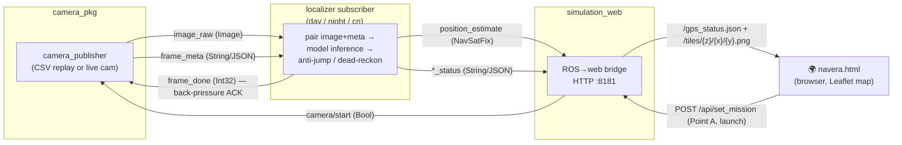
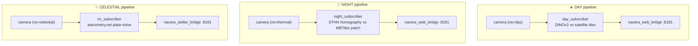
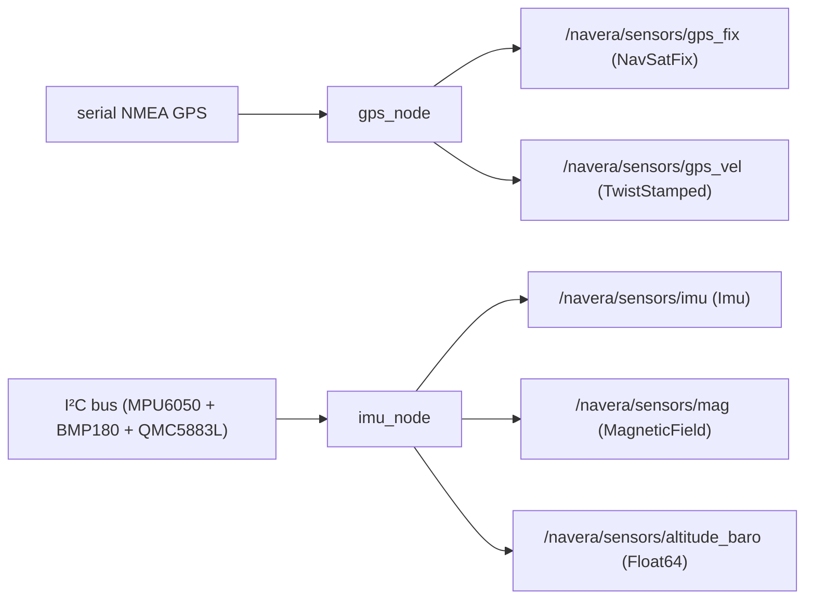
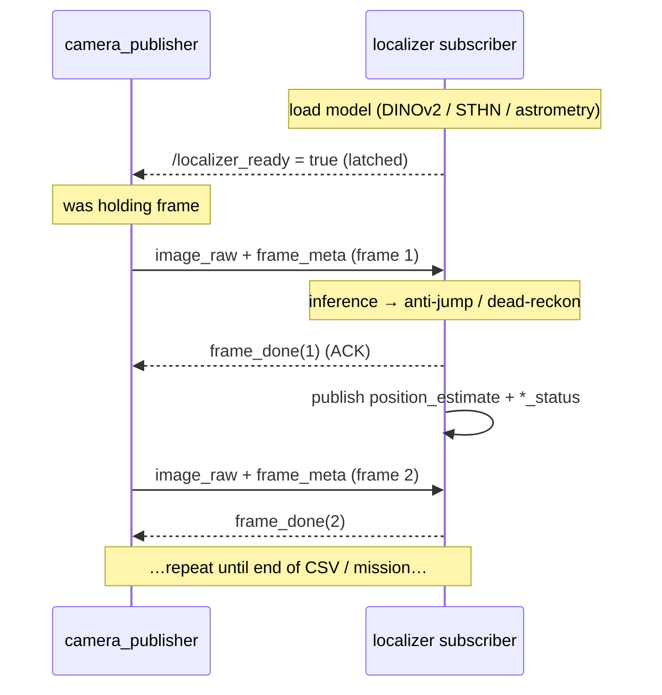
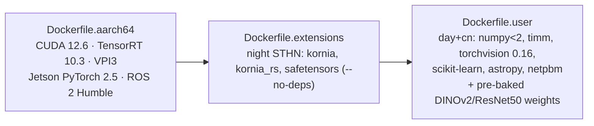

<div align="center">

# 🛰️ NAVERA — Full Project Documentation

**GPS‑denied autonomous drone localization on NVIDIA Jetson Orin Nano**
*Isaac ROS · ROS 2 Humble · DINOv2 · STHN · astrometry.net*

`Day (satellite vision)` · `Night (thermal / STHN)` · `Celestial (star plate‑solving)` · `+ dead‑reckoning fallback`

</div>

---

## TL;DR

NAVERA estimates a drone's **latitude/longitude when GPS is jammed or unavailable**, using three independent localization pipelines plus hardware sensor drivers and a live web map. Everything runs inside an **Isaac ROS / ROS 2 Humble** Docker container on a **Jetson Orin Nano**. Mission area: **Sousse, Tunisia** (`sousse_satellite.mbtiles`, ~10 GB, zoom 17).

```bash
# Inside the container, from /workspaces/isaac_ros-dev:
source /opt/ros/humble/setup.bash
colcon build --packages-select camera_pkg day_pkg night_pkg cn_pkg gps_pkg imu_pkg simulation_web
source install/setup.bash

# Run a full pipeline (camera → localizer → web), then open http://<jetson-ip>:8181/
ros2 launch simulation_web day_sim.launch.py     # daytime visual localization
ros2 launch simulation_web night_sim.launch.py   # nighttime thermal (STHN)
ros2 launch simulation_web cn_sim.launch.py       # celestial / star navigation
```

---

## Table of Contents

1. [What NAVERA Is](#1-what-navera-is)
2. [Repository Layout](#2-repository-layout)
3. [System Architecture](#3-system-architecture)
4. [The Three Localization Pipelines](#4-the-three-localization-pipelines)
5. [The Camera ⇄ Localizer Protocol (handshake & back‑pressure)](#5-the-camera--localizer-protocol)
6. [Complete ROS Topic Graph](#6-complete-ros-topic-graph)
7. [Package Reference](#7-package-reference)
   - [7.1 camera_pkg](#71-camera_pkg--frame-source) · [7.2 day_pkg](#72-day_pkg--daytime-visual-localization) · [7.3 night_pkg](#73-night_pkg--nighttime-thermal-localization-sthn) · [7.4 cn_pkg](#74-cn_pkg--celestial--stellar-navigation) · [7.5 gps_pkg](#75-gps_pkg--hardware-gps-driver) · [7.6 imu_pkg](#76-imu_pkg--hardware-imu--baro--mag-driver) · [7.7 simulation_web](#77-simulation_web--web-visualization-bridges) · [7.8 vision_pkg (legacy)](#78-vision_pkg--legacy-prototype)
8. [Docker Environment](#8-docker-environment)
9. [Build & Run — Command Cheat‑Sheet](#9-build--run--command-cheat-sheet)
10. [End‑to‑End Run Recipes](#10-end-to-end-run-recipes)
11. [Testing, Replay & Debugging](#11-testing-replay--debugging)
12. [Key Algorithms Explained](#12-key-algorithms-explained)
13. [Data Files & Assets](#13-data-files--assets)
14. [Troubleshooting](#14-troubleshooting)
15. [Appendix — Ports & Entry Points](#15-appendix--ports--entry-points)

---

## 1. What NAVERA Is

NAVERA is an autonomous drone navigation stack whose single mission is: **produce a reliable position fix without GPS.** It does this with three complementary techniques, each suited to different conditions, all falling back to dead reckoning when confidence is low.

| Pipeline | When used | Technique | Result topics |
|----------|-----------|-----------|---------------|
| ☀️ **Day** | Daytime flight | Match camera frames to satellite imagery with **DINOv2** deep descriptors (NetVLAD present but diagnostic only) | `/day/*` |
| 🌙 **Night** | Night / thermal | **STHN** (Spatial‑Temporal Homography Network) aligns thermal frame to a satellite patch | `/night/*` |
| ✨ **Celestial** | Clear night sky | **astrometry.net** plate‑solves the star field → RA/Dec → ground lat/lon via spherical trig | `/cn/*` |

Plus always‑on **hardware drivers**: `gps_pkg` (serial NMEA GPS) and `imu_pkg` (I²C IMU + barometer + magnetometer), and a **web dashboard** (`simulation_web` → `navera.html`) that shows the drone live on a Leaflet satellite map.

**Design philosophy**
- **Pure pub/sub** — no ROS services or actions anywhere.
- **Anchor + fallback** — each localizer keeps the last trusted position ("anchor"); GPS‑valid frames pass through, GPS‑denied frames trigger model inference inside a spatial window around the anchor, and failures dead‑reckon.
- **Back‑pressure** — the camera waits for an ACK per frame so slow GPU inference never drops frames.
- **Edge‑first** — fp16 inference, weight pre‑baking, patch‑size tuning to fit the Orin Nano's 8 GB.

---

## 2. Repository Layout

This repo is a fork of NVIDIA `isaac_ros_common`. The **NAVERA application** is the `*_pkg` packages + `simulation_web` + `docker/`. Everything else (`isaac_ros_*`, `torch_jetson/`, `torchgen/`, `functorch/`, `.venv/`, `build/`, `install/`, `log/`) is vendored or generated.

```
isaac_ros_common/
├── camera_pkg/          # Frame publisher — CSV replay or live CSI/USB camera
├── day_pkg/             # ☀️ Daytime visual localization (DINOv2 + NetVLAD)
├── night_pkg/           # 🌙 Nighttime thermal localization (STHN) + embedded STHN/ repo
├── cn_pkg/              # ✨ Celestial navigation (astrometry.net plate-solving)
├── gps_pkg/             # Hardware GPS driver (serial NMEA → NavSatFix/TwistStamped)
├── imu_pkg/             # Hardware IMU/baro/mag driver (I²C → Imu/MagneticField/Float64)
├── simulation_web/      # ROS→web bridges + Leaflet dashboard (navera.html)
├── vision_pkg/          # LEGACY prototype (superseded by day_pkg/night_pkg)
├── docker/              # Dockerfiles: base aarch64 + NAVERA extensions/user layers
├── scripts/             # run_dev.sh, build_image_layers.sh, docker_deploy.sh
├── replay_mission.py    # Mission replay / GPS-loss simulator
├── start_navera.sh      # Launch the NAVERA container
├── setup_night_deps.sh  # One-time pip install of night deps inside container
├── sousse_satellite.mbtiles            # 10 GB satellite tile DB (zoom 17, Sousse TN)
├── ROS_TOPICS_AND_COMMUNICATION.md     # (existing) canonical topic graph
└── VISUAL_LOCALIZATION_SUMMARY.md      # (existing) day-pipeline narrative
```

Every ROS 2 package uses the standard `ament_python` layout:

```
<pkg>/
├── <pkg>/
│   ├── nodes/        # Python node implementations
│   ├── launch/       # *.launch.py files
│   └── data|dataset/ # CSVs, configs, descriptor caches
├── setup.py          # console_scripts → the `ros2 run` executable names
├── package.xml       # dependencies
└── test/             # flake8 / pep257 / copyright lint
```

---

## 3. System Architecture

Every pipeline is the **same 4‑stage chain**, differing only by namespace and the localizer used:



**Key facts**
- **Only one pipeline runs at a time**; all three serve the browser on the **same port 8181** (you pick the mode in the UI).
- The bridge also serves **satellite tiles** straight out of the MBTiles SQLite DB (`/tiles/{z}/{x}/{y}.png`, with the TMS y‑flip `tile_row = 2^z − 1 − y`).
- The browser uses **plain HTTP polling** (`/gps_status.json` every 500 ms) — no websockets.

---

## 4. The Three Localization Pipelines



| Pipeline | Camera ns | Localizer node | Result ns | Web bridge | Launch |
|----------|-----------|----------------|-----------|------------|--------|
| ☀️ Day | `/day` | `day_subscriber` | `/day` | `navera_web_bridge.py` | `day_sim.launch.py` |
| 🌙 Night | `/thermal` | `night_subscriber` | `/night` | `navera_web_bridge.py` | `night_sim.launch.py` |
| ✨ Celestial | `/celestial` | `cn_subscriber` | `/cn` | `navera_stellar_bridge.py` | `cn_sim.launch.py` |

**Hardware sensors** run independently of the pipelines:



---

## 5. The Camera ⇄ Localizer Protocol

This is the heart of why NAVERA never drops a frame during heavy GPU inference. Two mechanisms work together:

1. **Ready handshake** — the localizer publishes `*/localizer_ready = true` (latched, `TRANSIENT_LOCAL`) only once its model is loaded. The camera holds frame #1 until it sees this (`wait_for_ready:=true`).
2. **Back‑pressure ACK** — after processing each frame the localizer publishes `*/frame_done` (`Int32` frame_id). With `flow_control:=ack`, the camera waits for the ACK before sending the next frame.



> ⚠️ **Night safety behavior:** if STHN weights fail to load, `night_subscriber` logs a **FATAL** and never publishes `localizer_ready` — so the camera deliberately waits forever at "Point A" rather than flying blind.

---

## 6. Complete ROS Topic Graph

`<ns>` = `day` | `thermal` | `celestial` (camera namespace).

| Topic | Message Type | Published by | Subscribed by | QoS |
|-------|--------------|--------------|---------------|-----|
| `/<ns>/image_raw` | `sensor_msgs/Image` | camera_publisher | day/night/cn subscriber | RELIABLE, depth 1 |
| `/<ns>/camera_info` | `sensor_msgs/CameraInfo` | camera_publisher | — | RELIABLE, depth 1 |
| `/<ns>/gps` | `sensor_msgs/NavSatFix` | camera_publisher | — | BEST_EFFORT, depth 10 |
| `/<ns>/frame_meta` | `std_msgs/String` (JSON) | camera_publisher | day/night/cn subscriber | RELIABLE, depth 10 |
| `/<ns>/camera/start` | `std_msgs/Bool` | web bridge / UI | camera_publisher | RELIABLE, TRANSIENT_LOCAL |
| `/day/frame_done` | `std_msgs/Int32` | day_subscriber | camera_publisher | RELIABLE, depth 1 |
| `/day/position_estimate` | `sensor_msgs/NavSatFix` | day_subscriber | navera_web_bridge | depth 10 |
| `/day/day_status` | `std_msgs/String` (JSON) | day_subscriber | navera_web_bridge | depth 10 |
| `/day/localizer_ready` | `std_msgs/Bool` | day_subscriber | camera_publisher | latched |
| `/thermal/frame_done` | `std_msgs/Int32` | night_subscriber | camera_publisher | RELIABLE, depth 1 |
| `/night/position_estimate` | `sensor_msgs/NavSatFix` | night_subscriber | navera_web_bridge | depth 10 |
| `/night/night_status` | `std_msgs/String` (JSON) | night_subscriber | navera_web_bridge | depth 10 |
| `/night/localizer_ready` | `std_msgs/Bool` | night_subscriber | camera_publisher | latched |
| `/cn/position_estimate` | `sensor_msgs/NavSatFix` | cn_subscriber | navera_stellar_bridge | depth 10 |
| `/cn/cn_status` | `std_msgs/String` (JSON) | cn_subscriber | navera_stellar_bridge | depth 10 |
| `/celestial/camera/start` | `std_msgs/Bool` | navera_stellar_bridge | camera_publisher | RELIABLE |
| `/navera/sensors/gps_fix` | `sensor_msgs/NavSatFix` | gps_node | — | depth 10 |
| `/navera/sensors/gps_vel` | `geometry_msgs/TwistStamped` | gps_node | — | depth 10 |
| `/navera/sensors/imu` | `sensor_msgs/Imu` | imu_node | — | depth 10 |
| `/navera/sensors/mag` | `sensor_msgs/MagneticField` | imu_node | — | depth 10 |
| `/navera/sensors/altitude_baro` | `std_msgs/Float64` | imu_node | — | depth 10 |

### Message payloads

**`frame_meta` (String/JSON)** — published by camera_pkg:
```json
{
  "frame_id": 123,
  "gps_valid": false,
  "lat": 35.8289, "lon": 10.6360,        // null when gps_valid=false
  "altitude_m": 400.0,
  "heading_deg": 92.0,
  "speed_mps": 10.0,
  "timestamp": 1717570000.5,
  "image_file": "frame_0123.jpg",
  "camera_type": "day",
  "tilt": 75.46, "azimuth": 283.18, "utc_time": "2026-03-10 20:20:00"  // celestial only
}
```

**`day_status` (String/JSON)** — typical:
```json
{ "frame_id": 123, "success": true, "lat": 35.8291, "lon": 10.6361,
  "score": 0.82, "match": "tile_17_x_y.jpg", "source": "predicted",
  "jump_m": 31.2, "reason": null, "total_ms": 41.5 }
```
`source` ∈ `gps` · `predicted` · `dead_reckon` (night also: `night_sthn`; celestial: `stellar`).

---

## 7. Package Reference

### 7.1 camera_pkg — frame source

Generic frame publisher. Replays a **CSV + images** dataset, or streams a **live Jetson CSI / USB** camera. Same node serves day, thermal and celestial — only the namespace/config differs. Implements GPS validity, the ready handshake, and ACK back‑pressure.

- **Node:** `camera_publisher` (in namespace `day` / `thermal` / `celestial`)
- **Run:** `ros2 run camera_pkg camera_publisher.py`
- **Launch:** `all_cameras.launch.py`, `day.launch.py`, `thermal.launch.py`, `celestial.launch.py`

**Publishes** (under namespace): `image_raw` (Image), `camera_info` (CameraInfo), `gps` (NavSatFix), `frame_meta` (String JSON).
**Subscribes:** `camera/start` (Bool gate), `<ack_topic>`=`frame_done` (Int32), `<ready_topic>` (Bool).

**Key parameters**

| Param | Default | Meaning |
|-------|---------|---------|
| `camera_type` | "generic" | thermal / celestial / day |
| `topic_ns` | "camera" | namespace for all topics |
| `source` | "csv" | "csv" replay or "camera" live |
| `fps` | 0.1 | publish rate (Hz) |
| `loop` | false | loop CSV at EOF |
| `default_gps_valid` | true | force GPS validity (false for thermal/celestial) |
| `start_paused` | false | wait for `camera/start` before streaming |
| `flow_control` | "rate" | "rate" (fixed fps) or "ack" (wait for frame_done) |
| `ack_topic` | "frame_done" | back‑pressure ACK topic |
| `ack_timeout_s` | 30.0 | continue if no ACK |
| `wait_for_ready` | false | hold frame #1 until `ready_topic`=true |
| `ready_topic` | "/day/localizer_ready" | handshake topic |
| `csv_path` / `images_dir` | "" | replay dataset |
| `camera_kind` | "csi" | "csi" (`nvarguscamerasrc`) or "usb" (`/dev/videoN`) |
| `sensor_id` / `device` | 0 / `/dev/video0` | CSI id / USB device |
| `width` / `height` | 1280 / 720 | resolution |
| `image_encoding` | "bgr8" | bgr8 / mono8 / mono16 |

**Examples**
```bash
ros2 launch camera_pkg all_cameras.launch.py
ros2 launch camera_pkg day.launch.py csv_path:=/path/day.csv images_dir:=/path/day fps:=0.5
# Live USB camera:
ros2 run camera_pkg camera_publisher.py --ros-args -p source:=camera -p camera_kind:=usb -p device:=/dev/video0
```

---

### 7.2 day_pkg — daytime visual localization

Matches drone frames against satellite tiles using deep descriptors. **DINOv2 ViT‑S/14** is the active backbone; NetVLAD is present but untrained (diagnostic only).

- **Run:** `ros2 run day_pkg day_subscriber.py` · **Launch:** `ros2 launch day_pkg day_subscriber.launch.py`

| File | Role |
|------|------|
| `day_subscriber.py` | **ROS2 node** `day_subscriber` — pairs image+meta, runs the localizer, anti‑jump filter, publishes. |
| `day_localizer.py` | `DayLocalizer` library — loads DINOv2, builds/loads descriptor cache, `predict()`. |
| `day_node.py` | Optional HTTP tile proxy (:8181) + subprocess manager. |
| `receiver_aonly.py` | Standalone Flask (:5000) — MBTiles pre‑collection + FMC matching (NetVLAD+DINOv2+GPS). |
| `mbtiles_extractor.py` | Offline utility — dump zoom‑17 tiles → JPEG + `dataset.csv`. |

**Topics** — subscribes `/day/image_raw`, `/day/frame_meta`; publishes `/day/position_estimate`, `/day/day_status`, `/day/frame_done`, `/day/localizer_ready`.

**Parameters**

| Param | Default | Meaning |
|-------|---------|---------|
| `conf_threshold` | 0.75 | min DINOv2 cosine similarity to accept |
| `antijump_enabled` | true | motion‑model gate + smoothing |
| `antijump_margin` | 3.0 | gate budget multiplier (× speed·dt) |
| `antijump_min_step_m` | 120.0 | min dead‑reckon step |
| `antijump_alpha` | 0.4 | exponential smoothing factor |

**Algorithm** — (1) GPS‑valid → pass through, update anchor; (2) GPS‑denied → search radius `R = clamp(max(footprint·3, altitude·2), 400, 600) m` around anchor, DINOv2 cosine over in‑circle tiles; (3) anti‑jump gate + α‑smoothing; (4) empty circle / rejected → dead reckon; (5) **always** ACK `frame_done`.

**Deps:** torch, torchvision, timm, opencv, numpy, pandas, scikit‑learn (Flask only for `receiver_aonly.py`).

---

### 7.3 night_pkg — nighttime thermal localization (STHN)

Estimates a homography between a thermal frame and a stitched satellite patch using **STHN** (embedded under `night_pkg/STHN/`).

- **Run:** `ros2 run night_pkg night_subscriber.py` · **Launch:** `ros2 launch night_pkg night_subscriber.launch.py`

| File | Role |
|------|------|
| `night_subscriber.py` | **ROS2 node** `night_subscriber` — same pattern as day; STHN inference + dead‑reckon. |
| `night_localizer.py` | `NightLocalizer` — dynamic STHN import (mocks heavy deps), 3×3 MBTiles patch, forward pass, 4‑corner homography → lat/lon, confidence gate, rolling average. |
| `night_receiver.py` | Flask server (:5001) for `navera.html` night mode; async worker thread. |
| `patch_localizer.py` / `patch_receiver.py` | Legacy patch scripts (fixes already baked into current code). |
| `test_night_standalone.py` | CLI test harness (synthetic or real frame). |

**Topics** — subscribes `/thermal/image_raw`, `/thermal/frame_meta`; publishes `/night/position_estimate`, `/night/night_status`, `/thermal/frame_done`, `/night/localizer_ready`.

**Parameters**

| Param | Default | Meaning |
|-------|---------|---------|
| `sthn_dir` | `…/night_pkg/STHN` | STHN repo path |
| `weights` | `…/STHN/weights/one_stage/model.safetensors` | checkpoint (.safetensors / .pth) |
| `mbtiles` | `…/vision_pkg/.../sousse_satellite.mbtiles` | satellite tiles |
| `zoom` | 17 | MBTiles zoom |
| `patch_size` | 512 (sim launch uses **256** to avoid OOM) | patch resolution |
| `conf_threshold` | 0.30 | confidence floor |
| `mixed_precision` | "true" | fp16 forward pass (saves VRAM) |
| `dr_step_min_m` | 120.0 | dead‑reckon min step |

**Algorithm** — (1) lat/lon → tile, read 3×3 = 768×768 MBTiles mosaic (TMS y‑flip), center‑crop to `patch_size`; (2) preprocess query+patch (square crop, resize, RGB, ImageNet normalize); (3) STHN forward → 4 corner offsets, `conf = clip(1 − rms_px/(patch_size·0.3), 0, 1)`; (4) conf ≥ threshold → corner displacement to Δlat/Δlon (metres‑per‑pixel), Bing↔ESRI bias correction, 5‑frame rolling average, publish; else dead reckon.

**Deps:** torch, **kornia / kornia_rs**, safetensors, opencv, numpy (installed by `docker/Dockerfile.extensions`).

**Standalone usage**
```bash
# Flask backend (legacy web mode):
python3 night_pkg/night_pkg/nodes/night_receiver.py --sthn-dir night_pkg/STHN \
    --weights night_pkg/STHN/weights/one_stage/model.safetensors \
    --mbtiles vision_pkg/vision_pkg/dataset/sousse_satellite.mbtiles --port 5001
# No-ROS test:
python3 night_pkg/test_night_standalone.py --sthn-dir night_pkg/STHN \
    --weights night_pkg/STHN/weights/one_stage/model.safetensors \
    --mbtiles vision_pkg/vision_pkg/dataset/sousse_satellite.mbtiles \
    --lat 35.8288 --lon 10.6360 --n 3
```

---

### 7.4 cn_pkg — celestial / stellar navigation

Determines ground position from a night‑sky image: detect stars → **astrometry.net `solve-field`** → RA/Dec → combine with tilt + azimuth + UTC → spherical trig → lat/lon.

- **Run:** `ros2 run cn_pkg cn_subscriber.py` · **Launch:** `ros2 launch cn_pkg cn_subscriber.launch.py`

| File | Role |
|------|------|
| `cn_subscriber.py` | **ROS2 node** `cn_subscriber` — pairs image+meta, calls solver, validates `match_score ≥ conf_threshold`, publishes. |
| `drone_sky_prep.py` | Full pipeline: Siril background subtraction → solve‑field → tilt self‑consistency scan → spherical geometry → prints a result table. |
| `solver.py` | `solve_image_b64()` (rough WCS RA/Dec) and `solve_image_b64_geoloc(b64, tilt, az, utc)` (true ground fix). |
| `celestial_node.py` | Minimal HTTP server (:5002), `/frame` POST → JSON position (non‑ROS clients). |
| `receiver_stellar.py` | Flask server (:5001) — saves images, writes `gps_status.json`, broadcasts to bridge. |
| `data/astrometry.cfg` | solve‑field config: `add_path /usr/share/astrometry`, `autoindex`, Tycho‑2 indexes, `cpulimit 300`. |

**Topics** — subscribes `/celestial/image_raw`, `/celestial/frame_meta`; publishes `/cn/position_estimate`, `/cn/cn_status` (includes `ra_deg`, `dec_deg`).

**Parameters:** `conf_threshold` 0.30 · `solver_mode` "geoloc" (full) or "wcs" (rough) · default `tilt` 75.46 · `azimuth` 283.18 · `utc_time` "2026-03-10 20:20:00".

**External tools (inside container):** `astrometry.net` (`/usr/local/astrometry/bin/solve-field` + Tycho‑2 indexes in `/usr/share/astrometry`), `astropy`, `Siril` (optional, PIL fallback), `netpbm`. Typical solve: 12–30 s (manual tilt), up to 60 s (auto tilt scan).

**Standalone**
```bash
python3 cn_pkg/cn_pkg/nodes/drone_sky_prep.py sky.jpeg 2026-03-10 20:20:00 75.46 283.18
python3 cn_pkg/cn_pkg/nodes/receiver_stellar.py     # Flask :5001
```

---

### 7.5 gps_pkg — hardware GPS driver

Reads NMEA from serial and publishes ROS messages.

```bash
ros2 run gps_pkg gps_node.py
ros2 launch gps_pkg gps.launch.py serial_port:=/dev/ttyUSB0 baud_rate:=115200
```

- **Node:** `gps_node` · **Params:** `serial_port` (`/dev/ttyTHS1` Jetson UART), `baud_rate` (9600).
- **Publishes:** `/navera/sensors/gps_fix` (NavSatFix from GGA, covariance from HDOP), `/navera/sensors/gps_vel` (TwistStamped from RMC, knots→m/s ×0.5144).
- **Deps:** pyserial, pynmea2.

---

### 7.6 imu_pkg — hardware IMU + baro + mag driver

Reads three I²C sensors and publishes IMU + magnetometer + barometric altitude.

```bash
ros2 run imu_pkg imu_node.py
ros2 launch imu_pkg imu.launch.py i2c_bus:=7 publish_rate:=10.0
```

- **Node:** `imu_node` · **Params:** `i2c_bus` (7 — Orin Nano pins 3/5), `publish_rate` (10 Hz).
- **Sensors:** MPU6050 accel/gyro (0x68), BMP180 barometer (0x77), QMC5883L magnetometer (0x0D).
- **Publishes:** `/navera/sensors/imu` (Imu), `/navera/sensors/mag` (MagneticField), `/navera/sensors/altitude_baro` (Float64).
- **Deps:** smbus2.

---

### 7.7 simulation_web — web visualization bridges

Subscribes to localizer results and serves the Leaflet dashboard + satellite tiles over HTTP (browser polls JSON; no websockets).

```bash
ros2 run simulation_web navera_web_bridge.py       # day & night bridge  (HTTP :8181)
ros2 run simulation_web navera_stellar_bridge.py   # celestial bridge    (HTTP :8181)
ros2 run simulation_web server.py                  # static-only test server (:8080)
```

**`navera_web_bridge.py`** (day/night) — subscribes `/day/day_status` (or `/night/night_status`) + `/day/position_estimate` (or `/night/...`); publishes `/day/camera/start`. HTTP server :8181 exposes:

| Endpoint | Method | Purpose |
|----------|--------|---------|
| `/` , `/navera.html` | GET | dashboard UI |
| `/gps_status.json` | GET | latest position (polled every 500 ms) |
| `/tiles/{z}/{x}/{y}.png` | GET | MBTiles tile (TMS y‑flip) |
| `/api/set_mission` | POST | store Point A, trigger camera start |
| `/api/cache_status`, `/api/precollect*`, `/health` | GET/POST | stubs / health |

**`navera_stellar_bridge.py`** (celestial) — identical, but subscribes `/cn/cn_status` + `/cn/position_estimate`, publishes `/celestial/camera/start`, and the JSON includes `ra_deg`/`dec_deg`.

**Launch files & ports**

| Launch file | Starts | Web port |
|-------------|--------|----------|
| `day_sim.launch.py` | camera(day) + day_subscriber + navera_web_bridge | 8181 |
| `night_sim.launch.py` | camera(thermal) + night_subscriber + navera_web_bridge | 8181 |
| `cn_sim.launch.py` | camera(celestial) + cn_subscriber + navera_stellar_bridge | 8181 |
| `simulation_web.launch.py` | static server only | 8080 |

**Resources:** `navera.html` (~161 KB — mission planner, Leaflet map, telemetry HUD), `navera_IMPROVED.html`, Leaflet assets. Endpoints derive from `window.location` (host:8181); optional night‑fusion endpoint is `:8182`.

---

### 7.8 vision_pkg — legacy prototype

> ⚠️ **Superseded by day_pkg / night_pkg.** Kept for reference. The original single‑Flask‑server prototype that pioneered the visual‑localization + GPS‑loss ideas now split into ROS packages.

Worth keeping in mind:
- **Non‑blocking GPS‑loss design** — on GPS loss return a dead‑reckoned position in ~1 ms, run GPU visual matching async (≤5 s timeout), update the navigator when the match lands.
- **Dual model** DINOv2‑S / NetVLAD switchable at runtime: `POST /api/gpu_config {"model":"netvlad"}`.
- **GPU tuning** (Orin Nano): `BATCH_SIZE` 32 (cuda) / 8 (cpu), fp16, `torch.cuda.set_per_process_memory_fraction(0.8)`, CUDA streams; ~3–8× over CPU.
- Files: `vision_pkg/vision_pkg/{server.py, receiver.py, gps_localizer.py, vision_node.py, navera.html}`; docs `GPS_LOSS_HANDLING.md`, `GPU_OPTIMIZATION_GUIDE.md`, `QUICK_START.md`.

---

## 8. Docker Environment

Everything runs in an **Isaac ROS / ROS 2 Humble** container. The image is built in three layers:



**Config** (`.isaac_ros_common-config`): `CONFIG_IMAGE_KEY=ros2_humble`.

| Dockerfile | Purpose |
|------------|---------|
| `Dockerfile.aarch64` | Base: CUDA 12.6 devel, TensorRT 10.3, VPI3, cuDSS, CV‑CUDA, NVIDIA Jetson PyTorch 2.5 wheel, Triton, ROS 2 Humble. |
| `Dockerfile.extensions` | `pip install --no-deps kornia kornia_rs safetensors` (no‑deps preserves the Jetson torch). |
| `Dockerfile.user` | `numpy<2`, `timm` (no‑deps), `torchvision==0.16.0` (no‑deps), scikit‑learn, huggingface_hub, astropy, `netpbm`, `libgsl27`; **pre‑bakes DINOv2 + ResNet50 weights** into `/opt/torch_cache` so they aren't re‑downloaded each start. |

**Launch the dev container**
```bash
cd /home/navera/isaac_ros_common
./scripts/run_dev.sh -d /home/navera/isaac_ros_common
# runs --privileged --network host --ipc=host --runtime nvidia with Jetson devices,
# X11 forwarding, and mounts the repo at /workspaces/isaac_ros-dev
```

**NAVERA dedicated container**
```bash
./start_navera.sh
# docker run --runtime nvidia --privileged
#   --device /dev/nvmap --device /dev/nvhost-ctrl --device /dev/nvhost-gpu
#   -v /home/navera/isaac_ros_common:/workspaces/isaac_ros-dev
#   -v .../.torch_cache:/root/.cache/torch -p 5000:5000
#   navera_isaac_ros:stable bash
```

**One‑time deps if container recreated**
```bash
./setup_night_deps.sh   # pip install flask flask-cors numpy opencv-python
```

---

## 9. Build & Run — Command Cheat‑Sheet

> Run **inside the container**, from `/workspaces/isaac_ros-dev` (= repo root).

```bash
# ── Build ───────────────────────────────────────────────────────────────
source /opt/ros/humble/setup.bash
colcon build --packages-select camera_pkg day_pkg night_pkg cn_pkg gps_pkg imu_pkg simulation_web
# or: colcon build --symlink-install        # build everything
source install/setup.bash

# ── Run individual nodes ────────────────────────────────────────────────
ros2 run camera_pkg camera_publisher.py
ros2 run day_pkg     day_subscriber.py
ros2 run night_pkg   night_subscriber.py
ros2 run cn_pkg      cn_subscriber.py
ros2 run gps_pkg     gps_node.py
ros2 run imu_pkg     imu_node.py
ros2 run simulation_web navera_web_bridge.py
ros2 run simulation_web navera_stellar_bridge.py

# ── Inspect ─────────────────────────────────────────────────────────────
ros2 topic list
ros2 topic echo /day/day_status
ros2 topic echo /day/position_estimate
ros2 topic hz   /day/image_raw
ros2 node  list
ros2 param list /day_subscriber
```

---

## 10. End‑to‑End Run Recipes

Each launches the full chain; then open **`http://<jetson-ip>:8181/`**, pick the mode, place Point A, and launch.

```bash
# ── ☀️ DAY ──────────────────────────────────────────────────────────────
ros2 launch simulation_web day_sim.launch.py \
    conf_threshold:=0.75 antijump_enabled:=true web_port:=8181

# ── 🌙 NIGHT (thermal / STHN) ────────────────────────────────────────────
ros2 launch simulation_web night_sim.launch.py \
    conf_threshold:=0.30 patch_size:=256 mixed_precision:=true \
    cuda_visible_devices:=0 web_port:=8181
#   patch_size:=256 avoids NvMap OOM on Orin Nano 8 GB; cuda_visible_devices:='' forces CPU

# ── ✨ CELESTIAL ─────────────────────────────────────────────────────────
ros2 launch simulation_web cn_sim.launch.py \
    solver_mode:=geoloc tilt:=75.46 azimuth:=283.18 \
    utc_time:="2026-03-10 20:20:00" conf_threshold:=0.30 web_port:=8181
```

**Manual day run (3 terminals)**
```bash
# T1 camera
ros2 launch camera_pkg day.launch.py wait_for_ready:=true flow_control:=ack
# T2 localizer
ros2 launch day_pkg day_subscriber.launch.py conf_threshold:=0.75
# T3 web bridge
ros2 run simulation_web navera_web_bridge.py
```

---

## 11. Testing, Replay & Debugging

```bash
# Standalone night STHN (no ROS)
python3 night_pkg/test_night_standalone.py \
    --sthn-dir night_pkg/STHN \
    --weights  night_pkg/STHN/weights/one_stage/model.safetensors \
    --mbtiles  vision_pkg/vision_pkg/dataset/sousse_satellite.mbtiles \
    --lat 35.8288 --lon 10.6360 --n 3

# Standalone celestial solve
python3 cn_pkg/cn_pkg/nodes/drone_sky_prep.py sky.jpeg 2026-03-10 20:20:00 75.46 283.18

# Mission replay / GPS-loss simulator (against legacy Flask receiver on :5000)
python3 replay_mission.py mission.zip \
    --url    http://localhost:5000/frame \
    --status http://localhost:5000/gps_status.json \
    --speed 1.0 --poll 0.3 --timeout 30

# Lint tests
colcon test --packages-select day_pkg
```

`mission.zip` = `flight_log.csv` + `frame_*.jpg`. The replayer **blocks** at each GPS‑loss frame, polls `/gps_status.json` until a visual prediction lands, and reports per‑frame CV latency (min/avg/max).

---

## 12. Key Algorithms Explained

**Dead reckoning** (all pipelines — the universal fallback)
```
d    = max(speed_mps · dt, min_step_m)         # floor avoids a zero step
dlat = d·cos(heading) / 111320
dlon = d·sin(heading) / (111320·cos(lat))
new  = (lat + dlat, lon + dlon)
```

**Day — spatial‑prior DINOv2 retrieval**
- Radius `R = clamp(max(footprint·3, altitude·2), 400, 600)` m around the anchor.
- Filter tiles to within `R` (Haversine), rank by DINOv2 cosine similarity, take top‑1.
- Anti‑jump gate (`speed·dt·margin`) + exponential smoothing (α = 0.4).

**Night — STHN homography → position**
- 4 normalized corner offsets → pixels → metres (`m/px = 156543.03·cos(lat)/2^zoom`) → Δlat/Δlon.
- Confidence from RMS corner displacement; reject below `conf_threshold`.
- Bing↔ESRI bias correction (~4 m N, ~5 m W) + 5‑frame rolling average.

**Celestial — plate‑solve → geolocation**
- `solve-field` returns RA/Dec of the field center plus a CD rotation matrix.
- Azimuth from CD matrix (`atan2(−CD1_2, CD2_2)` + calibration offset); tilt via 0.1°→0.001° self‑consistency scan when not provided.
- Spherical trig with Greenwich Sidereal Time: `HA = asin(−sin(az)·cos(alt)/cos(dec))`, then latitude from altitude/declination and longitude from `RA + HA − GST`.

---

## 13. Data Files & Assets

| File / dir | Purpose |
|------------|---------|
| `sousse_satellite.mbtiles` (~10 GB) | Satellite tile DB (SQLite, **TMS**, zoom 17) over Sousse, TN. Also mirrored under `vision_pkg/vision_pkg/dataset/`. |
| `<pkg>/.../dataset*/` | Extracted JPEG tiles + `dataset.csv` (filename, lat, lon) + `descriptors*.npz` (cached DINOv2/NetVLAD). |
| `camera_pkg/.../data/{day,thermal,celestial}/` | Replay CSVs + frame images. |
| `flight_log.csv` | Per‑frame log: frame_id, ts, lat, lon, alt, heading, speed, gps_valid, predicted_lat/lon, match_score. |
| `gps_status.json` | Latest localization status shared between solver and web bridge. |
| `model_cache/`, `.torch_cache/` | Downloaded model weights (mounted persistent). |
| `night_pkg/STHN/weights/` | STHN checkpoints (`.safetensors` / `.pth`). |
| `cn_pkg/.../astrometry.cfg` | astrometry.net index path + solver limits. |
| `mission.zip` | Sample mission for `replay_mission.py`. |

> **MBTiles note:** the DB is **TMS** (y‑axis inverted). Everywhere tiles are served the y is flipped to XYZ: `tile_row = 2^z − 1 − y`.

---

## 14. Troubleshooting

| Symptom | Likely cause / fix |
|---------|--------------------|
| Camera never sends frame #1 | Localizer never published `*/localizer_ready`. For night, check the **FATAL** log — STHN weights failed to load. Verify `weights` / `sthn_dir`. |
| Night node OOM on Orin Nano | `patch_size:=256`, `mixed_precision:=true`, `CUDA_ALLOC_CONF=expandable_segments:True`. |
| Day model re‑downloads each start | Ensure `Dockerfile.user` pre‑baked weights exist; mount `model_cache/` / `.torch_cache/`. |
| `numpy 2.x` import errors (torchvision) | Build pins `numpy<2`; night code also mocks torchvision. Reinstall `numpy<2`. |
| Celestial solve fails / 0 indexes | `astrometry.cfg` must point to `/usr/share/astrometry` **inside the container**; install the Tycho‑2 index package. |
| No GPU detected | `python3 -c "import torch; print(torch.cuda.is_available())"`; run with `--runtime nvidia`. |
| Web map blank | Check `sousse_satellite.mbtiles` path; tile 404s show in bridge logs. |
| Flask missing in fresh container | Run `./setup_night_deps.sh` once. |

---

## 15. Appendix — Ports & Entry Points

**HTTP ports**

| Port | Served by | Role |
|------|-----------|------|
| 8181 | `navera_web_bridge` / `navera_stellar_bridge` | main dashboard + tiles + status (one mode at a time) |
| 8182 | (optional) | night fusion endpoint referenced by `navera.html` |
| 8080 | `server.py` / `simulation_web.launch.py` | static‑only test server |
| 5000 | `day_pkg/receiver_aonly.py`, legacy `vision_pkg`, `start_navera.sh` exposed | day Flask backend / replay target |
| 5001 | `night_pkg/night_receiver.py`, `cn_pkg/receiver_stellar.py` | night & stellar Flask backends |
| 5002 | `cn_pkg/celestial_node.py` | celestial HTTP `/frame` endpoint |

**`ros2 run` executables** (exact `console_scripts` names)

| Package | Command |
|---------|---------|
| camera_pkg | `ros2 run camera_pkg camera_publisher.py` |
| day_pkg | `ros2 run day_pkg day_subscriber.py` |
| night_pkg | `ros2 run night_pkg night_subscriber.py` |
| cn_pkg | `ros2 run cn_pkg cn_subscriber.py` |
| gps_pkg | `ros2 run gps_pkg gps_node.py` |
| imu_pkg | `ros2 run imu_pkg imu_node.py` |
| simulation_web | `ros2 run simulation_web navera_web_bridge.py` · `navera_stellar_bridge.py` · `server.py` |

---

<div align="center">

*Consolidated reference for the NAVERA workspace.*
For the canonical per‑topic graph see **`ROS_TOPICS_AND_COMMUNICATION.md`**; for the day‑pipeline narrative see **`VISUAL_LOCALIZATION_SUMMARY.md`**.

</div>
