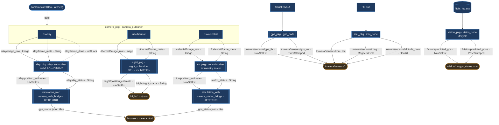

# NAVERA — ROS 2 Topics & Package/Node Communication

This document describes every ROS 2 package in the workspace, the nodes they
contain, and the topics those nodes publish and subscribe to. It also traces the
end-to-end data-flow chains between packages and the web UI.

All communication is **publish/subscribe** — no ROS 2 Services or Actions are
used anywhere in the workspace.

---

## 1. Overview — package roles

| Package | Role |
|---|---|
| `camera_pkg` | Frame source. Replays imagery (CSV / images) and publishes `image_raw`, `camera_info`, `gps`, `frame_meta` under a per-mode namespace (`/day`, `/thermal`, `/celestial`). |
| `day_pkg` | Daytime visual localizer (NetVLAD + DINOv2). Consumes `/day/*`, outputs a position estimate. |
| `night_pkg` | Night/thermal localizer (STHN homography vs. satellite MBTiles). Consumes `/thermal/*`. |
| `cn_pkg` | Celestial-navigation localizer (astrometry star solver). Consumes `/celestial/*`. |
| `gps_pkg` | Hardware GPS driver (serial NMEA → `NavSatFix` / `TwistStamped`). |
| `imu_pkg` | Hardware IMU/mag/baro driver (I²C → `Imu` / `MagneticField` / `Float64`). |
| `vision_pkg` | Lifecycle vision node; CSV-driven inference, writes `gps_status.json`. |
| `simulation_web` | HTTP bridges (`navera_web_bridge`, `navera_stellar_bridge`) that expose ROS state + map tiles to the browser UI. |

---

## 2. Topic catalog (all topics at a glance)

| Topic | Type | Published by | Subscribed by |
|---|---|---|---|
| `/<ns>/image_raw` | `sensor_msgs/Image` | `camera_publisher` | day/night/cn subscriber |
| `/<ns>/camera_info` | `sensor_msgs/CameraInfo` | `camera_publisher` | — |
| `/<ns>/gps` | `sensor_msgs/NavSatFix` | `camera_publisher` | — |
| `/<ns>/frame_meta` | `std_msgs/String` (JSON) | `camera_publisher` | day/night/cn subscriber |
| `/<ns>/camera/start` | `std_msgs/Bool` (latched) | (external / UI) | `camera_publisher` |
| `/day/frame_done` | `std_msgs/Int32` | `day_subscriber` | `camera_publisher` (ack) |
| `/day/position_estimate` | `sensor_msgs/NavSatFix` | `day_subscriber` | `navera_web_bridge` |
| `/day/day_status` | `std_msgs/String` (JSON) | `day_subscriber` | `navera_web_bridge` |
| `/night/position_estimate` | `sensor_msgs/NavSatFix` | `night_subscriber` | — |
| `/night/night_status` | `std_msgs/String` (JSON) | `night_subscriber` | — |
| `/cn/position_estimate` | `sensor_msgs/NavSatFix` | `cn_subscriber` | `navera_stellar_bridge` |
| `/cn/cn_status` | `std_msgs/String` (JSON) | `cn_subscriber` | `navera_stellar_bridge` |
| `/navera/sensors/gps_fix` | `sensor_msgs/NavSatFix` | `gps_node` | — |
| `/navera/sensors/gps_vel` | `geometry_msgs/TwistStamped` | `gps_node` | — |
| `/navera/sensors/imu` | `sensor_msgs/Imu` | `imu_node` | — |
| `/navera/sensors/mag` | `sensor_msgs/MagneticField` | `imu_node` | — |
| `/navera/sensors/altitude_baro` | `std_msgs/Float64` | `imu_node` | — |
| `/vision/predicted_gps` | `sensor_msgs/NavSatFix` | `vision_node` | — |
| `/vision/predicted_pose` | `geometry_msgs/PoseStamped` | `vision_node` | — |

`<ns>` is the camera namespace: `day`, `thermal`, or `celestial`.

---

## 3. Package details

### 3.1 `camera_pkg` — frame source
**Node:** `camera_publisher`
**File:** `camera_pkg/camera_pkg/nodes/camera_publisher.py`
**Namespace:** `/day`, `/thermal`, or `/celestial` (chosen by launch file)

**Publishes**
- `image_raw` — `sensor_msgs/Image` (bgr8) — QoS RELIABLE, depth 1
- `camera_info` — `sensor_msgs/CameraInfo` — QoS RELIABLE, depth 1
- `gps` — `sensor_msgs/NavSatFix` — depth 10
- `frame_meta` — `std_msgs/String` (JSON per-frame metadata) — depth 10

**Subscribes**
- `camera/start` — `std_msgs/Bool` — QoS RELIABLE + TRANSIENT_LOCAL (latched start/pause gate)
- `frame_done` — `std_msgs/Int32` — back-pressure ack (only when `flow_control == "ack"`; topic configurable via `ack_topic`)

**Launch files**
- `launch/day.launch.py` → namespace `day`
- `launch/thermal.launch.py` → namespace `thermal`
- `launch/celestial.launch.py` → namespace `celestial`

Parameters: `csv_path`, `images_dir`, `loop`, `fps`, `flow_control`.

---

### 3.2 `day_pkg` — daytime visual localizer
**Node:** `day_subscriber`
**File:** `day_pkg/day_pkg/nodes/day_subscriber.py`

**Subscribes**
- `/day/image_raw` — `sensor_msgs/Image` — RELIABLE, depth 10
- `/day/frame_meta` — `std_msgs/String` — RELIABLE, depth 10

**Publishes**
- `/day/position_estimate` — `sensor_msgs/NavSatFix`
- `/day/day_status` — `std_msgs/String` (JSON: success, score, match, lat, lon)
- `/day/frame_done` — `std_msgs/Int32` — RELIABLE, depth 1 (ack back to `camera_pkg`)

Key params: `conf_threshold` (0.75), anti-jump filter (`antijump_enabled`,
`antijump_margin`, `antijump_min_step_m`, `antijump_alpha`), plus topic-name overrides.

---

### 3.3 `night_pkg` — night/thermal localizer
**Node:** `night_subscriber`
**File:** `night_pkg/night_pkg/nodes/night_subscriber.py`

**Subscribes**
- `/thermal/image_raw` — `sensor_msgs/Image` — BEST_EFFORT, depth 10
- `/thermal/frame_meta` — `std_msgs/String` — RELIABLE, depth 10

**Publishes**
- `/night/position_estimate` — `sensor_msgs/NavSatFix`
- `/night/night_status` — `std_msgs/String` (JSON: success, conf, dt_ms, rms_px, raw_lat/lon)

Uses STHN homography against `sousse_satellite.mbtiles`. Key params: `sthn_dir`,
`weights`, `mbtiles`, `zoom` (17), `patch_size` (512), `conf_threshold` (0.30).
Concurrency: skip-if-busy (non-blocking lock).

---

### 3.4 `cn_pkg` — celestial navigation localizer
**Node:** `cn_subscriber`
**File:** `cn_pkg/cn_pkg/nodes/cn_subscriber.py`

**Subscribes**
- `/celestial/image_raw` — `sensor_msgs/Image` — BEST_EFFORT, depth 10
- `/celestial/frame_meta` — `std_msgs/String` — RELIABLE, depth 10

**Publishes**
- `/cn/position_estimate` — `sensor_msgs/NavSatFix`
- `/cn/cn_status` — `std_msgs/String` (JSON: success, ra_deg, dec_deg, lat, lon, match_score)

Astrometry star solver. Key params: `conf_threshold` (0.30), `solver_mode`
(`geoloc`/`wcs`), `tilt`, `azimuth`, `utc_time`. Concurrency: skip-if-busy.

---

### 3.5 `gps_pkg` — hardware GPS driver
**Node:** `gps_node`
**File:** `gps_pkg/gps_pkg/nodes/gps_node.py`

**Publishes**
- `/navera/sensors/gps_fix` — `sensor_msgs/NavSatFix` (from NMEA GGA)
- `/navera/sensors/gps_vel` — `geometry_msgs/TwistStamped` (from NMEA RMC)

Params: `serial_port` (`/dev/ttyTHS1`), `baud_rate` (9600). Reads on a background thread.

---

### 3.6 `imu_pkg` — hardware IMU / mag / baro driver
**Node:** `imu_node`
**File:** `imu_pkg/imu_pkg/nodes/imu_node.py`

**Publishes**
- `/navera/sensors/imu` — `sensor_msgs/Imu` (MPU6050 accel + gyro, 0x68)
- `/navera/sensors/mag` — `sensor_msgs/MagneticField` (QMC5883L, 0x0D)
- `/navera/sensors/altitude_baro` — `std_msgs/Float64` (BMP180, 0x77)

Params: `i2c_bus` (7), `publish_rate` (10 Hz). Timer-driven publishing.

---

### 3.7 `vision_pkg` — lifecycle vision node
**Node:** `vision_node` (managed lifecycle)
**File:** `vision_pkg/vision_pkg/vision_node.py`

**Subscribes**
- `/fusion/image_raw` — `sensor_msgs/Image`
- `/drone/gps` — `sensor_msgs/NavSatFix`
- `/drone/altitude` — `std_msgs/Float32`

**Publishes**
- `/vision/predicted_gps` — `sensor_msgs/NavSatFix`
- `/vision/predicted_pose` — `geometry_msgs/PoseStamped`

Lifecycle: `on_configure` warms up NetVLAD + DINOv2 on CUDA; `on_activate`
spins three background threads — CSV watcher (`flight_log.csv`, 150 ms),
inference pipeline (handles GPS-invalid rows), and a status writer that flushes
to `gps_status.json` every 50 ms.

---

### 3.8 `simulation_web` — web bridges
HTTP servers that expose ROS state and satellite map tiles to the browser.

**`navera_web_bridge.py`** (day mode)
- Subscribes `/day/day_status` (`String`) and `/day/position_estimate` (`NavSatFix`)
- HTTP endpoints: `GET /` (navera.html), `GET /tiles/{z}/{x}/{y}.png` (MBTiles),
  `GET /gps_status.json`, `GET /flight_log.csv`, `GET|POST /api/set_mission`, `GET /health`
- Params: `status_topic`, `fix_topic`, `mbtiles_path`, `web_host` (0.0.0.0), `web_port` (8181)

**`navera_stellar_bridge.py`** (celestial mode)
- Same design, bound to `/cn/cn_status` and `/cn/position_estimate`.

---

## 4. End-to-end data-flow chains

### 4.0 Mermaid diagram (full system)



> Solid arrows are topic publications; the dotted `/day/frame_done` arrow is the
> back-pressure ack loop, and dotted `camera/start` is the latched start gate.

### Daytime pipeline (`day_sim.launch.py`)
```
camera_publisher (ns=day)
  ├─ /day/image_raw ──┐
  └─ /day/frame_meta ─┴─▶ day_subscriber (NetVLAD + DINOv2)
                            ├─ /day/position_estimate ─┐
                            ├─ /day/day_status ────────┴─▶ navera_web_bridge (HTTP :8181)
                            └─ /day/frame_done ─────────▶ camera_publisher (back-pressure ack)
                                                                │
                                                          browser (navera.html)
                                                          GET /gps_status.json, /tiles/{z}/{x}/{y}.png
```

### Night/thermal pipeline
```
camera_publisher (ns=thermal)
  ├─ /thermal/image_raw ──┐
  └─ /thermal/frame_meta ─┴─▶ night_subscriber (STHN vs. MBTiles)
                                ├─ /night/position_estimate
                                └─ /night/night_status
```

### Celestial pipeline (`cn_sim.launch.py`)
```
camera_publisher (ns=celestial)
  ├─ /celestial/image_raw ──┐
  └─ /celestial/frame_meta ─┴─▶ cn_subscriber (astrometry solver)
                                  ├─ /cn/position_estimate ─┐
                                  └─ /cn/cn_status ─────────┴─▶ navera_stellar_bridge (HTTP :8181)
```

### Sensor telemetry (hardware)
```
Serial NMEA ─▶ gps_node ─▶ /navera/sensors/gps_fix, /navera/sensors/gps_vel
I²C sensors ─▶ imu_node ─▶ /navera/sensors/imu, /navera/sensors/mag, /navera/sensors/altitude_baro
```

### Vision (CSV-driven)
```
flight_log.csv ─▶ vision_node ─▶ /vision/predicted_gps, /vision/predicted_pose ─▶ gps_status.json
```

---

## 5. QoS reference

| Topic | Reliability | History | Depth | Durability |
|---|---|---|---|---|
| `image_raw` | RELIABLE | KEEP_LAST | 1 | — |
| `camera_info` | RELIABLE | KEEP_LAST | 1 | — |
| `gps` | BEST_EFFORT | KEEP_LAST | 10 | — |
| `frame_meta` | RELIABLE | KEEP_LAST | 10 | — |
| `frame_done` | RELIABLE | KEEP_LAST | 1 | — |
| `camera/start` | RELIABLE | KEEP_LAST | 1 | TRANSIENT_LOCAL |
| `*/position_estimate` | BEST_EFFORT | KEEP_LAST | 10 | — |
| `*_status` | BEST_EFFORT | KEEP_LAST | 10 | — |

---

## 6. Notes
- The three localizers (`day_pkg`, `night_pkg`, `cn_pkg`) are mutually independent
  pipelines distinguished only by the camera namespace they listen on.
- Only `day_pkg` implements the `frame_done` back-pressure ack loop with `camera_pkg`.
- The web bridges are HTTP polling servers (not rosbridge/websocket); the browser
  pulls `gps_status.json` and map tiles over plain HTTP on port 8181.
