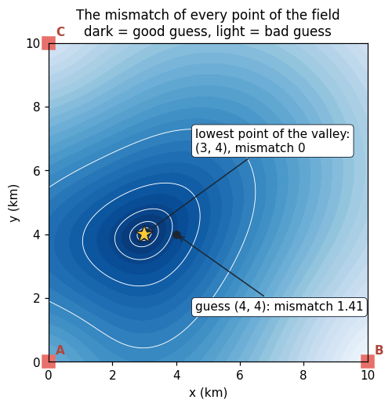

# Welcome: navigation without GNSS

> [!NOTE] Mission brief
> **22 June 2017, Black Sea, near Novorossiysk.** A ship's master reports that his GPS puts him at
> Gelendzhik airport, on land, tens of kilometres from where he really is. The AIS of about twenty
> nearby ships shows the same spot. The receivers appear to work normally. (Reported to the US
> Maritime Administration.)
>
> In this mission you find out how that is possible by doing it yourself. You **build** a
> satellite-style position solver, **break** it, **spoof** it, play **detective** on a spoofed flight,
> and finally fight NAVERA's jump gate as **attacker and defender**.

**Objectives.** After this mission you can:

1. explain trilateration, and why one cheap clock makes it a **4-unknown** problem;
2. solve a position as a **least-squares** problem, by brute force and by **Gauss–Newton**;
3. explain why jamming is noticed, a full spoof is not, and a partial spoof can be;
4. reason like NAVERA's arbiter: source priority, the FIX / DEGRADED / NO_FIX states, the jump gate
   and the cross-check, including **where each one fails**.

⏱ Reading: about 60 minutes, with pencil and calculator. Lab: 2 h 30 to 4 h.

<details><summary>Workspace and words (open if you need them)</summary>

Left: **Course**, **Lab**, and **✔ Check my work** (tests your files, gives hints). Right: **📝 Code**
(editor, `Ctrl+S` saves) and **⌨️ Terminal**. `~/navera/` is your own copy of NAVERA: you may change
anything (the 👤 menu resets it).

| Word | Meaning | Français |
|---|---|---|
| **pseudorange** | a measured range that includes the receiver's clock error | pseudo-distance |
| **clock bias** | the receiver clock error expressed as a distance, c × time error | biais d'horloge |
| **residual** | measured value − value predicted by a model | résidu |
| **least squares** | choose the unknowns that minimise the sum of squared residuals | moindres carrés |
| **Jacobian** | the matrix of partial derivatives of the predictions with respect to the unknowns | jacobienne |
| **fix** | one position computed by a receiver ("no fix" = none) | position calculée |
| **jamming / spoofing** | noise on the GPS band / fake but consistent GPS signals | brouillage / leurrage |
| **arbiter** | the NAVERA program that decides which position to trust | arbitre |
| **uncertainty (σ)** | how far off a position may be, stated by its source (e.g. 30 m) | incertitude |
</details>

## 1. Ranging: a time becomes a distance

A satellite cannot see you; it only broadcasts. Each GPS satellite repeats, in essence: *"I am here
(orbit data), and I sent this signal at exactly t₀ by my atomic clock."* Your receiver notes the
arrival time t₁ **on its own clock** and converts the travel time into a range with the speed of
light, `c ≈ 300 000 km/s`:

```
range = c × (t₁ − t₀)          0.07 s of travel  →  21 000 km
```

Picture a storm behind a hill: you cannot see the flash, but a weather station radios *"lightning at
15:00:00"*, and you hear the thunder at 15:00:03 by your watch: 3 s × 340 m/s ≈ 1 km. Two clocks are
involved, the station's and yours. Keep that in mind for §3.

The number that rules everything: at the speed of light, **1 µs** of timing error is **300 m** of
range error, and 1 ns is 30 cm. Satellite navigation is, above all, a clock problem.

## 2. Trilateration as a least-squares problem

**A flat model first.** On a 10 km × 10 km field, three beacons sit at `A = (0, 0)`, `B = (10, 0)`,
`C = (0, 10)` (km). You measure ranges **5.000**, **8.062** and **6.708** km. Each range puts you on a
circle; two circles cross in two points; the third picks one: **(3, 4)**.


**How a computer does it.** It scores a candidate position `p`. For each beacon, the **residual** is the
measured range minus the range predicted from `p`. The position is the `p` that minimises the sum of
squared residuals, which we call the **mismatch**:

```
mismatch(p) = Σᵢ ( measuredᵢ − ‖p − beaconᵢ‖ )²          ‖·‖ = Euclidean distance
```

That is a **least-squares** problem, the same family as fitting a line to data. Squaring stops a
+0.8 and a −0.8 from cancelling, and weighs large errors much more than small ones.

**Worked example.** The candidate `p = (4, 4)`:

| Beacon | Predicted ‖p − beacon‖ | Measured | Residual | Squared |
|---|---|---|---|---|
| A | √(4² + 4²) = 5.657 | 5.000 | −0.657 | 0.431 |
| B | √(6² + 4²) = 7.211 | 8.062 | +0.851 | 0.725 |
| C | √(4² + 6²) = 7.211 | 6.708 | −0.503 | 0.253 |
| | | | **mismatch** | **1.409** |

Mapped over the field, the mismatch is a valley whose lowest point is the position:



> [!QUESTION] ✏️ Check
> (3, 5) and (4, 4) are both exactly 1 km from the truth. Which one has the smaller mismatch? Guess
> first, then compute. What does that say about errors in different directions?

<details><summary>Answer</summary>
(3, 5): predicted 5.831, 8.602, 5.831 → residuals −0.831, −0.540, +0.877 → mismatch ≈ 1.75, worse than
1.41. The valley is not round: moving north changes the ranges to A and C a lot, moving east less. The
<b>geometry</b> of the beacons makes some error directions cheap and others expensive. A long flat
valley means poor precision in that direction: this is <b>dilution of precision</b> (DOP), and §3 shows
how to compute it.
</details>

## 3. The clock: four unknowns, and how real receivers solve them

The satellites carry atomic clocks; your receiver has a quartz clock that can be off by microseconds
up to a millisecond, i.e. hundreds of metres up to 300 km. Back to the storm: if **your** watch is
0.5 s ahead, the storm seems 170 m too far, and so does **every** storm, by the same amount, because
the station's clock and yours are different clocks. (Timing the visible flash on your own watch would
cancel the error; GPS cannot do that, the start time is always the satellite's.)

So every range is biased by the same `b = c × (receiver clock error)`. These are **pseudoranges**:

```
pseudorangeᵢ = ‖p − satelliteᵢ‖ + b
```

With a clock 1 µs ahead (b = 0.3 km) our ranges become 5.300, 8.362, 7.008, and the circles no longer
meet in one point. The trick that makes GPS work: `b` is **shared by all satellites**, so it is just
one more unknown. Solve for `(x, y, z, b)`:

| Situation | Unknowns | Measurements needed |
|---|---|---|
| flat field, perfect clock | x, y | 2, plus 1 to remove the mirror point |
| flat field, cheap clock | x, y, b | 3 |
| real GPS | x, y, z, b | **4** (the mirror solution usually lies far from the Earth's surface) |

Hence **four satellites**, and GPS gives you the time for free.

**Solver 1: brute force.** Try every point of a grid, keep the smallest mismatch:

```python
best_x, best_err = None, None
for i in range(101):                  # x = 0.0, 0.1 … 10.0 (loop on integers, then scale)
    x = i / 10
    err = (x * x - 20) ** 2           # 1-D toy: which x has x² closest to 20?
    if best_err is None or err < best_err:
        best_x, best_err = x, err
print(best_x)                         # 4.5
```

Two unknowns: two nested loops, 101² = 10 201 candidates. With the clock in 21 steps: 214 221. Now
real GPS at 1 m resolution: x, y, z over ±7 000 km and b over ±300 km is more than 10²⁷ candidates. At a
billion per second, longer than the age of the universe. We need something smarter.

**Solver 2: Gauss–Newton.** Start from a guess `(x, y, b)`. Near the guess, each prediction is almost
linear in a small correction `Δ = (Δx, Δy, Δb)`:

```
‖p + Δp − sᵢ‖ + b + Δb  ≈  dᵢ + b  +  uᵢ · Δp  +  Δb          dᵢ = ‖p − sᵢ‖,   uᵢ = (p − sᵢ) / dᵢ
```

`uᵢ` is the unit vector from the satellite to you: the derivative of a distance is a unit vector. Stack
one row `[uᵢ, 1]` per satellite into the **Jacobian** `H`, and the residuals `rᵢ = ρᵢ − (dᵢ + b)` into
`r`. The correction solves the linear least-squares problem

```
H Δ ≈ r          Δ = (Hᵀ H)⁻¹ Hᵀ r       (in numpy: np.linalg.lstsq(H, r))
```

Apply `Δ`, recompute, repeat. Each step is linear algebra, not a search.

**Worked example** (pseudoranges 5.300, 8.362, 7.008; guess (4, 4), b = 0):

| Beacon | dᵢ | rᵢ = ρᵢ − dᵢ − b | Row of H: uₓ, u_y, 1 |
|---|---|---|---|
| A (0, 0) | 5.657 | −0.357 | 0.707, 0.707, 1 |
| B (10, 0) | 7.211 | +1.151 | −0.832, 0.555, 1 |
| C (0, 10) | 7.211 | −0.203 | 0.555, −0.832, 1 |

Solving gives `Δ = (−0.979, −0.003, +0.338)`, so the new guess is (3.021, 3.997), b = 0.338. One more
step lands on (3.000, 4.000), b = 0.300: exact, in two iterations. This is what a real receiver does,
in 3-D, many times per second. And `(HᵀH)⁻¹` is also where DOP comes from: it measures how the
geometry amplifies range errors into position errors (mission 15).

> [!QUESTION] ✏️ Check
> 1. A ship knows its altitude. How many satellites does it need?
> 2. Why not put an atomic clock in every receiver?
> 3. Gauss–Newton needs a starting guess. What could go wrong with a very bad one?

<details><summary>Answer</summary>
1. Unknowns x, y, b: three.<br>
2. Cost, size and power: a chip-scale atomic clock costs far more than a whole consumer receiver and
still drifts. Solving for b with one extra satellite is free.<br>
3. The linear approximation is only good near the guess: from far away it can converge slowly, jump to
the mirror solution, or diverge. Receivers start from the last fix or the centre of the Earth, which
works for GPS geometry.
</details>

## 4. Attacking GPS

A GPS signal reaches the ground at about **−130 dBm**, roughly 10⁻¹⁶ W, **below** the receiver's
thermal noise. It is recovered only because the receiver knows each satellite's code and correlates
for milliseconds. A transmitter on the same band does not need much power to win.

| Threat | What happens | Does the receiver notice? |
|---|---|---|
| **Outage** | buildings, terrain, tunnels block the signal | yes: few satellites, poor geometry, or no fix |
| **Jamming** | noise is transmitted on the GPS band | yes: it loses the signal |
| **Spoofing** | fake signals are transmitted for a chosen false position | **?** — lab Step 7 |
| **Meaconing** | real signals are recorded and re-broadcast later | **?** — same idea |

A spoofer needs no cryptography against civil GPS: it computes, for its chosen false position, the
pseudoranges a receiver *would* measure there (the formula of §3), and broadcasts matching signals a
little stronger than the real ones. Interference is not rare: besides the Black Sea case, years of
reports around the Baltic, the Eastern Mediterranean and the Middle East describe ships and
airliners with false or missing GPS positions.

> [!QUESTION] ✏️ Check
> In free space, a radio signal loses `FSPL(dB) = 20·log₁₀(d_km) + 20·log₁₀(f_MHz) + 32.44`. A cheap
> 1 W jammer (30 dBm) transmits at the GPS frequency, 1 575.42 MHz, from 10 km away. How much stronger
> than the GPS signal (−130 dBm) does it arrive?

<details><summary>Answer</summary>
FSPL = 20 + 63.9 + 32.4 ≈ 116.4 dB, so the jammer arrives at 30 − 116.4 ≈ −86 dBm: about 44 dB above the
satellite, i.e. about 20 000 times stronger. Even with terrain and antenna losses, a drone at altitude
can lose GPS to a one-watt device kilometres away.
</details>

## 5. NAVERA: witnesses, a judge and a messenger

NAVERA runs on a small NVIDIA computer next to the autopilot.


(Look at the three big boxes; the small labels come in later missions.)

- **Sources (witnesses)** each give a position and, when they can, a stated uncertainty σ: GPS;
  **day vision** (camera matched against a stored satellite map); **night vision** (thermal image
  against the map); **celestial** (stars). The **IMU** gives the attitude; integrated for position it
  drifts fast, so NAVERA does not use it as a position source today.
- **The arbiter (judge)**, `estimator_node`, decides whenever an estimate arrives and at least five
  times per second. A source is eligible if it is valid and **fresh** (GPS: younger than 3 s). Among
  eligible sources the **priority** order wins: **GPS > day > night > celestial**. Not the most
  precise one: the first in priority. (A higher-priority source that comes back also waits a short
  hold-off of 2 s before taking over.)
- **The output (messenger)** hands the result to the autopilot in the same format as a GPS receiver,
  so the autopilot needs no code change, only configuration (tested with ArduPilot in simulation).

| State | Rule |
|---|---|
| **FIX** | fresh, measured, with a stated σ ≤ 25 m (any source) |
| **DEGRADED** | a position exists, but its σ is unknown or > 25 m |
| **NO_FIX** | nothing usable; an old position is never re-sent as new |

Today day vision states σ = 30 m (a conservative value, not yet measured with NAVERA's own camera)
and night vision states none, so vision positions show DEGRADED.

### The jump gate, and the cross-check

A vehicle cannot teleport. The arbiter refuses a GPS fix that is farther from the **last trusted** fix
than the vehicle could have travelled:

```
refuse if   distance(last trusted fix, new fix)  >  v_max × elapsed + margin
```

**Worked example**, NAVERA's defaults `v_max = 100 m/s`, `margin = 50 m`, one fix per second, **no
other source available**. The GPS jumps 500 m, stays there, then jumps 400 m further:

| Fix | Distance from last trusted | Elapsed | Gate | Decision |
|---|---|---|---|---|
| 1–4 | 500 m | 1, 2, 3, 4 s | 150, 250, 350, 450 m | refused ×4 |
| 5 | 500 m | 5 s | 550 m | **accepted** → new trusted fix, elapsed restarts |
| 6 | 0 m | 1 s | 150 m | accepted |
| 7 | 400 m | 1 s | 150 m | refused |

Refused fixes never become trusted, so `elapsed` grows and the gate widens until the fake position is
"reachable": alone, the gate only **delays** a jump, and a slow **drag** is never refused at all.


NAVERA's real defence is the **cross-check**: GPS must agree with an independent source that states
its uncertainty. When day vision has a match (σ 30 m), a refused GPS comes back only once it agrees
with vision, and a trusted GPS that drifts away from vision is refused (in NAVERA's simulator, a GPS
dragged at 4 m/s was refused about 140 m from the truth). Where vision cannot match (over the sea, on
uniform ground) there is no such source, and a patient spoof is not detected. NAVERA's documentation
(`docs/VALIDATION_STATUS.md`) states this limit openly. In the lab you exploit it, then catch it.

In your copy, these rules are four settings of
`navera_estimator/navera_estimator/config/estimator_params.yaml` (comments added here):

```yaml
    gps_timeout_s: 3.0        # older than this: not fresh
    fix_max_sigma_m: 25.0     # largest σ shown as FIX
    max_speed_mps: 100.0      # v_max of the jump gate (set per vehicle)
    gps_jump_margin_m: 50.0   # margin of the jump gate
```

> [!QUESTION] ✏️ Check
> 1. GPS is jammed. Day vision is fresh with σ 40 m; night vision is fresh with σ 10 m. Which source,
>    which state?
> 2. Same gate settings, no other source: a fix arrives 3 s after the last trusted one, 320 m away.
>    And after 2 s?

<details><summary>Answer</summary>
1. <b>Day vision</b> (priority, not precision), and 40 m > 25 m → <b>DEGRADED</b>.<br>
2. After 3 s the gate is 350 m: accepted. After 2 s it is 250 m: refused.
</details>

> [!WARNING]
> NAVERA is **Release 0.2 — field validation pending**. `docs/VALIDATION_STATUS.md` lists what has been
> measured and how, e.g. day vision placed 32 of 33 aerial test photos within 9 m (median 4 m) **on the
> bench**, with photos not taken by NAVERA's own camera. Always quote a number with its conditions.
> NAVERA's test map and data cover the region of Sousse, Tunisia.

## 🐦 How birds do it

Migrating birds have no single perfect sense: they combine landmarks, the sun, the stars and a
magnetic sense, and cross-check them; some thrushes recalibrate their magnetic compass from the sunset
every evening. That is NAVERA's founding idea.


## Summary

1. Ranging turns a travel time into a distance; at light speed, **1 µs = 300 m**.
2. A position is the solution of a **least-squares** problem: brute force works in a toy, real
   receivers linearise (**Gauss–Newton**: `H Δ ≈ r`).
3. One cheap clock biases every range equally: a 4th unknown, hence **4 satellites**, and the time
   for free.
4. Jamming is noticed. What spoofing does to the residuals is the subject of the lab.
5. NAVERA's arbiter chooses by freshness and **priority**, reports FIX / DEGRADED / NO_FIX, and guards
   GPS with a jump gate (which alone only delays a jump) and a cross-check (which needs a source with a
   stated σ, e.g. day vision over land).

**Next mission:** the terminal, your control panel for the NAVERA computer.

## Check yourself

Answer without scrolling up.

<details><summary>1. Why does a receiver need four satellites, and what does it get "for free"?</summary>
Unknowns x, y, z and the clock bias b. Solving for b gives the receiver's clock error, so GPS is also a
precise time source.
</details>

<details><summary>2. Write the row of the Jacobian for one satellite, and say what each entry means.</summary>
[uₓ, u_y, u_z, 1]: the unit vector from the satellite to the receiver (how the range changes when you
move), and 1 for the clock bias (every range changes by the same Δb).
</details>

<details><summary>3. Your receiver's clock is 2 µs ahead. What happens to the pseudoranges, and to the solved position?</summary>
Every pseudorange is 0.6 km too long. The position is unaffected: the solver absorbs it into b ≈ 0.6 km.
</details>

<details><summary>4. GPS is 5 s old, day vision has nothing, night vision is fresh with σ 12 m. Source and state?</summary>
GPS is not fresh (> 3 s), so <b>night vision</b>; 12 m ≤ 25 m → <b>FIX</b>.
</details>

<details><summary>5. (After the lab) Why can a fifth satellite expose a partial spoof but not a full one?</summary>
With more measurements than unknowns, real and fake signals cannot all be explained by one point: a
residual remains. A full spoof is consistent with one false point, so the residual is zero. This is
the idea behind receiver integrity monitoring (RAIM).
</details>

Now open the **🛠️ Lab** tab.
