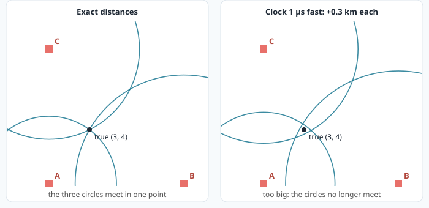
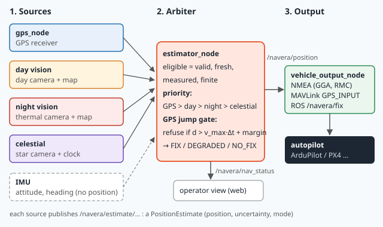
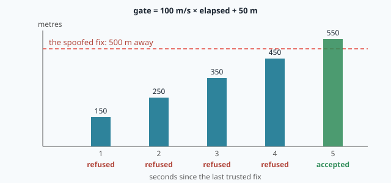

# Welcome: navigation without GNSS

> [!NOTE] In short
> - A satellite receiver finds its position from **distances**, like you will do with three
>   beacons on a map.
> - Its clock is not perfect. That adds **one more unknown**, so it needs one more satellite.
> - GPS can be **lost** (blocked, jammed) or **faked** (spoofed). A good fake looks perfect.
> - NAVERA keeps a vehicle on track with other **sources** (camera, stars), an **arbiter** that
>   decides whom to believe, and an **output** that looks like a GPS to the autopilot.
> - In the lab you write your own small position finder in Python, break it with a bad clock, fool
>   it with a fake signal, and write NAVERA's jump gate yourself.

⏱ Reading: about 25 minutes. Lab: about 2 h 30.

## Words of this lesson

You will meet these words below. Come back here when you forget one.

| Word | Meaning | Français |
|---|---|---|
| **GNSS / GPS** | satellite navigation in general / the American system | GNSS / GPS |
| **beacon** | a transmitter at a known place | balise |
| **pseudorange** | a measured distance that includes the clock error | pseudo-distance |
| **clock bias** | how wrong the receiver's clock is, written as a distance (km or m) | biais d'horloge |
| **mismatch** | how badly a guessed position explains the measurements (0 = perfectly) | écart |
| **fix** | one position given by a GPS receiver ("a GPS fix"; "no fix" = no position) | position calculée, « fix » |
| **uncertainty** | how many metres a position may be wrong, for example ± 10 m | incertitude |
| **fresh** | recent enough to use: for GPS, younger than 3 seconds in NAVERA | récent |
| **jamming** | noise sent on the GPS frequency, so the receiver hears nothing | brouillage |
| **spoofing** | fake GPS signals, so the receiver computes a false position | leurrage |
| **consistent** | (for fake signals) all the distances agree with each other, like real ones | cohérent |
| **meaconing** | real GPS signals recorded and sent again later | répétition (meaconing) |
| **autopilot** | the computer that flies the vehicle (ArduPilot, PX4) | autopilote |
| **attitude** | the angles of the vehicle: how it is tilted and where its nose points | attitude (angles) |
| **arbiter** | the NAVERA program that chooses which position to send | arbitre |

## The problem

A survey drone flies along a coast, from one harbour to the next. Its **autopilot** steers with a
position from GPS, five times per second. Suddenly the GPS says "no position". Or worse: it keeps
giving a calm, precise position… 2 km out at sea, while the drone is still over the beach. The
autopilot cannot tell. It will land where it is, or fly "home" towards a wrong home.

This course is about the engineering answer: **GNSS-denied navigation**. You will study, change and
test **NAVERA**, a navigation product made by IRIS Systems. NAVERA sits next to the autopilot and
keeps giving it a position when satellite navigation is lost or cannot be trusted.

To protect GPS, you must first understand how it works. So we start there.

## 1. A position from distances

Forget satellites for a moment. You are somewhere on a flat 10 km × 10 km field. Three radio
**beacons** stand at known places (in km):

```
A = (0, 0)      B = (10, 0)      C = (0, 10)
```

Your receiver measures the distance to each beacon: **5.000 km** to A, **8.062 km** to B,
**6.708 km** to C. Where are you?

Each distance puts you on a **circle** around that beacon. Two circles usually cross in **two**
points; the third circle chooses one of them. Three circles meet in one point: that is you. In the left picture, they meet at **(3, 4)**.



### The distance between two points

The distance between `p = (x1, y1)` and `q = (x2, y2)` is Pythagoras:

```
distance = √( (x2 − x1)² + (y2 − y1)² )
```

**Example.** From A = (0, 0) to the point (3, 4): `√(3² + 4²) = √25 = 5`. From B = (10, 0) to
(3, 4): `√(7² + 4²) = √65 = 8.062`.

### How good is a guess? The mismatch

A computer does not draw circles. It **tries** a position and measures how badly that position
explains the measurements. For a guess `p`, for each beacon:

1. compute the distance from `p` to the beacon (what you *would* measure if you were at `p`);
2. subtract what you *did* measure;
3. square it (so that a negative difference counts as much as a positive one).

Add the three squares. This sum is the **mismatch**. It is 0 when `p` explains every
measurement perfectly, and it grows when `p` is wrong.

**Worked example.** Guess `p = (4, 4)`:

| Beacon | Distance from (4, 4) | Measured | Difference | Squared |
|---|---|---|---|---|
| A (0, 0) | √(4² + 4²) = 5.657 | 5.000 | +0.657 | 0.431 |
| B (10, 0) | √(6² + 4²) = 7.211 | 8.062 | −0.851 | 0.725 |
| C (0, 10) | √(4² + 6²) = 7.211 | 6.708 | +0.503 | 0.253 |
| | | | **mismatch** | **1.409** |

And at the true point (3, 4), each difference is 0, so the mismatch is **0**.

### Finding the best guess: try them all

The simplest way to find the position: try **every** point of a grid and keep the one with the
smallest mismatch. Computers are fast: 101 × 101 points is about ten thousand tries, done in a
moment.

Here is the same idea in one dimension, in Python. *Which number x between 0 and 10 (in steps of
0.1) has a square closest to 20?*

```python
best_x = None
best_err = None
for i in range(101):            # i = 0, 1, 2, …, 100
    x = i / 10                  # x = 0.0, 0.1, 0.2, …, 10.0
    err = (x * x - 20) ** 2     # how wrong x is (squared: never negative)
    if best_err is None or err < best_err:
        best_x = x              # a better x: remember it
        best_err = err
print(best_x)                   # 4.5   (because 4.5² = 20.25, the closest)
```

Read it line by line:

- `best_x = None`: `None` means "nothing yet". Before the loop we have no best answer.
- `for i in range(101)` repeats the block 101 times, with `i` = 0, 1, …, 100.
- `x = i / 10` turns `i` into the number we try. (We loop over whole numbers and divide, because
  adding 0.1 again and again makes small rounding errors.)
- `err` measures how wrong this `x` is.
- `if best_err is None or err < best_err` asks: is this the first try, or the best so far? If yes,
  we remember it.
- `print(best_x)` is **after** the loop (not indented): it runs once, when all tries are done.

In the lab you write the **two-dimensional** version: two loops, one for `x` and one inside it for
`y`, and the mismatch instead of `err`.

## 2. The clock problem: a fourth unknown

Each satellite says: "I sent this signal at 12:00:00.000000". The receiver writes down when the
signal arrived, by its own clock. Distance = travel time × the speed of light
`c ≈ 300 000 km/s`. The satellite has a perfect atomic clock; your receiver has a cheap one.

If the receiver's clock is **1 µs fast** (ahead by one millionth of a second), it writes down every
arrival 1 µs too late. So every travel time looks 1 µs too long, and every distance comes out
**0.3 km** too long:

```
c × 1 µs = 300 000 km/s × 0.000 001 s = 0.3 km
```

Every distance is wrong by the **same** amount. A measured distance that includes this clock error
is called a **pseudorange**:

```
pseudorange = true distance + bias        (bias = c × clock error, here 0.3 km)
```

Back to our field, with a clock 1 µs fast:

| Beacon | True distance | Pseudorange |
|---|---|---|
| A | 5.000 | 5.300 |
| B | 8.062 | 8.362 |
| C | 6.708 | 7.008 |

All circles are now 0.3 km too big, and they **no longer meet** (right picture above). The best
grid point is no longer (3, 4), and even the best mismatch is not 0. You will see it happen in the
lab.

**The solution is clever.** We do not know the bias, so we make it an **unknown** too. A guess is
now `(x, y, bias)`. For each guess, what we *would* measure becomes:

```
would measure = distance from the guess to the beacon + bias
```

and the mismatch compares that with the measured pseudoranges, exactly as in §1. At (3, 4) with
bias = 0.3 km: 5.000 + 0.3 = 5.300, 8.062 + 0.3 = 8.362, 6.708 + 0.3 = 7.008. Every pseudorange is
explained: mismatch 0.

One more unknown needs one more measurement:

| World | Unknowns | Beacons or satellites needed (at least) |
|---|---|---|
| flat field, perfect clock | x, y | 2 (they leave two possible points; a 3rd chooses) |
| flat field, cheap clock | x, y, bias | **3** |
| real GPS, cheap clock | x, y, z, bias | **4** |

That is why a GPS receiver needs **at least four satellites**. With more than four, it uses the
extra ones to reduce the noise and to notice a measurement that disagrees with the others.

> [!NOTE]
> A real receiver does not try every point of a grid: in 3-D with a clock, that would be far too
> many. It starts from a guess and improves it a few times with algebra. The idea is the same:
> **find the position (and bias) with the smallest mismatch**. The "Going further" part of the lab
> lets you run such a receiver with eight satellites.

## 3. What can go wrong with GPS

The GPS signal is extremely weak when it reaches the ground: weaker than the natural radio noise
around the antenna. The receiver can still find it only because it knows exactly what pattern to
listen for. So a small transmitter on the same frequency can cover it completely, kilometres away.

| Threat | What happens | Does the receiver know? |
|---|---|---|
| **Outage** | buildings, mountains, a tunnel block the signal | yes: fewer satellites, or "no fix" |
| **Jamming** | someone sends noise on the GPS frequency | yes: "no fix" |
| **Spoofing** | someone sends **fake but consistent** GPS signals for a false position | **usually not** |
| **Meaconing** | someone records real signals and sends them again later | usually not |

Jamming is serious, but at least the receiver knows: it says "no fix", and the autopilot can react.
**Spoofing is the dangerous one.** The spoofer computes, for a false position, exactly the
pseudoranges a receiver *would* measure there. The receiver finds that false position with a
mismatch of 0: everything looks perfect. You will build such a spoofer in the lab and watch your own
position finder believe it.

Interference is real. Navigation authorities have warned for years about GPS interference around
the Baltic Sea, the Black Sea, the Eastern Mediterranean and the Middle East: ships that appear on
land, aircraft that lose GPS for part of a flight.

**Meaconing** is a lazy spoofing: the attacker records the real signals somewhere and sends them
again later. The receiver computes the position of the recording place (and an old time), again
with no alarm. NAVERA's defences are the same as for spoofing: the jump gate, and the comparison
with vision.

**Lesson learned:** inside the receiver, nothing says "spoofed". The only defence is to compare GPS
with something that does not use radio: a camera, the stars, the vehicle's own motion.

## 4. NAVERA: sources, arbiter, output

NAVERA is a set of programs running on an NVIDIA Jetson computer next to the autopilot. It has three
layers.



Today, look only at the three big boxes. The small names in the picture (topics, NMEA, MAVLink)
come in later lessons.

**1. Sources.** Each one produces its own position, with its own uncertainty.

| Source | How it finds the position | Lessons |
|---|---|---|
| GPS | reads the GPS receiver | 15 |
| Day vision | matches the camera image with a satellite map stored on the Jetson | 17–23 |
| Night vision | matches a thermal image with the map | 24 |
| Celestial | recognises stars in a sky image | 24 |
| IMU | measures turns and accelerations: gives the attitude (tilt and heading), **not** a position | 16 |

**2. The arbiter** (the program `estimator_node`) decides, five times per second, which source to
send. A source can be chosen only if its position is **fresh** (for GPS: younger than
`gps_timeout_s` = 3 s) and valid. Among those, the priority is
**GPS > day vision > night vision > celestial**.

**3. The output** gives the chosen position to the autopilot **in the form of a GPS**. The autopilot
does not need to change: for it, NAVERA is a GPS receiver. But unlike a GPS alone, it says when it
is not sure.

### The jump gate

One of the arbiter's rules is the **jump gate**. A vehicle cannot teleport. If a new GPS position is
farther from the last trusted one than the vehicle could have flown, the arbiter refuses it:

```
refuse the new GPS fix if   distance(last trusted fix, new fix)  >  v_max × elapsed + margin
```

- `v_max` is the vehicle's top speed (m/s), set per vehicle;
- `elapsed` is the time since the **last trusted** fix (s);
- `margin` covers normal GPS noise (m).

**Worked example.** `v_max = 100 m/s`, `margin = 50 m`, a fix every second. The drone flies
normally; then a spoofer makes the GPS jump **500 m** and stays there.

- After 1 s: gate = 100 × 1 + 50 = 150 m. 500 > 150: **refused**.
- The last trusted fix does not change, so `elapsed` keeps growing: 250 m, 350 m, 450 m: refused.
- After 5 s: gate = 550 m. 500 < 550: **accepted**. The fake position is "reachable" now.



So the gate alone only **delays** a jump. And a spoofer who drags the position slowly, for example
20 m each second, is never refused at all. That is why NAVERA does not trust GPS again just because
it became "reachable": when vision is available, the GPS must also **agree with vision**. Lessons
25–27 study these rules.

### How sure is NAVERA? The three states

Every position NAVERA sends carries its source and its **uncertainty** (how many metres it may be
wrong). The arbiter sums up the situation
in one of three states:

| State | Meaning |
|---|---|
| **FIX** | a fresh, measured position with a known uncertainty of at most 25 m |
| **DEGRADED** | a position exists, but its uncertainty is unknown or larger than 25 m |
| **NO_FIX** | no usable source; NAVERA never re-sends an old position as if it were new |

Today, GPS is normally FIX. The vision sources give positions without a validated uncertainty yet,
so they show **DEGRADED**. They would become FIX automatically once their uncertainty is measured
and stated.

> [!WARNING]
> NAVERA is **Release 0.2 — field validation pending**. Its file `docs/VALIDATION_STATUS.md` lists
> what has been measured, and how. For example, day vision placed 32 of 33 aerial test frames within
> 9 m (median 4 m) **on the bench**, with photos not taken by NAVERA's own camera. Engineers always
> give a number with its conditions. You will do the same in this course.

NAVERA's test map and recorded data cover the region of **Sousse, Tunisia**, where NAVERA is
developed.

## 🐦 How birds do it

Migrating birds cross seas and deserts without GPS. They do not have one perfect sense: they have
several imperfect ones (landmarks, the sun, the stars, a magnetic sense) and they **cross-check**
them. Thrushes even re-calibrate their magnetic compass each evening from the sunset sky. That is
NAVERA's founding idea, and the arbiter's job: never trust one source blindly. Meet **Navi**, a
barn swallow: she will appear briefly in each lesson.

## 5. Your workspace

- **Left — the notebook.** The **Course** tab (this text), the **Lab** tab, and
  **✔ Check my work**, which tests your files and gives a hint for each problem.
- **Right — your tools.** **📝 Code** (an editor; `Ctrl+S` saves), **⌨️ Terminal** (a Linux
  command line on the Jetson; lesson 2 teaches it), **🛩️ Simulator** (lesson 28) and
  **🧭 Operator view**.

| Folder | What it is |
|---|---|
| `~/navera/` | **your own copy of NAVERA**. You may change anything; the 👤 menu's **Reset my NAVERA copy** gives you a fresh one. |
| `~/lessons/<lesson>/` | the files of each lab. **↺ Reset lab files** puts them back as they were. |

> [!TIP]
> Code blocks with a **▶ Run** button type the command in your terminal for you.

## Check what you learned

<details><summary>1. Three beacons, and your clock is perfect. How many beacons do you really need on a flat field, and why use the third?</summary>
Two circles usually cross in two points, so two beacons leave you with two possible positions. The third beacon
chooses between them, and it also lets you notice if one measurement is wrong.
</details>

<details><summary>2. The receiver clock is 2 µs fast. What happens to each distance?</summary>
Each one is 0.6 km too long (c × 2 µs = 300 000 km/s × 0.000 002 s). All by the same amount — that is why the
bias can be found as one more unknown.
</details>

<details><summary>3. Why does a real GPS receiver need four satellites, not three?</summary>
Its unknowns are x, y, z and the clock bias: four unknowns need four measurements.
</details>

<details><summary>4. Why is jamming less dangerous than spoofing for an autopilot?</summary>
A jammed receiver says "no fix", so the autopilot knows and can react. A spoofed receiver gives a wrong
position that looks normal, with no alarm.
</details>

<details><summary>5. v_max = 100 m/s, margin = 50 m, fixes every second. The GPS jumps 120 m after one second. Refused?</summary>
No: 120 m is less than 100 × 1 + 50 = 150 m. Small or slow changes pass the gate, which is why NAVERA also
compares GPS with vision.
</details>

Now open the **🛠️ Lab** tab.
