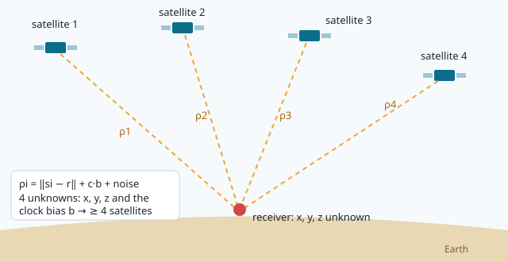
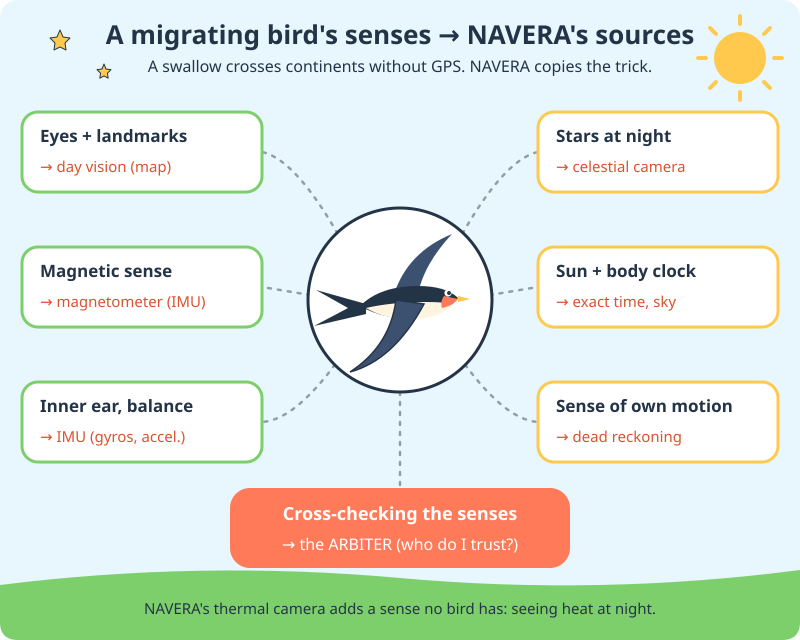

# Welcome: how does a robot know where it is?

Imagine you are blindfolded in your own house. You can still walk to the kitchen: you **remember**
where you started, you **count your steps**, you **touch** the walls you know. A robot that moves on
its own — a drone, a delivery car, a boat — has exactly the same problem: before it can decide where
to go, it must know **where it is**. That question is called **navigation**.

In this course you will learn how a real product, **NAVERA**, answers that question — and you will
read, change and test its code yourself.

## The easy answer: GPS

Your phone knows where you are because of **GPS** (the *Global Positioning System*). About thirty
satellites fly around the Earth, 20 000 km up. Each one keeps sending a message that says, in short:

> "I am satellite number 12, I am **here**, and the exact time is **now**."

Your phone listens to at least four of them. The messages travel at the speed of light, so a message
that arrives a tiny bit late came from farther away. From those tiny delays the phone computes its
distance to each satellite, and from the distances, its position on Earth — usually within 3 to 5 meters.



## The problem: GPS is fragile

GPS signals are **very weak** when they reach the ground — weaker than the noise of the radio itself.
That makes them easy to lose:

| What happens | Name | Example |
|---|---|---|
| The signal is blocked | **outage** | a tunnel, a canyon, tall buildings, under trees |
| Someone transmits noise on the GPS frequency | **jamming** | a cheap jammer the size of a phone can blind every GPS around it |
| Someone transmits *fake* GPS messages | **spoofing** | the receiver believes it is somewhere else — and the robot flies the wrong way |
| The receiver breaks | **failure** | a loose antenna cable |

For a person with a phone, losing GPS is annoying. For a drone carrying a parcel, it can mean a crash.
So engineers ask: **how can a vehicle keep knowing where it is when GPS is gone?**

## Where the idea came from: birds

Every spring, small birds fly over Sousse heading north. Every autumn, they come back heading south.
Many of them are **barn swallows**: they raise their young in Europe in summer and spend the winter in
Africa, south of the Sahara. That is thousands of kilometres over sea and desert — with no phone, no
map and no GPS. And yet many of them come back the next year to the same farm, sometimes to the very
same nest.

How do they do it? Scientists have studied that question for more than a hundred years, and the
answer surprised them: a bird does not have *one* magic sense. It has **several**, and it
**compares** them. That is exactly the idea the founders of NAVERA borrowed.

Meet **Navi**, a young barn swallow. Navi will fly with you through this course and show you how birds
solve the same problems as NAVERA.



| What the bird uses | What it gives the bird | NAVERA's version |
|---|---|---|
| **Eyes + landmarks** (coasts, rivers, mountains, roads) | "I know this place!" | **day vision**: camera + satellite map |
| **The stars** (some night migrants learn the part of the sky that turns around the pole star) | a direction at night | **celestial**: a star camera |
| **The sun + an inner clock** | a direction by day — the sun moves, so the bird must know the time | the **exact time** that GPS and the star camera both need |
| **A magnetic sense** | a compass, even under clouds | the **magnetometer** (compass) of the IMU |
| **The inner ear: balance** | which way is up, how fast it turns | the **IMU** (gyroscopes, accelerometers) |
| **A sense of its own motion** ("so far, in that direction") | where it is now, from where it started | **dead reckoning** and visual odometry |
| **Cross-checking all of these** | which sense to trust when they disagree | the **arbiter** |

Scientists still argue about *how much* birds rely on each sense — and the last-but-one line, the sense
of their own motion, is the least understood. But the big idea is solid: **many senses, checked
against each other**, are much harder to fool than one.

## The NAVERA answer: look, compare, double-check

**NAVERA** is a navigation box made by IRIS Systems. It sits on a vehicle (a drone, a car, a ground
robot, a boat) and gives it a position **even without GPS**. It uses several *sources*:

1. **Day vision** — a camera looks down. NAVERA compares the picture with a **satellite map** stored on
   the box, like you would find your street on Google Maps by looking at the shapes of the roofs and
   roads. When it finds the place, it knows the position. *(Lessons 20–23.)*
2. **Night vision** — at night a **thermal** (heat) camera sees roads and buildings that are warmer or
   colder than the fields around them. *(Lesson 24.)*
3. **The stars** — like sailors 300 years ago, a camera pointed at the sky can find the position from
   the stars and the exact time. *(Lesson 24.)*
4. **GPS** — when it works and can be trusted, it is still the best. *(Lesson 15.)*

Then a part called the **arbiter** decides which source to believe at every moment, and it can even
catch a **fake GPS** by comparing it with what the camera sees. *(Lessons 25–27.)*

```
 camera ─► day vision ────────┐
 thermal ─► night vision ─────┤
 star camera ─► celestial ────┼──► ARBITER ──► position ──► the vehicle's autopilot
 GPS receiver ────────────────┘    (who do I trust?)
```

> [!NOTE]
> NAVERA is a real commercial product, still being validated in the field. The code you will work with
> is a **copy** of the real code. You can change anything in your copy — you cannot break the product.

## 🐦 How birds do it

Navi has a confession: not one of a bird's senses is perfect. Clouds hide the sun and the stars.
Fog hides the landmarks. And the magnetic sense can be confused: homing pigeons released at places
where the rocks disturb the Earth's magnetic field (a *magnetic anomaly*) often fly off in confused
directions at first.

So birds cross-check. In 2004, American scientists (William Cochran and colleagues, in the journal
*Science*) followed migrating thrushes through the night with small radio transmitters — driving
behind them in a car with an antenna on the roof. Just before take-off, at sunset, they placed some of
the birds in an artificial magnetic field, turned to point the wrong way. That night, those birds flew
in the wrong direction. The next night, back in the normal field, they flew the right way again.

What does that tell us? The thrushes **re-set their magnetic compass every evening** using the sunset
sky. One sense calibrates another. When the scientists fooled the magnetic sense *at the moment of
calibration*, the error went straight into the flight.

That is exactly the job of NAVERA's **arbiter**: never trust a single source blindly, compare it with
the others, and notice when one of them starts telling a different story — like a GPS that says
"Tunis" while the camera sees the roofs of Sousse.

## Your workspace

This dashboard is your lab. It has two sides:

- **Left — the notebook.** The **Course** tab (what you are reading) explains; the **Lab** tab tells
  you, step by step, what to do. At the bottom, **✔ Check my work** runs automatic tests on your work
  and tells you what is right and what to fix.
- **Right — your tools.**
  - **📝 Code**: an editor like the ones engineers use. Your files are on the left; save with `Ctrl+S`.
  - **⌨️ Terminal**: a command line on the NAVERA computer (an NVIDIA Jetson). In lesson 2 you will
    learn to use it.
  - **🛩️ Simulator**: a flight simulator where NAVERA guides a virtual drone. *(Lesson 28.)*
  - **🧭 Operator view**: the screen a real NAVERA operator watches.

Your home folder contains two things:

| Folder | What it is |
|---|---|
| `navera/` | **Your own copy of NAVERA.** The **Reset my NAVERA copy** button (👤 menu) puts it back as new — your changes are saved in a backup first. |
| `lessons/` | One folder per lesson with the files of its lab. **↺ Reset lab files** puts the current lesson's files back. |

> [!TIP]
> Code blocks with a **▶ Run** button send the command to your terminal: you don't need to retype it.

## Some words you will meet again

| Word | Meaning |
|---|---|
| **position** | where you are, usually *latitude* and *longitude* (lesson 6) |
| **sensor** | a part that measures something: camera, GPS receiver, IMU (lesson 16) |
| **source** | a way to get a position: GPS, day vision, night vision, stars |
| **accuracy** | how far from the truth the position can be, in meters |
| **jamming / spoofing** | blinding / fooling a GPS receiver |
| **autopilot** | the computer that flies the vehicle; NAVERA *tells* it where it is |

## Check what you learned

<details><summary>1. Why can a GPS receiver be blinded so easily?</summary>
Because the satellite signals are extremely weak when they reach the ground — a small transmitter
nearby is much louder.
</details>

<details><summary>2. What is the difference between jamming and spoofing?</summary>
Jamming makes noise: the receiver loses GPS and <i>knows</i> it. Spoofing sends fake but believable
signals: the receiver gives a <b>wrong</b> position and may not know it. Spoofing is more dangerous.
</details>

<details><summary>3. How does NAVERA find its position with a camera in daylight?</summary>
It compares the camera picture with a satellite map stored on the box, and finds where they match.
</details>

Now open the **🛠️ Lab** tab.
