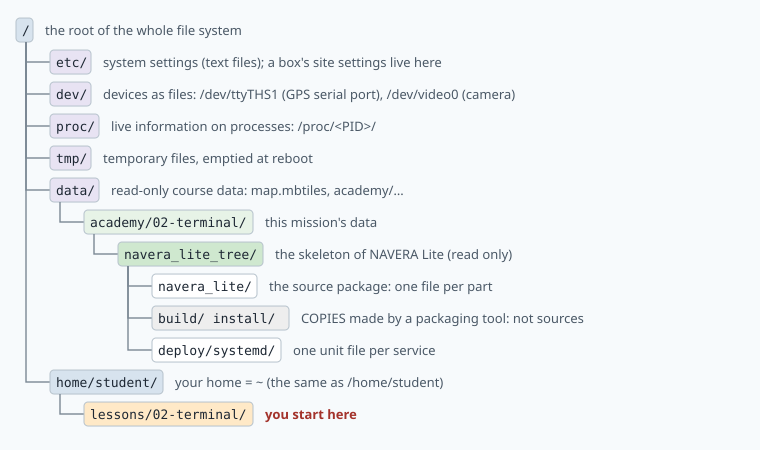
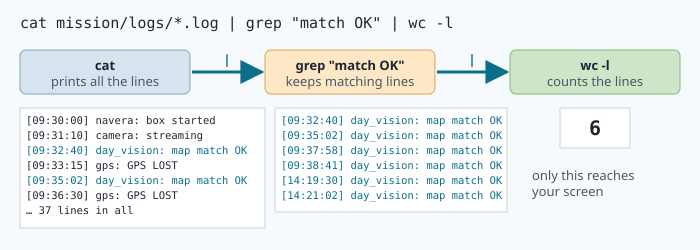

# Linux and the shell for robotics

> [!NOTE] Mission brief
> **28 September 2026.** A code review of NAVERA finds that its GPS service would run as a user who is
> **not allowed to open the serial port** of the GPS receiver. Started by hand on the developer's bench,
> the GPS reader works. Installed as a service on a box, it would print `Permission denied` and stop —
> and the same review found that crashed services were never restarted. (Today, with restarts, the
> symptom is a service restarting every 10 seconds.)
>
> **1 October 2026.** A review of NAVERA's mission simulator records why one test run was thrown away:
> starting a simulated mission could leave an **orphan** arbiter running beside the real one. Two
> arbiters judged at the same time, and their decisions were mixed in one stream.
>
> A robot computer has no screen: engineers find such faults with text commands. Today you do it on a
> NAVERA Lite box simulated on your bench. **Session 1 — the box:** tidy its files, fix a permission
> problem, find and stop an orphan (badge **Orphan hunter**). **Session 2 — the flight logs:** answer
> questions with pipelines and write a script that works on a log it has never seen (badge
> **Log detective**).
>
> **Start now:** open the 🛠️ **Lab** tab, do **Step 0** (two minutes), then come back here for §1.

**Objectives.** After this mission you can:

1. diagnose a `Permission denied`: read `ls -l` and `id`, compute octal modes, and tell a missing
   **x** bit from a missing **group**;
2. find a process, identify it by **PID**, parent (**PPID**), start time and command line, and stop it
   cleanly: **SIGTERM** first, **SIGKILL** only if needed;
3. answer questions about a log with **pipelines**, keeping errors (stderr) apart from results (stdout);
4. write a **bash script** that checks its arguments, reports errors correctly, and is right on input
   it has never seen.

**You need:** mission 01. No Linux experience. ⏱ Reading: about 60 minutes with the ✏️ checks. Lab:
2 h 30 to 3 h 30 (up to 5 h if you have never used a terminal: plan the two sessions on two days). Keep
[cheatsheet.md](file:./cheatsheet.md) open: it lists every command and option of this mission.

**Before you start (mission 01).** Answer without looking; if you miss two, reread lesson 01 §5.

<details><summary>1. What are NAVERA's three states, and the rule for FIX?</summary>
FIX, DEGRADED, NO_FIX. FIX: a fresh, measured position whose source states σ ≤ 25 m.
</details>
<details><summary>2. GPS and day vision are both fresh. Which one does the arbiter use?</summary>
GPS: priority wins (GPS > day > night > celestial), not precision.
</details>
<details><summary>3. Day vision is the active source and states σ 30 m. Which state?</summary>
DEGRADED: 30 m > 25 m.
</details>

<details><summary>Words of this lesson (open if you need them)</summary>

| Word | Meaning | Français |
|---|---|---|
| **shell** | the program that reads your command line and runs it (here: bash) | interpréteur de commandes |
| **path** | the folders to cross to reach a file | chemin |
| **working directory** | the folder you are in; relative paths start there | répertoire courant |
| **permission bits** | r (read), w (write), x (execute) for owner, group, others | droits d'accès |
| **process / PID / PPID** | a running program / its number / its parent's number | processus |
| **orphan** | a process whose parent has ended | processus orphelin |
| **signal** | a short message from the system to a process (TERM, KILL, INT) | signal |
| **exit code** | the number a program returns when it ends; 0 = success | code de retour |
| **environment variable** | a named text value passed to the programs a process starts | variable d'environnement |
| **stdout / stderr** | the normal output / the error output of a program | sortie standard / d'erreur |
| **pipe** | `\|`: the output of one command becomes the input of the next | tube |
</details>

## 1. The shell: a command is a list of words

The **terminal** is the window; the **shell** is the program inside it. Its **prompt**
`student@academy:~/lessons/02-terminal$` says: user `student`, computer `academy`, folder
`~/lessons/02-terminal`, ready (`$`). A command line is a list of words separated by spaces:

```
grep  -c  "state NO_FIX"  flight.log
│     │   │               └── argument: a file
│     │   └── argument: the pattern (the quotes keep the two words together)
│     └── option: "count the matching lines" (options start with -)
└── the command: a program on the disk (/usr/bin/grep)
```

Case matters (`Notes.txt` ≠ `notes.txt`), and a command that succeeds usually prints **nothing**:
silence means success. `Tab` completes a name, `↑` recalls the last command, `man grep` opens the
manual (`q` quits).

> [!TIP] 🧰 Coming from Windows?
> There is no `C:\`: one tree starts at `/`, and paths use `/`, not `\`. Your `C:\Users\you` is `~`
> (`/home/student`). Names are case-sensitive. A program in the current folder runs as `./name` (Linux
> does not search the current folder), and it needs no `.exe`: it needs the **x** bit (§3).
> `dir` = `ls`, `type` = `cat`, `copy` = `cp`, `move` = `mv`, `del` = `rm` (no recycle bin!), `cls` = `clear`.
> In the web terminal, `Ctrl+C` **stops a program** (it does not copy): to copy, select the text and
> right-click → Copy; `Ctrl+V` pastes.

## 2. One tree of files

Linux has **one tree** of folders (**directories**), whose top is the **root** `/`. Disks and even
devices appear somewhere in it.



An **absolute path** starts at `/` and means the same thing from anywhere. A **relative path** starts
from the **working directory** (`pwd` prints it). `.` is the current folder, `..` its parent, and `~`
your home: the shell turns `~/lessons` into `/home/student/lessons` before the command runs.

**Worked example.** The lab's data folder holds a **skeleton** of NAVERA Lite, the stack you build in
this course: every file it will have, with names only. You are in
`/data/academy/02-terminal/navera_lite_tree/navera_lite`:

| You type | It means |
|---|---|
| `ls ros` | `/data/academy/02-terminal/navera_lite_tree/navera_lite/ros` |
| `cat ../README.md` | `/data/academy/02-terminal/navera_lite_tree/README.md` |
| `cd ../../..` | `/data/academy` (three levels up) |

> [!NOTE] NAVERA's code is not part of this course
> NAVERA's code is IRIS's property. You build **NAVERA Lite**, which works on the same ideas, one part
> per mission. When a lesson says *In NAVERA*, it describes the product in words and numbers;
> *In NAVERA Lite* shows where the idea lives in your own code.

**Wildcards** (`*` any characters, `?` one character) are expanded by the **shell** before the command
runs: `mv inbox/*.log logs/` becomes `mv inbox/a.log inbox/b.log logs/`. So write
`find . -name "*.py"` **with quotes**: `find` must receive the `*` to apply it in every sub-folder.
And beware of **copies**: packaging tools leave copies of the sources in `build/` and `install/`;
`find` lists them all, but the file to read or change is the one outside them.

> [!WARNING]
> `rm` has no recycle bin. Before `rm pattern`, run `ls pattern` with the same pattern and read the list.

> [!QUESTION] ✏️ Check
> 1. You are in `/data/academy/02-terminal/navera_lite_tree/navera_lite/ros`. Write
>    `../../deploy/systemd` as an absolute path.
> 2. A folder holds `a.py` and a sub-folder `x/` with `b.py`. Why can `find . -name *.py` print only
>    `./a.py`?

<details><summary>Answer</summary>
1. <code>/data/academy/02-terminal/navera_lite_tree/deploy/systemd</code>.<br>
2. Without quotes the shell replaces <code>*.py</code> by the matching names of the <b>current</b> folder,
<code>a.py</code>; <code>find</code> then looks for files named exactly <code>a.py</code>.
</details>

## 3. Permissions: who may do what

Every file has an **owner**, a **group**, and three sets of bits: for the owner (**u**), the group's
members (**g**) and all others (**o**). Each set is **r** read, **w** write, **x** execute (for a folder:
may enter it).

```
crw-rw----  1  root  dialout  238, 1  Sep 30 09:12  /dev/ttyTHS1
│└┬┘└┬┘└┬┘     │     │
│ u  g  o      owner group
└ type: - file, d directory, c character device
```

Each set is one **octal** digit: r = 4, w = 2, x = 1, added. **Worked example:** `rwxr-x---` is 4+2+1,
4+0+1, 0 → **750**; backwards, `chmod 640 f` gives `rw-r-----`. `chmod u+x f` adds x for the owner only.

**Devices are files.** The line above is a Jetson's serial port, where the GPS receiver is wired. The
kernel uses the owner bits if you are the owner, else the group bits if you are in the group, else the
"others" bits. Owner `root`, group `dialout`, mode 660: only root and members of `dialout` can read the
GPS. `id NAME` lists a user's groups.

| Symptom | Cause | Fix |
|---|---|---|
| `./preflight.sh: Permission denied` | no **x** bit | `chmod u+x preflight.sh` (or `bash preflight.sh`: then bash is the program and the script only a file it reads) |
| a program cannot open `/dev/ttyTHS1` | its user is not in the device's **group** | give the user the group: for a service, one line in its unit file (§5); for a person, `sudo usermod -aG dialout NAME` and log in again |

Never "fix" a device with `chmod 666`: every program could then use the port, and the mode comes back
at the next boot anyway. A script needs two things to run as `./script.sh`: a first line `#!/bin/bash`
(the **shebang**: which interpreter reads it) and the **x** bit.

> [!QUESTION] ✏️ Check
> A camera service runs as user `cam`. `ls -l /dev/video0` gives `crw-rw---- 1 root video …` and
> `id cam` gives `groups=990(cam)`.
> 1. Can the service open the camera? Which bits decide?
> 2. Octal mode of the device? Of `rwxr--r--`?

<details><summary>Answer</summary>
1. No. <code>cam</code> is neither the owner nor in <code>video</code>, so the "others" bits apply: <code>---</code>. Fix: the group <code>video</code> for the service.<br>
2. 660; 744.
</details>

## 4. The environment

Every process carries **environment variables**, names with text values, and each child gets a
**copy** of its parent's. `echo $NAME` prints one, `env` prints all; `export NAME=value` gives a
variable to every program started afterwards from this shell, and `NAME=value cmd` to one command
only. A copy cannot change the original: a program never changes its shell's environment, and an
`export` in one terminal does not exist in another.

ROS 2 nodes talk only to nodes with the same **`ROS_DOMAIN_ID`** (different domains use different
network ports), and `ROS_LOCALHOST_ONLY=1` keeps their traffic inside the computer (ROS 2 Humble, used here; newer
releases use `ROS_AUTOMATIC_DISCOVERY_RANGE` instead). In this academy
each student has their own domain: you never see your neighbours' topics. The course's settings are
environment variables too: `NAVERA_LITE_MAP` is the path of the map.

> [!QUESTION] ✏️ Check
> In terminal A you `export ROS_DOMAIN_ID=7` and start a node. A node started in terminal B does not
> see it. Why, and how would you make B's node join A's?

<details><summary>Answer</summary>
The export changed only terminal A's shell and its future children; B keeps its own domain. Start B's
node with <code>ROS_DOMAIN_ID=7 …</code> (or export it in B).
</details>

## 5. Processes, parents and signals

A running program is a **process**, with a number (**PID**) and a parent, the process that started it
(**PPID**). `ps -ef` lists every process; `pgrep -a -f NAME` finds those whose command line contains
`NAME`; `ps -o pid,ppid,lstart,args -p 41,77` shows chosen columns (`lstart` = start time).

**Orphans and supervisors.** When a parent ends first, its child keeps running as an **orphan**, adopted
by process number 1 (systemd on a real computer; the sandbox's first process here). On a desktop,
`systemd --user` often adopts them instead, so the PPID is that process's PID, not 1: what matters is
that the parent is no longer the program that started it. On a real box,
**systemd** also **supervises** services: with `Restart=always` in its unit file, a service that ends is
started again. So killing a supervised process does not stop the service; `sudo systemctl stop NAME`
does. A **unit file** (`/etc/systemd/system/NAME.service`) tells systemd how to run one service:

```ini
[Service]
User=navera_lite                 # never root
Group=navera_lite
SupplementaryGroups=video        # extra groups, for devices (here /dev/video0)
ExecStart=/usr/bin/python3 -m navera_lite.ros.camera_node
Restart=always                   # started again when it ends
RestartSec=10

[Install]
WantedBy=multi-user.target       # started at boot
```

`systemctl status NAME` shows its state, `journalctl -u NAME` its messages.

**Signals** are short messages to a process. A program can **catch** most of them and react (close its
files), but not SIGKILL.

| Signal | No. | Sent by | Effect |
|---|---|---|---|
| `SIGINT` | 2 | **Ctrl+C** | "interrupt": ROS 2 nodes shut down cleanly |
| `SIGTERM` | 15 | `kill PID` | "please terminate": the polite way; systemd uses it |
| `SIGKILL` | 9 | `kill -9 PID` | immediate death; cannot be caught: no clean-up, no last message |

Use a **ladder**: `kill PID`, wait a few seconds, check with `ps -p PID`, and only then `kill -9 PID`.
(Even SIGKILL waits if the process is stuck inside the kernel, for example in a driver call:
`ps -o stat -p PID` then shows `D`, and only the driver or a reboot frees it.) A program that ends
returns an **exit code** (`0` = success; `$?` holds the last one). A program killed by a signal has no
exit code of its own: the shell, and supervisors, **report** 128 + the signal number: 130 after Ctrl+C,
143 after SIGTERM, 137 after SIGKILL (systemd writes it `status=9/KILL`).

**Worked example.** A box should run one camera reader, but the images stutter.

```
$ pgrep -a -f camera_reader
412 python3 camera_reader.py --device /dev/video0
988 python3 camera_reader.py --device /dev/video0
$ ps -o pid,ppid,lstart,args -p 412,988
  PID  PPID                  STARTED COMMAND
  412     1 Mon Oct 12 07:58:10 2026 python3 camera_reader.py --device /dev/video0
  988   951 Mon Oct 12 09:30:02 2026 python3 camera_reader.py --device /dev/video0
$ ps -o pid,args -p 951
  PID COMMAND
  951 /bin/bash ./start_camera.sh
```

988's parent is alive: this morning's start script. 412 was adopted by PID 1 and started 1 h 32 earlier
by something that has ended: it is the orphan. (Here the orphan is also the older one; in the lab it
may not be.) `kill 412`, then `ps -p 412`; `kill -9 412` only if it
is still there.

> [!WARNING] Kill exact PIDs, never by name
> `pkill python3` or `killall camera_reader` stop *every* matching process you may stop: here both
> readers; on a shared machine, other people's work. Find the PID, read its command line, `kill` it.

> [!QUESTION] ✏️ Check
> 1. Why is "the older one" alone not enough to decide?
> 2. You `kill 988` by mistake, and the reader is a service with `Restart=always`. What happens?
> 3. A shell reports exit code 143 for a process. What happened?

<details><summary>Answer</summary>
1. A service started at boot is the oldest of all, and the right one. The parent decides: 412's
starter is gone (PPID 1), 988's is alive and expected.<br>
2. systemd starts a new reader with a new PID a few seconds later; the orphan is still there.<br>
3. 143 = 128 + 15: SIGTERM ended it.
</details>

## 6. Streams and pipelines

Every process has three **streams**: **0 = stdin** (input), **1 = stdout** (normal output),
**2 = stderr** (errors), all the terminal by default. `cmd > f` sends stdout to a file (emptied first;
`>>` appends), `cmd 2> f` sends stderr, `cmd > f 2>&1` both. A **pipe** `a | b` makes stdout of `a` the stdin of `b`; stderr does not
enter it. Never redirect into the file you read: `sort a.txt > a.txt` empties `a.txt` first.

> [!TIP] 🧰 Reading `2>&1`
> Read it as "stream 2 goes to *wherever stream 1 goes right now*". Bash reads left to right. In
> `cmd > f 2>&1`: first 1 → f, then 2 → where 1 is = f. In `cmd 2>&1 > f`: first 2 → where 1 is = the
> screen, then 1 → f. So the errors stay on the screen.

NAVERA Lite's nodes (from mission 10) write their messages in the ROS 2 console format:

```
[WARN] [1790758811.181146383] [navera_lite_arbiter]: state DEGRADED source=day (gps: stale)
 │      │                      │                      └── the message
 │      │                      └── the node that wrote it            (field 3)
 │      └── Unix seconds since 1970-01-01 00:00 UTC . nanoseconds   (field 2)
 └── severity: DEBUG, INFO, WARN, ERROR, FATAL                       (field 1)
```

`grep` patterns are **regular expressions**: `^` = start of the line, `[` is special, so a real bracket
is `\[`. Each tool does one small job (the cheat sheet lists their options):



**Worked example** on the bench log of a harbour boat
(`/data/academy/02-terminal/examples/bench_2026-09-30.log`, 17 lines, called `bench.log` below):
*which node wrote the most WARN lines?* Build it one stage at a time and look at each output:

| Stage | Output |
|---|---|
| `grep "^\[WARN\]" bench.log` | the 7 WARN lines |
| `… \| cut -d' ' -f3` | `[nmea]:`, `[navera_lite_arbiter]:`, `[camera]:`, `[nmea]:`, … (7 lines) |
| `… \| sort \| uniq -c` | `2 [camera]:`, `1 [navera_lite_arbiter]:`, `4 [nmea]:` |
| `… \| sort -rn \| head -n 1` | `4 [nmea]:` |

`uniq -c` counts runs of identical **neighbouring** lines, hence the `sort` before it. *How many
different nodes wrote anything?* `cut -d' ' -f3 bench.log | sort -u | wc -l` gives 4 (`sort -u` keeps
one copy of each line). And `grep -c WARN bench.log` gives 8, not 7: an INFO line *mentions* a WARN.
The severity is the first field: **anchor** with `^`.

**Times.** `date -u -d @1790758811 +%T` prints `09:00:11` (UTC); `TZ=Africa/Tunis date -d @1790758811
+%T` prints `10:00:11`, the wall-clock time in Tunisia, UTC+1 all year. Without `+%T`, `date` also shows
the zone's short name, for Tunisia **CET** (Central European Time, UTC+1) even in summer, when Paris
uses CEST (UTC+2). Logs keep UTC so that machines agree; humans convert.

> [!QUESTION] ✏️ Check
> 1. What would `grep "WARN" bench.log | cut -d' ' -f3 | sort | uniq -c` count differently?
> 2. `ls a.txt nothing.txt > out.txt` still prints something on the screen. What, and why?

<details><summary>Answer</summary>
1. The INFO line that mentions a WARN: <code>[navera_lite_arbiter]:</code> gets 2 instead of 1.<br>
2. <code>ls: cannot access 'nothing.txt'…</code>: errors go to stderr, and only stdout was redirected.
</details>

## 7. Bash scripts

A **script** is a file of commands, with variables, tests and loops:

```sh
#!/bin/bash
# count_level.sh — how many lines of a log have a given severity
# usage: ./count_level.sh LOGFILE LEVEL
set -e                                   # stop at the first command that fails

if [ $# -ne 2 ]; then                    # $# = number of arguments
    echo "usage: $0 LOGFILE LEVEL" >&2   # an error message goes to stderr (>&2)
    exit 2
fi
log="$1"                                 # $1, $2 = the arguments; NO spaces around =
level="$2"
if [ ! -f "$log" ]; then                 # -f: "is a regular file"; ! = not
    echo "no such file: $log" >&2
    exit 1
fi
n=$(grep -c "^\[$level\]" "$log" || true)
echo "$level: $n"
```

`$(command)` runs the command and puts its output in its place: `n=$(grep -c …)` stores a count,
`echo "I am $(whoami)"` prints a sentence. A loop: `for f in logs/*.log; do wc -l < "$f"; done`.
The rules that avoid most bugs:

- **No spaces around `=`**: `n=3` (with spaces, bash runs a command called `n`).
- **Quote variables**: `"$log"`; a file name with a space otherwise becomes two words.
- `[ … ]` **needs its spaces**: `[ "$n" -gt 0 ]` (numbers `-eq -ne -lt -gt`, text `=`, files `-f -d`).
- Errors go to **stderr** with a **non-zero exit code**; results go to stdout, so others can pipe them.
- **`grep` exits with 1 when it finds nothing**, and under `set -e` an assignment `n=$(grep -c …)` with
  0 matches stops the script silently. Bash is not consistent (inside `echo "$(grep -c …)"` it goes on),
  so the rule is simple: **always add `|| true` after a grep that may find nothing.**

> [!QUESTION] ✏️ Check
> Find three bugs (line 2 should store the number of ERROR lines, line 3 print it as a result):
> ```sh
> #!/bin/bash
> errors = $(grep -c "^\[ERROR\]" $1)
> echo "errors: $errors" > &2
> ```

<details><summary>Answer</summary>
Spaces around <code>=</code>; <code>$1</code> without quotes; a result sent to stderr (and <code>&gt; &amp;2</code> is
not even valid: <code>&gt;&amp;2</code>). Under <code>set -e</code> it would also need <code>|| true</code>.
</details>

> [!WARNING] Common wrong ideas
> - "`Permission denied` means the hardware is broken." A bit or a group is missing.
> - "`kill` kills." It *asks* (SIGTERM); a program can catch it, and even ignore it.
> - "The oldest copy is the orphan." Look at the **parent** first.
> - "Nothing printed means it failed." Silence is success; read `$?` when in doubt.
> - "`uniq -c` counts every name." Only *neighbouring* lines: sort first.

## In NAVERA

NAVERA runs on an NVIDIA Jetson in the vehicle. In its documentation (October 2026), each part (GPS
reader, IMU reader, arbiter, vision pipeline, output to the autopilot) is a **systemd service**, all running
as one unprivileged service user, never root, and writes to the system journal (`journalctl -u <unit>`).
A box's settings sit in a few `NAME=value` files — the site's (ROS domain, data paths) under `/etc`, the
vehicle's under `/var/lib` — and every service loads them as **environment variables**. The engineering backlog records how this mission's stories ended:

- **GPS service without the serial port's group** (review of 2026-09-28, severity high): the service's
  user now has the group `dialout`. The troubleshooting guide lists the symptom ("the unit restarting
  every 10 s") and the first check, `ls -l` on the port. The IMU service needs the group `i2c`.
- **Crashed nodes were never restarted** (same review, critical): the services now restart.
- **Orphan arbiter** (review of 2026-10-01, high): fixed, and the arbiter now reports a second arbiter on
  the same ROS network instead of staying silent.
- **A test run hung for 30 minutes** with no failure reported: each test step now has a time limit, and
  the whole group of processes of a step that exceeds it is stopped.

## In NAVERA Lite

Your stack has the same layout, and the lab's skeleton shows all of it: the package `navera_lite/`
(one file per part: `geo.py` in mission 06, `arbiter.py` in 29…), its ROS nodes in `navera_lite/ros/`,
the settings `navera_lite.yaml`, and `deploy/` with one systemd unit per node. Your lesson folder holds
an empty `navera_lite/` package today: from mission 03, each mission adds its part. The node names in
the lab's logs (`navera_lite_arbiter`, `nmea`, `camera`, `day_vision`…) are those your nodes will use.

## 🐦 How birds do it

You cannot ask a steppe eagle over the Red Sea where it went. Ornithologists fit a small solar-powered
GPS tag, which sends its positions by satellite or mobile network. What reaches the scientist is
**text**, one line per position: `2025-10-14T06:30:00Z,9.03,38.74,eagle_07`. A season is tens of
thousands of lines, and the first tools are this lesson's: `cut -d, -f4 tracks.csv | sort | uniq -c`
gives the number of fixes per bird, and a bird whose count stops growing is a tag that died — the same
`sort | uniq -c` you use on WARN lines. Like a robot's box, the tag is far away and has no screen: its
log is all you have.

## Summary

1. **One tree**: paths are absolute (`/…`) or relative to `pwd`; `~` is `/home/student`; copies in
   `build/` and `install/` are not the source.
2. **Permissions**: r = 4, w = 2, x = 1 for owner, group, others. `Permission denied` is a missing x
   bit (scripts) or a missing **group** (devices, services): fix the group, not the device mode.
3. **Environment variables** are copied to children (`export`); ROS 2 uses `ROS_DOMAIN_ID`.
4. **Processes**: identify one by its parent first, then start time and command line; stop it with
   **TERM**, **KILL** only if it does not end; a supervisor restarts what you kill.
5. **Pipelines**: anchor with `^`, `sort` before `uniq -c`, `sort -u | wc -l` counts different values.
   Scripts send errors to stderr with a non-zero code, and add `|| true` after a grep that may find
   nothing.

**Next mission:** Python for engineers, and the first part of your stack.

## Check yourself

Answer without scrolling up.

<details><summary>1. <code>ls -l</code> shows <code>-rw-r--r-- preflight.sh</code>. Why does <code>./preflight.sh</code> fail? The fix, and the octal mode after <code>chmod u+x</code>?</summary>
No x bit. <code>chmod u+x preflight.sh</code> gives <code>rwxr--r--</code> = 744. (<code>bash preflight.sh</code> works without x.)
</details>

<details><summary>2. Two copies of the same node run. How do you find the orphan, and stop it?</summary>
<code>pgrep -a -f</code> for the PIDs, then <code>ps -o pid,ppid,lstart,args</code>: the one whose starter is gone (PPID 1, or a subreaper),
started earlier, maybe with other settings in its command line. <code>kill PID</code>, check after a few seconds,
<code>kill -9 PID</code> only if it is still there.
</details>

<details><summary>3. What do <code>cmd > out.txt 2>&1</code> and <code>cmd 2>&1 > out.txt</code> do?</summary>
The first puts both streams in the file. The second sends stderr to where stdout was at that moment (the
screen), then stdout to the file.
</details>

<details><summary>4. A script with <code>set -e</code> has <code>n=$(grep -c "^\[ERROR\]" "$1")</code>. It stops silently on a log without ERROR lines. Why, and the fix?</summary>
grep exits with 1 when nothing matches, and <code>set -e</code> stops on it. <code>n=$(grep -c "^\[ERROR\]" "$1" || true)</code>.
</details>

<details><summary>5. (Mission 01) Jump gate, v_max 100 m/s, margin 50 m: a GPS fix arrives 2 s after the last trusted one, 260 m away. Accepted?</summary>
Gate 100 × 2 + 50 = 250 m < 260 m: refused.
</details>

Now open the **🛠️ Lab** tab.
