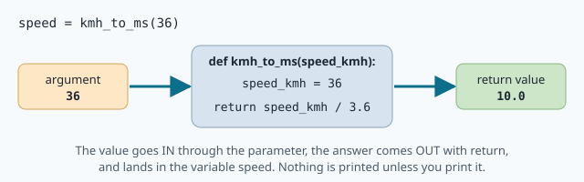
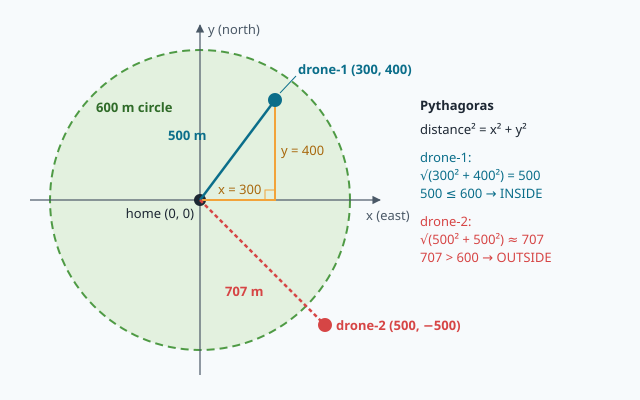

# Python first steps

A drone is 12 km from its landing point. It flies at 54 km/h. Its battery holds 100 Wh, it burns
400 W, and the rules say: *always keep 20 % for landing*. Will it make it?

You could take a pencil and work it out in five minutes. A computer does it in a millionth of a
second, a thousand times per second, for every vehicle of a fleet, without ever getting tired —
**if you tell it exactly how**. Writing those instructions is **programming**, and the language
NAVERA is written in is **Python**.

In this lesson you learn the first half of Python: storing values, computing, writing text,
making decisions and building your own **functions**. Every example is a real navigation question.

## Running Python

A Python **program** (or **script**) is a text file whose name ends in `.py`. You run it in the
terminal with:

```
python3 mission.py
```

Python reads the file **from top to bottom** and does each line in order. When it reaches the end,
the program stops.

You can also talk to Python directly, line by line. Type `python3` alone in the terminal: the prompt
becomes `>>>`. Type `2 + 3`, press `Enter`, Python answers `5`. This **interactive mode** is a perfect
calculator and the best place to try things out. Leave it with `exit()` (or `Ctrl+D`).

> [!TIP]
> Lines starting with `#` are **comments**: Python ignores them. They are notes for humans.
> NAVERA's code is full of them — they explain *why* the code does what it does.

## Variables: boxes with a name

A **variable** is a name that holds a value, like a labelled box:

```python
drone_name = "NAVERA-1"
cruise_speed_kmh = 54
battery_percent = 35
```

The `=` sign does **not** mean "equal" as in maths. It means "**put** the value on the right into the
box on the left". So this is fine:

```python
battery_percent = 35
battery_percent = battery_percent - 5     # now 30
```

Rules for names: letters, digits and `_`, no spaces, not starting with a digit. Upper and lower case
are different (`Speed` and `speed` are two boxes). Python programmers write names in
`lower_case_with_underscores`.

> [!NOTE]
> NAVERA engineers put the **unit at the end of the name**: `radius_m`, `speed_mps`
> (metres per second), `dt_s`, `altitude_m`, `heading_deg`. A speed of `15` means nothing; a variable
> called `speed_mps = 15` cannot be mistaken for km/h. Many real accidents came from mixing units —
> do as the professionals do.

## Numbers and arithmetic

Python has two kinds of numbers: **integers** (`int`, whole numbers like `54`, `-3`) and
**floats** (`float`, numbers with a decimal point like `3.6`, `0.5`). They mix freely.

| Operator | Means | Example | Result |
|---|---|---|---|
| `+` `-` | add, subtract | `600 - 450` | `150` |
| `*` | multiply | `15 * 60` | `900` |
| `/` | divide (always gives a float) | `900 / 15` | `60.0` |
| `//` | whole division | `130 // 60` | `2` |
| `%` | remainder | `130 % 60` | `10` |
| `**` | power | `300 ** 2` | `90000` |

`130 // 60` and `130 % 60` together turn 130 seconds into "2 min 10 s".

Python follows the usual priorities: `**` first, then `*` `/`, then `+` `-`. Use parentheses
whenever in doubt: `(100 - 20) / 100` is not the same as `100 - 20 / 100`.

### Speeds: km/h and m/s

People say km/h; robots compute in **m/s** (metres per second), because their sensors measure
metres and seconds. One kilometre is 1000 m and one hour is 3600 s, so:

```
1 km/h = 1000 m / 3600 s = 1 / 3.6 m/s        →   m/s = km/h ÷ 3.6   and   km/h = m/s × 3.6
```

54 km/h is `54 / 3.6 = 15` m/s: in one second the drone moves 15 metres.

### Distance, speed, time

The three are linked by one rule you already know:

| You know | You compute |
|---|---|
| speed and time | **distance = speed × time** |
| distance and speed | **time = distance ÷ speed** |

At 15 m/s for 60 s the drone covers `15 * 60 = 900` m. To cover 12 km = 12 000 m at 15 m/s it needs
`12000 / 15 = 800` s, a bit more than 13 minutes.

### Battery: energy and power

A battery stores **energy**, counted in **watt-hours** (Wh). A drone uses energy at a certain rate,
its **power**, in **watts** (W). Like water in a tank and the flow of a tap:

```
flight time (hours) = usable energy (Wh) ÷ power (W)
```

With 100 Wh, a 20 % reserve leaves `100 * (100 - 20) / 100 = 80` Wh usable. At 400 W that is
`80 / 400 = 0.2` h, which is `0.2 * 60 = 12` minutes. Our drone needs 13.3 minutes for 12 km…
it would **not** make it! This is exactly the kind of check a mission planner does before take-off.

## Text: strings and `print`

Text in Python is a **string** (`str`): characters between quotes, `"like this"` or `'like this'`.

```python
name = "NAVERA-1"
print("Hello", name)              # Hello NAVERA-1   (print puts a space between its items)
print("Status: " + "OK")          # Status: OK      (+ glues two strings together)
```

`+` only glues strings to strings. `"Battery: " + 35` is an error (`TypeError`): Python refuses to
guess whether you wanted text or a sum. Convert with `str(35)`, or better, use an f-string.

### f-strings: text with values inside

Put an `f` before the opening quote, and write variables (or whole calculations) between `{ }`:

```python
speed_kmh = 54
time_min = 13.3333333
print(f"{name} flies at {speed_kmh} km/h for {time_min:.1f} minutes")
# NAVERA-1 flies at 54 km/h for 13.3 minutes
```

The `:.1f` after the value means "as a number with **1** digit after the point". `:.0f` rounds to a
whole number, `:.2f` keeps two digits. You will see f-strings everywhere in NAVERA, for example in
its error messages: `f"{kmh:g} km/h is outside {lo:g}-{hi:g} km/h"`.

## Decisions: `if`, `elif`, `else`

A **comparison** gives a **boolean** (`bool`): `True` or `False`.

| Comparison | Means |
|---|---|
| `a == b` | equal (two `=`! one `=` is "put in the box") |
| `a != b` | not equal |
| `a < b`, `a <= b` | less than, less than or equal |
| `a > b`, `a >= b` | greater than, greater than or equal |

`if` runs some lines **only when** a condition is `True`:

```python
if battery_percent >= 50:
    print("OK")
elif battery_percent >= 20:
    print("LOW")
else:
    print("LAND NOW")
```

Python checks the conditions **from top to bottom** and runs only the **first** block whose
condition is true. `elif` means "else, if…"; `else` catches everything left. With 35 %: the first
test is false, the second is true → `LOW`, and Python skips the rest.

Look carefully at the shape:

- a **colon** `:` at the end of the `if`, `elif` and `else` lines;
- the lines that belong to a block are **indented** (pushed right) by 4 spaces.

**Indentation** is not decoration in Python: it is how Python knows which lines are inside the `if`.
The editor indents for you after a `:`; `Tab` adds 4 spaces, `Shift+Tab` removes them.

## Functions: your own commands

A **function** is a named piece of code that you can use again and again. You already used one:
`print(...)`. Here is how you make your own:

```python
def kmh_to_ms(speed_kmh):
    return speed_kmh / 3.6
```

- `def` starts the **definition**, then the name, then the **parameters** between parentheses
  (the inputs), then `:`;
- the indented lines are the **body**;
- `return` gives the answer back and **ends** the function.

Defining a function does nothing visible. It is **called** later:

```python
speed = kmh_to_ms(36)       # speed is now 10.0
print(kmh_to_ms(54))        # 15.0
```



The value you give when calling (`36`) is an **argument**; inside the function it lands in the
parameter `speed_kmh`.

### `print` is not `return`

This is the most common beginner bug. `print` shows a value **on the screen, for a human**.
`return` hands the value **back to the code that called the function**, so it can keep computing.
A function without `return` returns `None` — Python's word for "nothing":

```python
def bad(speed_kmh):
    print(speed_kmh / 3.6)        # shows 10.0 ... and returns None

x = bad(36) * 2                   # TypeError: None cannot be multiplied
```

The automatic checks of this course call your functions and look at what they **return**.

### Default values and functions calling functions

A parameter can have a **default value**, used when the caller does not give one:

```python
def flight_time_min(battery_wh, power_w, reserve_percent=20):
    ...

flight_time_min(100, 400)          # reserve_percent is 20
flight_time_min(100, 400, 0)       # reserve_percent is 0
```

And functions can call other functions — that is how big programs are built from small, tested
pieces. Your `inside_circle()` will call your `distance_from_home_m()`.

### Modules: functions other people wrote

`import math` gives you the **math module**: `math.sqrt(x)` (square root), `math.pi`,
`math.cos(...)`, `math.hypot(x, y)`… NAVERA imports `math` in almost every file.

## The 600 m circle

Navigation code is full of the same question: **is this point close enough?**

When NAVERA's day vision looks for the drone on the satellite map, it does not search the whole
map. It searches inside a **circle around the last known position**, whose radius is at most 600 m
(that is the constant `R_MAX_M = 600.0` in `day_pkg/day_pkg/nodes/day_subscriber.py`). Further away,
too many places look alike and the risk of a wrong match grows.

To answer "inside or outside?", put the centre at `(0, 0)` and measure positions in metres: `x` to
the **east**, `y` to the **north** (negative values mean west or south). The straight-line
distance is the long side of a right triangle — **Pythagoras**:



```
distance = √(x² + y²)            in Python:   math.sqrt(x ** 2 + y ** 2)
inside   = distance <= 600
```

`distance <= 600` is already `True` or `False`, so a function can simply
`return distance_from_home_m(x_m, y_m) <= radius_m` — no `if` needed.

## Reading error messages

Errors are normal: professionals get them all day. The trick is to **read the last line** of the
message, and the line number above it.

| Error | Usual reason |
|---|---|
| `SyntaxError` | a missing `:`, quote or parenthesis |
| `IndentationError` | the spaces at the start of a line are wrong |
| `NameError: name 'sped' is not defined` | a typo in a name, or using a variable before creating it |
| `TypeError` | mixing types: `"text" + 5`, or doing maths with `None` |
| `ZeroDivisionError` | dividing by 0 — test the value with an `if` before dividing |
| `NotImplementedError: TODO 3` | in this course: a TODO you have not written yet |

## In NAVERA

Everything in this lesson is in NAVERA's real code. Open
[navera_common/navera_common/vehicle.py](file:navera/navera_common/navera_common/vehicle.py): the
installer gives the vehicle's top speed in km/h, and NAVERA converts it exactly as you will:

```python
def max_speed_mps_from_env(environ=None) -> Optional[float]:
    ...
    lo, hi = MAX_SPEED_KMH_RANGE
    if not lo <= kmh <= hi:
        raise ValueError(f"{ENV_MAX_SPEED_KMH}={kmh:g} km/h is outside {lo:g}-{hi:g} km/h")
    return kmh / 3.6
```

An `if` that refuses an impossible value, an f-string message, and `return kmh / 3.6`.

In [navera_common/navera_common/geo.py](file:navera/navera_common/navera_common/geo.py), the
function `dead_reckon()` moves a position forward when nothing better is known. Its heart is
distance = speed × time:

```python
    d = spd * dt / EARTH_RADIUS_M
```

(`spd * dt` is the distance in metres; dividing by the Earth's radius turns it into an angle on the
globe — lesson 6 explains why.)

And in [day_pkg/day_pkg/vision_nav.py](file:navera/day_pkg/day_pkg/vision_nav.py), day vision keeps
only the past measurements that are **inside a circle** around the drone:

```python
pts = [p for p in self._bias if math.hypot(*_en(p[:2], near)) <= self.bias_radius_m]
```

`_en()` gives the (east, north) metres between two positions — your `x` and `y` — and
`math.hypot(x, y)` is exactly `math.sqrt(x ** 2 + y ** 2)`. You will be able to read the rest of
that line (a *list comprehension*) after lesson 4.

## Words of this lesson

| Word | Meaning |
|---|---|
| **program / script** | a `.py` file Python runs from top to bottom |
| **variable** | a name that holds a value (`speed_kmh = 54`) |
| **int / float** | whole number / number with a decimal point |
| **string (`str`)** | text between quotes |
| **f-string** | `f"...{value}..."`: text with values inside; `{x:.1f}` = 1 decimal |
| **boolean (`bool`)** | `True` or `False` |
| **condition** | a comparison that is True or False, used by `if` |
| **indentation** | the spaces at the start of a line; they make the blocks |
| **function** | named, reusable code: `def name(parameters):` … `return value` |
| **parameter / argument** | the input's name inside the function / the value given when calling |
| **return value** | what a function hands back to its caller |
| **`None`** | Python's "nothing"; what a function without `return` returns |
| **module** | a file of ready-made functions, loaded with `import` (`math`) |

## Check what you learned

<details><summary>1. What is the value of <code>x</code> after <code>x = 10</code> then <code>x = x * 3 + 1</code>?</summary>
<code>31</code>. The right side is computed first with the old value (10 × 3 + 1), then put back into <code>x</code>.
</details>

<details><summary>2. A rover drives at 7.2 km/h for 5 minutes. How far does it go?</summary>
7.2 km/h = 2 m/s. 5 minutes = 300 s. Distance = 2 × 300 = <b>600 m</b> — just on the edge of the circle!
</details>

<details><summary>3. What does <code>print(f"{707.1068:.0f} m")</code> show?</summary>
<code>707 m</code> — <code>:.0f</code> rounds to a whole number.
</details>

<details><summary>4. With <code>battery_percent = 20</code>, what does the if/elif/else of the course print? And with 50?</summary>
20 → <code>LOW</code> (20 >= 20 is True). 50 → <code>OK</code>: the first condition (50 >= 50) is already True,
so Python never looks at the others.
</details>

<details><summary>5. Is the point (−360, 480) inside the 600 m circle?</summary>
√(360² + 480²) = √(129600 + 230400) = √360000 = 600. Exactly on the circle: with <code>&lt;=</code> it counts as
<b>inside</b>. The minus sign does not matter, because squaring makes it positive.
</details>

Now open the **🛠️ Lab** tab.
