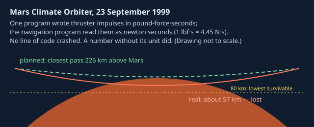
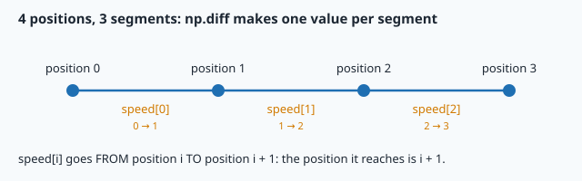

# Python for engineers: functions, classes and NumPy



> [!NOTE] Mission brief
> **23 September 1999, Mars.** NASA's Mars Climate Orbiter fires its engine to enter orbit, passes
> behind the planet, and is never heard from again. A week later NASA announced the cause, and the
> investigation board confirmed it: one ground program wrote the effect of small thruster firings in **pound-force·seconds**; the
> navigation software read the numbers as **newton·seconds**. Every value was 4.45 times too small, so
> the trajectory drifted for months. The orbiter passed about 57 km above Mars instead of the planned
> 226 km; below about 80 km it could not survive. (NASA Mishap Investigation Board, Phase I report,
> 10 November 1999.) No program crashed. A number without its unit did.
>
> NAVERA met a cousin of this bug in its review of 1 October 2026 (item R-1): a number without its
> context — one speed limit for every vehicle. You will see in "In NAVERA" what that broke.
>
> Today you start **NAVERA Lite**, the navigation stack you build in this course, with its first two
> parts: `vehicle.py` (vehicles, wind, battery) and `track.py` (a recorded flight). **Session 1 —
> Flight planner:** you write functions with units and decide whether a quad can fly an inspection in
> the wind. **Session 2 — Fleet and track detective:** you write classes, then hunt a wrong GPS fix in
> a recorded flight with NumPy. Each session ends with a badge: **Flight planner**, then **Track
> detective**.

**Objectives.** After this mission you can:

1. write **functions** whose names carry their units, that return a value and **refuse impossible
   input** with `ValueError`;
2. derive and compute the **wind triangle** by projection (dot products) and decide go / no-go;
3. build a **class** and a **subclass** with `super()`, and say where an inherited method comes from;
4. compute on a whole track with **NumPy** (`np.diff`, `np.hypot`, masks) and locate a glitch.

**You need:** mission 01 (unit vectors, the dot product, the jump gate) and mission 02 (the terminal).
🧰 boxes refresh the maths. ⏱ Reading: about 70 minutes with the ✏️ checks. Lab: 3 to 4 h (up to 6 h if
Python is new to you), in two sessions.

**Before you start** — answer without looking (if you miss two, reread mission 01 §3 and §5):

<details><summary>1. What is the unit vector from (0, 0) towards (3, 4)?</summary>
(0.6, 0.8): the vector divided by its length 5. Its length is 1.
</details>
<details><summary>2. Jump gate, v_max 100 m/s, margin 50 m: a fix 2 s after the last trusted one, 300 m away. Accepted?</summary>
No: the gate is 100 × 2 + 50 = 250 m, and 300 m > 250 m.
</details>
<details><summary>3. Which command shows the lines of <code>node.log</code> that contain <code>WARN</code>, and how do you count them?</summary>
<code>grep WARN node.log</code>; count with <code>grep -c WARN node.log</code> or <code>grep WARN node.log | wc -l</code>.
</details>

<details><summary>Workspace and words (open if you need them)</summary>

Left: **Course**, **Lab**, **✔ Check my work**. Right: **📝 Code** (editor, `Ctrl+S` saves) and
**⌨️ Terminal**. Your files are in `~/lessons/03-python-basics/`; your NAVERA Lite parts are in its
folder `navera_lite/`. To try one line of Python, type `python3` in the terminal (prompt `>>>`), and
`exit()` to leave.

| Word | Meaning | Français |
|---|---|---|
| **function / return** | named code that takes inputs and hands back one result | fonction / renvoyer |
| **exception** | an error object that stops the normal flow (`raise`) | exception |
| **class / object** | a blueprint / one value built from it | classe / objet |
| **attribute / method** | a value stored in an object (`self.x`) / a function of a class | attribut / méthode |
| **inheritance** | a class built on another one, taking its methods | héritage |
| **array** | NumPy's block of numbers of one type | tableau |
| **vectorised** | written as operations on whole arrays, no Python loop | vectorisé |
| **boolean mask** | an array of True/False that selects elements | masque booléen |
| **airspeed / ground speed** | speed through the air / speed over the ground | vitesse air / sol |
| **crab angle** | angle between heading and track, flown into a crosswind | angle de correction de dérive (« crabe ») |
| **endurance** | how long a vehicle can fly; **range**: how far | autonomie / distance franchissable |
</details>

## 1. Functions that carry their units, and refuse nonsense

A Python **function** turns inputs into one result. The line under `def` is the **docstring**: what
the function does, its units, an example.

```python
def climb_time_s(height_m, climb_rate_mps=2.5):
    """Seconds to climb height_m metres at climb_rate_mps m/s."""
    if climb_rate_mps <= 0:
        raise ValueError(f"climb_rate_mps must be > 0, got {climb_rate_mps}")
    return height_m / climb_rate_mps

climb_time_s(120)                         # 48.0   (the default 2.5 m/s is used)
climb_time_s(120, climb_rate_mps=4.0)     # 30.0   (an argument given by its name)
```

Three rules from this example, all used in the lab (plus one refresher, collapsed below):

- **The unit is at the end of every name**: `_m`, `_s`, `_mps` (m/s), `_deg`, `_wh`, `_w`. A variable
  `speed = 15` may be km/h or m/s; `speed_mps = 15` cannot. Had the Mars file said `impulse_lbfs`,
  someone would have asked.
- **Several results: a tuple.** `return e, n` returns the pair `(e, n)`; the caller **unpacks** it:
  `e, n = heading_vector(30)`.
- **Impossible input raises an exception.** `raise ValueError("…")` stops the function, and the error
  travels up to the caller. A climb rate of 0 has no answer: computing `120 / 0` or "some default"
  would be worse than stopping.

The caller can **catch** an exception and decide what to do:

```python
try:
    t = climb_time_s(120, 0)
except ValueError as e:
    print("refused:", e)          # refused: climb_rate_mps must be > 0, got 0
```

**Refuse, or say "no answer"?** Two different cases. *Impossible input* (a negative battery, a reserve of
150 %) is a bug in the caller: raise. *Unknown result* (no GPS yet, so no speed) is normal life: return
`None`, and let the caller decide. Never invent a value: mission 01's arbiter could only stay honest
because its sources never pretended.

> [!TIP] 🧰 Battery endurance in one line of physics
> A battery stores **energy** in watt-hours (1 Wh = 3 600 J); a vehicle draws **power** in watts.
> Energy ÷ power = time in **hours**. With a fraction `reserve` kept for landing:
> usable = battery × (1 − reserve). Example: 90 Wh, 250 W, reserve 20 % → 72 Wh ÷ 250 W = 0.288 h
> = **1 036.8 s** (17.3 min). Power depends on the **air**speed, not the ground speed: the wind changes
> how long you fly, not how much power you draw — that is why a headwind costs energy per kilometre.

<details><summary>🧰 Refresher: <code>return</code>, not <code>print</code> (open if unsure)</summary>

<code>print</code> shows a value to a human; <code>return</code> gives it to the code that called the
function. Checks test what your functions <b>return</b>. A function that ends without <code>return</code>
returns <code>None</code>. Example: with <code>def area(w, h): print(w * h)</code>, <code>x = area(2, 3)</code>
prints 6 and leaves <code>x = None</code>; <code>x * 2</code> then crashes with
<code>TypeError: unsupported operand type(s) for *: 'NoneType' and 'int'</code>.
</details>

> [!QUESTION] ✏️ Check
> Which of these should raise, and which should return `None`: (a) an endurance asked for a battery
> of −20 Wh; (b) the speed of a vehicle whose last two positions are both missing?

<details><summary>Answer</summary>
(a) raise <code>ValueError</code>: a negative battery is impossible, the caller has a bug. (b) return
<code>None</code>: "unknown" is a normal situation the caller must handle.
</details>

**Errors you will meet**, by the last line of the traceback (read that line first, then the line
number just above it):

| Last line | Usual cause |
|---|---|
| `SyntaxError: expected ':'` / `invalid syntax` | a missing `:`, quote or bracket |
| `IndentationError: unexpected indent` | wrong spaces at the start of a line (use 4 spaces) |
| `NameError: name 'h' is not defined` | a typo, or a variable of **another** function |
| `UnboundLocalError: local variable 'x' referenced before assignment` | `x = x - 1` inside a function when `x` was never set there (often a missing `self.`) |
| `TypeError: … 'NoneType' …` | a function you called forgot its `return` |
| `ValueError: math domain error` | `math.asin(1.2)`, `math.sqrt(-1)`: check the value first |
| `AttributeError: 'X' object has no attribute 'y'` | the object never got `self.y` (a typo, or a constructor that did not run) |
| `TypeError: only length-1 arrays can be converted…` | `math.cos(array)`: use `np.cos` |
| `NotImplementedError: TODO 4` | in this course: a TODO you have not written yet |

> [!WARNING] f-strings and quotes (Python 3.10)
> `f"{row["alt_m"]}"` fails with `SyntaxError: f-string: unmatched '['`: inside `{ }` use the other
> quote, `f"{row['alt_m']}"`. Formats: `f"{7.02098:.2f}"` → `7.02`; `f"{263:5d}"` → `  263`.

## 2. The wind triangle, by projection

**The problem.** A drone flies **through the air**; the air moves **over the ground**. To follow a line
on the ground (the **track**), it must point a little into the wind, and its speed over the ground
changes. The flight planner needs both numbers.

> [!TIP] 🧰 Radians, and the dot product
> `math.sin` and `math.cos` take **radians**: `math.radians(30)` = 0.5236, `math.degrees(0.5236)` = 30.
> `math.sin(30)` is the sine of 30 radians (−0.988), a silent bug. The inverse functions go the other
> way: `math.asin(0.6)` returns radians (0.6435); write `math.degrees(math.asin(0.6))` → 36.87 before you
> add it to a heading in degrees. **Dot product**:
> `a · b = aₑbₑ + aₙbₙ`. If `u` has length 1, `a · u` is the length of a's shadow along u (mission 01).

**Headings as vectors.** A heading ψ counts **clockwise from north** (east = 090°). Its unit vector,
in (east, north) components, is

```
u(ψ) = (sin ψ, cos ψ)        090° → (1, 0)     000° → (0, 1)     225° → (−0.707, −0.707)
```

East uses the **sine**: the opposite of the maths habit, because the angle starts at north. A wind
is also a vector, `w = (wₑ, wₙ)` in m/s, pointing where the **air goes**. Careful: weather reports
give where it comes **from**. "Wind **from** 045° at 5 m/s" blows **towards** 225°:
`w = 5 · u(225°) = (−3.54, −3.54)`.

**The idea.** The ground velocity is the sum of the air velocity and the wind:

```
v_ground = V · u(ψ) + w          V = true airspeed (m/s), ψ = heading
```

To follow the track T, split the wind on two unit vectors: along the track, `u(T)`, and 90° to its
**right**, `u(T + 90°)`. Two dot products:

```
along = w · u(T)               > 0: tailwind,  < 0: headwind
cross = w · u(T + 90°)         > 0: pushes the drone to the RIGHT of the track
```

The drone cancels `cross` by pointing into the wind by the **crab angle** c, with `V · sin c = cross`.
Then its own velocity has `V · cos c` left along the track. Why `V · sin c`? Turn the nose by c: your
air velocity gets a sideways part `V · sin c` and keeps `V · cos c` along the track (a right triangle
with hypotenuse V). Choose c so that the sideways part equals the wind's push:

```
c = asin(cross / V)          heading ψ = T − c          ground speed GS = V · cos c + along
```

**Worked example.** Track **090°** (east), V = **12 m/s**, wind 5 m/s towards 225°: w = (−3.54, −3.54).

```
u(T)       = (1, 0)               along = −3.54·1 + (−3.54)·0     = −3.54 m/s   (headwind)
u(T + 90°) = u(180°) = (0, −1)    cross = −3.54·0 + (−3.54)·(−1)  = +3.54 m/s   (pushes right)
c  = asin(3.54 / 12) = 17.1°      ψ = 90° − 17.1° = 072.9°        (point LEFT, into the wind)
GS = 12 · cos 17.1° − 3.54 = 11.47 − 3.54 = 7.93 m/s
```


**When there is no answer.** If `|cross| > V`, no heading cancels the crosswind (and `math.asin` would
crash with "math domain error"). If `GS ≤ 0`, the drone points the right way but makes no progress (GS = 0) or is blown backwards (GS < 0). Both
are impossible requests: the lab's `heading_for_track` raises `ValueError`, before calling `asin`.

> [!QUESTION] ✏️ Check
> 1. Track 000° (north), V = 10 m/s, wind towards 090° (east) at 6 m/s. Along, cross, heading, ground
>    speed?
> 2. A slow drone, V = 8 m/s, track 000°, wind towards east at 9 m/s. What should the planner do?

<details><summary>Answer</summary>
1. u(T) = (0, 1), u(T + 90°) = (1, 0): along = 0, cross = +6 (pushes right). c = asin(0.6) = 36.9°,
ψ = 0 − 36.9 = −36.9° = <b>323.1°</b> (keep headings in [0, 360): in Python <code>-36.9 % 360</code> is
323.1). GS = 10 · cos 36.9° = <b>8.0 m/s</b>.<br>
2. |cross| = 9 > 8: no heading works. Refuse the plan (<code>ValueError</code>), do not return a made-up
heading.
</details>

> [!WARNING] Common wrong ideas
> - "A north wind blows towards the north." It comes **from** the north: it blows towards 180°.
> - "Point the nose along the track and let the autopilot sort it out." The drone then drifts sideways
>   at `cross` m/s: 3.54 m/s is 212 m per minute.
> - `heading = T + c`: the drone turns **with** the wind and doubles the drift. It must point into it.

## 3. Classes: a vehicle is data plus behaviour

**The problem.** A planner handles a fleet. Each vehicle has numbers that belong together (cruise
speed, battery, power) and questions to answer about them (endurance, range). Passing five numbers to
every function is how units get mixed up. A **class** groups the data (**attributes**) and the
functions that use it (**methods**). An **object** is one value built from the class.

```python
import math

class Sensor:
    def __init__(self, name, rate_hz):                 # the constructor
        if rate_hz <= 0:
            raise ValueError(f"{name}: rate_hz must be > 0, got {rate_hz}")
        self.name = name                               # attributes: stored IN the object
        self.rate_hz = rate_hz

    def period_s(self):                                # a method
        return 1.0 / self.rate_hz

imu = Sensor("imu", 50)          # Python calls __init__(imu, "imu", 50)
imu.rate_hz                      # 50
imu.period_s()                   # 0.02
```

- `__init__` is the **constructor**: Python calls it when you write `Sensor(...)`. Its job: check the
  values, then store them.
- `self` is the object being built or used: `imu.period_s()` really is `Sensor.period_s(imu)`. Inside a
  method, `self.rate_hz` is **this** object's rate. Without `self.`, `rate_hz = …` makes a local variable
  that vanishes when the method returns.
- Names like `__init__`, `__repr__`, `__len__` are **special methods** that Python calls for you:
  `print(imu)` shows the text returned by `__repr__`, `len(track)` calls `track.__len__()`.

**Inheritance.** A camera **is a** sensor, with one more property. A **subclass** takes everything from
its parent and adds or changes some of it:

```python
class Camera(Sensor):                                  # Camera inherits from Sensor
    def __init__(self, name, rate_hz, hfov_deg):
        super().__init__(name, rate_hz)                # let Sensor check and store its part
        if not 0 < hfov_deg < 180:
            raise ValueError(f"{name}: hfov_deg must be in (0, 180), got {hfov_deg}")
        self.hfov_deg = hfov_deg

    def footprint_m(self, altitude_m):                 # width of ground seen, looking straight down
        return 2 * altitude_m * math.tan(math.radians(self.hfov_deg / 2))

cam = Camera("day", 10, 90)
cam.period_s()                   # 0.1   — Camera has no period_s: Python finds Sensor's
cam.footprint_m(100)             # 200.0
isinstance(cam, Sensor)          # True
```

`super().__init__(...)` calls the parent's constructor, so `name` and `rate_hz` are checked and stored
exactly as for any sensor. Writing `__init__` in a subclass **replaces** the parent's one: without the
`super()` line, the parent's code never runs.


> [!QUESTION] ✏️ Check
> 1. A method of a battery class contains `charge_wh = charge_wh - 10` instead of
>    `self.charge_wh = self.charge_wh - 10`. What happens?
> 2. `class Lidar(Sensor)` defines only `range_m(self)`. Where does `Lidar("l1", 20).period_s()` come
>    from, and what does it return?

<details><summary>Answer</summary>
1. <code>UnboundLocalError</code>: Python treats <code>charge_wh</code> as a new local variable and reads
it before it exists. Even without the error, a local would vanish at the end of the method: the object
would not change. Attributes always go through <code>self.</code><br>
2. From <code>Sensor</code>: Lidar inherits both <code>__init__</code> and <code>period_s</code>.
It returns 1/20 = 0.05 s.
</details>

The same pattern opens every ROS 2 node you will write from mission 10: `class MyNode(Node):` and
`super().__init__("my_node")` as the first line, so that ROS sets up the node's name, clock and
connections before your code adds its own.

## 4. NumPy: one operation on a whole flight

**The problem.** A flight log has thousands of positions. A Python loop over them works, but it is long
to write and slow. **NumPy** (`import numpy as np`) stores numbers in **arrays** of one type and applies
an operation to every element at once, in compiled code. This style is called **vectorised**.

```python
import numpy as np
e = np.array([0.0, 3.0, 3.0, 9.0])     # shape (4,), dtype float64
e[0], e[-1], e[1:3]                    # 0.0, 9.0, array([3., 3.])     (like a list)
e * 2, e - 100.0                       # every element × 2; 100 subtracted from every element
np.diff(e)                             # array([3., 0., 6.])  : the n − 1 differences e[i+1] − e[i]
np.hypot(np.array([3.0, 6.0]), np.array([4.0, 8.0]))   # array([ 5., 10.]) : √(a² + b²), element by element
e.sum(), e.mean(), e.max(), np.median(e)   # 15.0, 3.75, 9.0, 3.0 (median: the middle of the sorted values)
```

**Boolean masks** select elements by a condition, without a loop:

```python
v = np.array([4.0, 9.5, 3.8, 11.0])
fast = v > 5                     # array([False,  True, False,  True])
v[fast]                          # array([ 9.5, 11. ])
fast.sum()                       # 2          (True counts as 1)
np.flatnonzero(fast)             # array([1, 3])   : the indices of the True elements
np.argmax(fast)                  # 1          : the index of the FIRST True
np.flatnonzero(fast).tolist()    # [1, 3]     : a plain Python list of ints
```

Use the `np.` functions on arrays: `math.cos(array)` fails with `TypeError: only length-1 arrays can be
converted to Python scalars`; `np.cos(array)` works (and also on a single number).

**Worked example: the speeds of a track.** Four positions; the last one comes after a 2 s gap:

```python
t = np.array([0.0, 1.0, 2.0, 4.0])
e = np.array([0.0, 3.0, 3.0, 9.0])
n = np.array([0.0, 4.0, 10.0, 18.0])
seg = np.hypot(np.diff(e), np.diff(n))      # array([ 5.,  6., 10.])   three segment lengths (m)
seg.sum()                                   # 21.0                     the path length (m)
seg / np.diff(t)                            # array([5., 6., 5.])      three speeds (m/s)
```

4 positions give **3** segments. `speed[0]` goes from position 0 to position 1, so the **position
reached** at `speed[i]` is position `i + 1`. Here the last segment is 10 m long but took 2 s: dividing
by 1 s would have reported 10 m/s, an invented burst of speed.



> [!QUESTION] ✏️ Check
> `t = [0, 1, 2]`, `e = [0, 6, 6]`, `n = [0, 8, 20]` (s, m, m). Without running it: what do
> `np.hypot(np.diff(e), np.diff(n))` and its `.sum()` give? With `s` the speeds, what is
> `np.flatnonzero(s > 11) + 1`, and what does it mean?

<details><summary>Answer</summary>
Segments (6, 8) and (0, 12): lengths [10., 12.], sum 22.0 m. Speeds [10., 12.] m/s (1 s each).
<code>s > 11</code> is [False, True]: index 1, + 1 → <b>[2]</b>: position 2 was reached faster than
11 m/s.
</details>

## In NAVERA

NAVERA, IRIS's product, is written mostly in Python. Three items of its engineering backlog (described
here in words and numbers; NAVERA's code is not part of the course) are about this lesson:

- **One speed for every vehicle (R-1, review of 1 October 2026, severity high).** NAVERA had no vehicle
  speed setting: its arbiter used 100 m/s for the jump gate and its day and night vision used 30 m/s
  for their own motion checks, whatever the vehicle. On a fast fixed wing, the review found, real GPS
  fixes would be refused and every vision position rejected. The fix: one maximum speed per installation, given by the installer
  **in km/h**, converted to m/s in one place, and checked when NAVERA starts. A value that is not a
  number, or is outside a plausible range, stops NAVERA with a clear message instead of flying with a
  wrong limit. Units in names, one conversion, refuse nonsense: §1.
- **Never invent a value (LOC-11, review of 28 September 2026, severity critical).** When the camera did
  not know the speed, heading or altitude, it used 5 m/s, heading 0 and 400 m. Positions computed from
  these looked normal and were wrong. Unknown now means "no answer" (None).
- **A motion gate on vision (QA-9, simulator campaign of 30 September 2026).** One day-vision match
  jumped 554 m in 1 s and dragged the track onto wrong map tiles (0.4–1.1 km off). The fix refuses a
  match farther than `max_speed_mps × elapsed + 250 m` from the last one (the 250 m covers the tile
  size). Re-tested over 4 GPS losses in NAVERA's mission simulator: median 83 m, p90 258 m, worst
  448 m (it was up to 1 075 m). This is your mission-01 jump gate, applied to vision.

NAVERA's programs that run on ROS are classes built on ROS's `Node`, exactly as §3 shows.

## In NAVERA Lite

You write two parts of NAVERA Lite, the stack you build: [navera_lite/vehicle.py](file:./navera_lite/vehicle.py)
(TODO 1–9: wind, endurance, `Vehicle`, `FixedWing`) and [navera_lite/track.py](file:./navera_lite/track.py)
(TODO 10–13: `Track`). `vehicle.py` also holds the table `VEHICLES`, the maximum speed per type of vehicle
(drone 30, plane 100, boat 20, robot 10 m/s): mission 13 checks your settings against it, and Sim Lite
(mission 31) uses the same values. `Track` comes back in missions 04, 11, 24, 31 and 32. From the next
missions on, you receive the course's finished version of these parts, so a mistake made today never
breaks a later mission.

## 🐦 How birds do it

In 2022 a young bar-tailed godwit with a satellite tag flew from Alaska to Tasmania, about 13 560 km, in
about 11 days without landing. Godwits wait for favourable winds before they leave, and many migrating
birds correct their heading for crosswind drift, as your planner does. A tailwind is worth days of fat;
a headwind can make the same crossing impossible.

## Summary

1. A function **returns** its result; its name and arguments carry **units**; impossible input
   **raises** `ValueError`; an unknown result is `None`, never an invented value.
2. The wind triangle: `along = w · u(T)`, `cross = w · u(T + 90°)`, `sin c = cross / V`, heading
   `T − c`, ground speed `V cos c + along`. No answer if `|cross| > V` or `GS ≤ 0`.
3. A **class** groups data and methods; `self` is the object; a **subclass** calls `super().__init__`
   and inherits every method it does not redefine.
4. NumPy works on whole arrays: `np.diff` gives n − 1 segments, `speed[i]` reaches position `i + 1`,
   a **mask** and `np.flatnonzero` find the elements you want.

**Next mission:** data analysis with pandas: a whole flight campaign, cleaned and summarised.

## Check yourself

Answer without scrolling up.

<details><summary>1. Wind 4 m/s FROM the south. Write it as (wₑ, wₙ).</summary>
From 180° means towards 000°: (0, +4) m/s.
</details>

<details><summary>2. Track 270°, V = 15 m/s, no crosswind, 3 m/s headwind. Heading and ground speed?</summary>
c = 0, heading 270°, GS = 15 − 3 = 12 m/s.
</details>

<details><summary>3. Why must a subclass's <code>__init__</code> call <code>super().__init__(...)</code>?</summary>
Its own <code>__init__</code> replaces the parent's; without the call, the parent's checks and attributes
never happen, and inherited methods that use them fail with <code>AttributeError</code>.
</details>

<details><summary>4. A track has 500 positions. How many values does <code>np.diff(t)</code> have, and which position does <code>speed[41]</code> reach?</summary>
499; position 42.
</details>

<details><summary>5. (Mission 01) GPS is fresh with σ 12 m, day vision is fresh with σ 30 m. Source and state?</summary>
GPS (priority), σ 12 m ≤ 25 m: FIX.
</details>

Now open the **🛠️ Lab** tab.
