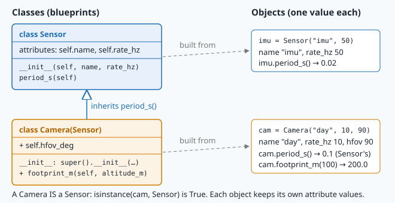
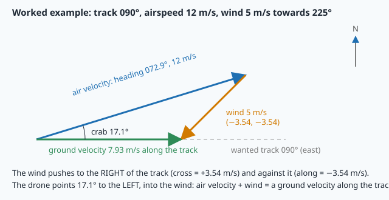

# Python for engineers: functions, classes and NumPy

> [!NOTE] In short
> - NAVERA is written in Python, and this lesson gives you the Python you need to read and write
>   it.
> - You learn **functions**, **modules**, **exceptions** (to refuse bad input) and **classes**
>   with inheritance.
> - With **NumPy** you compute on whole arrays of numbers at once, without loops.
> - You also use flight physics: the wind triangle, battery endurance and the turn radius.
> - In the lab you write a small navigation library and a mission planner for an inspection on the
>   coast.
> - NAVERA's `TrackVelocity` class is built like the `Track` class you write.

A survey drone takes off from a small harbour on a rocky coast. It must inspect a point
9 km away on the track 030° and come back. The wind blows at 5 m/s towards the south-west.
The drone flies at 12 m/s through the air, its battery holds 160 Wh, it uses 350 W, and the rules
say: **keep 20 % in reserve**. Can it do the mission? Which heading must it fly so that the wind
does not push it off its track?

A mission planner answers these questions in code, for every vehicle and every flight. NAVERA is
written in **Python**, and this lesson gives you the Python an engineer needs to read and write it:
the core language (fast), **functions**, **modules**, **exceptions**, **classes** (every ROS node
of lesson 10 is a class) and **NumPy** (arrays: the way to compute on thousands of numbers at once).
You will meet real maths on the way: the **wind triangle**, battery endurance and the turn radius
of an aircraft.

> [!NOTE]
> This lesson covers a lot of Python. Plan about 4–5 hours for the course and the lab together if
> you have done only one programming course. If a Python feature is new to you, try it in the
> interactive interpreter (`python3`, prompt `>>>`) right away. The official tutorial
> (docs.python.org/3/tutorial) covers every point in more detail; the sandbox has Python 3.10.

## 1. The core language in ten minutes

A Python **script** is a `.py` file that `python3 file.py` runs from top to bottom. Lines that
start with `#` are **comments**. Blocks are defined by **indentation** (4 spaces) after a line
that ends with `:`.

| Type | Examples | Notes |
|---|---|---|
| `int` | `54`, `-3`, `10**6` | whole numbers, no size limit |
| `float` | `3.6`, `1e-3`, `float("nan")` | 64-bit IEEE 754: `0.1 + 0.2` is `0.30000000000000004` |
| `str` | `"GPS"`, `'day'` | text; `+` joins strings, `len(s)` counts characters |
| `bool` | `True`, `False` | result of comparisons `==  !=  <  <=  >  >=`, combined with `and`, `or`, `not` |
| `None` | `None` | "no value"; what a function without `return` returns |

Operators: `+ - * /` (`/` always gives a float), `//` (integer division), `%` (remainder),
`**` (power). `130 // 60` is `2` and `130 % 60` is `10`: 130 s = 2 min 10 s.

> [!TIP]
> NAVERA puts the **unit at the end of every name**: `speed_mps`, `dt_s`, `heading_deg`,
> `radius_m`. A variable `speed = 15` can be km/h or m/s; `speed_mps = 15` cannot. Unit mix-ups
> have destroyed real spacecraft. Do the same in your code.

Because floats are binary approximations, **never compare floats with `==`**: test
`abs(a - b) < 1e-9` instead. You will see `6.123e-17` where you expect `0` (the cosine of 90°):
that is rounding, not a bug.

### Strings and f-strings

An **f-string** puts values inside text: `f"{name} flies at {speed_mps} m/s"`. After the value,
a colon starts a **format specification**:

| Code | Result | Meaning |
|---|---|---|
| `f"{7.02098:.1f}"` | `7.0` | fixed point, 1 decimal |
| `f"{7.02098:8.2f}"` | `    7.02` | **width** 8 characters, 2 decimals (aligned columns) |
| `f"{'quad':<10}|"` | `quad      \|` | text left-aligned in 10 characters (`>` right, `^` centre) |
| `f"{263:5d}"` | `  263` | an integer in 5 characters |
| `f"{0.004712:.2e}"` | `4.71e-03` | scientific notation |
| `f"{-0.597:+.2f} %"` | `-0.60 %` | always show the sign |

`round(x, n)` rounds a number to `n` decimals and returns a number (format specs return text).
Python rounds exact halves to the even neighbour: `round(2.5)` is `2`, `round(3.5)` is `4`.

> [!WARNING]
> **Quotes inside f-strings.** In Python 3.10, the expression inside `{ }` may not use the same
> quote as the f-string itself:
> ```
> print(f"{row["alt_m"]}")      →  SyntaxError: f-string: unmatched '['
> ```
> Use the other kind of quote inside: `f"{row['alt_m']}"`, or compute the value in a variable
> first. The error message does not mention quotes, so remember this one.

### Collections and loops

```python
alts = [0.0, 8.0, 120.5]          # list: ordered, changeable   alts[0], alts[-1], alts[1:3]
fix = (23.588, 58.383)            # tuple: ordered, fixed        lat, lon = fix   (unpacking)
row = {"t_s": 40.0, "src": "gps"} # dict: key -> value           row["src"], row.get("hdop", None)

for a in alts:                    # every item
    print(a)
for i, a in enumerate(alts):      # index and item
    print(i, a)
for t, a in zip([0, 2, 4], alts): # two lists side by side
    print(t, a)
while battery_wh > reserve_wh:    # repeat while a condition is true
    battery_wh -= 1.0
```

A **list comprehension** builds a list in one line:
`high = [a for a in alts if a > 100]`. NAVERA uses them everywhere, for example in
`day_pkg/day_pkg/vision_nav.py`:
`pts = [p for p in self._bias if math.hypot(*_en(p[:2], near)) <= self.bias_radius_m]`
(the `*` in front of `_en(...)` is explained at the end of section 2).

## 2. Functions

```python
import math

def heading_vector(heading_deg):
    """Unit vector (east, north) of a heading clockwise from north."""
    h = math.radians(heading_deg)
    return math.sin(h), math.cos(h)

east, north = heading_vector(30)    # 0.5, 0.866…
```

- `def name(parameters):` then an indented **body**. The string under the `def` is the
  **docstring**: what the function does, its units, an example.
- `return` ends the function and hands back a value. `return a, b` returns a **tuple**, and the
  caller can **unpack** it: `east, north = …`.
- **Default values**: `def flight_time_min(battery_wh, power_w, reserve_frac=0.2)`. Callers may
  pass arguments by position (`flight_time_min(100, 400)`) or by **keyword**
  (`flight_time_min(100, 400, reserve_frac=0.0)`).
- `print` is not `return`: `print` shows a value to a human, `return` gives it to the code that
  called the function. The checks of this course test what your functions **return**.

> [!NOTE]
> **Python note — `*` unpacking.** A `*` in front of a list or tuple **in a function call** passes
> its items as separate arguments:
> ```python
> math.hypot(*[3, 4])          # the same as math.hypot(3, 4)  → 5.0
> v = heading_vector(30)       # a tuple (east, north)
> print(*v)                    # the same as print(v[0], v[1])
> ```
> In a `def`, `*args` does the opposite: it collects any extra arguments into one tuple
> (`def f(*args):`). You will see both in NAVERA and in the lab files.

### Scope: variables live inside their function

A variable created inside a function is **local**: it exists only while that function runs.

```python
def distance(...):
    dl = math.radians(lon2 - lon1)     # local to distance()
    ...
def bearing(...):
    return math.atan2(math.sin(dl), …) # NameError: name 'dl' is not defined
```

`bearing()` cannot see the `dl` of `distance()`: each function must compute what it needs, or
receive it as a parameter. A function reads **global** constants (written at the top level of the
file, in CAPITALS by convention: `EARTH_RADIUS_M = 6_371_000.0`), but should never change them.

## 3. Modules

A **module** is a `.py` file. `import math` loads the standard maths module; `math.sqrt`,
`math.atan2`, `math.radians` live in it. Your own file is a module too:

```python
from navlib import Vehicle, wind_correction    # navlib.py in the same folder
```

When Python imports a file, it **runs** it from top to bottom. That is why scripts end with:

```python
if __name__ == "__main__":
    main()          # runs with "python3 navlib.py", NOT when another file imports navlib
```

`__name__` is `"__main__"` only for the file you started. In NAVERA, every node file ends this
way, and `setup.py` turns its `main()` into a ROS command (lesson 9).

## 4. Exceptions: refusing bad input loudly

When something is impossible, Python **raises an exception**: the normal flow stops, and the error
travels up to the caller. If nobody **catches** it, the program stops with a **traceback** (read
its **last line** first, then the line number just above it).

```python
def flight_time_min(battery_wh, power_w, reserve_frac=0.2):
    if power_w <= 0:
        raise ValueError(f"power_w must be positive, got {power_w}")
    ...

try:
    t = flight_time_min(100, 0)
except ValueError as e:
    print("refused:", e)        # refused: power_w must be positive, got 0
```

A safety-critical program **refuses** an impossible value instead of computing nonsense. NAVERA
does exactly this when the installer gives the vehicle's maximum speed
(`navera_common/vehicle.py`, see "In NAVERA" below): a wrong limit could let a spoofed GPS in.

Errors you will meet in this course, with their usual cause:

| Last line of the traceback | Usual cause |
|---|---|
| `SyntaxError: invalid syntax` / `expected ':'` | a missing `:`, quote or parenthesis |
| `SyntaxError: f-string: unmatched '['` | same quote inside and outside an f-string (see above) |
| `IndentationError: unexpected indent` | wrong spaces at the start of a line |
| `NameError: name 'dl' is not defined` | a typo, or a variable of another function (scope) |
| `TypeError: can only concatenate str (not "int") to str` | `"Battery: " + 35`: use an f-string |
| `TypeError: unsupported operand type(s) for *: 'NoneType' and 'int'` | a function that forgot `return` |
| `ValueError: math domain error` | `math.asin(1.2)`, `math.sqrt(-1)`: often degrees given instead of radians |
| `TypeError: only length-1 arrays can be converted to Python scalars` | `math.cos(array)`: use `np.cos` |
| `ZeroDivisionError`, `IndexError`, `KeyError` | divide by 0, index past the end, missing dict key |
| `NotImplementedError: TODO 3` | in this course: a TODO you have not written yet |

## 5. Classes and objects

A function computes; it forgets everything when it returns. Many things in a robot have a
**state** that lives on: a vehicle has a speed and a battery, a track has a list of positions, a
ROS node has publishers and timers. A **class** groups the state (**attributes**) and the
functions that use it (**methods**). An **object** (or **instance**) is one value of that class.



```python
class Vehicle:
    def __init__(self, name, cruise_ms, battery_wh, power_w):
        self.name = name                 # attributes: stored IN the object
        self.cruise_ms = cruise_ms
        self.battery_wh = battery_wh
        self.power_w = power_w

    def endurance_s(self, reserve_frac=0.2):
        usable_wh = self.battery_wh * (1 - reserve_frac)
        return usable_wh / self.power_w * 3600

quad = Vehicle("quad", 12.0, 160.0, 350.0)    # calls __init__
print(quad.cruise_ms)                         # 12.0
print(quad.endurance_s())                     # 1316.6 s
```

- `class Vehicle:` defines the class (names in `CamelCase`).
- `__init__` is the **constructor**: Python calls it when you write `Vehicle(...)`. Its job is to
  check the arguments and store them as attributes.
- `self` is the object being built or used. `quad.endurance_s()` is really
  `Vehicle.endurance_s(quad)`: Python passes the object as the first argument. Inside a method,
  `self.battery_wh` is **this** vehicle's battery. Forgetting `self.` in front of an attribute
  creates a local variable that disappears at the end of the method — a classic bug.
- Two objects of the same class have their own attributes:
  `Vehicle("wing", 20, 150, 220)` does not change `quad`.
- Names with two underscores on each side (`__init__`, `__len__`, `__repr__`) are **special
  methods**: Python calls them for you. `len(track)` calls `track.__len__()`, and `print(quad)`
  shows the text returned by `quad.__repr__()`. In an f-string, `{name!r}` inserts `repr(name)`:
  the text **with** its quotes (`'quad'`), useful in messages.

### Inheritance and `super()`

A **subclass** takes everything from its **parent class** and adds or changes some of it. A
fixed-wing aircraft *is a* vehicle, with one more property: a stall speed under which it falls.

```python
class FixedWing(Vehicle):                       # FixedWing inherits from Vehicle
    def __init__(self, name, cruise_ms, battery_wh, power_w, stall_ms):
        super().__init__(name, cruise_ms, battery_wh, power_w)   # let Vehicle do its part
        if cruise_ms <= stall_ms:
            raise ValueError("cruise speed below stall speed")
        self.stall_ms = stall_ms

    def turn_radius_m(self, bank_deg=30.0):
        ...

wing = FixedWing("wing", 20.0, 150.0, 220.0, 12.0)
wing.endurance_s()          # inherited from Vehicle: no need to write it again
isinstance(wing, Vehicle)   # True
```

`super().__init__(...)` calls the parent's constructor, so the attributes `name`, `cruise_ms`…
are set exactly as for any vehicle. This is precisely the first line of every ROS node in lesson
10, and of NAVERA's arbiter:

```python
class EstimatorNode(Node):                    # a ROS 2 node IS a Node, plus NAVERA's logic
    def __init__(self) -> None:
        super().__init__("estimator_node")    # rclpy's Node sets up the node's name, clock…
```

## 6. Three pieces of flight physics

### The wind triangle

An aircraft moves through the air; the air moves over the ground. The **ground velocity** is the
vector sum of the **air velocity** (airspeed `V` along the heading `ψ`) and the **wind** `w`:

```
v_ground = V · (sin ψ, cos ψ) + (w_east, w_north)          (east, north components)
```

Headings are measured **clockwise from north** (0° = north, 90° = east), so east uses `sin` and
north uses `cos` — the opposite of the maths convention. In this course a wind vector points
where the air **goes** (weather reports give where it comes **from**: a "north wind" blows
towards the south).



To follow a ground **track** `T`, split the wind into a component **along** the track and a
component **across** it (positive to the right of the track):

```
w_along = w_east · sin T + w_north · cos T
w_cross = w_east · cos T − w_north · sin T
```

The aircraft must cancel `w_cross` with its own velocity: it points into the wind by the
**crab angle** `c`, with `V · sin c = w_cross`. Then:

```
c = asin(w_cross / V)           (impossible if |w_cross| > V: no heading works)
ψ = T − c                       heading to fly
GS = V · cos c + w_along        ground speed along the track (must be > 0)
```

**Worked example.** Track `T = 030°`, `V = 12 m/s`, wind 5 m/s towards the south-west:
`w = (−3, −4)` m/s.

```
w_along = −3 · sin 30° + (−4) · cos 30° = −1.5 − 3.464 = −4.964 m/s   (a headwind)
w_cross = −3 · cos 30° − (−4) · sin 30° = −2.598 + 2.0  = −0.598 m/s   (pushes to the left)
c  = asin(−0.598 / 12) = −2.86°
ψ  = 30° − (−2.86°)    = 32.86°        → fly 2.9° to the RIGHT of the track
GS = 12 · cos(2.86°) − 4.964 = 7.02 m/s
```

On the way back (`T = 210°`) the headwind becomes a tailwind: `GS = 16.95 m/s`. The round trip
of 2 × 9 km takes `9000/7.02 + 9000/16.95 = 1282 + 531 = 1813 s = 30.2 min`.

### Battery endurance

A battery stores **energy** in watt-hours (1 Wh = 3600 J; a phone battery holds about 15 Wh).
A vehicle draws **power** in watts. With a reserve fraction `r` kept for landing:

```
endurance (h) = battery_Wh · (1 − r) / power_W
```

160 Wh, 350 W, `r = 0.2`: `128 / 350 = 0.366 h = 21.9 min`. The round trip needs 30.2 min:
**the quad cannot do this mission**, although 18 km at 12 m/s takes only 25 min in still air. The
wind costs more on the way out than it gives back on the way home.

### Turn radius of a fixed wing

A multirotor can stop and turn on the spot; an aircraft turns by **banking** (rolling) by an
angle `φ`. In a level turn, the horizontal component of the lift gives the centripetal force:

```
m · v² / r = m · g · tan φ      →      r = v² / (g · tan φ)
```

At 20 m/s and 30° of bank: `r = 400 / (9.81 × 0.577) = 70.6 m`. A day-vision search circle of
a few hundred metres is therefore much wider than the aircraft's turns — and the camera tilts
with the bank, which lesson 17 deals with.

## 7. NumPy: computing on whole arrays

A flight log has thousands of positions. A Python loop over them works, but it is slow and long to
write. **NumPy** (`import numpy as np`) stores numbers in **arrays** of one type and applies
operations to all elements at once, in compiled code — typically 10–100× faster. This style is
called **vectorised** code.

```python
import numpy as np
t = np.array([0.0, 1.0, 2.0, 3.0])          # shape (4,), dtype float64
e = np.array([0.0, 12.1, 24.3, 36.0])
n = np.array([0.0, 0.5, 0.9, 1.2])

e.shape, e.dtype, len(e)        # (4,), dtype('float64'), 4
e[0], e[-1], e[1:3]             # 0.0, 36.0, array([12.1, 24.3])  (slices like lists)
e * 2                           # every element × 2
np.diff(e)                      # [12.1, 12.2, 11.7]  : the n−1 differences
np.hypot(np.diff(e), np.diff(n))            # segment lengths, all at once
np.hypot(np.diff(e), np.diff(n)) / np.diff(t)   # segment speeds (element by element)
e.sum(), e.mean(), e.max(), np.median(e)    # reductions
```

**Boolean masks** select elements with a condition, with no loop:

```python
speeds = np.array([12.0, 11.8, 54.3, 40.1, 12.2])
fast = speeds > 25            # array([False, False, True, True, False])
speeds[fast]                  # array([54.3, 40.1])
fast.sum()                    # 2   (True counts as 1)
np.argmax(fast)               # 2   (index of the FIRST True)
```

**Use the `np.` functions on arrays**: `math.cos(array)` fails with
`TypeError: only length-1 arrays can be converted to Python scalars`; `np.cos(array)` works, and
also works on a plain number. A function written with `np.radians`, `np.cos`, `np.hypot` therefore
accepts a number **or** an array of any shape.

An operation between an array and a **number** applies the number to **every** element:
`e - 100.0` subtracts 100 from each east value, `t / 60` turns all the times into minutes. (Lesson 4
shows the general rule, **broadcasting**, for arrays of different shapes; you do not need it here.)

**Worked example: the speeds of a track.** Four positions, one per second:

```python
t = np.array([0.0, 1.0, 2.0, 3.0])
e = np.array([0.0, 3.0, 3.0, 9.0])
n = np.array([0.0, 4.0, 10.0, 18.0])
seg = np.hypot(np.diff(e), np.diff(n))      # [5., 6., 10.]   three segment lengths (m)
seg.sum()                                   # 21.0            the path length (m)
seg / np.diff(t)                            # [5., 6., 10.]   three speeds (m/s)
```

4 points give 3 segments. Speed `0` is the segment from point 0 to point 1, so the **point reached**
at speed `i` is point `i + 1`: keep this in mind when you look for the time of a glitch.

## 🐦 How birds do it

Every winter, the Wadden Sea on the coasts of the Netherlands, Germany and Denmark, and the Banc
d'Arguin in Mauritania hold millions of shorebirds: knots, oystercatchers, bar-tailed godwits and
many sandpipers. Many of them breed in Siberia or in the Arctic and fly thousands of kilometres to
reach these coasts; they are among the most important wetlands on the planet.

The bar-tailed godwit holds the record for non-stop flight. In 2022 a young godwit with a
satellite tag flew from Alaska to Tasmania, about 13 560 km, in about 11 days, without landing
once. Its average ground speed was `13560 / (11 × 24) = 51 km/h`. Scientists found that godwits
choose their departure day when the winds are favourable: with a tailwind, the same fat reserve
carries them much further — exactly the asymmetry of our quad, which loses more time in the
headwind than it wins back in the tailwind. A godwit even "plans a reserve": it leaves with a large
part of its body weight as fat, more than the trip strictly needs.

Navi the swallow does it differently: she cannot store that much fuel, so she feeds on insects
along the way. Two engineering answers to one equation — endurance = energy ÷ power — like the
quad and the fixed wing of this lesson.

## In NAVERA

Everything in this lesson is in NAVERA's code. Open
[navera_common/track.py](file:navera/navera_common/navera_common/track.py): the class that
estimates the ground velocity used to dead-reckon when vision loses the map.

```python
class TrackVelocity:
    def __init__(self, window_s: float = 20.0, min_span_s: float = 4.0, min_points: int = 3,
                 heading_sigma_deg: float = 5.0, speed_sigma_floor_mps: float = 0.5,
                 accel_mps2: float = 0.5):
        self.window_s, self.min_span_s, self.min_points = window_s, min_span_s, min_points
        self.heading_sigma = math.radians(heading_sigma_deg)
        ...
        self._pts = deque(maxlen=200)                  # (t, lat, lon, sigma_m)

    def add(self, t: float, lat: float, lon: float, sigma_m: float) -> None:
        if self._pts and t <= self._pts[-1][0]:
            if t < self._pts[-1][0] - 1.0:              # clock stepped back
                self._pts.clear()
            else:
                return
        self._pts.append((t, lat, lon, max(1.0, sigma_m)))
```

A constructor with default values, attributes with units in their names, and an `add()` method
that refuses a time that does not increase — the `Track.add()` you will write. (The `: float`
and `-> None` are **type hints**: documentation for humans and tools, ignored when the code runs.)

[navera_common/vehicle.py](file:navera/navera_common/navera_common/vehicle.py) refuses a bad
installation value with an exception:

```python
    try:
        kmh = float(raw)
    except ValueError:
        raise ValueError(f"{ENV_MAX_SPEED_KMH}={raw!r} is not a number (km/h)") from None
    lo, hi = MAX_SPEED_KMH_RANGE
    if not lo <= kmh <= hi:
        raise ValueError(f"{ENV_MAX_SPEED_KMH}={kmh:g} km/h is outside {lo:g}-{hi:g} km/h")
    return kmh / 3.6
```

And day vision computes the distance from a position to **all** 1120 map tiles in one vectorised
NumPy expression ([day_localizer.py](file:navera/day_pkg/day_pkg/nodes/day_localizer.py)):

```python
    def _haversine_to_coords(self, lat, lon):
        R   = 6_371_000.0
        la  = np.radians(self.coords[:, 0]); lo = np.radians(self.coords[:, 1])
        p1  = radians(lat);                  l1 = radians(lon)
        dp  = la - p1; dl = lo - l1
        a   = np.sin(dp / 2) ** 2 + np.cos(p1) * np.cos(la) * np.sin(dl / 2) ** 2
        return R * 2 * np.arctan2(np.sqrt(a), np.sqrt(1 - a))
```

`self.coords` is a 2-D array with one row per tile; `self.coords[:, 0]` is its first **column**
(all latitudes). `la - p1` is an array minus a number (every element); the result is an array of N
distances. Elsewhere the same
file keeps only the tiles inside the search circle with a boolean mask: `near[d <= radius_m]`.

## Glossary

| Word | Meaning |
|---|---|
| **format specification** | the part after `:` in `{x:8.2f}`: width, decimals, alignment |
| **tuple / unpacking** | a fixed sequence `(a, b)`; `a, b = f()` takes its items apart |
| **`*` unpacking** | `f(*seq)` passes the items of `seq` as separate arguments |
| **list comprehension** | `[expr for x in seq if cond]`: builds a list in one line |
| **scope / local variable** | where a name exists; a local exists only inside its function |
| **module** | a `.py` file loaded with `import` |
| **exception** | an error object that stops the normal flow (`raise`), caught with `try`/`except` |
| **traceback** | the error report Python prints; read its last line first |
| **class / object (instance)** | a blueprint / one value built from it |
| **attribute / method** | data stored in an object (`self.x`) / a function defined in a class |
| **constructor (`__init__`)** | the method Python calls to build a new object |
| **`self`** | the object a method works on |
| **inheritance / subclass** | a class built on another one, inheriting its methods |
| **`super()`** | access to the parent class, e.g. `super().__init__(...)` |
| **special method** | `__init__`, `__len__`, `__repr__`…: methods Python calls for you |
| **array / dtype / shape** | NumPy's block of numbers / their type / their size per dimension |
| **vectorised** | written as operations on whole arrays, without a Python loop |
| **boolean mask** | an array of `True`/`False` used to select elements |
| **crab angle** | angle between heading and track, flown to cancel the crosswind |
| **endurance** | how long a vehicle can fly; **range**: how far |

## Check what you learned

<details><summary>1. What does <code>f"{3.14159:7.2f}|"</code> print, and why does <code>print(f"{r["alt_m"]}")</code> fail in Python 3.10?</summary>
<code>   3.14|</code>: width 7, 2 decimals, right-aligned. The second one uses double quotes inside a
double-quoted f-string: <code>SyntaxError: f-string: unmatched '['</code>. Write <code>f"{r['alt_m']}"</code>.
</details>

<details><summary>2. A method writes <code>battery_wh = battery_wh - 10</code> instead of <code>self.battery_wh = self.battery_wh - 10</code>. What happens?</summary>
Python looks for a local variable <code>battery_wh</code> that does not exist yet:
<code>UnboundLocalError</code> (a kind of NameError). Even without the error, a local variable would vanish at the
end of the method: the object's battery would not change. Attributes always go through <code>self.</code>.
</details>

<details><summary>3. Why must <code>FixedWing.__init__</code> call <code>super().__init__(...)</code>?</summary>
Defining <code>__init__</code> in the subclass replaces the parent's one. Without the <code>super()</code> call,
<code>Vehicle.__init__</code> never runs: no <code>self.name</code>, <code>self.cruise_ms</code>… and the inherited
<code>endurance_s()</code> fails with <code>AttributeError</code>.
</details>

<details><summary>4. Same aircraft (20 m/s), track 090°, wind 5 m/s towards the north. Heading and ground speed?</summary>
w_cross = 0·cos 90° − 5·sin 90° = −5 (to the left), w_along = 0. c = asin(−5/20) = −14.48°, so ψ = 90° + 14.48° =
104.5° (turn right, into the wind), GS = 20·cos 14.48° = 19.36 m/s.
</details>

<details><summary>5. <code>s = np.array([12.0, 30.5, 11.9, 40.2])</code>. What are <code>s &gt; 25</code>, <code>(s &gt; 25).sum()</code> and <code>np.argmax(s &gt; 25)</code>? What does <code>math.hypot(*[6, 8])</code> return?</summary>
<code>array([False, True, False, True])</code>, <code>2</code> (True counts as 1) and <code>1</code> (the index of the first True).
<code>math.hypot(*[6, 8])</code> is <code>math.hypot(6, 8)</code> = <code>10.0</code>: the <code>*</code> unpacks the list into two arguments.
</details>

<details><summary>6. A track has 263 positions. How many elements do <code>np.diff(t)</code> and the speed array have, and why does that matter for the index of a glitch?</summary>
262: one per segment. Speed <code>i</code> is the segment from point <code>i</code> to point <code>i+1</code>, so the point reached
at a speed <code>speeds[i]</code> is <code>t[i + 1]</code>.
</details>

Now open the **🛠️ Lab** tab.
