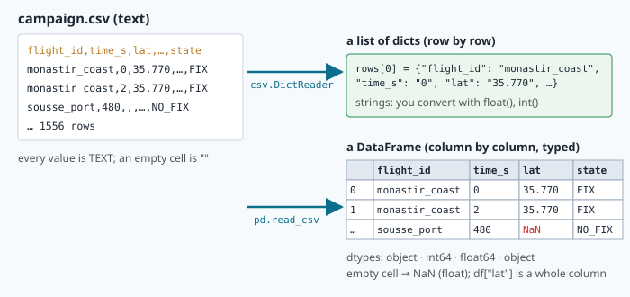
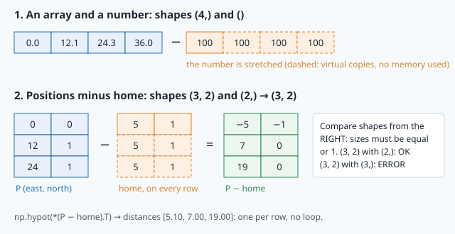

# Data analysis: reading a flight-test campaign

> [!NOTE] In short
> - After a test campaign, an engineer must check that the data is clean and measure what happened
>   in each flight.
> - You read CSV files and work with tables in **pandas**: filters, missing values, duplicates and
>   `groupby`.
> - You compute distances and speeds with NumPy, find GPS outages with **run-length** logic, and
>   use statistics that survive bad data.
> - In the lab you analyse four synthetic flights near Sousse, Tunisia, draw two figures with matplotlib and
>   write a short test report.
> - NAVERA's tools use the same methods: pandas for the map tile table, and the same statistics in
>   `evaluate_session.py`.

A test week is over. Four drone flights were logged in NAVERA's test area in Tunisia: along the
coast near Monastir, around the port of Sousse, over the hills of the Sahel inland, and a survey line
pattern (a grid) over the sea shore. The logger
wrote one row every 2 seconds per flight: 1556 rows, ten columns. The test engineer must answer
before the next campaign:

- Is the data clean? (Loggers write rows twice; sensors glitch; cells stay empty.)
- How long, how far, how high did each flight go?
- **How often and how long was GPS lost**, and what did NAVERA report meanwhile?
- How noisy is each position source?

You will answer with the standard tools of every data engineer: the `csv` module, **pandas**,
**NumPy**, **matplotlib** and **json**. The campaign is **synthetic** (generated for this course,
with realistic errors) but placed in NAVERA's test area: NAVERA's real recordings cover Sousse,
Tunisia, where it is developed. The
methods are the same ones NAVERA's team uses to produce the numbers in
`docs/VALIDATION_STATUS.md`.

## 1. The file: CSV

A **CSV** (comma-separated values) file is text: a **header** line with the column names, then one
line per row.

```
flight_id,time_s,lat,lon,alt_m,speed_mps,battery_pct,gps_valid,source,state
monastir_coast,0,35.769986,10.829994,0.0,0.44,100.0,1,gps,FIX
sousse_port,480,,,118.6,14.76,70.1,0,none,NO_FIX
```

The second line has **empty cells**: during that moment no source gave a position. Every value in
the file is text; the program decides what is a number.

### Opening a file: `with`

```python
with open("campaign.csv") as f:      # f is the open file
    header = f.readline()
# here the file is closed again, even if an error happened inside the block
```

`with` is a **context manager**: it opens the file, runs the indented block, and **always closes**
the file at the end — also when an exception stops the block. Without it, an error could leave the
file open (and, when writing, data not saved). Write files with `open(path, "w")`: `"w"` empties
the file first, `"a"` appends.

### The `csv` module: rows as dicts

```python
import csv
with open("campaign.csv", newline="") as f:
    rows = list(csv.DictReader(f))          # a list of dicts, one per row
rows[0]["flight_id"]                        # 'monastir_coast'
rows[0]["alt_m"]                            # '0.0'   ← a string!
alts = [float(r["alt_m"]) for r in rows if r["flight_id"] == "sousse_port"]   # list comprehension
```

`csv.DictReader` gives each row as a **dict** whose keys are the column names (lesson 3). Every value
is a **string**: you convert with `float()` or `int()`, and `float("")` on an empty cell raises
`ValueError: could not convert string to float: ''`. This is enough for small scripts — NAVERA's
own `evaluate_session.py` writes its results with the `csv` module. For analysis, pandas does the
conversions, the missing values and the grouping for you.



## 2. pandas: tables of typed columns

```python
import pandas as pd
df = pd.read_csv("campaign.csv")
df.shape            # (1556, 10): rows, columns
df.head(3)          # the first 3 rows
df.dtypes           # the type of each column
df.info()           # columns, non-null counts, dtypes
df.describe()       # count, mean, std, min, quartiles, max of the numeric columns
```

A **DataFrame** is a table; each column is a **Series** (a 1-D labelled array, built on a NumPy
array). `read_csv` guesses a **dtype** per column: `int64` for `time_s` and `gps_valid`, `float64`
for `lat`, `alt_m`…, and `object` (Python strings) for `flight_id`, `source`, `state`. An empty cell
becomes **NaN** ("not a number"), which is a float — that is why `lat` is `float64` even with empty
cells.

| Code | Gives |
|---|---|
| `df["alt_m"]` | one column (a Series) |
| `df[["time_s", "alt_m"]]` | several columns (a DataFrame) — note the double brackets |
| `df.loc[5, "alt_m"]` | one value: row **label** 5, column `alt_m` |
| `df.iloc[0]`, `df.iloc[-1]` | first / last row by **position** |
| `df["alt_m"].max()`, `.mean()`, `.median()`, `.std()`, `.quantile(0.95)` | statistics |
| `df["state"].value_counts()` | how many rows of each value |
| `df["alt_m"].to_numpy()` | the underlying NumPy array |

### Filtering with boolean masks

Exactly like NumPy masks (lesson 3): a comparison on a column gives a Series of `True`/`False`, and
indexing with it keeps the `True` rows.

```python
lost = df["gps_valid"] == 0                       # a boolean Series
df[lost]                                          # rows without GPS
df[(df["flight_id"] == "sousse_port") & lost]      # AND: &   OR: |   NOT: ~
df[~df["source"].isin(["gps", "day_vision"])]     # rows whose source is something else
```

Use `&`, `|`, `~` (not `and`, `or`, `not`), and put **parentheses** around each comparison:
`&` binds more strongly than `==`.

### Missing values

| Code | Meaning |
|---|---|
| `df["lat"].isna()` | `True` where the cell is empty |
| `df.isna().sum()` | number of empty cells per column |
| `df.dropna(subset=["lat", "lon"])` | drop rows with an empty `lat` or `lon` |
| `df["battery_pct"].ffill()` | fill a gap with the previous value ("forward fill") |

NaN **propagates** through arithmetic: `NaN + 1` is `NaN`, and `np.mean([1.0, np.nan, 3.0])` is
`nan`. pandas statistics **skip** NaN by default: `pd.Series([1.0, np.nan, 3.0]).mean()` is `2.0`.
Before you drop or fill, ask what the empty cell **means**. Here an empty position means NO_FIX: the
row is real and belongs to an outage; dropping it would make the outage look shorter.

### Duplicates, new columns, sorting

```python
df.duplicated().sum()                 # rows identical to an earlier row
df = df.drop_duplicates()             # returns a NEW DataFrame (the old one is unchanged)
df["alt_km"] = df["alt_m"] / 1000     # a new column, computed on the whole column at once
df = df.sort_values(["flight_id", "time_s"]).reset_index(drop=True)   # sort, then renumber 0..n−1
```

Most pandas methods return a **new** object. If a function receives a DataFrame and must not change
it, start with `out = df.copy()`.

### groupby: one answer per flight

**groupby** splits the table into groups, applies a function to each group, and combines the
results ("split–apply–combine"):

```python
df.groupby("flight_id")["alt_m"].max()            # a Series: max altitude per flight
df.groupby("flight_id").agg(                      # named aggregations: new_name=(column, function)
    rows=("time_s", "size"),
    t_last=("time_s", "max"),
    mean_speed_mps=("speed_mps", "mean"),
)
pd.crosstab(df["flight_id"], df["state"], normalize="index") * 100   # % of each state per flight
```

In a named aggregation, the function is a **name** that pandas knows (`"size"`, `"min"`, `"max"`,
`"mean"`, `"median"`, `"sum"`, `"std"`) **or** a Python function. A percentile needs a parameter
(0.95), so you give it as a small function written with `lambda`:

```python
df.groupby("source").agg(
    median_mps=("err", "median"),
    p95_mps=("err", lambda x: x.quantile(0.95)),    # x is the column of ONE group
)
```

> [!NOTE]
> **Python note — `lambda`.** `lambda x: x.quantile(0.95)` is a function without a name, written
> in one expression. It is exactly the same as
> ```python
> def p95(x):
>     return x.quantile(0.95)
> ```
> and you could write `p95_mps=("err", p95)` instead. pandas calls it once per group, with that
> group's values as `x`. Example: `square = lambda v: v * v`, then `square(3)` is `9`.

### A table from a dict

When a loop computes several values per flight, collect them in a **dict of dicts**
`{row label: {column: value}}`, then turn it into a DataFrame in one call:

```python
rows = {
    "flight_a": {"n_outages": 3, "longest_outage_s": 40.0},
    "flight_b": {"n_outages": 0, "longest_outage_s": 0.0},
}
table = pd.DataFrame.from_dict(rows, orient="index")    # the outer keys become the row index
#           n_outages  longest_outage_s
# flight_a          3              40.0
# flight_b          0               0.0
```

`orient="index"` says "the outer keys are the rows". (Without it, the outer keys would become the
columns.) Add `.sort_index()` to sort the rows by their label.

`shift()` inside a group gives the **previous row of the same flight** — and NaN on the first row
of each flight, so a flight never borrows the last position of the flight before it:

```python
g = df.groupby("flight_id")
df["dt_s"] = df["time_s"] - g["time_s"].shift()
```

## 3. Distances and speeds from positions

The speed logged by the autopilot and the speed computed from two consecutive positions should
agree. Comparing them measures the **noise of each position source**. For the distance between
consecutive fixes we use the **haversine** formula (lesson 6 derives it), written with NumPy so that
it works on whole columns:

```
a = sin²(Δφ/2) + cos φ1 · cos φ2 · sin²(Δλ/2)        d = 2 R · asin(√a)        R = 6 371 000 m
```

**Worked example.** London (51.507° N, 0.128° W, so longitude −0.128°) to Paris (48.857° N,
2.352° E): `Δφ = −2.650° = −0.046251 rad`, `Δλ = 2.480° = 0.043284 rad`,
`a = sin²(−0.023126) + cos(51.507°)·cos(48.857°)·sin²(0.021642) = 5.347e−4 + 0.6223 × 0.6581 × 4.683e−4
= 7.265e−4`, `d = 2 × 6 371 000 × asin(0.026953) = 343.5 km`.

With NumPy the same lines compute 1500 distances at once: `np.radians`, `np.sin`, `np.cos`,
`np.arcsin` work element by element on Series and arrays, and NaN in gives NaN out.

**How noisy will the speed be?** If each position has an independent error of standard deviation
`σ` per axis, the difference of two positions has `σ·√2` (variances add: `Var(a − b) = Var a + Var b`).
Divided by `Δt = 2 s`:

```
σ_speed ≈ √2 · σ / Δt         GPS, σ = 1.5 m  →  1.1 m/s        day vision, σ = 6 m  →  4.2 m/s
```

A speed computed from vision fixes 2 s apart is four times noisier than from GPS, even if each
vision fix is "only" 6 m off. You will measure this in the lab.

### NumPy broadcasting

In lesson 3, an array and a number met in one operation: `e - 100.0` subtracted 100 from every
element. This is the simplest case of **broadcasting**, NumPy's rule to combine arrays of different
shapes: a size-1 (or missing) dimension is stretched to match the other one. It is why the haversine
above works with a whole column `lat2` and a single number `lat1`.



```python
e = np.array([0.0, 12.1, 24.3])
e - 100.0                          # [-100., -87.9, -75.7]: 100 subtracted from every element
P = np.array([[0, 0], [12, 1], [24, 1]])   # shape (3, 2): one (east, north) point per row
home = np.array([5, 1])                     # shape (2,)
d = P - home                       # shape (3, 2): home subtracted from EVERY row
d[:, 0]                            # first column (all east values), shape (3,)
np.hypot(d[:, 0], d[:, 1])         # distance of every point to home: [5.10, 7.0, 19.0]
P.mean(axis=0)                     # column means: the centre of the points, shape (2,)
```

`d[:, 0]` means "all rows, column 0". `axis=0` means "along the rows", i.e. one result per column.
You will also meet a shorter form of the distance line: `np.hypot(*d.T)`. `.T` **transposes** the
array (rows become columns: shape (2, 3)), and `*` unpacks its two rows into the two arguments of
`np.hypot` (the `*` unpacking of lesson 3, section 2). Both forms give the same result; use the
one you can read.

Rule: compare the shapes from the **right**; two sizes fit when they are equal or one of them is
1. `(3, 2)` with `(2,)` fits; `(3, 2)` with `(3,)` does not:
`ValueError: operands could not be broadcast together with shapes (3,2) (3,)`.

### Worked example: from lat/lon to metres

Near a reference point `(φ0, λ0)`, latitude and longitude can be turned into metres east and north
with a **flat-Earth** (equirectangular) approximation (lesson 6 derives it; angles in radians,
`R = 6 371 000 m`):

```
east  = R · (λ − λ0) · cos φ0
north = R · (φ − φ0)
```

With London (51.507° N, −0.128°) as the reference, Paris (48.857° N, 2.352° E) is at
`east = 6 371 000 × (2.480 × π/180) × cos 51.507° = 171.6 km` and
`north = 6 371 000 × (−2.650 × π/180) = −294.7 km`: 341.0 km away. The haversine distance above is
343.5 km, so the flat formula is wrong by 0.7 % (2.5 km). For Madrid, 1263 km away, the error grows
to 5.6 km. Over the few kilometres of a test flight it stays around one metre. With broadcasting,
`lat` and `lon` can be whole columns and `φ0`, `λ0` single numbers: the helper `plot_tracks()` of the lab draws every flight in metres exactly like this.

## 4. Outages: run-length logic

An **outage** is a run of consecutive rows with `gps_valid == 0`. A loop with a counter works, but
NumPy finds every run at once: mark the lost rows with 1, pad with a 0 at both ends, and take
`np.diff`. It is `+1` where a run **starts** and `−1` just after it **stops**.


```python
lost = (gps_valid == 0).astype(int)            # [0 0 1 1 1 0 1 1 0]
edges = np.diff(np.concatenate([[0], lost, [0]]))
starts = np.flatnonzero(edges == 1)            # [2 6]
stops = np.flatnonzero(edges == -1)            # [5 8]   (stop is excluded, like a slice)
```

`np.flatnonzero(mask)` gives the indices where the mask is `True`. A run of rows `start … stop−1`
lasts `time_s[stop−1] − time_s[start] + Δt`: one lost row = one logging period of 2 s. Padding at the
end makes an outage that lasts **until the last row** close correctly — the classic bug of the loop
version.

## 5. Statistics that survive bad data

| Statistic | Definition | Sensitive to one wild value? |
|---|---|---|
| mean | `Σx / n` | yes |
| median | middle value of the sorted data | no |
| standard deviation | `√( Σ(x − mean)² / (n − 1) )` (pandas default) | yes, a lot |
| p-th **percentile** | value below which p % of the data lies | the high ones yes, the median no |

**Worked example.** Speed errors (m/s) `[2, 4, 4, 5, 7, 9, 30]` — one wild value. Mean `8.71`,
median `5`, standard deviation `9.66`. The 90th percentile with pandas' linear interpolation: position
`0.9 × (7 − 1) = 5.4` in the sorted list, so `9 + 0.4 × (30 − 9) = 17.4`. One glitch moves the mean
and the standard deviation a lot and the median not at all. That is why NAVERA's validation tables
report **median, p90 and max**, never only a mean: the median tells the typical case, p90 and the
maximum the bad cases.

> [!NOTE]
> Percentile definitions differ slightly between tools (`numpy.percentile`, `pandas.quantile`,
> a hand-written "nearest rank" like NAVERA's `pct()`). On large samples the difference is tiny; on
> 7 values it is not. Say which definition you used.

## 6. Plots with matplotlib (no screen)

The sandbox has no display, so matplotlib must draw into a file. Select the **Agg** backend before
importing `pyplot`, draw on an **axes** object, and save:

```python
import matplotlib
matplotlib.use("Agg")
import matplotlib.pyplot as plt

fig, ax = plt.subplots(figsize=(9, 3.5))       # a figure with one axes
ax.plot(t, alt, label="altitude")              # a line
ax.scatter(east, north, s=4, color="tab:orange")   # points
ax.axvspan(560, 976, color="tab:red", alpha=0.2)   # a shaded time interval
ax.set_xlabel("time (s)"); ax.set_ylabel("altitude (m)"); ax.set_title("sahel_hills")
ax.legend()
fig.savefig("altitude.png", dpi=100)
plt.close(fig)                                 # free the memory
```

`plt.show()` would try to open a window: do not use it here. The **📝 Code** editor displays PNG
files: open them from the file list.

## 7. Saving results: json

```python
import json
results = {"rows_clean": int(len(df)), "longest_outage": {"flight_id": "x", "duration_s": 416.0}}
with open("results.json", "w") as f:
    json.dump(results, f, indent=2)
```

JSON holds dicts, lists, strings, numbers, `true`/`false` and `null`. As in lesson 3, convert
NumPy/pandas scalars with `int()`, `float()`, `bool()` first.

## Errors you will meet

| Message (last line) | Meaning |
|---|---|
| `KeyError: 'alt'` | no column with that name: check `df.columns` (spelling, spaces) |
| `ValueError: could not convert string to float: ''` | `float()` on an empty CSV cell (csv module) |
| `TypeError: unsupported operand type(s) for -: 'str' and 'int'` | a column is `object` (text): look at `df.dtypes` |
| `ValueError: operands could not be broadcast together with shapes (3,2) (3,)` | array shapes that do not fit the broadcasting rule (section 3) |
| `ValueError: The truth value of a Series is ambiguous` | `and`/`or`/`if` used on a Series: use `&`, `\|` and parentheses |
| `SettingWithCopyWarning` | you changed a filtered **view**; build a new DataFrame (`.copy()`) or use `.loc[mask, "col"] = …` |
| a result is `nan` | NaN propagated: a NumPy function on data with empty cells; use pandas methods or drop NaN first |
| `SyntaxError: f-string: unmatched '['` | `f"{r["alt_m"]}"`: use the other quote inside (lesson 3) |

## 🐦 How birds do it

Bird scientists are data engineers too. Shorebirds such as bar-tailed godwits, knots and
sandpipers have been counted and tracked for decades on the great tidal flats where they stop or
winter — the Wadden Sea in Europe, the Yellow Sea in Asia, the coasts of New Zealand and Australia.
In 2022 a tagged young godwit flew non-stop from Alaska to Tasmania, about 13 500 km in 11 days. A satellite or
GPS tag on a godwit produces exactly our kind of file: one row per fix, with time, latitude,
longitude, sometimes altitude and battery voltage, and **gaps** when the tag could not get a fix or
had too little solar energy to send it. Before any conclusion, the scientists remove duplicate
transmissions and impossible positions (a "fix" 500 km away for a few minutes), then group the rows
per bird and per season — the same cleaning and groupby of this lesson.

Tiny birds are tracked differently. A **light-level geolocator** of about one gram records only the
light intensity and the time. From the times of sunrise and sunset the scientists compute, once per
day, the length of the day (which gives the latitude) and the time of local noon (which gives the
longitude). These positions are coarse — typically 100–200 km — and the latitude is unusable around
the equinoxes, when day length is the same everywhere. With such tags, Arctic terns were shown in
2010 to fly about 70 000 km per year between the Arctic and the Antarctic. Good analysis means knowing
the **error of each source**, exactly like comparing GPS and day vision in our speed check.

Navi has never carried a tag, but ringing and tracking studies of her species show that barn swallows
from Europe spread over a large part of Africa for the winter — a result that only exists because
thousands of messy records were cleaned and grouped.

## In NAVERA

NAVERA's day vision reads its map tile table with pandas
([day_localizer.py](file:navera/day_pkg/day_pkg/nodes/day_localizer.py)):

```python
        df    = pd.read_csv(CSV_PATH)
        df    = df.rename(columns={"filename": "imageName"})
        total = len(df)
```

and keeps only the rows whose image exists with `df.iloc[valid_idx].reset_index(drop=True)` — the
same `reset_index` you use after cleaning.

The tool that measures each source against GPS in a recorded session,
[evaluate_session.py](file:navera/navera_tools/evaluate_session.py), reports exactly the
statistics of section 5, with its own nearest-rank percentile:

```python
def pct(v, q):
    s = sorted(v)
    return s[min(len(s) - 1, int(round(q / 100.0 * (len(s) - 1))))]
...
    for (src, mode), errs in sorted(groups.items()):
        within = [100.0 * sum(e < d for e in errs) / len(errs) for d in (50, 100, 300)]
        print(f"{src:10s} {mode:14s} {len(errs):5d} {pct(errs, 50):7.0f}m {pct(errs, 90):7.0f}m "
              f"{max(errs):7.0f}m {within[0]:5.0f}% {within[1]:5.0f}% {within[2]:5.0f}%")
```

A group per (source, mode), the median, p90, maximum, and the share of errors below 50, 100 and
300 m — printed with the format widths of lesson 3. Its docstring states the rule of the team: "This
is how accuracy claims in docs/VALIDATION_STATUS.md must be produced from real data."

## Glossary

| Term | Meaning |
|---|---|
| **CSV** | text table: a header line, then one line per row, values separated by commas |
| **context manager (`with`)** | runs a block and always cleans up after it (closes the file) |
| **DataFrame / Series** | pandas table / one labelled column |
| **dtype** | the type of a column: `int64`, `float64`, `object` (text), `bool` |
| **NaN** | "not a number": pandas' marker for a missing value |
| **boolean mask** | a Series of True/False used to select rows |
| **groupby / aggregation** | split rows into groups, compute one value per group |
| **`lambda`** | a small function without a name: `lambda x: x.quantile(0.95)` |
| **broadcasting** | NumPy's rule to combine arrays of different shapes |
| **shift** | the value of the previous (or next) row |
| **run-length** | describing a sequence by its runs of equal values |
| **percentile (p90, p95)** | the value below which 90 % (95 %) of the data lies |
| **median** | the 50th percentile: robust to outliers |
| **outlier / glitch** | a value far outside the plausible range, usually an error |
| **Agg backend** | matplotlib drawing into files, without a window |

## Check what you learned

<details><summary>1. <code>df["lat"]</code> has dtype float64 although some cells are empty. Why, and what does <code>df["lat"].mean()</code> do with them?</summary>
An empty cell becomes NaN, which is a float, so the column stays float64. pandas statistics skip NaN by default:
the mean is computed over the non-empty cells only (NumPy's <code>np.mean</code> would return nan).
</details>

<details><summary>2. Why <code>(df.a == 0) &amp; (df.b == 0)</code> and not <code>df.a == 0 and df.b == 0</code>?</summary>
<code>and</code> needs one True/False, but a Series holds many: Python raises "The truth value of a Series is ambiguous".
<code>&amp;</code> combines element by element. The parentheses are needed because <code>&amp;</code> binds more strongly than <code>==</code>.
</details>

<details><summary>3. Two flights are stored one after the other. What goes wrong if you compute <code>df["lat"].shift()</code> without groupby?</summary>
The first row of the second flight gets the last position of the first flight as its "previous" position: a step of
hundreds of kilometres and an absurd speed. <code>df.groupby("flight_id")["lat"].shift()</code> gives NaN there instead.
</details>

<details><summary>4. <code>gps_valid = [0, 0, 1, 1, 0, 0, 0]</code>, one row every 2 s. Runs and durations?</summary>
Padded lost array <code>[0, 1, 1, 0, 0, 1, 1, 1, 0]</code>; diff is +1 at 0 and 4, −1 at 2 and 7: runs (0, 2) and (4, 7).
Durations: (2 − 0) + 2 = 4 s and (12 − 8) + 2 = 6 s. The second one lasts until the end of the log.
</details>

<details><summary>5. Positions have σ = 3 m per axis, one row per second. Rough noise of the speed computed from them?</summary>
√2 × 3 / 1 ≈ 4.2 m/s. Halving the rate (Δt = 2 s) halves it to about 2.1 m/s; averaging over a longer window
reduces it further — that is why NAVERA fits a velocity over 20 s of fixes instead of using two.
</details>

<details><summary>6. A validation report gives only "mean error 12 m". What is missing?</summary>
The distribution: one bad fix of 1 km among good ones changes the mean a lot. Report median, p90 (or p95) and the
maximum, the number of samples, and the conditions (bench, simulation, flight).
</details>

<details><summary>7. <code>P</code> has shape (100, 2) and <code>v = np.array([3.0, 4.0, 5.0])</code>. Does <code>P - v</code> work? And <code>P - v[:2]</code>?</summary>
No: (100, 2) and (3,) do not fit from the right (2 ≠ 3), so NumPy raises "operands could not be broadcast together".
<code>v[:2]</code> has shape (2,), which fits: the vector (3, 4) is subtracted from every row.
</details>

Now open the **🛠️ Lab** tab.
