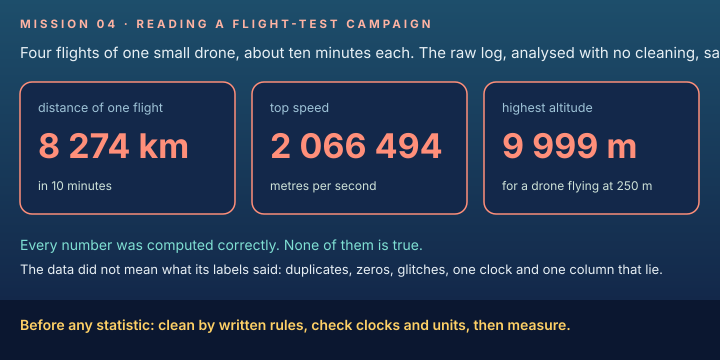
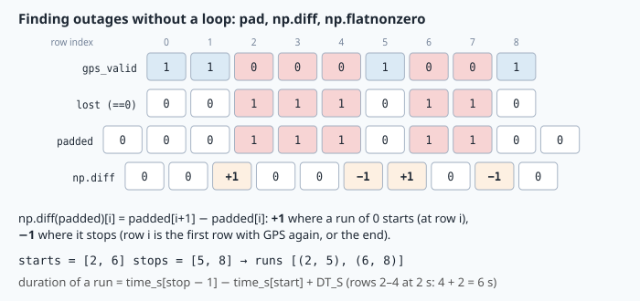
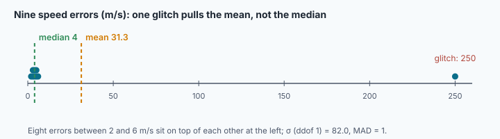

# Data analysis: reading a flight-test campaign



> [!NOTE] Mission brief
> **3 October 2026, NAVERA's validation report.** One sentence in it cancels weeks of results: *"The
> replay frames do not show the places their CSV labels say. Earlier accuracy figures computed on them
> are not valid."* However carefully the errors were computed, the data did not mean what its labels
> said, so the numbers built on it had to be withdrawn. In NAVERA's engineering backlog (RTC-2, now
> fixed), a clock module said its time was valid even when it disagreed with the system clock, so a clock
> left on **local** time instead of UTC gave a 1-hour error that nothing flagged.
>
> Today you are the test engineer of a campaign: four flights of one drone near Sousse and Monastir,
> Tunisia (synthetic data, made for the course). Session 1: clean and measure. Session 2: play detective
> (two of the labels lie), measure how noisy each position source is, and write the test report.
>
> **Start now:** do lab **Step 0** (two minutes, no code), then come back here for §1.

**Objectives.** After this mission you can:

1. clean a log with **written rules**, and count what each rule removed;
2. compute per-flight quantities with **groupby** (time steps, speeds, state shares) without mixing flights;
3. find outages as **runs** of lost rows, and turn them into durations;
4. choose between **mean/σ** and **median/MAD**, and justify the choice;
5. find **systematic errors** (a wrong clock, a wrong unit) that no statistic can repair, before
   computing anything.

**You need:** missions 02 (shell pipelines) and 03 (functions, dicts, numpy arrays and masks). pandas is
new: this lesson teaches what you use. ⏱ Reading: about 75 minutes with the ✏️ checks (up to 95 if
English or pandas is slow for you). Lab: 2 h 30 to 5 h.

**Before you start** (answer without looking; if you miss two, reread mission 03's numpy section):

<details><summary>1. Which shell command counts the lines of <code>log.csv</code> that contain <code>NO_FIX</code>?</summary>
<code>grep -c NO_FIX log.csv</code> (mission 02).
</details>
<details><summary>2. <code>v = np.array([3.0, 4.0, 12.0])</code>. What are <code>np.diff(v)</code> and <code>v[v > 3.5]</code>?</summary>
<code>[1., 8.]</code> (each element minus the one before) and <code>[4., 12.]</code> (a boolean mask keeps the True positions).
</details>
<details><summary>3. Two positions, 2 s apart, are 30 m apart. What speed do they give, and in which unit should its name end?</summary>
15 m/s, named like <code>speed_mps</code> (mission 03: the unit at the end of every name).
</details>

<details><summary>Words of this lesson (open if you need them)</summary>

| Word | Meaning | Français |
|---|---|---|
| **DataFrame** | a pandas table: named columns, one type per column | tableau de données |
| **NaN** | "not a number": pandas' mark for an empty cell | valeur manquante |
| **boolean mask** | a column of True/False used to keep rows | masque booléen |
| **groupby** | split the rows into groups, compute one answer per group | regrouper par |
| **outage** | a run of rows where GPS was lost | coupure |
| **robust** (statistic) | hardly moved by a few wild values | robuste |
| **median** | the middle value of the sorted data | médiane |
| **MAD** | median absolute deviation: the median of the distances to the median | écart absolu médian |
| **percentile** (p95) | the value below which 95 % of the data lies | centile |
| **systematic error** | an error that pushes every value the same way (a unit, a clock) | erreur systématique |
| **UTC** | the world reference time; local time = UTC + the zone's offset | temps universel |
</details>

## 1. A log is a table

The campaign's logger writes a **CSV** file: a header line with the column names, then one line per
row, one row every 2 s. Every value in the file is text; an empty cell means "no value".

```
flight_id,time_s,lat,lon,alt_m,speed_mps,battery_pct,gps_valid,source,state
harbour_a,43200,-33.906,18.421,40.2,8.10,97.5,1,gps,FIX
harbour_a,43202,,,40.6,8.30,97.4,0,none,NO_FIX
```

**pandas** reads the
whole file into a **DataFrame**, a table whose columns each have one type (a **dtype**):

```python
import pandas as pd
df = pd.read_csv("log.csv")
df.shape                     # (rows, columns)
df.dtypes                    # time_s int64, lat float64, flight_id object (= text) ...
df["alt_m"]                  # one column (a Series); df["alt_m"].max(), .mean(), .median()
df["state"].value_counts()   # how many rows of each value
df.isna().sum()              # how many empty cells in each column
```

An empty cell becomes **NaN**, which is a float: that is why `lat` stays `float64` even with holes.
Two facts about NaN matter for the whole mission. Every comparison with NaN is **False**, except
`!=`, which is True (`NaN == 0` and `NaN > 5000` are False; `NaN != 0` is True). And pandas statistics **skip** NaN:
`pd.Series([1.0, None, 3.0]).mean()` is 2.0, while numpy's `np.mean` would give `nan`.

**Masks** are mission 03's numpy masks on a column: a comparison gives a Series of True/False, and
`df[mask]` keeps the True rows. Combine masks with `&` (and), `|` (or), `~` (not), with **brackets**
around each comparison:

```python
df[(df["flight_id"] == "harbour_a") & (df["gps_valid"] == 0)]    # the lost rows of one flight
df[~(df["alt_m"] > 500)]                                         # every row NOT above 500 m
```

> [!QUESTION] ✏️ Check
> A column `lat` holds `35.8, NaN, 0.0`. What does `df["lat"] == 0` give? And `~(df["lat"] == 0)`?
> Which rows does `df[~(df["lat"] == 0)]` keep?

<details><summary>Answer</summary>
<code>[False, False, True]</code>, then <code>[True, True, False]</code>: it keeps the first two rows,
<b>including the NaN row</b>. Remember this when you write a cleaning rule: a rule written as
"remove where …" keeps the empty cells; a rule "keep where lat > 0" (any comparison but `!=`) throws them away.
</details>

## 2. Cleaning: written rules, counted

**Why.** Loggers write a line twice; a receiver with no position writes zeros; a sensor glitches. Fix
things "by eye" and nobody can repeat your analysis. A test engineer writes the rules down, applies them in
a fixed order, and **counts** what each removed. The raw file is never edited: it is the evidence.

**The idea.** One mask per rule, applied one after the other; the count of a rule is the number of
True values in its mask. Three pandas tools do the rest:

| Code | Gives |
|---|---|
| `df.duplicated()` | True for a row identical to an EARLIER row (the first copy is False) |
| `df.sort_values(["flight_id", "time_s"])` | the rows sorted by flight, then by time |
| `.reset_index(drop=True)` | the rows renumbered 0, 1, 2 … (the old numbers are dropped) |

Most pandas methods return a **new** DataFrame and leave the old one unchanged. `out = df[mask]`
does not change `df`.

**Worked example.** A 7-row log; the rules are "duplicate", then "lat and lon both 0", then
"altitude above 3 000 m":

| row | flight | time_s | lat | lon | alt_m | duplicate? | (0, 0)? | alt > 3000? |
|---|---|---|---|---|---|---|---|---|
| 0 | b | 0 | 12.10 | 15.05 | 80 | | | |
| 1 | a | 0 | 12.00 | 15.00 | 90 | | | |
| 2 | a | 2 | 0.00 | 0.00 | 91 | | **removed** | |
| 3 | a | 4 | NaN | NaN | 92 | | no (NaN) | |
| 4 | a | 4 | NaN | NaN | 92 | **removed** | | |
| 5 | a | 6 | 12.01 | 15.00 | 7 500 | | | **removed** |
| 6 | b | 2 | 12.11 | 15.05 | 81 | | | |

Counts: 1 duplicate, 1 at (0, 0), 1 bad altitude: 4 rows stay. Sorted, they are a0, a4 (the NaN row:
GPS lost, a real moment of the flight), b0, b2, renumbered 0–3. Row 4 is a copy of row 3 including
its two NaN, and `duplicated()` treats NaN cells as equal, so it is found.

> [!WARNING] Common mistake: `df.dropna()`
> `dropna()` removes every row with **any** empty cell: the NO_FIX row, and every row with no battery or
> speed value. Outages look shorter than they were. Drop a row only for a rule you can write down.

> [!QUESTION] ✏️ Check
> Why apply "duplicate" **first**? What would the counts be if a duplicated row also sat at (0, 0)?

<details><summary>Answer</summary>
Each row is counted under the first rule that removes it. If both copies of a (0, 0) row reached the
(0, 0) rule, it would count 2 instead of "1 duplicate + 1 at (0, 0)": the counts would describe the
logger's double writes as receiver glitches. Order is part of the rule; write it down.
</details>

## 3. One flight at a time: groupby

**Why.** A speed needs the **previous row of the same flight**. Take the previous row of the table, and
the first row of each flight gets the last position of the flight before it: an absurd step.

**The idea: split, apply, combine.** `df.groupby("flight_id")` splits the rows into one group per flight;
what you apply runs on each group alone; pandas combines the answers.

```python
g = df.groupby("flight_id")
g["alt_m"].max()                                  # one value per flight
g["time_s"].shift()                               # the PREVIOUS row's value, inside each flight
for fid, f in g:                                  # a loop: f is the DataFrame of one flight
    print(fid, len(f))
```

`shift()` moves a column down by one row, so each row sees the value of the row before; inside a
groupby it restarts for each flight, and the first row of a flight gets NaN. So
`df["time_s"] - g["time_s"].shift()` is the time step **within** each flight.

For the distance between two positions you get `haversine_m(lat1, lon1, lat2, lon2)`, finished, in your
`logbook.py`. It works on whole columns at once, NaN in → NaN out. (Mission 06 derives it, and you
write it there.)

**Worked example.** Two flights, sorted by flight then time:

| flight | time_s | lat | lon | shift(time_s) in the flight | dt_s | step_m | speed (m/s) |
|---|---|---|---|---|---|---|---|
| a | 100 | 51.5000 | −0.1000 | NaN | NaN | NaN | NaN |
| a | 102 | 51.5002 | −0.1000 | 100 | 2 | 22.2 | 11.1 |
| b | 50 | 51.6000 | −0.1000 | NaN | NaN | NaN | NaN |

0.0002° of latitude is 0.0002 × 111 195 m = 22.2 m. Without the groupby, row b would get dt = 50 − 102
= −52 s and a step of 11.1 km.

> [!QUESTION] ✏️ Check
> The first row of each flight has NaN in `dt_s`. Should you fill it with 0, or with 2 (the logging
> period)? What would each choice do to a speed?

<details><summary>Answer</summary>
Neither: there is no previous row, so there is no step and no speed. dt = 0 gives a division by zero
(inf); dt = 2 invents a step from nowhere. NaN says "unknown", and pandas statistics skip it.
</details>

## 4. Outages are runs

**Why.** "GPS was lost in 46 rows" is not a result: one loss of 92 s needs another position source, 46
losses of 2 s mean a noisy antenna. You need each **outage** (a run of consecutive lost rows), its start
and its duration.

**The idea.** Mark lost rows with 1, pad with a 0 at both ends, and take `np.diff`: it is +1 where a run
starts and −1 just after it ends. `np.flatnonzero(mask)` gives the positions where a mask is True.



**Worked example** (the figure): `gps_valid = [1, 1, 0, 0, 0, 1, 0, 0, 1]`, one row every 2 s from
t = 0. Lost: `[0, 0, 1, 1, 1, 0, 1, 1, 0]`; padded: `[0, 0, 0, 1, 1, 1, 0, 1, 1, 0, 0]`; diff:
+1 at 2 and 6, −1 at 5 and 8. Runs **(2, 5)** and **(6, 8)**, the end excluded like a slice. A run of
rows i0 … i1−1 lasts `t[i1−1] − t[i0] + Δt`: (8 − 4) + 2 = **6 s** and (14 − 12) + 2 = **4 s**. The
`+ Δt` is there because each row stands for one logging period: one lost row is 2 s of outage, not 0.
The padding at the end closes a run that lasts until the last row, the classic bug of loop versions.

> [!QUESTION] ✏️ Check
> `gps_valid = [0, 0, 1, 0]`. Runs? Durations with Δt = 2 s?

<details><summary>Answer</summary>
Padded lost: [0, 1, 1, 0, 1, 0]; diff: +1 at 0 and 3, −1 at 2 and 4. Runs (0, 2) and (3, 4): 4 s and 2 s.
The first starts at row 0, the second ends at the last row: both need the padding.
</details>

## 5. How noisy? Mean and σ, or median and MAD

**Why.** The speed from a source's positions minus the speed the autopilot logged is an **error**; its
spread says how noisy the source is. Which number describes that spread?

**Two families of statistics.** The **mean** and **σ** use every value, squared for σ: one wild value
moves them a lot. The **median** (the middle of the sorted values) and the **MAD** (the median of
|x − median|) only care about the order of the middle values: they are **robust**.

**Worked example.** Nine speed errors (m/s): `[2, 3, 3, 4, 4, 5, 5, 6, 250]`, the last one a glitch.

(σ here is pandas' `.std()`, which divides by n − 1, "ddof 1"; numpy's `np.std` divides by n. Say which.)

| | mean | σ (ddof 1) | median | MAD |
|---|---|---|---|---|
| with the glitch | 31.3 | 82.0 | 4 | 1 |
| without it | 4.0 | 1.31 | 4 | 1 |

One glitch multiplies the mean by 8 and σ by 60; the median and the MAD do not move.



**MAD to σ.** For Gaussian errors, half the values lie within 0.674 σ of the centre, so
MAD ≈ 0.674 σ and **σ ≈ 1.4826 × MAD**. Scaled this way, the MAD is a σ you can compare with a theory:
here 1.4826 × 1 = 1.48, close to the 1.31 of the clean values.

**Percentiles, the course rule.** The p-th percentile of n sorted values sits at position
`p/100 × (n − 1)`, with **linear interpolation** between neighbours (numpy's and pandas' default). p90
of the nine errors: position 0.9 × 8 = 7.2, between 6 (position 7) and 250 (position 8):
6 + 0.2 × 244 = **54.8**. The median says what is typical; p90/p95 and the maximum say how bad the bad
cases are. Report both.

**What noise to expect.** A speed from positions divides a position **difference** by Δt. The difference
of two independent errors of σ each has variance σ² + σ² = 2σ² (variances add), so its σ is √2 σ, and

```
σ_speed ≈ √2 · σ_position / Δt          example: σ = 3 m, Δt = 2 s  →  2.12 m/s
```

The logged speed has its own small noise; the two add as variances (0.3 m/s gives √(2.12² + 0.3²) = 2.14).

> [!QUESTION] ✏️ Check
> A source's errors have σ = 9.5 m/s but a MAD-based σ of 1.6 m/s. What does that say about its
> errors? Which number goes in a report as "typical noise", and what else must the report give?

<details><summary>Answer</summary>
Most errors are small (about 1.6 m/s), and a few are huge: they inflate σ. The robust 1.6 m/s is the
typical noise; the report must also give the tail (p95 or max) and the number of samples, because the
wild values are real events (a wrong match, a jump) that a user of the data must know about.
</details>

## 6. Errors that no statistic can repair

**Why.** The median survives a few glitches, not a **systematic error**: a clock in the wrong time zone, a
column in the wrong unit, frames labelled with the wrong places. They move a whole flight the same way,
and every statistic built on them is wrong, robust or not. So check the data **before** any statistic.

**The idea: compare with an independent record.**

- **Clocks.** Test sheets, radio logs and ATC records use **UTC**. Local time = UTC + the zone's offset
  (Tunisia: UTC+1 all year; Cape Town: UTC+2; Quito: UTC−5). Compare each flight's first logged time with
  its take-off on the sheet: a difference of a whole number of hours is a time-zone mistake. Another
  clue: one drone cannot fly two flights at the same time.
- **Units.** Compare a column with a physical limit (mission 03's `VEHICLES` table: a drone flies at most
  30 m/s) and with another measurement of the same quantity. If the logged speed is steadily 1.944 times
  the speed from positions, it is in knots (1 kn = 0.5144 m/s); 3.6 times, km/h.
- **Repair as data.** The raw file stays as it is. You write the corrections down
  (`{"flight_x": -7200}` seconds, `{"flight_y": 0.5144}`), apply them in code, and say so in the report.

**Worked example.** A boat log in Cape Town: the sheet says departure 06:00:00 UTC; the log's first
`time_s` is 28 800 (08:00:00). The difference, +7 200 s, is exactly 2 h: the logger kept South African
time. Its `speed_mps` has a median of 9.7 while the positions give 5.0 m/s: ratio 1.94, knots. The
corrections: clock −7 200 s, speed × 0.5144.

> [!QUESTION] ✏️ Check
> Quito: the sheet gives take-off at 23:40:00 UTC; the log's first `time_s` is 67 200. What happened, and
> which clock correction do you write (with its sign)?

<details><summary>Answer</summary>
67 200 s = 18:40:00, exactly 5 h before 23:40 UTC: the logger kept Ecuador's local time (UTC−5). The
log is BEHIND UTC, so the correction ADDS +18 000 s. Check the sign by recomputing the first row's time.
</details>

> [!WARNING] Common wrong ideas
> - "Clean data = no empty cells." Empty cells can be real (NO_FIX); remove rows only by written rules.
> - "The median protects me from bad data." From a few wild values, yes; from a wrong unit or clock, no.
> - "A bigger sample fixes a bias." More rows with the same wrong clock are still wrong.
> - "σ is σ." Say ddof 0 or 1, and robust or not.

## In NAVERA

NAVERA's validation report states each result with its **conditions** and **several statistics**,
never a mean alone: for example, day vision during a 13 km simulated flight over uniform desert with
GPS jammed, 185 matches, **median 351 m, p90 853 m** (simulator, 2026-10-01; that was the tile-retrieval
method of the time: with local feature matching, the same flight held to the end of the test); after a motion gate was
added to day vision, over 4 GPS losses in the mission simulator, **median 83 m, p90 258 m, max 448 m**
(QA campaign of 2026-09-30, backlog item QA-9). NAVERA's evaluation tool groups errors per source, as your
`noise_by_source` does. Its percentile takes the sorted sample at index `round(q/100 × (n − 1))`,
without interpolation (a "nearest-rank" rule): on small samples it differs from the course rule, and
mission 32 compares the two. The mission brief's sentence is in the same report: when the labels
of a data set are wrong, the numbers are withdrawn, however carefully they were computed.

**In NAVERA Lite**, these tools are your `navera_lite/logbook.py` (TODO 1–7); missions 31 and 32 use it, finished,
on simulated campaigns of the whole stack.

## 🐦 How birds do it

A tag on a bar-tailed godwit logs exactly our kind of table: time, latitude, longitude, battery, and
gaps when the tag could not get a fix. Before any conclusion (in 2022 a young godwit flew about
13 500 km non-stop from Alaska to Tasmania), scientists remove duplicate transmissions and impossible
positions, then group the rows per bird and per season. Light-level geolocators on small birds give a
position from sunrise and sunset times, so a wrong clock moves the bird: a 4-minute clock error shifts
the computed longitude by 1°, about 100 km near the equator.

## Summary

1. The raw log is evidence: never edit it. Clean with **written rules**, in a fixed order, and count
   what each rule removed; keep empty cells that mean something (NO_FIX).
2. Per-flight quantities need **groupby**: `shift()` inside it gives the previous row of the same flight.
3. An **outage** is a run of lost rows; padded `np.diff` finds every run; duration = t_last − t_first + Δt.
4. **Mean/σ** describe all the data and are pulled by wild values; **median/MAD** (× 1.4826) describe
   the typical value. Report a robust centre and spread, a tail (p95, max) and the sample size.
5. **Systematic errors** (clock, unit, labels) survive every statistic: find them first, by comparing
   with an independent record, and repair them as written corrections.

**Next mission:** git, so that every change to your code, and every correction, is recorded.

## Check yourself

Answer without scrolling up.

<details><summary>1. Why must a cleaning rule never be "drop the rows with an empty cell"?</summary>
Empty cells can be real events (no position = NO_FIX); dropping them shortens outages and removes rows
for unrelated reasons (a missing battery value). Only written, justified rules remove rows.
</details>

<details><summary>2. <code>gps_valid = [1, 0, 1, 0, 0]</code>, Δt = 2 s: runs and total outage time?</summary>
(1, 2) and (3, 5): 2 s + 4 s = 6 s. The second run reaches the end.
</details>

<details><summary>3. Errors [1, 1, 2, 2, 3, 40]: median, MAD, and the robust σ?</summary>
Median 2; |x − 2| = [1, 1, 0, 0, 1, 38] → sorted [0, 0, 1, 1, 1, 38], MAD 1; σ ≈ 1.48.
</details>

<details><summary>4. A log's first time is 3 h after the take-off on the sheet, in a country at UTC+3. What happened, and what do you write?</summary>
The logger kept local time. Write a correction of −10 800 s for that flight, apply it in code, say so in
the report; leave the raw file unchanged.
</details>

<details><summary>5. (Mission 01) GPS is fresh with σ 35 m, day vision fresh with σ 30 m. Which source does NAVERA's judge use, in which state?</summary>
GPS (priority, not precision), DEGRADED (35 m > 25 m).
</details>


Now open the **🛠️ Lab** tab.
