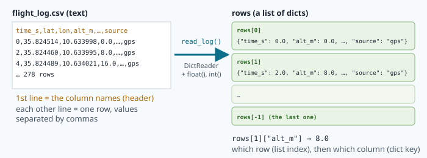

# Lists, loops and files: reading a flight log

The drone has landed. During its 9-minute flight, its computer wrote one line every two seconds:
the time, the position, the altitude, the speed, the battery, and whether the GPS was working.
That makes 278 lines. The test engineer has four questions before the next flight:

- How **high** did it go?
- How **fast** did it fly, on average?
- **How often**, and for **how long**, was the GPS lost?
- What did the **track** look like?

Reading 278 lines by hand would take an hour and you would make mistakes. With what you learn
today, Python answers in a few milliseconds — and the same program works on a log of a million
lines. You need four new tools: **lists**, **loops**, **dictionaries** and **files**.

## Lists: many values in one variable

A **list** is an ordered collection of values, written between square brackets:

```python
altitudes = [0.0, 8.0, 16.0, 24.0, 120.5]
sources = ["gps", "gps", "day_vision"]
empty = []
```

Each value has a position called its **index**. Indexes **start at 0**:

| Code | Result | Why |
|---|---|---|
| `altitudes[0]` | `0.0` | the first item |
| `altitudes[2]` | `16.0` | the third item |
| `altitudes[-1]` | `120.5` | negative index = from the end: the last item |
| `len(altitudes)` | `5` | how many items |
| `altitudes[1:3]` | `[8.0, 16.0]` | a **slice**: from index 1 up to (not including) 3 |
| `"gps" in sources` | `True` | is this value in the list? |

Lists can change:

```python
altitudes.append(130.0)     # add at the end -> 6 items
altitudes[0] = 1.5          # replace the first item
```

`altitudes[10]` on a 6-item list is an `IndexError`: there is no item number 10.

## `for` loops: do something for every item

A **loop** repeats some lines. The `for` loop takes the items of a list **one by one**:

```python
for alt in altitudes:
    print("altitude:", alt)
```

The variable `alt` holds the first item, the indented lines run; then `alt` holds the second item,
the lines run again… until the list is finished. Like `if`, the loop line ends with `:` and its
body is indented.

### Three patterns you will use all your life

**1. Add up (the accumulator).** Start a total at 0, add each item:

```python
total = 0
for alt in altitudes:
    total = total + alt         # or: total += alt
average = total / len(altitudes)
```

**2. Count.** Start a counter at 0, add 1 when a condition is true:

```python
lost = 0
for s in sources:
    if s != "gps":
        lost += 1
```

**3. Keep the best so far.** Start with the **first item** (not 0!), replace it when you find better:

```python
highest = altitudes[0]
for alt in altitudes:
    if alt > highest:
        highest = alt
```

Why not start at 0? Because if all the values are negative (a boat below the dock, a drone that
took off from a hill and flew down into a valley), the answer would wrongly be 0.

> [!TIP]
> Python has these three built in: `sum(altitudes)`, `max(altitudes)`, `min(altitudes)`,
> `len(altitudes)`. Use them in real life — but write the loops once yourself, so that you
> understand what they do. The lab asks for both.

### `range()`: counting numbers

`range(5)` gives `0, 1, 2, 3, 4`. `range(2, 10, 3)` gives `2, 5, 8` (start, stop before, step).
It is how you loop over **positions** instead of values:

```python
for i in range(0, len(altitudes), 2):      # every other row: 0, 2, 4…
    print(i, altitudes[i])
```

## `while` loops: repeat as long as…

A `while` loop repeats **as long as a condition is true**. It is the loop to use when you don't
know in advance how many turns you need:

```python
x = 450.0               # metres east of home
seconds = 0
while x <= 600:         # still inside the 600 m circle (lesson 3)
    x = x + 12          # flying east at 12 m/s
    seconds += 1
print("leaves the circle after", seconds, "s")
```

> [!WARNING]
> If the condition never becomes false, the loop never ends (an **infinite loop**): the program
> seems frozen. Press `Ctrl+C` in the terminal to stop it, then fix the condition.

## Dictionaries: values with names

A list finds values by **position**. A **dictionary** (`dict`) finds them by **name**. It stores
pairs **key → value**, between curly braces:

```python
row = {"time_s": 40.0, "alt_m": 121.3, "speed_mps": 14.2, "source": "gps"}
```

| Code | Result |
|---|---|
| `row["alt_m"]` | `121.3` |
| `row["battery_pct"] = 92.5` | adds a new key (or replaces its value) |
| `"source" in row` | `True` — is this **key** in the dict? |
| `row.get("heading_deg", 0)` | the value, or `0` if the key is missing (no error) |
| `row["heading"]` | `KeyError` — the key does not exist |
| `for key, value in row.items():` | loops over every pair |

A dictionary is also the perfect tool to **count things by name**:

```python
counts = {}
for s in ["gps", "gps", "day_vision", "gps"]:
    counts[s] = counts.get(s, 0) + 1
# counts is {"gps": 3, "day_vision": 1}
```

The first time a name is seen, `counts.get(s, 0)` gives 0, so it becomes 1. The next times, it
grows.

## A table = a list of dicts

Put the two together and you have a table, exactly like a spreadsheet: a **list** of rows, and each
row a **dict** whose keys are the column names.



```python
rows[0]["alt_m"]        # altitude of the first row
rows[-1]["time_s"]      # time of the last row
for r in rows:          # every row...
    print(r["time_s"], r["alt_m"])
```

## Files

A program forgets everything when it stops. To keep results, or to read data recorded by someone
else, you use **files**.

```python
with open("notes.txt", "w") as f:       # "w" = write: creates the file, or EMPTIES it
    f.write("flight checked\n")
    f.write(f"max altitude: {151.4:.1f}\n")

with open("notes.txt", "a") as f:       # "a" = append: adds at the end
    f.write("second line\n")

with open("notes.txt") as f:            # (default) "r" = read
    for line in f:
        print(line.strip())             # strip() removes the "\n" at the end
```

- `with open(...) as f:` opens the file and **closes it automatically** at the end of the block.
- `write()` does **not** go to a new line by itself: add `"\n"` (the **newline** character).
- `"w"` destroys what was in the file — the same trap as `>` in the terminal (lesson 2).

## CSV files and the `csv` module

**CSV** (*comma-separated values*) is the simplest table format: plain text, one row per line,
values separated by commas, and usually the **column names on the first line** (the **header**).
Every spreadsheet can open and save it, and NAVERA uses it for flight logs, datasets and results.

```
time_s,lat,lon,alt_m,speed_mps,battery_pct,gps_valid,source
0,35.824514,10.633998,0.0,0.3,99.8,1,gps
2,35.824460,10.633995,8.0,0.5,100.0,1,gps
```

Python's **`csv` module** reads it for you. `csv.DictReader` gives each row as a dict whose keys
come from the header:

```python
import csv

with open("flight_log.csv", newline="") as f:
    for line in csv.DictReader(f):
        print(line["alt_m"])
```

> [!WARNING]
> A CSV file is **text**. `line["alt_m"]` is the **string** `"8.0"`, not the number `8.0`.
> `"8.0" + 1` is an error and `"9.0" > "10.0"` is `True` (strings compare letter by letter)!
> Convert each value as you read it: `float(line["alt_m"])`, `int(line["gps_valid"])`.

## Drawing the data

Numbers are good, a picture is better. **matplotlib** is Python's most famous drawing library.
On this computer there is no screen for Python windows, so we tell matplotlib to draw **into a
PNG file** (the `Agg` backend), and open the image in the editor:

```python
import matplotlib
matplotlib.use("Agg")
import matplotlib.pyplot as plt

times = [r["time_s"] for r in rows]
alts = [r["alt_m"] for r in rows]
plt.plot(times, alts)
plt.xlabel("time (s)")
plt.ylabel("altitude (m)")
plt.savefig("altitude.png")
```

`[r["alt_m"] for r in rows]` is a **list comprehension**: a one-line loop that builds a list — "the
`alt_m` of each `r` in `rows`". It is the same as an empty list plus a `for` loop with `append`.

Without any library, you can even draw with text: `"#" * 12` gives `############`. One `#` per
10 m of altitude makes a little chart right in the terminal — you will build one in the lab.

## The longest GPS outage

The hardest question of the lab is "*how long was the longest GPS outage?*". The log has a column
`gps_valid`: `1` when the GPS works, `0` when it is lost. We want the longest run of `0`s in a row.
The trick is to carry **two** variables through the loop:


- `run` — how many `0`s in a row **right now**: it grows on a `0` and drops back to 0 on a `1`;
- `best` — the biggest `run` seen so far.

Check your idea on the tricky cases: the GPS is never lost (answer 0), or it is lost until the very
last row (the run must still count).

## 🐦 How birds do it

Scientists read flight logs too — written by birds.

In 2007, a team led by the Danish biologist Carsten Egevang fitted **Arctic terns** nesting in
Greenland and Iceland with **geolocators**: tiny loggers on a leg ring. A geolocator has no GPS. It
only writes, again and again, two columns: the **time** and **how bright the light is**. From those
two columns alone, scientists compute where the bird was each day. The time of local noon gives the
longitude; the length of the day gives the latitude. It is rough — a couple of hundred kilometres —
but over a whole ocean, that is enough.

One year later the team caught the same birds, downloaded the logs and drew the tracks. The terns had
flown from Greenland down to the seas near Antarctica and back, on a long S-shaped route: on average
about **70 900 km in one year** (published in 2010, in the journal *PNAS*). It was the longest
migration ever measured for any animal.

Look at what the scientists did with the data: a **list** of rows, a **loop** over every row, a
**dictionary** per day, and questions like "where was the bird furthest south?" or "how long did it
stop over the North Atlantic?" — the same pattern as finding the longest GPS outage.

Arctic terns can live 30 years. With Python: `30 * 70900` is more than **2 million km** in a
lifetime — enough to go to the Moon and back almost three times.

NAVERA's CSV flight log is the same idea, with one row every two seconds instead of one per day.

## In NAVERA

NAVERA reads flight CSV files exactly like this. When the camera package **replays** a recorded
flight (instead of a live camera), [camera_publisher.py](file:navera/camera_pkg/camera_pkg/nodes/camera_publisher.py)
does:

```python
            with open(self.csv_path, newline="") as fp:
                reader = csv.DictReader(fp)
                for idx, row in enumerate(reader):
                    ...
                    lat = _to_float_or_none(row.get("lat"))
                    lon = _to_float_or_none(row.get("lon"))
                    alt = _to_float_or_none(row.get("altitude_m"))
                    ...
                    # GPS rule: must be valid in CSV AND allowed by config
                    gps_valid = (lat is not None) and (lon is not None) and self.default_gps_valid
```

`csv.DictReader`, a `for` loop over the rows, `row.get(...)`, and a conversion to `float`.
Its helper `_to_float_or_none()` turns an **empty** cell into `None` instead of crashing — because
in NAVERA's logs, a missing GPS is written as empty `lat` and `lon` cells. Look at a real one:

```bash
head -6 ~/navera/camera_pkg/camera_pkg/data/thermal/flight_ready.csv
```

Frame 4 is called `…NOGPS…` and its `lat,lon` cells are empty. (The comment in the code says why
NAVERA never puts a made-up number there: "*Unknown stays unknown (None): a default would be read
downstream as a measured altitude*". An invented value is worse than no value.)

After a real test session, the engineers run `navera_tools/evaluate_session.py`, which measures
each source against GPS and prints the median and the worst errors, and can save them as CSV
(`--csv out.csv`) — the same loops, counts and files as today, on bigger data.

> [!NOTE]
> The log of this lab is **synthetic**: it was generated by a program
> (`/data/academy/04-python-data/make_flight_log.py`) to look like a real flight, with exactly known
> values. That is common practice: you test your analysis tools on data whose answers you know,
> before trusting them on real flights.

## Words of this lesson

| Word | Meaning |
|---|---|
| **list** | an ordered collection: `[1, 2, 3]` |
| **index** | the position of an item, starting at 0; `-1` is the last |
| **slice** | a part of a list: `rows[10:20]` |
| **loop** | lines that repeat: `for` (for each item) or `while` (as long as…) |
| **accumulator** | a variable that collects a result through a loop (a total, a count, a best) |
| **dictionary (`dict`)** | pairs key → value: `{"alt_m": 120.0}` |
| **key** | the name used to find a value in a dict |
| **file** | data kept on disk; `open(path, "r" / "w" / "a")` |
| **newline (`\n`)** | the invisible character that ends a line of text |
| **CSV** | a text table: one row per line, values separated by commas, header first |
| **header** | the first line of a CSV, with the column names |
| **list comprehension** | a one-line loop that builds a list: `[r["alt_m"] for r in rows]` |
| **matplotlib** | Python's drawing library; with `Agg` it draws into image files |

## Check what you learned

<details><summary>1. <code>gps = [1, 1, 0, 1]</code>. What are <code>gps[0]</code>, <code>gps[-1]</code> and <code>len(gps)</code>?</summary>
<code>1</code> (the first), <code>1</code> (the last), <code>4</code>.
</details>

<details><summary>2. Why is <code>highest = 0</code> a bad start to find the maximum altitude?</summary>
If every altitude is negative, nothing is ever bigger than 0 and the function answers 0 — a value that
is not even in the data. Start with the first row's altitude.
</details>

<details><summary>3. <code>line["speed_mps"]</code> from a <code>csv.DictReader</code> is <code>"14.2"</code>. What happens with <code>total += line["speed_mps"]</code> when total is 0?</summary>
A <code>TypeError</code>: you cannot add a string to a number. Convert first: <code>float(line["speed_mps"])</code>.
</details>

<details><summary>4. What does <code>counts</code> contain after counting <code>["gps", "day_vision", "gps"]</code> with the dict pattern?</summary>
<code>{"gps": 2, "day_vision": 1}</code>.
</details>

<details><summary>5. gps_valid is <code>1 0 0 1 0 0 0</code>. What are <code>run</code> and <code>best</code> after the last row?</summary>
<code>run = 3</code> (the outage is still going on) and <code>best = 3</code>: the longest outage is 3 rows, even though
it never ended with a 1.
</details>

Now open the **🛠️ Lab** tab.
