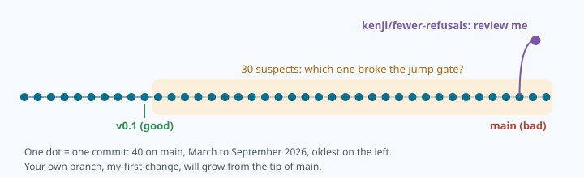
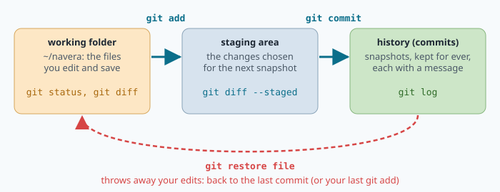
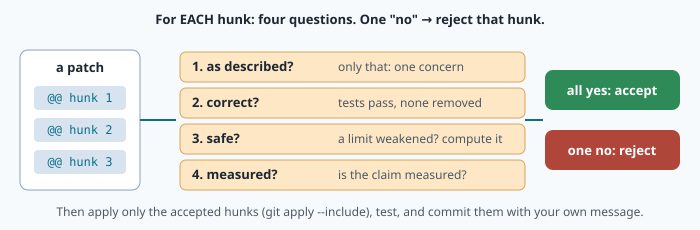
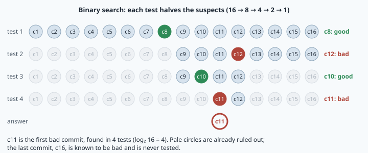

# Git and the engineering workflow



> [!NOTE] Mission brief
> NAVERA's engineering backlog lists every finding of a full code review of the product
> (2026-09-28), and the items found in testing, each with a severity. Its rule: *an item is done only
> when it is fixed, tested and committed; the commit is listed.* One critical item, **EST-9**, was
> found in NAVERA's mission simulator: *a refused GPS was re-accepted once "reachable" by time alone:
> a patient spoofer gets in, then the true GPS is locked out.* Its line ends with a commit hash: the
> fingerprint of the exact code that fixed it.
>
> Today you work on the history of **NAVERA Lite**, the stack you build in this course (40 commits,
> five engineers, March to September 2026; invented for the lab). Two things wait for you. A
> colleague, Kenji, asks you to accept his change "to stop false GPS refusals". And a bug report says
> that since some commit, the jump gate of mission 01 never accepts GPS again after a jump.
> **Session 1 — Reviewer:** you read Kenji's change hunk by hunk and accept only what is safe.
> **Session 2 — Detective:** you find the commit that broke the gate among 30 suspects, fix it with a
> test, then lose your work on purpose and get it back. Badges: **Reviewer**, then **Detective**.
>
> **Start now:** open the 🛠️ **Lab** tab and do **Step 0** (two minutes): it unpacks the repository.

**Objectives.** After this mission you can:

1. make small, well-described commits on a branch, and say what a commit, a branch and HEAD are;
2. read a unified diff and **review** a patch hunk by hunk, with a justified verdict for each hunk,
   and send your own change as a patch;
3. find the commit that introduced a **regression** with `git bisect run`, and explain why it needs
   only about log₂ n tests;
4. undo safely and recover "lost" work: `restore`, `revert`, `reset` and the **reflog**.

**You need** mission 01 (the jump gate) and mission 02 (exit codes, `$(…)`, scripts). Check yourself:

1. Lesson 1 §5: with `v_max = 100 m/s` and a margin of 50 m, how far may a fix be from the last trusted
   one, 1 s later? And 3 s later?
2. Lesson 2: what does exit code 0 mean, and which variable holds the exit code of the last command?
3. Lesson 2: what does `n=$(grep -c ERROR log.txt)` put in `n`?

If you miss two, reread lesson 1 §5 and the scripts part of lesson 2.
<details><summary>Answers</summary>
1. 150 m, then 350 m. 2. Success; <code>$?</code>. 3. What the command printed (the number of
matching lines), as text.
</details>

⏱ Reading: about 80 minutes with the ✏️ checks. Lab: 3 h to 4 h (up to 5 h if the terminal is still
new to you).

<details><summary>Workspace and words (open if you need them)</summary>

Your files are in `~/lessons/05-git/`; the repository the lab builds is
`~/lessons/05-git/navera-lite-history/`. Most lab commands run **inside** that repository.

| Word | Meaning | Français |
|---|---|---|
| **repository** | a project folder whose history git keeps (in a hidden `.git` folder) | dépôt |
| **commit** | one saved snapshot of the whole project, with author, date, message and parent | commit, version |
| **hash** | the 40-character fingerprint that names a commit (`bd4a667…`) | empreinte |
| **branch** | a movable name that points at a commit and follows your new commits | branche |
| **HEAD** | "where you are now": normally a branch | HEAD (position courante) |
| **staging area** | the changes you chose for the next commit (`git add`) | zone d'index |
| **diff / hunk** | the list of changed lines / one block of it, with its `@@` header | différence / bloc |
| **patch** | a diff saved in a file, to send or to review | correctif |
| **code review** | reading a change for correctness and safety before it is accepted | revue de code |
| **regression** | something that worked before and is broken by a later change | régression |
| **bisect** | finding the first bad commit by binary search | bissection |
| **reflog** | git's journal of where your branches and HEAD pointed | journal des références |
</details>

## 1. A commit is a snapshot with a fingerprint

A **repository** is a folder whose history git keeps. Each **commit** stores the **whole project**
as it was at that moment (not only the changed lines), plus the author, the date, a message, and the
commit before it, its **parent**. The commits form a line: each one points back to its parent.

Every commit is named by a **hash**: a 40-character fingerprint computed from its content, its
message and its parent's hash. Change one byte and the hash changes; since each hash includes the
parent's, the newest hash depends on the **entire** history. That is why NAVERA's backlog closes an
item with a hash: it names exactly the code that was fixed and tested. People write the first 7
characters (`bd4a667`); git accepts that while it is unique.

**Three areas.** You do not commit everything you changed. Git keeps three places:



1. the **working folder**: the files you edit;
2. the **staging area**: the changes you **chose** for the next commit (`git add <file>`);
3. the **history**: `git commit -m "message"` turns the staging area into a new commit.

**Worked example.** Ana fixes the text of the gate's status line in `navera_lite/guard.py` and its
test, but she also left a debug `print` in `navera_lite/geo.py`:

```
$ git status
On branch fix-status
Changes not staged for commit:
	modified:   navera_lite/geo.py
	modified:   navera_lite/guard.py
	modified:   tests/test_guard.py
```

The fix is ready, the debug line must never enter the history. She stages only the fix:

```
$ git add navera_lite/guard.py tests/test_guard.py
$ git status --short
 M navera_lite/geo.py          # ← first column empty: modified, not staged
M  navera_lite/guard.py        # ← first column M: staged
M  tests/test_guard.py
$ git commit -m "fix(guard): say GPS in the status line"
$ git restore navera_lite/geo.py      # throw the debug line away
```

The commit holds **one idea**. `git diff` shows what is changed but not staged, `git diff --staged`
what the next commit will contain.

> [!QUESTION] ✏️ Check
> You changed three files: a fix in `guard.py`, a spelling fix in `README.md`, a debug print in
> `geo.py`. How many commits do you make, what goes in each, and what happens to the print?

<details><summary>Answer</summary>
Two commits: the guard fix (with its test, if any), then the spelling fix: one concern each, so a
reviewer can accept one and refuse the other, and a later <code>git revert</code> can undo one without
the other. The print never enters the history: <code>git restore geo.py</code>.
</details>

<details class="further"><summary>Optional: what is inside .git</summary>

Git stores **objects** named by the SHA-1 hash of their content: a **blob** (one file's content), a
**tree** (a folder: names → blobs and trees), a **commit** (a tree, parent(s), author, dates,
message). `git cat-file -p HEAD` prints the current commit. A blob's hash is SHA-1 of
`blob <size>\0<content>`: `echo hello | git hash-object --stdin` and
`python3 -c "import hashlib; print(hashlib.sha1(b'blob 6\x00hello\n').hexdigest())"` both print
`ce01362…`. Commits and parents form a directed acyclic graph (DAG); a merge commit has two parents.
</details>

## 2. Branches, HEAD and messages that help

A **branch** is only a **name pointing at a commit**. When you commit on it, the name moves to the
new commit. `main` is the shared line; you try a change on your own branch, and `main` does not move
until the change is reviewed and accepted.

| Command | What it does |
|---|---|
| `git switch -c my-idea` | create the branch `my-idea` at the current commit and move onto it |
| `git switch main` | move onto `main`: **the files in your folder change** to `main`'s version |
| `git log --oneline --graph --all --decorate` | the whole history as a graph, with the names |
| `git switch --detach v0.1` | look at an old commit without any branch ("detached HEAD") |

**HEAD** says where you are, normally a branch. With `--detach` you stand on a commit with no
branch: fine for looking and testing (git bisect does exactly this). Come back with
`git switch <branch>`. A **tag** (`v0.1`) is a name that never moves: releases are tagged.

**Messages.** In a year, someone will read `git log` to find why the gate changed. Write a subject
**`type(scope): summary`** under 72 characters and, when the why is not obvious, a blank line and a
body.

| Type | Use | Example from the lab's history |
|---|---|---|
| `feat` | a new capability | `feat(guard): JumpGate keeps the last trusted fix` |
| `fix` | a correction | `fix(guard): finish the status line` |
| `refactor` | same behaviour, cleaner code | `refactor(guard): count_refused uses JumpGate` |
| `test`, `docs`, `style`, `chore` | tests, documentation, layout, housekeeping | `test(geo): London to Paris is 343.6 km` |

`update`, `fix` or `wip` ("work in progress") say nothing. One commit of the lab's history is called
`wip: guard status line`: you will see what it costs.

**Two dots and three dots.** Branches move on in parallel. You branch `my-fix` from `main` at commit
B and commit F (you change `gps.py`); meanwhile a colleague commits C on `main` (she changes
`README.md`):

```
A ── B ── C          main         (C changes README.md)
      \
       F             my-fix       (F changes gps.py)
```

| Command | Shows | Why |
|---|---|---|
| `git diff main..my-fix` | `gps.py` **and** `README.md` (C's change, reversed) | snapshot C against snapshot F |
| `git diff main...my-fix` | `gps.py` only | from the **merge base** B (where the branch left) to F |
| `git log main..my-fix` | commit F | the commits of `my-fix` that `main` does not have |

Two dots compare two snapshots. Three dots ask "what did this branch do since it left?", which is what a
reviewer wants to read.

> [!QUESTION] ✏️ Check
> 1. Rewrite the message `update stuff` for a commit that changes `gps_timeout_s` from 3.0 to 2.0 s in
>    `navera_lite.yaml`, with a body that says why (invent a reason that a reviewer could check).
> 2. You are on `main` and run `git switch -c my-idea`, then commit twice. Which name moved, which did not?

<details><summary>Answer</summary>
1. For example <code>feat(settings): GPS fixes stale after 2 s instead of 3 s</code>, body (an invented
reason): "Our receiver sends 10 fixes per second; in last week's bench logs no gap was longer than
0.4 s, so 2 s still leaves margin and a frozen receiver is noticed sooner." A body gives the reason
and the evidence.<br>
2. <code>my-idea</code> moved twice (it follows your commits, HEAD is on it); <code>main</code> did not move.
</details>

## 3. Reading a diff, reviewing a patch

A **patch** is a diff saved in a file. It is the form in which a change is read, sent and reviewed.
Here is a small one, exactly as `git diff` prints it (it is also in the lab's `detective.py`):

```diff
diff --git a/README.md b/README.md
index 390b40b..743368c 100644
--- a/README.md
+++ b/README.md
@@ -11,6 +11,8 @@ the last trusted fix than the vehicle can fly in the elapsed time, plus a margin
 
 ## Settings
 
+Ask Priya before you change a value.
+
 The gate's values are in `navera_lite.yaml` (ROS 2 params-file format). Change them only with a
 measurement that shows why.
 
diff --git a/navera_lite.yaml b/navera_lite.yaml
index 0753941..dfb8f24 100644
--- a/navera_lite.yaml
+++ b/navera_lite.yaml
@@ -3,4 +3,4 @@
   ros__parameters:
     max_speed_mps: 100.0        # v_max of the jump gate (m/s)
     gps_jump_margin_m: 50.0     # margin of the jump gate (m)
-    gps_timeout_s: 3.0          # a GPS fix older than this is not fresh (s)
+    gps_timeout_s: 10.0         # GPS drops out a lot over the hills
```

This is the **unified diff** format. Each file starts with **header lines**: `diff --git a/… b/…`
(`a/` old, `b/` new), `index` (hashes of the old and new contents, file mode), `--- a/…` and
`+++ b/…`. Then come **hunks**, each with a **hunk header**:

```
@@ -3,4 +3,4 @@         old file: 4 lines from line 3      new file: 4 lines from line 3
```

Inside a hunk, a line starting with `-` is removed, `+` added, and a space is unchanged **context**
(up to 3 lines around each change, so a tool finds the right place even if line numbers moved). An
empty context line is written as a single space. Old count = context + removed lines, new count =
context + added lines: the yaml hunk has 3 + 1 on each side, the README hunk `@@ -11,6 +11,8 @@` has 6
context lines and 2 added. A count left out means 1 (`@@ -5 +5,2 @@`); a new file has `@@ -0,0 +1,n @@`.
Text after the second `@@` only hints where you are (the enclosing function or a nearby line).

**Code review** is reading a change before it enters `main`. For **each hunk**, a reviewer asks four
questions:



1. **Does it do what the message says, and only that?** One concern per commit.
2. **Is it correct?** Do the tests still pass — and were tests changed or removed to make them pass?
   A test removed in the same change as the code it tests is a red flag: ask why.
3. **Is it safe?** In navigation code: does it weaken something that protects the vehicle (a timeout,
   a gate, a threshold, a refusal)? Compute what it does with numbers.
4. **Is it measured?** A claim like "fewer false refusals" needs a measurement, not a feeling.

**Worked review** of the patch above, hunk by hunk:

| Hunk | What it changes | Verdict |
|---|---|---|
| `README.md` | a sentence of documentation, correct and harmless | **accept** |
| `navera_lite.yaml` | a GPS fix stays "fresh" for 10 s instead of 3 s. At 30 m/s a 10 s old fix can be 300 m behind the vehicle and still be used as if it were now. "Drops out a lot" is not measured, and a frozen receiver is noticed 7 s later | **reject** |

The patch also mixes two concerns. Advice: send the README line alone; measure the real gaps
between GPS fixes over the hills first, then propose a timeout with the measurement in the body.

**Applying only part of a patch.** Never apply blindly:

| Command | Purpose |
|---|---|
| `git apply --stat change.patch` | which files, how many lines |
| `git apply --check change.patch` | would it apply here without conflict? (changes nothing) |
| `git apply --include=README.md change.patch` | apply only the hunks of that file (one `--include` per file) |
| `git apply --exclude=navera_lite.yaml change.patch` | apply everything except that file |
| `git format-patch main --stdout > my.patch` | the other direction: **your** commits since `main`, as mail-format patches (author, date and message kept); the receiver runs `git am my.patch` to recreate your commits, whereas `git apply` only changes files |

`git apply` changes your working folder only: you then run the tests, `git add` and `git commit`
yourself, with your own message.

> [!QUESTION] ✏️ Check
> A hunk changes `max_speed_mps` from 100.0 to 30.0 in `navera_lite.yaml`, for a survey drone whose
> top speed is 25 m/s. What is the largest accepted jump 1 s after the last trusted fix, before and
> after? Is it safer? What would you ask the author before you accept it?

<details><summary>Answer</summary>
Before 100 × 1 + 50 = 150 m, after 30 × 1 + 50 = 80 m: the largest jump a spoofer can make 1 s after
the last trusted fix falls from 150 m to 80 m, so it is safer against spoofing. But an honest GPS that jumps more (a multipath spike,
a fix after a short gap) is refused more often. Ask for the vehicle's real top speed with wind, and a
replay of real flights showing how many honest fixes the new gate refuses.
</details>

## 4. Bisect: find the first bad commit by binary search

A **regression** is a behaviour that worked and was broken by a later change. Often nobody knows which
change: the history between the last good version and today may hold 30 commits, and testing them one
by one takes 30 test runs. But the commits are in order, and one change made the code bad: every
commit before it is good, every commit from it on is bad. Then **binary search** works: test the
middle, keep the half that contains the change, repeat.

**Worked example.** Sixteen commits c1 … c16. You know the commit before c1 was good and c16 is bad;
the first bad one (which you do not know yet) is c11:



| Test | Suspects left before the test | Middle tested | Result | Suspects left after |
|---|---|---|---|---|
| 1 | c1 … c16 (16) | c8 | good | c9 … c16 (8) |
| 2 | c9 … c16 (8) | c12 | bad | c9 … c12 (4) |
| 3 | c9 … c12 (4) | c10 | good | c11 … c12 (2) |
| 4 | c11 … c12 (2) | c11 | bad | c11 (1): found |

Each test halves the suspects: 16 → 8 → 4 → 2 → 1. With n suspects you need at most **⌈log₂ n⌉**
tests (⌈x⌉ = x rounded up): 4 for 16, 10 for 1 000, 20 for a million. The last commit is never
tested: it is already known to be bad.

**Git does the search for you.** `git bisect start BAD GOOD` checks out the middle commit; you test it
and say `git bisect good` or `git bisect bad`; git checks out the next one; at the end it names the
first bad commit. `git bisect run <script>` does the testing too: it runs your script on each commit
and reads its **exit code** (lesson 2):

| Exit code | Meaning for git bisect |
|---|---|
| 0 | good |
| 1 to 127, except 125 | bad |
| **125** | this commit **cannot be tested**: skip it |
| 128 or more | something went wrong: stop the whole bisect |

**A skip costs tests.** Git cannot test the skipped commit, so it picks another one some distance away
(with a fixed pseudo-random rule) and the two halves become uneven. Expect one to three tests more than
⌈log₂ n⌉ for each skip that lands on the search path. `git bisect log` records every test and skip.

**Worked example of a test script.** Suppose the London–Paris distance of `haversine_m` became wrong
somewhere (it must round to 343 556 m):

```sh
#!/bin/bash
# good = haversine_m still gives 343 556 m from London to Paris
d=$(python3 -c "from navera_lite.geo import haversine_m; print(round(haversine_m(51.5074, -0.1278, 48.8566, 2.3522)))") || exit 125
if [ "$d" = "343556" ]; then
    exit 0
fi
exit 1
```

`A || B` runs B only when A fails. If the Python line cannot even run (an import error in that
commit), the script answers 125: that commit is neither good nor bad, it just cannot answer the
question. Without the `|| exit 125`, `d` would be empty, the script would say "bad", and binary
search would happily name a commit that has nothing to do with the regression.

The four commands of a session, run inside the repository:

```
git bisect start main v0.1          # main is bad, v0.1 is good
git bisect run ../my_test.sh        # git tests, halves, repeats, and names the first bad commit
git bisect log > ../bisect.log      # save what was tested (a record for your report)
git bisect reset                    # back to the branch you were on
```

Two rules. The test script must live **outside** the repository (here in `..`): bisect checks out old
commits, and a script inside the repository would change with them. And bisect needs a **clean**
working folder: commit or restore your edits first.

> [!QUESTION] ✏️ Check
> 1. How many tests does bisect need, at most, for 200 suspects? For 2 000?
> 2. In a history, one commit does not even import. Your script exits 1 for it, and it happens to be
>    tested. Can bisect then name the wrong commit? Which one?

<details><summary>Answer</summary>
1. ⌈log₂ 200⌉ = 8 (2⁸ = 256 ≥ 200 > 128); ⌈log₂ 2 000⌉ = 11.<br>
2. Yes. If the broken commit comes before the real bad one and is tested, bisect believes "bad" and
searches before it, where everything is good: it names the broken commit. Exit 125 avoids that.
</details>

## 5. Undo, and recover what looks lost

| Situation | Command | What it does |
|---|---|---|
| I broke or deleted a file; I want it as in the last commit | `git restore <file>` | throws away your edit of that file |
| I staged a file by mistake | `git restore --staged <file>` | unstages it (the edit stays) |
| A **shared** commit was wrong | `git revert <hash>` | a **new** commit that undoes it; history is kept |
| My last commit, not shared yet, has a bad message | `git commit --amend -m "…"` | replaces it (new hash) |
| Move my branch back, throwing commits away | `git reset --hard <commit>` | dangerous: the branch forgets them |

`revert` is the safe undo on a shared branch: everybody keeps the same history, and the revert is
itself a commit that a reviewer can read. `reset --hard` rewrites where your branch points.

**What `reset --hard` really does.** It moves the branch name back. The commits it "removes" are
still in `.git`: no name points at them any more, that is all. Git keeps a journal of every position
of HEAD and of your branches, the **reflog**, for about 90 days by default (30 days for commits no
branch can reach any more); only after that can git's clean-up delete them.

**Worked example.** Ana resets her branch one commit too far:

```
$ git reset --hard HEAD~1                 # HEAD~1 = the parent of the current commit
HEAD is now at 1f76dac test(geo): one degree of latitude is about 111 km
$ git reflog -3
1f76dac HEAD@{0}: reset: moving to HEAD~1
decd14a HEAD@{1}: commit: fix(guard): say GPS in the status line
1f76dac HEAD@{2}: checkout: moving from main to fix-status
$ git reset --hard decd14a                # or: git reset --hard HEAD@{1}
```

Read the reflog from the top: `HEAD@{0}` is now, `HEAD@{1}` is one move ago. Her commit `decd14a` is
there; resetting to it brings the branch back. (Hashes on your screen will be different: they depend
on the author and the time.)

What git **cannot** give back: edits you never committed (and never staged). `git restore`, `reset
--hard` and a deleted folder throw those away for good. Commit small, commit often.

> [!QUESTION] ✏️ Check
> 1. A bad commit is already on `main`, which three colleagues use. Revert or reset? Why?
> 2. You ran `git reset --hard HEAD~3` on your own branch by mistake. Which command shows you where
>    your branch was, and what do you look for?

<details><summary>Answer</summary>
1. <code>git revert</code>: it adds a commit, so everybody's history stays the same and the undo is visible
and reviewable. A reset would make your <code>main</code> disagree with everybody else's.<br>
2. <code>git reflog</code>: the line just below <code>reset: moving to HEAD~3</code> (<code>HEAD@{1}</code>) shows
the commit you were on; <code>git reset --hard HEAD@{1}</code> (or its hash) goes back to it.
</details>

> [!WARNING] Common wrong ideas
> - "A commit saves the files I changed." It saves a snapshot of the **whole project** (git stores
>   unchanged files only once).
> - "`git add` saves my work." It only **chooses** it for the next commit; only `git commit` records it.
> - "Two dots and three dots are the same." Only while `main` has not moved since the branch left it.
> - "Exit 1 is fine for a commit that does not build." It makes bisect blame that commit; use 125.
> - "`reset --hard` deleted my commits." It moved a name; the reflog still knows them.

## In NAVERA

IRIS's engineers work the same way (described here in words). NAVERA's engineering backlog rates
each finding of the 2026-09-28 code review (C critical, H high, M medium, L low) and closes an item
only when it is fixed, tested and committed, with the commit listed. EST-4 ("GPS always wins, even
when spoofed", fixed by the jump gate of mission 01) and EST-9 (the patient spoofer) are both closed
that way; EST-9's fix requires agreement with an independent source of stated accuracy (mission 30).
The jump gate you restore in today's lab is mission 01's version: alone, it only **delays** a spoofer.
NAVERA's validation report ties its claims to dates and commits in the same spirit: the BNO085 IMU
driver was "verified live on the Jetson on 2026-07-13", commit named. A number without the exact code
and date behind it cannot be checked. NAVERA is a commercial product, **Release 0.2 — field
validation pending**.

## In NAVERA Lite

The lab's repository is an early, invented history of NAVERA Lite, the stack you build: `geo.py`,
the settings file `navera_lite.yaml`, and `guard.py` with mission 01's jump gate as a `JumpGate`
class. Later missions give you the finished gate as `navera_lite/guard.py` and turn your own
`navera_lite/` folder into a git repository with a test suite; mission 33's final project is a branch,
a test and a reviewed change: exactly today's workflow.

## 🐦 How birds do it

Blackcaps from central Europe traditionally winter around the Mediterranean, flying south-west. From
the 1960s, more and more of them wintered in Britain instead. Peter Berthold's team bred the young of
these birds far from any adult: in autumn they oriented north-west too (published in 1992). The new
route is inherited, a **branch** of the population's "program", tested by real winters and passed on
when it works. Evolution has no review and no `revert`; engineers do.

## Summary

1. A **commit** is a snapshot of the whole project with author, message and parent, named by a
   **hash** that depends on the entire history. Stage (`git add`) only what belongs to one concern.
2. A **branch** is a movable name; HEAD is where you are. `main..branch` compares two snapshots,
   `main...branch` shows only what the branch did since it left: the reviewer's view.
3. A **review** asks, for each hunk: does it do only what it says, is it correct (tests intact), is it
   safe (computed with numbers), is it measured? Apply only the accepted hunks.
4. **Bisect** finds the first bad commit in ⌈log₂ n⌉ tests; a test script answers 0 good, 1 bad,
   **125 skip** for a commit that cannot be tested, and lives outside the repository.
5. `revert` undoes a shared commit with a new one; `reset --hard` moves a name; the **reflog** finds
   "lost" commits. Uncommitted edits are the only thing git cannot give back.

**Next mission:** coordinates on a round Earth: NAVERA Lite's `geo.py`, written by you.

## Check yourself

Answer without scrolling up.

<details><summary>1. Why does a hash quoted in a test report identify exactly the code that was tested?</summary>
It is computed from the commit's snapshot, message and parent's hash, so from the whole history: any
change to the code or to an earlier commit gives a different hash.
</details>

<details><summary>2. During <code>git bisect</code>, what is HEAD, and why do <code>main</code> and your branch not move?</summary>
HEAD is detached: it points at the commit under test, not at a branch. A branch is a name that moves only
when you commit on it, so <code>main</code> and your branch stay where they were.
</details>

<details><summary>3. Decode <code>@@ -30,6 +30,9 @@ def check(self, t_s, xy):</code>.</summary>
Old file: 6 lines from line 30; new file: 9 lines from line 30. The hunk adds 3 lines more than it removes;
the text after <code>@@</code> says it is inside <code>check()</code>.
</details>

<details><summary>4. 60 suspects. How many bisect tests at most, and what must the script return for a commit whose code does not import?</summary>
⌈log₂ 60⌉ = 6; exit code 125 (skip). Exit 1 would make bisect blame that commit.
</details>

<details><summary>5. You reset your branch two commits back by mistake. Which command, and what do you look for?</summary>
<code>git reflog</code>; the line just below <code>reset: moving to HEAD~2</code>, i.e. <code>HEAD@{1}</code>; then
<code>git reset --hard HEAD@{1}</code>.
</details>

<details><summary>6. (Mission 01) A GPS fix arrives 4 s after the last trusted one, 420 m away, with v_max 100 m/s and margin 50 m. Accepted?</summary>
The gate is 100 × 4 + 50 = 450 m ≥ 420 m: accepted.
</details>

<details><summary>7. (Mission 02) A script ends with <code>exit 3</code>. What does <code>echo $?</code> print just after it, and what would git bisect make of it?</summary>
3: a non-zero code, i.e. failure; for git bisect, 3 means "bad".
</details>

Now open the **🛠️ Lab** tab.
