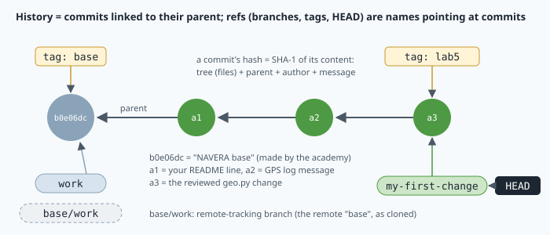

# Git and the engineering workflow

Friday evening, an engineer raises one number in NAVERA's arbiter configuration "to stop false GPS
refusals". On Monday, a spoofing test in the simulator fails: a GPS position that jumps 2 km in one
second is accepted. What changed? Which file, which line, who, when, and why? With **git**, the team
answers in one command: `git log -p` shows the exact line, in red and green, with the author, the
date and the reason given. A second command puts the old version back. And if a colleague had
**reviewed** the change before it entered the main line, it would never have been accepted.

Every professional software team works this way, NAVERA's included. In this lesson you learn how git
stores history (and why that makes it reliable), the daily commands, branches, tags, merges and
**patches**, and the engineering habits around them: small commits with clear messages, and code
review. You also learn exactly what the dashboard's **Reset** button does to your work.

## 1. What git stores: the object model

A **repository** is a project folder whose history git keeps, in a hidden folder `.git`. Git
stores four kinds of **objects**, each one named by the **SHA-1 hash** of its content (40
hexadecimal characters):

| Object | Contains |
|---|---|
| **blob** | the content of one file (no name, no date) |
| **tree** | a folder: a list of names, each pointing to a blob or another tree |
| **commit** | one tree (the whole project at that moment), its **parent** commit(s), author, committer, date and message |
| **tag** (annotated) | a pointer to a commit, with its own author, date and message |

A hash is a fingerprint: the same content always gives the same hash, and any change — one byte —
gives a completely different one. You can compute a blob's hash yourself: git hashes the text
`blob <size>\0` followed by the file content.

```
$ echo 'hello' | git hash-object --stdin
ce013625030ba8dba906f756967f9e9ca394464a
python: hashlib.sha1(b"blob 6\x00hello\n").hexdigest()   → the same 40 characters
```

Because a commit contains the hash of its tree **and** of its parent, the hash of the newest commit
depends on the entire history: nobody can change an old commit without changing every hash after
it. This is why a hash quoted in a test report (`docs/VALIDATION_STATUS.md` does this) identifies
exactly the code that was measured.

Look at a real commit object of your copy:

```
$ git cat-file -p HEAD
tree 51f0b82a62b6a67b748e6e8b0602d3db6519ec95
author NAVERA Academy <academy@localhost> 1791366291 +0100
committer NAVERA Academy <academy@localhost> 1791366291 +0100

NAVERA base — fa775cd fix(bench): screen_mission mirrors the product (re-match, …)
```

(This first commit has no `parent` line: it is the root of your history. The number after the
e-mail is the time in seconds since 1 January 1970, then the time zone. `+0100` is the time zone of
the academy computer's clock, one hour ahead of UTC; a laptop in Oman would write `+0400`. The
number of seconds is the same everywhere: only the display changes.)

### Short hashes and their collisions

People write only the first 7 characters (`b0e06dc`). That gives `16⁷ = 2²⁸ ≈ 2.7 × 10⁸`
possible values. With `n` commits, the probability that two share the same 7-character prefix is
about `n² / (2 · 2²⁸)` (the "birthday" approximation): for 1000 commits, `10⁶ / 5.4 × 10⁸ ≈ 0.2 %`.
Small, but not zero for big projects — so git prints more characters when a short hash would be
ambiguous, and scripts should use the full hash.

### The DAG and the refs

Each commit points to its parent: the history is a **directed acyclic graph** (DAG) — usually a
line, with forks for branches and joins for merges. Names that point into the graph are **refs**:

- a **branch** (`work`, `my-first-change`) is a movable name: when you commit on it, it moves to the
  new commit;
- a **tag** (`base`) is a fixed name on one commit;
- **HEAD** says where you are: normally it points to a branch ("on branch my-first-change").



## 2. Who are you?

Every commit records an author. Set your identity once (`--global` writes it into `~/.gitconfig`):

```
git config --global user.name "Aisha Al Balushi"
git config --global user.email "aisha@example.com"
```

These are **examples**: write **your own** name. The e-mail may be invented — it is only written into
your commits. Without an identity, `git commit` refuses with *Please tell me who you are*.

## 3. The three areas: edit, stage, commit


1. The **working folder**: the files you edit. After a save, git sees the file as **modified**.
2. The **staging area** (or **index**): the changes you have **chosen** for the next commit
   (`git add file`).
3. The **history**: `git commit -m "message"` turns the staging area into a new commit.

Why two steps? A concrete case: while fixing a log message in `gps_node.py`, you also added a
`print()` in `geo.py` to debug something. The fix is ready; the debug line must never enter the
product. `git add gps_pkg/gps_pkg/nodes/gps_node.py` then `git commit` records **only** the fix.
Staging is how you make each commit hold **one** idea. (`git add -p file` even lets you choose
part of a file, hunk by hunk.)

| Command | What it does |
|---|---|
| `git status` | branch, modified files, staged files — run it all the time |
| `git diff` | changes in the working folder not staged yet |
| `git diff --staged` | what is staged: what the next commit will contain |
| `git add <file>` | stage the current changes of a file |
| `git commit -m "…"` | create the commit |
| `git restore --staged <file>` | unstage (the edits stay in the file) |

### Reading a diff

```
diff --git a/gps_pkg/gps_pkg/nodes/gps_node.py b/gps_pkg/gps_pkg/nodes/gps_node.py
index f3fcce3..5002890 100755
--- a/gps_pkg/gps_pkg/nodes/gps_node.py
+++ b/gps_pkg/gps_pkg/nodes/gps_node.py
@@ -78,7 +78,7 @@ class GPSNode(Node):

         self.running = True
         threading.Thread(target=self._read_loop, daemon=True).start()
-        self.get_logger().info("Read thread started")
+        self.get_logger().info("Read thread started, listening to the GPS receiver")

     def _read_loop(self):
         self.get_logger().info("READ LOOP RUNNING")
```

This is the **unified diff** format. `a/` is the old version, `b/` the new one; the `index` line gives
the two blob hashes (and the file mode: `100755` = an executable file). The **hunk header**
`@@ -78,7 +78,7 @@` means: in the old file, 7 lines starting at line 78; in the new file, 7 lines
starting at line 78 (after it, git shows the enclosing function or class, here `class GPSNode`). Lines with `-` are removed, `+` added, a space = unchanged **context** (3 lines
around each change by default; the first one here is an empty line), which lets a tool find the right place even if the line numbers moved.

### Two dots and three dots

| Form | Meaning |
|---|---|
| `git diff base` | `base` against your **working folder** now |
| `git diff base my-first-change` (= `base..my-first-change`) | the two commits' snapshots, compared directly |
| `git diff base...my-first-change` | from the **merge base** (the commit where the branch left `base`) to the branch tip: only what the branch did |
| `git log base..my-first-change` | the commits reachable from the branch but not from `base`: your commits |

For a branch that started at `base`, two and three dots give the same diff. They differ as soon as
the main line moves on: three dots then show only **your** work, which is what a reviewer wants.

A small example. You branch `my-fix` from `main` at commit B and commit `F` (you change `gps.py`).
Meanwhile a colleague commits `C` on `main` (she changes `README.md`):

```
A ── B ── C          main         (C changes README.md)
      \
       F             my-fix       (F changes gps.py)
```

| Command | Shows | Why |
|---|---|---|
| `git diff main..my-fix` | `gps.py` **and** `README.md` (C's change, reversed) | snapshot C against snapshot F |
| `git diff main...my-fix` | `gps.py` only | from the merge base B to F: your work only |
| `git log main..my-fix` | `F` | commits on `my-fix` that `main` does not have |

Two dots compare two snapshots; three dots ask "what did this branch do since it left?".

## 4. Reading the history

```
git log --oneline --graph --all --decorate
* 3c4d5e6 (HEAD -> my-first-change, tag: lab5) refactor(geo): use EARTH_RADIUS_M in haversine_m
* 9a8b7c6 fix(gps): clearer start-up log message
* 1f2e3d4 docs(academy): add my name to the academy README
* b0e06dc (tag: base, base/work, work) NAVERA base — fa775cd fix(bench): screen_mission …
```

`--decorate` adds the ref names in brackets. **Read the last line carefully: it contains two hashes.**
The **first word** (`b0e06dc` here; yours may differ) is the hash of that commit **in your
repository**. The second hash, `fa775cd`, is **part of the message**: the academy wrote it to say
which commit of the real NAVERA repository your copy was taken from. When the lab asks for the hash
of *your* commit, it is always the **first word** of the line that shows *your* message.

Other useful forms: `git show <hash>` (one commit and its diff), `git show base:ACADEMY_README.md`
(a file as it was in another commit), `git log -p -- <file>` (every change to one file),
`git blame <file>` (who last changed each line).

> [!TIP]
> When the output is longer than the screen, git opens a viewer (`:` or `(END)` at the bottom).
> Scroll with the arrows or `Space`, quit with **`q`**.

## 5. Undo

| Situation | Command |
|---|---|
| I changed or **deleted** a file; I want it back as in the last commit | `git restore <file>` |
| I staged a file by mistake | `git restore --staged <file>` |
| I want a file as it was in another commit | `git restore --source=base <file>` |
| My last commit's message is bad, and I have not shared the commit | `git commit --amend -m "…"` |
| A shared commit was wrong: undo it with a new commit | `git revert <hash>` |

`git restore` brings back a file even after `rm` — lesson 2 said "the shell has no recycle bin", but
every **committed** version is in `.git`. Uncommitted changes are the only thing git cannot give
back: **commit small, commit often.** (`--amend` replaces a commit by a new one with a new hash: never
amend a commit that others already have. You may meet the older forms `git checkout -- <file>` for
restore and `git checkout -b <name>` for `git switch -c <name>`; they do the same.)

## 6. Branches and merges

A **branch** is a separate line of commits: try an idea there, while the main line stays untouched.

| Command | What it does |
|---|---|
| `git branch -vv` | lists branches, the commit of each, and what it tracks |
| `git switch -c my-idea` | creates `my-idea` at the current commit and moves onto it (older: `git checkout -b my-idea`) |
| `git switch work` | moves onto `work`: **the files in your folder change** to that branch's version |
| `git merge my-idea` | brings the commits of `my-idea` into the current branch |

Git refuses to switch if it would overwrite uncommitted changes: commit or restore first.

**Merging.** Suppose `work` has no new commit since `my-idea` started. Then `git merge my-idea` (run
on `work`) is a **fast-forward**: git just moves the `work` label forward to the last commit of
`my-idea`; no new commit is made. If both branches have new commits, git makes a **merge commit**
with **two parents**, combining the two sets of changes (a **three-way merge**: it compares both
tips with their merge base). If both changed the same lines, git stops with a **conflict**, marks
the lines with `<<<<<<<`, `=======`, `>>>>>>>`, and a human decides. In the lab you will **not**
merge into `work`: it must stay equal to `base`.

## 7. Tags

A **tag** fixes a name on one commit, for ever — releases are tagged (`v0.2.0`).

- A **lightweight** tag (`git tag name`) is only a name pointing at a commit.
- An **annotated** tag (`git tag -a name -m "message"`) is an object of its own, with author, date
  and message — what a release should use. `git show name` displays it; `git cat-file -t name`
  says `tag` for annotated, `commit` for lightweight.

## 8. Patches and code review

A **patch** is a diff saved in a file. It is how changes travel between repositories by e-mail or
for review, and how you can move work between copies that do not share a remote.

| Command | Purpose |
|---|---|
| `git diff base my-first-change > my.patch` | the plain diff between two commits, in a file (lesson 2's `>`) |
| `git format-patch base --stdout > my.patch` | your commits as patches, with author, date and message (mail format) |
| `git apply --stat my.patch` | which files and how many lines a patch changes |
| `git apply --check my.patch` | would it apply cleanly here? (changes nothing) |
| `git apply my.patch` | apply it to the working folder (then you `add` and `commit`) |
| `git apply --exclude=<path> my.patch` | apply it, except the changes to that file |
| `git am my.patch` | apply mail-format patches **as commits**, keeping their author |

**Code review** is reading someone else's change before it enters the main line. A reviewer asks:

1. Does it do what the message says, and only that (**one concern per commit**)?
2. Is it correct? Does it still build, do the tests pass, are the units right?
3. Is it **safe**? In navigation code: does it weaken a check that protects the vehicle (a timeout,
   a gate, an uncertainty threshold)? Is the claim **measured**?
4. Is the message clear enough for someone who reads it in a year?


In the lab you review a patch that mixes a harmless clean-up with a change of
`gps_jump_margin_m` from 50 m to 5000 m. Recall the arbiter's gate of lesson 1:
`refuse if distance > v_max · Δt + margin`. With `v_max = 100 m/s` and fixes 1 s apart, the limit
grows from 150 m to 5100 m: a spoofer could move the vehicle by 5 km in one step without being
refused.

## 9. Your copy of NAVERA

When your account was created, the academy:

- took **one commit** of the real NAVERA repository (`fa775cd`), saved its files as **one** commit
  in a separate repository — the **academy base**, tagged `base`, branch `work` — and built it;
- **cloned** that base into your `~/navera`. A clone is a complete repository with all the history;
- renamed the clone's source, normally called `origin`, to **`base`**: it is a **remote**.

`git remote -v` therefore shows a path like `/home/shadow-team/navera-academy/base`: the folder of
the academy base **on the server**, outside your sandbox. You cannot reach it from your terminal, and
you never need to: nothing you do is ever **pushed** (sent) anywhere.

A clone also keeps **remote-tracking branches**: read-only copies of the remote's branches as they
were when you cloned, named `<remote>/<branch>` — here `base/work`. When `git status` says
*"Your branch is up to date with 'base/work'"*, it only compares your `work` with that local copy:
they point at the same commit. Nothing was sent or received.

Your copy has no link to the real product: commit, branch, break and fix anything.

## 10. What the Reset button does

**Reset my NAVERA copy** (👤 menu) runs this on the server (`server/workspaces.py`):

1. `git add -A` and a commit `auto-save before reset` (author "NAVERA Academy") — your uncommitted
   work, staged or not, becomes a commit;
2. `git bundle create …/backups/navera-<date>-<time>.bundle --all` — the **whole** repository, all
   branches and tags, packed into **one file** kept in your backup folder;
3. deletes `~/navera`, clones the academy base again, renames the remote to `base`, and copies the
   build.

Nothing is lost — a teacher can clone the bundle (`git clone navera-….bundle`) and recover any
commit — but the new `~/navera` no longer contains your branches. **↺ Reset lab files** is
different: it only restores `~/lessons/<lesson>/` and never touches `~/navera`.

## 11. Commit messages that help

NAVERA uses a short conventional style: **`type(scope): summary`**, under 72 characters, then
optionally a blank line and a body explaining *why*.

| Type | Use |
|---|---|
| `feat` | a new capability |
| `fix` | a correction |
| `refactor` | same behaviour, cleaner code |
| `docs`, `test` | documentation, tests |

Real example — the commit your copy comes from:
`fix(bench): screen_mission mirrors the product (re-match, odometry prediction); thin HUD strip`.
Bad messages: `update`, `fix`, `wip`, `asdf` — they say nothing to the person who must find, in a
year, why the gate margin changed.

## 🐦 How birds do it

A young **common cuckoo** never meets its parents: its mother laid the egg in the nest of another
species, and foster parents raised it. When it leaves Europe, the adult cuckoos have usually gone
already. Yet it flies alone to Africa, to the wintering region of its population; satellite tags on
young cuckoos have shown it. The route — roughly *which direction* and *for how long* — is
**inherited**: every chick starts with a copy of its population's "program", like a clone.

And the program can **branch**. Blackcaps from Central Europe traditionally winter around the
Mediterranean, flying south-west. From the second half of the 20th century, more and more of them
wintered in Britain instead, flying north-west. Peter Berthold's team raised the young of these
birds far from any adult, and in autumn the young oriented north-west too (published in 1992): a new
branch, tested by real winters, then passed on.

Navi's own species shows the other half of the idea: barn swallows often return to the same
building year after year — a known good version, like a tag you can always come back to. Birds that
pass through Oman in spring and autumn follow such inherited programs too, adjusted by experience.
Git gives engineers what evolution never had: a history you can read, branches you can try without
risk, review before a change spreads, and a Reset button.

## In NAVERA

The team's rules are in [CLAUDE.md](file:navera/CLAUDE.md), at the root of your copy:

```text
2. **Always work on a git branch**, never directly on `main`. Commit small, commit often.
3. **Never commit large files.** No `.mbtiles`, `.npz`, `.pth`, `.safetensors`, `.engine`, `.so`,
   `.whl`, model caches, ... The `.gitignore` already excludes these — keep it that way.
5. **One concern per commit.** Cleaning, refactor, optimization, and new features go in separate commits.
6. **Measure, don't guess.** For any performance/accuracy claim, run a measurement and report the number.
```

and the workflow for every task:

```text
1. **Understand:** read the relevant files before changing anything.
2. **Branch:** `git checkout -b <task-name>` off `main`.
3. **Change:** make the smallest coherent change.
4. **Verify:** does it still build? does the pipeline still launch? (run it if possible).
5. **Commit:** clear message, one concern.
6. **Report:** summarize what changed, what was verified, what's the risk, what's next.
```

Rule 3 explains [.gitignore](file:navera/.gitignore): patterns of files git must **ignore**, so
`git status` never shows them and `git add -A` never stages them:

```text
build/
install/
log/
*.npz
*.mbtiles
*.safetensors
*.pth
```

The 10 GB satellite map and the neural-network weights are data, not source code; `build/` and
`install/` are re-made by `colcon`. Rules 5 and 6 are exactly the two problems of the patch you
will review.

## Glossary

| Term | Meaning |
|---|---|
| **repository** | a folder with its history in `.git` |
| **object / blob / tree** | what git stores, named by hash / a file's content / a folder listing |
| **commit** | a snapshot (tree) + parent(s) + author, date, message |
| **hash (SHA-1)** | 40-hex fingerprint of an object; the short form has 7 characters |
| **DAG** | directed acyclic graph: commits linked to their parents |
| **ref / branch / tag / HEAD** | a name pointing at a commit / movable / fixed / "where you are" |
| **working folder / staging area (index)** | files on disk / changes chosen for the next commit |
| **diff / hunk** | list of changed lines / one block of it, with its `@@` header |
| **merge base** | the last common commit of two branches |
| **fast-forward / merge commit** | the label just moves / a commit with two parents |
| **annotated tag** | a tag object with author, date and message |
| **patch** | a diff saved in a file, applied with `git apply` or `git am` |
| **code review** | reading a change for correctness and safety before accepting it |
| **clone / remote / remote-tracking branch** | full copy / another repository known by a name / `base/work` |
| **push** | sending commits to a remote (never done in this course) |
| **bundle** | a whole repository packed in one file (the Reset backup) |

## Check what you learned

<details><summary>1. You fixed a log message in gps_node.py and left a debug print in geo.py. How do you commit only the fix?</summary>
<code>git add gps_pkg/gps_pkg/nodes/gps_node.py</code>, then <code>git commit -m "fix(gps): …"</code>. geo.py stays modified
but unstaged; <code>git restore navera_common/navera_common/geo.py</code> removes the debug line afterwards.
</details>

<details><summary>2. Your log shows <code>b0e06dc (tag: base, work) NAVERA base — fa775cd fix(bench): …</code> and above it <code>1f2e3d4 docs(academy): add my name…</code>. What is the hash of your first commit?</summary>
<code>1f2e3d4</code>: the first word of the line with your message. <code>b0e06dc</code> is the base commit in your
repository, and <code>fa775cd</code> is only text inside its message (the real NAVERA commit it came from).
</details>

<details><summary>3. Why can nobody change an old commit's message without anybody noticing?</summary>
A commit's hash covers its message, its tree and its parent's hash. Changing anything gives a new hash for that
commit, so every later commit (which contains its parent's hash) gets a new hash too.
</details>

<details><summary>4. What is the difference between a fast-forward and a merge commit?</summary>
Fast-forward: the target branch has no own commits since the split, so its label just moves to the other branch's
tip — no new commit. Otherwise git creates a merge commit with two parents, combining both lines of work.
</details>

<details><summary>5. A patch changes <code>gps_jump_margin_m</code> from 50 to 5000 "to avoid false refusals". With <code>v_max = 100 m/s</code> and Δt = 1 s, what does it change?</summary>
The largest accepted jump grows from 100 + 50 = 150 m to 100 + 5000 = 5100 m: a spoofer can move the position
by about 5 km in one step. The claim is not measured (rule 6). Reject it and ask for a measured, targeted change.
</details>

<details><summary>6. What does Reset keep, where, and what does your new ~/navera contain?</summary>
It commits any uncommitted work ("auto-save before reset"), packs the whole repository (all branches and tags) into a
git bundle in your backup folder, then makes a fresh clone of the academy base: branch <code>work</code> and tag
<code>base</code> only.
</details>

Now open the **🛠️ Lab** tab.
