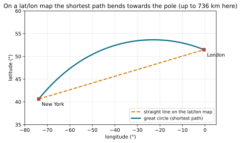

# Geodesy for navigation: WGS84, ECEF and ENU

> [!NOTE] Mission brief
> **1 October 2026.** NAVERA's team prepares a long simulated mission, Paris to central Tunisia, and
> records two bugs. **R-6:** the server's route length, from "a flat approximation", said **1 750 km**; the
> great-circle route is **1 768 km**. Which flat formula? The backlog does not say. **R-2:** the ±1 km map
> corridor followed the straight line between the two ends on a latitude/longitude map; the vehicle flew
> another path, and only **871 of the 20 675** downloaded map tiles were on it.
>
> Both bugs treat the Earth as a flat sheet of degrees. You are the **auditor**: you build NAVERA Lite's
> geodesy part, reproduce both bugs with it, and measure how far each shortcut can be trusted. Session 1
> (the sphere) earns **Navigator**, session 2 (the real Earth) **Surveyor**.
>
> **Start now:** open the 🛠️ **Lab** tab, do **Step 0** (one minute, no code), then come back here for §1.

**Objectives.** After this mission you can:

1. convert lat/lon differences into metres east and north, and say how wrong the flat shortcut is and
   **where cos φ must be taken**;
2. compute a **haversine** distance, an initial **bearing** and a **great-circle path**, and measure its
   offset from the straight line of a lat/lon map;
3. convert between **geodetic** (φ, λ, h), **ECEF** and **ENU** on the **WGS84** ellipsoid, and prove your
   code right with round trips and an independent method;
4. tell an **ellipsoidal height** from a **sea-level height**, and choose a flat, spherical or ellipsoidal
   model for a job, with numbers.

**You need:** mission 01 (dot product, unit vector), mission 03 (tuples, numpy arrays). ⏱ Reading: about
50 minutes with the ✏️ checks (up to 1 h 15 if English or trigonometry is rusty): §1–§4 before session 1,
§5–§8 before session 2. Lab: 3 to 5 h.

**Before you start.** Answer without looking; if you miss two, reread mission 01 §3 and mission 03 §4.

<details><summary>1. a = (3, 4), b = (1, 0). What is a · b, and the angle between a and b?</summary>
a · b = 3; |a| = 5, |b| = 1, so cos θ = 3/5 and θ = 53.1°.
</details>
<details><summary>2. A function ends with <code>return e, n</code>. How do you get both values?</summary>
<code>e, n = f(...)</code>: the function returns one tuple, and the assignment unpacks it.
</details>
<details><summary>3. <code>np.sin(np.radians(np.array([0.0, 30.0, 90.0])))</code> gives? And <code>math.sin</code> of an array?</summary>
<code>[0.0, 0.5, 1.0]</code>; <code>math.sin</code> takes one number: <code>TypeError: only length-1 arrays…</code>.
</details>

<details><summary>Words of this lesson (open if you need them)</summary>

| Word | Meaning | Français |
|---|---|---|
| **latitude φ / longitude λ** | angle north of the equator / east of Greenwich, in degrees | latitude / longitude |
| **great circle** | a circle on a sphere whose centre is the sphere's centre; the shortest path | grand cercle |
| **bearing** | direction to fly, degrees clockwise from true north, in [0°, 360°) | cap, azimut |
| **ellipsoid (WGS84)** | the flattened reference shape of the Earth that GPS uses | ellipsoïde |
| **radius of curvature (M, N)** | radius of the circle that best fits the surface, north–south (M) or east–west (N) | rayon de courbure |
| **ECEF** | Earth-centred, Earth-fixed: X, Y, Z in metres from the Earth's centre | ECEF (géocentrique) |
| **ENU** | a local frame: metres East, North, Up from a home point | repère local ENU |
| **geoid** | the "mean sea level" surface that heights on maps refer to | géoïde |
| **ellipsoidal height h** | height above the ellipsoid, along its normal: what GPS computes | hauteur ellipsoïdale |
</details>

## 1. Writing a position: two numbers and three traps

**Latitude** φ: north (+) or south (−) of the equator; **longitude** λ: east (+) or west (−) of Greenwich.
Write **decimal degrees, latitude first**: Cape Town is (−33.9249, 18.4241). On a sphere of radius
**R = 6 371 000 m**, 1° of latitude is R·π/180 = **111.19 km**, so the 5th decimal is about 1.1 m.


**Trap 1 — order.** GeoJSON writes (lon, lat): the Eiffel Tower (48.8584, 2.2945) swapped lands in the
Indian Ocean, 6 802 km away. **Trap 2 — Null Island.** (0°, 0°), open sea in the Gulf of Guinea, is where
**missing coordinates** land; NAVERA Lite's `is_finite_latlon` (given) refuses it. **Trap 3 — the date
line.** A boat at 179.99° E that moves 2 km east is at −179.99°: the naive Δλ = −359.98° says, near Fiji
(17° S), that it went 38 279 km west. Bring every Δλ back into [−180°, 180°):

```
Δλ = (λ − λ0 + 180) % 360 − 180          (−359.98 + 180) % 360 − 180 = 0.02
```

In February 2007, six F-22 fighters flying from Hawaii to Japan had their navigation systems fail as they
crossed the date line; they returned by following their tanker aircraft, and a software fix followed
within days (widely reported; the exact bug was not published).

> [!QUESTION] ✏️ Check
> A drone log shows Lima (−12.05, −77.04), then for one second (0.0, 0.0), then Lima again. What do you
> report? And what is Δλ for a boat moving from λ = −179.5° to 179.8°?

<details><summary>Answer</summary>
A missing fix logged as (0, 0), not a jump: refuse it. Δλ = (179.8 + 179.5 + 180) % 360 − 180 = <b>−0.7°</b>.
</details>

## 2. The flat shortcut: metres from degrees

Near a point the Earth looks flat. A step Δφ north is an arc **R·Δφ**; a step Δλ east runs along a
**parallel**, a circle of radius R·cos φ, so it is **R·cos φ·Δλ** (angles in radians):

```
north = R · Δφ          east = R · cos φ · Δλ
```

The engineer's question: **which φ** goes in cos φ? Between two points the latitude changes.

> [!TIP] 🧰 Radians
> `math.sin`, `math.cos`, `np.sin`… take **radians**: `math.radians(48.0)` = 0.8378. `math.cos(48)` is
> cos(48 rad) = −0.640, not cos 48° = 0.669: no error, just a wrong number. Forgetting the cos altogether
> makes east–west distances 23 % too long at 36° and more than twice too long at 64°.

**Worked example: London (51.5074, −0.1278) → Paris (48.8566, 2.3522).** Δφ = −2.6508°, Δλ = +2.4800°.
North = 6 371 000 × (−2.6508 × π/180) = **−294 755.5 m** in every version; east depends on the φ in cos φ:

| cos of | φ used | east (m) | flat distance (m) | vs great circle (343 556.1 m) |
|---|---|---|---|---|
| start latitude | 51.5074° | 171 638.9 | 341 087.6 | **−2 468** |
| mean latitude | 50.1820° | 176 585.4 | 343 603.3 | **+47** |
| end latitude | 48.8566° | 181 437.4 | 346 121.9 | +2 566 |

East–west distances shrink along the way; the mean latitude is their typical value, 50 times better.
Your `enu_flat` (TODO 1) uses it, and `offset` (TODO 2) is its exact inverse. In lab Step 3 you play
detective: three candidate formulas, one server number.

> [!QUESTION] ✏️ Check
> 1. How long is 1° of longitude at Reykjavik (64.1466°) on the sphere?
> 2. Derive: why are the start- and end-latitude errors on London → Paris about equal and opposite?
>    (Hint: cos φ ≈ cos φm − sin φm · (φ − φm) over a small span.)

<details><summary>Answer</summary>
1. 111.19 km × cos 64.1466° = <b>48.49 km</b>.<br>
2. The ends are 1.33° above and below the mean, so east is off by ∓ R·Δλ·sin φm·(1.33° in rad) ≈ ∓ 4.9 km:
the same size, opposite signs (≈ ∓ 2.5 km in distance).
</details>

## 3. The sphere: distance and bearing

On a sphere the shortest path follows a **great circle**, a circle whose centre is the sphere's centre
(the equator and the meridians are great circles; other parallels are not). You used the **haversine**
formula as a finished tool in mission 04 (`logbook.haversine_m`); here you see why it is written this way,
and write NAVERA Lite's own version (TODO 3):

```
a = sin²(Δφ/2) + cos φ1 · cos φ2 · sin²(Δλ/2)
d = 2 R · asin(√a)                                      radians; clamp a to at most 1
```

The simpler law of cosines, cos θ = sin φ1 sin φ2 + cos φ1 cos φ2 cos Δλ, fails for short distances: for
points 1 m apart cos θ ≈ 1 − 1.2 × 10⁻¹⁴, and `acos` of a number so close to 1 loses most of a float's 16
digits (1 m north at 48° N: 0.996 m; at 45° N: 1.005 m; the haversine gives 1.000 m). The clamp stops
rounding pushing a above 1, which would crash `asin` with `math domain error`.

The **initial bearing**, clockwise from **north** (∝ means "proportional to": both parts share a positive
factor that atan2 does not need):

```
east  ∝ sin Δλ · cos φ2
north ∝ cos φ1 · sin φ2 − sin φ1 · cos φ2 · cos Δλ
bearing = atan2(east, north) → degrees → % 360
```

Maths measures angles from the x axis counter-clockwise; navigation from north, clockwise: so **east goes
first**, and `% 360` turns −90° into 270°. The other way round: a distance d on bearing β is
east = d·sin β, north = d·cos β (β in radians).

**Worked example.** London → Paris: **343 556.1 m**, bearing **148.1°**. Paris → London: **330.0°**, not
148.1° + 180° = 328.1°: along a great circle the angle with the local meridian changes, because the
meridians converge towards the poles.

> [!QUESTION] ✏️ Check
> 1. What does `atan2(north, east)` give for a target due north?
> 2. You start at 60° N with bearing 90° on a great circle. After 1 000 km, is your bearing above or below 90°?

<details><summary>Answer</summary>
1. 90° (the maths angle from east), not the bearing 0°.<br>
2. Above: a great circle that starts due east is not the parallel; it bends towards the equator.
</details>

## 4. Great circles with vectors

A point (φ, λ) on a unit sphere is the unit vector `unit_vector(lat, lon)` (given):

```
v = (cos φ · cos λ,  cos φ · sin λ,  sin φ)           x towards (0°, 0°), z towards the North Pole
```

The angle between two points is **cos d = a · b** (mission 01's dot product). A fraction f of the way
along the great circle is the **slerp** (spherical linear interpolation), then back to angles:

```
v(f) = [ sin((1 − f)·d) · a  +  sin(f·d) · b ] / sin d          φ = atan2(z, √(x² + y²)),  λ = atan2(y, x)
```

**Worked example.** London → Paris: a · b = 0.998546, d = 3.0897°, R·d = 343 556 m (the haversine agrees).
Halfway the great circle is at **(50.1886, 1.1466)**; the middle of the straight lat/lon line is (50.1820,
1.1122), **2.56 km** away. Across an ocean it is much more:



On a lat/lon map a great circle bends **towards the nearer pole**: east–west distances are shorter there,
so the shortest path "cuts the corner". TODO 5 draws such paths; TODO 6 measures the gap (the R-2 audit).

> [!QUESTION] ✏️ Check
> Show that v(0.5) is a unit vector. (Hint: |a + b|² = 2 + 2 cos d and sin d = 2 sin(d/2) cos(d/2).)

<details><summary>Answer</summary>
v(0.5) = sin(d/2)(a + b)/sin d = (a + b)/(2 cos(d/2)), and |a + b| = √(2 + 2 cos d) = 2 cos(d/2), so |v| = 1.
</details>

---

**Session 2 — Surveyor.** Read §5–§8 before lab Step 5.

## 5. The real shape: the WGS84 ellipsoid

The spinning Earth is flattened: its equatorial radius is 21.4 km longer than the polar one. GPS uses the
**WGS84** ellipsoid (`WGS84_A`, `WGS84_F` in `geo.py`):

```
a = 6 378 137.0 m      f = 1 / 298.257223563 = (a − b)/a      b = 6 356 752.314 m      e² = f (2 − f) = 0.00669438
```


The **geodetic latitude** φ (what GPS gives) is the angle between the surface **normal** and the equator
plane, not the angle seen from the centre (the **geocentric latitude**; 0.19°, about 21 km, apart at 45°).
The ellipsoid has two **radii of curvature** at latitude φ (w = 1 − e² sin²φ):

```
M(φ) = a (1 − e²) / w^1.5       north–south          N(φ) = a / √w       east–west (a parallel has radius N cos φ)
```

1° of latitude is M·π/180, 1° of longitude N·cos φ·π/180:

| Place | φ | M (km) | N (km) | 1° latitude | 1° longitude |
|---|---|---|---|---|---|
| Quito | −0.1807° | 6 335.4 | 6 378.1 | 110.574 km | 111.319 km |
| Sousse (NAVERA's test area) | 35.8277° | 6 357.3 | 6 385.5 | 110.956 km | 90.359 km |
| Reykjavik | 64.1466° | 6 387.3 | 6 395.5 | 111.480 km | 48.675 km |

A degree of latitude is longer near the poles (flatter there, so M is larger), and no sphere fits: at the
equator M is 0.56 % shorter and N 0.11 % longer than 6 371 km.

**A constant per degree.** A common shortcut uses 111 320 m per degree for both axes (east × cos φ);
NAVERA's day vision does this. 111 320 m is a·π/180, a degree **of the equator**. At Sousse a degree of
latitude is 110 956 m, so north distances come out **0.33 % too long**; east is 0.11 % short.

> [!QUESTION] ✏️ Check
> On the sphere, 1° of longitude at 45° is 111.19 × cos 45° km. How far is that from WGS84's 78.847 km,
> and which radius explains it?

<details><summary>Answer</summary>
78.63 km, 0.28 % short: east–west uses N, and N(45°) = 6 388.8 km is 0.28 % larger than 6 371 km.
</details>

## 6. ECEF: one Cartesian frame for the whole Earth

**ECEF** (Earth-Centred, Earth-Fixed): origin at the centre, Z on the spin axis, X through (0°, 0°), Y
through (0°, 90° E). The point (φ, λ, h):

```
X = (N + h) cos φ cos λ          Y = (N + h) cos φ sin λ          Z = (N (1 − e²) + h) sin φ
```

At (0°, 0°, 0) this gives (a, 0, 0); at the pole Z = b. The factor **(1 − e²)** in Z makes it an
ellipsoid. **Worked example:** Quito (−0.1807°, −78.4678°, 2 850 m): N = 6 378 137.2 m, X = **1 275 671.8
m**, Y = **−6 252 140.0 m**, Z = **−19 989.7 m**.

**The way back** has no simple closed form; an iteration converges fast:

```
λ = atan2(Y, X)          p = √(X² + Y²)          φ = atan2(Z, p (1 − e²))      (first guess)
repeat:   N = N(φ);   h = p / cos φ − N;   φ = atan2(Z, p (1 − e² N / (N + h)))
finally:  h = p / cos φ − N   with the last φ
```

For Reykjavik at 30 m the latitude error is 8 cm after the first guess, 0.4 mm after one iteration: each
iteration divides it by more than 100. (Dividing by cos φ fails at the poles.) You do not prove
convergence: you **test** it with round trips, geodetic → ECEF → geodetic, to 1 mm.

> [!QUESTION] ✏️ Check
> `ecef_to_geodetic` returns a wrong height but the right longitude. Name two mistakes that do that.

<details><summary>Answer</summary>
Radians given to <code>radii()</code> (it takes degrees), degrees given to <code>math.cos</code>, or h not recomputed
with the last φ. The longitude, atan2(Y, X), depends on none of them.
</details>

## 7. ENU: the local frame

In ECEF, 10 m north changes X, Y **and** Z. A vehicle wants a frame at a **home point** (φ0, λ0, h0):
e east, n north, u up. Its unit vectors in ECEF are the **rows** of a matrix R:

```
E = (−sin λ0,           cos λ0,           0     )
N = (−sin φ0 cos λ0,   −sin φ0 sin λ0,    cos φ0)          [e, n, u] = R · (X − X0)
U = ( cos φ0 cos λ0,    cos φ0 sin λ0,    sin φ0)          back:  X = X0 + Rᵀ · [e, n, u]
```

> [!TIP] 🧰 Matrix × vector, and rotations
> Each output number is one row times the vector: [[1, 2], [3, 4]] · (5, 6) = (17, 39). A **rotation
> matrix** has unit rows at right angles, so R·Rᵀ = I (inverse = transpose) and det R = +1. det = −1 is a
> **mirror** (two rows swapped, or one sign flipped): R·Rᵀ = I still holds, only the determinant shows it.
> numpy: `R @ d`, `R.T`, `np.linalg.det(R)`.

**Worked example: Cape Point seen from Cape Town**, home (−33.9249°, 18.4241°, 0 m), target (−34.3568°,
18.4970°, 0 m). X − X0 = (−27 633.0, −2 136.3, −39 651.9) m; rows E = (−0.3160, 0.9487, 0), N = (0.5295,
0.1764, 0.8298), U = (0.7872, 0.2622, −0.5581); so e = **6 706.6 m**, n = **−47 910.4 m**, u = **−184.1 m**.

Cape Point is 184 m **below** Cape Town's horizontal plane, although both are at h = 0: the ground curves
away under the plane by about **d²/(2R)** (1 km → 8 cm, 10 km → 7.8 m, 50 km → 196 m; 48.4 km → 183.7 m,
within 0.5 m of the exact frame). ENU is exact everywhere, but its (e, n) is a flat picture of a curved
surface.


> [!QUESTION] ✏️ Check
> Derive the drop rule: a circle of radius R, its tangent at home, a point at arc length d. Show that it is
> about d²/(2R) below the tangent. (Hint: R(1 − cos(d/R)) and cos x ≈ 1 − x²/2.)

<details><summary>Answer</summary>
The point is at angle d/R from home; R − R cos(d/R) ≈ R·(d/R)²/2 = d²/(2R).
</details>

## 8. Heights: ellipsoid, geoid, sea level

GPS computes the **ellipsoidal height h**. Maps give the height above **mean sea level**, which follows the
**geoid**, a bumpy surface of equal gravity potential. Their difference, the **geoid separation**, ranges
from about −106 m to +85 m around the world:

```
h (ellipsoid) = height above mean sea level + geoid separation
```

Mixing the two costs exactly the separation, silently. An **unknown** height is NaN, never 0: 0 m is a
real height, like (0, 0) is a real place.

> [!QUESTION] ✏️ Check
> Two sources at one spot, separation +47 m: GPS says h = 72.0 m, a barometer calibrated to sea level
> says 26.5 m. Do they disagree, and by how much?

<details><summary>Answer</summary>
72.0 − 47 = 25.0 m above sea level against 26.5 m: 1.5 m, normal barometer noise. Comparing 72.0 with 26.5
directly would invent a 45.5 m fault.
</details>

> [!WARNING] Common wrong ideas
> - "The Earth is a sphere, so the haversine is exact." On the Earth it is off by up to about 0.6 %.
> - "A flat frame is wrong only far away, because of curvature." Step 9 shows what dominates near home.
> - "Height 0 means unknown." 0 m is a height; unknown is NaN.

## Bird's-eye view: which model, where

| Model | Typical use | How wrong |
|---|---|---|
| flat (`enu_flat`: one scale, cos of the mean latitude) | steering and gates near home | Step 9 measures it |
| sphere (`haversine_m`, `bearing_deg`, great circles, R = 6 371 km) | route lengths, bearings, long paths | up to about 0.6 % (§5) |
| ellipsoid (WGS84: ECEF, ENU, `radii`) | comparing with GPS to the metre, long flights in one frame | millimetres |

## In NAVERA

NAVERA's test map and data cover Sousse, Tunisia. From its backlog and validation report (Release 0.2,
2026-10-01 to 2026-10-03):

- Distances are computed on a 6 371 000 m sphere with the haversine (position arbiter, day vision, the tool
  that scores test flights). Day vision converts small displacements with 111 320 m per degree; it converts
  its position back with the same constant, so the error cancels in the position; it remains in any
  distance it reports in metres.
- Since R-2 and R-6 were fixed, routes are measured on great circles and mapped **and** flown as the same
  legs of at most 10 km. Paris → Tunisia was mapped as 79 775 tiles (980 MB); day vision flew its last 13 km.
- Heights: output altitude above the WGS84 ellipsoid, NaN if unknown (GPS-4 fixed an earlier sea-level
  altitude and a 0 for "missing").

## In NAVERA Lite

[navera_lite/geo.py](file:./navera_lite/geo.py) is NAVERA Lite's geodesy part. Every later mission that
touches a latitude uses it, finished from the course's reference.

## 🐦 How birds do it

In the 1950s Albert Perdeck displaced about 11 000 migrating starlings from the Netherlands to
Switzerland. The adults corrected towards their usual winter area: a **map** and a compass. The juveniles
kept their programmed bearing and wintered in Spain and southern France, on a route parallel to their usual
one: a **bearing without a position**.

## Summary

1. (lat, lon) in degrees, latitude first; refuse (0, 0); Δλ into [−180°, 180°); radians only inside trig.
2. Flat: north = R·Δφ, east = R·cos φ·Δλ with the **mean** latitude.
3. Sphere: haversine, `atan2(east, north)`, great circles by slerp; on a lat/lon map they bend poleward.
4. WGS84: M and N; ECEF and back by iteration; ENU = R·(X − X0), R⁻¹ = Rᵀ; the ground drops d²/2R.
5. h = sea-level height + geoid separation; unknown is NaN.

**Next mission:** map tiles — how a round Earth becomes square images, with your `geo.py` underneath.

## Check yourself

Answer without scrolling up.

<details><summary>1. Why does cos of the start latitude give a wrong length on a long north–south route?</summary>
East–west distances shrink with cos φ along the route; one end's value is used for all of it. The mean
latitude is the typical value (London → Paris: −2.5 km vs +47 m).
</details>
<details><summary>2. Write the bearing formula's last line, and say why east comes first.</summary>
atan2(east, north) in degrees, % 360: a bearing is measured from north, clockwise.
</details>
<details><summary>3. 1 250 m above sea level, separation +12 m: h? And a missing height?</summary>
1 262 m above the ellipsoid; NaN, never 0.
</details>
<details><summary>4. (Mission 01) The jump gate compares a distance with v_max × elapsed + margin. What should happen to a fix at (0, 0)?</summary>
Refused before the gate as "no fix" (Null Island), not counted as a thousands-of-km jump.
</details>


Now open the **🛠️ Lab** tab.
