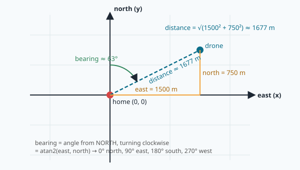

# Latitude, longitude and meters

A drone takes off from the old **Ribat of Sousse**, the fortress in the middle of the medina. The
operator types a mission: *"fly to Monastir marina, then come back"*. Two minutes later the GPS is
jammed. NAVERA's camera finds the drone on the map and says: *"you are at 35.8054, 10.7312"*.

Is the drone on the right path? How far is the marina now, and in which direction should it turn?
To answer, NAVERA has to do three small calculations again and again, many times per second:

1. **how far** is one point from another, in meters;
2. **in which direction** is it (the *bearing*);
3. **where** is it on a simple flat map in meters around a *home* point.

In this lesson you learn all three, and you will find them in NAVERA's code.

## The grid on the Earth

The Earth is (almost) a ball. To say where something is on a ball, we draw two families of circles on it.

- **Latitude** says how far **north or south** you are. The **equator** is latitude 0°. The North Pole is
  90° N, the South Pole 90° S. The circles of equal latitude are called **parallels** — they never cross,
  like the lines of a notebook.
- **Longitude** says how far **east or west** you are. Longitude 0° is a line from pole to pole through
  Greenwich, in London: the **Greenwich meridian**. Longitudes go from 180° W to 180° E. The lines of
  equal longitude are the **meridians** — like the segments of an orange, they all meet at the poles.


In computers we write a position as two **decimal degrees**: north and east are **positive**, south and
west are **negative**. Tunisia is north of the equator and east of Greenwich, so both numbers are positive:

| Place | Latitude | Longitude |
|---|---|---|
| Ribat of Sousse | 35.8277 | 10.6388 |
| Port El Kantaoui marina | 35.8942 | 10.5979 |
| Monastir marina | 35.7795 | 10.8320 |
| Monastir airport | 35.7581 | 10.7547 |
| Rio de Janeiro (for comparison) | −22.91 | −43.17 |

> [!NOTE]
> Always **latitude first, then longitude** — (lat, lon). It is the most common order, and the one
> NAVERA uses everywhere. Some file formats (GeoJSON, for instance) put longitude first: mixing them up
> sends you to a completely different place. Sousse written the wrong way round, (10.6388, 35.8277),
> is in western Ethiopia!

You may also see the old **degrees, minutes, seconds** style: 35° 49′ 40″ N. One degree has 60 minutes,
one minute has 60 seconds, so 35° 49′ 40″ = 35 + 49/60 + 40/3600 = 35.8278°. GPS receivers speak in
a mix of both (degrees and decimal minutes); you will decode that in lesson 15.

### How many decimals do we need?

Every decimal is 10 times smaller. Since one degree of latitude is about 111 km:

| Decimals | Example | Step | Good for |
|---|---|---|---|
| 1 | 35.8 | 11 km | a city |
| 3 | 35.828 | 111 m | a neighbourhood |
| 5 | 35.82770 | 1.1 m | a car on a road |
| 7 | 35.8277012 | 1.1 cm | survey instruments |

NAVERA stores positions as Python `float`s (about 15 significant digits), so precision of the *number*
is never the problem — the accuracy of the *measurement* is.

## How long is one degree?

The Earth's circumference is about **40 075 km**. A full circle is 360°, so along a meridian one degree
of latitude is

40 075 km ÷ 360 ≈ **111.32 km = 111 320 m**.

This number is so useful that it appears in NAVERA many times, as `M_PER_DEG = 111_320.0`.

Longitude is trickier. Look at the parallels on the globe: near the equator they are big circles, near
the poles they become tiny. All parallels are still cut into 360 degrees, so on a small circle one
degree is short. The size of a parallel is the size of the equator multiplied by the **cosine** of the
latitude.

> [!TIP]
> **Cosine** (`cos`) is just a button on a calculator that turns an angle into a number between 0 and 1
> (for angles from 0° to 90°). cos(0°) = 1, cos(60°) = 0.5, cos(90°) = 0. Here it tells you *what
> fraction of the equator's size* a parallel has: the equator itself (0°) is 100 %, the parallel at 60°
> is half, the pole is nothing.

At Sousse, cos(35.8°) ≈ 0.811, so

1° of longitude ≈ 111.32 km × 0.811 ≈ **90.3 km**.

In other words: at Sousse, moving 0.01° **north** is 1113 m, but moving 0.01° **east** is only 903 m.
If you forget the cosine, every east–west distance is 23 % too long — a classic bug.

> [!WARNING]
> Python's `math.cos()` wants the angle in **radians**, not degrees. A radian is just another unit for
> angles (180° = π radians ≈ 3.14). Always convert first: `math.cos(math.radians(35.8))` = 0.811.
> `math.cos(35.8)` would silently give −0.37: wrong, and no error message.

## Short distances: just Pythagoras

Around one city, the Earth is so big that it looks flat (like a football field looks flat even though
it lies on a ball). So for a few kilometers we can:

1. turn the latitude difference into meters **north**: `north = Δlat × 111 320`
2. turn the longitude difference into meters **east**: `east = Δlon × 111 320 × cos(lat)`
3. use **Pythagoras**: `distance = √(east² + north²)`

(Δ, "delta", means "difference": Δlat = lat2 − lat1.)

Example — from the Ribat of Sousse to Port El Kantaoui marina: Δlat = +0.0665°, Δlon = −0.0409°.
north = 0.0665 × 111 320 = 7403 m, east = −0.0409 × 111 320 × 0.811 = −3692 m (negative = west),
distance = √(3692² + 7403²) ≈ **8 272 m**.

## Long distances: the haversine formula

For long trips the flat trick slowly goes wrong, because the Earth is round. The exact way to measure
on a ball is to follow the **great circle** — the shortest path on a sphere, the one planes follow.
Its length comes from the **haversine formula**. It looks scary, but it is only five lines of Python:

```python
p1, p2 = math.radians(lat1), math.radians(lat2)          # latitudes in radians
dp = math.radians(lat2 - lat1)                           # Δlat in radians
dl = math.radians(lon2 - lon1)                           # Δlon in radians
a = math.sin(dp / 2) ** 2 + math.cos(p1) * math.cos(p2) * math.sin(dl / 2) ** 2
d = 2 * R * math.asin(math.sqrt(a))                      # R = 6 371 000 m, the Earth's radius
```

You don't need to prove it. Notice only that it has the same two ingredients as before: a
**north–south** part (`dp`) and an **east–west** part (`dl`) that is made smaller by **cos** of the
latitudes. `asin` ("arc sine") is the button that does the opposite of `sin`.

Ribat of Sousse → Port El Kantaoui marina with the haversine: **8 262 m**. The flat method gave 8 272 m.
Why 10 m apart over 8 km? Mostly not because of the curve! The two methods use two slightly different
sizes for the Earth: 111 320 m per degree is the size **at the equator** (the Earth is a little fat
there), while the haversine uses the **average** radius, 6 371 km, which gives 111 195 m per degree.
That is a 0.1 % difference: 1 m per km. For a drone that needs to know where it is within a few
meters, around one city, both are fine — but you should know why they differ.

## Which direction? The bearing

The **bearing** is the direction from one point to another, as an angle measured from **north**,
turning **clockwise** like a compass:

| Bearing | Direction |
|---|---|
| 0° | north |
| 90° | east |
| 180° | south |
| 270° | west |
| 315° | north-west |

In the flat world it is easy: you know `east` and `north`, so the angle is

`bearing = atan2(east, north)` (in degrees, then `% 360`).

`atan2(y, x)` is a function that gives the angle of an arrow that goes `x` forward and `y` sideways.
Unlike a plain arctangent it knows in which quarter of the circle the arrow points. It answers between
−180° and +180°; `% 360` (the remainder after dividing by 360) turns −90° into 270°, so the bearing
is always between 0 and 360.

> [!NOTE]
> Careful with the order: mathematicians measure angles from the **east** axis, counter-clockwise;
> navigators measure from **north**, clockwise. That is why we write `atan2(east, north)` and not
> `atan2(north, east)`.

On the round Earth, the bearing of the great circle uses the same idea with a few more cos and sin:

```python
y = math.sin(dl) * math.cos(p2)                                         # the "east" part
x = math.cos(p1) * math.sin(p2) - math.sin(p1) * math.cos(p2) * math.cos(dl)   # the "north" part
bearing = math.degrees(math.atan2(y, x)) % 360
```

From the Ribat of Sousse, Monastir marina is at **107°** (a bit south of east) and 18.2 km away.
Coming back, the bearing is **287°** — about 107° + 180°, as you would expect.

## A home made of meters: the local frame

Robots hate degrees. Speeds are in meters per second, a camera sees a field 200 m wide, the drone must
stay 50 m away from a building… So navigation software picks a **home point** (often the take-off
point) and describes every position as **meters east** and **meters north** of home. This is called a
**local frame**, or **ENU frame** (**E**ast, **N**orth, **U**p — the third axis is the height, which we
leave aside today).



Going **to** the local frame (lat, lon → east, north):

```
east  = (lon − home_lon) × 111 320 × cos(home_lat)
north = (lat − home_lat) × 111 320
```

Going **back** (east, north → lat, lon) is the same formula turned around:

```
lat = home_lat + north / 111 320
lon = home_lon + east / (111 320 × cos(home_lat))
```

With the Ribat of Sousse as home, Monastir marina is at (east 17 438 m, north −5 366 m).

How far can you go before the "flat Earth" breaks? Compared with the haversine, our flat frame is off
by about 1 m at 1 km, 6 m at 5 km and 30 m at 20 km (mostly the 0.1 % effect above, then the curve
of the Earth). For one city that is fine; for a flight across the country, the software must use
the round-Earth formulas or move its home point along the way.

## In NAVERA

**`navera_common/navera_common/geo.py`** — the geodesy helpers shared by every part of NAVERA
([open it](file:navera/navera_common/navera_common/geo.py)):

```python
EARTH_RADIUS_M = 6_371_000.0

def haversine_m(lat1: float, lon1: float, lat2: float, lon2: float) -> float:
    """Great-circle distance in metres (spherical Earth, R = 6 371 km)."""
    p1, p2 = math.radians(lat1), math.radians(lat2)
    a = (math.sin((p2 - p1) / 2) ** 2
         + math.cos(p1) * math.cos(p2) * math.sin(math.radians(lon2 - lon1) / 2) ** 2)
    return 2 * 6_371_000.0 * math.asin(math.sqrt(min(1.0, a)))
```

The `min(1.0, a)` is a safety belt: because of tiny rounding errors `a` can be 1.0000000001 for two
opposite points, and `sqrt`/`asin` of more than 1 would crash. The same file has
`dead_reckon()`: "from here, going on bearing *h* at speed *v* for *t* seconds, where am I?" — the
opposite question of `distance` + `bearing` — and `is_finite_latlon()`, which refuses impossible
positions before they reach the autopilot.

**`day_pkg/day_pkg/vision_nav.py`** — day vision moves positions around in a local frame
([open it](file:navera/day_pkg/day_pkg/vision_nav.py)):

```python
M_PER_DEG = 111_320.0

def _en(p, ref):
    """(east, north) metres of p from ref."""
    return ((p[1] - ref[1]) * M_PER_DEG * math.cos(math.radians(ref[0])), (p[0] - ref[0]) * M_PER_DEG)

def _move(p, de, dn):
    return (p[0] + dn / M_PER_DEG, p[1] + de / (M_PER_DEG * math.cos(math.radians(p[0]))))
```

`_en` is exactly your `to_local_xy` (with points written as `(lat, lon)` pairs) and `_move` is your
`from_local_xy`. When the camera cannot see the ground for a while (over the sea, for instance), day
vision uses them to **carry the position along the measured velocity** — east and north meters per
second — until the next match.

The flight simulator (`navera_tools/demo_mission.py`) does the same with `to_en()` and `to_ll()`
around the first point of its `ROUTE`: the loop around Sousse you will measure in the lab.

## New words

| Word | Meaning |
|---|---|
| **latitude** | angle north (+) or south (−) of the equator, −90° to +90° |
| **longitude** | angle east (+) or west (−) of the Greenwich meridian, −180° to +180° |
| **parallel / meridian** | circle of equal latitude / half-circle of equal longitude |
| **decimal degrees** | a position written as two decimal numbers, e.g. (35.8277, 10.6388) |
| **cosine (cos)** | turns an angle into a number from 1 (0°) to 0 (90°): how much a parallel shrinks |
| **radian** | another unit for angles; 180° = π rad. Python's `sin`/`cos` use it |
| **great circle** | the shortest path between two points on a sphere |
| **haversine** | the formula that gives the great-circle distance |
| **bearing** | direction to a point, in degrees clockwise from north (0–360) |
| **home point** | the origin (0, 0) of a local frame, often the take-off point |
| **local frame / ENU** | positions as meters East, North (and Up) of the home point |

## Check what you learned

<details><summary>1. Why is 0.01° of longitude shorter than 0.01° of latitude in Sousse?</summary>
Parallels get smaller away from the equator. At latitude 35.8° a parallel is only cos(35.8°) ≈ 0.81 of
the equator, so 0.01° of longitude is 0.81 × 1113 m ≈ 903 m, while 0.01° of latitude is always about
1113 m.
</details>

<details><summary>2. A program computes math.cos(35.8) and gets −0.37. What went wrong?</summary>
The angle was given in degrees, but math.cos expects radians. It should be math.cos(math.radians(35.8)) = 0.81.
</details>

<details><summary>3. The bearing from A to B is 60°. What is the bearing from B to A (roughly)?</summary>
About 240° (60° + 180°): the opposite direction.
</details>

<details><summary>4. Why do robots prefer a local frame in meters to latitude and longitude?</summary>
Distances, speeds and sizes are all in meters, and in a local frame they are simple: Pythagoras gives a
distance, atan2 gives a direction, adding meters moves a point. Degrees need cosines and are not the
same size east–west and north–south.
</details>

<details><summary>5. Someone writes Sousse as (10.6388, 35.8277). Where does that point fall?</summary>
Latitude 10.6° N, longitude 35.8° E: in western Ethiopia, more than 3 000 km away — latitude and
longitude were swapped.
</details>

Now open the **🛠️ Lab** tab.
