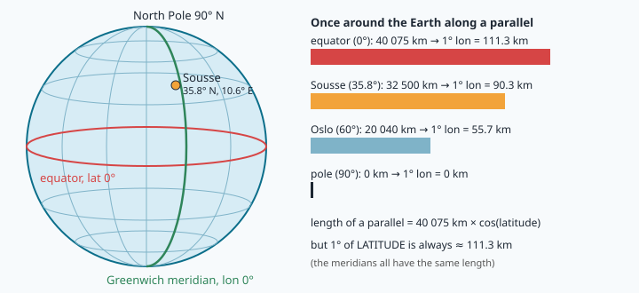
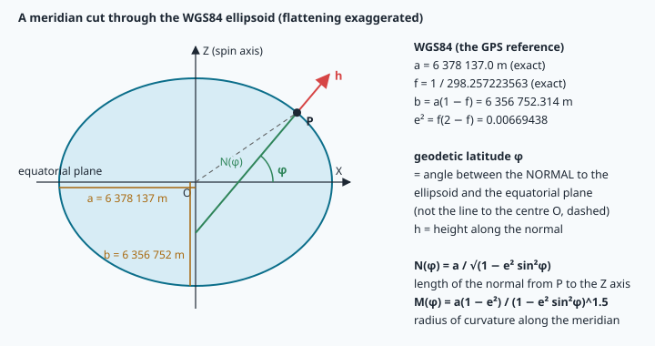
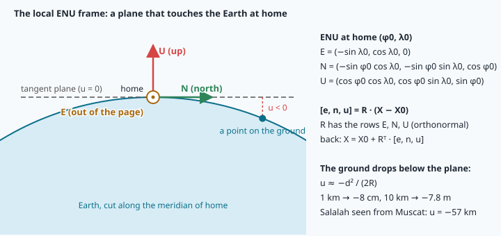

# Geodesy for navigation: from WGS84 to a local frame in meters

> [!NOTE] In short
> - GPS and maps use degrees, but the flight controller needs metres, so NAVERA converts between
>   them every second.
> - You learn three ways to write one point: **geodetic** (lat, lon, height), **ECEF** (X, Y, Z
>   from the Earth's centre) and **ENU** (metres east, north, up from a home point).
> - The exact conversions use the WGS84 ellipsoid; the haversine (sphere) and the flat-Earth
>   formula are faster shortcuts.
> - The key question for an engineer: how big is the error of each shortcut?
> - In the lab you implement the conversions, check them against NAVERA's code, and measure the
>   error of the shortcuts around Muscat.

A survey drone takes off from the port of **Sohar** and flies down the Batinah coast towards
**Muscat**. Halfway, its GPS is jammed. NAVERA's camera matches the ground with the on-board
map and reports *"you are at 23.9120° N, 57.6050° E"*. The flight controller does not think in
degrees: it needs **meters** — how far to the next waypoint, in which direction, how fast the
drone drifts east. Every second, NAVERA converts between three ways of writing the same point:

1. **geodetic coordinates** (latitude, longitude, height) — what GPS and maps use;
2. **ECEF** — a Cartesian (X, Y, Z) frame fixed to the Earth, with its origin at the Earth's centre;
3. **ENU** — a local frame in meters: **E**ast, **N**orth, **U**p from a home point.

This lesson gives you the exact mathematics of these conversions on the **WGS84 ellipsoid**,
the spherical shortcuts (haversine, bearing) and the flat-Earth shortcut that NAVERA uses, and —
most important for an engineer — **how big the error of each shortcut is**.

## 1. Latitude, longitude and sign conventions

- **Latitude** φ: angle north (+) or south (−) of the equator, from −90° to +90°.
  Circles of equal latitude are **parallels**.
- **Longitude** λ: angle east (+) or west (−) of the **Greenwich meridian**, from −180° to +180°.
  Half-circles of equal longitude, from pole to pole, are **meridians**.



Software writes positions in **decimal degrees**, latitude first: the Sultan Qaboos Grand Mosque in
Muscat is (23.5839, 58.3875). Oman is north of the equator and east of Greenwich, so both numbers
are positive. Old notation uses degrees, minutes and seconds: 23° 35′ 02″ N = 23 + 35/60 + 2/3600 =
23.5839°.

> [!WARNING]
> **Order and units.** NAVERA always writes (lat, lon). GeoJSON and some web tools write
> (lon, lat): Muscat written the wrong way round, (58.3875, 23.5839), falls near the west coast of Estonia,
> 4 700 km away. And Python's `math.sin`, `math.cos`, `math.tan` take **radians**: `math.cos(23.58)` is
> 0.018, not 0.917. Convert with `math.radians()` and back with `math.degrees()`.

> [!NOTE]
> **Null Island.** The point (0°, 0°) lies in the open Atlantic Ocean, in the Gulf of Guinea, about
> 600 km south of the coast of Ghana. There is no island there — only a weather buoy. Mapping
> people call it "Null Island" because it is where data with **missing coordinates** lands: a
> GPS receiver that has no fix yet, a variable left at its default value 0, a failed conversion.
> A drone in Oman that suddenly "is" at (0, 0) has a software problem, not a 7000 km jump. That is
> why NAVERA's `is_finite_latlon()` refuses exactly (0, 0) as well as NaN, infinity and out-of-range
> values.

**Precision of the number.** One degree of latitude is about 111 km, so the 5th decimal is about
1.1 m and the 7th about 1.1 cm. A Python `float` keeps about 15–16 significant digits: the
*number* is never the problem — the *measurement* is.

## 2. The shape of the Earth: the WGS84 ellipsoid

The Earth spins, so it is slightly flattened: the equatorial radius is 21 km longer than the polar
radius. GPS uses a reference **ellipsoid** (an ellipse rotated around the spin axis) called
**WGS84** (World Geodetic System 1984). It is defined by two exact numbers:

```
a = 6 378 137.0 m              semi-major axis (equatorial radius)
f = 1 / 298.257223563          flattening, f = (a − b) / a
```

and everything else follows:

```
b  = a (1 − f)        = 6 356 752.314 m     semi-minor axis (polar radius)
e² = f (2 − f)        = 0.00669438          first eccentricity squared, e² = (a² − b²) / a²
```

In `geo_lab.py` these are `WGS84_A`, `WGS84_F`, `WGS84_B` and `WGS84_E2`.



On an ellipsoid, "latitude" needs a precise definition. The **geodetic latitude** φ (the one GPS
gives) is the angle between the **normal** to the ellipsoid at the point (the line perpendicular to
the surface, the direction a plumb line roughly follows) and the equatorial plane. It is *not* the
angle of the line to the Earth's centre (the **geocentric latitude**). At 45° the two differ by
0.19°: confusing them moves a point about 21 km north or south.

**Height.** GPS heights are measured along the normal, above the ellipsoid: the **ellipsoidal
height h**. The height on a road sign is above **mean sea level** (the **geoid**, an irregular
surface of equal gravity potential). The two differ by the **geoid separation**, which varies
between about −106 m and +85 m around the world. An NMEA receiver gives the altitude above mean
sea level *and* the separation; NAVERA's GPS node adds them to publish an ellipsoidal height.

### Radii of curvature: how long is a degree?

A sphere has one radius. An ellipsoid curves differently north–south and east–west, so at latitude
φ we need two **radii of curvature** (with w = 1 − e² sin²φ):

```
M(φ) = a (1 − e²) / w^1.5        meridian radius: curvature along the north-south direction
N(φ) = a / √w                    prime-vertical radius: curvature along the east-west direction
```

A small change of latitude dφ (in radians) is a ground distance M·dφ; a small change of longitude
dλ is N·cos φ·dλ (the parallel at latitude φ is a circle of radius N cos φ). So:

```
meters per degree of latitude  = M(φ) · π / 180
meters per degree of longitude = N(φ) · cos φ · π / 180
```

| Place | φ | M (km) | N (km) | 1° latitude | 1° longitude |
|---|---|---|---|---|---|
| Equator | 0° | 6335.4 | 6378.1 | 110.574 km | 111.319 km |
| Salalah | 17.02° | 6340.9 | 6380.0 | 110.669 km | 106.475 km |
| Nizwa | 22.93° | 6345.1 | 6381.4 | 110.743 km | 102.573 km |
| Muscat | 23.58° | 6345.6 | 6381.6 | 110.752 km | 102.076 km |
| Sohar | 24.35° | 6346.3 | 6381.8 | 110.763 km | 101.477 km |
| Khasab (Musandam) | 26.18° | 6347.8 | 6382.3 | 110.791 km | 99.965 km |
| Sousse (NAVERA's test area) | 35.83° | 6357.3 | 6385.5 | 110.956 km | 90.359 km |

Two things to notice. First, **longitude shrinks with cos φ**: in Salalah one degree east is
106.5 km, in Muscat 102.1 km, 4.4 km less. A program that forgets the cosine makes east–west
distances 9 % too long in Muscat and 23 % too long in Sousse. Second, a degree of **latitude is not
constant**: 110.57 km at the equator, 111.69 km at the poles — because the ellipsoid is *flatter*
near the poles, its curvature radius M is *larger* there.

## 3. ECEF: a Cartesian frame for the whole Earth

**ECEF** (Earth-Centred, Earth-Fixed) puts the origin at the centre of the ellipsoid, the Z axis on
the spin axis (towards the North Pole), the X axis through (0°, 0°) and the Y axis through (0°, 90° E).
It rotates with the Earth, so a building has constant ECEF coordinates. Any point (φ, λ, h) is:

```
X = (N + h) cos φ cos λ
Y = (N + h) cos φ sin λ
Z = (N (1 − e²) + h) sin φ
```

Check: at (0°, 0°, 0 m), N = a, so X = a, Y = Z = 0. At the North Pole, Z = N(1 − e²) = b. ✔

**The inverse** (ECEF → φ, λ, h) has no simple closed form, but a fixed-point iteration converges
very fast:

```
λ = atan2(Y, X)
p = √(X² + Y²)                         distance from the spin axis
φ = atan2(Z, p (1 − e²))               first guess (exact for h = 0)
repeat:  N = N(φ);   h = p / cos φ − N;   φ = atan2(Z, p (1 − e² N / (N + h)))
```

Each iteration reduces the error by a factor of the order of e² ≈ 0.007, so 5–6 iterations give
sub-millimeter accuracy for any point near the Earth. (Closed-form solutions exist, for example
Bowring's method, but the iteration is easier to read and to test.) Because the formula divides by
cos φ, it would fail exactly at the poles — not a problem for a drone in Oman. You do not need to prove
that the iteration converges: the lab checks it with a **round-trip test** (geodetic → ECEF →
geodetic must give back the same point to a millimeter).

## 4. ENU: the local tangent frame

For a vehicle, ECEF numbers are inconvenient: moving 10 m north changes X, Y *and* Z. We want a
frame attached to a **home point** (φ0, λ0, h0): x to the **east**, y to the **north**, z **up**
(along the ellipsoid normal). Its three unit vectors, written in ECEF, are:

```
E = (−sin λ0,          cos λ0,          0     )
N = (−sin φ0 cos λ0,  −sin φ0 sin λ0,   cos φ0)
U = ( cos φ0 cos λ0,   cos φ0 sin λ0,   sin φ0)
```

You can check them: U is the normal direction (the X, Y, Z formulas above without the radius); E is
horizontal (no Z part) and points towards increasing λ; N = U × E. Put them as the **rows** of a
3 × 3 matrix R. To express a point in ENU, take its ECEF position minus the home's ECEF position and
project it on each axis — a dot product with each row, which is a matrix product:

```
[e, n, u]ᵀ = R · (X − X0)                   R = [[E], [N], [U]]
```

R is a **rotation matrix**: its rows are orthonormal, so R·Rᵀ = I, det R = +1 and its inverse is its
transpose. The way back is therefore cheap:

```
X = X0 + Rᵀ · [e, n, u]ᵀ          then ECEF → (φ, λ, h) with the iteration above
```



The ENU plane **touches** the Earth at home. A point on the ground d meters away is below the
plane: u ≈ −d² / (2R). That is −8 cm at 1 km, −7.8 m at 10 km, and −57 km for Salalah seen from
Muscat. ENU is exact everywhere (it is just a rotation and a translation of ECEF), but its
horizontal (e, n) is a "flat picture" of a curved surface, so it is most meaningful near home.

### Worked example: Nizwa fort seen from Muscat

Home: Muscat (23.5839°, 58.3875°, h0 = 0). Target: Nizwa fort (22.9333°, 57.5300°, h = 500 m).

1. ECEF of Muscat: X0 = (3 065 638.6, 4 980 689.3, 2 536 114.8) m.
   ECEF of Nizwa: X = (3 155 356.4, 4 958 645.0, 2 470 113.1) m.
2. Difference: X − X0 = (89 717.8, −22 044.3, −66 001.7) m.
3. R at Muscat (rounded): E = (−0.8516, 0.5242, 0), N = (−0.2097, −0.3407, 0.9165),
   U = (0.4804, 0.7805, 0.4001).
4. e = E·(X − X0) = −87 959.8 m, n = N·(X − X0) = −71 793.2 m, u = U·(X − X0) = −512.4 m.

Nizwa is 88 km west and 72 km south of Muscat. Although the fort is 500 m above the ellipsoid, it is
512 m **below** Muscat's tangent plane: at 113.5 km, the curvature term d²/(2R) ≈ 1010 m is larger
than its height. The horizontal ENU distance is √(e² + n²) = 113 539 m; the distance along the
ellipsoid (Vincenty's formula) is 113 536 m.

## 5. The spherical shortcuts: haversine and bearing

Many programs, NAVERA included, use a **sphere** of mean radius R = 6 371 000 m (`EARTH_RADIUS_M`)
for distances. The shortest path on a sphere follows a **great circle** (a circle whose centre is the
centre of the sphere). The central angle θ between two points satisfies the **haversine formula**
(hav θ = sin²(θ/2)):

```
a = sin²(Δφ/2) + cos φ1 · cos φ2 · sin²(Δλ/2)        all angles in radians
d = 2 · EARTH_RADIUS_M · asin(√a)
```

It is mathematically equal to the spherical law of cosines, cos θ = sin φ1 sin φ2 + cos φ1 cos φ2
cos Δλ, but numerically much better for short distances: for points 1 m apart, cos θ = 0.999999999999988
and `acos` of a number so close to 1 loses most of its digits; `asin` of a small number does not.

The **initial bearing** (direction to fly, clockwise from north) is the same idea as ENU. Put both
points on a unit sphere, rotate the target into the ENU frame of the start point: its east and north
components are

```
east  ∝ sin Δλ · cos φ2
north ∝ cos φ1 · sin φ2 − sin φ1 · cos φ2 · cos Δλ
bearing = atan2(east, north)   → degrees → % 360
```

`atan2(y, x)` returns the angle of the vector (x, y) in (−π, π], using the signs of both arguments
to choose the right quadrant. Mathematicians measure from the x axis counter-clockwise; navigators
measure from **north**, clockwise — so the east component goes **first**: `atan2(east, north)`.
`% 360` maps −90° to 270°.

From Muscat, Salalah is at a bearing of **212.3°** (south-south-west) and 856.4 km away on the
sphere. The way back is **30.8°**, not 212.3° − 180° = 32.3°: on a great circle the bearing changes
along the way.

### How wrong is the sphere?

On the WGS84 ellipsoid, Muscat → Salalah is **854.017 km**; the sphere says **856.375 km**,
2.36 km (0.28 %) too long. The reason is the radii table: at Muscat a north–south distance really
curves with M = 6345.6 km, but the sphere uses 6371 km — **0.40 % too large**. East–west
(N = 6381.6 km) the sphere is 0.17 % too small. So the haversine error depends on the direction,
between about −0.2 % and +0.4 % in Oman: **2–4 m per km**. It is fine for "how far is the next
waypoint"; it is not fine for surveying.

## 6. The flat-Earth shortcut and its error

Inside one city, the fastest conversion is to treat degrees as a flat grid with a constant scale.
This is what NAVERA's day vision does, with `M_PER_DEG = 111 320.0`:

```
east  = (λ − λ0) · M_PER_DEG · cos φ0
north = (φ − φ0) · M_PER_DEG
```

and the inverse (`flat_move` in the lab, `_move` in NAVERA) divides instead of multiplying. It has
two kinds of error:

1. **Scale error (first order, proportional to distance).** 111 320 m is a·π/180, the length of a
   degree *of the equator*. At Muscat a degree of latitude is 110 752 m (M·π/180), so every
   north displacement is **0.51 % too long** — 5 m per km. East is almost right (−0.05 %), because
   N·π/180 ≈ 111 380 m is close to 111 320 m.
2. **Curvature and convergence of the meridians (second order, proportional to d²).** Using the
   cosine of the home latitude for all points ignores that meridians get closer as you go north:
   the east error is about e·n·tan φ0 / R (e, n: the east and north distances in meters). Example
   at Muscat (φ0 = 23.6°, tan φ0 = 0.436), a point 10 km east and 10 km north:
   `10 000 × 10 000 × 0.436 / 6 371 000 ≈ 6.8 m`. Twice farther (20 km, 20 km) gives four times
   more, 27 m: that is "proportional to d²". With the exact radii M and N instead of 111 320 m, this
   is all that remains: a few meters at 10 km.

In the lab you will measure both curves. For the worked example above, the flat formula puts
Nizwa at (−87 484, −72 425) m instead of (−87 960, −71 793) m: **791 m wrong** at 113 km.
A flat frame is a tool for a few kilometers, not for a flight across the Hajar mountains.

> [!TIP]
> **Python and numpy notes for this lab.**
> - A function can return several values as a **tuple**: `return east, north`. The caller
>   **unpacks** it: `e, n = flat_en(...)`. `m, n = radii(lat)` works the same way.
> - Variables created inside a function are **local**: they exist only during that call. The `p1`,
>   `p2`, `dl` of `haversine()` do not exist inside `bearing()`; each function computes its own.
>   Using one anyway gives `NameError: name 'dl' is not defined` (Python may then suggest a
>   similar name such as `'d'` — ignore the suggestion and define the variable).
> - Use the constant names of the file: the sphere radius is `EARTH_RADIUS_M`, not `R`.
> - A `*` in front of a tuple in a call **unpacks** it into separate arguments (lesson 3):
>   `ecef_to_geodetic(*x)` is `ecef_to_geodetic(x[0], x[1], x[2])`.
> - Tuples do not do arithmetic: `(1, 2) - (1, 1)` raises `TypeError: unsupported operand type(s)`.
>   Make numpy arrays, `np.array(geodetic_to_ecef(...))`, then `-` works element by element,
>   `R @ d` is the matrix–vector product and `R.T` is the transpose.
> - `ValueError: math domain error` means a function received a value outside its domain:
>   `math.asin(1.0000000002)` or `math.sqrt(-1e-12)`. In geodesy it comes from rounding (clip with
>   `min(1.0, a)`) or from degrees passed where radians were expected.

## 🐦 How birds do it

In the 1950s the Dutch biologist **Albert Perdeck** caught about 11 000 starlings that were
migrating through the Netherlands, flying west-south-west towards their winter quarters in
north-west France and southern England. He ringed them, transported them by plane to Switzerland,
and released them there (published 1958). Recoveries of the rings told the result:

| Birds | What they did | Interpretation |
|---|---|---|
| **Adults** | corrected towards the north-west, back to their usual winter area | they have a **map** (a sense of position) and a compass |
| **Juveniles**, first migration | kept flying west-south-west, parallel to their normal route, and wintered in southern France and Spain | they have only a **compass** and a programmed direction |

The young birds behaved like a vehicle with heading but no position: displaced sideways, they kept
the same bearing and missed by the size of the displacement. The adults behaved like a navigation
computer: they knew where they were and computed a **new bearing** to the goal.

Long-distance migrants in Oman face the same problem at a larger scale. **Sooty falcons** that
breed on islands off the coast of Oman, such as the Daymaniyat islands, spend the northern winter
in Madagascar, and satellite-tracking studies have followed sooty falcons across thousands of kilometers.
For trips of that length the difference between a flat map, a sphere and the real Earth is not
an academic detail. Navi, our swallow, prefers the version of the story where she knows her
position *and* the shape of the Earth.

## In NAVERA

NAVERA's real data — its satellite map, recorded frames and simulator area — cover **Sousse,
Tunisia**, where NAVERA is developed. The code below works the same anywhere on Earth; the lab uses
Omani places.

**`navera_common/navera_common/geo.py`** ([open it](file:navera/navera_common/navera_common/geo.py))
— the geodesy helpers shared by all localizers. They work on a sphere:

```python
EARTH_RADIUS_M = 6_371_000.0

def is_finite_latlon(lat, lon) -> bool:
    """True for a real, in-range position. Rejects None, NaN/inf and (0, 0)."""
    ...
    return not (lat == 0.0 and lon == 0.0)

def haversine_m(lat1: float, lon1: float, lat2: float, lon2: float) -> float:
    """Great-circle distance in metres (spherical Earth, R = 6 371 km)."""
    p1, p2 = math.radians(lat1), math.radians(lat2)
    a = (math.sin((p2 - p1) / 2) ** 2
         + math.cos(p1) * math.cos(p2) * math.sin(math.radians(lon2 - lon1) / 2) ** 2)
    return 2 * 6_371_000.0 * math.asin(math.sqrt(min(1.0, a)))
```

`min(1.0, a)` protects `sqrt`/`asin` against rounding. The same file has `dead_reckon()`, the
inverse problem ("from here, on bearing h at speed v for t seconds, where am I?") on the same sphere.

**`day_pkg/day_pkg/vision_nav.py`** ([open it](file:navera/day_pkg/day_pkg/vision_nav.py)) — day
vision's flat shortcut:

```python
M_PER_DEG = 111_320.0

def _en(p, ref):
    """(east, north) metres of p from ref."""
    return ((p[1] - ref[1]) * M_PER_DEG * math.cos(math.radians(ref[0])), (p[0] - ref[0]) * M_PER_DEG)

def _move(p, de, dn):
    return (p[0] + dn / M_PER_DEG, p[1] + de / (M_PER_DEG * math.cos(math.radians(p[0]))))
```

Day vision measures its **velocity** from two map fixes with `_en()` (meters per second) and later
carries the position along that velocity with `_move()`, for example over the sea where the camera
finds nothing to match. Because the same constant is used in both directions, the 0.5 % scale
error **cancels** in the carried position; it only affects numbers expressed in meters, such as
the distance gates and the stated uncertainty. You will quantify this in the lab and decide whether
it matters.

**`gps_pkg/gps_pkg/nodes/gps_node.py`** — the GPS node publishes the height above the **WGS84
ellipsoid**: `fix.altitude = msl + geo_sep` (NMEA altitude above mean sea level plus the geoid
separation).

## Glossary

| Term | Meaning |
|---|---|
| **geodetic latitude φ** | angle between the ellipsoid normal and the equatorial plane |
| **longitude λ** | angle east (+) or west (−) of the Greenwich meridian |
| **ellipsoid, WGS84** | the reference shape of GPS: a = 6 378 137 m, f = 1/298.257223563 |
| **flattening f, eccentricity e²** | f = (a − b)/a; e² = f(2 − f) = 0.00669438 |
| **ellipsoidal height h** | height above the ellipsoid, along the normal (what GPS computes) |
| **geoid, mean sea level** | the surface heights on maps refer to; differs from the ellipsoid by up to ~100 m |
| **radius of curvature M, N** | meridian (north–south) and prime-vertical (east–west) radii at φ |
| **ECEF** | Earth-centred Earth-fixed Cartesian frame (X, Y, Z) in meters |
| **ENU** | local frame east, north, up at a home point; a rotation + translation of ECEF |
| **rotation matrix** | orthonormal matrix with det = +1; inverse = transpose |
| **great circle** | shortest path on a sphere; its centre is the sphere's centre |
| **haversine** | numerically stable formula for the great-circle distance |
| **bearing** | direction to a point, degrees clockwise from north, in [0, 360) |
| **Null Island** | the point (0°, 0°) in the Gulf of Guinea, where missing coordinates land |
| **scale error** | an error proportional to distance (a wrong constant); first order |

## Check what you learned

<details><summary>1. How many kilometers is 1° of longitude in Salalah and in Muscat, and why do they differ?</summary>
N(φ)·cos φ·π/180: 106.5 km at Salalah (17.0°) and 102.1 km at Muscat (23.6°). Parallels are
circles of radius N cos φ, which shrink as cos φ decreases away from the equator.
</details>

<details><summary>2. Why is the inverse of R simply its transpose, and why does it matter for enu_to_geodetic()?</summary>
The rows of R are orthonormal unit vectors (E, N, U), so R·Rᵀ = I. Inverting a general 3 × 3 matrix
costs more and loses precision; with a rotation, X = X0 + Rᵀ·[e, n, u] is exact and cheap.
</details>

<details><summary>3. Your function returns math.cos(23.58) = 0.018 for Muscat. What happened, and what would happen in asin?</summary>
The angle was passed in degrees; math.cos expects radians (use math.radians(23.58) → cos = 0.917).
With asin or sqrt, a wrong unit or rounding can give a value outside the domain and the error
"ValueError: math domain error".
</details>

<details><summary>4. A point 10 km from home is 7.8 m below the ENU plane. Is the ENU frame wrong?</summary>
No. ENU is an exact Cartesian frame (rotation of ECEF): the ground curves away from the tangent
plane by about d²/(2R). A program that assumes "ground = u = 0" far from home makes that error.
</details>

<details><summary>5. NAVERA's flat shortcut is 0.5 % too long in the north direction at Muscat. Give one case where it matters and one where it cancels.</summary>
It cancels when a velocity measured with _en() is applied with _move() (same constant both ways).
It matters when the result is compared with true meters: a distance gate, a stated uncertainty, a
speed from another sensor (airspeed, IMU) — about 5 m per km.
</details>

<details><summary>6. Why is the bearing from Salalah back to Muscat (30.8°) not 212.3° − 180°?</summary>
A great circle is not a line of constant bearing: the direction relative to the local meridian
changes along the path, so the final bearing of A→B differs from the initial bearing of B→A + 180°.
</details>

Now open the **🛠️ Lab** tab.
