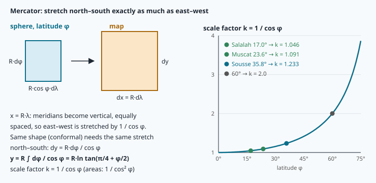
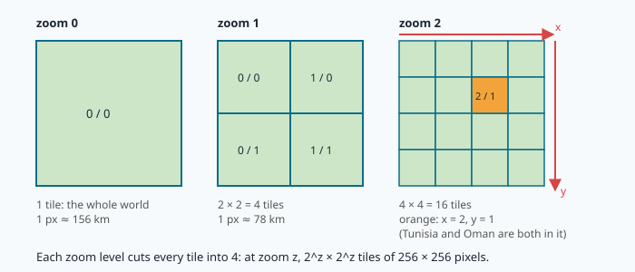
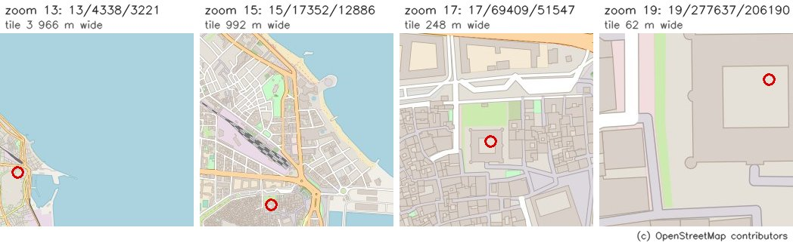
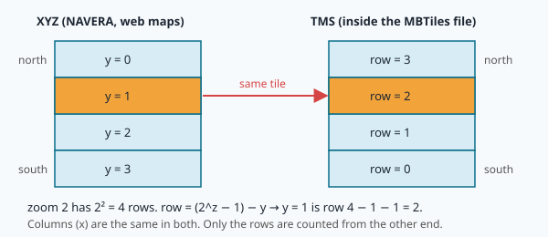
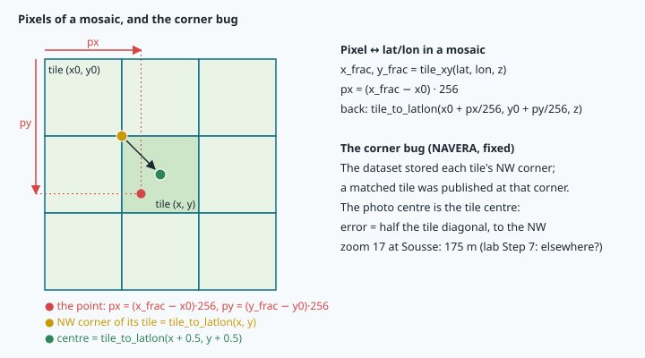

# Map projections and tiles: Web Mercator and MBTiles

> [!NOTE] Mission brief
> **28 September 2026.** A full code review of NAVERA lists a critical bug, **LOC-1**: when day vision
> matched a camera photo to a map tile, it published the tile's **north-west corner** as the drone's
> position. Every fix was shifted by the same **175 m**, always towards the north-west. A wrong position that looks
> steady is the worst kind: nothing jumps, so no gate catches it.
>
> Where does 175 m come from? You will prove it is half the diagonal of a zoom-17 tile at Sousse. To do
> that you build NAVERA Lite's map part, `navera_lite/tiles.py`: the Web Mercator projection, tile numbers,
> pixel sizes, a reader for the course's map file, and pixel ↔ lat/lon in a mosaic. You are a **bug hunter**
> (reproduce LOC-1 and measure it around the world) and a **careful server author** (an MBTiles reader
> that refuses impossible requests). Session 1 earns **Cartographer**, session 2 **Tile hunter**.
>
> **Start now:** open the 🛠️ **Lab** tab, do **Step 0** (one minute, no code), then come back here for §1.

**Objectives.** After this mission you can:

1. derive the Web Mercator ordinate, compute a point's **tile** and its **pixel** inside the tile from
   (lat, lon), and go back;
2. compute the ground size of a map pixel at any latitude and **choose a zoom** for a camera;
3. read a tile from an **MBTiles** file with parameterised SQL, read-only, with the **TMS** row flip, and
   refuse impossible tile addresses;
4. convert a mosaic pixel to (lat, lon), and explain and size the **corner bug**.

**You need:** mission 06 (degrees vs radians, `geo.haversine_m`, the WGS84 radius a), mission 03 (tuples,
`math`), mission 04 (`int`, floats). ⏱ Reading: about 55 minutes with the ✏️ checks (up to 1 h 15 if SQL
is new to you): §1–§3 before session 1, §4–§6 before session 2. Lab: 3 to 4 h.

**Before you start.** Answer without looking; if you miss two, reread mission 06 §1–§3.

<details><summary>1. <code>math.tan(45)</code> — is that tan 45° = 1?</summary>
No: 45 is read as radians, tan(45 rad) = 1.62. Write <code>math.tan(math.radians(45))</code>.
</details>
<details><summary>2. 1° of longitude is 111.19 km at the equator (mean Earth radius, mission 06). About how long at 60° N, and why?</summary>
111.19 × cos 60° = 55.6 km: a parallel is a circle of radius R·cos φ.
</details>
<details><summary>3. <code>int(-0.3)</code> and <code>math.floor(-0.3)</code> give?</summary>
0 and −1: <code>int</code> cuts towards zero, <code>floor</code> goes down.
</details>

<details><summary>Words of this lesson (open if you need them)</summary>

| Word | Meaning | Français |
|---|---|---|
| **projection** | a function (lat, lon) → (x, y) from the curved Earth to a flat map | projection |
| **conformal** | keeps angles and small shapes (a small circle stays a circle) | conforme |
| **scale factor k** | map length / ground length at a point | facteur d'échelle |
| **tile** | a 256 × 256 picture, one square of the map; address z/x/y | tuile |
| **zoom level z** | at zoom z the world is 2^z × 2^z tiles | niveau de zoom |
| **XYZ / TMS** | tile rows counted from the north / from the south | XYZ / TMS |
| **GSD** | ground sample distance: ground size of one camera pixel | résolution au sol |
| **MBTiles** | a whole tile pyramid in one SQLite database file | MBTiles |
| **BLOB** | a database column that holds raw bytes (here a JPEG file) | BLOB (données binaires) |
| **placeholder `?`** | a slot in an SQL query that receives a value, never SQL text | paramètre lié |
| **mosaic** | several tiles glued into one picture | mosaïque |
</details>

## 1. Why Mercator?

A **map projection** is a function (φ, λ) → (x, y). A sphere cannot be flattened without stretching, so
every projection gives something up: **conformal** projections keep angles and small shapes,
**equal-area** ones keep areas, none keeps all distances. To match a camera photo with a map, shape
matters most: a roundabout must stay round, a building corner must stay 90°, north must stay up. So web
maps use a conformal projection: **Mercator** (Gerardus Mercator, 1569).

**The idea in three lines.** On a sphere of radius R, a small step north is R·dφ and a small step east is
R·cos φ·dλ (mission 06 §2). Mercator draws the meridians as vertical, equally spaced lines, **x = R·λ**:
an east step becomes R·dλ on the map, stretched by **1/cos φ**. To keep small shapes, the north step must
be stretched by the same factor:

```
dy = R · dφ / cos φ          →          y(φ) = R · ln tan(π/4 + φ/2)          (φ in radians)
```

Adding up all the small steps dφ/cos φ from the equator (an integral) gives this formula; the ✏️ check
below asks you to verify it by differentiating. **ln** is the natural logarithm: in Python `math.log(v)`,
not `math.log10(v)` (on many calculators "log" means log₁₀).



The **scale factor** is k = 1/cos φ: 1.000 at Singapore (1.3°), 1.233 at Sousse (35.8°), 2.293 at
Reykjavik (64.1°). Areas grow by k², which is why Greenland looks as big as Africa on a web map although
it is 14 times smaller. At the pole y → ∞, so **Web Mercator** stops where y = π·R: the world becomes an
exact square, and nothing beyond **φ_max = 85.0511°** exists on a web map.

The inverse (from y back to φ, on the unit sphere R = 1) is φ = atan(sinh y).

**Worked example: Sousse (35.8277°).** φ = 0.625311 rad; tan(π/4 + φ/2) = tan(1.098054) = 1.955337;
ln of that = **0.670562**. Back: atan(sinh 0.670562) = atan(0.721957) = 0.625311 rad = 35.8277°. ✔

> [!WARNING] `ValueError: math domain error`
> Forget `math.radians` and Sousse gives tan(π/4 + 17.91) = −0.15: `math.log` of a negative number fails.
> Singapore (1.2834) gives tan(…) = +6.91, no error, just y = 1.93 instead of 0.022: a tile near 73.5° N,
> in Arctic Siberia, 8 000 km north. A crash is the lucky case.

> [!QUESTION] ✏️ Check
> 1. What is mercator_y(−35.8277)? Why, without computing?
> 2. At which latitude is a map distance stretched by exactly 2?
> 3. Derive: show that d/dφ [ln tan(π/4 + φ/2)] = 1/cos φ, so the formula really is the sum of the steps
>    dφ/cos φ. (Hint: tan′ u = 1/cos² u, and 2 sin u cos u = sin 2u.)

<details><summary>Answer</summary>
1. −0.670562: ln tan(π/4 − φ/2) = −ln tan(π/4 + φ/2) (the two tangents are inverses), so the map is
symmetric about the equator.<br>
2. 1/cos φ = 2 → φ = 60°.<br>
3. With u = π/4 + φ/2: d/dφ ln tan u = (1/2)·(1/cos² u)/tan u = 1/(2 sin u cos u) = 1/sin 2u = 1/sin(π/2 + φ) = 1/cos φ.
</details>

<details class="further"><summary>Optional: Web Mercator is not quite Mercator</summary>
Web Mercator (EPSG:3857) applies the <b>sphere</b> formula, with R = a = 6 378 137 m, to <b>WGS84</b>
latitudes. The true Mercator of the ellipsoid (EPSG:3395) has an extra term: y = a·[ln tan(π/4 + φ/2) −
e·atanh(e·sin φ)]. At Sousse the two differ by about 25 km in y. Mixing tiles from the two systems shifts a
whole city. Web Mercator is therefore also not exactly conformal (north–south and east–west scales differ by
N/M, about 0.4 % at Sousse): fine for matching photos, wrong for surveying.
</details>

## 2. The tile pyramid and tile numbers

After projection the world (to ±85.05°) is a square. **Zoom 0**: one 256 × 256 tile. **Zoom 1**: 2 × 2.
**Zoom z**: n = 2^z tiles per side, 4^z in all. Each tile is cut into four at the next zoom.



A tile's address is **z/x/y**. x counts columns **east** from λ = −180°; y counts rows **south** from the
top edge (85.05° N). This is the **XYZ** convention of web maps. In **fractional** tile coordinates:

```
x = (λ + 180) / 360 · n                          a direct proportion: λ from −180..180 → 0..n
y = (1 − mercator_y(φ) / π) / 2 · n              mercator_y from +π (top) .. −π (bottom) → 0..n
```

The **whole parts** are the tile; the **fractional parts × 256** are the pixel inside it. Multiplying by
256 gives **global pixels**: (0, 0) is the world's north-west corner.

**Worked example: Marina Bay Sands, Singapore (1.2834°, 103.8607°), zoom 17.** n = 131 072.
x = 283.8607/360 · 131 072 = **103 350.53**; mercator_y = 0.022401, so y = (1 − 0.022401/π)/2 · 131 072 =
**65 068.69**. The building is in tile **17/103350/65068**, at pixel (0.53 × 256, 0.69 × 256) ≈ (135, 176)
of it. Sanity check: east of Greenwich (x > n/2 = 65 536) and just north of the equator (y a little below
n/2). ✔

**The way back.** λ = x/n · 360 − 180 and φ = atan(sinh(π·(1 − 2y/n))). Whole x, y give the tile's
**north-west corner**; x + 0.5, y + 0.5 its **centre**. Use `math.floor` for tile numbers: `int()` cuts
towards zero, which is wrong for a negative pixel offset in a mosaic (§6).



*What to see:* each step of 2 zoom levels makes the tile cover 4 times less width. The Ribat, a square
fort of the 8th century, is a dot at zoom 13 and fills the tile at zoom 19.

> [!QUESTION] ✏️ Check
> The Ribat is in tile 17/69409/51547 with fractional (69409.469, 51547.560). Without any formula: what
> are its fractional coordinates at zoom 18, and its tile?

<details><summary>Answer</summary>
Double both: (138 818.938, 103 095.121), tile 18/138818/103095. One more zoom cuts every tile into 2 × 2.
</details>

## 3. How big is a pixel? Choosing a zoom

The equator, **2πa = 40 075 016.7 m** (a = 6 378 137 m, WGS84), is cut into 256 · 2^z pixels. Away from
the equator the map is stretched by 1/cos φ, so one pixel covers less ground:

```
metres per pixel = 2πa · cos φ / (256 · 2^z) = 156 543.03 · cos φ / 2^z
```

| Zoom | Singapore (1.28°) | Sousse (35.83°) | London (51.50°) | Reykjavik (64.14°) |
|---|---|---|---|---|
| 13 | 19.104 m | 15.493 m | 11.896 m | 8.334 m |
| 15 | 4.776 m | 3.873 m | 2.974 m | 2.084 m |
| 17 | 1.194 m | 0.968 m | 0.743 m | 0.521 m |
| 19 | 0.299 m | 0.242 m | 0.186 m | 0.130 m |

The "same" zoom-17 map is 23 % coarser in Singapore than in Sousse and 2.3 times coarser than in Reykjavik.
A zoom-17 tile at Sousse is 256 × 0.968 = **248 m** wide. Half its diagonal is 248/√2 = **175 m**: the
LOC-1 error (§6, lab Step 7).

**Choosing a zoom.** A downward camera at height H, with horizontal field of view α and W pixels across,
sees ground pixels of **GSD = 2H·tan(α/2)/W** (mission 18 studies cameras). Before matching, the photo is
rescaled to the map's metres per pixel. Shrinking a photo is safe; enlarging it invents nothing but blur.
So a simple rule takes the **highest zoom whose pixel is still at least the GSD**, then keeps it inside the
zooms the map holds:

```
z = floor( log2( 156 543.03 · cos φ / GSD ) )          then clamp to [zmin, zmax]
```

**Worked example.** A camera with α = 84° and W = 1 536 px at 300 m: GSD = 600 · tan 42° / 1 536 =
0.352 m. Over Singapore: log2(156 503.8 / 0.352) = 18.76 → **zoom 18** (0.597 m pixels; zoom 19, at
0.299 m, would be finer than the photo).

> [!TIP] 🧰 log₂ and clamping
> A logarithm undoes a power: 2³ = 8, so log₂ 8 = 3. Here 2^z = (m/px at zoom 0)/GSD, so z = log₂(…).
> log₂(v) answers "how many halvings": `math.log2(8)` = 3.0, `math.log2(100)` = 6.64. `math.floor(6.64)` =
> 6. Clamping keeps a value inside [lo, hi]: `max(lo, min(hi, v))`, e.g. `max(13, min(19, 22))` = 19.

The course map carries its own table, `altitude_zoom_map`, in its metadata (lab Step 1). Compare it with the
rule above in lab Step 4.

> [!QUESTION] ✏️ Check
> 1. By how much does the pixel size change from zoom 17 to zoom 18, and from Sousse to the equator at the
>    same zoom?
> 2. With the camera above, at what height over Singapore does the rule first choose zoom 17?

<details><summary>Answer</summary>
1. Halved; × 1/cos 35.83° = × 1.233 larger at the equator.<br>
2. When the GSD exceeds the zoom-18 pixel, 0.597 m: H > 0.597 × 1 536 / (2 tan 42°) = 509 m.
</details>

---

**Session 2 — Tile hunter.** Read §4–§6 before lab Step 5.

## 4. XYZ rows and TMS rows

MBTiles files follow an older standard, **TMS** (Tile Map Service), that counts rows from the **south**.
Columns are the same; rows are flipped:

```
tms_row = (2^z − 1) − y
```



The Ribat's tile 17/69409/51547 is stored with tile_row 131 071 − 51 547 = **79 524**. Forget the flip and
you ask for the tile at the mirror latitude, about 35.8° **south**: in the South Atlantic, south-west of Cape Town, where
the course map has nothing. Your reader returns "no tile", and the bug hides as "the map has a hole".

> [!QUESTION] ✏️ Check
> At zoom 2, y = 1 is which TMS row? And at zoom 0?

<details><summary>Answer</summary>
3 − 1 = 2; at zoom 0 there is one tile: row 0 both ways.
</details>

## 5. Inside an MBTiles file

**MBTiles** stores a whole tile pyramid in **one SQLite file**. **SQLite** is a database engine that keeps
its tables in a single ordinary file made of fixed **pages** (4 096 bytes here); Python reads it with the
standard module `sqlite3`. The course map has two tables:

```sql
CREATE TABLE metadata (name TEXT PRIMARY KEY, value TEXT)
CREATE TABLE tiles (zoom_level INTEGER NOT NULL, tile_column INTEGER NOT NULL,
                    tile_row INTEGER NOT NULL, tile_data BLOB NOT NULL,
                    PRIMARY KEY (zoom_level, tile_column, tile_row))
```

A **BLOB** holds raw bytes: here a whole JPEG file, which always starts with the bytes `FF D8 FF`. The
**primary key** builds an **index**, a B-tree sorted by (zoom, column, row): finding one tile among a
quarter of a million takes a few page reads, not a scan of the table. SQLite tells you its plan:

```sql
EXPLAIN QUERY PLAN SELECT tile_data FROM tiles WHERE zoom_level=17 AND tile_column=69409 AND tile_row=79524
-- SEARCH tiles USING INDEX sqlite_autoindex_tiles_1 (zoom_level=? AND tile_column=? AND tile_row=?)
```

> [!TIP] 🧰 SQL and sqlite3 in ten lines
> ```python
> import sqlite3
> db = sqlite3.connect("file:/data/academy/07-map-tiles/sousse_small.mbtiles?mode=ro", uri=True)
> db.execute("SELECT COUNT(*) FROM tiles").fetchone()                  # (88,)  one row = a tuple
> db.execute("SELECT zoom_level, COUNT(*) FROM tiles GROUP BY zoom_level").fetchall()   # a list of rows
> db.execute("SELECT value FROM metadata WHERE name = ?", ("minzoom",)).fetchone()     # ('13',)
> db.execute("SELECT value FROM metadata WHERE name = ?", ("colour",)).fetchone()      # None: no row
> db.close()
> ```
> `SELECT` columns `FROM` a table `WHERE` a condition; `COUNT(*)` counts rows; `length(tile_data)` is the
> size of a BLOB. `uri=True` tells Python to read the text as a URI with options, here `mode=ro` (**read-only**).
> Some SQLite builds (this computer's, 3.37) read URIs even without it; others take the whole text as a file
> name and quietly create a new, empty, writable file. Always pass `uri=True`. If the path is in a variable,
> build the text as `"file:" + quote(path) + "?mode=ro"` (`from urllib.parse import quote`): a path that
> contains `?`, `#` or `%` would otherwise be cut. Note `("minzoom",)`: a tuple of one value needs the comma.

**Placeholders, always.** The values of a query go in a tuple, matched to the `?` in order. They are sent
to SQLite **as values**, never as SQL text, so whatever a value contains it can only be compared, never
executed. Building the SQL text by pasting numbers into a string looks the same on good input, but the moment
one of the pieces comes from outside (a web request, a file), the program no longer controls what its query
says. This class of bug, **SQL injection**, has been near the top of web-security failure lists for twenty
years. With placeholders it cannot happen.

**Refuse impossible requests early.** NAVERA's backlog item **WEB-4** (high severity, fixed): its map web page
computed 2^z from a zoom typed into the request. A zoom of a billion makes that one number 125 MB and costs
about 6 seconds of processor time on the lab's Jetson (we measured it); a zoom of ten billion needs 1.25 GB. A
handful of such requests fill the 8 GB board and stall the server for everyone. Your `read_tile` checks
that z, x, y are whole numbers in range (0 ≤ z ≤ 30, 0 ≤ x, y < 2^z), **checking z before computing 2^z**,
and raises `ValueError` otherwise.

**Read-only.** The map is shared by the class (and by Sim Lite). Open it with `mode=ro`: a read-only
connection cannot change the file, even by mistake.

**Metadata is not a measurement.** The `metadata` table is free text written by the tool that made the file:
a name, the zooms, the `bounds` of the area (west, south, east, north — **longitude first**, the GeoJSON
order of mission 06 §1), the `attribution`. Nobody checks it. In lab Step 8 you compare what it says with what
the tiles really cover.

> [!NOTE] © OpenStreetMap contributors
> The course map is drawn from **OpenStreetMap** data (map data under the ODbL licence). It is a **drawn**
> street map (roads, buildings, water), not a satellite photo. NAVERA matches photos against satellite
> imagery; tiles, zooms, MBTiles and every formula of this mission are exactly the same for both. Every picture made
> from it must say "© OpenStreetMap contributors"; NAVERA Lite's `stamp_attribution` does it for you. The
> metadata names the exact data file and date it was drawn from.

> [!QUESTION] ✏️ Check
> 1. `db.execute("SELECT tile_data FROM tiles WHERE zoom_level=? AND tile_column=? AND tile_row=?", (17, 69409))`
>    — what happens?
> 2. A query that finds no tile: what does `fetchone()` return, and what should `read_tile` return?

<details><summary>Answer</summary>
1. An error: three placeholders, two values (`Incorrect number of bindings supplied`).<br>
2. <code>None</code>; return <code>None</code> too ("no such tile"). Otherwise <code>bytes(row[0])</code>.
</details>

## 6. Mosaics, pixels and the corner bug

One tile is small (248 m at zoom 17 in Sousse) and the drone may be near its edge, so vision works on a
**mosaic**: several tiles glued into one picture. If the mosaic's top-left tile is (x0, y0):

```
px = (x − x0) · 256          py = (y − y0) · 256          (x, y) = tile_xy(lat, lon, z), fractional
```



These two lines turn "the photo's centre matched pixel (412.6, 377.1) of the mosaic" into a position: the
output of day vision. Pixel coordinates can be fractional and even negative (a point left of the mosaic).

**Worked example.** The Ribat, mosaic with top-left tile (69408, 51546) at zoom 17: px = (69 409.469 −
69 408)·256 = **376.0**, py = (51 547.560 − 51 546)·256 = **399.5**.

> [!QUESTION] ✏️ Check
> Write the way back yourself: given a mosaic pixel (px, py) and the top-left tile (x0, y0), which
> fractional tile coordinates do you pass to `tile_to_latlon`?

<details><summary>Read this after lab Step 7</summary>
x = x0 + px/256 and y = y0 + py/256: undo the two lines above in reverse order.
</details>

**The corner bug (LOC-1).** NAVERA's day-vision tile list stored, for each zoom-17 tile, the latitude and
longitude of its **north-west corner** (what `tile_to_latlon(x, y)` returns). When a photo matched a tile, that
corner was published as the position. But the photo matched the **whole** tile: the right answer is its
**centre**, x + 0.5, y + 0.5. The error is the distance from corner to centre, half the diagonal, always
towards the north-west.

> [!QUESTION] ✏️ Check
> Why can no "jump gate" (mission 01) catch the corner bug?

<details><summary>Answer</summary>
The error is the same at every fix: the track is shifted 175 m north-west, but it moves smoothly. A jump
gate only sees sudden changes. A constant bias needs an independent reference (here: the tile's own
geometry, or GPS before the outage).
</details>

> [!WARNING] Common wrong ideas
> - "Zoom 17 means the same detail everywhere." A zoom-17 pixel is 1.19 m at the equator and 0.52 m at
>   Reykjavik.
> - "Rows count from the north in the file too." MBTiles stores TMS rows, from the south.
> - "`int()` and `math.floor()` are the same." Not for negative numbers.
> - "Placeholders are just style." They are what keeps a value from ever becoming part of the query.
> - "The metadata tells me what the file covers." It tells you what its author wrote.

## Bird's-eye view

| From | To | Function (NAVERA Lite `tiles.py`) |
|---|---|---|
| latitude | Mercator ordinate | `mercator_y` |
| (lat, lon, z) | fractional tile (x, y) → tile and pixel | `tile_xy` |
| tile (x, y, z) | (lat, lon): corner, or centre with + 0.5 | `tile_to_latlon` |
| (lat, z) | metres per pixel; camera GSD → zoom | `m_per_px`, `best_zoom` |
| file | read-only connection → JPEG bytes (TMS row, `?`, checks) | `open_map`, `read_tile` |
| (lat, lon) ↔ mosaic pixel | | `latlon_to_pixel`, `pixel_to_latlon` |
| (lat, lon, radius, z) | the tiles a vision search compares | `tiles_in_circle` |

## In NAVERA

From NAVERA's backlog (code review of 2026-09-28) and validation report (Release 0.2, 2026-10-03):

- NAVERA's day vision matches each camera photo against **zoom-17** map tiles, after rescaling the photo to
  the map's metres per pixel from the altitude and the camera's field of view. It searches only the tiles
  within **600 m** of its last position: about **21 tiles** per frame (you write that search in lab Step 7).
- **LOC-1** (critical, fixed): the tile's north-west corner was published as the position, a 175 m bias; the
  fix uses the centre (fixed and tested, says the backlog). **WEB-4** (high, fixed): 2^z computed from a zoom typed
  into a web request.
- **R-3** (high, fixed): on a long route, day vision first compared the photo with every tile of the map, then
  kept those inside its search circle: 289 ms per frame on an 80 000-tile route. With a grid index it takes the
  circle first: 3–11 ms, same ranking. (The same idea as the B-tree index in §5: never scan what you can look up.)
- A long simulated route (Paris → Tunisia, 2026-10-01) was mapped as 79 775 tiles, 980 MB on disk. NAVERA's
  test map covers Sousse only, zooms 13–19; the report notes that a map's imagery licence must allow offline
  commercial use. The course uses its own OpenStreetMap map for that reason.

## In NAVERA Lite

[navera_lite/tiles.py](file:./navera_lite/tiles.py) is NAVERA Lite's map part. You write ten functions; the
file also gives `MAP_PATH` (the course map), `decode_tile`, `map_patch` (a picture of the map around a point,
built with your functions) and `stamp_attribution`. Missions 08 and 21–25 use it, finished, every time they
need the map. It uses `geo.py` from mission 06 (finished).

## 🐦 How birds do it

In the early 2000s Tim Guilford, Dora Biro and colleagues at Oxford put small GPS loggers on homing pigeons
released many times from the same sites. Each bird settled on its **own route** and then repeated it closely;
other teams (Zurich, 2004) saw pigeons follow roads and motorways. High up, a bird sees only coasts and ridges (a low zoom); lower down,
single roads (a high zoom). And it does not carry the world, only the places it has flown over: like a drone
that carries only the tiles along its route.

## Summary

1. Mercator: x = R·λ, y = R·ln tan(π/4 + φ/2); scale 1/cos φ; Web Mercator stops at ±85.05°.
2. Tiles: n = 2^z per side; x = (λ + 180)/360·n, y = (1 − y_merc/π)/2·n; whole part = tile, fraction × 256 =
   pixel; + 0.5 = centre.
3. Pixel size 156 543.03·cos φ/2^z m; zoom = floor(log₂(m/px at zoom 0 / GSD)), clamped.
4. MBTiles = SQLite: read-only URI, `?` placeholders, TMS row = 2^z − 1 − y, `None` when absent, refuse
   impossible addresses (z first).
5. Mosaic pixel = (tile coordinate − top-left tile) × 256; the corner bug is half a tile diagonal.

**Next mission:** images — what a tile really is once decoded (a numpy array), and how to make a camera
photo look like the map.

## Check yourself

Answer without scrolling up.

<details><summary>1. Why must Mercator stretch north–south by 1/cos φ?</summary>
x = R·λ already stretches east–west by 1/cos φ; a conformal map must stretch all directions at a point by the
same factor.
</details>
<details><summary>2. Tile 17/x/y is stored in the file with which tile_row?</summary>
131 071 − y (2^17 − 1 − y).
</details>
<details><summary>3. Why must <code>read_tile</code> check z before computing 2**z?</summary>
A huge z (a billion) makes 2**z a 125 MB number that takes seconds of processor time to build (1.25 GB for
ten billion): a few bad requests can stall the program or exhaust its memory. The check costs nothing.
</details>
<details><summary>4. (Mission 06) Why does the metadata write bounds as "10.47,35.7,…"? Which number is the latitude?</summary>
Longitude first (west, south, east, north), the GeoJSON order; 35.7 is the south latitude.
</details>
<details><summary>5. (Mission 01) A source has a constant 175 m bias. Can a jump gate see it?</summary>
No: it only sees jumps between fixes; a steady offset needs an independent reference.
</details>


Now open the **🛠️ Lab** tab.
