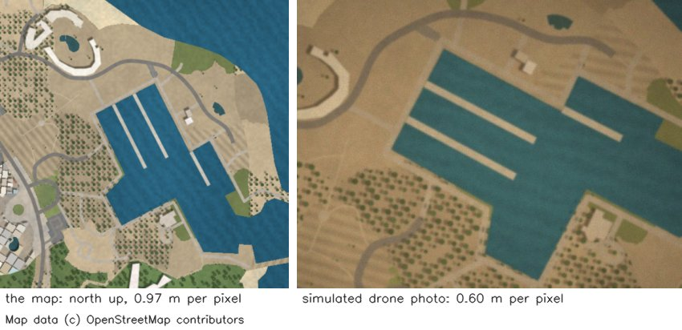
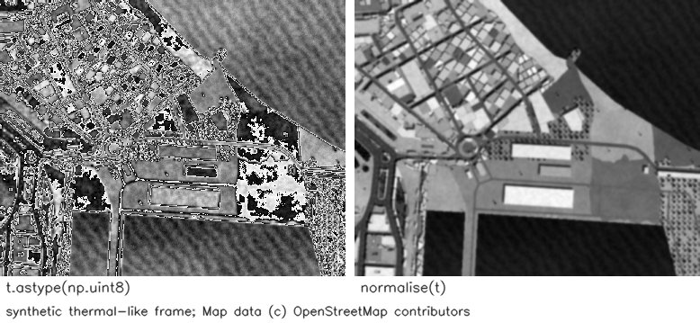
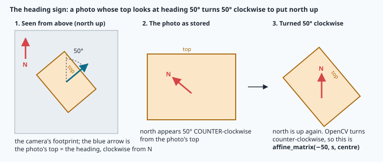
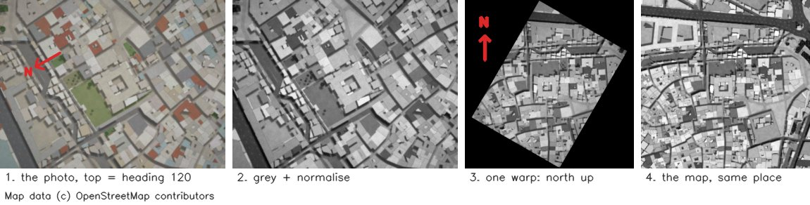

# Digital images: arrays, filters and geometric transforms



> [!NOTE] Mission brief
> **28 September 2026.** NAVERA's code review finds two bugs in its night vision, which places thermal frames
> on the map. **LOC-24:** 16-bit thermal frames were converted to 8 bits **without scaling**. **LOC-16:**
> frames were compared with the map without being brought to its **scale** or turned **north-up**. On
> synthetic frames at 250 m, the median position error was **149–263 m** before the fix (30 September) and
> **11–13 m** after it.
>
> You write NAVERA Lite's image part, turn a (simulated) drone photo north-up at the map's scale, and find
> out how wrong the drone's compass was. Session 1 earns **Darkroom**, session 2 **Map matcher**.
>
> **Start now:** open the 🛠️ **Lab** tab, do **Step 0** (one minute, no code), then come back here for §1.

**Objectives.** After this mission you can:

1. predict what a **dtype** does to pixel values (wrap, truncation) and convert safely between uint8,
   uint16 and float;
2. **convolve** by hand and in code (Gaussian, Sobel) and explain why the kernel is **flipped**;
3. build the 2 × 3 **affine matrix** of a rotation plus a scale about a point, and resample with it by
   **inverse mapping** and **bilinear** interpolation;
4. bring a drone photo to a map's **heading** and **metres per pixel**, and measure with **NCC** how precise
   both must be.

**You need:** mission 03 (numpy arrays, `.shape`, slicing), mission 06 (heading clockwise from north,
degrees vs radians), mission 07 (metres per pixel of a map at zoom z). 🧰 boxes refresh matrix × vector.
⏱ Reading: about 70 minutes with the ✏️ checks (up to 1 h 30 if numpy is rusty): §1–§2 before lab Step 1,
§4 before Step 3, §5–§7 before session 2. Lab: 3 to 5 h.

**Before you start.** Answer without looking; if you miss two, reread mission 03 §4, mission 06 §3 and
mission 07 §3.

<details><summary>1. <code>a = np.array([[1, 2, 3], [4, 5, 6]])</code>. What are <code>a.shape</code>, <code>a[1, 0]</code> and <code>a[:, 1]</code>?</summary>
(2, 3) — 2 rows, 3 columns; 4 (row 1, column 0); <code>array([2, 5])</code> (column 1 of every row).
</details>
<details><summary>2. A drone flies with heading 90°. Which way does its nose point?</summary>
East: a heading is measured from north, clockwise (mission 06).
</details>
<details><summary>3. At zoom 17 near Sousse (35.8°), about how many metres does one map pixel cover?</summary>
156 543.03 × cos 35.8° / 2¹⁷ ≈ 0.97 m (mission 07).
</details>

<details><summary>Words of this lesson (open if you need them)</summary>

| Word | Meaning | Français |
|---|---|---|
| **pixel** | one cell of the image array; its value is a brightness (or 3 colour values) | pixel |
| **dtype** | the type of every number in a numpy array (uint8, uint16, float32…) | type de données |
| **uint8 / uint16** | unsigned integers 0…255 / 0…65 535 (8 or 16 bits) | entier non signé |
| **wrap-around** | a value too big for its type restarts from 0 (300 → 44 in uint8) | dépassement circulaire |
| **kernel** | the small array of weights of a filter | noyau |
| **convolution** | each output pixel = weighted sum of its neighbours, kernel flipped | convolution |
| **gradient** | how fast the brightness changes, and in which direction | gradient |
| **affine transform** | (u, v) = A·(x, y) + t: turns, scales, shears, moves | transformation affine |
| **interpolation** | estimating a value between pixels (nearest, bilinear) | interpolation |
| **NCC** | normalised cross-correlation: a similarity score of two images, −1…1 | corrélation croisée normalisée |
</details>

## 1. An image is an array

A grey image is a 2-D array: `img[y, x]` is the brightness of the pixel in **row y, column x**. (0, 0) is
the **top-left** corner and **y grows downwards**, unlike a maths graph. A colour image adds a third axis
for the **channels**, shape `(height, width, 3)`, and OpenCV stores them as **B, G, R**: `img[y, x]` is
`[blue, green, red]`.


The lab's real aerial frame is 730 rows × 1536 columns × 3 channels: 3 363 840 numbers, one byte each.

**Where is the centre?** A 4-pixel row has pixels at x = 0, 1, 2, 3: the middle is at 1.5 = (4 − 1)/2, while
w/2 = 2 is the centre of pixel 2, half a pixel off. So the **centre point** is x = (w − 1)/2. Half a pixel
barely changes one comparison, but every pixel ↔ position step of later missions uses this convention and
mismatched half pixels add up, so `like_map` is checked to 0.15 px.

> [!TIP] 🧰 numpy for pictures (you need exactly these)
> ```python
> img[100:200, 50:80]          # a crop: rows 100..199, columns 50..79 — always [y0:y1, x0:x1]
> img[..., 0]                  # "..." = all the other axes: channel 0 (blue) of a colour image
> img.astype(np.float32)       # a NEW array with another dtype (the original is unchanged)
> np.iinfo(np.uint16).max      # 65535: the largest value a dtype can hold
> ```

> [!QUESTION] ✏️ Check
> A grey picture has shape (480, 640). What is `img.shape[1]`, which pixel is `img[479, 0]`, and where is
> its centre point (x, y)?

<details><summary>Answer</summary>
640 (the width, number of columns); the bottom-left pixel (last row, first column); (319.5, 239.5).
</details>

## 2. dtypes: where pixels go wrong silently

Cameras and image files store each value in **uint8**, 0…255. Thermal and scientific cameras use
**uint16**, 0…65 535. Arithmetic on integer arrays is **modular**: a value that does not fit keeps only its
remainder, with no error and no warning.

```python
a = np.array([250, 100], np.uint8)
a + 10                    # [  4, 110]   250 + 10 = 260 = 256 + 4
a * 2                     # [244, 200]   wrong again
a / 2                     # [125., 50.]  float64: division always gives floats
np.array([300.0, -5.0, 254.9]).astype(np.uint8)   # [44, 0, 254] here, and a RuntimeWarning
```

The last line is the dangerous one: a float out of range has no defined result (another computer may
differ), and 254.9 is cut to 254, not rounded. The rule:

> **Compute in float, store in uint8:** `.astype(np.float32)`, do the maths, then **round, clip,
> convert**: `np.clip(np.rint(x), 0, 255).astype(np.uint8)`. In NAVERA Lite this is `to_uint8()` (TODO 1).

`to_float01()` (TODO 2) gives floats in 0…1 by dividing by the largest value of the image's **own** dtype
(255 or 65 535). Mixing scales is a classic bug: NAVERA's night inputs were once normalised twice (LOC-7).

**Worked example: a 16-bit thermal pixel.** A thermal frame holds raw counts from 7 150 (cold sea) to 8 430
(warm roofs). Take a pixel of **7 500**:

| Conversion | Result | Why |
|---|---|---|
| `astype(np.uint8)` | **76** | 7 500 = 29 × 256 + 76: only the remainder stays |
| `to_uint8` (clip) | **255** | everything above 255 becomes white: no detail left |
| min–max stretch | **70** | (7 500 − 7 150) / (8 430 − 7 150) × 255 = 69.7 → 70 |

Only the third keeps the order of temperatures: **min–max normalisation**, `normalise()` (TODO 3), for
uint8, uint16 and float images. A uniform image (max = min) gives zeros: never divide by 0.

> [!QUESTION] ✏️ Check
> 1. `np.array([200], np.uint8) * 2`, and `np.array([200], np.uint8) * 2.0`?
> 2. A thermal frame spans 7 200 … 7 455 counts. What do its coldest and hottest pixels become with a
>    plain `astype(np.uint8)`? Is anything lost?

<details><summary>Answer</summary>
1. [144] (400 − 256, still uint8), and [400.] (float64: a float operand gives floats).<br>
2. 7 200 = 28 × 256 + 32 → 32, and 7 455 → 287 − 256 = 31: the hottest pixel is darker than the coldest.
The range is 255 counts, so the order is broken exactly once, where the values cross 7 424 = 29 × 256.
</details>

<details><summary>Read this after lab Step 2: what the lab's thermal frame looks like</summary>



The naive cast wraps every 256 counts: the picture is cut into bands, and pixels 1 280 counts apart (5 × 256)
look identical. This is the worst form of LOC-24's mistake (16 bits converted without scaling): depending on
the conversion, the picture wraps into bands like this, saturates to white, or goes almost black.
</details>

## 3. Grey, and what we leave for later

Matching works in **grey**: colours of a map and of a camera never agree, shapes do. The standard
luminance (`cv2.cvtColor(img, cv2.COLOR_BGR2GRAY)`) weights green most, like the eye:

```
Y = 0.299·R + 0.587·G + 0.114·B          (channel 0 is BLUE in OpenCV)
```

`to_gray()` and `histogram()` (pixels per grey value) are given finished.

<details class="further"><summary>Optional: equalisation, CLAHE, HSV (mission 21 uses CLAHE)</summary>

**Histogram equalisation** maps each value through the cumulative histogram so that every grey level is
used about equally: strong, but it amplifies noise in flat areas. **CLAHE** (contrast-limited adaptive
equalisation) does it per tile of a grid and clips each tile's histogram, so a shadow in one corner does not
darken the whole picture. NAVERA's day vision applies CLAHE (clip limit 2.0, 8 × 8 tiles) before it looks
for features; mission 21 shows why. **HSV** separates hue from brightness: useful to find vegetation or
water, not needed to match shapes.
</details>

## 4. Convolution: filters as weighted neighbourhoods

A **linear filter** replaces each pixel by a weighted sum of its neighbours. The weights form a **kernel**
k of size (2r + 1) × (2r + 1), indexed i, j = −r … r around its centre:

```
convolution:  out(y, x) = Σ_i Σ_j k(i, j) · img(y − i, x − j)        the kernel is FLIPPED
correlation:  out(y, x) = Σ_i Σ_j k(i, j) · img(y + i, x + j)        what cv2.filter2D and cv2.Sobel compute
```

Why flip? Feed a single bright pixel (an **impulse**) [0, 0, 1, 0, 0] to the kernel [1, 2, 3]. Convolution
returns [0, 1, 2, 3, 0]: the kernel itself, the right way round. A filter is *defined* by what it does to one
pixel (its impulse response), and that is also why convolutions chain: blur then differentiate = one
convolution with the combined kernel. Correlation returns [0, 3, 2, 1, 0], reversed. The two are identical
for a **symmetric** kernel and have opposite **signs** for a derivative kernel.

**Worked example (1-D).** The signal [0, 0, 4, 0, 0] with the kernel [1, 2, 1]/4. At x = 1: ¼·0 + ²⁄₄·0 +
¼·4 = 1; at x = 2: ¼·0 + ²⁄₄·4 + ¼·0 = 2. Result **[0, 1, 2, 1, 0]**: the spike is spread out.

**The border.** At x = 0 the neighbour x − 1 does not exist. OpenCV's default, **reflect 101**, mirrors the
picture without repeating the edge pixel: … c b | a b c … (`np.pad(img, r, mode="reflect")`). In code you
never loop over pixels: pad once, then for each kernel entry add `weight × a shifted slice` (TODO 4).


**Gaussian blur** (k ∝ exp(−(x² + y²)/(2σ²)), sum 1, about 6σ wide; `gaussian_kernel`, given) removes noise
and detail the map does not have. **Sobel** = smoothing [1, 2, 1] across × central difference along. In the
figure, an edge from 10 to 80 gives 280; **course rule: divide by 8**, giving grey levels per pixel (35: the
edge climbs 70 over 2 pixels). The given `sobel()` passes `SOBEL_X = [[1, 0, −1], [2, 0, −2], [1, 0, −1]] / 8`,
already flipped, to **your** `convolve2d`, so gx > 0 where it gets brighter to the right.

> [!QUESTION] ✏️ Check
> Convolve [5, 5, 5, 9] with [1, 0, −1] (true convolution, reflect 101), then as a correlation. Which one is
> positive where the signal gets brighter?

<details><summary>Answer</summary>
Convolution: out(x) = img(x + 1) − img(x − 1); the mirror gives img(−1) = 5 and img(4) = img(2) = 5:
[0, 0, 4, 0]. Correlation: [0, 0, −4, 0]. The convolution is positive where it gets brighter.
</details>

---

**Session 2 — Map matcher.** Read §5–§7 before lab Step 5.

## 5. The 2 × 3 affine matrix

An **affine transform** maps a point (x, y) to (u, v) = A·(x, y) + t, A a 2 × 2 matrix and t a translation.
OpenCV stores it as one 2 × 3 matrix M = [A | t]. Rotations, scalings and translations are all affine.

> [!TIP] 🧰 Matrix × vector, and the "extra 1"
> Each output is one row times the vector: [[1, 2], [3, 4]] · (5, 6) = (1·5 + 2·6, 3·5 + 4·6) = (17, 39).
> A 2 × 3 matrix times (x, y, **1**) adds the translation: [[1, 0, 10], [0, 1, 20]] · (5, 6, 1) = (15, 26).
> With the row [0, 0, 1] added below, these become 3 × 3 matrices, and **doing two transforms one after the
> other is a matrix product**. numpy: `M @ np.array([x, y, 1.0])`.

**Rotation by θ and scale s about a centre c = (cx, cy).** Three moves: bring c to the origin, turn and
scale, bring it back. As a product M = T(c) · S·R(θ) · T(−c), with

```
R(θ) = [[ cos θ,  sin θ],
        [−sin θ,  cos θ]]
```

This is your first-year matrix [[cos θ, −sin θ], [sin θ, cos θ]] with θ replaced by −θ: the image y axis
points down, so a turn that looks counter-clockwise on the screen is clockwise in maths axes. The product is:

```
      [  a   b   (1 − a)·cx − b·cy ]
M  =  [ −b   a   b·cx + (1 − a)·cy ]          a = s·cos θ,   b = s·sin θ
```

The centre stays where it is (check: M·(cx, cy, 1) = (cx, cy)). A positive θ turns the picture
**counter-clockwise on the screen**: OpenCV's rule, and `cv2.getRotationMatrix2D(c, θ, s)` gives exactly this M.

<details><summary>Where the last column comes from (the 3 × 3 product)</summary>
T(−c) moves c to the origin: its last column is (−cx, −cy). S·R = [[a, b], [−b, a]]. So S·R·T(−c) has the last
column (−a·cx − b·cy, b·cx − a·cy); T(c) then adds (cx, cy): (1 − a)·cx − b·cy and b·cx + (1 − a)·cy.
</details>


**Worked example:** θ = 30°, s = 0.5, c = (100, 50). a = 0.5 cos 30° = 0.4330, b = 0.5 sin 30° = 0.25:

```
M = [[ 0.4330   0.25    44.20 ]          tx = (1 − 0.4330)·100 − 0.25·50 = 44.20
     [−0.25     0.4330  53.35 ]]         ty = 0.25·100 + (1 − 0.4330)·50 = 53.35
```

The point (200, 50), 100 px right of the centre, goes to **(143.3, 25.0)**: 50 px from the centre (s = 0.5),
30° above the horizontal on the screen: counter-clockwise. TODO 5 is `affine_matrix(angle_deg, scale, centre)`.

> [!QUESTION] ✏️ Check
> With θ = 90°, s = 1, c = (0, 0): write M. Where does (10, 0) go, and is that clockwise on the screen?

<details><summary>Answer</summary>
a = 0, b = 1: M = [[0, 1, 0], [−1, 0, 0]]. (10, 0) → (0, −10): from the right of the origin to above it
(y points down): counter-clockwise.
</details>

## 6. Resampling: inverse mapping and bilinear interpolation

Pushing every source pixel to its new place leaves **holes**. `cv2.warpAffine`, and your `warp_affine`
(TODO 6), go the other way: for every **output** pixel (u, v), find where it **comes from**:

```
(x, y) = A⁻¹ · ((u, v) − t)          A = M[:, :2],  t = M[:, 2]     (np.linalg.inv(A))
```

(x, y) usually falls **between** four pixels. **Bilinear** interpolation blends them: x0 = ⌊x⌋, fx = x − x0,
same for y, and

```
value = (1−fx)(1−fy)·I(x0, y0) + fx(1−fy)·I(x0+1, y0) + (1−fx)fy·I(x0, y0+1) + fx·fy·I(x0+1, y0+1)
```

**Worked example:** (x, y) = (2.3, 1.6) with I(2, 1) = 10, I(3, 1) = 50, I(2, 2) = 30, I(3, 2) = 90. fx = 0.3,
fy = 0.6. Along x first: top 0.7·10 + 0.3·50 = 22, bottom 0.7·30 + 0.3·90 = 48; then along y: 0.4·22 + 0.6·48
= **37.6**. Neighbours outside the source count as 0 (black corners); the given `pixel_or_zero` reads many
pixels at once and returns 0 outside.

Shrinking without blurring first causes **aliasing** (false patterns); a "Going further" measures it.

> [!QUESTION] ✏️ Check
> 1. Why is the inverse mapping not slower than the forward one, although it needs A⁻¹?
> 2. A 2 × 2 picture [[0, 10], [20, 30]] is read at (0.5, 0.5). Value? And at (1.5, 0.5)?

<details><summary>Answer</summary>
1. A⁻¹ is computed once (a 2 × 2 inverse); then each output pixel costs one small matrix × vector, as forward.<br>
2. 15 (the mean of the four). At (1.5, 0.5) the right neighbours are outside (0): top 0.5·10 + 0.5·0 = 5,
bottom 0.5·30 + 0 = 15, value 10.
</details>

## 7. A drone photo made like the map

The map has **north up** and about **0.97 m per pixel**. A downward drone photo has its **top along the
heading** and a **ground sample distance** (GSD) set by its height and lens (lab: 0.60 m/px; mission 18).
Before any pixel comparison, both must agree:

| Difference | Fix | In `like_map` |
|---|---|---|
| colour, brightness | grey, then stretch BEFORE the warp (its black corners must not count as darkest) | `to_gray`, `normalise` |
| orientation | turn the photo by **minus** the heading ψ | angle = −ψ |
| scale | s = GSD_photo / GSD_map (0.60/0.97: the photo shrinks) | scale = s |
| framing | a square canvas, side round(√(w² + h²)·s), so no corner is cut | add (c_out − c_in) to M's last column |



**The heading sign.** The heading ψ (psi) is where the photo's **top** points, clockwise from north (a
bearing, mission 06). In the photo, north is therefore ψ **counter-clockwise** from the top. To bring it back
up, the photo turns ψ **clockwise**: in OpenCV's counter-clockwise convention, the angle **−ψ**.

**The centre shift.** `affine_matrix(−ψ, s, c_in)` keeps c_in = ((w − 1)/2, (h − 1)/2) in place (w × h = the
photo's size); add (c_out − c_in) to M's last column, c_out = ((side − 1)/2, (side − 1)/2). One matrix, one
resampling.

**Worked example** (the figure below): a 640 × 480 photo of the Sousse medina, heading 120°, 0.45 m/px, map
0.968 m/px. s = 0.45/0.968 = 0.4649; side = round(800 × 0.4649) = **372**. affine_matrix(−120, 0.4649,
(319.5, 239.5)) has the 2 × 2 part [[−0.2324, −0.4026], [0.4026, −0.2324]] and the last column (490.19,
166.54); adding (185.5 − 319.5, 185.5 − 239.5) = (−134, −54) gives **(356.19, 112.54)**, and M·(319.5, 239.5, 1)
= (185.5, 185.5), the canvas centre.



**How similar? NCC.** Subtracting two pictures fails as soon as the brightness differs. The **normalised
cross-correlation** compares patterns, not levels:

```
NCC(a, b) = Σ (a − ā)(b − b̄) / √( Σ(a − ā)² · Σ(b − b̄)² )          ā = mean of a
```

It is 1 for the same pattern whatever the brightness and contrast, about 0 for unrelated pictures, −1 for a
negative. Example: a = [1, 2, 3, 4] and b = [52, 54, 56, 58] (= 2a + 50) give NCC = **1**; b = [4, 3, 2, 1]
gives −1. The lab's runner compares the middle 200 × 200 pixels of your result with the map's middle.

The lab's map and photo are both drawn from OpenStreetMap data by the same renderer, so its NCC values are
higher than a real camera against a satellite map would give (shadows, cars, seasons). Read the shape of the
curves, not their height.

> [!QUESTION] ✏️ Check
> 1. A photo's top looks south-west (heading 225°). Which `angle_deg` turns it north-up?
> 2. The same 640 × 480 photo at 1.2 m/px against the 0.97 m/px map: does it grow or shrink, and what is the
>    canvas side?

<details><summary>Answer</summary>
1. −225 (or +135, the same turn).<br>
2. It grows: s = 1.2/0.97 = 1.237; side = round(800 × 1.237) = 990 px.
</details>

> [!WARNING] Common wrong ideas
> - "`astype(np.uint8)` rounds and clips." It truncates, and out-of-range values wrap: 7 500 → 76.
> - "Convolution and correlation are the same." Only for symmetric kernels; a derivative changes sign.
> - "The photo's heading is the angle to give OpenCV." It is its opposite: −heading.

## Bird's-eye view: what each operation is for

| Operation | Why | NAVERA Lite |
|---|---|---|
| dtypes, stretch | sensors give uint16/uint8, maths needs float, cameras differ in brightness | `to_uint8`, `to_float01`, `normalise` |
| convolution | remove detail the map lacks; edges survive light changes | `convolve2d`, `sobel` |
| affine warp | one resampling for turn + scale + framing | `affine_matrix`, `warp_affine` |
| photo → map | pixel comparison needs the same orientation and scale | `like_map` |

## In NAVERA

NAVERA's test map and data cover Sousse, Tunisia. From its backlog and validation report (Release 0.2,
2026-09-28 to 2026-10-03):

- **Night vision** compares each thermal frame with the map with a learned model. Since LOC-16 (fixed
  2026-09-30) each frame is resampled from the altitude and the camera's horizontal field of view, turned
  north-up with the heading (from the frame's data, else the IMU) and cropped to the camera's footprint.
  Since LOC-24, 16-bit frames are stretched between their 2nd and 98th percentiles before the 8-bit
  conversion: unlike min–max, one hot pixel cannot squash the rest. On synthetic frames (grey renders of the
  map) the median error went from 149–263 m to 11–13 m at 250 m, and from 98–218 m to 8–11 m at 600 m. Not
  yet validated on real thermal images.
- **Day vision** does **not** turn its frames: it scales them from the altitude, matches features and fits
  rotation + scale + translation, accepting a match only if the scale agrees with the altitude (±15 %).
- **Scale is not a detail.** Replay frames covering only 190–300 m of ground, fed to night vision at the wrong
  scale, once produced a 4.7 km "drift"; they are now refused ("footprint too small").

## In NAVERA Lite

[navera_lite/image.py](file:./navera_lite/image.py) is NAVERA Lite's image part. Missions 18 and 21–25 use it
finished: the camera model, features, matching, locating a photo on the map, visual odometry and night
vision all start from these arrays.

## 🐦 How birds do it

A hovering kestrel keeps its head still while its body moves in the wind; a walking pigeon "bobs" its
head so that, during each step, the head is fixed relative to the ground. Both **stabilise the image before
they analyse it**. NAVERA does it with numbers: it turns, scales and normalises a photo before comparing it.

## Summary

1. An image is an array `img[y, x]`, y down; a picture of width w has its centre point at (w − 1)/2.
2. Integer dtypes wrap silently: compute in float, then round, clip, convert. Stretch 16-bit data (min–max,
   or percentiles against hot pixels), never cast it.
3. Convolution = weighted sum of neighbours with a flipped kernel; reflect-101 border; Gaussian blurs,
   Sobel (÷ 8) measures the gradient.
4. M = [[a, b, (1 − a)cx − b·cy], [−b, a, b·cx + (1 − a)cy]]; warp by inverse mapping and bilinear blending.
5. Photo → map: grey, normalise, turn by −ψ (minus the heading), scale by GSD_photo/GSD_map, centre on the canvas; compare
   with NCC.

**Next mission:** ROS 2 — the programs of a robot and how they talk.

## Check yourself

Answer without scrolling up.

<details><summary>1. <code>np.array([1000], np.uint16).astype(np.uint8)</code> gives? And your <code>to_uint8</code>?</summary>
232 (1000 − 3 × 256), and 255 (clipped).
</details>
<details><summary>2. Why does a missing kernel flip not matter for a blur but break an edge detector?</summary>
A blur kernel is symmetric: flipped, it is the same kernel. A derivative kernel is antisymmetric: flipped, it
changes sign, so brighter-to-the-right edges come out negative.
</details>
<details><summary>3. Why does warpAffine use A⁻¹?</summary>
It visits every output pixel once and asks where it comes from in the source; forward mapping leaves holes.
</details>
<details><summary>4. A photo's top points east (heading 90°). Which OpenCV angle puts north up, and which way does it turn on the screen?</summary>
−90: a clockwise quarter turn.
</details>
<details><summary>5. (Mission 06) A drone at 35.8° N moves 100 m east. By how much does its longitude change?</summary>
100 / (6 371 000 · cos 35.8°) rad ≈ 0.00111°.
</details>


Now open the **🛠️ Lab** tab.
