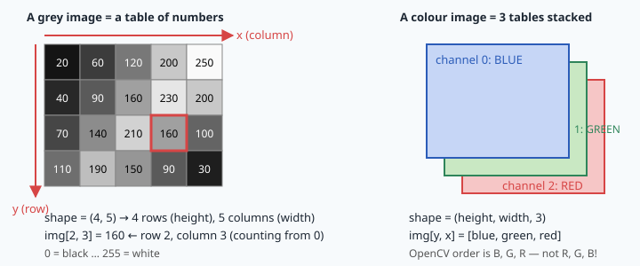
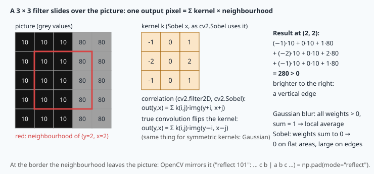
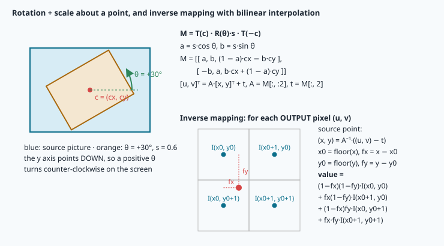
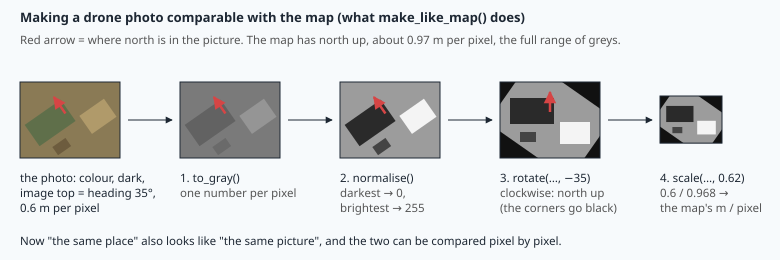

# Digital images: arrays, filters and geometric transforms

> [!NOTE] In short
> - For a computer, a photo is an array of numbers, and NAVERA must compare it with another array:
>   the satellite map.
> - You learn array types (**dtypes**) and their traps, colour and grey, and histograms for
>   contrast.
> - **Convolution** filters (blur, edges) and **affine** transforms (rotation, scale) change an
>   image with a small matrix.
> - Before a comparison, the photo needs the map's orientation and scale: rotate by −heading, then
>   scale.
> - In the lab you write these operations with NumPy, check them against OpenCV, and bring a drone
>   photo to the map's orientation and scale.
> - NAVERA's night vision prepares every thermal frame with the same steps.

A drone flies over the old town (medina) of **Sousse** at 300 m. Its camera looks straight down and
sends a photo of 1536 × 730 pixels every second. You see the fort, the market streets, the harbour. The computer
sees **3 363 840 numbers** of type `uint8`. To find its position without GPS, NAVERA must compare
those numbers with another array of numbers — the satellite map, taken by another camera, on another
day, from far above (satellite or survey aircraft), with north at the top and about 1 m per pixel.

Before any comparison, the two arrays must become **comparable**: same orientation, same scale,
similar brightness distribution. This lesson gives you the tools, with the mathematics behind them:
array types and their traps, colour and histograms, convolution filters, and affine transforms with
resampling. Each one is something NAVERA does to every frame.

> [!NOTE]
> **The data.** The lab uses a real aerial frame recorded for NAVERA and a map patch of NAVERA's
> test map, which covers **Sousse, Tunisia** (Port El Kantaoui marina), plus a simulated drone photo
> made from that map with known heading and scale. The academy has no imagery of other regions.

## 1. An image is an array

A grey image is a 2-D array: `img[y, x]` is the brightness of the pixel in row y, column x, with
(0, 0) at the **top-left** and y growing **downwards**. A colour image adds a third axis for the
**channels**: shape `(height, width, 3)`.



> [!TIP]
> **numpy in ten lines** (you need exactly these in the lab)
> ```python
> a = np.array([[1, 2, 3], [4, 5, 6]], np.uint8)   # 2 rows, 3 columns, dtype uint8
> a.shape, a.ndim, a.dtype, a.size                  # (2, 3), 2, dtype('uint8'), 6
> a[1, 2]            # 6: row 1, column 2 — ROW FIRST
> a[:, ::-1]         # all rows, columns reversed (mirror)
> a[0:2, 1:3]        # rows 0..1, columns 1..2 (a crop: img[y0:y1, x0:x1])
> b = a.astype(np.float32)        # a new array with another dtype
> b * 0.5 + 10                    # arithmetic works element by element ("vectorised")
> np.clip(b, 0, 255), np.rint(b)  # limit to a range; round to the nearest integer
> a.ravel(), np.bincount(a.ravel(), minlength=256)   # flatten; count each value
> img[..., 0]        # "..." = all the other axes: the first channel of a colour image
> ```
>
> Three more tools, used in the equalisation and the warp of the lab:
> ```python
> lut = np.array([0, 50, 100, 255], np.uint8)
> lut[np.array([[3, 0], [1, 1]])]   # [[255, 0], [50, 50]]: an ARRAY of indices gives an array
>                                   # of the same shape — each value v is replaced by lut[v]
> a = np.array([[10, 11, 12], [20, 21, 22]])
> a[np.array([0, 1]), np.array([2, 0])]   # [12, 20]: picks a[0, 2] and a[1, 0] —
>                                         # one row index and one column index per result
> v, u = np.mgrid[0:2, 0:3]         # the row (v) and the column (u) of every pixel of a 2 × 3 image:
> v                                 # [[0, 0, 0],
>                                   #  [1, 1, 1]]
> u                                 # [[0, 1, 2],
>                                   #  [0, 1, 2]]
> ```
> This is **integer-array indexing** ("fancy indexing"): with integer arrays as indices, numpy
> reads many pixels in one operation, without a loop.

## 2. dtypes: the most common source of image bugs

Cameras and image files store each value in one byte: **uint8**, an unsigned integer from 0 to 255.
Arithmetic on uint8 arrays is **modular** (mod 256), with no error and no warning:

```python
a = np.array([250, 100], np.uint8)
a + 10        # array([  4, 110], dtype=uint8)   250 + 10 = 260 = 4 (mod 256)
a * 2         # array([244, 200], dtype=uint8)   wrong again
a / 2         # array([125., 50.])  dtype float64 — division always gives float
```

A white cloud plus 10 becomes black. The rule used by every image-processing engineer:

> **Compute in float, store in uint8.** Convert with `.astype(np.float32)`, do the maths, then
> **round, clip, convert**: `np.clip(np.rint(x), 0, 255).astype(np.uint8)`.

The order matters: `astype(np.uint8)` alone **truncates** (254.9 → 254) and **wraps** (300 → 44) —
always round and clip first. In the lab this is `to_uint8()`, and every function says which dtype it
returns. Many OpenCV functions accept **only uint8**, and their error messages look frightening:

| What you did | What you see | Meaning |
|---|---|---|
| `cv2.imwrite("x.png", float_image)` | `[ WARN:0@0.6] global loadsave.cpp:848 imwrite_ Unsupported depth image for selected encoder is fallbacked to CV_8U.` | The picture was float; OpenCV converted it to uint8 itself. If its values were 0..1, the PNG is black. Convert with `to_uint8()` first. |
| CLAHE on a float image | `error: (-215:Assertion failed) _src.type() == CV_8UC1 \|\| _src.type() == CV_16UC1 in function 'apply'` | "−215 Assertion failed" = a condition on the input is false; `CV_8UC1` = uint8, 1 channel. |
| `cv2.equalizeHist`, `cv2.Canny` on float | `(-215:Assertion failed) _src.type() == CV_8UC1` / `_src.depth() == CV_8U` | Same: these need uint8. |
| `cv2.cvtColor` on float64 | `Unsupported depth of input image ... 'depth' is 6 (CV_64F)` | Depth 6 = float64. Use uint8 or float32. |
| `np.uint8(250) + np.uint8(10)` | `RuntimeWarning: overflow encountered in scalar add` → 4 | Scalars warn; **arrays wrap silently**. |
| `np.array([300.0, -5.0]).astype(np.uint8)` | `[44, 0]`, sometimes `RuntimeWarning: invalid value encountered in cast` | Out-of-range float → uint8 is undefined (here 300 wraps silently, −5 warns): clip first. |

Two conventions coexist for float images: values 0..255 (what we use) or 0..1. Mixing them gives
pictures that are black or saturated white. Always print `dtype`, `min()` and `max()` when in doubt;
`demo.py` in the lab does it for every result.

## 3. Colour and grey

A colour pixel is three values. **OpenCV stores them in the order B, G, R** (not RGB): `img[y, x]` is
`[blue, green, red]`. For matching, NAVERA works in **grey** — colours of a satellite map and of a drone
camera never agree (sensor, season, hour, haze), but shapes do. The standard luminance (ITU-R BT.601,
the one `cv2.cvtColor(..., cv2.COLOR_BGR2GRAY)` uses) is a weighted sum that follows the eye's
sensitivity, highest for green:

```
Y = 0.299·R + 0.587·G + 0.114·B
```

(Other colour spaces exist for other tasks — HSV separates hue from brightness, which helps to segment
vegetation or water — but grey is enough for geometric matching, and it is all a thermal camera gives.)

## 4. Histograms and contrast

The **histogram** h(v) counts the pixels of each grey value v = 0…255; the cumulative histogram
**CDF**(v) = h(0) + … + h(v) counts the pixels ≤ v. A dull photo (morning haze over a flat coast)
uses only a narrow band of values. Three ways to stretch it:

1. **Min–max normalisation**: g' = (g − min)/(max − min) · 255. Linear, keeps the shape of the
   histogram, but one single hot pixel (a reflection on a car roof) can block the whole stretch.
2. **Histogram equalisation**: map each value through its normalised CDF,
   `g' = round((CDF(g) − CDF_min) / (N − CDF_min) · 255)` with N the number of pixels. The output
   CDF becomes approximately linear: every grey level is used about equally. Strong, but it changes
   the grey values a lot — and noise in flat areas is amplified.
3. **CLAHE** (Contrast-Limited Adaptive Histogram Equalisation): equalise each tile of an 8 × 8 grid
   separately, **clip** each tile's histogram at a limit (2.0 = twice the average bin) and spread the
   excess, then blend neighbouring tiles bilinearly. A dark shadow in one corner no longer darkens the
   whole picture, and the clip limit stops noise amplification. NAVERA's day vision uses
   `cv2.createCLAHE(clipLimit=2.0, tileGridSize=(8, 8))`.

## 5. Convolution: filters as weighted neighbourhoods

A **linear filter** computes each output pixel as a weighted sum of the input pixels around it. With a
kernel k of size (2r + 1) × (2r + 1):

```
correlation:   out(y, x) = Σ_i Σ_j k(i, j) · img(y + i, x + j)        i, j = −r … r
convolution:   out(y, x) = Σ_i Σ_j k(i, j) · img(y − i, x − j)        (= correlation with k rotated 180°)
```

Mathematicians and signal-processing books use **convolution** (it is associative: blurring then
differentiating equals convolving once with the combined kernel). OpenCV's `filter2D` and `Sobel`
compute a **correlation**. For symmetric kernels (Gaussian, box) the two are identical; for derivative
kernels the sign flips. Near the border the neighbourhood leaves the picture: OpenCV's default
**BORDER_REFLECT_101** mirrors the picture without repeating the edge pixel (… c b | a b c …), which
is `np.pad(img, r, mode="reflect")` in numpy.



**Gaussian blur.** k(x, y) ∝ exp(−(x² + y²)/(2σ²)), normalised so the weights sum to 1: a weighted local
average that removes sensor noise and fine detail the other picture does not have (a 1 m map pixel
never shows a 30 cm crack). The kernel must be about 6σ wide to hold almost all the weight. It is
**separable**: the 2-D kernel is the outer product of a 1-D kernel with itself, so a k × k blur costs 2k
multiplications per pixel instead of k². When σ = 0, OpenCV derives it from the size:
σ = 0.3·((k − 1)·0.5 − 1) + 0.8 (and for small kernels, k ≤ 9 in OpenCV 4.11, it uses fixed tables
instead — compare with an explicit σ).

**Sobel gradients.** The Sobel kernel is a smoothing [1, 2, 1]ᵀ times a central difference [−1, 0, 1]:

```
         [-1  0  1]                  gx > 0 when the picture gets brighter to the RIGHT
Kx  =    [-2  0  2]   (correlation)  gy (the transpose) > 0 when it gets brighter DOWNWARDS
         [-1  0  1]                  magnitude √(gx² + gy²), direction atan2(gy, gx)
```

Worked example (the figure): a vertical edge from 10 to 80 gives gx = 70 + 2·70 + 70 = **280**. On a flat
area the weights sum to 0 and so does gx. **Canny** edge detection builds on this: Gaussian blur,
Sobel gradient, thinning to one-pixel lines (non-maximum suppression), and two thresholds with
hysteresis. Edges and gradients matter for navigation because they survive changes of brightness:
a wall is a wall in the morning and in the evening. Lesson 20 builds features on them.

## 6. Geometric transforms: the 2 × 3 affine matrix

An **affine transform** maps a point (x, y) to (u, v) = A·(x, y) + t, with A a 2 × 2 matrix and t a
translation. OpenCV stores it as one 2 × 3 matrix M = [A | t]. Rotations, scalings, shears and
translations are all affine, and their **composition is a product** of 3 × 3 matrices (add the row
[0 0 1]): this is why one matrix can do "turn and scale" in a single operation.

**Rotation by θ and scale s about a point c = (cx, cy)**: move c to the origin, rotate and scale,
move back:

```
M = T(c) · S(s)·R(θ) · T(−c)

    [  a   b   (1 − a)·cx − b·cy ]
M = [ −b   a   b·cx + (1 − a)·cy ]        a = s·cos θ,  b = s·sin θ
```

This is exactly `cv2.getRotationMatrix2D(c, θ, s)`. Because the image y axis points **down**, a
positive θ looks **counter-clockwise** on the screen.



**Resampling by inverse mapping.** Pushing each source pixel to its destination leaves holes. So
`warpAffine` goes the other way: for every **output** pixel (u, v) it computes the source point
(x, y) = A⁻¹·((u, v) − t), which generally falls between four pixels, and **interpolates**:

- **nearest**: take the closest pixel — fast, blocky, keeps exact values (good for masks);
- **bilinear**: with x0 = ⌊x⌋, fx = x − x0 (same for y), blend the four neighbours with weights
  (1−fx)(1−fy), fx(1−fy), (1−fx)fy, fx·fy — smooth, the default;
- **area** (`INTER_AREA`, for `resize`): average all source pixels that fall in the output pixel.

**Shrinking needs care.** Reducing an image by a factor s < 1 with bilinear sampling skips pixels:
fine patterns become false patterns (**aliasing**, the moiré on a TV of a striped shirt). The fix is
to low-pass first — blur with σ of roughly 0.5/s pixels — or to use `INTER_AREA`, which averages.
That is why NAVERA resizes with `INTER_AREA` when s < 1.

**Worked example.** The lab's simulated photo is 640 × 480 px at 0.6 m/px, heading 35°; the map is
0.9675 m/px. The scale is s = 0.6/0.9675 = 0.6201, so the output is round(640·s) × round(480·s) =
397 × 298 px. With θ = −35° about c = (320, 240):

```
M = [[ 0.5080  −0.3557  242.81 ]
     [ 0.3557   0.5080    4.26 ]]
```

and to put the photo centre at the centre of the 397 × 298 output, add ((397 − 640)/2, (298 − 480)/2) =
(−121.5, −91) to the last column. Check: (320, 240) → (198.5, 149) = the output centre. ✔

## 7. Why the photo must match the map's scale and orientation

| Difference | Cause | Fix |
|---|---|---|
| **orientation** | the map has north up; the photo's top points along the drone's **heading** | rotate by **−heading** (clockwise) |
| **scale** | map pixel ≈ 1 m (zoom 17); photo pixel = GSD from height and lens | scale by s = GSD_photo / GSD_map |
| **brightness** | other sensor, day, sun, haze | grey + normalise / CLAHE |
| **detail, noise** | low drone, sensor noise | slight blur (or area resampling) |



The **ground sample distance** of a downward camera at height H above ground, with horizontal field
of view α and W pixels across, is GSD = 2H·tan(α/2)/W. At 300 m with α = 84° and W = 1536:
2·300·tan 42°/1536 = 0.352 m/px. To compare with a zoom-17 map at Sousse (0.968 m/px, lesson 7) the
photo is shrunk by 0.352/0.968 = 0.36.

The **heading sign**: the heading is the direction of the photo's top, clockwise from north (a
bearing, lesson 6). With heading 35°, north appears 35° counter-clockwise from the photo's top; to
bring it back to the top, turn the photo 35° clockwise — θ = **−35** in OpenCV.

A pixel-by-pixel comparison (the correlation of the lab) is **not** invariant to rotation or scale:
you will measure that 10° of heading error is already enough to lose the match. That is why NAVERA
needs the heading (IMU, lesson 16) and the height above ground before it prepares a frame — or a
matching method that estimates rotation and scale itself (features, lessons 20–21).

## 🐦 How birds do it

Many countries have an old tradition of **falconry**, and falcons are a good model of a vision system.
Like other raptors, a falcon's retina has two **foveae** (regions of very densely packed
photoreceptors) in each eye: a deep central one looking sideways and a shallower one looking forward.
The deep fovea works like a high-resolution crop of the image — in our words, more pixels per degree
in a small part of the field of view. Large eagles have been measured at about twice the human visual
acuity.

Birds also have **more channels** than our cameras. Most birds have four types of colour cones,
one sensitive to violet or **ultraviolet** light. In 1995, Finnish researchers (Viitala and colleagues)
showed that kestrels can find areas used by voles by the UV-reflecting urine marks the voles leave —
information that a three-channel (BGR) camera simply does not record.

And birds **stabilise the image before they analyse it**. A hovering kestrel keeps its head almost
perfectly still while its body moves in the wind; a walking pigeon "bobs" its head so that, during
each step, the head is fixed relative to the ground. That is the idea of this lesson: before NAVERA
compares a photo with the map, it turns, scales and normalises it — Navi does the same with her neck.

## In NAVERA

**Night vision prepares every thermal frame like this** — `night_pkg/night_pkg/nodes/night_localizer.py`,
`normalize_query()` ([open it](file:navera/night_pkg/night_pkg/nodes/night_localizer.py)):

```python
footprint_w = 2.0 * altitude_m * math.tan(math.radians(hfov_deg) / 2.0)
gsd_cam = footprint_w / w                     # camera metres per pixel
gsd_map = ground_resolution_m(lat, zoom)      # map metres per pixel (lesson 7)
scale = gsd_cam / gsd_map
...
    diag = int(math.ceil(math.hypot(w, h)))
    M = cv2.getRotationMatrix2D((w / 2.0, h / 2.0), -float(heading_deg), 1.0)
    M[0, 2] += (diag - w) / 2.0
    M[1, 2] += (diag - h) / 2.0
    img_bgr = cv2.warpAffine(img_bgr, M, (diag, diag), flags=cv2.INTER_LINEAR)
...
interp = cv2.INTER_AREA if scale < 1.0 else cv2.INTER_LINEAR
img = cv2.resize(img_bgr, (nw, nh), interpolation=interp)
```

GSD, scale factor, rotation by **minus** the heading about the centre, a translation added to the last
column of M (here to centre the photo in a canvas as large as its diagonal, so no corner is cut), and
`INTER_AREA` to shrink. If the altitude or the field of view is unknown, the function returns a reason
instead of guessing — a frame at the wrong scale would give a wrong position.

**Day vision** — `day_pkg/day_pkg/local_matcher.py`, `locate()`
([open it](file:navera/day_pkg/day_pkg/local_matcher.py)):

```python
grey = frame if frame.ndim == 2 else cv2.cvtColor(frame, cv2.COLOR_BGR2GRAY)
mpp_map = map_m_per_px(prior[0], self.z)
s = frame_m_per_px / mpp_map                     # frame pixels → map pixels
...
q = self.clahe.apply(cv2.resize(grey, None, fx=s, fy=s,
                                interpolation=cv2.INTER_AREA if s < 1 else cv2.INTER_LINEAR))
```

with `self.clahe = cv2.createCLAHE(clipLimit=2.0, tileGridSize=(8, 8))`. Grey, scale, CLAHE — and the
CLAHE receives the uint8 output of `resize`, as it must. Here the rotation is not applied to the
picture: the feature matcher estimates it, and NAVERA accepts a match only if the fitted rotation
agrees with the measured heading and the fitted scale with the altitude. The GSD formula itself is
`ground_m_per_px(altitude_agl_m, hfov_deg, width_px)` in `navera_common/navera_common/camera_model.py`.

## Glossary

| Term | Meaning |
|---|---|
| **dtype, uint8** | the type of the array's values; uint8 = integers 0..255, arithmetic mod 256 |
| **channel, BGR** | one layer of a colour image; OpenCV's order is blue, green, red |
| **luminance Y** | grey value 0.299 R + 0.587 G + 0.114 B |
| **histogram, CDF** | count of pixels per grey value; its cumulative sum |
| **normalisation** | linear stretch of the values to 0..255 |
| **equalisation, CLAHE** | non-linear stretch by the CDF; tile-wise, clipped version |
| **kernel** | the small array of weights of a linear filter |
| **convolution / correlation** | weighted sum of neighbours with / without flipping the kernel |
| **border reflect 101** | mirror the picture at its edge without repeating the edge pixel |
| **separable** | a 2-D kernel equal to the outer product of two 1-D kernels |
| **gradient, Sobel** | rate of change of brightness; the 3 × 3 kernel that estimates it |
| **affine transform** | (u, v) = A·(x, y) + t; a 2 × 3 matrix in OpenCV |
| **inverse mapping** | compute, for each output pixel, where it comes from in the input |
| **bilinear interpolation** | weighted blend of the 4 nearest pixels |
| **aliasing** | false patterns created by sampling too sparsely; prevented by low-pass filtering |
| **GSD** | ground sample distance: metres on the ground per pixel |

## Check what you learned

<details><summary>1. a = np.array([200], np.uint8). What are a * 2, a / 2 and (a * 2.0).astype(np.uint8)?</summary>
a * 2 = [144] (400 mod 256, uint8); a / 2 = [100.] (float64); converting 400.0 to uint8 is undefined
in C: here numpy silently gives [144], another platform may give something else. Clip to 0..255 (and
round) before astype.
</details>

<details><summary>2. Why does normalise() have to end with to_uint8(), and what happens in the lab if it does not?</summary>
(g − min)/(max − min)·255 is a float array. Returned as is, later steps get float64: CLAHE and Canny
raise "(-215:Assertion failed)", imwrite prints the CV_8U warning, and the check reports the dtype.
</details>

<details><summary>3. Convolution and correlation give the same result for a Gaussian but not for Sobel. Why?</summary>
They differ by a 180° rotation of the kernel. A Gaussian is symmetric, so it is unchanged; the Sobel
kernel is antisymmetric, so rotating it changes its sign: gx would be negative where the picture gets
brighter to the right.
</details>

<details><summary>4. Write the 2 × 3 matrix that rotates by θ = 90° (s = 1) about c = (0, 0). Where does the point (10, 0) go, and does it look clockwise on screen?</summary>
a = 0, b = 1: M = [[0, 1, 0], [−1, 0, 0]]. (10, 0) → (0, −10): from the right of the origin to above it
(y down), i.e. counter-clockwise on screen.
</details>

<details><summary>5. Why does warpAffine use inverse mapping rather than moving each source pixel?</summary>
Forward mapping leaves holes (some output pixels receive nothing) and collisions. Inverse mapping
visits every output pixel once and interpolates the source at a non-integer position.
</details>

<details><summary>6. A frame has GSD 0.35 m and the map (zoom 17 at Sousse) 0.968 m. Bigger or smaller, by how much, and with which interpolation?</summary>
Smaller: s = 0.35/0.968 ≈ 0.36, i.e. about 2.8× smaller. Shrinking this much must average (INTER_AREA) or blur first, otherwise
aliasing creates false patterns.
</details>

Now open the **🛠️ Lab** tab.
