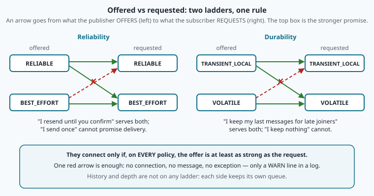
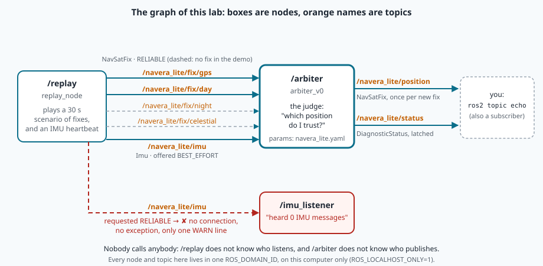

# The ROS 2 graph: nodes, topics, discovery and QoS

> [!NOTE] Mission brief
> **3 October 2026, acceptance test.** Three independent testers try to break NAVERA before it ships. The
> integrator's own script publishes the boat's attitude sensor (its **IMU**). The programs run, the IMU topic
> exists. Yet NAVERA's camera pipeline marks **4 frames out of 4 unusable: "no attitude"**. No crash. After NAVERA
> changed the way it *asks* for that data, **3 frames out of 3 are usable** (finding I-F3, fixed and verified).
>
> The code review of 28 September 2026 had found the opposite problem (WEB-12): NAVERA's programs could talk to
> **too many** others. A simulator on the same network could join in and feed the judge fake positions.
>
> Today you are the detective. **Session 1 — Map the graph:** you start NAVERA Lite's first judge and draw, with
> the `ros2` tools, who talks to whom (badge **Cartographer**). **Session 2 — The silent listener:** you
> reproduce the I-F3 bug on your own stack, write the rule that predicts it, and repair it (badge **QoS
> detective**).
>
> **Start now:** open the 🛠️ **Lab** tab, do **Step 0** (three minutes, no code), then come back here for §1.

**Objectives.** After this mission you can:

1. **map** a running ROS 2 system with the `ros2` command-line tools: nodes, topics, message types,
   parameters, and who publishes or subscribes what;
2. **read** a node's Python code (rclpy) and say which edges of the graph it creates;
3. **explain** discovery, domains and localhost isolation, and why a new node needs a moment to be seen;
4. **predict** from the QoS profiles whether a publisher and a subscriber connect, and write that rule as code;
5. **diagnose and repair** a QoS mismatch: "topic present, node present, no data".

**You need:** mission 01 (the arbiter's states, priority and jump gate), mission 02 (environment variables,
signals, `Ctrl+C`), mission 03 (classes, `self`, `super().__init__`). ⏱ Reading: 60 to 90 minutes with the ✏️
checks: §1–§4 before session 1, §5–§6 before session 2. Lab: 2 h 30 to 3 h 30.

**Before you start.** Answer without looking; if you miss two, reread mission 01 §5 and mission 02 §4.

<details><summary>1. In terminal A you <code>export ROS_DOMAIN_ID=7</code>. Does a program started in terminal B get it?</summary>
No. An export changes only that shell and the programs it starts afterwards; terminal B keeps its own
environment (mission 02 §4).
</details>
<details><summary>2. GPS is 5 s old (timeout 3 s), day vision is fresh with σ 30 m. Which source does NAVERA's arbiter use, and in which state?</summary>
Day vision (GPS is not fresh; priority does the rest), and 30 m > 25 m → DEGRADED (mission 01 §5).
</details>
<details><summary>3. The jump gate: last trusted fix 4 s ago, v_max 100 m/s, margin 50 m. How far may the new fix be?</summary>
100 × 4 + 50 = 450 m. A refused fix never becomes trusted, so the gate keeps growing (mission 01 §5).
</details>

<details><summary>Words of this lesson (open if you need them)</summary>

| Word | Meaning | Français |
|---|---|---|
| **node** | one program (or part of one) connected to the ROS graph, with a name | nœud |
| **topic** | a named channel that carries one message type, from publishers to subscribers | topic, sujet |
| **message type** | the fixed list of typed fields a topic carries, e.g. `sensor_msgs/msg/NavSatFix` | type de message |
| **callback** | a function you give to ROS; ROS calls it later, e.g. when a message arrives | fonction de rappel |
| **parameter** | a named setting stored inside a node, readable from outside | paramètre |
| **discovery** | how nodes find each other on the network, with no central server | découverte |
| **domain** | a number (`ROS_DOMAIN_ID`) that splits one network into separate ROS worlds | domaine |
| **QoS** | quality of service: the delivery promises of a publisher or the demands of a subscriber | qualité de service |
| **reliability / durability** | "resend until received?" / "keep old messages for late subscribers?" | fiabilité / durabilité |
| **latched topic** | a topic whose last message is kept and given to every subscriber that joins later | topic « verrouillé » |
</details>

## 1. The graph: nodes and topics

A NAVERA box runs about a dozen programs at once: GPS reader, IMU reader, camera, map matcher, judge, autopilot
link, web page. Each needs data from the others many times per second, and any of them may restart in flight.

NAVERA (and NAVERA Lite, the stack you build) connects these programs with **ROS 2**, the *Robot Operating
System*. It is not an operating system but a **middleware**: a software layer that moves data between programs
for them, plus tools and conventions. A running system is described as a **graph**:

- its vertices are **nodes**: programs with one job and a name that should be unique, such as `/arbiter` (ROS
  does not enforce it: §6);
- its edges are **topics**: named channels such as `/navera_lite/fix/gps`. A node **publishes** messages on a
  topic; every node that **subscribes** to that topic receives each one.


(The figure uses ROS's classic demo names; ignore the post-office sentence for now, §4 explains domains.)

The key property is **decoupling**. A publisher does not know who subscribes, and a subscriber does not know who
publishes: they only agree on a topic name and a message type. You can add a logger, a test tool or a second
consumer without changing the publisher. You can also *replace* a publisher: in mission 10 you write a fake GPS,
and the rest of the graph cannot tell the difference. That is how NAVERA is tested on a bench without a real
receiver. The price of decoupling: nothing in ROS checks *who* publishes on a name, or *how many* do.

A node also holds **parameters**, named settings (`fix_max_sigma_m = 25.0` in the judge) read with
`ros2 param get`. They are reached through **services** (request → one answer), which is why `ros2 node info`
lists many "Service Servers": ignore them until mission 13. (ROS also has **actions**; NAVERA Lite uses none.)

**Worked example: names.** A node creates its topics with **relative** names (no leading `/`), for example
`navera_lite/imu`. ROS prefixes the node's **namespace**: with none, the full name is `/navera_lite/imu`; started
in the namespace `/boat`, the same code publishes `/boat/navera_lite/imu`. The node's own name gets the namespace
too: the node `replay` started in `/boat` is `/boat/replay`. One code, many vehicles: mission 13 uses it. The `ros2` tools always print full names, with the leading `/`.

> [!QUESTION] ✏️ Check
> 1. You add a node that subscribes to the judge's position to write it into a log file. What must change in the
>    judge's code?
> 2. A node created with the name `trip` runs in the namespace `/drone` and publishes on `navera_lite/trip`. What
>    are its full name and the topic's full name?

<details><summary>Answer</summary>
1. Nothing: the judge does not know who subscribes (decoupling).<br>
2. The node is <code>/drone/trip</code>; the topic is <code>/drone/navera_lite/trip</code>.
</details>

## 2. Messages: a typed contract

Every topic carries exactly **one message type**, written `package/msg/Name`. A type is a list of typed fields,
defined in a small text file; ROS generates a Python class from it. `ros2 interface show` prints it. NAVERA Lite
uses only **standard** message types, which every ROS installation has. Here is the beginning of the one that
carries every position (comments shortened):

```
# sensor_msgs/msg/NavSatFix
std_msgs/Header header           # stamp: when the position was MEASURED; frame_id: who measured it
NavSatStatus status              # a nested message, with its own constants (you read them in the lab)
float64 latitude                 # degrees, WGS84 (mission 06)
float64 longitude
float64 altitude                 # metres above the WGS84 ellipsoid
float64[9] position_covariance   # m², ENU, row-major (CONVENTIONS §5: a = [0], b = [1], c = [4])
uint8 COVARIANCE_TYPE_UNKNOWN = 0
uint8 COVARIANCE_TYPE_APPROXIMATED = 1
uint8 COVARIANCE_TYPE_DIAGONAL_KNOWN = 2
uint8 COVARIANCE_TYPE_KNOWN = 3
uint8 position_covariance_type
```

| In the definition | In Python | Remark |
|---|---|---|
| `float64` | `float` | an `int` is **refused**: write `25.0`, not `25` (mission 10 shows the error) |
| `uint8`, `int8`, … | `int` | the range is checked: a `uint8` holds 0…255 |
| `float64[9]` | 9 floats exactly | a fixed-size array |
| `std_msgs/Header header` | a nested message | messages contain messages |
| `uint8 COVARIANCE_TYPE_KNOWN = 3` | a class constant | **not** a field: a name for a value |
| `byte level` | one byte | printed by the tools as `"\0"`, `"\x01"`… (byte 0, byte 1) |

Because the format is fixed, every node agrees on each number's meaning and unit: that lets one judge compare very different sources.

**Worked example.** The replay node publishes a GPS fix with σ = 3 m east and north. Its covariance holds the
variances (σ²) on the diagonal: `position_covariance = [9.0, 0.0, 0.0, 0.0, 9.0, 0.0, 0.0, 0.0, 0.0]`, type
`COVARIANCE_TYPE_APPROXIMATED` (1), `header.frame_id = "gps"`. The judge reads σ back as √max(a, c) = √9 = 3 m
(mission 12 asks whether it should believe it).

The judge answers with `diagnostic_msgs/msg/DiagnosticStatus`: a `level` (a byte constant: OK, WARN, …), a
`message` (the reason in words, e.g. "gps: σ 3.0 m") and `values`, each a key and a **string**. Standard types
need no build step; the price is that the keys (`state`, `source`, `sigma_m`…) are a contract written in
`convert.py`, not checked by ROS. (NAVERA uses its own typed messages.)

> [!TIP] 🧰 Reading `estimate.py`
> Your copy's `navera_lite/estimate.py` starts with `@dataclass` above `class Estimate:` and a list of fields
> such as `source: str` and `lat: float`. A **dataclass** is a class whose `__init__` Python writes for you from
> that list; mission 12 explains it. Today read it like a table: one Estimate = one position from one source.

> [!QUESTION] ✏️ Check
> 1. A day-vision fix states σ 30 m east and 20 m north, no correlation. Which numbers go at indices 0, 1 and 4 of
>    `position_covariance`?
> 2. Why does `msg.latitude = 36` raise an error, while `msg.latitude = 36.0` works?

<details><summary>Answer</summary>
1. [0] = 900.0 (30²), [1] = 0.0, [4] = 400.0 (20²).<br>
2. The field is a <code>float64</code>; the generated Python class refuses an <code>int</code>. Write floats.
</details>

## 3. Inside a node: rclpy in a few lines

**rclpy** is ROS 2's Python library. A node is a class built on `rclpy.node.Node` (mission 03's subclasses).
In its `__init__` it creates its edges; afterwards it only reacts:

| Call (inside the node) | Creates | Its callback runs… |
|---|---|---|
| `super().__init__("replay")` | the node, named `/replay` | — |
| `self.create_publisher(Type, "topic", qos)` | an outgoing edge | — (you call `.publish(msg)`) |
| `self.create_subscription(Type, "topic", callback, qos)` | an incoming edge | at each message |
| `self.create_timer(period_s, callback)` | a clock | every `period_s` seconds |
| `self.declare_parameter("name", default)` | a parameter | — |

Nothing runs until the program **spins**: `rclpy.spin(node)` waits for messages and timers and calls the right
callback, one at a time, until `Ctrl+C`. In NAVERA Lite, every node's `main()` calls `run_node()` from
`navera_lite/ros/runner.py`, which starts ROS, spins, and closes cleanly on `Ctrl+C` (SIGINT, mission 02).

**Worked example.** Here is the start of `Replay.__init__` in `navera_lite/ros/replay_node.py`, shortened:

```python
super().__init__("replay")
self.declare_parameter("file", "")
self.declare_parameter("rate", 1.0)
self.pubs = {name: self.create_publisher(NavSatFix, f"navera_lite/fix/{name}", FIX_QOS)
             for name in SOURCES}                          # SOURCES = ("gps", "day", "night", "celestial")
self.pub_imu = self.create_publisher(Imu, "navera_lite/imu", SENSOR_QOS)
self.create_timer(0.05, self.on_timer)
```

Read it as a graph: one node `/replay`; parameters `file` and `rate`; **five outgoing edges**: four NavSatFix
topics (the `{…: … for name in SOURCES}` builds a dict with one publisher per source) and one Imu topic; **no
incoming edge** (no `create_subscription`). Every 0.05 s, `on_timer` publishes the rows whose time has come.
The last argument of each publisher, `FIX_QOS` or `SENSOR_QOS`, is its QoS (§5).

> [!QUESTION] ✏️ Check
> Which edges does this node create? Name the node, its incoming and outgoing topics, and how often `tick` runs.
> ```python
> super().__init__("logger")
> self.create_subscription(NavSatFix, "navera_lite/position", self.on_position, FIX_QOS)
> self.create_subscription(DiagnosticStatus, "navera_lite/status", self.on_status, STATUS_QOS)
> self.pub = self.create_publisher(String, "navera_lite/log", 10)
> self.create_timer(2.0, self.tick)
> ```

<details><summary>Answer</summary>
Node <code>/logger</code>. Incoming: <code>/navera_lite/position</code> (NavSatFix) and <code>/navera_lite/status</code>
(DiagnosticStatus). Outgoing: <code>/navera_lite/log</code> (String). <code>tick</code> runs every 2 s. (The plain
<code>10</code> is a QoS too: §5 says which one.)
</details>

## 4. Discovery and domains: who can hear whom

There is **no central server** in ROS 2. Under it, a standard called **DDS** (*Data Distribution Service*, also
used in ships, aircraft and factories) moves the bytes over the network. Nodes find each other by
**discovery**: each ROS program announces itself regularly ("I exist, here is how to reach me"), then the
programs that know each other exchange the list of their publishers and subscribers: topic name, type and QoS.
A publisher and a subscriber are **matched** when the name and the type are equal and their QoS are compatible
(§5). Only then do messages flow.

> [!TIP] 🧰 IP, port, UDP and 127.0.0.1 in five lines
> An **IP address** names a computer on a network (`192.168.1.20`). A **port** (0–65 535) names one program's
> mailbox on that computer. **UDP** sends small packets to an address and port, with no delivery guarantee
> (DDS adds resending on top when it is asked to). **Multicast** sends one packet to every computer that
> listens on a group address: that is how announcements reach strangers. `127.0.0.1` (**localhost**, the
> **loopback**) is "this computer": packets sent there never leave it.


(SPDP and SEDP are the names of the two phases in the DDS standard; you do not need them.)

**Discovery takes time, and each side decides alone.** On this course's computer (2026-10-13) the tools needed
about **1 s** to see a new node, and the first listing after their background helper (the **ros2 daemon**)
restarted was often empty; asking for a topic's messages 0.8 s after its node started failed with *"Could not
determine the type for the passed topic"*. Starting a Python node is slow too: importing rclpy and creating the
node took about **3 s** here, and arbiter v0's first log line appeared about 5 s after the command. The lab's rule:
**wait until the node's log says it started**, run a listing **twice** before you believe an empty answer, and give
`ros2 topic echo` the message type (it then waits for the publisher). A single message sent at once can also be
lost: the publisher may know the subscriber before the subscriber knows the publisher (the red message in the
figure), or a program publishes once and exits before discovery has finished, so nobody receives it.

**Domains.** `ROS_DOMAIN_ID` (a number, 0 by default) splits one network into separate ROS worlds: programs only
discover programs of the same domain, because each domain uses its own UDP ports. `ROS_LOCALHOST_ONLY=1` goes
further: discovery and data stay on the loopback, inside this computer. (These are the names in ROS 2 Humble,
used here; newer releases use `ROS_AUTOMATIC_DISCOVERY_RANGE`.) In this academy the sandbox picks your domain
(`echo $ROS_DOMAIN_ID`) and keeps you on a private network, so you never see a neighbour's nodes.

**Worked example (WEB-12).** Before the 28 September 2026 review, NAVERA's settings left discovery open to the
network. A developer's laptop on the same Wi-Fi, running a simulator in the default domain 0, could publish
positions on the topic the judge listens to: decoupling means the judge would take them like any other
publisher's. The fix: a domain of NAVERA's own **and** loopback only. Today operators reach the box over HTTP,
not over ROS.

> [!QUESTION] ✏️ Check
> 1. Two students work on two laptops in the same classroom Wi-Fi, both in domain 0, both with
>    `ROS_LOCALHOST_ONLY=1`. Do their nodes see each other? And with `ROS_LOCALHOST_ONLY=0`?
> 2. You start a node and immediately run `ros2 node list`: nothing. Is the node broken?

<details><summary>Answer</summary>
1. With localhost-only: no, each laptop's traffic stays on its own loopback. Without it: yes, if the Wi-Fi
lets multicast through (many campus networks block it or isolate the clients): same network and same domain, they
discover each other (and can publish on each other's topics).<br>
2. Not necessarily: discovery takes about a second, and the first listing after the daemon starts can be empty.
Wait until its log says it started (here a node needs 3–5 s), run it again, and only then suspect the node.
</details>

<details class="further"><summary>Optional: the port of a domain</summary>
The DDS standard computes the ports from the domain: discovery multicast port = 7400 + 250 × domain (domain 42 →
17 900), then two ports per program (participant p): 7400 + 250 × domain + 10 + 2p for discovery and + 11 + 2p for
data. The largest port is 65 535, so the domain is at most 232; domains 102–214 put the ports inside Linux's
"ephemeral" range (32 768–60 999), where they may collide with ports the system hands to other programs, which is
why the ROS documentation recommends 0–101 (and 215–232). The academy gives students domains in 1–101, and each sandbox has a private
network of its own, so no other program can take its ports. `ss -uln` lists the UDP ports in use (lab "Going
further").
</details>

## 5. QoS: what is offered, what is requested

**The problem.** A packet is lost: send it again, or forget it? A node restarts in flight: should it get the last
message published before it started? An IMU sample is worthless 0.1 s later, but "the mission has started" must
reach a node that restarts at any time. Each side states its rules: its **Quality of Service**.

| Policy | Values | Meaning |
|---|---|---|
| **reliability** | `RELIABLE` / `BEST_EFFORT` | resend lost messages until the subscriber confirms / send once, never resend |
| **durability** | `TRANSIENT_LOCAL` / `VOLATILE` | keep the last messages for subscribers that join later / keep nothing for them |
| **history + depth** | `KEEP_LAST` n / `KEEP_ALL` | how many messages each side's queue holds |
| deadline, liveliness | durations, kinds | advanced (maximum period, "still alive?"): also "offer at least as strong as the request" (a shorter deadline or lease is stronger); left at their defaults in this course, so they never refuse a pair |
| lifespan | a duration | maximum age of a message; not part of matching |

A publisher **offers** a profile; a subscriber **requests** one. They connect only if, **policy by policy, the
offer is at least as strong as the request**. In this course two policies decide (deadline and liveliness stay at
their defaults):



| Publisher offers → / subscriber requests ↓ | RELIABLE | BEST_EFFORT |
|---|---|---|
| **RELIABLE** | ✔ | ✘ no connection |
| **BEST_EFFORT** | ✔ | ✔ |

| Publisher offers → / subscriber requests ↓ | TRANSIENT_LOCAL | VOLATILE |
|---|---|---|
| **TRANSIENT_LOCAL** | ✔ (and gets the kept messages) | ✘ no connection |
| **VOLATILE** | ✔ (new messages only) | ✔ |

History and depth are **not** in the rule: each side keeps its own queue, and discovery does not even share them.
(The full ROS table also has rows for deadline and liveliness; `rclpy.qos.qos_check_compatible(pub, sub)` applies
all of them: lab "Going further".)

**An incompatible pair fails in silence.** No exception in your code, no message: only a `WARN` line in the log of
the programs involved, which names the policy that failed (your TODO 1 does the same), for example *"New publisher discovered on topic …, offering incompatible QoS. No messages
will be received from it. Last incompatible policy: RELIABILITY"*. `ros2 topic info -v <topic>` shows the
reliability and durability of every endpoint: the detective's first command.

**Worked example: NAVERA Lite's three profiles** (`navera_lite/ros/qos.py`):

| Name | Reliability, durability, history | Used on |
|---|---|---|
| `FIX_QOS` | RELIABLE, VOLATILE, KEEP_LAST 10 | the fix topics and the judge's position |
| `SENSOR_QOS` | BEST_EFFORT, VOLATILE, KEEP_LAST 5 (ROS's `qos_profile_sensor_data`) | the IMU heartbeat |
| `STATUS_QOS` | RELIABLE, TRANSIENT_LOCAL, KEEP_LAST 1 ("latched") | the judge's status |

Pair 1: the replay publishes the IMU with `SENSOR_QOS`, a listener requests `FIX_QOS`. Reliability: BEST_EFFORT
offered, RELIABLE requested → ✘. One ✘ is enough: **no connection**. Pair 2: the judge publishes its status with
`STATUS_QOS`, a logger requests `FIX_QOS`. Reliability RELIABLE → RELIABLE ✔; durability TRANSIENT_LOCAL →
VOLATILE ✔: they connect, and the logger gets new statuses only.

**The plain number trap.** `self.create_subscription(Imu, "navera_lite/imu", cb, 10)` looks as if it chose no
QoS. A plain number sets only the depth; every other policy comes from ROS's **default profile**: RELIABLE,
VOLATILE, KEEP_LAST. Many sensor drivers publish BEST_EFFORT (a fresh IMU sample is worth more than an old one
sent again), so a subscriber that must work with *any* driver requests BEST_EFFORT: it accepts both kinds.

**Latched topics.** TRANSIENT_LOCAL with depth 1 keeps the last message for every subscriber that joins later:
a **latched** topic, ideal for states and one-time commands. A late subscriber gets it only if it requests
TRANSIENT_LOCAL too.

One case the tables do not settle: a late subscriber that requests TRANSIENT_LOCAL but BEST_EFFORT. The tables
say "matched"; whether it also gets the kept message, lab experiment B3 shows you.

<details><summary>Read this after lab Step 7: latched, in practice</summary>

> [!WARNING] Latched: request RELIABLE + TRANSIENT_LOCAL
> A subscriber that requests TRANSIENT_LOCAL **but** BEST_EFFORT is matched (no warning!), yet with Fast DDS, the
> middleware of ROS 2 Humble used here, it never receives the kept message (lab Step 7, B3): the kept messages are
> handed over by the reliable protocol. Other DDS implementations may differ, so never rely on it: for a latched
> topic, request RELIABLE + TRANSIENT_LOCAL.
</details>

**Choosing a depth.** The queue must cover the worst burst the callback cannot process. An IMU at 200 Hz and a
callback blocked for 0.25 s: 200 × 0.25 = **50 samples** arrive meanwhile. With depth 10 the 40 oldest are
dropped; with depth 50 none is.

> [!QUESTION] ✏️ Check
> 1. A publisher offers RELIABLE + TRANSIENT_LOCAL; a subscriber requests RELIABLE + VOLATILE. Matched? Does a
>    subscriber that starts late receive the last message?
> 2. A camera driver publishes BEST_EFFORT. Your subscriber was created with the plain number `5`. Will it receive
>    images? What is the smallest change?
> 3. An IMU publishes at 400 Hz and your callback can be blocked for 0.1 s. What depth avoids losing samples?

<details><summary>Answer</summary>
1. Matched (RELIABLE serves RELIABLE; TRANSIENT_LOCAL serves VOLATILE), but the late subscriber gets new messages
only: it did not ask for the kept ones.<br>
2. No: the number gives the default profile, RELIABLE, and a BEST_EFFORT offer cannot serve it. Request
BEST_EFFORT (e.g. <code>qos_profile_sensor_data</code>); it accepts both kinds of publishers.<br>
3. 400 × 0.1 = 40: a depth of at least 40.
</details>

## 6. The detective's toolbox: the `ros2` command

| Command | What it shows |
|---|---|
| `ros2 node list` · `ros2 node info /n` | the nodes · what one node subscribes, publishes, serves |
| `ros2 topic list` · `ros2 topic info -v /t` | the topics · a topic's type, its endpoints **and their QoS** |
| `ros2 topic echo /t <type> --once` | one message (add `--field message` for one field only) |
| `ros2 topic hz /t` | the rate, in messages per second (`Ctrl+C` to stop) |
| `ros2 topic pub -r 2 /t <type> "<yaml>"` | publish by hand, 2 times per second |
| `ros2 interface show <type>` | the fields and constants of a type |
| `ros2 param list /n` · `ros2 param get /n name` | a node's parameters · one value |

Messages you will meet, and what they mean:

| You see | It means | Do |
|---|---|---|
| empty `ros2 node list`, *"Unable to find node"* | discovery has not finished | wait 2 s, run it again |
| *"Could not determine the type for the passed topic"* | the tool has not seen a publisher yet | give the type: `ros2 topic echo /t pkg/msg/Type` |
| *"A message was lost!!!"* in `ros2 topic echo` | the subscriber saw a gap in the publisher's message numbers (e.g. it joined late a topic whose publisher keeps only the last message) | harmless for watching |
| `WARN … incompatible QoS … Last incompatible policy: X` | a pair that will never connect | `ros2 topic info -v`, compare policy X |
| a long error ending in `!rclpy.ok()` | the ros2 daemon is in a bad state | `ros2 daemon stop`, try again |

One more trap: `ros2 topic echo` **without** QoS options adapts its request to the publishers it finds. So the
echo can print data while your own node, with a fixed request, hears nothing. "Echo works" does not prove that
your subscriber can connect.

> [!WARNING] Common wrong ideas
> - "If `ros2 topic list` shows the topic, my node receives it." The topic exists as soon as *anyone* uses the
>   name; a connection also needs the same type and compatible QoS.
> - "A plain `10` means no QoS." It means the default profile: RELIABLE, VOLATILE, depth 10.
> - "A QoS mismatch raises an error." It logs one WARN line, once, and then nothing happens.
> - "RELIABLE is always better." It resends old samples and can delay new ones; for fast sensor data most drivers
>   choose BEST_EFFORT, and the subscriber must accept it.
> - "Two nodes with the same name cannot run." Both run; `ros2 node list` warns that two nodes share a name, and
>   tools that address `/name` (param, node info) then talk to either one. Two publishers on one topic are allowed.

## Bird's-eye view: the detective's table

| Symptom | First command | Usual cause |
|---|---|---|
| the node is not in `ros2 node list` | run it twice, 2 s apart; `jobs` | discovery lag, the node crashed, another domain or another terminal tab |
| node present, topic present, no data | `ros2 topic info -v /t` | incompatible QoS (or a different type) |
| a late subscriber misses a state | `ros2 topic info -v /t` | VOLATILE or BEST_EFFORT request on a latched topic |
| two different answers on one topic | `ros2 topic info /t` → Publisher count | a second node publishing on the same name |
| data from a "stranger" | `echo $ROS_DOMAIN_ID $ROS_LOCALHOST_ONLY` | an open network, a shared domain |

<details><summary>Read this after lab Step 9: the graph of the lab</summary>


</details>

## In NAVERA

NAVERA's graph has the shape of mission 01: **witnesses → judge → messenger**. Every position source (GPS, day
vision, night vision, celestial) publishes the **same message type** on its own topic, and the judge (NAVERA's
estimator) subscribes to all of them; it also watches the IMU for liveness. It publishes two answers: the winning
position, only when there is a new one (an old position is never sent again as if it were new), and a status five
times per second (state, active source, health of each source, and the reason in words). The messenger node turns
the position into what the autopilot expects.

QoS in NAVERA, in numbers (architecture document; acceptance test of 3 October 2026): the vehicle's sensors
(IMU, GPS, rangefinder) are requested **BEST_EFFORT with depth 50**, so that both BEST_EFFORT and RELIABLE
publishers work (the I-F3 fix of the brief); the camera pipeline interpolates the attitude from that IMU history,
so it keeps a long queue. One-time
states are latched: the camera's start signal, the localiser's "ready" flag and the operator's start position, so
that a node restarting in flight learns them without anybody sending them again. Isolation since WEB-12: DDS
stays on the box (`ROS_LOCALHOST_ONLY=1`, a domain of its own); the operator uses the web page.

## In NAVERA Lite

Your stack has the same shape, built from standard messages (the parts are in your lesson folder):

| Part | Role |
|---|---|
| `navera_lite/ros/qos.py` | the three profiles of §5, `describe()`, and ✏️ **your TODO 1: `incompatible_policies()`**; `compatible()` (given) uses it |
| `navera_lite/ros/replay_node.py` | node `/replay`: plays a 30 s scenario of fixes and an IMU heartbeat (given) |
| `navera_lite/ros/arbiter_v0.py` | node `/arbiter`: NAVERA Lite's first judge, naive on purpose (given; mission 12 attacks it, mission 29 replaces it) |
| `navera_lite/ros/convert.py` | Estimate ↔ NavSatFix, the decision → DiagnosticStatus (given) |
| `navera_lite/ros/runner.py` | start, spin, clean `Ctrl+C` (given) |
| `navera_lite.yaml` | the judge's settings (mission 01's values), passed with `--params-file` |

## 🐦 How birds do it

A winter flock of starlings turns like smoke with no leader. Filming flocks over Rome, Ballerini and colleagues
(*PNAS*, 2008) found that each bird follows about **six or seven** nearest neighbours, not the whole flock. Like a
publisher, a bird shows its movement without addressing anyone; like a subscriber, it listens only to what it
needs. The analogy stops there: a bird picks neighbours by sight, a node by topic name, type and QoS.

## Summary

1. A ROS 2 system is a **graph**: nodes publish and subscribe on named, typed topics, decoupled from each other.
2. A message type is a **contract**: fixed fields, units and constants (`float64` needs a float).
3. A node creates its edges in `__init__` (publishers, subscriptions, timers, parameters) and then reacts to
   callbacks while it spins.
4. Nodes find each other by **discovery** (wait for the node's log, list twice); `ROS_DOMAIN_ID` and `ROS_LOCALHOST_ONLY` decide who can
   join: NAVERA's WEB-12 fix.
5. **QoS**: a pair connects only if the offer is at least as strong as the request, policy by policy; a mismatch
   is silent (I-F3) except for one WARN line. A plain number means the default, RELIABLE. Latched = TRANSIENT_LOCAL on
   both sides (and RELIABLE: lab Step 7).

**Next mission:** you write your own publisher, a fake GPS receiver, and let arbiter v0 judge it.

## Check yourself

Answer without scrolling up.

<details><summary>1. "Topic present, node present, no data." Which command first, and what do you compare?</summary>
<code>ros2 topic info -v /topic</code>: the reliability and durability of the publisher (offered) and of your
subscriber (requested), with the two ladders of §5. Also check the type.
</details>
<details><summary>2. A publisher offers RELIABLE + VOLATILE; a subscriber requests RELIABLE + TRANSIENT_LOCAL. Connected?</summary>
No: a VOLATILE offer cannot serve a TRANSIENT_LOCAL request (one ✘ is enough).
</details>
<details><summary>3. Why did a simulator on the same Wi-Fi threaten NAVERA before WEB-12, and what two settings stop it?</summary>
Discovery was open to the network and topics are decoupled: anyone in the same domain could publish on the judge's
topics. A private <code>ROS_DOMAIN_ID</code> and <code>ROS_LOCALHOST_ONLY=1</code>.
</details>
<details><summary>4. <code>create_subscription(Imu, "imu", cb, 10)</code>: what does it request, and from which publishers does it receive?</summary>
The default profile: RELIABLE, VOLATILE, KEEP_LAST 10. It receives from RELIABLE publishers only.
</details>
<details><summary>5. (Mission 01) A GPS fix is refused by the jump gate. Does the next fix's gate start from the refused fix or from the last trusted one?</summary>
From the last trusted one: a refused fix never becomes trusted, so the elapsed time, and the gate, keep growing.
</details>

Now open the **🛠️ Lab** tab.
