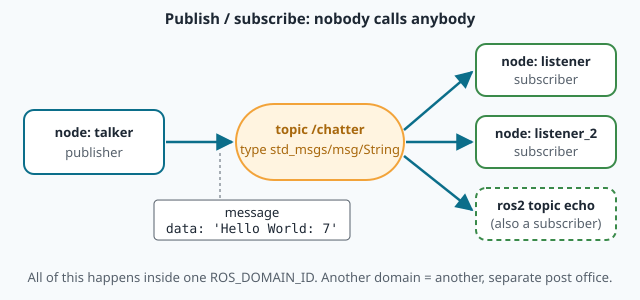
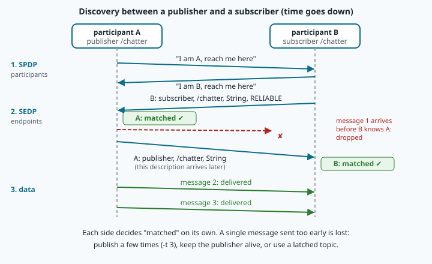
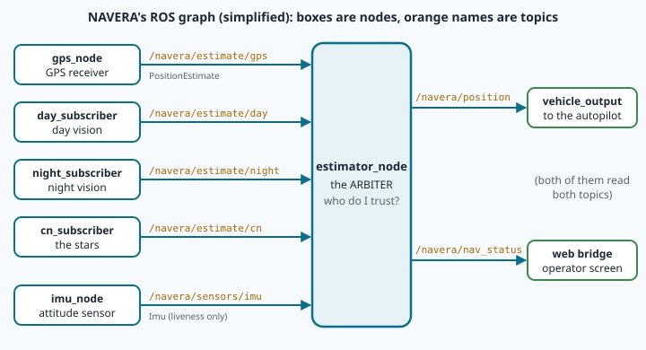

# The ROS 2 graph: nodes, topics, discovery and QoS

> [!NOTE] In short
> - About ten programs run at the same time in a NAVERA box, and they exchange data many times per
>   second.
> - **ROS 2** connects them: **nodes** send typed **messages** on topics, or use services and
>   actions.
> - Under ROS 2, **DDS** lets the nodes find each other on the network (discovery).
> - **QoS** rules decide what happens when a message is late or lost.
> - In the lab you measure discovery, message sizes and QoS on a live system, and question
>   NAVERA's real arbiter.
> - In NAVERA, every source publishes the same message type on its own topic, and the arbiter
>   subscribes to all of them.

A NAVERA box is mounted on a survey drone that flies a coastal survey, 100 km along the shore. Inside
the box, about **ten programs run at the same time**: one reads the GPS receiver, one reads the
attitude sensor, one takes camera frames, one matches them against the satellite map, one decides
which position to trust, one sends that position to the autopilot, one serves the operator's web
page. Each of them needs data from the others, many times per second, and any of them may crash
and restart in the middle of a flight.

How do these programs find each other, agree on the format of the data, and decide what happens
when a message is late or lost? NAVERA uses **ROS 2** (*Robot Operating System 2*) for this. ROS 2
is not an operating system: it is a **middleware** — a software layer between your programs and
the network — plus a set of tools and conventions. This lesson explains the model behind it (the
**graph**), the protocol underneath (**DDS**), and the delivery rules (**QoS**). In the lab you
will measure all of it on a live system, then question NAVERA's real arbiter.

## 1. The computation graph

A running ROS 2 system is described as a **graph**:

- the vertices are **nodes** — processes (or parts of a process) with one job and a unique name,
  such as `/estimator_node`;
- the edges are **communication channels** between them.

ROS 2 offers four kinds of channels. Choosing the right one is a design decision:

| Pattern | Shape | Use it for | NAVERA example |
|---|---|---|---|
| **topic** | one-to-many stream, publish / subscribe | data that keeps coming | `/navera/estimate/gps`, `/navera/nav_status` (5 Hz) |
| **service** | request → one response | a quick question or command | every node's `get_parameters` service |
| **action** | goal → feedback … → result, can be cancelled | long tasks | (not used by NAVERA; the lab uses a demo) |
| **parameter** | a named setting stored in a node | configuration | `fix_max_sigma_m = 25.0` in the arbiter |

The key property of a topic is **decoupling**: a publisher does not know who subscribes, and a
subscriber does not know who publishes. The GPS source publishes on `/navera/estimate/gps`; it does
not know that the arbiter exists. You can add a logger, a debugging tool or a second consumer
without changing the publisher. You can also **replace** a publisher: in lesson 10 you will write a
fake GPS, and the rest of the graph cannot tell the difference. That is exactly how NAVERA is
tested on a bench without a real receiver.



Parameters are also implemented with services: each node offers services such as
`/estimator_node/get_parameters` and `/estimator_node/set_parameters`. This is why `ros2 node info`
prints a long list of "Service Servers" for every node — they are mostly this standard parameter
machinery, and you can ignore them until lesson 13.

## 2. Messages: a typed contract

Every topic carries exactly one **message type**. A type is defined in a small text file in the
ROS **interface definition language** (a `.msg` file); at build time ROS generates a Python class
and a C++ class from it. The full name has three parts, `package/msg/Name`, for example
`std_msgs/msg/String`, `sensor_msgs/msg/NavSatFix` or NAVERA's own `navera_msgs/msg/PositionEstimate`.

Here is the beginning of NAVERA's most important message (lesson 12 studies it field by field):

```
std_msgs/Header header        # stamp = publication instant
float64 latitude              # deg, WGS84
float64 longitude             # deg, WGS84
float64 altitude              # m above the WGS84 ellipsoid; NaN if unknown
float64[9] position_covariance
uint8 source
uint8 SOURCE_UNKNOWN=0
uint8 SOURCE_GPS=1
...
```

**WGS84** is the reference ellipsoid and coordinate system that GPS uses — you met it in lesson
06: latitude and longitude are angles on that ellipsoid, and altitude is measured from its surface.

| In the `.msg` file | Python type | Remark |
|---|---|---|
| `float64` | `float` | an `int` is **refused** (lesson 10 shows the error) |
| `uint8`, `int32`, … | `int` | range checked: a `uint8` holds 0…255 |
| `bool`, `string` | `bool`, `str` | |
| `float64[9]` | sequence of exactly 9 floats | fixed-size array |
| `SourceHealth[]` | list | unbounded array of another message |
| `std_msgs/Header header` | a nested message | messages contain messages |
| `uint8 SOURCE_GPS=1` | class constant | **not** a field: a name for a value |

Constants make code readable: `msg.source == PositionEstimate.SOURCE_GPS` instead of a mysterious
`msg.source == 1`. Because the format is fixed and typed, every node that uses `PositionEstimate`
agrees on what each number means, in which unit. That is what allows the arbiter to compare
positions coming from very different sources with one single rule.

### How big is a message?

On the wire, a message is **serialised** with CDR (*Common Data Representation*): fields one after
the other, each aligned to its own size, plus a 4-byte header. A `std_msgs/String` holding
`"Hello World: 12"` (15 characters) takes 4 (header) + 4 (string length) + 16 (characters and the
final zero) = **24 bytes**. A `NavSatFix` is about 120 bytes: 12 float64 (96 bytes) plus the
header and status fields. So a GPS at 5 Hz uses about 600 B/s, while one colour camera frame of
1536 × 730 pixels is 1536 × 730 × 3 ≈ 3.4 MB. Two orders of magnitude matter when you design a
system: this is why NAVERA's cameras and localisers run on the same box and never send raw frames
over a radio link. You will measure message sizes with `ros2 topic bw`.

## 3. Under the hood: DDS and discovery

ROS 2 does not move the bytes itself. It uses **DDS** (*Data Distribution Service*), an industry
standard for publish/subscribe also used in ships, aircraft and factories. DDS implementations talk
to each other with the **RTPS** protocol (*Real-Time Publish-Subscribe*) over UDP. Each ROS process
creates one DDS **participant**; each publisher and subscriber is an **endpoint** of that
participant.

There is no central server. Nodes find each other by **discovery**, in two phases:

1. **Participant discovery (SPDP).** Each participant announces itself periodically on a
   well-known port: "I exist, here is how to reach me."
2. **Endpoint discovery (SEDP).** Participants that know each other exchange the list of their
   endpoints: topic name, type and QoS of each publisher and subscriber.

A publisher and a subscriber are **matched** when the topic name and the type are equal and their
QoS are **compatible** (section 4). Only then do messages flow.



Discovery is **asymmetric**: the publisher's side and the subscriber's side each decide "matched"
when *they* have received the other's description. There is a short moment when the publisher
already knows the subscriber, but the subscriber does not yet know the publisher. A message sent
in that moment is lost for a subscriber with VOLATILE durability. This explains a classic
surprise: `ros2 topic pub --once` waits until it sees one subscriber, publishes immediately, and
exits — and the listener sometimes prints nothing. It is not your mistake; it is discovery. The
robust ways: publish a few times (`-t 3`), or keep the publisher alive, or use a TRANSIENT_LOCAL
("latched") topic.

### Domains and ports

The **ROS_DOMAIN_ID** separates independent systems on the same network or computer: participants
only discover participants of the same domain. Each domain uses its own UDP ports. The RTPS
standard gives the formula (default constants PB = 7400, DG = 250, PG = 2):

```
discovery multicast port  = PB + DG * domain              = 7400 + 250 * domain
discovery unicast port    = PB + DG * domain + 10 + PG * p  (p = participant index 0, 1, 2 ...)
user data unicast port    = PB + DG * domain + 11 + PG * p
```

Worked example: in domain 42, the discovery port is 7400 + 250 × 42 = **17 900**; the first
participant (p = 0) receives its user data on 17 900 + 11 = 17 911, the second (p = 1) on 17 913.

In this academy every student has a private domain between 1 and 101, and NAVERA itself avoids
77–79 for student use.

> [!NOTE]
> **For the curious: why domains 0–101?** The largest port number is 65 535, so the domain can be
> at most 232. On Linux, ports 32 768 to 60 999 are **ephemeral ports** that the system gives to any
> program that asks for "a free port". Domains 102 to 214 put DDS ports in that range, where they
> may collide with another program; this is why the ROS documentation recommends **0–101** (and
> 215–232). You do not need this for the lab.

One more setting narrows discovery further: `ROS_LOCALHOST_ONLY=1` keeps all ROS traffic on the
loopback interface (127.0.0.1), so it never leaves the computer. A NAVERA box runs this way: operators reach it through
a web page, not through ROS (docs/ARCHITECTURE.md §1).

## 4. Quality of Service

Every publisher **offers** a QoS profile and every subscriber **requests** one. The main policies:

| Policy | Values | Meaning |
|---|---|---|
| **reliability** | `RELIABLE` / `BEST_EFFORT` | resend lost samples until acknowledged / send once |
| **durability** | `TRANSIENT_LOCAL` / `VOLATILE` | keep the last samples for subscribers that join later / do not |
| **history + depth** | `KEEP_LAST` n / `KEEP_ALL` | how many samples are kept in the queue |
| deadline, lifespan, liveliness | durations | advanced: maximum period, maximum age, "still alive?" |

The compatibility rule is **"offered ≥ requested"**: the publisher must give at least what the
subscriber asks for.

| Publisher offers → / subscriber requests ↓ | RELIABLE | BEST_EFFORT |
|---|---|---|
| **RELIABLE** | ✔ | ✘ no connection |
| **BEST_EFFORT** | ✔ | ✔ |

| Publisher offers → / subscriber requests ↓ | TRANSIENT_LOCAL | VOLATILE |
|---|---|---|
| **TRANSIENT_LOCAL** | ✔ (gets the stored samples) | ✘ no connection |
| **VOLATILE** | ✔ (live samples only) | ✔ |

An incompatible pair is simply **not matched**: no error in your code, no message. The subscriber's
side only logs a warning such as `offering incompatible QoS … Last incompatible policy:
RELIABILITY`. This is one of the most common reasons why "my node receives nothing". Many sensor
drivers publish BEST_EFFORT (a fresh IMU sample is worth more than an old one re-sent), so a
subscriber that wants to work with *any* driver should request BEST_EFFORT: it accepts both.

### Choosing a depth: a worked example

With `KEEP_LAST`, the depth must cover the worst burst the consumer cannot process. NAVERA reads the
vehicle's IMU at about 200 Hz. If the callback thread is blocked for 0.25 s (a heavy computation, a
burst after a network hiccup), 200 × 0.25 = **50 samples** arrive meanwhile. With depth 10, the 40
oldest are dropped; with depth 50, none is. This is exactly the comment in NAVERA's `qos.py`
(below). For a 5 Hz status topic, depth 10 covers 2 s of stall — plenty.

### Latched topics

`TRANSIENT_LOCAL` with depth 1 is called a **latched** topic: the publisher keeps its last message
and gives it to every subscriber that joins later — if the subscriber also requests
TRANSIENT_LOCAL, and is RELIABLE (DDS delivers stored samples only through its reliable protocol). NAVERA uses it for one-time commands and states: the camera's
`camera/start` gate, the localiser's `localizer_ready` flag and the operator's start position
(docs/ARCHITECTURE.md §7–8). A localiser that restarts in flight immediately receives "the mission
has started" without anybody sending it again.

## 5. Tools: the ros2 command

| Command | What it shows |
|---|---|
| `ros2 node list` / `ros2 node info /n` | nodes / what one node publishes, subscribes, serves |
| `ros2 topic list` / `ros2 topic info -v /t` | topics / type, endpoints **and their QoS** |
| `ros2 topic echo /t` / `ros2 topic hz /t` / `ros2 topic bw /t` | messages / rate / bandwidth |
| `ros2 topic pub -t 3 /t <type> "<yaml>"` | publish by hand (3 times) |
| `ros2 interface show <type>` | the fields of a type |
| `ros2 service list` / `ros2 service call` | services / call one |
| `ros2 action list` / `ros2 action send_goal` | actions / send a goal |
| `ros2 param list` / `ros2 param get` | parameters of a node |

The command-line tools use a background helper, the **ros2 daemon**, which keeps a cache of the
graph so that commands answer quickly. In your terminal it is started for you. If a `ros2` command
ever fails with a long error ending in `!rclpy.ok()`, run `ros2 daemon stop` and try again.

## 🐦 How birds do it

In winter, starlings gather in flocks of thousands that twist and turn like smoke above their roost
— a **murmuration**. There is no leader. In 2008, Michele Ballerini and colleagues filmed flocks over
Rome with several synchronised cameras, rebuilt the 3D position of every bird, and published the
result in *PNAS*: each starling reacts to about **six or seven nearest neighbours**, a fixed
*number* of neighbours, not to every bird within a fixed distance. They called it a
**topological** interaction.

Coasts have their own great gatherings. During migration, the tidal mudflats of the **Wadden Sea**
(Netherlands, Germany, Denmark) hold millions of shorebirds — waders such as red knots, dunlins and
bar-tailed godwits — and their dense flocks wheel together in the same leaderless way when a
peregrine falcon passes.

| A flock | A ROS 2 graph |
|---|---|
| each bird shows its movement just by flying | a node **publishes**; it does not address anyone |
| each bird watches a few neighbours, not the whole flock | a node **subscribes** only to the topics it needs |
| a bird finds its neighbours by looking around | participants find each other by **discovery** |
| a bird can join or leave; the others carry on | a node can start, stop or crash; the graph adapts |

The analogy has limits, and an engineer should say so: a bird chooses its neighbours by distance
and sight, while a ROS node chooses by **topic name, type and QoS**. Navi the swallow would add that
a flock has no `ROS_DOMAIN_ID` — swallows and starlings ignore each other mostly because they fly
in different places at different times.

## In NAVERA

The whole graph is drawn in `docs/ARCHITECTURE.md` of your copy
([open it](file:navera/docs/ARCHITECTURE.md)). Here is its heart:



Every position source publishes the **same message type** on its own topic
`/navera/estimate/<source>`, and the arbiter subscribes to all of them. In
[estimator_node.py](file:navera/navera_estimator/navera_estimator/nodes/estimator_node.py):

```python
# RELIABLE depth 10, matching the sensor/estimate data topics (CLAUDE.md).
self.sub_gps = self.create_subscription(
    PositionEstimate, "/navera/estimate/gps", self._on_gps, 10)
self.sub_day = self.create_subscription(
    PositionEstimate, "/navera/estimate/day", self._on_day, 10)
...
self.sub_imu = self.create_subscription(
    Imu, str(self.get_parameter("imu_topic").value), self._on_imu, SENSOR_QOS)

self.pub_pos = self.create_publisher(PositionEstimate, "/navera/position", 10)
self.pub_status = self.create_publisher(NavStatus, "/navera/nav_status", 10)
```

A plain number `10` means "the default profile — RELIABLE, VOLATILE, KEEP_LAST — with depth 10". The
IMU, which comes from other people's drivers, is read with `SENSOR_QOS`, defined in
[navera_common/qos.py](file:navera/navera_common/navera_common/qos.py):

```python
"""Most ROS sensor drivers (IMU drivers, MAVROS, GPS drivers) publish BEST_EFFORT
(rclpy.qos.qos_profile_sensor_data). A RELIABLE subscription never receives from a
BEST_EFFORT publisher; a BEST_EFFORT subscription receives from both. Depth 50: an IMU
at 200 Hz arriving in bursts under load is not cut to its last sample."""
SENSOR_QOS = QoSProfile(reliability=ReliabilityPolicy.BEST_EFFORT, durability=DurabilityPolicy.VOLATILE,
                        history=HistoryPolicy.KEEP_LAST, depth=50)
```

`docs/VALIDATION_STATUS.md` records why this matters: with an integrator's IMU published
BEST_EFFORT on a boat, frames went from "4/4 unusable, no attitude" to "3/3 frames usable" after
this change. One QoS policy, a whole navigation pipeline.

The arbiter publishes two answers: `/navera/position` (the winning estimate, only when there is one)
and `/navera/nav_status` (5 times per second: the state `INITIALIZING`, `NO_FIX`, `FIX` or
`DEGRADED`, the active source, the health of each source and a reason in plain words). In the lab
you will start this node from your NAVERA copy and question it with the tools of section 5.

## Glossary

| Term | Meaning |
|---|---|
| **middleware** | software between applications and the network that moves data for them |
| **graph** | the nodes of a running system and the channels between them |
| **node** | a named unit of computation connected to the graph |
| **topic / service / action / parameter** | stream / request-response / long goal with feedback / stored setting |
| **message type (.msg, IDL)** | the typed list of fields a topic carries |
| **serialisation (CDR)** | turning a message into bytes for the network |
| **DDS / RTPS** | the publish/subscribe standard ROS 2 uses / its wire protocol over UDP |
| **participant / endpoint** | one process in DDS / one publisher or subscriber |
| **discovery (SPDP, SEDP)** | finding participants, then their endpoints, with no central server |
| **ROS_DOMAIN_ID** | number that separates independent graphs (different UDP ports) |
| **ephemeral port** | a port the OS hands out on demand (32 768–60 999 on Linux) |
| **QoS** | delivery rules: reliability, durability, history and depth… |
| **latched topic** | TRANSIENT_LOCAL, depth 1: late subscribers get the last message |

## Check what you learned

<details><summary>1. Compute the discovery multicast port of domain 7, and the user-data port of the third participant (p = 2).</summary>
7400 + 250 × 7 = 9150. User data: 9150 + 11 + 2 × 2 = 9165.
</details>

<details><summary>2. A camera driver publishes BEST_EFFORT. Your subscriber uses the default profile (depth 10). What happens, and what is the fix?</summary>
The default profile requests RELIABLE; a BEST_EFFORT publisher offers less than that, so the pair is
not matched and nothing arrives (only a QoS warning). Request BEST_EFFORT, e.g.
<code>qos_profile_sensor_data</code> or NAVERA's <code>SENSOR_QOS</code>: it accepts both kinds of publishers.
</details>

<details><summary>3. <code>ros2 topic pub --once</code> found the listener, published, and the listener printed nothing. Explain.</summary>
Discovery is asymmetric: the publisher had matched the subscriber, but the subscriber had not yet
matched the publisher when the single message was sent. A VOLATILE subscriber does not get messages
sent before it matched. Publish a few times (<code>-t 3</code>) or use a latched topic.
</details>

<details><summary>4. An IMU publishes at 400 Hz and your callback can be blocked for 0.1 s. What depth avoids losing samples?</summary>
400 × 0.1 = 40 samples: a depth of at least 40 (NAVERA uses 50 for 200 Hz bursts of 0.25 s).
</details>

<details><summary>5. Why is <code>/camera/start</code> latched, and what must a late subscriber request to get it?</summary>
It is a one-time command; a node that (re)starts later must still learn that the mission started.
The subscriber must request TRANSIENT_LOCAL durability (and the publisher must offer it with depth ≥ 1).
</details>

<details><summary>6. Why do all NAVERA sources publish the same message type?</summary>
So the arbiter can judge them with one rule: same fields, same units (degrees WGS84, m² in ENU), same
meaning of validity and mode. A new source only has to fill the same form honestly (lesson 12).
</details>

Now open the **🛠️ Lab** tab.
