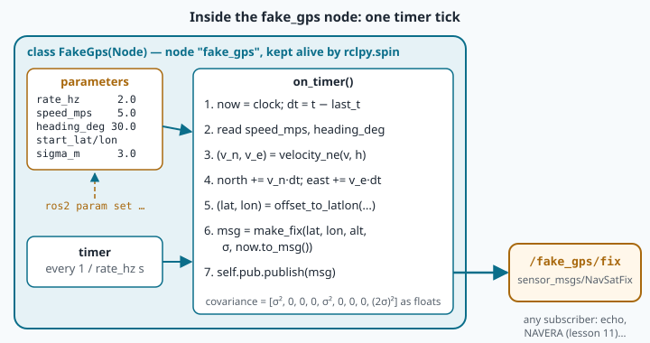

# Your first publisher: a fake GPS

Before a NAVERA box ever flies, it spends many hours on a **test bench**: a table, a Jetson, some
cables — and no drone. But the arbiter needs GPS positions that *move*, as if the box were flying.
How do the engineers test it? They write a small program that **pretends to be a GPS**: it publishes
the same kind of message, on the same kind of topic, as a real receiver. The rest of NAVERA cannot
tell the difference — that is the magic of publish/subscribe you discovered in lesson 9.

Today you write such a program yourself: a **fake GPS** that drives in a straight line through Sousse
and tells the world where it is, twice per second. It is your first ROS 2 **node** in Python.

## rclpy: ROS for Python

To talk to ROS from Python, you import the library **rclpy** (*ROS Client Library for Python*). A
ROS program in Python always has the same skeleton:

```python
import rclpy
from rclpy.node import Node


class MyNode(Node):                    # our node is a special kind of Node
    def __init__(self):
        super().__init__("my_node")    # its name in the ROS graph
        # ... create publishers, subscribers, timers here ...


def main():
    rclpy.init()                       # 1. connect to ROS
    node = MyNode()                    # 2. create our node
    rclpy.spin(node)                   # 3. wait and react, forever (until Ctrl+C)
    node.destroy_node()                # 4. clean up
    rclpy.shutdown()
```

Two new Python ideas hide in there:

- **`class MyNode(Node)`** — a **class** is a recipe for an object that has its own data and its own
  functions (called **methods**). `MyNode(Node)` means "a MyNode is a Node, plus what I add". So our
  node can do everything a ROS node does (have a name, a clock, a logger…) and we only write the
  parts that are special.
- **`self`** — inside a method, `self` is "this object". `self.count = 0` stores a value *in the
  node*, so that other methods can read it later. Think of `self` as the node's backpack.

And one new ROS idea: **`rclpy.spin(node)`**. A node does not run from top to bottom and stop like
your earlier scripts. It **waits**, and when something happens — a timer rings, a message arrives —
ROS calls the right method of your node. Spinning means "keep waiting and reacting". The program only
ends when you press `Ctrl+C`.

## A publisher: your node's mouth

To send messages, a node creates a **publisher**:

```python
self.pub = self.create_publisher(NavSatFix, "/fake_gps/fix", 10)
```

Three things, always in this order:

1. **the message type** (`NavSatFix`) — the form your messages will follow;
2. **the topic name** (`"/fake_gps/fix"`) — where they go;
3. **the queue depth** (`10`) — how many messages may wait in line if the network is busy. Ten is
   the usual value; NAVERA uses it for its data topics too.

Then, every time you have something to say:

```python
self.pub.publish(msg)
```

That's all. You do not say *who* receives it — whoever subscribed to `/fake_gps/fix` will.

## A timer: your node's alarm clock

A real GPS receiver sends a new position at a regular rhythm: 1, 5 or 10 times per second. To do
something regularly, a node uses a **timer**:

```python
self.create_timer(0.5, self.on_timer)
```

"Every 0.5 seconds, call the method `on_timer`." Notice that we pass `self.on_timer` **without
parentheses**: we do not call the method now, we give its name to ROS so that ROS can call it later.
A function given to someone else to be called later is named a **callback**.

The rhythm is usually given in **hertz** (Hz, times per second). The period of the timer is
`1 / rate`: at 2 Hz, the timer rings every `1 / 2 = 0.5` s.



## The message: sensor_msgs/NavSatFix

GPS positions in ROS travel in a standard message, **`sensor_msgs/msg/NavSatFix`** ("navigation
satellite fix"). Every GPS driver in the ROS world publishes it, and so does NAVERA. Its fields:

| Field | Type | What to put in it |
|---|---|---|
| `header.stamp` | time | **when** the position was measured (seconds + nanoseconds) |
| `header.frame_id` | text | the name of the sensor, e.g. `"gps"` |
| `status.status` | int8 | `STATUS_FIX` (0) when there is a position, `STATUS_NO_FIX` (−1) when not |
| `status.service` | uint16 | which satellite system: `SERVICE_GPS` (1), Galileo (8)… |
| `latitude`, `longitude` | float64 | in degrees (lesson 6) |
| `altitude` | float64 | metres above the WGS84 ellipsoid |
| `position_covariance` | 9 × float64 | how uncertain the position is (below) |
| `position_covariance_type` | uint8 | how much the covariance itself can be trusted |

In Python you fill a message like any object: create it, then set its fields.

```python
msg = NavSatFix()
msg.latitude = 35.8256
msg.status.status = NavSatStatus.STATUS_FIX     # a message inside a message: use two dots
```

Every field starts at zero (or empty text). This is a trap: **if you forget a field, it silently
stays 0**. A latitude of 0 and longitude of 0 is a real place — in the Atlantic Ocean, south of
Ghana, nicknamed "Null Island". That is why NAVERA's GPS code refuses the position (0, 0) — open
[gps_pkg/…/ros_gps_node.py](file:navera/gps_pkg/gps_pkg/nodes/ros_gps_node.py) and look for
`not (m.latitude == 0.0 and m.longitude == 0.0)`.

### The time stamp

`header.stamp` says *when* the position was true. It is not decoration: if the arbiter receives a
position that is 10 seconds old, the drone has moved since — at 20 m/s, that is 200 m! NAVERA throws
away any position older than a few seconds. In a node, you read the time from the node's clock:

```python
now = self.get_clock().now()     # a ROS Time
msg.header.stamp = now.to_msg()  # converted into the message's format (sec + nanosec)
```

> [!BIRD] A pigeon's sun compass needs a correct **clock**: the sun moves across the sky all day, so
> the bird must know the time to turn the sun's position into a direction. In classic "clock-shift"
> experiments, pigeons kept for days with lights switched on and off 6 hours too early flew off in a
> wrong direction — often roughly a quarter turn (about 90°) away, as a 6-hour error predicts. A wrong time stamp gives a wrong answer — for birds and for robots.

### Covariance in one picture

No GPS is perfect. A receiver says "I am here, **give or take 3 metres**". That "give or take" is
called the **standard deviation**, written **σ** (the Greek letter *sigma*). NavSatFix does not store
σ itself but σ² — "sigma squared", called the **variance** — in a 3 × 3 table of 9 numbers called
the **covariance**, written row after row:

```
[ east²   .      .
  .      north²  .
  .       .     up²  ]     →  [σe², 0, 0,  0, σn², 0,  0, 0, σu²]
```

For a GPS that is good to 3 m horizontally and 6 m vertically: `[9, 0, 0, 0, 9, 0, 0, 0, 36]`.
The zeros say that the errors in the three directions are unrelated. Places 0, 4 and 8 of the list
are the diagonal of the table. The `position_covariance_type` then says how this table was obtained;
`COVARIANCE_TYPE_DIAGONAL_KNOWN` means "I know the three variances, the rest is 0". If you do not
know the accuracy at all, the honest choice is `COVARIANCE_TYPE_UNKNOWN` — never invent a number.
Lesson 26 goes deeper into uncertainty.

## Moving in a straight line

Our fake vehicle starts at `START_LAT, START_LON` and drives 3 m/s towards the east and 4 m/s towards
the north. After `t` seconds it has moved `4 × t` metres north and `3 × t` metres east — that is
`5 × t` metres in total (Pythagoras: √(3² + 4²) = 5).

To turn metres into degrees, use what you learned in lesson 6:

- 1 degree of latitude is always about **111 195 m** (the Earth's circumference, 2π × 6 371 km,
  divided by 360);
- 1 degree of longitude is that length **times cos(latitude)**: at Sousse (35.8°N), cos = 0.81, so
  only about 90 200 m.

So `dlat = north_m / 111195` and `dlon = east_m / (111195 × cos(lat))`. Remember that Python's
`math.cos()` wants **radians**: `math.cos(math.radians(lat))`.

## QoS in one paragraph

When a node subscribes to a topic, ROS checks that the publisher and the subscriber agree on the
**QoS** (*Quality of Service*): the delivery rules. The main rule is **reliability**. `RELIABLE`
means "make sure every message arrives, send it again if needed" — the default when you write just a
queue depth like `10`. `BEST_EFFORT` means "send it once; if it is lost, too bad" — the choice of
fast sensors like cameras and IMUs, where a fresh message is worth more than an old one re-sent.
A `BEST_EFFORT` subscriber can listen to both kinds of publishers, but a `RELIABLE` subscriber
**never** receives anything from a `BEST_EFFORT` publisher, with no error message: one of the most
common reasons why "my node receives nothing". NAVERA writes this rule down in
[navera_common/…/qos.py](file:navera/navera_common/navera_common/qos.py) and listens to other
people's sensors in `BEST_EFFORT` so that it works with both. For your fake GPS, the default is fine.

## 🐦 How birds do it

When a **black-capped chickadee** — a small North American bird — spots a predator, it calls
*"chick-a-dee-dee-dee"*. It does not know who is listening: its mate, other chickadees, birds of
other species, maybe nobody. It just **broadcasts** the message. That is a publisher.

And the call carries **data**. In 2005, Christopher Templeton and colleagues showed (in the journal
*Science*) that chickadees add more "dee" notes when the predator is more dangerous. A small, agile
pygmy owl — a real threat to a chickadee — gets more "dee"s than a big great horned owl, which is too
slow to catch such a small bird. For a hawk in flight, chickadees use a different call: a soft, high
*"seet"*. Different situations, different message types — and inside each message, a value.

So a chickadee's alarm is like your fake GPS:

- it publishes on a "channel" everyone nearby can hear;
- it does not wait for an answer and does not care who listens;
- its message has a fixed shape with values inside (how many "dee"s = how dangerous).

Navi's family has alarm calls too: when a cat or a hawk comes near the nest, barn swallows call
loudly and the other swallows nearby gather to chase it away. One publisher, many subscribers.

Your node does the same thing, twice per second, in a language the whole of NAVERA understands.

## In NAVERA

NAVERA's engineers have a fake GPS too: the bench tool
[navera_tools/sensor_sim.py](file:navera/navera_tools/sensor_sim.py) publishes simulated sensors on
the real topics to test the whole chain on a bench. Here is how it fills its NavSatFix — compare with
your TODO 3:

```python
fix = NavSatFix()
fix.header.stamp = now
fix.header.frame_id = "gps_link"
fix.status.status = NavSatStatus.STATUS_FIX
fix.status.service = NavSatStatus.SERVICE_GPS
fix.latitude, fix.longitude, fix.altitude = lat, lon, ALT_M
fix.position_covariance = cov
fix.position_covariance_type = NavSatFix.COVARIANCE_TYPE_DIAGONAL_KNOWN
self.pub_fix.publish(fix)
```

and how it creates its publishers and timers:

```python
self.pub_fix = self.create_publisher(NavSatFix, "/navera/sensors/gps_fix", 10)
self.create_timer(0.20, self.tick_gps)   # 5 Hz
```

Notice one important safety habit at the top of that file: it **refuses to run** unless the variable
`NAVERA_ALLOW_SIM=1` is set, because it publishes fake data on the real topic names, and it must never
feed a real box by accident. Your fake GPS uses its own topic, `/fake_gps/fix`, which no NAVERA node
listens to unless you ask it to — you will do exactly that in lesson 11.

## Words to remember

| Word | Meaning |
|---|---|
| **rclpy** | the Python library to write ROS 2 nodes |
| **class / method / self** | a recipe for objects / a function of an object / "this object" |
| **spin** | wait and react to timers and messages, until stopped |
| **publisher** | the object a node uses to send messages on one topic |
| **queue depth** | how many messages may wait in line (usually 10) |
| **timer** | calls a method again and again, every period |
| **callback** | a function you give to ROS so that ROS calls it later |
| **NavSatFix** | the standard ROS message for a satellite position |
| **time stamp** | when the data was measured (`header.stamp`) |
| **variance / covariance** | σ² / the 3 × 3 table of variances: how uncertain a position is |
| **QoS, RELIABLE, BEST_EFFORT** | delivery rules: resend lost messages, or not |

## Check what you learned

<details><summary>1. You want a timer at 10 Hz. What period do you give to create_timer?</summary>
1 / 10 = 0.1 second.
</details>

<details><summary>2. Why <code>create_timer(0.5, self.on_timer)</code> and not <code>create_timer(0.5, self.on_timer())</code>?</summary>
With parentheses, Python would call <code>on_timer</code> right now, once, and give its result to the
timer. Without them, we give the method itself, so ROS can call it every 0.5 s: it is a callback.
</details>

<details><summary>3. You forget to fill <code>latitude</code> and <code>longitude</code>. What does a subscriber receive?</summary>
0.0 and 0.0 — "Null Island" in the Atlantic. Fields you don't fill keep their default value, silently.
NAVERA refuses (0, 0) for that reason.
</details>

<details><summary>4. A GPS says σ = 5 m horizontally. What numbers go at places 0 and 4 of position_covariance?</summary>
The variance, σ² = 25 (m²), at both places.
</details>

<details><summary>5. Your RELIABLE subscriber receives nothing from a camera driver. What could it be?</summary>
The camera publishes BEST_EFFORT: a RELIABLE subscriber never receives from a BEST_EFFORT publisher.
Subscribe with BEST_EFFORT (for example <code>qos_profile_sensor_data</code>).
</details>

Now open the **🛠️ Lab** tab.
