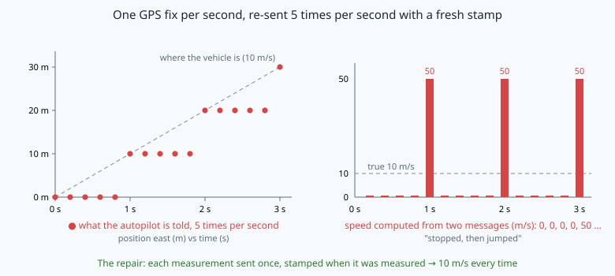
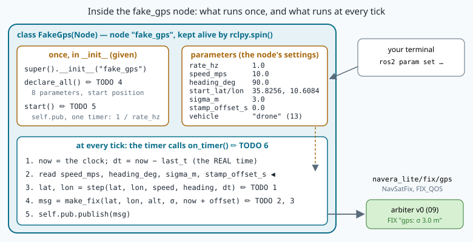

# Your first publisher: a fake GNSS receiver



> [!NOTE] Mission brief
> **NAVERA in ArduPilot's simulator (validation report, 2026-10-03).** NAVERA hands its position to an
> autopilot, here ArduPilot in simulation. The vehicle flies at a steady speed, yet the autopilot sees it
> **stop, then jump**, again and again. The cause: the same GPS fix was re-sent five times per second, each
> time with a **fresh time stamp**. The report gives no speeds; picture a vehicle at 10 m/s with one fix per
> second (the figure above): four messages say "still here, now" and the fifth says "10 m further, 0.2 s
> later", so a listener computes 0 m/s four times, then 50 m/s. NAVERA's code review of 2026-09-28 had found the same
> mistake inside its judge (backlog EST-1, critical); the output's version is OUT-3 (high). Both are fixed:
> every position is now published **once**, stamped with the instant it was **measured**. The same review
> found a missing accuracy that was **invented** (GPS-5), and a launch override typed `1` instead of `1.0`
> that crashed a node (LOC-30).
>
> Today you write the node where those bugs live: a **fake GNSS receiver**, NAVERA Lite's test GPS.
> **Session 1 — build:** a node with parameters, a timer and a publisher that moves a vehicle with the
> **real** time between ticks and states its accuracy honestly. **Session 2 — sabotage:** you feed it to the
> judge of mission 09, arbiter v0, with wrong stamps and missing accuracies, and find what the judge
> believes that it should not. Badges: **Builder**, then **Saboteur**.
>
> **Start now:** open the 🛠️ **Lab** tab, do **Step 0** (two minutes, no code), then come back for §1.

**Objectives.** After this mission you can:

1. **write** an rclpy node class with parameters, a timer and a publisher, and **explain** what `spin` does
   with your callbacks;
2. **integrate** motion with the real time between ticks, and **measure** a topic's rate and jitter;
3. **fill** a `sensor_msgs/NavSatFix` honestly: the stamp is the measurement instant, every number a float,
   variances in m², the type UNKNOWN when nothing is known;
4. **predict** how a judge reads your stamp and your covariance, and **find** where a naive judge is fooled.

**You need:** classes and `super()` (mission 03), `vehicle.ground_velocity` and `geo.offset` (missions 03 and
06), topics, QoS and the `ros2` command line (mission 09). ⏱ Reading: about 60 minutes with the ✏️ checks.
Lab: 2 h 30 to 4 h.

<details><summary>Three questions first (if you miss two, reread lesson 03 on classes, 06 on offset, 09 on QoS)</summary>

1. `class Camera(Sensor)` has its own `__init__` that starts with `super().__init__(name, rate_hz)`. What does
   that line do, and what is lost without it? — *It runs the parent's constructor, which checks and stores
   `name` and `rate_hz`. Without it, `Sensor.__init__` never runs: the object has no `self.name`.*
2. `geo.offset(lat, lon, 100.0, 0.0)` at the equator and at 60° N: which longitude change is larger? — *At
   60° N, twice as large: a degree of longitude is cos 60° = 0.5 times as long there.*
3. A publisher offers RELIABLE + VOLATILE; a subscriber asks BEST_EFFORT. Do they connect? — *Yes: what is
   offered is at least as good as what is asked. The other way round, they would not.*
</details>

<details><summary>Words of this lesson</summary>

| Word | Plain meaning | Français |
|---|---|---|
| **callback** | a function you give to ROS; ROS calls it later, when an event happens | fonction de rappel |
| **timer, period** | calls a callback again and again; the period is the time between calls, 1 / rate | minuterie, période |
| **jitter** | the random variation of the real time between two calls | gigue |
| **parameter** | a named, typed setting of a node, which you can change from outside | paramètre |
| **stamp** | `header.stamp`: the instant the content of the message was true | horodatage |
| **variance** | the square of a standard deviation σ; unit m² for a position | variance |
| **covariance type** | what the sender knows about its covariance: unknown, approximated, diagonal known, known | type de covariance |
| **nominal** | what was asked for (0.5 s), as opposed to what really happened (0.62 s) | nominal |
</details>

## 1. A node is an object

In mission 09 you ran nodes and repaired one line of a listener. Today you write a whole node. In rclpy, a
node is an object of a class that **inherits** from `rclpy.node.Node`. Here is a small one, not the lab's:
it publishes a heartbeat twice a second.

```python
import rclpy
from rclpy.node import Node
from std_msgs.msg import String


class Heartbeat(Node):                          # a Heartbeat IS a Node, plus what we add
    def __init__(self):
        super().__init__("heartbeat")           # Node's constructor: register the name in the graph
        self.count = 0                          # state, kept between two calls
        self.pub = self.create_publisher(String, "beat", 10)
        self.create_timer(0.5, self.on_timer)   # call self.on_timer every 0.5 s

    def on_timer(self):                         # a callback: ROS calls it, you never do
        self.count += 1
        self.pub.publish(String(data=f"beat {self.count}"))


def main():
    rclpy.init()                                # 1. start ROS in this process
    node = Heartbeat()                          # 2. build the node: __init__ runs once
    rclpy.spin(node)                            # 3. wait for events and run callbacks, until Ctrl+C
```

Read it with mission 03's words:

- `class Heartbeat(Node)` — inheritance. `Heartbeat` gets every method of `Node`: `create_publisher`,
  `create_timer`, `declare_parameter`, `get_parameter`, `get_clock`, `get_logger`…
- `super().__init__("heartbeat")` runs `Node`'s constructor. Without it the object is not a node, and the
  first `self.create_…` fails.
- `self.count` is an **attribute**: it lives as long as the object. A plain `count = 0` inside a method is
  forgotten when the method returns.
- `self.on_timer`, **without parentheses**, is the method itself, given to ROS as a **callback**.
  `self.on_timer()` would call it once, now, and give ROS its result, `None`.
- `create_publisher(String, "beat", 10)`: a plain `10` is the default QoS profile (mission 09); your receiver
  uses `qos.FIX_QOS`.

`rclpy.spin(node)` turns the program into an **event-driven** one. It does not run from top to bottom and
stop: it waits, and when a timer is due or a message arrives, it calls the right callback. All callbacks of
the node run **one after the other**, in one thread. So a slow callback delays every other one: §3 shows
what that does to a timer, and mission 11 to a subscriber.

In NAVERA Lite, every node's `main()` calls `runner.run_node(NodeClass)` (given in mission 09): it does
`rclpy.init`, builds the node, spins it, and closes it cleanly on Ctrl+C.



(Look at the white boxes: what runs once, the parameters, and what runs at every tick. The ✏️ marks are your six TODOs.)

> [!QUESTION] ✏️ Check
> 1. A student writes `self.create_timer(0.5, self.on_timer())`. What happens when the node starts?
> 2. Another writes `count = 0` in `__init__` and `count += 1` in `on_timer`. What happens at the first tick?

<details><summary>Answer</summary>
1. <code>on_timer</code> runs once, while the node is built (it publishes "beat 1" and returns <code>None</code>);
<code>create_timer</code> then gets <code>None</code> as its callback, and at the first tick the node dies
with <code>TypeError: 'NoneType' object is not callable</code>. Give the method, not its result.<br>
2. <code>UnboundLocalError: local variable 'count' referenced before assignment</code>: inside
<code>on_timer</code>, <code>count</code> is a new local variable. State that must survive between calls
lives in <code>self</code>.
</details>

## 2. Parameters: settings you can change from outside

A **parameter** is a named setting stored in a node. You **declare** it with a default value, and the type
comes from that default: `10.0` makes a double, `10` an integer, `"drone"` a string.

```python
self.declare_parameter("text", "beat")          # name, default → a string parameter
word = self.get_parameter("text").value         # the value in use NOW
```

The value can come from the command line when the node starts, and change while it runs:

```bash
python3 heartbeat.py --ros-args -p text:=pulse          # at start: overrides the default
ros2 param set /heartbeat text tick                     # while it runs
ros2 param list /heartbeat                              # every parameter of the node
```

**When you read matters.** A node that reads `text` inside `on_timer`, at every tick, follows a
`ros2 param set` at once. A node that reads it once, in `__init__`, never sees the change, although
`ros2 param set` answers "Set parameter successful". Your fake receiver reads its speed and heading at every
tick, so you can drive it from the terminal. It reads `rate_hz` once, to build its timer: changing it later
changes nothing (mission 13 makes it read-only, so the lie disappears).

> [!WARNING] The type trap (NAVERA's LOC-30)
> `-p speed_mps:=12` is an **integer**, and `speed_mps` was declared with `10.0`, a double. The node does not
> start: `InvalidParameterTypeException: Trying to set parameter 'speed_mps' to '12' of type 'INTEGER',
> expecting type 'DOUBLE'`. At run time, `ros2 param set /fake_gps speed_mps 20` answers
> `Setting parameter failed: Wrong parameter type, expected 'Type.DOUBLE' got 'Type.INTEGER'`. NAVERA had
> this bug: an override typed `conf_threshold:=1` on its launch command crashed a float parameter. Always
> write `12.0`.

> [!QUESTION] ✏️ Check
> Your node declares `speed_mps` = 10.0 and reads it at every tick, and `rate_hz` = 1.0, read once in
> `start()`. Which of these do what the user wants?
> (a) `--ros-args -p speed_mps:=15` · (b) `--ros-args -p speed_mps:=15.0` ·
> (c) `ros2 param set /fake_gps speed_mps 15.0` while it runs · (d) `ros2 param set /fake_gps rate_hz 5.0` while it runs

<details><summary>Answer</summary>
(b) and (c). (a) crashes at start (INTEGER vs DOUBLE). (d) answers "successful", but the timer was built with
the old rate and keeps it: a setting that is read once must not look changeable.
</details>

## 3. Time: stamps, timers and the real dt

**The stamp is part of the measurement.** A position without its instant is half a measurement: at 20 m/s,
a fix that is 2 s old is 40 m behind. The hook's forwarder stamped each message with the instant it **sent**
it, not the instant the position was **true**. A node reads ROS time with `self.get_clock().now()` (normally
the computer's clock, seconds since 1970); `now().nanoseconds * 1e-9` gives seconds as a float. A message
stores it as two integers, `header.stamp.sec` and `.nanosec`; `convert.s_to_stamp(t_s)` (mission 09) converts:
100.25 s → `sec=100, nanosec=250000000`.

**Timers are not perfect.** A timer of period T keeps its deadlines on a fixed grid (0, T, 2T, …), so the
average rate stays right. But each call starts a little late, by a different amount each time: that is
**jitter**. And when the computer is busy, deadlines are **missed and not made up**. Measured on the course's
Jetson (2026-10-13): a 0.5 s timer whose callback was blocked for 1.3 s was next called 1.303 s after the
blocked call started, then 0.197 s later, then every 0.500 s again. One tick was lost for good.


(Look at the two bottom rows: green follows the stamps, red falls behind after the busy call.)

> [!TIP] In one sentence
> Measure how much time REALLY passed since the last tick, and move the vehicle by speed × that time.

**So integrate with the real dt.** At each tick, measure the time since the previous tick on the same clock
as the stamp, and move the vehicle by speed × that time:

```
dt_k = t_k − t_(k−1)                    (0 at the first tick)
position_k = position_(k−1) moved by speed × dt_k on the heading
```

**Worked example.** A vehicle at 10 m/s, a 2 Hz timer, real intervals 0.50, 0.62, 0.41, 0.55 s. With the
real dt it has moved 10 × 2.08 = **20.8 m** at the stamp 2.08 s (the fifth call; the first one moves 0 m),
exactly where it was at that instant. A receiver that adds the **nominal** 0.5 s four times says **20.0 m**: 0.8 m behind its own stamp. Its
listener computes speeds of 5 / 0.50 = 10.0, 5 / 0.62 = 8.1, 5 / 0.41 = 12.2 and 5 / 0.55 = 9.1 m/s for a
vehicle that never changed speed.

**One step of motion** uses two parts you already have. A heading is measured clockwise from north (mission
03), so the velocity is east = v·sin h, north = v·cos h: that is `vehicle.ground_velocity(speed, heading)`.
Multiplied by dt, it gives metres east and north, and `geo.offset(lat, lon, e_m, n_m)` (mission 06, east
**first**) turns them into a new latitude and longitude. Example: 10 m/s, heading 90°, dt 0.62 s, from
(35.8256, 10.6084): velocity (10.0, 0.0) m/s, move (6.2, 0.0) m, and since one degree of longitude is
R·cos(35.8256°)·π/180 = 90 157 m there, the new position is (35.8256, 10.608469). This is lab TODO 1.

> [!TIP] 🧰 Standard deviation, in one line
> For intervals 0.5, 0.6, 0.4 s: mean 0.5; deviations 0, +0.1, −0.1; std = √((0 + 0.01 + 0.01) / 3) = 0.082 s.
> `ros2 topic hz` prints the mean rate and the std dev of the intervals. Mission 04 did this with numpy.

> [!QUESTION] ✏️ Check
> A receiver uses the nominal dt of 0.25 s (4 Hz) at 8 m/s. Its real intervals are 0.25, 0.40, 0.10 s. What
> speeds does a listener compute from consecutive fixes? Where is the vehicle really at the last stamp, and
> where does the receiver say it is?

<details><summary>Answer</summary>
Each fix moves 8 × 0.25 = 2 m: speeds 2 / 0.25 = 8.0, 2 / 0.40 = 5.0, 2 / 0.10 = 20.0 m/s. At the last stamp
(0.75 s after the first fix) the vehicle has flown 6.0 m; the receiver says 3 × 2 = 6 m too, by luck: the
lateness of the second tick cancelled. Nominal errors cancel when the timer catches up, but not when a tick is
lost, and every speed computed in between is wrong.
</details>

## 4. The message: an honest NavSatFix

Every GNSS driver in the ROS world publishes `sensor_msgs/msg/NavSatFix`
(`ros2 interface show sensor_msgs/msg/NavSatFix` prints it, with its constants):

| Field | Type | What you put in it |
|---|---|---|
| `header.stamp` | Time | the instant the position was **measured** (§3) |
| `header.frame_id` | string | the source: `"gps"` |
| `status.status` | int8 | `STATUS_NO_FIX` (−1), `STATUS_FIX` (0), `STATUS_SBAS_FIX` (1), `STATUS_GBAS_FIX` (2) |
| `status.service` | uint16 | which systems, as bits: `SERVICE_GPS` (1), GLONASS (2), COMPASS (4, BeiDou), GALILEO (8) |
| `latitude`, `longitude` | float64 | degrees, WGS84 (mission 06) |
| `altitude` | float64 | metres above the WGS84 **ellipsoid**, not above the sea (mission 06) |
| `position_covariance` | float64[9] | the uncertainty, m², ENU, row-major (below) |
| `position_covariance_type` | uint8 | `UNKNOWN` (0), `APPROXIMATED` (1), `DIAGONAL_KNOWN` (2), `KNOWN` (3) |

A message is filled like any object; a nested field takes two dots: `msg.status.status = NavSatStatus.STATUS_FIX`.
Every field starts at zero. Forget the position and it stays **(0.0, 0.0)**: a real point in the Gulf of
Guinea, nicknamed Null Island, and nothing warns you. Worse, `status.status` also starts at 0, and 0 is
`STATUS_FIX`: an empty NavSatFix claims a valid fix at (0, 0). An honest receiver always sets the status
itself (`STATUS_NO_FIX`, −1, when it has no position).

**Covariance.** A receiver says "here, give or take σ metres". σ is a **standard deviation**; its square σ²
is a **variance**, in m². The 3 × 3 covariance matrix of the (East, North, Up) error holds the three
variances on its diagonal and the links between directions elsewhere. NavSatFix stores it **row-major**: row
0, then row 1, then row 2, so the variances sit at indices **0, 4 and 8**:

```
| σE²  ·    ·   |     index  0  1  2
| ·    σN²  ·   |            3  4  5
| ·    ·    σU² |            6  7  8
```

**Worked example.** A receiver states σ = 2.5 m horizontally. NAVERA Lite's rule: σ² on East and North,
(2σ)² on Up (the vertical error of GNSS is typically 1.5 to 2 times the horizontal one; NAVERA Lite takes 2), 0.0 elsewhere:

```
position_covariance      = [6.25, 0.0, 0.0,   0.0, 6.25, 0.0,   0.0, 0.0, 25.0]
position_covariance_type = 1        # APPROXIMATED
```

Why APPROXIMATED and not DIAGONAL_KNOWN? A single stated σ is an approximation: nobody measured the three
variances, and the zeros only say "no link assumed". And when the receiver states **nothing**, the honest
message is nine `0.0` with type **UNKNOWN**, never a number you made up. A made-up σ looks exactly like a
measured one to everybody downstream (NAVERA's GPS-5).

> [!WARNING] ROS float fields refuse integers
> `msg.position_covariance = [6.25, 0, 0, 0, 6.25, 0, 0, 0, 25.0]` crashes with `AssertionError: The
> 'position_covariance' field must be a set or sequence with length 9 and each value of type 'float' and
> each double in [-1797693…`, then two numbers of 300 digits. Read only the start: **"each value of type
> 'float'"**. The same for `msg.latitude = 36`: write `float(lat)`. `3 ** 2` is the int 9; `3.0 ** 2` is 9.0.

> [!QUESTION] ✏️ Check
> A receiver states σ = 4 m. A colleague publishes `[4.0, 0, 0, 0, 4.0, 0, 0, 0, 8.0]` with type 2. Find
> four problems.

<details><summary>Answer</summary>
(1) 4.0 is σ, not the variance: 16.0 m². (2) Up must be (2σ)² = 64.0, not 8.0. (3) The zeros are ints: the
message refuses them (write 0.0). (4) Type 2, DIAGONAL_KNOWN, claims the variances were measured; a stated σ is
APPROXIMATED (1).
</details>

## 5. How a judge reads your fix

Your receiver is a **witness**; arbiter v0, which you ran in mission 09, is a **judge**. It listens on
`navera_lite/fix/gps` and decides on every arrival and five times per second. Its rules for GPS, in words:

- **Fresh?** The **age** is now − `header.stamp`. A GPS fix is usable while its age is at most
  `gps_timeout_s`, 3.0 s.
- **How precise?** From your covariance it takes a = index 0 and c = index 4, and σ = √max(a, c).
- **Which state?** FIX if σ ≤ `fix_max_sigma_m` (25 m), DEGRADED if σ is larger, NO_FIX when no source is
  usable. The reason is written in the status, for example `gps: σ 3.0 m`.
- (It also passes each GPS fix through mission 01's jump gate.)

**Worked example.** A fix arrives stamped 1.2 s ago, with `position_covariance[0]` = `[4]` = 16.0: age 1.2 ≤
3.0, fresh; σ = √16 = 4.0 m ≤ 25 m: **FIX**, reason `gps: σ 4.0 m`.

> [!QUESTION] ✏️ Check
> A fix arrives stamped 2.5 s ago with index 0 = 400.0 and index 4 = 100.0. State and reason? And 1 s later,
> if no new fix arrives?

<details><summary>Answer</summary>
σ = √max(400, 100) = 20.0 m, age 2.5 s: FIX, <code>gps: σ 20.0 m</code>. One second later the age is 3.5 s
&gt; 3.0 s: the fix is stale, and with no other source the judge says NO_FIX.
</details>

These rules look reasonable. In session 2 you turn the knobs of your own receiver (its stamp, its σ) and
check whether the judge believes things it should not. Predict first, from the rules above.

<details><summary>Read this after lab Step 9</summary>

Arbiter v0 never asks two questions. **Is the stamp in the future?** A negative age is "at most 3 s", so v0
calls it fresh, and keeps a dead receiver's last fix fresh for as long as you measured. **Does the covariance mean
anything?** Nine zeros with type UNKNOWN give σ = 0.0 m: v0 shows the most honest message, "I don't know my
accuracy", as a perfect FIX. NAVERA had the first hole (EST-2, "future timestamp kept a dead source fresh");
its judge now refuses a stamp more than 0.5 s in the future, and a fix with an all-zero covariance or an
undefined type is DEGRADED "uncertainty unknown" (validation report, 2026-10-03). And its jump gate (mission 01)
assumes that stamps only move forward: a fix stamped before the last trusted one gives a negative elapsed time,
and a reachable fix is refused. NAVERA once refused a late GPS fix as "possible spoofing"; it now drops a fix
stamped before the newest one as old news (validation report). In mission 12 you write
these checks yourself and plug them into arbiter v0 with `-p use_eligible:=true`.
</details>

> [!WARNING] Common wrong ideas
> - "The stamp is when I publish." It is when the content was true. Here they are the same instant only
>   because the fake receiver measures and publishes in the same callback.
> - "`ros2 param set` answered successful, so the node uses the new value." Only if the node reads it again.

## In NAVERA

NAVERA's GPS driver reads the receiver's NMEA sentences (mission 15) and publishes each fix **once**. Its
position message carries two instants: the measurement instant (for a GPS fix, the instant of the NMEA
sentence) and the publication instant, and the judge decides freshness on the first one (a fix of the
2026-09-28 review, EST-7). Altitude is above the ellipsoid and NaN when unknown (it was above sea level, and
0 when missing: GPS-4). An accuracy that is missing stays UNKNOWN (GPS-5). The GPS path was bench-tested with
scripted tests, a virtual serial port and simulated sensors (validation report, 2026-10-03): fake receivers,
like yours. Each position is published once (EST-1), and the output to the autopilot sends each position
once, stamped with its measurement instant (OUT-3).

## In NAVERA Lite

You write `navera_lite/ros/gps_node.py`, the node `fake_gps`: `step` (TODO 1), `covariance_from_sigma`
(TODO 2), `make_fix` (TODO 3) and three methods of `FakeGps` (TODO 4–6). It publishes on
`navera_lite/fix/gps`, a **relative** name (in the namespace `/drone` it becomes `/drone/navera_lite/fix/gps`).
Missions 11–13 subscribe to it, make the judge refuse your sabotage and check its parameters; mission 15
replaces the fake σ by one computed from HDOP.

## 🐦 How birds do it

A homing pigeon steers by the sun, and the sun's direction depends on the time of day: the bird needs a
correct clock. In classic clock-shift experiments, pigeons kept for days under lights switched on and off
6 hours early flew off about 90° away from home when released: a quarter of the sun's daily turn. Their
measurement (the sun's direction) was right; its time stamp was wrong, so the position they computed was
wrong. Your receiver's stamp matters for the same reason.

## Summary

1. A node is an object: state in `self`, callbacks given without `()`, and `spin` runs them one after the
   other.
2. Parameters are declared with a typed default and read when needed: read at every tick, they follow
   `ros2 param set`. A float is written `12.0`.
3. Timers jitter and lose ticks on a busy computer: integrate with the **real** dt, measured on the stamp's
   clock, so each fix is where the vehicle was at its stamp.
4. An honest NavSatFix: the measurement instant, floats, variances in m² at indices 0, 4, 8, type
   APPROXIMATED for a stated σ, UNKNOWN with zeros when nothing is stated.
5. A judge decides from your stamp and your covariance; a naive one can be fooled by both.

**Next mission:** the subscriber side, with a trip computer that refuses bad fixes and a watchdog that hears
silence.

## Check yourself

Answer without scrolling up.

<details><summary>1. Why does on_timer measure dt instead of using 1 / rate_hz?</summary>
The real interval varies (jitter) and a busy computer loses ticks. With the real dt each fix is where the
vehicle was at its stamp, and a listener computes the true speed.
</details>

<details><summary>2. Write position_covariance and its type for a stated σ of 0.8 m.</summary>
<code>[0.64, 0.0, 0.0, 0.0, 0.64, 0.0, 0.0, 0.0, 2.56]</code>, type 1 (APPROXIMATED).
</details>

<details><summary>3. The receiver states no accuracy. What do you publish, and why?</summary>
Nine 0.0 and type UNKNOWN (0): an invented σ would look like a measured one to every reader.
</details>

<details><summary>4. A node reads speed_mps once in __init__. You run ros2 param set … speed_mps 20.0. What happens?</summary>
"Set parameter successful", and the node keeps its old speed: it never reads the parameter again.
</details>

<details><summary>5. (Mission 06) geo.offset(lat, lon, 50.0, 0.0) at 60° N: how many degrees of longitude, roughly?</summary>
One degree of longitude is about 111 195 × cos 60° ≈ 55 600 m there, so about 0.0009°.
</details>

<details><summary>6. (Mission 01) GPS is 2 s old with σ 4 m, day vision is fresh with σ 30 m. Which source does NAVERA's arbiter use, in which state?</summary>
GPS: it is fresh (2 s ≤ 3 s) and first in priority; σ 4 m ≤ 25 m, so FIX.
</details>

Now open the **🛠️ Lab** tab.
