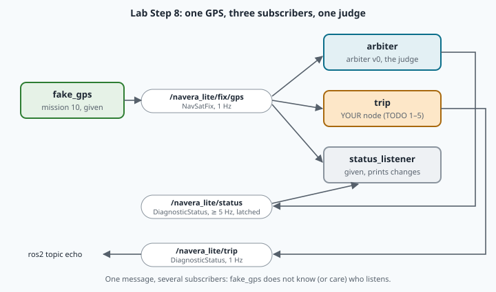

# Lab 11 — A trip computer that listens with memory

**Goal:** reproduce a real polling bug, write NAVERA Lite's trip computer (a subscriber that judges every
GPS fix, measures distance and speed, and notices silence), put it on the wire, overload a node on
purpose, and time how fast the judge notices a GPS that went silent.
**Time:** 2 h 30 to 3 h 30 (up to 4 h 30 if Python classes are still new to you).
**Fast track:** if Steps 1–3 take you under 30 minutes, do "A smarter odometer" from Going further after
Step 4.

Your files (📝 Code tab): [navera_lite/ros/trip_node.py](file:./navera_lite/ros/trip_node.py) (**your
code**: `TODO 1–5`), [answers.py](file:./answers.py) (predictions, results, explanations),
[run_trip.py](file:./run_trip.py) (runs your TODO 1–3 without ROS), [polling.py](file:./polling.py),
[blocking_demo.py](file:./blocking_demo.py), [status_listener.py](file:./status_listener.py) and
[bad_fixes.csv](file:./bad_fixes.csv) (given: you run them, you don't edit them).

| Lesson | Lab | You write |
|---|---|---|
| §6 On arrival, not by polling | Step 0 | nothing: you reproduce a bug |
| §3 Memory, stamps, refusals | Steps 1–2 | `TripComputer.update` (TODO 1) |
| §4 Speed and windows · §5 Silence | Steps 3–4 | `speed_window` (TODO 2), `Watchdog.silent` (TODO 3) |
| §1 Subscriptions | Steps 5–6 | `TripNode.listen` (TODO 4), `TripNode.on_fix` (TODO 5) |
| §2 Executors | Step 7 | nothing: you overload a node |
| §5 Silence, §6 the judge | Step 8 | nothing: you time the judge |

> [!NOTE]
> **Predict, then run.** Each `PREDICT_…` in `answers.py` is written **before** you run the step. It is
> never marked right or wrong; being wrong and finding out why is the point.

## Session 1 — Memory (about 1 h 30)

## Step 0 — Reproduce a real bug (no code)

[polling.py](file:./polling.py) replays the mission brief without ROS: 300 positions arrive at 5 Hz
with a little jitter (40 ms), and a messenger forwards them to an autopilot with a 5 Hz timer, always
"the newest position I have".

> [!TASK]
> **Predict** (`PREDICT_POLL`): the same rate on both sides. Will positions be lost, or sent twice?
> How many, roughly?

```bash
python3 polling.py
```

Read the counts, then the line `first ticks sent`: find the double and the loss (`#7(again) #9(#8 lost)`
is lesson §6's figure: #8 came late). Positions that come a little *early* give the mirror image, a loss then
a double; both are in the counts. Write `DROPPED_5HZ` and
`DOUBLED_5HZ`. Now take the jitter away (a perfect clock on the sender's side):

```bash
python3 polling.py --jitter-ms 0
```

Poll twice as fast, then forward on arrival:

```bash
python3 polling.py --poll-hz 10
```

```bash
python3 polling.py --mode arrival
```

> [!TASK]
> Write `DOUBLED_10HZ`, and `EXPLAIN_POLLING`: why does the bug need jitter, and why does forwarding on
> arrival remove it?

## Step 1 — The trip computer's judgement (TODO 1)

Open [navera_lite/ros/trip_node.py](file:./navera_lite/ros/trip_node.py). The class `TripComputer`
contains no ROS: it is the memory of the trip (`self.fixes`, `self.distance_m`, `self.refused`,
`self.last_refusal`). **TODO 1** `update(est)`: the four rules of lesson §3. Their order is yours to get
right: before you code, find a fix for which testing "jump" before "old fix" gives the wrong reason (lesson
§3 has one). And a question to think about: `guard.py` already has a finished `JumpGate` (mission 09); why
can the trip computer not simply use it? (Look at what it does with a late fix.)
`est` is an `Estimate` (given, mission 09): `est.valid`, `est.lat`, `est.lon`, `est.stamp_s`.

Already imported at the top of the file, finished: `is_finite_latlon(lat, lon)` (mission 06),
`enu_flat(lat0, lon0, lat, lon)` → (east, north) metres of the second point seen from the first,
`haversine_m(lat1, lon1, lat2, lon2)` and `gate_ok(last_xy, new_xy, elapsed_s, v_max_mps, margin_m)`
(mission 01's gate: two points in metres, True if accepted).

> [!TIP] 🧰 The last element, and a pair
> ```python
> runs = [(1.0, "a"), (2.5, "b")]
> t, name = runs[-1]          # [-1] is the LAST element; a tuple unpacks into two names
> print(t, name, len(runs))   # 2.5 b 2
> if not runs: ...            # an empty list counts as False: "no element yet"
> return False, "too late"    # a function can return a pair; the caller writes ok, why = f(...)
> ```

```bash
python3 run_trip.py test
```

The TODO 1 lines must all be ✔ (TODO 2 and 3 come in Step 3).

<details><summary>Stuck? Hints, one at a time</summary>

1. Shape: one `if … elif …` chain for the four refusals, in lesson §3's order. A refusal adds 1 to
   `self.refused`, keeps the reason in `self.last_refusal`, and returns at once. Only then: accept.
2. The gate needs two points in metres: the last accepted fix is the origin `(0.0, 0.0)`, the new fix is
   `enu_flat(lat0, lon0, est.lat, est.lon)` seen from it; the elapsed time is the difference of the stamps.
3. `(False, 'jump')` where `(False, 'old fix')` is expected: your gate test comes before the stamp test
   (lesson §3: a late fix behind the vehicle looks like a jump).
4. The 5 km fix gives `(True, 'ok')`: the gate compares the fix with itself, or you pass degrees
   instead of the metres of `enu_flat`.
5. `(True, 'ok')` for the very first fix: test `if not self.fixes` before you look at `self.fixes[-1]`.
6. Distance 5010 m, or 4 fixes remembered: a refused fix was appended or added; append and add only
   after every rule has passed.
7. `(True, 'ok')` for the fix with the SAME stamp as the last accepted one: "not newer" means `<=`, not `<`.
</details>

## Step 2 — Trace the lesson's plane

```bash
python3 run_trip.py trace
```

This is lesson §3's worked table (the plane at 75 m/s), judged by **your** code. Compare it with the
table row by row. Then compare it with your answer to the §3 ✏️ check: if you said "ok" for the fix at
250 m, look again at where the gate measures from.

## Step 3 — Speed over a window, and silence (TODO 2 and 3)

**TODO 2** `speed_window(fixes, window_s)` (lesson §4): the chord from the oldest fix inside the window
to the newest one. **TODO 3** `Watchdog.silent(now_s)` (lesson §5). Both docstrings give an example.

> [!TIP] 🧰 Keep only some elements of a list
> ```python
> temps = [(0, 12.5), (4, 13.0), (9, 15.5)]          # (hour, °C)
> late = [p for p in temps if p[0] >= 3]              # [(4, 13.0), (9, 15.5)]
> ```
> And remember: `return None` is a real answer when there is nothing to compute.

```bash
python3 run_trip.py test
```

<details><summary>Stuck? Hints, one at a time</summary>

1. TODO 2: the newest time is `fixes[-1][0]`; keep the fixes whose time is ≥ newest − `window_s`; with
   fewer than 2 of them, return `None`; otherwise distance (haversine) between the first and the last
   kept, divided by the difference of their times.
2. About 14.9 instead of 19.83 for the docstring example, or a number instead of `None` for "one fix in
   the window": you used the whole list, not only the fixes inside the window.
3. `ZeroDivisionError`: you divided with fewer than two fixes in the window.
4. TODO 3: `False` before any message? `self.last_s is None` means nothing ever came: that is silence.
5. `True` at exactly 3.0 s (13.0): the docstring says MORE than `silence_s`: `>`, not `>=`.
</details>

## Step 4 — A noisy drive

`run_trip.py drive` feeds your trip computer a 2-minute drive: east at 10 m/s for 60 s, then parked,
one fix per second, GPS noise σ = 3 m per axis (fixed random seed: everybody gets the same numbers). For
each fix it computes `speed_window` over 1 s (from one fix to the next) and over 10 s.

> [!TASK]
> **Predict** (`PREDICT_NOISE`): while cruising, what standard deviation do you expect for the speed over
> a 1 s window? Over a 10 s window? (Lesson §4.)

```bash
python3 run_trip.py drive
```

Open `out/drive.png`. Write `INSTANT_STD_MPS`, `WINDOW_STD_MPS`, `PARKED_INSTANT_MPS` and `LAG_S` (two
decimals are enough).

<details><summary>Read this after you ran it: why does a parked car show 5 m/s?</summary>
A speed is the <b>length</b> of a step, and a length is never negative. While parked, the true step is 0
and each noisy step has some length in a random direction: the average length is well above zero (for
this noise, about 1.25 × √2 × 3 m per second ≈ 5.3 m/s). While cruising, the same effect pushes the
fix-to-fix mean a little above 10 m/s. Mission 27 computes this bias properly. The odometer line shows the
same effect, added up at every fix: the trip computer "drives" while parked.
</details>

> [!TASK]
> `EXPLAIN_WINDOW`: what does the 10 s window buy, what does it cost (look at the stop in the picture),
> and which speed would you show to a driver?

> [!TIP] 🏅 End of session 1 — Trip computer
> Press **✔ Check my work**. When the checks of TODO 1–3, Step 0 and Step 4 pass, you earn the **Trip
> computer** badge. The other ✘ lines belong to session 2. If the class session ends here, stop here.

## Session 2 — On the wire (about 1 h 45)

Session 2 runs several nodes at once, all in **one terminal**: each node runs in the background with `&`,
and its messages go to a log file that you read with `cat` or `tail` (mission 09 worked the same way).

<details><summary>🧰 Several programs in one terminal (open it if <code>&amp;</code> and <code>jobs</code> are new to you)</summary>

```
python3 -m http.server 8000 > web.log 2>&1 &      # & = in the background; its output goes into web.log
jobs                                              # [1]+  Running   python3 -m http.server 8000 > web.log 2>&1 &
tail -n 3 web.log                                 # the last 3 lines it wrote
kill -INT %%                                      # Ctrl+C for the most recent background job (the + line)
kill -INT $(jobs -p); sleep 1; jobs               # Ctrl+C for ALL your background jobs, then check
```

A background program cannot read your keyboard, so `Ctrl+C` does not reach it: use `kill -INT`. Before you
start a node, run `jobs`: never leave two copies of the same node running.
</details>

After starting a node, wait about 2 s before you look at it with `ros2`: discovery takes a moment (mission 09).

## Step 5 — The node listens (TODO 4 and 5)

**TODO 4** `TripNode.listen()`: one subscription (lesson §1), kept in `self.sub`. **TODO 5**
`TripNode.on_fix(msg)`: the callback. It has the least help: read its docstring and lesson §1, §3 and §5,
then decide what it must do.

> [!TIP] 🧰 Two node tools
> ```python
> self.get_logger().warn(f"pump {name} stopped: {why}")   # a [WARN] line in the node's log
> e = from_navsatfix(msg, source="gps", now_s=self.now_s())  # a NavSatFix → an Estimate (given, convert.py)
> ```

Start your trip node first, in the background:

```bash
python3 -m navera_lite.ros.trip_node > trip.log 2>&1 &
```

Wait 2 s and read its log: no fix has come yet, so it says `GPS silent` (your TODO 3 at work).

```bash
cat trip.log
```

Now the fake GPS of mission 10 (finished), also in the background:

```bash
python3 -m navera_lite.ros.gps_node > gps.log 2>&1 &
```

Is your node subscribed? (Look under `Subscribers:`.)

```bash
ros2 node info /trip
```

And what does it say? (`--once` prints one message; the type is given so that it waits for the node.)

```bash
ros2 topic echo /navera_lite/trip diagnostic_msgs/msg/DiagnosticStatus --once
```

Run the echo a few times: `fixes` and `distance_m` grow, `speed_mps` settles near the fake GPS's 10 m/s,
`silent` is `false`. `cat trip.log` again: `GPS talking`. Stop both nodes:

```bash
kill -INT $(jobs -p); sleep 1; jobs
```

<details><summary>Stuck? Hints, one at a time</summary>

1. `NotImplementedError: TODO 4` in trip.log: `listen()` is still the stub. Its four arguments are those of
   lesson §1; the callback is `self.on_fix`, **without** parentheses.
2. The node starts, then dies at the first fix with `TODO 5`: write `on_fix`.
3. `AttributeError: 'NavSatFix' object has no attribute 'valid'` (or `'stamp_s'`): `update()` wants an
   `Estimate`; convert the message first.
4. `fixes` stays `'0'`: is the topic name exactly `navera_lite/fix/gps`? `ros2 node info /trip` shows
   what you subscribed to.
5. `silent` stays `'true'` while fixes come in: the watchdog is never kicked.
</details>

## Step 6 — Bad fixes on the wire

Open [bad_fixes.csv](file:./bad_fixes.csv): a 20-second scenario of GPS fixes for the replay node of
mission 09 (one row per second; `valid` 0 = no position; `delay_s` = how old the measurement already is
when it is sent).

> [!TASK]
> **Predict** (`PREDICT_TRIP`): which rows will your trip computer refuse, and why? How many fixes
> accepted, how many refused, the last reason?

Your trip node again (a fresh start, so an empty memory), then the scenario, played once:

```bash
python3 -m navera_lite.ros.trip_node > trip.log 2>&1 &
```

```bash
python3 -m navera_lite.ros.replay_node --ros-args -p file:=bad_fixes.csv -p loop:=false > replay.log 2>&1 &
```

The replay waits 3 s (so that your node has discovered it: a VOLATILE subscriber never gets a message sent
before the two were matched), then plays 20 rows, one per second. Wait until `replay.log` says `scenario
finished` (about 25 s; `cat replay.log` to see), then read the warnings and the trip:

```bash
grep WARN trip.log
```

```bash
ros2 topic echo /navera_lite/trip diagnostic_msgs/msg/DiagnosticStatus --once
```

> [!TASK]
> Write `TRIP_FIXES`, `TRIP_REFUSED`, `TRIP_LAST_REFUSAL` and `TRIP_DISTANCE_M`. Then stop both nodes
> (`kill -INT $(jobs -p); sleep 1; jobs`).

## Step 7 — A blocking callback

[blocking_demo.py](file:./blocking_demo.py) is a node with a 10 Hz timer and a fix callback that works
for 0.3 s. It listens for 10 s, reports the timer's longest gap and how old the fixes were when their
callback started, and adds each run to `out/blocking.json` (the check compares your answers with it).

A GPS at 5 Hz, in the background:

```bash
python3 -m navera_lite.ros.gps_node --ros-args -p rate_hz:=5.0 > gps.log 2>&1 &
```

> [!TASK]
> **Predict** (`PREDICT_BLOCKING`, lesson §2): one thread, fixes every 0.2 s, 0.3 s of work each. The
> timer's longest gap? Will the fixes be handled on time, and if not, how old will they get (FIX_QOS:
> depth 10)? And with two threads and two groups?

Then, one after the other (each run takes 10 s):

```bash
python3 blocking_demo.py single
```

```bash
python3 blocking_demo.py multi
```

```bash
python3 blocking_demo.py shared
```

```bash
python3 blocking_demo.py single --work 0.1
```

(`single --work 0.1`: ρ = 0.5, every fix is handled at once (age 0.00 s), yet the timer can still wait up
to one callback: its longest gap is a little more than its 100 ms period.)

> [!TASK]
> Write `GAP_SINGLE_MS`, `GAP_MULTI_MS` and `AGE_MULTI_S` (the `max` age of the `multi` run), and
> `EXPLAIN_BLOCKING`: why does `multi` rescue the timer but not the fixes, and what did `shared` show?
> Stop the GPS: `kill -INT %%`.

## Step 8 — The judge notices a silent GPS



Run `jobs` first: nothing should be running. Then start the judge, the status listener (given; read its
`on_status`: a second subscriber with memory), your trip node, and last the GPS:

```bash
python3 -m navera_lite.ros.arbiter_v0 --ros-args --params-file navera_lite.yaml > arbiter.log 2>&1 &
```

```bash
python3 status_listener.py > listener.log 2>&1 &
```

```bash
python3 -m navera_lite.ros.trip_node > trip.log 2>&1 &
```

```bash
python3 -m navera_lite.ros.gps_node > gps.log 2>&1 &
```

Wait 3 s, then:

```bash
cat listener.log
```

It ends with `FIX | source: gps | gps: σ 3.0 m`.

> [!TASK]
> **Predict** (`PREDICT_SILENCE`): `gps_timeout_s` is 3.0 s and the judge also decides 5 times a second
> (`tick_hz` in `navera_lite.yaml`). How long after the stamp of the last fix will it say NO_FIX?

Stop the GPS (it is your most recent job), wait 5 s, and read the listener's last lines:

```bash
kill -INT %%
```

```bash
tail -n 2 listener.log
```

A `NO_FIX` line, then `GPS silent for … s` (also added to `out/silence.json`). Start the GPS again with the
same command as above, wait for `FIX` **and then about 5 s more**, stop it again, read again. Do it **three
times** in all. Then compare the judge's NO_FIX times with your trip node's `GPS silent` times (the number in
brackets on each log line is the time in seconds):

```bash
grep -h "NO_FIX\|GPS silent" listener.log trip.log
```

> [!TASK]
> Write `SILENCE_S` (your values, a list) and `EXPLAIN_SILENCE`: where do these numbers come from, and
> why does your trip node *usually* say "GPS silent" later than the judge (by up to about 1 s)?

<details><summary>Read this after you measured: the two watchdogs</summary>
The judge: 3.0 s after the <b>stamp</b> of the last fix, checked 5 times a second → 3.0 to 3.2 s (measured
while building this lab: 3.08, 3.02, 3.16 s). Your trip node: 3.0 s after the <b>arrival</b> of the last fix
(<code>self.now_s()</code> in <code>on_fix</code>), checked once a second → 3.0 to 4.0 s after it; in the same
runs it logged "GPS silent" 0.5 to 0.9 s after the judge's NO_FIX. When its 1 Hz tick falls just after 3.0 s,
it can even come a few hundredths of a second <i>before</i> the judge: both answers are right if you explain them.
</details>

**Stop everything,** then check that nothing is left (a judge left running would disturb the next
missions — mission 09: two judges):

```bash
kill -INT $(jobs -p); sleep 1; jobs
```

## Step 9 — Check, then look back

Press **✔ Check my work**. It tests your TODOs on fixes they have never seen, starts your trip node and
feeds it a scenario of its own, then reads your answers. It takes about 50 s. When every check passes,
you earn the **Watchdog** badge. Then look back, without the lesson:

1. Explain to a friend, in three sentences, why an autopilot refused to arm although every position was
   right.
2. Your trip node checks its watchdog once a second. What would you change so that it says "silent" as
   fast as the judge, and what does that cost?
3. Which of your predictions was the most wrong, and why?

## Going further (optional)

- **A smarter odometer.** Your odometer added far more than the 600 m really driven (Step 4). Change a copy of the
  drive so that `distance_m` only grows by the chord of a 10 s window, once per window. How close to
  600 m do you get, and what do you lose in a turn?
- **Arrival vs stamp.** In `on_fix`, log `self.now_s() - e.stamp_s` (the age of each fix on arrival).
  Run `gps_node` with `-p stamp_offset_s:=-0.8` (each fix 0.8 s old when sent): what does your trip
  computer do, and what would it do with arrival times instead of stamps?
- **The age, exactly.** Once the queue is full, derive the age of a fix when its callback starts, from depth, T and S,
  and compare with the max age of Step 7 (1.97–1.99 s). Which detail of the queue decides the last 0.1 s?
- **Reentrant.** In a copy of `blocking_demo.py`, put the subscription in a `ReentrantCallbackGroup` with
  3 threads. How old are the fixes now? Then imagine `self.count += 1` inside `on_fix`: what can go
  wrong when two copies run at once?
