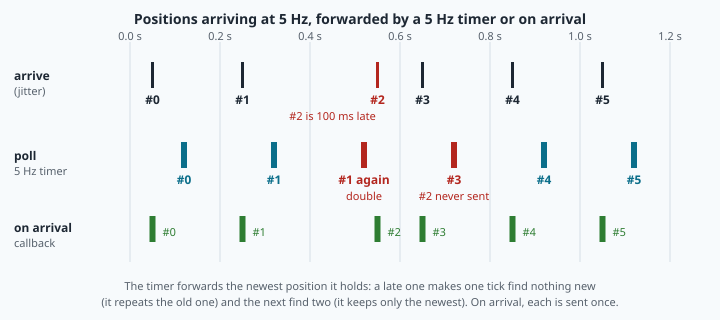
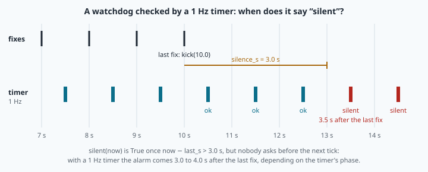

# Subscribers, callbacks and executors: listening with memory



> [!NOTE] Mission brief
> **Autumn 2026, NAVERA's simulation bench.** An ArduPilot autopilot (in simulation, SITL) takes its
> position only from NAVERA. The positions NAVERA computed were right. Yet the autopilot reports
> **"GPS not healthy"** and refuses to arm. The cause is not in the maths. The messenger that hands
> positions to the autopilot read them with a **5 Hz timer**, while they **arrived** at about 5 Hz: now
> and then one position was sent twice and the next one never. The judge had a cousin of the same bug:
> it decided only on its own 5 Hz tick, so a decision came up to 200 ms late, and when two measurements
> arrived between two ticks, one was skipped. Both now act **on arrival**. (NAVERA's engineering
> backlog, items OUT-5 and EST-13, fixed before the validation report of 3 October 2026.)
>
> A program that listens is harder to write than one that talks. Today you are the engineer who
> builds the listening side. **Session 1 — Memory:** you reproduce the bug in Step 0 (no code), then
> write a trip computer that judges every GPS fix, remembers the good ones and measures a speed that
> noise cannot fool. **Session 2 — On the wire:** your trip computer becomes a ROS 2 node, you overload
> a node on purpose, and you time how fast a judge notices that the GPS has gone silent. Badges:
> **Trip computer**, then **Watchdog**.

**Objectives.** After this mission you can:

1. write a **subscriber with memory**: a callback that judges each message by its **stamp**, refuses
   a bad fix with the reason, and keeps what it needs between calls;
2. predict the noise of a **speed computed from positions**, and choose a **window** knowing what it
   costs;
3. detect **silence** with a timer (a **watchdog**), and predict how late the alarm comes;
4. explain what an **executor** does with a slow callback, and why acting **on arrival** beats
   **polling**.

**You need:** mission 10 (a node with a timer and a publisher), mission 09 (topics, QoS), mission 06
(`haversine_m`, `enu_flat`) and mission 01's jump gate. ⏱ Reading: about 60 minutes with the checks.
Lab: 2 h 30 to 3 h 30.

<details><summary>Before you start: three questions on earlier missions (if you miss two, reread mission 10 §3 and mission 09 §4)</summary>

1. Your fake GPS (mission 10) moves the vehicle by `speed × dt` at each tick. Why the **real** time
   since the previous tick, and not `1 / rate_hz`? — *Ticks are not exactly on time (0.50, 0.62,
   0.41 … s); with the nominal period, every late tick loses distance and the position drifts.*
2. A publisher offers RELIABLE, a subscriber requests BEST_EFFORT. Do they connect? — *Yes: the offer
   is at least as good as the request. The reverse pair does not connect.*
3. Write mission 01's jump gate rule. — *Refuse a fix farther from the last **trusted** fix than
   `v_max × elapsed + margin` (NAVERA's defaults: 100 m/s and 50 m).*
</details>

<details><summary>How to study, and the words of this lesson</summary>

Read a section, do its ✏️ check on paper before you open the answer, then go on. The lab follows the
same order. Your files are in `~/lessons/11-subscriber/`; the part you write is
[navera_lite/ros/trip_node.py](file:./navera_lite/ros/trip_node.py).

| Word | Meaning | Français |
|---|---|---|
| **subscription** | a node's request to receive the messages of one topic | abonnement |
| **callback** | your function that ROS calls once for each message (or each timer tick) | fonction de rappel |
| **queue (depth)** | received messages waiting for their callback; beyond `depth`, the oldest are dropped | file d'attente (profondeur) |
| **executor** | the loop inside `rclpy.spin()` that decides which callback runs, and when | exécuteur |
| **thread** | one line of execution: one thing done at a time | fil d'exécution |
| **callback group** | a rule saying which callbacks may run at the same time | groupe de callbacks |
| **state** | what a node remembers between two callbacks (`self.…`) | état |
| **stamp** | `header.stamp`: when the measurement was made, not when it arrived | horodatage |
| **window** | the recent messages used together for one result | fenêtre |
| **watchdog** | a timer that raises an alarm when nothing has come for too long | chien de garde |
| **polling** | asking "anything new?" at fixed times instead of reacting when it comes | scrutation |
</details>

## 1. A subscription calls you

In mission 10 you published fixes on `navera_lite/fix/gps`. To receive them, a node creates a
**subscription**:

```python
self.sub = self.create_subscription(NavSatFix, "navera_lite/fix/gps", self.on_fix, FIX_QOS)

def on_fix(self, msg):          # called by ROS, once per message, with the message
    ...
```

Four arguments: the **message type** (it must be the publisher's type, or the two never match), the
**topic**, the **callback**, and the **QoS** (mission 09: `FIX_QOS` is RELIABLE, VOLATILE, depth 10).
The callback is passed **without parentheses**: you give ROS the function, and ROS calls it later.

> [!TIP] 🧰 A function is a value
> ```python
> def shout(text):
>     return text.upper() + "!"
> f = shout              # no parentheses: f IS the function, nothing runs yet
> print(f("hello"))      # HELLO!   — now it runs
> ```
> `self.on_fix` is the same idea for a method: the function, already tied to your object (`self`).
> `self.on_fix()` with parentheses would call it **now**, with no message, and crash with
> `TypeError: on_fix() missing 1 required positional argument: 'msg'`.

You never call `on_fix` yourself. When a message arrives, the middleware stores it in the
subscription's **queue** (at most `depth` messages; when it is full, the **oldest** is dropped).
Later, the **executor** takes it out and calls your callback with it. This is **event-driven**
programming: your code reacts to events instead of running from top to bottom. A consequence: the
callback runs when the executor gets to it, which is not always the moment the message arrived (§2).

One message can have many subscribers: the publisher sends it once and does not know who listens.
In the lab, your fake GPS feeds the judge, your trip computer and a listener at the same time.

> [!QUESTION] ✏️ Check
> A subscription with depth 10 receives 4 fixes per second, but its callback is never called (the
> program is stuck elsewhere). After 5 seconds, which fixes are in the queue?

<details><summary>Answer</summary>
20 fixes arrived; the queue keeps the <b>10 newest</b>, those of the last 2.5 s. The 10 oldest were dropped.
Nobody is told: a full queue loses data silently.
</details>

## 2. The executor: one thread, one callback at a time

`rclpy.spin(node)` is a loop, the **executor**: it waits until something is ready (a timer is due, a
message is in a queue), runs the ready callback, and waits again. The default one is a
`SingleThreadedExecutor`: one **thread**.

> [!TIP] 🧰 What a thread is
> Picture a kitchen with **one cook**. Orders (callbacks) come in; the cook prepares them one after
> the other. While the cook spends 20 minutes on a cake, the coffee orders wait. A **thread** is one
> cook: one line of work, one thing at a time. A second cook (a second thread) helps only if the rules
> of the kitchen allow both to work at once. Where the picture stops being right: in Python, two
> threads really run at the same time only while one of them *waits* (`time.sleep`, the network, a C
> library such as OpenCV); two threads doing pure-Python arithmetic take turns.

**Worked example.** Fixes arrive at 2 Hz (every T = 0.5 s) and each callback works for S = 0.3 s (think
of image matching). A 10 Hz timer (a control loop) shares the node.


- With one thread, the timer due at 0.1 s cannot start before 0.3 s, when the callback ends. Ticks
  are late or lost; the longest gap is 0.3 s instead of 0.1 s. (When a tick and a fix are ready at the
  same moment, as at 0.5 s, rclpy's executor runs the timer first.)
- The **utilisation** ρ = S / T = 0.3 / 0.5 = 0.6: the thread is busy 60 % of the time. That is still
  sustainable: every fix is handled before the next one comes.
- Make the work S = 0.6 s: ρ = 1.2 > 1. Fixes come faster than they are handled. The queue grows by
  1/T − 1/S = 2 − 1.67 = 0.33 fix per second (1/T = fixes that **come** per second; 1/S = fixes the
  thread can **finish** per second, 1/0.6 ≈ 1.67; the difference piles up), so a depth-10 queue is full after about 30 s. From then
  on, the queue always holds the 10 newest fixes, and the callback takes the oldest of them: it works
  on a fix that is about **depth × T = 10 × 0.5 = 5 s old**, and the others are dropped.

**More threads.** `MultiThreadedExecutor(num_threads=2)` has two cooks. But every callback of a node
belongs, by default, to the node's one **mutually exclusive callback group**: its callbacks never run
at the same time. Two threads alone change nothing; you must also put the timer and the subscription
in **two different groups** (`MutuallyExclusiveCallbackGroup()` each). Then the timer runs on time on
the free thread. Note what threads do **not** do: the fix callback is still one callback in its own
exclusive group. If ρ > 1 it stays overloaded, threads or not. The real cures are a shorter callback,
fewer messages, or the heavy work moved out of the callback.

> [!QUESTION] ✏️ Check
> 1. A colleague uses a MultiThreadedExecutor with 4 threads, and the timer still waits for the slow
>    callback. What did they forget?
> 2. Fixes at 10 Hz, 0.15 s of work each, depth 10. Is the node keeping up? If not, how old is a fix
>    when its callback finally starts, once the queue is full?

<details><summary>Answer</summary>
1. The callback groups: both callbacks are still in the node's default mutually exclusive group, so
they never run at the same time, whatever the number of threads.<br>
2. ρ = 0.15 / 0.1 = 1.5 &gt; 1: no. Once the queue is full, about 10 × 0.1 = 1 s old, and one fix in
three is dropped (10 come per second, about 6.7 are handled). (× T, not × S: the queue holds the 10 newest
fixes, which <b>arrived</b> 0.1 s apart, so the oldest of them came about 10 × 0.1 s ago.)
</details>

## 3. Memory: judge each fix, by its stamp

A local variable inside a callback is born at each call and forgotten at the end. To remember
something between messages, store it in the object: `self.fixes`, `self.distance_m`. What a node
remembers is its **state**. Keep the state and the logic in a small **plain class with no ROS
inside**, and keep the node thin: the callback converts the message and calls the plain class. The
plain class can then be tested with one line of Python, no node, no topic. In the lab, the plain class
is `TripComputer` and the node is `TripNode`.

**Which time? The stamp.** Two fixes measured 1.0 s apart may *arrive* 0.2 s apart after waiting in a
queue (§2). A speed computed with arrival times would be 5 times too high. Always use
`msg.header.stamp`, the instant of the measurement (`convert.stamp_to_s(msg.header.stamp)` gives
seconds as a float; `convert.from_navsatfix(msg)` makes an `Estimate` whose `stamp_s` is that time).

**Refuse before you remember.** Real data contains bad messages, and a subscriber must refuse them
**before** they touch the state. The trip computer applies four rules, in this order, and the first
rule broken gives the reason:

| Rule | Refuse when | Why it happens |
|---|---|---|
| no position | the source says so (`status −1`, `est.valid` False) | tunnel, jamming, receiver starting |
| bad position | NaN, ±∞, out of range, or exactly (0, 0) | a driver writes NaN for "unknown"; an unfilled field |
| old fix | its stamp is not newer than the last **accepted** fix | a late or repeated message (buffers, network) |
| jump | mission 01's gate refuses it, from the last accepted fix | a glitch, or a spoofer |

**Why "old fix" comes before "jump".** A plane flies at 75 m/s and sends one fix per second. The fix
measured at 1.2 s arrives late, after the one of 2.0 s has been accepted. It is 60 m *behind* the
last accepted fix. Tested by the gate first, with an elapsed time of 1.2 − 2.0 = −0.8 s (counted as
0), the allowed distance is only the 50 m margin: "jump", a **false spoofing alarm** against a
perfectly good GPS. Tested by its stamp first, it is simply "old fix": old news, ignored. NAVERA had
exactly this bug (see "In NAVERA").

**Worked example** — the plane, `TripComputer` with v_max 100 m/s and margin 50 m:

| Stamp | East (m) | Verdict | Why |
|---|---|---|---|
| 0.0 s | 0 | first fix | nothing to compare with |
| 1.0 s | 75 | ok | 75 m ≤ 100 × 1 + 50 |
| 2.0 s | 150 | ok | |
| 1.2 s | 90 | **old fix** | 1.2 ≤ 2.0 (not "jump", see above) |
| 3.0 s | — (valid False) | no position | |
| 4.0 s | 300 | ok | 150 m from the 2.0 s fix, in 2 s: ≤ 250 m |
| 5.0 s | 5 000 | jump | 4 700 m in 1 s |
| 6.0 s | 450 | ok | 150 m from the 4.0 s fix, in 2 s |

Distance: 450 m along 5 accepted fixes; 3 refused. A refused fix changes **nothing** except the
refusal counter: the gate keeps measuring from the last accepted fix.

> [!QUESTION] ✏️ Check
> Same rules and settings. Fixes (stamp, metres east): (10.0, 0), (11.0, 30), (11.0, 60), (12.5, 250),
> (13.0, 90). Give each verdict, the distance and the number refused.

<details><summary>Answer</summary>
first fix; ok; <b>old fix</b> (11.0 is not newer than 11.0); <b>jump</b> (220 m from the 11.0 s fix in
1.5 s, the gate allows 200 m); ok (60 m from the 11.0 s fix in 2.0 s). Distance 90 m, 2 refused.
If you said "ok" for 250 m, you measured from the refused fix at 60 m.
</details>

> [!WARNING] Common wrong ideas
> - "The callback runs when the message arrives." It runs when the executor gets to it; meanwhile
>   the message waits in the queue, and may even be dropped.
> - "Use `time.time()` in the callback for the speed." That is the arrival; use the stamp.
> - "A refused fix should still update `last`." Then one wild fix moves the reference, and the
>   good fixes after it look like jumps.
> - "More threads make a slow callback faster." They let *other* callbacks run meanwhile, and only if
>   the callback groups allow it.

## 4. Speed from noisy positions, and the price of a window

From two accepted fixes, speed = distance / (difference of stamps). Now add noise: each position is
off by an error of standard deviation σ, in east and in north, independent from fix to fix. The
difference of two positions carries both errors. Variances add (🧰 toolbox, Maths 5): the error of the
difference has a variance σ² + σ² = 2σ², so a standard deviation **√2·σ** per axis. Divided by the time
Δt between the fixes:

```
σ_v ≈ √2 · σ / Δt          (per axis; valid while the noise is small compared with the distance)
```

A speed is the **length** of the velocity vector, not one axis. For a vehicle driving east, that length
is almost the east component (the north noise only tilts the vector a little), so the speed's noise is
about the per-axis value. When the vehicle is parked there is no direction to follow, and the length of
a pure-noise step is biased upwards: you will see it in lab Step 4.

**Worked example:** σ = 5 m, fixes 1 s apart: σ_v ≈ 1.414 × 5 / 1 ≈ **7.1 m/s**. For a car at 10 m/s,
the speed read from one fix to the next is useless.

**The remedy is a longer baseline.** Use the fix of 10 s ago and the newest one: the chord between
them still carries the error of only **two** fixes, but over 10 s. σ_v ≈ 1.414 × 5 / 10 ≈ **0.71 m/s**.
That is `speed_window(fixes, window_s)` in the lab: the distance from the oldest fix inside the window
to the newest, divided by the time between their stamps.


**The price** is a **delay**. The window speed is the average of the last 10 s: when the vehicle
brakes, it needs about the length of the window to show the new speed. (A chord also cuts corners in
a turn, so it reads a little low there.) Every estimator trades noise against delay; mission 28's
Kalman filter makes that trade-off with a model.

> [!QUESTION] ✏️ Check
> A receiver gives 5 fixes per second with σ = 2 m. Estimate σ_v from one fix to the next, and over a
> 2 s window. Which one would you put on a dashboard, and what does the driver lose?

<details><summary>Answer</summary>
Fix to fix: Δt = 0.2 s, √2 × 2 / 0.2 ≈ 14.1 m/s (worse than at 1 Hz: more fixes, each step shorter).
Window 2 s: √2 × 2 / 2 ≈ 1.4 m/s. The window speed, at the cost of reacting about 2 s late.
</details>

## 5. Silence: a subscription cannot hear nothing

A callback only runs when a message **arrives**. If the receiver stops, nothing arrives and nothing
runs: a node with only a subscription cannot notice silence. The pattern is a **watchdog**: the
callback notes *when* the last message came (`kick(now)`), and a **timer** regularly asks whether
that is too long ago (`silent(now)`).

**Worked example.** The trip computer's watchdog has `silence_s = 3.0`, and its node checks it in a
**1 Hz** timer (the one that publishes the trip). The last fix arrives at 10.0 s.



`silent(now)` is True as soon as `now − 10.0 > 3.0`, but nobody asks before the next tick: here at
13.5 s, **3.5 s** after the last fix. Depending on the timer's phase, the alarm comes 3.0 to 4.0 s after
the last fix: the threshold plus up to one timer period. A faster timer gives a tighter alarm.

> [!QUESTION] ✏️ Check
> The same watchdog, but its timer runs at 4 Hz. Between which values does the alarm come? Why can't
> the callback itself raise the alarm?

<details><summary>Answer</summary>
Between 3.0 and 3.25 s after the last fix. The callback runs only when a message comes; during a silence
it never runs.
</details>

## 6. On arrival, not by polling

Back to the mission brief. Positions arrive about every 0.2 s, but never exactly: their arrival time
**jitters**. A messenger that **polls** with its own 5 Hz timer forwards "the newest position I have".


Follow #2 in the figure. It is 100 ms late, so it misses its tick: that tick finds nothing new and
sends #1 **again** (a double). The next tick finds #2 *and* #3, and sends only the newest: #2 is
**never sent** (a drop). A position that comes a little **early** gives the mirror image: one tick finds
two new ones (a drop), the next finds none (a double). Either way, one jitter across a tick costs one drop
and one double. To an autopilot, a repeated position looks like a vehicle that stopped, and
the next one like a jump: "GPS not healthy". With perfectly regular clocks this would never happen;
real clocks jitter and drift, so it happens, and only now and then, which is what makes it hard to
find.

The fix is the subscription itself: forward each position **in its callback, on arrival**. Each
position is sent once, as soon as it exists. A timer is still needed, but only for what a callback
cannot do: noticing silence (§5). NAVERA's judge now works this way: it decides on every arrival
**and** at least 5 times per second, the tick catching the moment a source goes stale.

> [!QUESTION] ✏️ Check
> Why not simply poll at 50 Hz?

<details><summary>Answer</summary>
Drops become rare and the delay shrinks to 20 ms, but most ticks now find nothing new: the old position
is sent ten times unless you also check "is it new?", and the node wakes up 50 times a second for
nothing. On arrival gives one send per position, at once, for free.
</details>

## In NAVERA

- **The judge decides on arrival and on a 5 Hz tick.** Until autumn 2026 it decided only on its tick:
  up to 200 ms of added delay, and a measurement skipped when two arrived between ticks (backlog item
  EST-13). The output to the autopilot polled at 5 Hz while positions arrived at 5 Hz, which dropped
  or doubled messages: in ArduPilot simulation the autopilot said "GPS not healthy" and refused to arm
  (OUT-5). Both now act on arrival.
- **Silence.** A GPS position is fresh for 3 s (`gps_timeout_s`). The 5 Hz tick notices when it goes
  stale; with no other source the state becomes NO_FIX, and an old position is never re-sent as new.
- **Old news.** NAVERA's validation report (updated 3 October 2026) lists the bench test "GPS fix
  0.8 s late, 60 m behind a vehicle at 75 m/s": *dropped as old news; GPS stays FIX* — before the fix
  it was "refused as possible spoofing". That is the order of the rules in §3.
- All these numbers come from the bench and from simulation. NAVERA is **Release 0.2 — field
  validation pending**.

## In NAVERA Lite

- [navera_lite/ros/trip_node.py](file:./navera_lite/ros/trip_node.py) is **yours** today:
  `TripComputer.update()` (§3), `speed_window()` (§4), `Watchdog.silent()` (§5), and the node's
  `listen()` and `on_fix()` (§1). It publishes `navera_lite/trip` once a second.
- `navera_lite/ros/arbiter_v0.py` (given, mission 09) is the judge: it subscribes to the four fix
  topics, decides on every arrival **and** at `tick_hz` (5 Hz in `navera_lite.yaml`), and publishes
  `navera_lite/status`. It calls a GPS position stale after `gps_timeout_s` = 3.0 s, by its stamp.
- `navera_lite/ros/gps_node.py` (your mission 10 node, given finished) is the GPS of the lab.

## 🐦 How birds do it

Red-breasted nuthatches **subscribe** to another species: they listen to the alarm calls of
chickadees, and they react more strongly to the calls that signal a more dangerous predator
(Templeton and Greene, *PNAS*, 2007). They read the value inside the message, not just its arrival.
And a good listener keeps memory: an alarm about a hawk that flew off ten minutes ago is old news.

## Summary

1. A subscription queues messages; the **executor** calls your callback later, one at a time per
   thread. A slow callback delays everything that shares its thread and group; at ρ > 1 the queue
   fills and the work is done on old data.
2. A subscriber **with memory** keeps its state in `self` (best: in a plain class), judges each
   message by its **stamp**, and refuses bad data *before* it touches the state — "old fix" before
   "jump".
3. A speed from two fixes has noise ≈ √2·σ/Δt: a longer **window** divides it, and costs a **delay**.
4. Only a **timer** can notice silence: the alarm comes after the threshold plus up to one period.
5. Act **on arrival**; use timers for what has no message. Polling at the same rate drops and
   doubles.

**Next mission:** the position contract — what a fix must contain to be trusted, and how a naive
judge can be fooled.

## Check yourself

Answer without scrolling up.

<details><summary>1. Your callback works for 0.3 s and fixes arrive at 4 Hz, depth 10. What happens over a minute?</summary>
ρ = 0.3 / 0.25 = 1.2 &gt; 1: the queue fills (4 come per second, 3.3 are handled), then the oldest are
dropped and each handled fix is about 10 × 0.25 = 2.5 s old.
</details>

<details><summary>2. Why must "old fix" be tested before "jump"?</summary>
A late fix measured behind the vehicle has a negative elapsed time: the gate allows only the margin and
calls it a jump (a false spoofing alarm). Its stamp shows it is simply old news.
</details>

<details><summary>3. σ = 4 m, one fix per second. σ_v fix to fix, and over 8 s?</summary>
√2 × 4 / 1 ≈ 5.7 m/s; √2 × 4 / 8 ≈ 0.71 m/s (and about 8 s of delay).
</details>

<details><summary>4. What does a watchdog need besides the subscription, and why?</summary>
A timer. Silence calls no callback; only a timer runs when nothing arrives.
</details>

<details><summary>5. (mission 09) The fake GPS publishes with FIX_QOS (RELIABLE). Can a subscriber that requests BEST_EFFORT read it?</summary>
Yes: a RELIABLE offer serves a BEST_EFFORT request. (A BEST_EFFORT offer cannot serve a RELIABLE request.)
</details>

<details><summary>6. (mission 01) The gate: v_max 100 m/s, margin 50 m. A fix 280 m from the last trusted one, 2 s later?</summary>
Allowed 100 × 2 + 50 = 250 m: refused.
</details>

Now open the **🛠️ Lab** tab.
