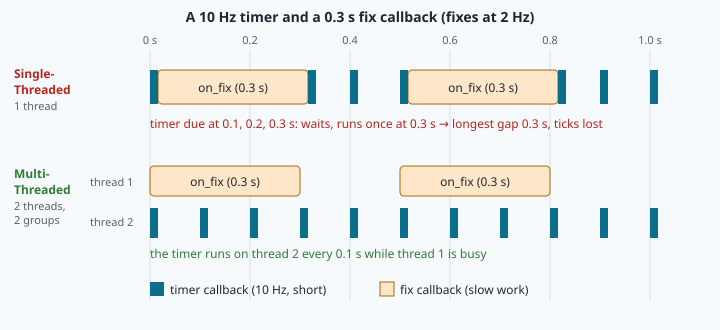
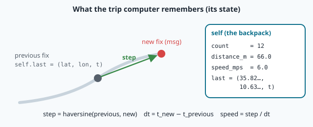

# Subscribers, callbacks and executors: listening with memory

> [!NOTE] In short
> - A **subscriber** runs a **callback** for every message; an **executor** decides when callbacks run.
> - You will learn how a node keeps **state** (memory) and refuses bad messages.
> - You will see why speed computed from noisy GNSS positions is wrong, and how a **window** fixes it.
> - You will learn why a node needs a **timer** to notice that a sensor went silent.
> - In the lab you build a trip computer, measure single- vs multi-threaded executors, and watch
>   NAVERA's real arbiter detect a lost GNSS.

In lesson 10 your fake receiver published its position into `/fake_gps/fix`. Publishing is half of
a conversation. The other half is harder: a **subscriber** must react to every message, **remember**
what came before, **refuse** bad data, and do it all without blocking the rest of the node. A trip
computer on the Muscat Expressway does not only show where you are: it shows how far you drove and
how fast — and to know your speed, it must remember where you were a moment ago, and how sure it
was.

This lesson covers the mechanics of subscriptions and callbacks, what an **executor** does with
them, how a node keeps **state** and filters messages, and what GNSS noise does to a speed computed
from positions. In the lab, your listener will also follow the decisions of NAVERA's real arbiter —
fed by a GNSS source that you will switch off.

## 1. Subscriptions and callbacks

```python
self.create_subscription(NavSatFix, "/fake_gps/fix", self.on_fix, qos_profile_sensor_data)

def on_fix(self, msg):              # called by ROS, once per message, with the message
    ...
```

Four arguments: the **message type** (it must equal the publisher's type, or the endpoints never
match), the **topic**, the **callback** (a bound method, without parentheses — lesson 10), and the
**QoS** (a depth or a profile). `qos_profile_sensor_data` is BEST_EFFORT with a small depth; as
lesson 09 showed, a BEST_EFFORT subscriber matches **both** RELIABLE and BEST_EFFORT publishers, so a
node that reads other people's sensors should use it. NAVERA does exactly that for an external GNSS.

You never call `on_fix` yourself. When a message arrives, the middleware stores it in the
subscription's queue (at most `depth` messages; the oldest are dropped when it is full). The
**executor** later takes it from the queue and calls your callback. That is **event-driven**
programming: the code reacts to events instead of running from top to bottom.

## 2. Executors: who runs the callbacks

An **executor** is the loop inside `rclpy.spin()`. Repeatedly, it waits until something is ready —
a timer expired, a message is in a queue, a service request arrived — then runs the ready callbacks.

- `SingleThreadedExecutor` (what `rclpy.spin(node)` uses): **one** thread. Callbacks run one after
  the other; while one runs, everything else waits.
- `MultiThreadedExecutor(num_threads=n)`: a pool of n threads; callbacks may run in parallel —
  but only if their **callback groups** allow it.

A **callback group** is a rule attached to callbacks:

| Group | Rule |
|---|---|
| `MutuallyExclusiveCallbackGroup` | callbacks of this group never run at the same time |
| `ReentrantCallbackGroup` | callbacks of this group may run in parallel, even the same one twice |

By default, every callback of a node belongs to the node's **one default mutually-exclusive group**.
So a `MultiThreadedExecutor` alone changes nothing: you must also put the callbacks that should run
in parallel into **different** groups.



### A worked example: utilisation and queues

A fix arrives every T = 0.5 s (2 Hz) and its callback takes S = 0.3 s (say, image matching). The
**utilisation** of the single thread is ρ = S / T = 0.6: busy 60 % of the time. A 10 Hz control timer
in the same thread will sometimes wait up to 0.3 s: its period jumps from 0.1 s to about 0.4 s,
and some ticks are simply lost.

If S grows to 0.6 s, ρ = 1.2 > 1: messages arrive faster than they are processed. The queue grows by
1/T − 1/S = 2 − 1.67 = 0.33 messages per second, so a depth-10 queue is full after about 30 s;
after that the oldest messages are **dropped**, and the node processes data that is 10 × 0.6 = 6 s
old. Rule: keep ρ well below 1, keep callbacks short, and move heavy work out of the way of
time-critical callbacks.

> [!NOTE]
> Python threads share one interpreter lock (the **GIL**). Two threads really run in parallel only
> while one of them waits (I/O, `time.sleep`, or a C library such as OpenCV or PyTorch that releases
> the lock). Pure-Python number crunching in two threads is not faster. And with a
> `ReentrantCallbackGroup`, two callbacks may modify the same attribute at the same time: protect
> shared state with a `threading.Lock`, or keep mutually-exclusive groups.

## 3. State: what a node remembers

A local variable inside a callback is created at each call and forgotten at the end. To remember,
store it in the object — `self.distance_m`, `self.last` — as you did with `self.count` in lesson 10.
What a node remembers between events is its **state**. A good design keeps the state and the logic
in a small **plain class with no ROS inside** (the lab's `Tracker`), and keeps the ROS node thin: it
unpacks each message and calls the plain class. The plain class can then be tested in one line of
Python, without any node or topic (lesson 14). NAVERA is built this way: `ros_gps_node.py` calls a
pure function `estimate_from_fix(m)` that has its own unit tests.

### Which time? The stamp, not the arrival

Compute times from the **message stamp** (`msg.header.stamp`, the measurement instant), never from
the arrival time. Two fixes measured 0.5 s apart may arrive 0.1 s apart after waiting in a queue
(section 2): with arrival times, the speed would be 5 times too large.

```python
t = msg.header.stamp.sec + msg.header.stamp.nanosec * 1e-9     # seconds, float
```

### Filtering: refuse what cannot be used

Real data contains bad messages, and a subscriber must refuse them **before** they touch its state:

| Problem | Test | Why it happens |
|---|---|---|
| no fix | `msg.status.status < 0` | receiver lost the satellites (tunnel, jamming) |
| not finite | `not math.isfinite(x)` | a driver writes NaN for "unknown" |
| Null Island | `lat == 0.0 and lon == 0.0` | a field nobody filled (lesson 10) |
| not newer | `t <= t_last` | a late or duplicated message (buffering, network reordering) |

The last rule protects the state: a fix older than the previous one would give a negative or zero
dt, and a speed of ±∞. Count the rejections by reason: a counter that grows tells an engineer more
than a silent drop.

## 4. Speed from positions, and what noise does to it

From two accepted fixes p₁ (at t₁) and p₂ (at t₂):

```
step = haversine(p1, p2)        dt = t2 − t1        v = step / dt
```

Now add GNSS noise. Each position has an error of standard deviation σ in east and in north,
independent from fix to fix. The difference of two positions then has an error of √2·σ per axis
(variances add: σ² + σ² = 2σ²). When the noise is small compared with the step, the speed error is
about

```
σ_v ≈ √2 · σ / dt
```

Worked example: σ = 3 m and dt = 0.5 s give σ_v ≈ 1.414 × 3 / 0.5 = **8.5 m/s** for a vehicle
driving at 6 m/s. The instantaneous speed is useless. Worse, here the noise (4.2 m per axis) is
larger than the true step (3 m), so the approximation breaks down and the result is also **biased**:
the length of a 2-D vector of pure noise has a mean of about 1.77 σ (a **Rayleigh distribution**:
for a 2-D Gaussian with σ' per axis, the mean length is σ'·√(π/2) ≈ 1.25 σ', and here σ' = √2·σ,
so 1.25 × 1.414 ≈ 1.77), so a
**parked** car would show 1.77 × 3 / 0.5 ≈ 10.6 m/s — 38 km/h — on average. The same bias makes a sum
of noisy steps much longer than the real path. The spread is also smaller than 8.5 m/s, because a
length cannot be negative (about 6 m/s in the lab — the lab explains why).

The remedy is to measure over a longer baseline. With a **window** of N fixes, use the straight
distance from the oldest to the newest fix divided by their time span (N − 1)·dt:

```
σ_v,window ≈ √2 · σ / ((N − 1) · dt)
```

For N = 10: √2 × 3 / 4.5 ≈ **0.94 m/s**. The price is **lag** (the value describes the last 4.5 s)
and **corner cutting** (the chord takes a short cut: in a turn, the chord is shorter than the arc). Every estimator chooses a
trade-off between noise and delay; the Kalman-style filters of lesson 26 make that choice
optimally. In the lab you will measure all of this with a seeded simulation.



## 5. Detecting silence

A subscription only runs when something **arrives**. If the GNSS receiver stops, no callback is
called at all — the node cannot notice silence with a subscription alone. The pattern is a
**subscription plus a timer**: the callback stores the last message; the timer regularly checks its
age. NAVERA's arbiter does exactly this: its callbacks store each estimate and call `_tick()`, and a
5 Hz timer also calls `_tick()`. A GNSS estimate older than `gps_timeout_s` (3 s) is **stale**; with
no other source, the state becomes `NO_FIX`. Because the timer runs at 5 Hz, the arbiter detects the
silence between 3.0 and about 3.2 s after the last fix was measured — a number you will measure.

## 🐦 How birds do it

Birds are good subscribers. In 2007, Christopher Templeton and Erick Greene showed in *PNAS* that
red-breasted nuthatches listen to (**eavesdrop** on) the alarm calls of chickadees, a different species, and
react more strongly to the calls that signal a more dangerous predator. They read the value inside
the message and decide what to do — a callback with state. In Muscat's gardens you can watch the same
behaviour: when one bird starts a harsh alarm at a cat or an owl, bulbuls and other small birds arrive
to attack the predator together (biologists call this **mobbing**).

Birds also filter. A good listener ignores old news: Navi does not panic about a cat that left ten
minutes ago (a **stale** message), and she does not count the same alarm twice when it echoes from a
wall (a **duplicate**). And she knows that one alarm call means little: several calls from different
birds over a few seconds — a **window** of evidence — are worth a reaction. That is the noise
trade-off of section 4, solved by evolution.

## In NAVERA

NAVERA's GNSS bridge, [ros_gps_node.py](file:navera/gps_pkg/gps_pkg/nodes/ros_gps_node.py), is a
subscriber whose callback publishes — a link in a chain. It reads any vehicle's `NavSatFix` with the
best-effort profile:

```python
self.declare_parameter("fix_topic", "/navera/vehicle/gps2")
topic = str(self.get_parameter("fix_topic").value)
self.pub_est = self.create_publisher(PositionEstimate, "/navera/estimate/gps", 10)
self.create_subscription(NavSatFix, topic, self._on_fix, qos_profile_sensor_data)
```

The arbiter's GNSS callback, in
[estimator_node.py](file:navera/navera_estimator/navera_estimator/nodes/estimator_node.py), applies
the "not newer" rule before it touches its state:

```python
def _on_gps(self, msg: PositionEstimate) -> None:
    # a fix stamped before the newest one received (link buffering, DDS reordering) is
    # old news: dropped — scored against the newer trusted fix with dt clamped to 0 it
    # looked like a jump ("possible spoofing") and refused a good GPS
    last = Time.from_msg(self._gps_last.header.stamp) if self._gps_last is not None else None
    if last is not None and Time.from_msg(msg.header.stamp) < last and \
            last <= self.get_clock().now() + Duration(seconds=0.5):   # a future stamp sets no order
        self.get_logger().info("GPS fix older than the last one received: dropped",
                               throttle_duration_sec=10.0)
        return
    self._gps_last = msg
    ...
    self._tick()
```

Read the comment: before this rule, a late fix was compared with a newer one, looked like an
impossible jump, and a good GNSS was refused as "possible spoofing". `docs/VALIDATION_STATUS.md`
records the bench test "GPS fix 0.8 s late, 60 m behind a vehicle at 75 m/s": "Dropped as old news;
GPS stays FIX". Filtering is not a detail.

The status the arbiter publishes, `NavStatus`, carries a `sources` list: one `SourceHealth` per
source with `alive`, `last_seen` (the stamp of its last message) and `contributing`. Your status
listener will compute "GPS silent for … s" from `header.stamp − last_seen`.

## Glossary

| Term | Meaning |
|---|---|
| **subscription / callback** | receives a topic's messages / the method ROS calls for each one |
| **queue depth** | how many received messages wait for the callback; the oldest are dropped beyond it |
| **executor** | the loop that waits for ready events and runs their callbacks |
| **Single / MultiThreadedExecutor** | one thread / a pool of threads |
| **callback group** | rule saying which callbacks may run in parallel (mutually exclusive, reentrant) |
| **utilisation ρ** | processing time ÷ time between messages; must stay below 1 |
| **GIL** | Python's interpreter lock: one thread runs Python code at a time |
| **state** | what a node remembers between events (`self.…`) |
| **filtering** | refusing unusable messages before they change the state |
| **stale / duplicate / out of order** | too old / sent twice / older than one already received |
| **Rayleigh bias** | the mean length of a noisy 2-D step is larger than the true step |
| **window, lag** | the last N samples used together / the delay this averaging introduces |

## Check what you learned

<details><summary>1. You use a MultiThreadedExecutor, but the timer still waits for the slow callback. Why?</summary>
Both callbacks are still in the node's default mutually-exclusive group: they can never run at the
same time, whatever the number of threads. Put them in two different groups.
</details>

<details><summary>2. Fixes arrive at 5 Hz and each callback takes 0.25 s. What is ρ, and what happens to a depth-10 queue?</summary>
ρ = 0.25 / 0.2 = 1.25 &gt; 1. The queue grows by 5 − 4 = 1 message per second, is full after about
10 s, then the oldest messages are dropped and the processed data is about 10 × 0.25 = 2.5 s old.
</details>

<details><summary>3. Why compute the speed with stamps rather than arrival times?</summary>
The stamps are the measurement instants. Arrival times include network and queue delays, which vary
from message to message and would make the speed jump.
</details>

<details><summary>4. σ = 2 m, fixes at 1 Hz. Estimate σ_v for consecutive fixes and for a window of 6 fixes.</summary>
Consecutive: √2 × 2 / 1 ≈ 2.8 m/s. Window of 6 (span 5 s): √2 × 2 / 5 ≈ 0.57 m/s (valid while the
noise is small compared with the distance travelled).
</details>

<details><summary>5. A node with only a subscription must report when the GNSS stops. Why can't it, and what is the fix?</summary>
Its callback is only called when a message arrives; silence calls nothing. Add a timer that checks
the age of the last message, as the arbiter's <code>_tick()</code> does.
</details>

Now open the **🛠️ Lab** tab.
