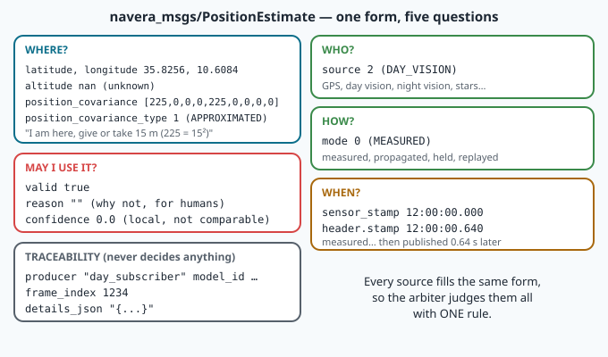
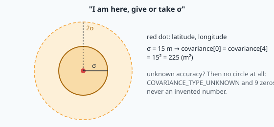
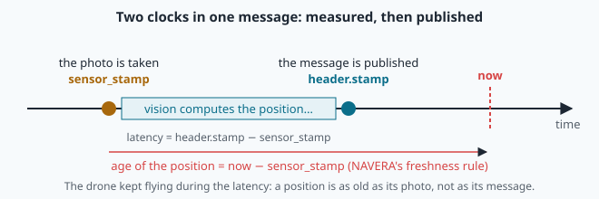

# The position contract: covariance, stamps and honest uncertainty

A drone flies over the Wahiba Sands. Its GNSS is jammed. Three NAVERA sources still produce positions:
day vision matched a photo against the satellite map 0.6 s ago, celestial navigation solved a star
field 20 s ago, and a dead-reckoned position is carried forward from the last good fix. Which one
should the autopilot follow — and how much should it trust it?

The arbiter can only answer if every source describes its position **the same way**: where, how
sure, measured when, by what method, and whether it is usable at all. NAVERA writes this agreement
down as one message type, `navera_msgs/msg/PositionEstimate`. Engineers call such an agreement a
**contract**: its format *and* the meaning of each field, which every producer must respect. This
lesson studies the contract in depth — above all the covariance matrix, the two time stamps and the
rules the arbiter applies — and in the lab you become a source and inject faults into the real
arbiter.

## 1. The form



| Question | Fields |
|---|---|
| **where?** | `latitude`, `longitude` (deg, WGS84), `altitude` (m above the ellipsoid, **NaN** if unknown) |
| **how sure?** | `position_covariance[9]` (m², ENU, row-major), `position_covariance_type` |
| **who?** | `source`: GPS 1, DAY_VISION 2, NIGHT_VISION 3, CELESTIAL 4, … |
| **how?** | `mode`: MEASURED 0, PROPAGATED 1, HELD 2, REPLAYED 3 |
| **usable?** | `valid`, `reason` (for humans), `confidence` (source-local, never compared) |
| **when?** | `sensor_stamp` (measurement), `header.stamp` (publication) |
| **traceability** | `producer`, `model_id`, `frame_index`, `details_json` |

The message file states two rules: (1) the **covariance** is the only quantity that may be fused or
compared mathematically across sources — `confidence` is not comparable; (2) **nothing may decide on
`details_json`** (or on `reason`): free text has no guaranteed format, so if a value matters for a
decision it must become a typed field.

**Unknown is NaN, never 0.** An altitude of `0.0` is a real altitude — sea level. `math.nan` ("not a
number") means "no value": every calculation with it gives NaN, and `math.nan == math.nan` is even
`False`; test it with `math.isnan(x)`.

## 2. The covariance matrix: what the nine numbers mean

The covariance describes the **error** e = (e_E, e_N, e_U) of the position, in metres, along East,
North and Up (**ENU**, a local frame tangent to the Earth at the position). It is the 3 × 3 matrix
Σ = E[e eᵀ]; the message stores it **row-major**:

```
position_covariance = [ Σ_EE, Σ_EN, Σ_EU,
                        Σ_NE, Σ_NN, Σ_NU,
                        Σ_UE, Σ_UN, Σ_UU ]        unit: m²
```

The diagonal holds the variances σ_E², σ_N², σ_U²; the off-diagonal terms say how the errors are
linked: Σ_EN = ρ σ_E σ_N, with the **correlation** ρ between −1 and 1. A real covariance matrix
always has two properties:

- **symmetric**: Σ_EN = Σ_NE, etc. (indices 1 and 3, 2 and 6, 5 and 7);
- **positive semi-definite (PSD)**: for every direction vector x, xᵀ Σ x ≥ 0. The reason is simple:
  xᵀ Σ x is the variance of the error projected on x, and a variance cannot be negative.

For the horizontal 2 × 2 block with a = Σ_EE, b = Σ_EN, c = Σ_NN, PSD is equivalent to

```
a ≥ 0,   c ≥ 0,   a·c − b² ≥ 0          (the determinant is not negative ⇔ |ρ| ≤ 1)
```

A matrix with b² > a·c would claim a correlation larger than 1: impossible, and a Kalman filter that
receives it can produce negative variances and diverge. This is why NAVERA's arbiter refuses such a
message entirely (section 6).

### Building a covariance from an error ellipse

Sources rarely make round errors. A vision fix taken while flying on heading h is often less precise
**along** the track than **across** it (motion blur, timing). Say σ_a along-track and σ_c across.
In a frame aligned with the track the covariance is diagonal, D = diag(σ_a², σ_c²). To express it in
(East, North), rotate it: with the along-track unit vector u = (sin h, cos h) and the cross-track
vector w = (cos h, −sin h) as the columns of R,

```
Σ = R · D · Rᵀ
Σ_EE = σ_a² sin²h + σ_c² cos²h
Σ_NN = σ_a² cos²h + σ_c² sin²h
Σ_EN = (σ_a² − σ_c²) · sin h · cos h
```

**Worked example** (the lab's default source): σ_a = 15 m, σ_c = 6 m, h = 30°, so σ_a² = 225,
σ_c² = 36, sin 30° = 0.5, cos 30° = 0.8660:

```
Σ_EE = 225 × 0.25 + 36 × 0.75 = 56.25 + 27.00 =  83.25 m²
Σ_NN = 225 × 0.75 + 36 × 0.25 = 168.75 +  9.00 = 177.75 m²
Σ_EN = (225 − 36) × 0.5 × 0.8660                =  81.84 m²
check: det = 83.25 × 177.75 − 81.84² = 8100 = (15 × 6)²    ✔ (a rotation keeps the determinant)
```

### From a covariance back to the ellipse: eigenvalues

The inverse problem: given a, b, c, find the ellipse. Its semi-axes are the square roots of the
**eigenvalues** of the 2 × 2 block,

```
λ₁,₂ = (a + c)/2 ± √( ((a − c)/2)² + b² )
```

and the major axis points to the heading θ (clockwise from north) with tan 2θ = 2b / (c − a), that is
θ = ½·atan2(2b, c − a). For the example: (a + c)/2 = 130.5, ((a − c)/2)² + b² = 2232.6 + 6697.8 =
8930.4, √ = 94.5, so λ₁ = 225 and λ₂ = 36 — semi-axes **15 m and 6 m** — and θ = ½·atan2(163.7, 94.5)
= ½ × 60° = **30°**. We recovered the source's ellipse.



## 3. How much probability is inside "1 σ"?

In one dimension, a Gaussian error is within ±1σ with probability 68.3 % and within ±2σ with
95.4 %. In **two** dimensions it is very different. The squared **Mahalanobis distance**
d² = eᵀ Σ⁻¹ e of a 2-D Gaussian error follows a χ² distribution with 2 degrees of freedom, so

```
P(d ≤ k) = 1 − exp(−k² / 2)
k = 1      → 39.3 %       ("the 1-sigma ellipse")
k = 2      → 86.5 %
k = 2.448  → 95.0 %
```

The 1σ ellipse contains only **39 %** of the positions! To draw a 95 % region for the example, scale
the semi-axes by 2.448: 36.7 m by 14.7 m. Remember this when you read an accuracy: "σ = 15 m" does
not mean "within 15 m most of the time". In the lab you will verify these numbers by sampling 100 000
errors from the example's Σ.

## 4. The covariance type: say what you know

| `position_covariance_type` | Meaning |
|---|---|
| `UNKNOWN` (0) | no accuracy is stated — the nine numbers are not used |
| `APPROXIMATED` (1) | an estimate of the accuracy (e.g. from HDOP, or a validated model) |
| `DIAGONAL_KNOWN` (2) | the three variances are known, the correlations are not |
| `KNOWN` (3) | the full matrix is known |

The message file is blunt: *"Publish UNKNOWN rather than an invented matrix: a fabricated covariance
is indistinguishable from a measured one downstream."* A made-up "5 m" looks exactly like a measured
5 m to every node after it. NAVERA's arbiter also refuses to read an accuracy from a **zero**
covariance: σ below 1 cm counts as "not filled", not as a perfect sensor.

## 5. Two stamps: measured when, published when

| Field | The instant of… |
|---|---|
| `sensor_stamp` | the **measurement**: photo exposure, NMEA sentence, star-field exposure |
| `header.stamp` | the **publication** of the message |

Day vision needs time to match a photo. If the photo was taken at 12:00:00.000 and the result
published at 12:00:00.640, the position describes 12:00:00.000; at 20 m/s the aircraft is already
12.8 m further. The difference `header.stamp − sensor_stamp` is the source's **latency**.


 The arbiter
judges **freshness on the measurement**: age = now − `sensor_stamp` (or `header.stamp` when a producer
leaves `sensor_stamp` at zero). A position is as old as its photo. A stamp more than 0.5 s in the
**future** (`future_tolerance_s`) is refused too: its age cannot be trusted (clock stepped back, two
machines on different clocks).

## 6. The jury's rule

The arbiter (docs/ARCHITECTURE.md §3) applies **one generic rule** to every source. A source is
**eligible** when:

1. `valid` is true;
2. `mode` is MEASURED or PROPAGATED (HELD carries no new information; REPLAYED is test data);
3. it is **fresh**: −0.5 s ≤ age < the source's window (GPS 3 s; day vision 3 s with `ros2 run`, 5 s
   with the product's YAML — lesson 13);
4. it is **sane**: finite and in-range position, and a covariance that is one (finite, non-negative
   variances, symmetric, horizontal block PSD).

Priority among eligible sources: GPS > day > night > celestial (with a 2 s hold-off before a recovering
higher-priority source takes over). The state then follows from the winner:

- **FIX**: MEASURED, with a **stated** σ (defined bounded type, σ ≥ 1 cm) of at most
  `fix_max_sigma_m` = 25 m;
- **DEGRADED**: MEASURED with an unknown or larger σ, or PROPAGATED;
- **NO_FIX**: no eligible source — with one reason per source.

> [!WARNING]
> **The arbiter believes the stated σ.** A source that claims 15 m while being 500 m off would get a
> green FIX. Honesty is not decoration; it is what makes one generic rule possible. This is why
> NAVERA's day vision does not claim an accuracy that has not been measured, and why
> `docs/VALIDATION_STATUS.md` separates "measured in simulation" from "measured with the real camera".

### What "stated σ" means in the code

```python
@staticmethod
def _stated_sigma(msg: PositionEstimate) -> Optional[float]:
    if msg.position_covariance_type not in (PositionEstimate.COVARIANCE_TYPE_APPROXIMATED,
                                            PositionEstimate.COVARIANCE_TYPE_DIAGONAL_KNOWN,
                                            PositionEstimate.COVARIANCE_TYPE_KNOWN):
        return None
    sigma = math.sqrt(max(msg.position_covariance[0], msg.position_covariance[4]))
    return sigma if sigma >= MIN_STATED_SIGMA_M else None
```

It reads the **axis variances** Σ_EE and Σ_NN, not the eigenvalues. For an ellipse aligned with
north or east the two agree. For a tilted one they do not: in the worked example, √max(83.25, 177.75)
= **13.3 m**, while the largest σ in any direction is √λ₁ = **15 m**. Since max(a, c) ≥ (a + c)/2 =
(λ₁ + λ₂)/2 ≥ λ₁/2, the stated σ always lies between σ_max/√2 and σ_max. Is that a problem? It depends
on what the threshold of 25 m is meant to protect; the lab lets you measure the effect and discuss
the design choice.

## 🐦 How birds do it

Ornithologists face the arbiter's problem every day. A bird's position may come from a ring read on a
beach, a light-level geolocator (lesson 04: errors of the order of a hundred kilometres), a GPS
tag good to metres, or the **Argos** satellite system. Argos is a good teacher: every position it
delivers carries a **location class** that states its accuracy — class 3 better than 250 m, class 2
from 250 to 500 m, class 1 from 500 to 1500 m, class 0 worse than 1500 m — and classes A and B,
which are positions **without** an accuracy estimate, and Z, which is invalid. That is
`position_covariance_type` and a stated σ, decades before ROS.

Researchers who follow raptors such as the steppe eagles that winter in large numbers around Salalah
use exactly this information: before drawing a migration route, they **filter** positions by class,
and they remove fixes that would need an impossible flight speed. A position without its accuracy and
its time is worse than no position: it can draw a false route. Navi puts it simply: *"I was near
Masirah"* is a story; *"I was at 20.6 N, 58.9 E, give or take 10 m, at 06:12 UTC on 3 April, by GPS"*
is data.

## In NAVERA

The eligibility test, identical for every source, in
[estimator_node.py](file:navera/navera_estimator/navera_estimator/nodes/estimator_node.py):

```python
age = self._age_s(now, self._measured_at(last))      # now − sensor_stamp
alive = -self._future_tol <= age < timeout
eligible = (alive and last.valid and last.mode in _ELIGIBLE_MODES
            and self._sane(last))
```

and the sanity test, which is the PSD criterion of section 2:

```python
@staticmethod
def _sane(msg: PositionEstimate) -> bool:
    if not is_finite_latlon(msg.latitude, msg.longitude):
        return False
    cov = list(msg.position_covariance)
    if not all(math.isfinite(c) for c in cov):
        return False
    if not all(cov[i] >= 0.0 for i in (0, 4, 8)):
        return False
    tol = 1e-9 * max(1.0, cov[0], cov[4], cov[8])
    if any(abs(cov[i] - cov[j]) > tol for i, j in ((1, 3), (2, 6), (5, 7))):
        return False
    return cov[0] * cov[4] - cov[1] * cov[3] >= -tol
```

When a source is not eligible, `_source_reason()` says why, in a fixed order: `none received`,
`timestamp … in the future (clock problem)`, `stale (…s>…s)`, `invalid (<your reason>)`,
`held not usable` / `replayed not usable`, and `non-finite position or covariance` (the wording
covers every `_sane` failure, including a non-PSD matrix). `docs/VALIDATION_STATUS.md` records the
bench test that led to these rules: a GPS "with an all-zero covariance, an undefined covariance type,
a non-PSD covariance" is now "DEGRADED 'uncertainty unknown' / DEGRADED / not used" — before, it was
"FIX with accuracy 0, FIX, republished".

How a real source fills the form — day vision, in
[day_subscriber.py](file:navera/day_pkg/day_pkg/nodes/day_subscriber.py) (`_publish_estimate`):

```python
est.altitude  = float(_alt) if _alt is not None else math.nan
...
est.source     = PositionEstimate.SOURCE_DAY_VISION
...
est.sensor_stamp = exposure_stamp(meta, now)
est.producer   = "day_subscriber"
```

NaN for an unknown altitude, and `sensor_stamp` at the photo's exposure, not at the end of the
computation.

## Glossary

| Term | Meaning |
|---|---|
| **contract** | an agreement on a message's format and meaning that every producer respects |
| **ENU** | local East–North–Up frame at the position |
| **covariance matrix Σ** | E[e eᵀ]: variances on the diagonal, covariances off it (m²) |
| **correlation ρ** | Σ_EN / (σ_E σ_N), between −1 and 1 |
| **PSD (positive semi-definite)** | xᵀ Σ x ≥ 0 for all x: every projected variance is non-negative |
| **eigenvalues λ** | the variances along the ellipse's axes; √λ are the semi-axes |
| **Mahalanobis distance** | √(eᵀ Σ⁻¹ e): an error measured in "sigmas" of its own covariance |
| **χ² with 2 degrees of freedom** | distribution of d² in 2-D: P(d ≤ k) = 1 − e^(−k²/2) |
| **stated σ** | the accuracy a source claims (NAVERA: √max(Σ_EE, Σ_NN), defined type, ≥ 1 cm) |
| **sensor_stamp / header.stamp / latency** | measurement / publication / their difference |
| **mode** | measured, propagated (dead-reckoned), held, replayed |
| **eligible** | valid, right mode, fresh, sane: may win the arbitration |

## Check what you learned

<details><summary>1. A source states σ_a = 20 m, σ_c = 20 m (a circle). What is the covariance, whatever the heading?</summary>
<code>[400.0, 0.0, 0.0, 0.0, 400.0, 0.0, …]</code>: R·(400·I)·Rᵀ = 400·I — a circle has no orientation.
</details>

<details><summary>2. Is [100, 120, 0, 120, 100, 0, 0, 0, 0] a covariance? What does the arbiter say?</summary>
No: a·c − b² = 10 000 − 14 400 &lt; 0 (it would mean ρ = 1.2). <code>_sane</code> fails and the arbiter reports
<code>non-finite position or covariance</code>: the estimate is not used at all.
</details>

<details><summary>3. Which fraction of positions lies inside the 2σ ellipse? And inside ±2σ in the east direction alone?</summary>
Ellipse: 1 − e^(−2) = 86.5 %. East alone (1-D): 95.4 %.
</details>

<details><summary>4. A photo was taken 4 s ago; its result was published 0.2 s ago. Day window 3 s: fresh?</summary>
No. Freshness uses <code>sensor_stamp</code>: the position is 4 s old, whatever the publication time. Latency 3.8 s.
</details>

<details><summary>5. σ_a = 30 m, σ_c = 5 m, heading 45°. What does <code>_stated_sigma</code> return, and what is σ_max?</summary>
Σ_EE = Σ_NN = (900 + 25)/2 = 462.5 → stated √462.5 = 21.5 m (≤ 25: FIX). σ_max = √λ₁ = 30 m.
</details>

<details><summary>6. Why is MODE_HELD refused even when <code>valid</code> is true?</summary>
A held position repeats an old value: no new information. Accepting it would present an old position
as current, the exact failure the contract exists to prevent.
</details>

Now open the **🛠️ Lab** tab.
