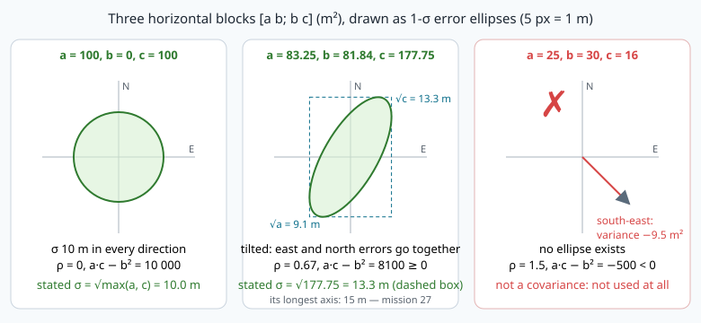
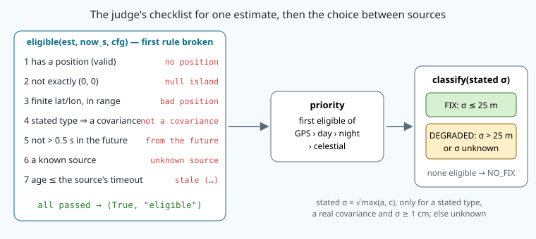

# The position contract: covariance, stamps and honest uncertainty


> [!NOTE] Mission brief
> **3 October 2026, NAVERA's bench.** The validation report of NAVERA, IRIS's product, records three
> fixed bugs of its judge: a GPS with an **all-zero covariance** shown as FIX "with accuracy 0", an
> **undefined covariance type** read as a stated accuracy (FIX), and a covariance **no real sensor can
> produce** published again as a position. The same report shows the other side: vision positions
> describing the photo's instant, **1 to 2.5 s earlier**, on a plane at 40 m/s. Output error: **83 m
> median, 0 % within the accuracy they stated** (simulator).
>
> Each witness tells the judge *where*, *how sure* and *when*; one wrong answer, and the judge believes
> a lie. Today you play both sides. **Session 1 — the contract:** you write the
> tests that decide whether nine numbers are a covariance, what accuracy they state, and how much a
> late position costs. **Session 2 — attack, then defend:** you fool NAVERA Lite's naive judge
> (arbiter v0) four times, then plug your own `eligible()` into it and watch the attacks fail — almost:
> one of them comes back.
> Badges: **Contract keeper**, then **Honest judge**.
>
> **Start now:** open the 🛠️ **Lab** tab, do **Step 0** (five minutes, no code), then come back for §1.

**Objectives.** After this mission you can:

1. fill a position estimate **honestly**: the measurement instant, variances in m², a covariance type
   that says what is known, "unknown" instead of an invented value;
2. decide whether nine numbers **can be a covariance** for the judge (finite, symmetric, no negative
   variance — a, c and the up variance —, a·c − b² ≥ 0) and compute the **stated σ** a judge may believe;
3. tell **age** from **latency**, compute the error of a late position, and explain why a stamp from
   the **future** is refused;
4. predict a judge's **verdict** (eligible? which source? FIX or DEGRADED?) and find the holes of a
   judge that skips a rule.

**You need:** mission 06 (ENU metres), 09 (arbiter v0, the status topic), 10 (`covariance_from_sigma`,
the stamp of a NavSatFix), 11 (stale fixes, the watchdog). ⏱ Reading: about 60 minutes with the ✏️
checks. Lab: 3 to 4 h 30 in two sessions.

**What you already know** — answer without looking; if you miss two, reread the mission named.

<details><summary>1. Mission 10: your fake GPS states σ = 3 m. Which nine numbers and which type did covariance_from_sigma() put in its NavSatFix?</summary>
[9.0, 0.0, 0.0, 0.0, 9.0, 0.0, 0.0, 0.0, 36.0] and type 1 (APPROXIMATED): σ² east and north, (2σ)² up, all in m².
With no σ it publishes nine zeros and type 0 (UNKNOWN): it never invents one.
</details>

<details><summary>2. Mission 11: GPS sends one fix per second, then stops. When does arbiter v0 report NO_FIX, and with which reason?</summary>
When the last fix is older than gps_timeout_s = 3.0 s: about 3 s after the last fix (2–4 s after you stop it),
"no usable source (gps: stale (3.1 s > 3.0 s))".
</details>

<details><summary>3. Mission 09: which status levels mean FIX, DEGRADED and NO_FIX?</summary>
OK, WARN and ERROR (STALE = STARTING). The state is also in the status values, key "state".
</details>

<details><summary>Words of this lesson</summary>

| Word | Plain meaning | Français |
|---|---|---|
| **contract** | the agreed format AND meaning of a message, which every producer respects | contrat (d'interface) |
| **estimate** | one position from one source, with its accuracy and its instant | estimation |
| **variance** | the mean squared error along one axis (m²); its square root is σ (m) | variance |
| **covariance** | how the errors along two axes vary together (m²) | covariance |
| **correlation ρ** | the covariance divided by σE·σN: a number between −1 and +1 | corrélation |
| **positive semi-definite (PSD)** | no direction has a negative variance | semi-définie positive |
| **stated σ** | the one accuracy number a judge reads from a covariance it believes | σ annoncé |
| **stamp** | the time written in the message (`header.stamp`) | horodatage |
| **age / latency** | now − measured / published − measured | âge / latence |
| **eligible** | allowed to compete for the judge's choice | éligible |
| **hold-off** | a delay a recovering source must wait before it takes over | temporisation |
</details>

## 1. One form for every witness

A judge that compares GPS, day vision, night vision and the stars needs every witness to answer the
same questions in the same way. In NAVERA Lite that form is a small class, `Estimate`, in
[navera_lite/estimate.py](file:./navera_lite/estimate.py); on the wire it travels as a standard
`sensor_msgs/NavSatFix` (the mapping is in `navera_lite/ros/convert.py`, given since mission 09).

| Question | `Estimate` field | `NavSatFix` field |
|---|---|---|
| who? | `source`: "gps", "day", "night", "celestial" | `header.frame_id` |
| where? | `lat`, `lon` (degrees), `alt_m` (nan if unknown) | `latitude`, `longitude`, `altitude` |
| how sure? | `cov` (9 numbers, m²), `cov_type` | `position_covariance`, `position_covariance_type` |
| when? | `stamp_s`: the instant it was **measured** | `header.stamp` |
| usable? | `valid`, `reason` | `status.status` (−1 = no position) |

A **contract** is more than a format: it fixes the *meaning* of each field, and every producer must
respect it. Two rules of NAVERA Lite's contract matter today:

- **Unknown is unknown.** An unknown altitude is `math.nan`, not `0.0` (0.0 is sea level). An unknown
  accuracy is `cov_type = 0` (UNKNOWN), not a made-up number. A made-up "5 m" looks exactly like a
  measured 5 m to every program after it: nobody downstream can tell them apart.
- **The stamp is the measurement.** `stamp_s` is when the photo was taken or the satellite signal was
  received, not when the message was sent (§4).

> [!TIP] 🧰 Python: dataclasses (`Estimate` is one)
> ```python
> from dataclasses import dataclass
>
> @dataclass                      # Python writes __init__, __repr__ and == from the fields below
> class Reading:
>     sensor: str                 # fields without a default first: required
>     value: float
>     t_s: float = 0.0            # fields with a default after them: optional
>
> r = Reading("baro", 1013.2)     # Reading(sensor='baro', value=1013.2, t_s=0.0)
> r.value, r.t_s                  # (1013.2, 0.0)
> Reading("baro", 1013.2, t_s=7.5) == Reading("baro", 1013.2, 7.5)   # True: compared field by field
> ```
> The type after `:` is a note for the reader: Python does not check it. `Estimate("gps", "35.8", …)`
> is accepted, and fails later. Check values where it matters.

**Worked example.** A day-vision matcher took a photo at t = 1000.0 s (the judge's clock) and published
its result at t = 1001.6 s: 35.8301° N, 10.6352° E, accuracy "about 30 m" horizontally (east and north
alike, correlation not known) and 60 m vertically, altitude not measured. The form:

```python
Estimate("day", 35.8301, 10.6352, 1000.0,
         cov=(900.0, 0.0, 0.0, 0.0, 900.0, 0.0, 0.0, 0.0, 3600.0), cov_type=COV_APPROXIMATED)
```

The stamp is 1000.0 (the photo), not 1001.6. The covariance holds **variances** (30² = 900 m², not 30).
"About 30 m" is an estimate, so the type is APPROXIMATED (§3). 

> [!QUESTION] ✏️ Check
> A celestial fix: the star photo was taken at t = 2400.0 s, the solution came out at 2412.5 s (star
> matching is slow), 36.10° N, 10.20° E, "σ 5 km in every direction, one number for all axes, a rough
> model". What are `source`, `stamp_s`, `cov[0]` and `cov_type`?

<details><summary>Answer</summary>
"celestial", 2400.0 (the photo), 25 000 000 m² (5000²: the units are m², so a few-km σ gives very large
numbers), COV_APPROXIMATED (1): one rough number for every axis is an approximation, not a known matrix.
</details>

## 2. Nine numbers: when are they a covariance?

**Why.** The judge reads the covariance to decide FIX or DEGRADED; missions 27–28 fuse positions with
it. Nine numbers that cannot be a covariance make every result meaningless, and can make a filter diverge.

**The idea.** The covariance describes the **error** of the position, in metres, along East, North
and Up (ENU, mission 06). It is a 3 × 3 table stored row by row (**row-major**). NAVERA Lite's judge
reads the horizontal 2 × 2 block, written with the course's letters (CONVENTIONS), and the up variance:

```
position_covariance = [ a , b , · ,         a = σE²       east variance (m²)     index 0
                        b , c , · ,         b = cov(E, N)  east-north covariance  indices 1 and 3
                        · , · , σU² ]       c = σN²       north variance (m²)    index 4,   σU²: index 8
```

> [!TIP] 🧰 Variance, covariance, correlation
> σ is in metres, the variance σ² in m²: σ = 3 m ⇔ variance 9 m². The **covariance** b says whether
> east and north errors go together: b > 0 means "when the position is too far east, it tends to be
> too far north too" (a fix smeared along a north-east line). Divided by the two σ, it gives the
> **correlation** ρ = b / (σE·σN), always between −1 and +1: ρ = 0 independent errors, ρ = ±1 errors on
> one exact line. ρ = 1.5 does not exist.

The error **in any direction** u = (uE, uN) (a unit vector) has the variance

```
variance along u = a·uE² + 2·b·uE·uN + c·uN²          (m²)
```

A variance is an average of squares: it is **never negative**, in any direction. A matrix with that
property is **positive semi-definite (PSD)**. For a symmetric 2 × 2 block it is equivalent to three
inequalities you can check by hand:

```
a ≥ 0,    c ≥ 0,    a·c − b² ≥ 0            (the last one ⇔ |ρ| ≤ 1)
```

**Worked example.** A message carries a = 25, b = 30, c = 16 (m²). Then σE = 5 m, σN = 4 m and
ρ = 30 / (5 × 4) = **1.5**: impossible. The determinant says the same: 25 × 16 − 30² = 400 − 900 =
**−500 < 0**. In the direction u = (0.707, −0.707) (south-east; 0.707 = 1/√2, so uE² = uN² = 0.5 and u has
length 1):

```
25 × 0.5 + 2 × 30 × (0.707 × −0.707) + 16 × 0.5 = 12.5 − 30 + 8 = −9.5 m²
```

A negative variance: no sensor produces that. These nine numbers are **not a covariance**, and a
judge must not use them at all.

Two more rules make the test complete. The matrix must be **symmetric** (index 1 and index 3 hold the
same b: the covariance of east with north is the covariance of north with east), and the numbers must
be **finite** (no nan, no infinity), and the **up variance** (index 8) must not be negative either. The
judge reads nothing else: the east-up and north-up terms (indices 2, 5, 6, 7) are not tested (a full
3 × 3 test needs eigenvalues, mission 27).

Computers round, so the tests use a tolerance **relative** to the size of the numbers. A celestial fix
with σE = 3615.9 m, σN = 4706.3 m and ρ = 1 has a·c − b² = 0 exactly, but −0.0625 m⁴ in floating
point: a fixed 10⁻⁹ would call it impossible. NAVERA Lite allows tol × size on b and tol × size² on
a·c − b², where size is the largest of 1 and the variances (tol = 10⁻⁹).



(In the figure, look at the shape of each ellipse and at the third panel; the ellipse axes are
mission 27's subject.)

> [!QUESTION] ✏️ Check
> Covariance or not? Give ρ when it is defined.
> 1. a = 100, b = −60, c = 49  2. a = 9, b = 4, c = 1  3. a = −4, b = 0, c = −9

<details><summary>Answer</summary>
1. Yes: 4900 − 3600 = 1300 ≥ 0, ρ = −60 / (10 × 7) = −0.86 (east error goes with SOUTH error).<br>
2. No: 9 − 16 = −7 &lt; 0, ρ = 4 / (3 × 1) = 1.33.<br>
3. No, although a·c − b² = 36 &gt; 0: the variances themselves are negative. This is why the
determinant alone is not enough, and why your TODO 1 tests the variances first.
</details>

## 3. The covariance type, and the one σ the judge believes

The covariance type says **how much of the matrix is known**. NavSatFix defines four values:

| `cov_type` | Constant | Meaning |
|---|---|---|
| 0 | `COV_UNKNOWN` | nothing is stated: the nine numbers mean nothing, whatever they are |
| 1 | `COV_APPROXIMATED` | an estimate of the accuracy (e.g. from HDOP, mission 15) |
| 2 | `COV_DIAGONAL_KNOWN` | the three variances are known, the correlations are not |
| 3 | `COV_KNOWN` | the whole matrix is known |

Types 1, 2 and 3 **state** an accuracy (`STATED_TYPES` in estimate.py). The judge needs one number to
compare with `fix_max_sigma_m` (25 m). NAVERA Lite, like NAVERA, takes the larger axis variance:

```
stated σ = √max(a, c)        (m)
```

and refuses to read one when:

- the type states nothing (0, or a number that is not a defined type);
- the nine numbers are not a covariance (§2);
- σ < `min_stated_sigma_m` = 0.01 m. Nobody knows a position to the millimetre: an **all-zero**
  covariance is a field nobody filled, not a perfect sensor.

Then the stated σ is "unknown", and the judge calls a winning position **DEGRADED**, never FIX.

**Worked example.** A vision fix with a = 83.25, b = 81.84, c = 177.75 m², type 3: a covariance
(83.25 × 177.75 − 81.84² = 8100 ≥ 0), stated σ = √177.75 = **13.3 m** → FIX if it wins. Its error
ellipse is tilted (ρ = 0.67): its longest axis is actually 15 m long, which √max(a, c) does not
see. Mission 27 computes ellipse axes; for today, √max(a, c) is the contract.

> [!QUESTION] ✏️ Check
> Stated σ, and the state if this estimate wins (`fix_max_sigma_m` = 25 m)?
> 1. type 2, a = 400, c = 144  2. type 0, a = c = 4  3. type 1, a = b = c = 0  4. type 1, a = 625, b = 0, c = 100

<details><summary>Answer</summary>
1. 20 m → FIX. 2. None (type 0 states nothing; the 4 m² are noise) → DEGRADED. 3. None (below 1 cm) →
DEGRADED. 4. 25 m → FIX: the rule is "at most 25 m".
</details>

> [!WARNING] The judge believes the stated σ
> A source that states 3 m while it is 500 m off gets a green FIX. No test on the nine numbers can see
> that: they are a perfectly good covariance. Only something **independent** of that source can — the
> jump gate and the cross-check of mission 01, or a validation campaign. This is why NAVERA's day
> vision states a conservative 30 m until its accuracy is measured with NAVERA's own camera.

## 4. When was it measured?

A position describes **one instant**: the measurement (the photo is taken). Then the source
**publishes** it, and the judge **uses** it, "now". Two durations follow:

- **latency** = published − measured: how slow the source is.
- **age** = now − measured: how old the position is when it is used. The judge tests **freshness on
  the age**: a position is as old as its photo, not as its message.

NavSatFix has only one stamp, so NAVERA Lite's contract says: `header.stamp` = the measured instant.
(NAVERA's own message carries both stamps, measured and published; the idea is the same.)


**What a late position costs.** While the position ages, the vehicle keeps moving. Using it *now*
puts the vehicle where it was, so the error grows by the distance flown during the age:

```
staleness (m) = speed (m/s) × age (s)
```

**Worked example.** A plane at 40 m/s; the photo was taken 1.8 s before the judge uses its position:
40 × 1.8 = **72 m** behind, while the matcher states σ = 30 m. Its own match may be perfect, the
position is still wrong by more than twice the accuracy it claims. (σ is a *typical* error, not a
maximum: even an honest 2-D error with σ = 30 m falls within 30 m only about 4 times in 10. But 72 m
with a 1 m match error is not bad luck: it is the lag.) That is NAVERA's simulator finding of the
mission brief. In the lab you measure it on a bench log of 160 vision fixes.

**Stamps from the future.** If a source's clock is ahead (two computers, a clock stepped back, a bug),
its stamp is *later* than now and the age is **negative**. A freshness test "age > timeout" never
fires on a negative age: a fix stamped 60 s ahead stays "fresh" for 60 s plus the timeout, **even if
the source died a second after sending it**. A judge must therefore refuse any stamp more than
`future_tolerance_s` = 0.5 s ahead (a small tolerance absorbs clock jitter between programs).
Refusing it *now* is not the end of the story: the judge still holds that fix, and the clock keeps
running towards its stamp. Lab Step 8 shows what happens then.

> [!QUESTION] ✏️ Check
> 1. A drone at 15 m/s; a day fix whose photo is 1.5 s old when used. Staleness? Is it stale for the
>    judge (day timeout 5 s)?
> 2. now = 300.0 s. Ages of a GPS fix stamped 299.7 s, and of one stamped 300.4 s? Is the second one
>    eligible? And one stamped 301.0 s?

<details><summary>Answer</summary>
1. 15 × 1.5 = 22.5 m. Not stale (1.5 s ≤ 5 s): freshness and accuracy are different questions — a fresh
fix can still be 22 m behind.<br>
2. 0.3 s and −0.4 s. −0.4 s is within the 0.5 s tolerance: eligible (if the rest is fine). 301.0 s: age
−1.0 s → refused, "from the future".
</details>

## 5. The judge's checklist

**Why.** One rule for every source is what lets the judge compare GPS with the stars. NAVERA Lite's
`eligible(est, now_s, cfg)` (your TODO 4) answers "may this estimate compete?", with the **first**
rule it breaks as the reason:

| # | Rule | Reason if broken |
|---|---|---|
| 1 | the source has a position (`valid`) | `no position` |
| 2 | not exactly (0, 0), where missing coordinates land | `null island` |
| 3 | a finite position, latitude within ±90°, longitude within ±180° | `bad position` |
| 4 | if it states an accuracy (type 1–3), the nine numbers are a covariance | `not a covariance` |
| 5 | not stamped more than `future_tolerance_s` ahead | `from the future` |
| 6 | a source the judge knows (it has a timeout) | `unknown source` |
| 7 | age ≤ the source's timeout (GPS 3 s, day 5 s, night 5 s, celestial 45 s) | `stale (3.4 s > 3.0 s)` |
|  | otherwise | `eligible` |



An estimate with **no** stated accuracy can still be eligible: it may be the only position left, and
the judge then says DEGRADED. A stated accuracy that is **not a covariance** is worse than none: the
source claims something impossible, so the judge does not use it at all.

Among eligible estimates the **priority** decides: GPS > day > night > celestial, first eligible wins
(mission 01). The winner's stated σ then gives the state with `classify()`: FIX if σ ≤ 25 m, else
DEGRADED. (NAVERA also has a **hold-off**: a returning higher-priority source must stay eligible for 2 s
before it takes over, so a flickering GPS cannot make the output zig-zag. Mission 29 adds it.)

**Worked example.** now = 1000.0 s, defaults. GPS: stamped 996.5, σ 3 m → age 3.5 s > 3.0 s, **stale**.
Day: stamped 998.4, type 1, a = c = 900 → age 1.6 s, eligible. Night: stamped 999.0, type 0 → eligible.
Priority: GPS is out, **day wins** (night is never looked at). Stated σ = 30 m > 25 m: **DEGRADED**,
"day: σ 30.0 m > 25.0 m".

### The attacker's view: arbiter v0

Arbiter v0 (mission 09) is naive **on purpose**. Its "usable" test is: valid, a finite position, age ≤
timeout. Its σ is √max(a, c, 0) read **straight from the numbers**. Read those two sentences again and
list the questions it never asks. Each missing question is a hole: in Session 2 you use four of them,
as small scenario files for the replay node (lab Step 5).

> [!QUESTION] ✏️ Check
> No GPS, no day vision. Night vision sends one fix: fresh, type 0, a = c = 100. What does arbiter v0
> say? What does a judge with your checklist and `stated_sigma()` say?

<details><summary>Answer</summary>
v0 reads σ = √100 = 10 m from numbers that mean nothing: <b>FIX</b>, "night: σ 10.0 m". An honest judge:
eligible (no accuracy claimed is not a fault), but no stated σ → <b>DEGRADED</b>, "night: σ unknown".
</details>

> [!WARNING] Common wrong ideas
> - "Fresh means accurate." A 1.5 s old fix is fresh for the judge and still 60 m behind a 40 m/s plane.
> - "A future stamp is just a small clock error." Unchecked, it keeps a dead source alive.
> - "If I do not know the accuracy, I put a safe value like 5 m." That is an invented value: publish
>   type 0 (UNKNOWN). The judge makes it DEGRADED, which is the truth.

## In NAVERA

NAVERA's witnesses publish a message type of NAVERA's own, with more than NavSatFix: **two stamps** (the
measurement, and the publication), a **mode** (measured, propagated by dead reckoning, held, replayed
test data — only measured and propagated may compete), and traceability fields (which program, which
model, which frame, and free-form details on which, by rule, **no decision may depend**). Its judge
applies the checklist of §5, and its validation report (2026-10-03, bench) tests each rule: before the
fixes, the three covariance cases of the mission brief came out FIX with accuracy 0, FIX, and
republished; now DEGRADED, DEGRADED, and not used. Its backlog records two older bugs of the same family:
a future timestamp kept a dead source "fresh" (EST-2), and vision stamped its positions at
**publication** instead of the photo's exposure (LOC-17). Since 2026-10-03 NAVERA also carries a vision
position forward to the present and grows its stated accuracy with the lag (simulator only: a 1.5 s
old photo at 40 m/s is moved 60 m and stated ±31.5 m).

## In NAVERA Lite

Your four functions live in `navera_lite/estimate.py`; `arbiter_v0 -p use_eligible:=true` calls them
instead of its own tests. Mission 29's real arbiter is built on them.

## 🐦 How birds do it

Bird trackers face the judge's problem. Each position from the Argos satellite system carries a
**location class**: 3, 2, 1, 0 state an accuracy band (class 3: better than 250 m; class 0: worse than
1500 m), A and B come **without** an accuracy, Z is invalid. Before drawing a white stork's route across
Gibraltar, researchers filter by class and drop fixes that need an impossible flight speed: a stated
accuracy, an honest "unknown" and a plausibility test, decades before ROS.

## Summary

1. Every witness fills one **contract**: who, where, how sure, when, usable. Unknown stays unknown
   (nan, type 0); nothing is invented.
2. Nine numbers pass the judge's covariance test only if finite, symmetric, no variance is negative
   (a, c, σU²) and **a·c − b² ≥ 0** (|ρ| ≤ 1), with a tolerance relative to their size. Otherwise some
   direction has a negative variance.
3. The **stated σ** = √max(a, c), believed only for a stated type, a real covariance and σ ≥ 1 cm.
   The judge believes it: honesty is the source's job.
4. The stamp is the **measurement**: age = now − stamp, latency = published − stamp; a late position
   costs speed × age metres. A stamp from the future is refused — and a refused fix still waits for
   its time.
5. A judge's checklist names the **first** broken rule; a judge that skips one has a hole.

**Next mission:** launch files and parameters — start the whole stack with one command, and make your
settings refuse impossible values.

## Check yourself

Answer without scrolling up.

<details><summary>1. Is a = 49, b = 30, c = 16 a covariance? What is ρ?</summary>
784 − 900 = −116 &lt; 0: no. ρ = 30 / (7 × 4) = 1.07 &gt; 1.
</details>

<details><summary>2. Type 3, a = 0.0001, b = 0, c = 0.0001 m². Stated σ?</summary>
√0.0001 = 0.01 m: exactly the minimum, so it is believed (σ ≥ 1 cm). With a = c = 0: None.
</details>

<details><summary>3. A photo taken at 50.0 s, published at 51.2 s, used at 51.5 s. Latency, age, and the staleness at 20 m/s?</summary>
Latency 1.2 s, age 1.5 s, 20 × 1.5 = 30 m.
</details>

<details><summary>4. Why does an honest judge refuse a non-PSD covariance completely, but accept a position with no accuracy at all (DEGRADED)?</summary>
"No accuracy" is an honest unknown. A non-PSD matrix claims something impossible: the source is broken or
lying, so nothing it says is trusted, and a filter fed with it could diverge.
</details>

<details><summary>5. (Mission 01) GPS jumps 400 m, 1 s after the last trusted fix. Jump gate verdict with v_max 100 m/s, margin 50 m?</summary>
The gate is 100 × 1 + 50 = 150 m: refused.
</details>

Now open the **🛠️ Lab** tab.
