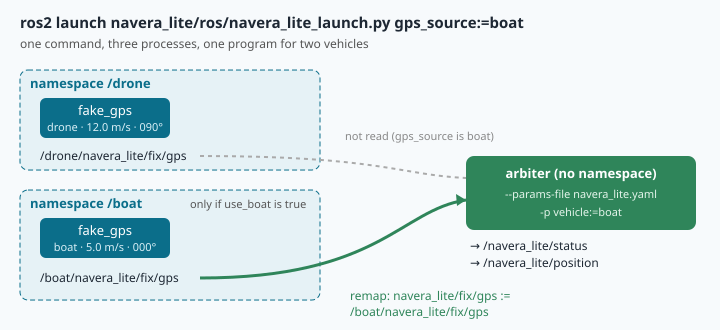

# Launch files and parameters: configuring a system without touching its code



> [!NOTE] Mission brief
> **1 October 2026, NAVERA review, item R-1 (severity high).** NAVERA had no setting for the vehicle's
> speed. Its arbiter's jump gate used 100 m/s, its day and night vision used 30 m/s for their own motion
> checks, **whatever the vehicle**. The review found that on a fast fixed wing, real GPS fixes would be
> refused and every vision position rejected. Nothing was wrong in the code. The **configuration** was
> wrong: one number, written once, for every vehicle. A few days earlier (item LOC-30), a launch file
> override written `1` instead of `1.0` had crashed a node at start.
>
> You met R-1 in mission 03. Today you fix NAVERA Lite's own version of it. **Session 1 — Guard the
> knobs:** you make the fake GNSS receiver of mission 10 refuse impossible settings, and you write the
> check that reads a whole settings file. **Session 2 — One command:** you write a settings file for two
> vehicles, measure which value wins when several places give one, start a drone, a boat and the judge
> with one launch file, and then play the integrator who copied the drone's settings onto a plane.
> Badges: **Knob guard**, then **Integrator**.

**Objectives.** After this mission you can:

1. declare typed parameters with **descriptors** (range, read-only) and a **validation callback**, and
   say which mistakes each guard catches, at start or at run time;
2. predict, then measure, which value a node gets when a default, files and the command line all give
   one (**precedence**);
3. write a **launch file** that starts two vehicles in **namespaces** and one judge, with launch
   arguments, a condition and a **remap**;
4. change one setting of the stack, predict the judge's new verdict, and check a whole settings file
   against the vehicle it is for (R-1).

**You need:** missions 03 (`VEHICLES`), 09 (nodes, topics, `ros2 node list`), 10 (`declare_parameter`,
`-p`, `ros2 param set`). ⏱ Reading: about 70 minutes with the ✏️ checks. Lab: 3 to 4 h (two sessions).

**Before you start** — three questions from earlier missions. If you miss two, reread lesson 10 §3.

<details><summary>1. Your fake GPS reads <code>speed_mps</code> at every tick. What happens 1 s after <code>ros2 param set /fake_gps speed_mps 20.0</code>?</summary>
It moves at 20 m/s: the node reads the value again at the next tick. A node that read it once in
<code>__init__</code> would keep its old speed.
</details>

<details><summary>2. What is the type of <code>-p speed_mps:=12</code>, and why does it matter?</summary>
An integer. <code>speed_mps</code> was declared with the default <code>10.0</code>, a double, so the node stops with
<code>InvalidParameterTypeException</code>. Write <code>12.0</code>.
</details>

<details><summary>3. In <code>navera_lite/vehicle.py</code> (mission 03), what is <code>VEHICLES["boat"]</code>, and what is it for?</summary>
20.0: the top speed of a boat, in m/s. A speed limit belongs to the vehicle, not to the software.
</details>

<details><summary>Workspace and words (open if you need them)</summary>

Your files are in `~/lessons/13-launch-params/`. The lab runs in **one** terminal tab: nodes in the
background (`&`, as in mission 09), questions (`ros2 param get`, `ros2 topic echo`) in the same tab, and
`kill -INT %%` to stop the last node.

| Word | Meaning | Français |
|---|---|---|
| **parameter** | a named, typed setting of a node, given from outside | paramètre |
| **descriptor** | the description and limits of a parameter (range, read-only) | descripteur |
| **validation callback** | your function that ROS calls before a parameter changes; it may refuse | fonction de validation |
| **parameters file** | a YAML file of sections `node name: ros__parameters: …` | fichier de paramètres |
| **fully qualified name** | namespace + name: `/boat/fake_gps`, `/boat/navera_lite/fix/gps` | nom complet |
| **namespace** | a prefix that keeps the nodes and topics of one subsystem apart | espace de noms |
| **remap** | replacing one name by another when a node starts (`-r from:=to`) | remappage |
| **launch file** | a Python file that describes which processes `ros2 launch` starts, and how | fichier de lancement |
| **launch argument** | a value given to a launch file: `ros2 launch file.py name:=value` | argument de lancement |
| **substitution** | a value that the launch system computes later, when it runs | substitution |
| **precedence** | which value wins when several places give one | priorité |
</details>

## 1. A parameter has a type, fixed by its default

In mission 10 you declared `self.declare_parameter("speed_mps", 10.0)`. The default does two jobs: it
gives the value, and it fixes the **type** for the life of the node. `10.0` makes a double, `10` an
integer, `"drone"` a string, `True` a bool. A later value of another type is refused, at start or at
run time. The judge of NAVERA Lite (`arbiter_v0`, given since mission 09) declares every key of
`navera_lite.yaml` with its default, so `max_speed_mps` is a double. Started with
`-p max_speed_mps:=30`, it stops before it judges anything:

```
rclpy.exceptions.InvalidParameterTypeException: Trying to set parameter 'max_speed_mps' to '30' of
type 'INTEGER', expecting type 'DOUBLE'
```

This is NAVERA's LOC-30, in your own stack. It is good that the node stops: a silent conversion would
hide the mistake. It is bad that the person who wrote `30` was an integrator on a test site, far from
the code. Two habits: write every decimal with a dot, and say in each parameter's description what it
is (§2). Some teams also declare the parameter with **dynamic typing**, so that both `30` and `30.0`
are accepted and converted in the code; you lose the type check, and in exchange no integrator can
crash the node with a missing `.0`.

The same rule holds in a YAML file: `max_speed_mps: 30` is an integer, `30.0` a double, `"30"` a
string.

## 2. Three guards on a parameter, and when each one acts

A type is not enough: `speed_mps: 500.0` is a perfectly good double. ROS gives you three guards.

**A descriptor** is the third argument of `declare_parameter`:

```python
from rcl_interfaces.msg import FloatingPointRange, ParameterDescriptor

d = ParameterDescriptor(description="direction of motion, degrees clockwise from north",
                        floating_point_range=[FloatingPointRange(from_value=0.0, to_value=360.0, step=0.0)])
self.declare_parameter("heading_deg", 90.0, d)
```

`ros2 param describe /fake_gps heading_deg` prints the description and the limits, so an integrator
can read what the number means. `floating_point_range` is a **list** holding one range (`step=0.0`
means "any value in between"); `read_only=True` is another field of the same descriptor.

**A validation callback** checks rules that one range cannot express, because they link several
parameters: 25 m/s is fine for a drone (`VEHICLES["drone"]` = 30) and impossible for a boat (20). You
register a method; ROS calls it with the list of parameters **about to change**, and applies the
change only if it returns `successful=True`:

```python
from rcl_interfaces.msg import SetParametersResult

self.add_on_set_parameters_callback(self.on_set_parameters)      # after the declarations

def on_set_parameters(self, params):          # params: a list of rclpy Parameter (.name, .value)
    new = {p.name: p.value for p in params}   # {"heading_deg": 400.0}: only what is changing
    ...
    return SetParametersResult(successful=False, reason="heading_deg 400.0 is not a heading")
```

The list holds only the parameters that change. When the rule needs another parameter, take its new
value if it is in the list, else its current one (`self.get_parameter(name).value`).

**Read-only.** A timer's period is fixed when the timer is created. If `rate_hz` could be changed while
the node runs, `ros2 param set` would answer "successful" and nothing would change: a lie. Declared
`read_only=True`, it can be given at start only, and a change is refused with a clear message.

The guards do not all act at the same moment. Measured on the course's fake GNSS (Humble):

| Guard | at start (`-p`, a file) | while it runs (`ros2 param set`) |
|---|---|---|
| type (the default) | ✘ node stops | ✘ "Wrong parameter type" |
| range (descriptor) | ✘ node stops | ✘ "out of range Min … Max …" |
| read-only (descriptor) | ✔ allowed | ✘ "Trying to set a read-only parameter" |
| callback, registered after the declarations | **not called** | ✘ your reason |

The last line is the attacker's door: values given at start never pass through a callback registered
after the declarations. (Registered before them, it would be called once per declared parameter,
while the others are not declared yet, and your `get_parameter` would fail.) So a careful node checks
its **start** values too, in one place: §6.

> [!QUESTION] ✏️ Check
> A node declares `heading_deg` with the range 0.0 … 360.0 and registers a callback that refuses
> `heading_deg` > 180.0 when `vehicle` is `"robot"`. It is started with
> `-p vehicle:=robot -p heading_deg:=270.0`. Does it start, and what does `ros2 param get` show?
> Then `ros2 param set … heading_deg 200.0`?

<details><summary>Answer</summary>
It starts with 270.0: the range allows it, and the callback is not called for start values. The
<code>param set</code> to 200.0 is refused by the callback. The node now holds a value its own rule forbids,
and refuses a smaller one: the start values needed a check of their own.
</details>

**Read once, or read every time?** `ros2 param set` changes the **stored** value. A node uses it only if
it reads it again. NAVERA Lite's judge reads its settings once, when it starts, and builds its rules
from them: a `ros2 param set /arbiter fix_max_sigma_m 2.0` is stored, reported "successful", and changes
no verdict until the judge restarts (you will see it in lab Step 0). Neither design is wrong; a node
must say which one it is, and `read_only` is the honest way to say "restart me".

## 3. Settings files, and which value wins

Twenty `-p` on one command line are unreadable. A **parameters file** is YAML, made of **sections**.
A section's key is a node's **fully qualified name** (namespace + name), or a wildcard:

```yaml
/**:                      # every node
  ros__parameters:        # always this key, two underscores
    sigma_m: 3.0
/boat/fake_gps:           # only the node fake_gps in the namespace /boat
  ros__parameters:
    vehicle: "boat"
    heading_deg: 45.0
```

`/**` matches every node; `/boat/*` every node directly in `/boat`. A key without the first slash,
`fake_gps:`, means `/fake_gps`: it does **not** match the same node started in `/boat` (measured: the
node keeps its code default, with no warning). You load the file at start:
`--ros-args --params-file my_file.yaml`. Your `navera_lite.yaml` is such a file: one `/**` section.

**Who wins?** A value can come from the code's default, from one or more files, from `-p`, and later
from `ros2 param set`. The default loses to anything given at start, and `ros2 param set` comes last
(if a guard accepts it). Between the files and `-p`, ROS 2 Humble follows a rule that surprises most
people. We measured it on 20 command lines; this model predicts all of them:


1. Everything given at start goes into **one table**, with **one row per section name**.
2. A row is created where its name **first** appears, reading the command line from left to right
   (and each file from top to bottom).
3. A later value for the same section name **overwrites that row in place**: the row does not move.
4. `-p name:=value` writes into the **`/**` row**: it is a value for every node.
5. The node applies its matching rows **from top to bottom**: the **lowest** matching row wins.

**Worked example.** `/boat/fake_gps` is started with `--params-file a.yaml -p heading_deg:=180.0`, where
`a.yaml` holds `/boat/fake_gps: heading_deg 45.0` and then `/**: heading_deg 0.0`.
Rows: `/boat/fake_gps` (45.0), then `/**` (0.0); `-p` overwrites the `/**` row with 180.0, which stays
second. Both rows match; the lowest wins: **180.0**. Without the `-p`: **0.0**, because the file put
its wildcard *after* the specific section. Put `/**` first in a file, always.

> [!QUESTION] ✏️ Check
> `b.yaml` holds `/**: heading_deg 0.0`, then `/boat/fake_gps: heading_deg 45.0`. Predict `heading_deg`
> of `/boat/fake_gps` for (1) `--params-file b.yaml`, (2) `--params-file b.yaml -p heading_deg:=180.0`,
> (3) `-p heading_deg:=180.0 --params-file b.yaml`.

<details><summary>Answer</summary>
(1) 45.0: rows <code>/**</code>, <code>/boat/fake_gps</code>; the lower one wins. (2) 45.0: <code>-p</code> overwrites the
<code>/**</code> row, which is still above. (3) 45.0: <code>-p</code> creates the <code>/**</code> row first, the file
overwrites it and adds <code>/boat/fake_gps</code> below. A <code>-p</code> cannot beat a section written for the
node's own name. To override such a value, give a second file with the <b>same section name</b>
after the first one, or use <code>ros2 param set</code> once the node runs.
</details>

The practical rule: give each value in **one** place, put `/**` first, override a node's own section
with a later file that uses the same name, and **always check** with `ros2 param get`.

## 4. Names: namespaces and remaps

Every node and topic name is **resolved** into a fully qualified name. A name that starts with `/` is
**absolute** and stays as it is. A name without it is **relative**: the node's namespace is put in
front. NAVERA Lite's nodes use relative topic names on purpose (`navera_lite/fix/gps`):

| Node started with | Node's full name | It publishes on |
|---|---|---|
| no namespace | `/fake_gps` | `/navera_lite/fix/gps` |
| `-r __ns:=/drone` | `/drone/fake_gps` | `/drone/navera_lite/fix/gps` |
| `-r __ns:=/boat` | `/boat/fake_gps` | `/boat/navera_lite/fix/gps` |

So two identical receivers can run side by side without mixing their fixes. The judge runs without a
namespace and subscribes to `navera_lite/fix/gps`, which resolves to `/navera_lite/fix/gps`, where
nobody publishes any more. A **remap** tells one node, at start, to use another name:
`-r navera_lite/fix/gps:=/boat/navera_lite/fix/gps`. The judge's code does not change; the judge now
listens to the boat. `-r __ns:=…` and `-r __node:=…` are remaps too, of the namespace and of the node's
name.

> [!QUESTION] ✏️ Check
> The judge is started with `-r __ns:=/test`, no other remap, next to the two receivers above. Which
> topic does it read, and what does it say?

<details><summary>Answer</summary>
<code>/test/navera_lite/fix/gps</code>, where nobody publishes. It never receives a position and stays
STARTING, "no position received yet", forever, without an error. A wrong name is not a crash: it is
silence. <code>ros2 node info /test/arbiter</code> shows what it really subscribes to.
</details>

## 5. Launch files

NAVERA starts about ten programs at every boot, each with its namespace, its files and its remaps,
with one command. In ROS 2 that command is `ros2 launch`, and the description of what to start is a
**launch file**: a Python file with a function `generate_launch_description()` that returns a
`LaunchDescription`, a **list of actions**. The function starts nothing. It *describes*; `ros2 launch`
then does it, shows every process's output in one terminal (each line prefixed with its name), and
stops them all on `Ctrl+C`.

Product packages are built with **colcon** and started with `launch_ros.actions.Node(package=…,
executable=…)`. NAVERA Lite is not built (you run it with `python3 -m`), so it gives you a helper,
`fl_node()` in `navera_lite/ros/launch_util.py`, that builds the same command line you type in a
terminal. The two map one to one:

```python
Node(package="pkg", executable="gps_node", name="fake_gps", namespace="boat",
     parameters=["file.yaml", {"speed_mps": 5.0}], remappings=[("from", "to")])
fl_node("gps_node", "fake_gps", namespace="boat",
        params_file="file.yaml", params={"speed_mps": 5.0}, remaps=[("from", "to")])
# both start:  ... --ros-args -r __node:=fake_gps -r __ns:=/boat --params-file file.yaml
#                  -p speed_mps:=5.0 -r from:=to
```

<details><summary>🧰 colcon, <code>share/</code> and <code>--symlink-install</code> (open if you are curious; not needed for the lab)</summary>

A ROS 2 **package** is a folder with a `package.xml` (its name and dependencies) and, for Python, a
`setup.py`. `colcon build` copies each package into `install/`: the code, and the launch and config
files into `install/<pkg>/share/<pkg>/`, where `get_package_share_directory("<pkg>")` finds them at
run time. `colcon build --symlink-install` puts links instead of copies, so an edited Python or YAML
file is used at the next start without building again. After a build, `source install/setup.bash`
lets `ros2 run <pkg> <exe>` and `ros2 launch <pkg> <file>` find it. That is how NAVERA is installed on
its computer. NAVERA Lite skips all of it: no build, `python3 -m` from the lesson folder.
</details>

**A complete example** (not the one you write): replay a CSV file into a judge, with a launch argument
`file` and a switch `with_judge`.

```python
import os, sys                                                         # 1
from launch import LaunchDescription                                  # 2
from launch.actions import DeclareLaunchArgument                      # 3
from launch.conditions import IfCondition                             # 4
from launch.substitutions import LaunchConfiguration                  # 5
sys.path.insert(0, LESSON_FOLDER)   # ros2 launch reads this file by its path: see the note  # 6
from navera_lite.ros.launch_util import fl_node                       # 7

def generate_launch_description():                                    # 8
    log = LaunchConfiguration("file")         # a substitution: known only when it runs  # 9
    return LaunchDescription([                                        # 10
        DeclareLaunchArgument("file", default_value="", description="CSV to replay"),  # 11
        DeclareLaunchArgument("with_judge", default_value="true"),    # 12
        fl_node("replay_node", "replay", namespace="test", params={"file": log, "loop": False}),  # 13
        fl_node("arbiter_v0", "arbiter", params_file="navera_lite.yaml",                        # 14
                remaps=[("navera_lite/fix/gps", "/test/navera_lite/fix/gps")],                  # 15
                condition=IfCondition(LaunchConfiguration("with_judge"))),                      # 16
    ])
```

`ros2 launch replay_launch.py file:=attack.csv with_judge:=false` would start the replay only. Three
ideas in it:

- **Launch arguments** (lines 11–12) are declared with a default; `name:=value` on `ros2 launch`
  changes them. `ros2 launch <file> --show-args` lists them.
- **Substitutions.** `LaunchConfiguration("file")` is not a string in Python: it is an object that
  `ros2 launch` replaces by the argument's value when it runs. A **list** mixing text and substitutions
  is joined at run time: `["/", LaunchConfiguration("gps_source"), "/navera_lite/fix/gps"]` becomes
  `/boat/navera_lite/fix/gps`. Writing `"/" + LaunchConfiguration("gps_source")` fails at once with
  `TypeError: can only concatenate str (not "LaunchConfiguration") to str`: Python tries to add them
  now, and the value does not exist yet.
- **Conditions** (line 16): `IfCondition(…)` starts the action only when the value is true.

> [!NOTE]
> **Why line 6?** `ros2 launch` loads a launch file by its **path**, like `python3 file.py`, so Python
> does not know where `navera_lite/` is, and line 7 fails with `ModuleNotFoundError: No module named
> 'navera_lite'`. Your launch file already has this line (it finds the lesson folder from its own
> path). A colcon-built package does not need it. Its name ends in `_launch.py` because NAVERA Lite's
> parts are Python modules, and a module name cannot contain a dot.

> [!QUESTION] ✏️ Check
> 1. In the example, why is `default_value="true"` a string and not `True`?
> 2. Someone writes `params={"loop": False, "rate": 2}`. What happens when `replay` starts?

<details><summary>Answer</summary>
1. Launch arguments are text, like everything typed on a command line; <code>IfCondition</code> reads
"true"/"false" (also "1"/"0").<br>
2. <code>fl_node</code> writes <code>-p rate:=2</code>, an integer, and <code>rate</code> was declared as a double
(1.0): the node stops with <code>InvalidParameterTypeException</code>. LOC-30 again, now hidden in a launch
file. Write <code>2.0</code>.
</details>

## 6. Checking a whole settings file at start: one speed per vehicle

Guards on one node do not see the whole picture. The judge's `navera_lite.yaml` holds twelve values
that must agree with each other and with the vehicle: the timeouts must be positive, FIX must allow
more than the smallest stated σ, and `max_speed_mps`, the speed of the jump gate (mission 01), must be
at least the vehicle's top speed. Below it, the gate refuses the vehicle's own **real** fixes.
Worked example: a robot's limit (10 m/s) left in the settings of a boat that cruises at 18 m/s, one fix
per second, margin 50 m. Each fix is 18 m from the last one and the gate allows 10 × 1 + 50 = 60 m: no
problem, the margin hides the mistake. Now the boat sails at 18 m/s for 5 s with one fix lost to a wave:
the next fix is 36 m away, the gate 70 m: still fine. The mistake bites a vehicle that moves **more than
`max_speed_mps` + margin in one second**. Once one of its fixes is refused, the gap to the last trusted
fix grows faster than the gate, and every later fix is refused too: the judge loses GPS on a healthy
vehicle. That is R-1, and you will watch it happen in lab Step 8. The rule is simple and strict:
`max_speed_mps` ≥ the vehicle's top speed, so that no healthy vehicle depends on the margin.

So the rule is checked **once, at start, on the whole file**: your `check_settings(cfg)` (TODO 4)
returns every rule the settings break, as plain sentences. A list, not the first problem only: an
integrator fixing one mistake per restart loses an afternoon. And a value that is an integer where a
float is expected is reported with the fix (`write 3.0, not 3`), because a ROS node would crash on it.

> [!QUESTION] ✏️ Check
> `max_speed_mps` is 30.0 (a drone), the vehicle is a plane at 80 m/s, one fix per second, margin
> 50 m. Is the first fix after the first one refused? And with 90 m/s?

<details><summary>Answer</summary>
80 m/s: 80 m ≤ 30 × 1 + 50 = 80 m, accepted, and every fix after it too (just). 90 m/s: 90 m > 80 m,
refused; 2 s after the last trusted fix the gap is 180 m and the gate 110 m; it never catches up.
The judge loses GPS for good, on a healthy plane.
</details>

> [!WARNING] Common wrong ideas
> - "`-p` on the command line always wins." Not against a section written for the node's own name (§3).
> - "If `ros2 param set` says *successful*, the node uses the value." Only if it reads it again (§2).
> - "My callback protects the node." Only against changes made after it was registered; start values
>   need their own check (§2, §6).
> - "The launch file failed, I would have seen an error." A wrong remap or namespace starts everything
>   and connects nothing: the judge just waits (§4).
> - "`LaunchConfiguration("x")` is the argument's value." It is a promise of it, kept when the launch runs (§5).

## In NAVERA

NAVERA, IRIS's product, is installed on very different vehicles with the same software. What follows is
from its engineering backlog and architecture notes (in words and numbers; NAVERA's code is not part
of the course):

- **One speed per installation (R-1, fixed after the review of 1 October 2026).** The installer gives
  the vehicle's maximum speed **once, in km/h**, in NAVERA's settings file or on its mission page; it is
  converted to m/s in one place and feeds the arbiter's jump gate and both vision motion gates. Its
  field test procedure suggests cruise speed + 50 %. A value outside 4–1 890 km/h stops NAVERA at start
  with a message that names the setting: the start-time check of §6.
- **LOC-30 (review of 28 September 2026, low severity, fixed):** integer launch overrides crashed float
  parameters (§1).
- **A default is not a setting.** NAVERA's production configuration keeps a day-vision position fresh
  for 5 s (frames come every 1–4 s under load), while the node's own code default is 3 s. If the
  configuration file did not reach that node (a section name that does not match, §3), it would run on
  3 s without a word, and the arbiter would flicker to NO_FIX between good frames.
- NAVERA's programs read their settings when they start. After a change, the installer restarts NAVERA's
  services; nothing is changed in flight.

## In NAVERA Lite

You write three parts of the stack you build: in [navera_lite/ros/gps_node.py](file:./navera_lite/ros/gps_node.py)
the descriptors and the callback of `CheckedGps` (TODO 1–3: a subclass of mission 10's `FakeGps`; from
now on `python3 -m navera_lite.ros.gps_node` starts the checked node); in
[navera_lite/settings.py](file:./navera_lite/settings.py) `check_settings` (TODO 4); and
[navera_lite/ros/navera_lite_launch.py](file:./navera_lite/ros/navera_lite_launch.py), the stack's launch file
(TODO 5). `launch_util.fl_node` is given. Mission 14 tests the whole stack, launch file included.

## 🐦 How birds do it

Blackcaps from southern Germany migrate far; blackcaps from the Canary Islands hardly migrate. When
Peter Berthold and Ulrich Querner crossed them (published 1981), the young showed a migratory
restlessness **in between** their parents'. Same species, same body: different inherited
**settings**. Evolution, like an integrator, configures one design for many journeys, and a setting
copied from the wrong population sends a bird the wrong way.

## Summary

1. A parameter's **type** is fixed by its default: write `30.0`, not `30`, on the command line, in
   YAML and in launch files.
2. **Descriptors** (range, read-only) act at start and at run time; a **callback** checks rules that
   link parameters, but only for changes after it is registered: start values need their own check.
3. Precedence: one table, one row per section name, created where it first appears; `-p` writes the
   `/**` row; **the lowest matching row wins**. Put `/**` first; check with `ros2 param get`.
4. Relative names + **namespaces** keep identical nodes apart; a **remap** reconnects one node; a wrong
   name gives silence, not an error.
5. A **launch file** describes processes, arguments, conditions and substitutions; `ros2 launch` runs
   them with one command. One speed for every vehicle (R-1) is a configuration bug: check settings
   against the vehicle, at start.

**Next mission:** testing, so that a wrong change, in the code or in a launch file, is caught before it flies.

## Check yourself

Answer without scrolling up.

<details><summary>1. Name one mistake each guard catches: range, read-only, callback, check_settings.</summary>
Range: <code>speed_mps 500.0</code>. Read-only: changing <code>rate_hz</code> while the timer runs. Callback: 25 m/s
for a boat (two parameters). check_settings: a whole file, at start (a timeout of 0, an int, a drone's
speed limit for a plane).
</details>

<details><summary>2. A file has <code>/**</code> first and then <code>/drone/fake_gps: speed_mps 18.0</code>. You add <code>-p speed_mps:=25.0</code> after it. Value? How do you really get 25.0 at start?</summary>
18.0: <code>-p</code> overwrites the <code>/**</code> row, which stays above the drone's row. Give a second file
with <code>/drone/fake_gps: speed_mps: 25.0</code> after the first.
</details>

<details><summary>3. Node <code>fake_gps</code> in namespace <code>/boat</code> publishes on <code>navera_lite/fix/gps</code>. Full topic name? And if the code had written <code>/navera_lite/fix/gps</code>?</summary>
<code>/boat/navera_lite/fix/gps</code>. With the leading slash the name is absolute: the namespace is ignored and
both vehicles would publish on the same topic.
</details>

<details><summary>4. Why must <code>rate_hz</code> be read-only, while <code>speed_mps</code> need not be?</summary>
The timer's period is set once, when it is created; the speed is read again at every tick.
</details>

<details><summary>5. (Mission 01) Jump gate: v_max 20 m/s, margin 50 m, 1 fix/s, a vehicle at 75 m/s. Why is it never accepted again after its first refused fix?</summary>
Each second the gap from the last trusted fix grows by 75 m and the gate by only 20 m: the gate falls
further behind every second (75 m > 70 m after 1 s, 150 m > 90 m after 2 s…).
</details>

Now open the **🛠️ Lab** tab.
