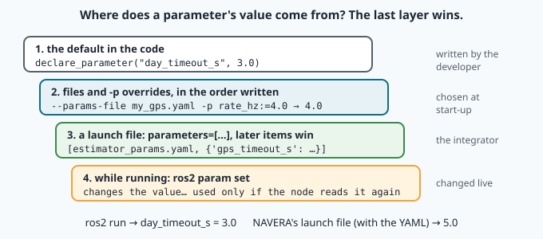
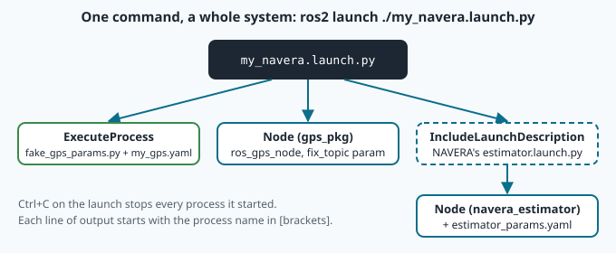

# Launch files and parameters: configuring a system without touching its code

> [!NOTE] In short
> - A node's **parameters** are its settings; the code stays the same for a car, a boat or a drone.
> - You will learn parameter types, **descriptors** (description, range, read-only) and **validation callbacks**.
> - You will write a **YAML parameters file** and measure which value wins when there are several.
> - You will learn **namespaces** and **remapping**, then write one **launch file** that starts a car, a boat and NAVERA.
> - In the lab you also change one of NAVERA's own settings and see its verdict change.

The same NAVERA software runs on a survey drone over Jebel Akhdar, on a delivery car in Muscat and on
a patrol boat off Sohar. The drone flies at 30 m/s, the boat at 15 m/s. One box reads its GNSS on a
serial cable, another from the autopilot, a third from the vehicle's own ROS topic. IRIS Systems does
not write three programs: the **code** stays identical and only the **configuration** changes. In
ROS 2 the configuration of a node is its **parameters**; the description of *which* nodes run, in
which **namespace**, with which parameters and **remappings**, is a **launch file**.

In lesson 11 you started four programs in four terminals to get a FIX. A NAVERA box starts about ten
at every boot — with one command. Today you learn how: parameters in depth (types, descriptors,
validation, precedence), YAML parameter files, names and namespaces, and the Python launch API. Then
you change one of NAVERA's own settings and watch its verdict change.

## 1. Parameters in depth

Lesson 10 introduced `declare_parameter(name, default)` and `get_parameter(name).value`. A parameter
has a **type**, fixed at declaration by the default: `2.0` → double, `2` → integer, `"car"` → string,
`True` → bool, `[1.0, 2.0]` → double array. A later value of another type is refused:

```
-p rate_hz:=5          → InvalidParameterTypeException … of type 'INTEGER', expecting type 'DOUBLE'
ros2 param set … 5     → Setting parameter failed: Wrong parameter type, expected 'Type.DOUBLE' got 'Type.INTEGER'
```

NAVERA's engineers met this trap with launch files written by **integrators** (the people who install
NAVERA on a vehicle), for example `max_speed_mps:=25`. They
wrote a helper, `declare_float`, that declares a double with **dynamic typing** so that an integer is
accepted ([navera_common/params.py](file:navera/navera_common/navera_common/params.py)):

```python
def declare_float(node, name: str, default: float, description: str = "") -> None:
    """…with a float default, a launch override written without a decimal point
    (`max_speed_mps:=25`) is an INTEGER and crashes the node with
    InvalidParameterTypeException. Dynamic typing accepts both; read the value back with float(...)."""
    node.declare_parameter(
        name, float(default),
        ParameterDescriptor(description=description, dynamic_typing=True))
```

### Descriptors: describe and constrain

The third argument of `declare_parameter` is a **ParameterDescriptor**. It documents the parameter
(`ros2 param describe /node name` prints it) and constrains it:

| Field | Effect |
|---|---|
| `description` | a sentence for humans |
| `read_only=True` | may be set at start (file, `-p`, launch), never changed while running |
| `floating_point_range` / `integer_range` | [from_value, to_value] (and a step); out-of-range values are refused |
| `dynamic_typing=True` | the type may change (NAVERA's `declare_float`) |

A timer period is fixed when the timer is created, so `rate_hz` should be **read-only**: a
`ros2 param set` that "succeeds" but changes nothing would be a lie.

### Validation callbacks: rules a range cannot express

Some rules involve **several** parameters: a boat cannot be set to 20 m/s, a car can. A node registers
a callback that ROS calls **before** applying new values:

```python
self.add_on_set_parameters_callback(self.on_set_parameters)

def on_set_parameters(self, params):          # the list of parameters about to change
    new = {p.name: p.value for p in params}
    vehicle = new.get("vehicle", self.get_parameter("vehicle").value)
    ...
    return SetParametersResult(successful=False, reason="speed 20.0 m/s too fast for a boat (max 15.0)")
```

If it returns `successful=False`, nothing is changed and the caller receives the reason. The callback
must be fast and must not change other parameters itself.

### Read once, or read every time?

`ros2 param set` changes the stored value; the node **uses** it only if it reads it again. NAVERA's
arbiter copies its parameters into attributes in `__init__` (`self._fix_max_sigma = …`), so a live
change is stored but ignored until a restart. Your fake GNSS reads `speed_mps` at every tick, so a
live change takes effect at once. Neither design is wrong — but each node should say which it is;
`read_only` is the honest way to say "this one needs a restart".

## 2. YAML parameter files

Twenty parameters on a command line are unreadable. A **parameters file** in YAML lists them:

```yaml
/**:                          # every node (wildcard)
  ros__parameters:            # always this key: two underscores
    rate_hz: 1.0
/car/fake_gps:                # the FULLY QUALIFIED node name: namespace + name
  ros__parameters:
    vehicle: "car"
    speed_mps: 12.0
```

and a node loads it with `--ros-args --params-file my_gps.yaml`. YAML rules to remember: spaces, never
tabs; equal indentation for equal levels; `1.0` is a double, `1` an integer, `"car"` or `car` a
string, `true` a bool; `#` starts a comment. A section applies to a node when its key matches the node's
full name (`/car/fake_gps`) or a wildcard (`/**` = every node, `/car/*` = every node directly in
`/car`). A key without the leading slash, `fake_gps:`, means `/fake_gps`: it does **not** match the
same node started in a namespace — a frequent surprise (measured: the node keeps its code default).
NAVERA's own [estimator_params.yaml](file:navera/navera_estimator/navera_estimator/config/estimator_params.yaml)
uses `estimator_node:` with no slash. This is not a bug: the arbiter runs **without** a namespace, so
its full name is `/estimator_node`, and `estimator_node:` means exactly that.

## 3. Who wins? Precedence, measured

A parameter can receive values from several places. The rule is **"the last value applied wins"**,
and the lab measures it. In order of application:

1. the **default** in the code (`declare_parameter`);
2. the `--params-file` files and `-p name:=value` overrides of the command line, **in the order they
   are written** — `--params-file f.yaml -p rate_hz:=4.0` gives 4.0, but
   `-p rate_hz:=4.0 --params-file f.yaml` gives the file's value;
3. inside one file, the **later** matching section wins — even a `/**` section placed after a specific
   one. Put the wildcard first;
4. in a launch file, the items of `parameters=[…]`, from first to last;
5. at run time, `ros2 param set` (if the node accepts it and reads it again).



## 4. Names: namespaces and remapping

Every node and topic name is resolved into a **fully qualified name**:

| Written in the code | Node namespace `/car` | Resolved |
|---|---|---|
| `"/fake_gps/fix"` (absolute: starts with `/`) | — | `/fake_gps/fix` (the namespace is ignored) |
| `"fix"` (relative) | `/car` | `/car/fix` |
| `"~/fix"` (private) | `/car`, node `fake_gps` | `/car/fake_gps/fix` |

A **namespace** groups the nodes and topics of one subsystem — `/car` and `/boat` can run identical
nodes without collision. It is set without changing code: `--ros-args -r __ns:=/car` on the command
line, `namespace="car"` in a launch file. A **remapping** replaces one name by another at start:
`-r /fake_gps/fix:=fix` makes the absolute topic relative, so it lands in the namespace. NAVERA's
`ros_gps_node` does the same with a *parameter* (`fix_topic`), which is more explicit when the name
comes from an installation's settings.

Worked example: node `fake_gps`, namespace `/boat`, remapping `/fake_gps/fix → fix`: the publisher
writes `/fake_gps/fix`, the remapping turns it into `fix`, and resolution in `/boat` gives
**`/boat/fix`**. Without the remapping it would stay `/fake_gps/fix`, and two vehicles would publish on
the same topic — a serious bug in a multi-vehicle bench.

## 5. Launch files: the Python API

A ROS 2 launch file is a Python module with a function `generate_launch_description()` that returns a
`LaunchDescription`: a **list of actions**. It is **declarative**: the function does not start
anything; it describes what `ros2 launch` will do.

| Action | Does |
|---|---|
| `Node(package=…, executable=…, name=…, namespace=…, parameters=[…], remappings=[…])` | start a ROS node (a script path also works: `executable=path`) |
| `ExecuteProcess(cmd=[…])` | start any command |
| `IncludeLaunchDescription(source, launch_arguments={…}.items())` | include another launch file |
| `DeclareLaunchArgument(name, default_value=…)` | an argument: `ros2 launch file.py name:=value` |
| `GroupAction([...])`, `PushRosNamespace(ns)` | group actions, e.g. under one namespace |
| `LogInfo(msg=…)`, `TimerAction(period=…, actions=[…])` | log, act after a delay |

Values that are only known at launch time are **substitutions**: `LaunchConfiguration("gps_source")`
is *not* a string in Python — it is an object that `ros2 launch` replaces by the argument's value
later. A **list** mixing strings and substitutions is concatenated:
`["/", LaunchConfiguration("gps_source"), "/fix"]` becomes `/car/fix`. Writing
`"/" + LaunchConfiguration(...)` fails with a TypeError — a classic mistake. **Conditions**
(`condition=IfCondition(LaunchConfiguration("with_boat"))`) start an action only if the argument is
true. When you press `Ctrl+C`, `ros2 launch` stops every process it started; their outputs share one
terminal, each line prefixed with the process name in brackets.



## 🐦 How birds do it

In autumn, caged migratory birds become restless at night and hop in the direction they would fly —
*Zugunruhe*, "migratory restlessness". In the late 1970s Peter Berthold and Ulrich Querner crossed
**blackcaps** from southern Germany, which migrate far, with blackcaps from the Canary Islands, which
hardly migrate; the hybrid young showed an amount of restlessness **in between** their parents'
(published 1981). The same species, the same body plan — different inherited **settings**.

Oman has a striking example of settings tuned to a schedule. The **sooty falcon** breeds on islands
such as the Daymaniyat, off the Batinah coast, unusually late — in late summer — so that its chicks
are fed when small songbirds migrate across the sea in autumn; then it winters in Madagascar. Other
falcons nest in spring. One "code" (a falcon), different parameters: timing, route, destination.
If birds had parameter files, they might read (a joke — but the facts are real):

```yaml
/**:
  ros__parameters:
    flight: flapping
/oman/sooty_falcon:
  ros__parameters:
    breeding_season: late_summer      # chicks fed on autumn migrants
    winter_quarters: madagascar
```

NAVERA follows the same idea: one program for the drone, the car and the boat — and a few parameters
that say which "bird" this vehicle is.

## In NAVERA

NAVERA's arbiter launch file,
[estimator.launch.py](file:navera/navera_estimator/navera_estimator/launch/estimator.launch.py):

```python
pkg_share = get_package_share_directory('navera_estimator')
cfg = os.path.join(pkg_share, 'config', 'estimator_params.yaml')
...
DeclareLaunchArgument('gps_timeout_s',   default_value='3.0'),
...
Node(
    package='navera_estimator',
    executable='estimator_node.py',
    name='estimator_node',
    output='screen',
    on_exit=Shutdown(reason='node exited'),
    parameters=[
        cfg,
        {
            'publish_rate_hz': LaunchConfiguration('publish_rate_hz'),
            'gps_timeout_s':   LaunchConfiguration('gps_timeout_s'),
            'imu_timeout_s':   LaunchConfiguration('imu_timeout_s'),
        },
        max_speed_params(),
        imu_topic_params(),
    ],
),
```

Read it with section 3 in mind:

- `get_package_share_directory` finds the **installed** package; the YAML is installed there by
  `setup.py`. Your copy was built with `--symlink-install`, so the installed file is a link to the
  source file: edit `navera_estimator/navera_estimator/config/estimator_params.yaml` and the next launch
  uses it, without rebuilding.
- `parameters=[cfg, {...}, ...]`: the YAML first, then a dict that **overrides** three of its values
  with launch arguments. So a change of `gps_timeout_s` **in the YAML alone has no effect** with this
  launch file — the dict comes later and wins (default `'3.0'`). Use
  `ros2 launch navera_estimator estimator.launch.py gps_timeout_s:=2.0`, or an include with
  `launch_arguments`. You will measure this **order trap**.
- `max_speed_params()` reads the vehicle's maximum speed from the installation's settings
  (`NAVERA_MAX_SPEED_KMH`); without it, the launch prints a warning (you will see it).
- `on_exit=Shutdown(...)`: if the arbiter dies, the whole launch stops and the system service restarts
  everything cleanly — a half-running navigation system is worse than a restart.

Then open [estimator_params.yaml](file:navera/navera_estimator/navera_estimator/config/estimator_params.yaml):
every value carries a comment explaining *why* — sometimes with the measurement behind it
(`ros2 topic hz /navera/sensors/gps_fix = 1.000 Hz, std 0.148 s`), sometimes with the incident that
changed it (day vision's 5 s window: "a 3 s window made NAVERA flicker NO_FIX between good fixes").
If a setting has no reason written next to it, people are afraid to change it. In the lab you will change
`fix_max_sigma_m`, the largest stated σ that still counts as FIX.

## Glossary

| Term | Meaning |
|---|---|
| **parameter type** | fixed by the default value: bool, integer, double, string, arrays |
| **ParameterDescriptor** | description, read_only, ranges, dynamic typing of a parameter |
| **validation callback** | `add_on_set_parameters_callback`: accept or refuse new values, with a reason |
| **parameters file** | YAML: `<node name or /**>: ros__parameters: name: value` |
| **fully qualified name** | namespace + name, e.g. `/car/fake_gps`, `/car/fix` |
| **absolute / relative / private name** | starts with `/` / resolved in the namespace / `~` = under the node |
| **namespace** | a prefix that groups the nodes and topics of a subsystem |
| **remapping** | replacing one name by another at start (`-r old:=new`) |
| **launch file / action** | Python description of what to start / one element of it |
| **launch argument / substitution** | `name:=value` on `ros2 launch` / a value resolved at launch time |
| **condition** | `IfCondition(...)`: start an action only when true |
| **share directory** | where a package's installed files (launch, config) live |

## Check what you learned

<details><summary>1. <code>-p rate_hz:=4.0 --params-file my_gps.yaml</code> and the file says 1.0. Which value does the node use?</summary>
1.0: command-line items are applied in order and the file comes last. Swap them to get 4.0.
</details>

<details><summary>2. A file contains <code>/car/fake_gps:</code> with rate_hz 3.0, then <code>/**:</code> with rate_hz 1.0. Value for /car/fake_gps?</summary>
1.0: the later matching section wins inside one file. Put <code>/**</code> first.
</details>

<details><summary>3. Node <code>fake_gps</code> in namespace <code>/boat</code> publishes on <code>"/fake_gps/fix"</code>. Where do messages go? How do you get <code>/boat/fix</code>?</summary>
On <code>/fake_gps/fix</code>: absolute names ignore the namespace. Remap <code>/fake_gps/fix:=fix</code> (or write a
relative name in the code).
</details>

<details><summary>4. You change <code>gps_timeout_s</code> to 1.0 in estimator_params.yaml and run <code>ros2 launch navera_estimator estimator.launch.py</code>. The arbiter uses 3.0. Why?</summary>
The launch file passes a dict after the YAML, with <code>gps_timeout_s</code> taken from a launch argument whose
default is '3.0'. Later items win. Pass <code>gps_timeout_s:=1.0</code> to the launch instead.
</details>

<details><summary>5. Why is <code>["/", LaunchConfiguration("gps_source"), "/fix"]</code> right and <code>"/" + LaunchConfiguration("gps_source")</code> wrong?</summary>
A LaunchConfiguration is a substitution object resolved later by <code>ros2 launch</code>, not a string; Python
cannot add it to a string. A list of strings and substitutions is concatenated at launch time.
</details>

<details><summary>6. Why should <code>rate_hz</code> be read-only, and how is that better than ignoring a change?</summary>
The timer period is fixed when the timer is created. A read-only parameter makes <code>ros2 param set</code> fail with
a clear message, instead of reporting success while nothing changes.
</details>

Now open the **🛠️ Lab** tab.
