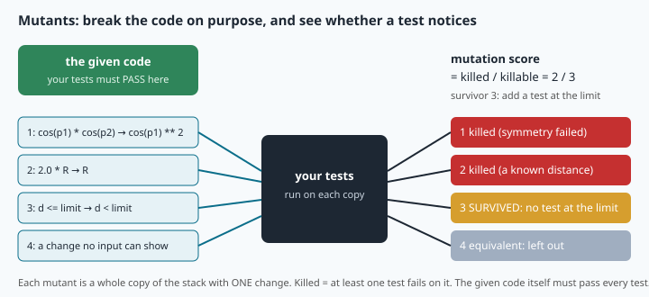

# Testing robotics code: examples, properties, mutants and launch tests

> [!NOTE] In short
> - A **test** is a small program that checks your program automatically, in seconds.
> - You will write **example tests** with pytest (fixtures, parametrized tests).
> - You will write **property tests** with hypothesis: one rule, hundreds of generated inputs.
> - You will measure the quality of your tests with **mutants** (wrong copies of the code).
> - You will run NAVERA's 359 unit tests and write a **launch test** that starts NAVERA's real arbiter.

A NAVERA box flies over the sea off a coastal city. Yesterday an engineer made a small change to the function
that checks whether a position is real. He tried it on his desk: it worked. He did not notice that it
now accepts (0, 0) — the "Null Island" value of a GNSS field nobody filled. Today a sensor glitch sends
(0, 0)… and the arbiter believes it.

How do you make sure that a change in one place breaks nothing elsewhere, in a product of tens of
thousands of lines written by several people over years? You cannot re-try everything by hand after
every change. You write **tests**: small programs that check the program automatically, in seconds,
every time. NAVERA has **359 unit tests** for its logic (you will run them all in the lab), plus
integration tests that start real nodes. This lesson covers how to write tests that actually find
bugs: example tests with pytest, **property-based** tests with hypothesis, **mutation** thinking to
measure test quality, and **launch tests** for ROS nodes.

## 1. Why, what and where

| Level | Tests | Speed | NAVERA |
|---|---|---|---|
| **unit** | one function or class, alone | milliseconds | `<package>/test/test_*.py`, run by `navera_tools/run_tests.sh` |
| **integration** | several real nodes talking over ROS | seconds | `navera_tools/tests/test_*.py`, `run_tests.sh --integration` |
| **system / simulation** | the whole box with a simulated vehicle | minutes | the simulator (lesson 31), `docs/VALIDATION_STATUS.md` |
| **field** | the real vehicle | hours, money | "field validation pending" |

Most tests should be unit tests: fast, precise about *where* a bug is, and runnable before every
commit. That is only possible if the logic is **separated** from the ROS plumbing — the `Tracker`
of lesson 11 and NAVERA's `estimate_from_fix()` are pure functions tested without any node. A test
pyramid that is mostly field tests is a slow, expensive way to find a sign error.

## 2. pytest in practice

pytest finds files `test_*.py`, runs functions `test_*`, and reports each as passed or failed.

```python
def test_one_degree_of_latitude():
    assert haversine_m(35.0, 10.0, 36.0, 10.0) == pytest.approx(M_PER_DEG, rel=1e-6)
```

`assert` stops the test with an AssertionError when its condition is false; pytest **rewrites** the
assert to show the values involved. Tools you will use:

- **`pytest.approx`** — never compare floats with `==`: `0.1 + 0.2 == 0.3` is False (binary rounding).
  `approx(x, abs=…)` or `rel=…` sets an explicit tolerance. Choose it like an engineer: tighter than
  the bug you want to catch (a missing cos(φ) at 60° is a factor 2), looser than honest rounding
  (≈ 1e-12 relative for double precision after a few operations) **and** looser than the gap between
  your simple expected value and what the formula really computes. Example: 1° of longitude at 60° is
  "half of M_PER_DEG" = 55 597.46 m **along the parallel**, but `haversine_m` gives the **great-circle**
  distance, 55 596.93 m (the great circle is a little shorter: a parallel is not a great circle).
  The gap is 1e-5 relative, so `rel=1e-6` fails on correct code; `rel=1e-3` passes and still catches
  the factor-2 bug.
- **`is`** for exact objects: `assert speed_mps(100, 0) is None`, `assert is_valid(0, 0) is False`
  (with `== False`, a function returning `0` would pass).
- **`pytest.raises(ValueError)`** — a test that an error *is* raised.
- **`@pytest.mark.parametrize("lat, lon, ok", [...])`** — one test function, many cases; each case is
  reported separately, e.g. `test_is_valid_position[0.0-0.0-False]`.
- **fixtures** — `@pytest.fixture` functions prepare a value (a start point, a temporary folder
  `tmp_path`, a running node) for every test that names it as an argument; with `yield`, the code
  after it runs as clean-up.

### Reading a failure

```
_____________________ test_is_finite_latlon[0.0-0.0-False] _____________________
lat = 0.0, lon = 0.0, ok = False
    def test_is_finite_latlon(lat, lon, ok):
>       assert is_finite_latlon(lat, lon) is ok
E       assert True is False
E        +  where True = is_finite_latlon(0.0, 0.0)

navera_common/test/test_geo.py:62: AssertionError
```

From top to bottom: the test and its **case**, the inputs, the failing line (`>`), the explanation
(`E`: the function returned True where False was expected), the file and line. A failing test is good
news delivered early: the bug was found on a desk, in one second, not over the sea.

## 3. Property-based testing

An example test checks a few points chosen by a human — who tends to choose the easy ones. A
**property** states what must hold for **all** inputs of a domain, and a tool generates the inputs.
With **hypothesis**:

```python
from hypothesis import given, settings, strategies as st
LAT = st.floats(min_value=-90.0, max_value=90.0, allow_nan=False)
LON = st.floats(min_value=-180.0, max_value=180.0, allow_nan=False)

@settings(deadline=None)
@given(LAT, LON, LAT, LON)
def test_distance_is_symmetric(lat1, lon1, lat2, lon2):
    assert haversine_m(lat1, lon1, lat2, lon2) == pytest.approx(haversine_m(lat2, lon2, lat1, lon1), abs=1e-6)
```

hypothesis runs the test with 100 generated inputs (more with `max_examples`), deliberately including
edge values (0, ±90, ±180, tiny and huge numbers). When one fails it **shrinks** it — simplifies it
step by step while it still fails — and prints a minimal `Falsifying example` (an input that
proves the property false). It stores failing
examples in a local database (`.hypothesis/`) and replays them first next time.

Good properties for navigation code are mathematical facts:

| Property | Statement |
|---|---|
| identity | d(A, A) = 0 |
| symmetry | d(A, B) = d(B, A) |
| bounds | 0 ≤ d(A, B) ≤ πR (half the circumference) |
| triangle inequality | d(A, C) ≤ d(A, B) + d(B, C) |
| round trip | `latlon_to_offset(offset_to_latlon(p)) = p` (inverse functions) |
| invariant | a valid start and a small move give a valid position |

**Worked example — a property that finds a real limit.** "From a valid start, a move of at most
50 km gives a valid position" sounds obvious. hypothesis answers with something like
`lat0=86.61, lon0=173.23, north=0.0, east=44488.5`: near the pole, 44 km east is several degrees of
longitude (1/cos φ is large), so the flat-Earth helper returns a longitude above 180° — invalid,
because it never **wraps** longitude. No human chose that example. The fix is either to restrict the
helper's documented **domain** (far from the poles and the antimeridian) or to wrap the result. NAVERA's
`dead_reckon` wraps (`lon2 = (degrees(l2) + 540.0) % 360.0 - 180.0`) and has a test for it:
`test_longitude_wraps_at_antimeridian`. Your run may find one of **two different failure modes**:

- **Longitude past ±180°** (a missing longitude wrap): near a pole as above, or **on the ±180°
  meridian** (the **antimeridian**), for example `lat0=78.2, lon0=180.0, east=46302`: a start at
  longitude 180 plus a move east gives more than 180.
- **Latitude past ±90°** (crossing the pole): for example `lat0=89.6, north=49751`. 49 751 m north is
  49 751 / 111 195 = 0.447° of latitude, and 89.6 + 0.447 = 90.05° — a latitude that does not exist.
  The flat-Earth helper just adds degrees; it does not know that a move north over the pole comes
  down the other side (latitude goes down again and the longitude jumps by 180°).

Both come from the same cause: the flat-Earth formula is only right **far from the poles and the
antimeridian**, and restricting the domain to |lat0| ≤ 80° and |lon0| ≤ 170° removes both (50 km is
at most 0.45° of latitude and, at 80°, 2.6° of longitude). Because generation is random, a run can
also miss a rare counterexample: raise `max_examples` for exploration, and keep the database.

## 4. Are the tests any good? Mutation thinking

All tests pass. Does that prove anything? Only that the code does what the tests check. This test
passes on correct code…

```python
def test_meters_to_degrees():
    dlat, dlon = meters_to_degrees(0, 0, 35.0)
    assert dlat == 0 and dlon == 0
```

…and also on code that forgets cos(φ) or swaps north and east. To measure a test suite, **break the
code on purpose** and see whether a test fails. Each broken copy is a **mutant**; a mutant that no
test detects **survives**. The **mutation score** = killed mutants / total mutants. Two subtleties:

- an **equivalent mutant** changes the code without changing its behaviour (for example removing
  `min(1.0, a)` in haversine, which only matters when rounding pushes `a` above 1) — no test can kill
  it, and that is fine;
- some mutants are invisible to examples but obvious to properties: a haversine that uses
  `cos(p1)²` instead of `cos(p1)·cos(p2)` gives correct results whenever both points share a
  latitude — but symmetry fails at once.

The checker of this lab applies 12 mutants to `geo_tools.py` and 5 to NAVERA's `geo.py`, and tells
you which ones survived. Ask, for every test you write: **which bug would this catch?**



## 5. Testing ROS nodes: launch_testing

Unit tests cover the logic; an **integration test** checks that the real nodes, with their real QoS,
topics and timers, behave together. ROS 2 provides **launch_testing**: a test file declares
`generate_test_description()`, which returns a `LaunchDescription` (the nodes under test plus a
`ReadyToTest()` action); `launch_test file.py` starts them, runs the `unittest` test classes **while
they run** (your test node publishes inputs and subscribes to outputs), then stops them and runs the
classes marked `@launch_testing.post_shutdown_test()` — typically checking that every process exited
cleanly (exit code 0).

```python
@pytest.mark.launch_test
def generate_test_description():
    arbiter = launch_ros.actions.Node(package="navera_estimator", executable="estimator_node.py")
    return launch.LaunchDescription([arbiter, launch_testing.actions.ReadyToTest()]), {"arbiter": arbiter}
```

Integration tests are slower and more fragile (discovery takes time, timing varies with machine load),
so they test **behaviour at the interfaces**: "one GNSS estimate → FIX, and exactly one position
published", "a NaN position → NO_FIX, nothing published". NAVERA's own
`navera_tools/tests/test_estimator.py` does exactly this with a subprocess and a scripted test node.

## 🐦 How birds do it

How do you ask a bird which way it wants to go? In the 1960s Stephen Emlen and his father John Emlen
built the **Emlen funnel**: a paper funnel with an ink pad at the bottom. A migratory bird placed
inside at night hops towards its preferred direction, and its inky footprints record it — an
**automatic, repeatable measurement**. Emlen then tested hypotheses one at a time in a planetarium with
indigo buntings: rotate the projected sky and the birds' direction rotates with it; raise young birds
under a sky turning around a different star (Betelgeuse) and, as adults, they treat that star as north
— they learn the **centre of rotation** of the sky. In the 1960s and 1970s Wolfgang and Roswitha
Wiltschko did the same with European robins and magnetic coils: turn the field, and the birds' choice
turns.

These are **property tests** of a navigation system: "for any rotation of the sky, the chosen
direction rotates by the same angle". And they are designed to be able to **fail** — the essential
quality of a test. The same logic is applied today to satellite-tagged birds crossing the Mediterranean: a
hypothesis about how they navigate is only useful if it predicts tracks that the measured ones could
contradict.

## In NAVERA

Open [navera_common/test/test_geo.py](file:navera/navera_common/test/test_geo.py):

```python
@pytest.mark.parametrize("lat, lon, ok", [
    (35.8, 10.6, True), (-89.9, -179.9, True), (0.0, 0.0, False),
    (float("nan"), 1.0, False), (91.0, 0.0, False), (0.0, 181.0, False),
    (None, 1.0, False), ("x", 1.0, False)])
def test_is_finite_latlon(lat, lon, ok):
    assert is_finite_latlon(lat, lon) is ok


def test_stationary_vehicle_does_not_move():
    # The old code floored every step at 120 m.
    out = dead_reckon(35.83, 10.64, 45.0, 0.0, 30.0)
    assert haversine_m(35.83, 10.64, *out) < 1e-6
```

(The coordinates 35.8 N, 10.6 E are in Sousse, Tunisia, where NAVERA is developed and where its
test data and map come from.) Eight cases in five lines — including absurd inputs (`None`, `"x"`) because sensor data must never
crash the arbiter. The second test is a **regression test**: its comment records a real bug (a stopped
vehicle was moved 120 m at every step); the test makes sure it can never come back unnoticed. The file
also defines its own `haversine_m` at the top: expected values are computed **independently** of the
code under test — testing a function with itself proves nothing.

The test runner, [navera_tools/run_tests.sh](file:navera/navera_tools/run_tests.sh), shows two
engineering habits: every step has a **time limit** ("a hang fails the run (TIMED OUT) instead of
blocking it"), and integration tests run on their **own ROS domain** with `ROS_LOCALHOST_ONLY=1`, "so
they never talk to a live NAVERA system on the same machine or network" — lesson 09's domains,
applied to testing.

## Glossary

| Term | Meaning |
|---|---|
| **unit / integration / system test** | one piece alone / several nodes together / the whole system |
| **assert, pytest.approx, pytest.raises** | must be true / equal within a tolerance / must raise |
| **parametrize** | one test function, many cases |
| **fixture** | a prepared value or resource injected into tests by name (`tmp_path`, `yield` clean-up) |
| **property-based test** | a statement checked on many generated inputs (hypothesis `@given`) |
| **strategy / shrinking** | how inputs are generated / reducing a failing input to a minimal one |
| **domain** | the set of inputs a function is designed for |
| **mutant / mutation score** | a deliberately broken copy / fraction of mutants the tests detect |
| **equivalent mutant** | a change that does not alter behaviour: undetectable by design |
| **regression test** | a test written after a bug, so that it can never return unnoticed |
| **launch_testing** | ROS 2 framework: start nodes, test them live, check their exit codes |

## Check what you learned

<details><summary>1. Why is <code>assert haversine_m(...) == 111195.0</code> a bad test?</summary>
Floats carry rounding errors, and 1° of latitude is only about 111 195 m. Use
<code>pytest.approx(M_PER_DEG, rel=1e-6)</code> with an independently computed expected value.
</details>

<details><summary>2. All 30 of your tests pass and 4 of 12 mutants survive. What is the mutation score, and what do you do?</summary>
8/12 ≈ 67 %. For each surviving mutant, write a test that passes on the correct code and fails on the
mutant (unless it is equivalent).
</details>

<details><summary>3. Which mutant is invisible to "1° of latitude along a meridian" and "1° of longitude on the equator", but caught by symmetry?</summary>
A haversine using <code>cos(p1)²</code> instead of <code>cos(p1)·cos(p2)</code>: both examples have equal latitudes (or no
longitude change), where the two expressions agree; swapping two points at different latitudes exposes it.
</details>

<details><summary>4. hypothesis prints <code>Falsifying example: lat0=86.6, …, east=44488.5</code>. Is the code wrong?</summary>
It is outside the domain the flat-Earth helper can handle: near a pole, or on the ±180° meridian, the
longitude exceeds 180° (and a move north close to a pole can also give a latitude above 90°). Either
restrict and document the domain, or fix the function (wrap the longitude, as NAVERA's dead_reckon does).
</details>

<details><summary>5. Why does NAVERA's run_tests.sh run integration tests on their own ROS domain?</summary>
So the test nodes never discover — or publish to — a real NAVERA running on the same machine or network.
</details>

Now open the **🛠️ Lab** tab.
