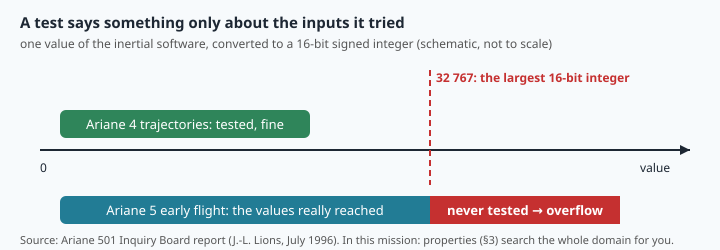
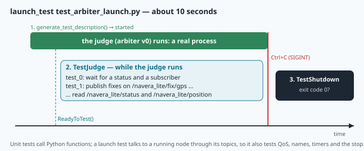

# Testing robotics code: examples, properties, mutants and launch tests



> [!NOTE] Mission brief
> **4 June 1996, Kourou.** About 37 seconds after lift-off, Ariane 5 flight 501 suddenly veers off course;
> seconds later it breaks up. Both inertial reference units, the main one and the backup with the same software, had stopped
> within 72 ms of each other. A 64-bit floating-point value was converted to a 16-bit signed integer: it
> was larger than 32 767, the conversion failed, and the unit shut down. The code came from Ariane 4,
> where it had worked for years. It had never been run with Ariane 5's trajectory, whose horizontal
> speed early in flight is much higher. (Inquiry Board report, J.-L. Lions, July 1996.)
>
> The code was not "untested". It was tested on the wrong **inputs**. NAVERA's own review of
> 28 September 2026 found the same kind of hole twice: day vision could publish a position of (0, 0) and
> use it as its anchor (LOC-4, critical), and the judge re-published the same measurement five times per
> second as if it were new (EST-1, critical). Both were fixed, tested and committed.
>
> Today you learn to write tests that **find** bugs, and to measure whether they would. **Session 1 —
> Pin the bugs:** break your stack on purpose, then write example tests and properties strong enough to
> catch wrong versions of it. **Session 2 — Hunt and launch:** measure your tests with mutants, play
> saboteur against the stack's own tests, and test the running judge over ROS. Badges: **Bug pinner**,
> then **Mutant hunter**.

**Objectives.** After this mission you can:

1. write **example tests** with pytest (tolerances you can justify, `is`, `pytest.raises`, parametrized cases,
   fixtures) that pin each rule of a specification;
2. write **property tests** with hypothesis, read the counterexample it finds, and decide whether it is
   a bug or a limit of the function's **domain**;
3. measure a test suite with **mutants**, explain a **mutation score**, and recognise an **equivalent
   mutant**;
4. run a stack's suite, break and restore it with git, and write a **launch test** that starts a node
   and checks its behaviour at its topics.

**You need:** missions 05 (git), 06 (`navera_lite/geo.py`), 01 and 09 (the jump gate, arbiter v0), 13
(`fl_node`, launch files). ⏱ Reading: 80 to 110 minutes with the ✏️ checks (§3 and §5 bring new tools).
Lab: 3 h 30 to 5 h in two sessions. In all: about 5 h to 6 h 30.

**Before you start** — three questions from earlier missions. If you miss two, reread lesson 06 §1 and
lesson 05 §1.

<details><summary>1. You edited <code>navera_lite/geo.py</code> and did not commit. What does <code>git restore navera_lite/geo.py</code> do, and what can git not give back?</summary>
It throws your edit away: the file is again as in the last commit. Git cannot give back edits that were
never committed or staged.
</details>

<details><summary>2. <code>offset(60.0, 10.0, 1000.0, 0.0)</code>: does the latitude change? Why does a metre east change the longitude more at 60° than at the equator?</summary>
No, a move east keeps the latitude (on the flat-Earth shortcut). A parallel at latitude φ is a circle of
radius R cos φ: at 60° it is half as long as the equator, so one metre is twice as many degrees.
</details>

<details><summary>3. Jump gate, 100 m/s and a 50 m margin. A fix arrives 180 m from the last trusted one, 1 s later. Accepted? And 2 s later?</summary>
After 1 s the gate is 150 m: refused. After 2 s it is 250 m: accepted. The gate grows with the time since
the last <b>trusted</b> fix.
</details>

<details><summary>Workspace and words (open if you need them)</summary>

Your files are in `~/lessons/14-testing/`. One terminal tab is enough; the launch test starts its own
judge. **pytest** and **hypothesis** are installed.

| Word | Meaning | Français |
|---|---|---|
| **unit test** | a test of one function or class, alone, in milliseconds | test unitaire |
| **integration test** | a test of several parts working together (here: real ROS nodes) | test d'intégration |
| **assertion** | a condition that must be true, or the test fails | assertion |
| **tolerance** | how far a computed number may be from the expected one | tolérance |
| **fixture** | a value prepared by pytest for each test that names it | fixture |
| **parametrized test** | one test function run once per case of a list | test paramétré |
| **property** | a statement that must hold for every input of a domain | propriété |
| **domain** | the inputs a function is designed for | domaine |
| **counterexample** | an input that makes a property false ("Falsifying example") | contre-exemple |
| **mutant** | a copy of the code with one small, deliberate bug | mutant |
| **mutation score** | killed mutants / mutants that can be killed | score de mutation |
| **regression test** | a test written after a bug, so that it cannot come back unnoticed | test de non-régression |
| **to pin (a rule, a bug)** | to write a test that fails as soon as the rule is broken | verrouiller par un test |
| **launch test** | a test that starts nodes, talks to them, and checks how they stop | test de lancement |
</details>

## 1. What a test is for, and where it lives

Imagine a colleague's "small change" in NAVERA Lite: `is_finite_latlon` now ends with `return in_range`
instead of `return in_range and not null_island`. It works on her desk. Then a receiver with an empty
field sends (0, 0), and the judge believes it. Nobody can try every function by hand after every change
of a stack of a few thousand lines. A **test** is a small program that does it in seconds, every time,
and says exactly what broke.

Tests come in levels:

| Level | What runs | Speed | In NAVERA Lite |
|---|---|---|---|
| **unit** | one function or class, no ROS | milliseconds | `navera_lite/tests/test_geo.py`, `test_arbiter_v0.py` (the judge's logic, `NaiveJudge`) |
| **integration** | real nodes, real topics and timers | seconds | `test_ros_smoke.py`; your launch test (§5) |
| **system** | the whole stack with a simulated vehicle | minutes | Sim Lite, mission 31 |
| **field** | the real vehicle | hours, and money | NAVERA: "field validation pending" |

Most tests should be unit tests: fast, and precise about *where* the bug is. That is possible only if
the logic is **separated** from the ROS plumbing. Arbiter v0 is built this way: `NaiveJudge` decides in
plain Python, `ArbiterV0` only connects it to topics. Mission 11's `TripComputer` and `TripNode` are the
same split.

One question to ask of every test you write: **which bug would make this test fail?** A test that
cannot fail proves nothing.

> [!QUESTION] ✏️ Check
> `test_arbiter_v0.py` runs in a tenth of a second; one of the stack's ROS tests takes about 10 s. Both test
> the judge. Why the difference, and which bug could only the slow one find?

<details><summary>Answer</summary>
The first calls <code>NaiveJudge</code> in Python: no process, no network. The second starts two real
nodes and waits for ROS discovery and messages. Only the slow one sees the wiring: a wrong topic name, an
incompatible QoS, a timer that never fires, a node that crashes at start.
</details>

## 2. Example tests with pytest

`pytest` finds the files named `test_*.py`, runs every function named `test_*` in them, and reports each
one as passed or failed. Inside, `assert` states what must be true. pytest rewrites the `assert` so that a
failure shows the values involved.

**Compare floats with a tolerance.** `0.1 + 0.2 == 0.3` is `False` in Python (binary rounding), so a
float is compared with `pytest.approx(expected, abs=…)` or `rel=…`. The tolerance is an engineering
choice: **tighter than the bug** you want to catch, **looser than the honest gap** between your simple
expected value and what the function really computes.

**Worked example.** One degree of longitude at 60° N. The simple expected value is "half a degree of the
equator": 111 194.93 × cos 60° = 55 597.46 m. That is the length **along the parallel**. But
`haversine_m` returns the **great-circle** distance, a little shorter because a parallel is not a great
circle: 55 596.93 m. The gap is 9.5 × 10⁻⁶ relative. So `rel=1e-6` fails on correct code, while
`rel=1e-3` passes and still catches a missing cos φ (a factor of 2). Write the reason next to the
tolerance: the next reader will want it.

Four more tools:

- `assert f(x) is True` (and `is False`, `is None`) for exact objects: with `== False`, a function that
  returns `0` would pass.
- `with pytest.raises(ValueError): f(bad)` passes only if `f` raises that error.
- **Parametrized test**: one function, many cases, each reported on its own line.
- **Fixture**: a function marked `@pytest.fixture` prepares a value; a test receives it by naming it
  as an argument.

> [!TIP] 🧰 Decorators and `yield` fixtures
> A line `@something` just above a `def` is a **decorator**: Python passes the function to `something`,
> which registers or wraps it. You met `@dataclass` in mission 12. `@pytest.mark.parametrize(…)` tells
> pytest to call the function once per case; `@pytest.fixture` tells pytest "this function makes a
> value". A fixture that must clean up after the test uses `yield` instead of `return`:
> ```python
> @pytest.fixture
> def log_file(tmp_path):          # tmp_path: a fixture of pytest itself, a new empty folder
>     f = open(tmp_path / "log.txt", "w")
>     yield f                      # the test runs here, with f
>     f.close()                    # then the clean-up runs, even if the test failed
> ```

Here is a fixture and a test already written in your `test_geo_examples.py`. They test `bearing_deg`,
which you do not test in the lab:

```python
@pytest.fixture
def quito():
    """A point 20 km south of the equator, in Ecuador (lat, lon in degrees)."""
    return (-0.1807, -78.4678)


@pytest.mark.parametrize("dlat, dlon, expected", [
    (0.01, 0.0, 0.0), (0.0, 0.01, 90.0), (-0.01, 0.0, 180.0), (0.0, -0.01, 270.0)])
def test_bearing_of_the_four_cardinal_directions(quito, dlat, dlon, expected):
    lat, lon = quito
    # 0.01 degree of tolerance: 100 times finer than a wrong quadrant or a swapped east/north
    assert bearing_deg(lat, lon, lat + dlat, lon + dlon) == pytest.approx(expected, abs=0.01)
```

**Reading a failure.** Suppose someone flips the sign of the east component inside `bearing_deg`. pytest
then prints, for the east case (shortened):

```
_________ test_bearing_of_the_four_cardinal_directions[0.0-0.01-90.0] __________
quito = (-0.1807, -78.4678), dlat = 0.0, dlon = 0.01, expected = 90.0
>       assert bearing_deg(lat, lon, lat + dlat, lon + dlon) == pytest.approx(expected, abs=0.01)
E       assert 269.99998423097645 == 90.0 ± 0.01
test_geo_examples.py:55: AssertionError
```

From the top: the test and its **case** in brackets, the inputs, the failing line (`>`), what was
obtained and expected (`E`), the file and line. North and south still pass: only east and west fail,
which already says "the east component". A failing test is good news, delivered on a desk.

**Which cases?** A specification is a list of rules. For each rule, write a case that breaks **that rule
alone** (so that only it can explain a failure), cases exactly **on the limits**, and a few normal cases.
Bugs live at the limits: `<` instead of `≤` is invisible everywhere else.

> [!QUESTION] ✏️ Check
> 1. You test one degree of longitude at 45° and at 75° with `rel=1e-5`. The great-circle gap is
>    6.3 × 10⁻⁶ at 45° and 1.18 × 10⁻⁵ at 75°. Which test fails on correct code?
> 2. `valid_heading(h)` must accept a heading in degrees in [0, 360). List six cases (input → result)
>    that pin this rule.

<details><summary>Answer</summary>
1. The 75° test: its honest gap is larger than the tolerance. The gap grows towards the poles, which is
why a tolerance must be chosen for the worst case you test, with its reason written next to it.<br>
2. For example 0.0 → True (the limit is in), 359.9 → True, 360.0 → False (the limit is out), −0.1 →
False, NaN → False, "north" → False (not a number). Each case breaks one rule, or sits on one limit.
</details>

## 3. Properties: one rule, hundreds of inputs

A human chooses examples, and chooses easy ones. A **property** states what must hold for **every** input
of a domain, and a tool generates the inputs. With **hypothesis**:

```python
from hypothesis import assume, given, settings
from hypothesis import strategies as st

LAT = st.floats(min_value=-90.0, max_value=90.0)     # a STRATEGY: how to draw a latitude

@settings(deadline=None)                             # no time limit per example (shared machine)
@given(LAT, LON, LAT, LON)                           # draw four numbers, call the test with them
def test_a_distance_is_between_zero_and_half_the_earth(lat1, lon1, lat2, lon2):
    d = haversine_m(lat1, lon1, lat2, lon2)
    assert 0.0 <= d <= math.pi * R_M + 1e-6
```

hypothesis calls the test 100 times (`@settings(max_examples=…)` for more), and on purpose tries edge
values: 0, the limits, tiny and huge numbers. `assume(condition)` throws away a drawn example that is
outside the property's domain. When an example fails, hypothesis **shrinks** it: it simplifies the input
step by step while the test still fails, and prints a small **Falsifying example**. It also stores
failing examples in `.hypothesis/` and tries them first next time.

**Worked example: Ariane in miniature.** A telemetry link packs the ground speed into 2 bytes, in
centimetres per second:

```python
def pack_speed(v_mps):
    return struct.pack("<h", round(v_mps * 100))      # "<h": a signed 16-bit integer

def unpack_speed(data):
    return struct.unpack("<h", data)[0] / 100
```

Example tests at 0, 12.34, 30 and 100 m/s all pass. The property "unpack gives back what was packed, to
half a centimetre per second, for every speed in [0, 400] m/s" fails at once:

```
Falsifying example: test_pack_round_trip(
    v=327.67500000000007,
)
E       struct.error: short format requires (-0x7fff - 1) <= number <= 0x7fff
```

Shrinking walked it down to the edge: from 327.675 m/s on, the speed rounds to 32 768 cm/s, one more
than a 16-bit integer can hold (hypothesis stopped one rounding step above it). That is flight 501 in four lines. Now the engineer must decide: is the bug in
the code, or in the domain? Three honest answers: refuse speeds above 327.67 m/s with a clear error (and
test that it is raised), clamp them (and say so), or use a wider field. The wrong answer is to leave the
domain unwritten.

Good properties for navigation code are mathematical facts:

| Property | Statement |
|---|---|
| identity | d(A, A) = 0 |
| symmetry | d(A, B) = d(B, A) |
| bounds | 0 ≤ d(A, B) ≤ πR |
| triangle inequality | d(A, C) ≤ d(A, B) + d(B, C) |
| round trip | a function and its inverse give the input back |
| invariant | a valid input gives a valid output |

**Random search can miss.** `great_circle_points` raises an error for two opposite points (its
docstring says so). The property "the midpoint is halfway" ran 100 examples with three different seeds
and never drew two opposite points. A rare edge still deserves an example test: properties and examples
work together.

> [!QUESTION] ✏️ Check
> You choose to make `pack_speed` refuse speeds above 327.67 m/s with a `ValueError`. Which tests do you
> write now?

<details><summary>Answer</summary>
Two: the round-trip property on the new domain [0, 327.67], and an example (or a property on (327.675,
400]) with <code>pytest.raises(ValueError)</code>. A third, on the limit itself: 327.67 m/s packs and
unpacks correctly. The domain is now written in the code and pinned by tests.
</details>

<details><summary>Read this after lab Step 3: the validity property of offset</summary>
On the whole Earth, hypothesis finds a start very close to a pole and a move towards it, for example
lat0 = 89.5526°, n = 49 751 m (50 km north, from 50 km below the pole): the result is a latitude of
90.00002°, just above 90°. Yours will differ: any start within 50 km of a pole, with a move towards it,
fails. The flat-Earth shortcut adds degrees;
it does not know that a move over the pole comes down on the other side (latitude decreases, longitude
jumps by 180°). It is a limit of the shortcut's domain, not a slip in its code: <code>offset</code> is
meant for small moves far from the poles. Restricting the start to |lat0| ≤ 80° (50 km is at most 0.45°
of latitude) removes it. The longitude, on the other hand, never leaves [−180, 180): <code>offset</code>
brings it back, as its docstring says.
</details>

## 4. Are the tests any good? Mutants

Every test passes. What does that prove? Only that the code does what the tests check. To measure a
test suite, **break the code on purpose** and see whether a test fails. Each broken copy is a **mutant**;
a mutant that makes at least one test fail is **killed**; one that passes every test **survives**:

```
mutation score = killed mutants / mutants that can be killed
```


**Worked example.** A mutant of `haversine_m` writes `np.cos(p1) ** 2` where the code has
`np.cos(p1) * np.cos(p2)`. Five reasonable tests:

| Test | Correct code | Mutant | Killed? |
|---|---|---|---|
| a point to itself is 0 m | 0.0 | 0.0 | no |
| 1° along a meridian | 111 194.93 | 111 194.93 | no |
| 1° along the equator | 111 194.93 | 111 194.93 | no |
| 1° along the 60° parallel | 55 596.93 | 55 596.93 | no |
| the bounds property 0 ≤ d ≤ πR | holds | holds | no |

All five survive it: in each one both latitudes are equal, or the longitudes are, and there the two
formulas agree. The **symmetry** property kills it on its first try: London → Paris gives 341 098.8 m,
Paris → London 346 134.6 m (the truth is 343 556.1 m). So would one "diagonal" example, with both
latitudes and longitudes different, if you thought of writing it.

**Equivalent mutants.** Some changes do not change the behaviour at all: no input can show a
difference, so no test can kill them, and they are left out of the score. Be careful before you call a
mutant equivalent. In `haversine_m`, removing `np.minimum(1.0, a)` looks harmless, since a sine squared
cannot exceed 1. Yet for the points (−44.0875753669041, −1.6433686469012514) and their opposite point,
rounding gives a = 1.0000000000000002, and without the guard the function returns NaN. "Almost
equivalent" mutants are exactly the bugs that reach the field.

> [!TIP] 🧰 NaN in comparisons
> Every comparison with NaN is False: `nan < 1`, `nan <= 180`, `nan > 0`, `nan == nan` all give `False`
> (only `!=` gives `True`). So `abs(x) <= 180.0` is already `False` for NaN, and for ±infinity too. Try it:
> `python3 -c "import math; print(math.nan <= 180, abs(-math.inf) <= 180)"`.

**The saboteur's view.** The mutants that survive a real suite show what it does not protect. Tools such
as mutmut generate thousands of mutants automatically; in the lab you write them yourself, and the
check runs its own, which you have not seen.

> [!QUESTION] ✏️ Check
> A mutant of mission 01's gate writes `d < v_max × elapsed + margin` instead of `≤`. With 100 m/s and
> 50 m, which of these tests kill it: (a) 120 m after 1 s → accepted; (b) 500 m after 1 s → refused;
> (c) 150 m after 1 s → accepted?

<details><summary>Answer</summary>
Only (c): 150 m is exactly the limit, the one input where <code>&lt;</code> and <code>≤</code> disagree.
(a) and (b) are far from the limit and pass on both. This is why §2 says: test on the limits.
</details>

## 5. Testing a running node: launch tests

Arbiter v0's rule "never publish the same measurement twice" is not in `NaiveJudge`: it is in the node,
`ArbiterV0.step`, which remembers the last position it sent. No unit test of `NaiveJudge` can see it.
QoS, topic names, timers and a clean stop are the same: only a test that **starts the node** and
talks to it can check them. ROS 2's **launch_testing** does this:



1. `generate_test_description()` returns a `LaunchDescription`: the processes under test, then
   `ReadyToTest()` ("the tests may start"), plus a dict that names the processes.
2. The tests of the normal test classes run **while the processes run**. Your test node publishes
   inputs and subscribes to outputs, like any node.
3. `launch_test` stops the processes (Ctrl+C), then runs the classes marked
   `@launch_testing.post_shutdown_test()`; `assertExitCodes` checks that each one exited with code 0.

```python
@pytest.mark.launch_test
def generate_test_description():
    judge = fl_node("arbiter_v0", "arbiter", params_file="navera_lite.yaml")   # mission 13's helper
    return launch.LaunchDescription([judge, launch_testing.actions.ReadyToTest()]), {"judge": judge}
```

> [!TIP] 🧰 unittest in five lines
> launch_testing uses Python's **unittest**: tests are methods `test_…` of a class that inherits
> `unittest.TestCase`, run in **alphabetical** order. `setUpClass` runs once before them (create the test
> node, its publisher and subscriptions), `tearDownClass` once after. Instead of `assert`, use the
> methods: `self.assertEqual(a, b)`, `self.assertIn("jump", text)`, `self.assertTrue(x)`,
> `self.assertAlmostEqual(a, b, places=7)`. Each takes an optional last argument: a message for the
> failure.

Integration tests are slower and more fragile than unit tests, so they test **behaviour at the
interfaces** and guard against timing:

- **Discovery takes time.** A fix published before the judge has subscribed is lost (`FIX_QOS` is
  VOLATILE: no late delivery). Wait until the publisher sees a subscriber.
- **Let messages arrive.** Received messages go into lists only while the test node **spins**; your file
  has a `spin_for(seconds)` helper.
- **Time limits.** A test that waits forever blocks everything: every wait has an end.
- **Isolation.** Your sandbox has its own ROS domain, so your test never hears another student's judge.
  A judge of your own still running in your terminal would be heard: stop it first.

> [!QUESTION] ✏️ Check
> Without the wait for a subscriber in `test_0`, a launch test passes 9 times out of 10 on a quiet
> machine. What do we call such a test, and why is it worse than a test that always fails?

<details><summary>Answer</summary>
A <b>flaky</b> test. It fails for reasons that have nothing to do with the code (here: discovery
timing), so people learn to re-run it and ignore it — and then they also ignore it on the day it reports
a real bug. A test that always fails is at least fixed at once.
</details>

> [!WARNING] Common wrong ideas
> - "All tests pass, so the code is correct." They pass on the inputs they tried (§4: mutants).
> - "More tests means better tests." Five tests with equal latitudes miss the `cos²` bug; one diagonal
>   example kills it. Ask which bug each test would catch.
> - "A failing property means the code is wrong." It means the code and its stated domain disagree;
>   sometimes the domain is what must be written (§3).
> - "Compare floats with `==`, or with a tiny tolerance to be strict." Strict is not right: a tolerance
>   below the honest gap fails correct code (§2).
> - "A unit test of the judge's logic tests the judge." Not its wiring, its QoS or what the node
>   publishes (§5).

## In NAVERA

From NAVERA's engineering backlog and validation report (in words; its code is not part of the course):

- **Done means tested.** The backlog's rule, since the full code review of 28 September 2026: an item is
  done only when it is fixed, **tested** and committed, and the commit is listed.
- **LOC-4 (critical):** day vision could publish a rejected match, or (0, 0), and use it as its anchor.
  **EST-1 (critical):** the judge re-published the same measurement at 5 Hz as new measured fixes. Both
  fixed. Why EST-1 is critical: a filter downstream (an autopilot's EKF) that fuses each message as an
  independent measurement then believes one fix five times per second. Its uncertainty shrinks on
  information it does not have, and an old position keeps "arriving" after the GPS has stopped.
- The validation report (last updated 3 October 2026) lists bench robustness tests of the judge, for
  example: one measurement → published once ("it was re-published at 5 Hz"); a GPS jump of 5 km in 1 s →
  refused as possible spoofing, re-accepted once plausible again; an all-zero covariance → DEGRADED
  (before the fix: FIX with an accuracy of 0).
- **R-5 (review of 1 October 2026):** a test run hung for 30 minutes and reported no failure. Since then
  every step of NAVERA's test script has a time limit, and when it is reached the step's whole process
  group is killed: a hang becomes a failure.
- None of these tests is a flight: NAVERA is **Release 0.2 — field validation pending**, and its report
  says which results come from the bench, the simulator or synthetic data.

## In NAVERA Lite

Your stack ships with its own suite, `navera_lite/tests/`: one test file per part, written with the
parts, plus one ROS smoke test. `navera_lite/tools/init_repo.sh` makes your
lesson folder a git repository, so that a broken part is one `git restore` away; mission 33 uses it again
for your final project. You write three test files: `test_geo_examples.py` and `test_geo_properties.py`
for `geo.py` and `guard.py` (missions 06 and 01), and `test_arbiter_launch.py`, a launch test of arbiter
v0 (mission 09). `hunt.py` runs your tests against mutants.

## 🐦 How birds do it

How do you ask a bird which way it wants to fly? In the 1960s Stephen Emlen put migratory indigo
buntings in a paper funnel with an ink pad at the bottom: at night the bird hops towards its preferred
direction, and its footprints record it. In a planetarium he then **rotated the projected sky**, and the
birds' direction rotated with it. That is a property test of a navigation system — "for any rotation of
the sky, the chosen direction turns by the same angle" — designed so that it could fail.

## Summary

1. A test must be able to **fail**: ask which bug each one would catch.
2. Example tests pin rules and **limits**; choose each tolerance between the bug and the honest gap, and
   write why.
3. A **property** checks a rule on hundreds of generated inputs; its shrunk counterexample asks: a bug,
   or an unwritten domain?
4. **Mutants** measure tests: killed / killable. An equivalent mutant cannot be killed; an "almost
   equivalent" one is a real, rare bug.
5. A **launch test** starts the node and checks it at its topics, with waits that end.

**Next mission:** GNSS and NMEA — the real receiver's sentences, parsed by your own code (and tested).

## Check yourself

Answer without scrolling up.

<details><summary>1. <code>assert haversine_m(10, 20, 11, 20) == M_PER_DEG</code> fails, although the function is correct and one degree of a meridian is exactly M_PER_DEG. Why, and what do you write instead?</summary>
The function returns 111 194.92664455871 m, the formula 111 194.92664455873 m: two different roundings of the
same number, 2 × 10⁻¹¹ m apart. Floats are compared with a tolerance chosen between the honest gap and the
bug: <code>pytest.approx(M_PER_DEG, rel=1e-9)</code>.
</details>

<details><summary>2. All 30 of your tests pass; 12 mutants are run, 4 survive, and 1 of the 4 is equivalent. What is the mutation score, and what do you do next?</summary>
8 / 11 ≈ 73 %. For each of the 3 killable survivors, write a test that passes on the correct code and fails
on the mutant.
</details>

<details><summary>3. hypothesis prints a Falsifying example. Name two possible decisions.</summary>
Fix the code (it is a bug), or restrict and document the domain (refuse, clamp, or <code>assume</code> in the
property) — and pin the decision with a test.
</details>

<details><summary>4. Which rule of arbiter v0 can only a launch test check, and why?</summary>
"Never publish the same measurement twice" (or QoS, topics, clean exit): it lives in the node
(<code>ArbiterV0.step</code>), not in <code>NaiveJudge</code>.
</details>

<details><summary>5. (Mission 12) Arbiter v0 shows FIX for a fix whose covariance is all zeros. Which test level would have caught it first, and what would it assert?</summary>
A unit test of the judge's logic (or of <code>estimate.stated_sigma</code>): an all-zero covariance gives no
stated σ, so the state must not be FIX. <code>test_arbiter_v0.py</code> pins this hole on purpose.
</details>

Now open the **🛠️ Lab** tab.
