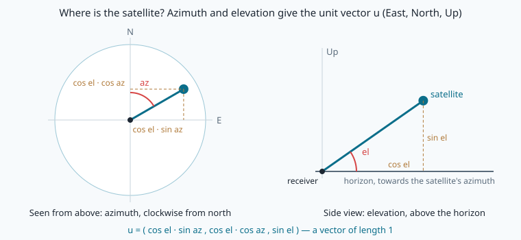
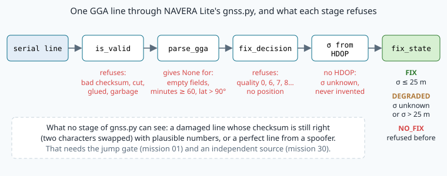

# GNSS receivers and NMEA 0183: from satellites to a trusted fix

> [!NOTE] Mission brief
> **28 September 2026.** A full code review of NAVERA finds, among others, five problems in the way it
> reads **and judges** its GPS receiver: the line **checksum was not verified** (GPS-1); a receiver that was only **guessing** its
> position (GGA quality 6) was **accepted as a fix** (GPS-2); the altitude was the **sea-level** one instead of
> the ellipsoidal one, and a missing altitude became **0** (GPS-4); a missing HDOP was **invented** (GPS-5); and
> the judge showed a position as precise whatever its accuracy: "**HDOP 20 = green**" (EST-6). All five were
> fixed within days (validation report, 3 October 2026). None of them is exotic: each one is a line of code that trusted a
> line of text.
>
> You are now the engineer who must make sure that NAVERA Lite, your stack, cannot have any of these bugs.
> You build its GNSS part, `navera_lite/gnss.py`, then you attack it like a saboteur on the serial cable.
> **Session 1 — The wire:** read and check the receiver's text (badge **Line inspector**). **Session 2 — The
> sky:** turn the satellite geometry into an honest σ and a state (badge **Fix judge**).
>
> **Start now:** open the 🛠️ **Lab** tab, do **Step 0** (two minutes, no code), then come back here for §1.

**Objectives.** After this mission you can:

1. **validate and parse** NMEA 0183 sentences (checksum, GGA, GSA) so that a damaged line never crashes the
   reader and never becomes a position, and say what a checksum **cannot** catch;
2. **convert** degrees-and-minutes to decimal degrees with range checks, and an MSL altitude to an
   ellipsoidal height;
3. **compute** the DOPs of a 3-D satellite geometry from (GᵀG)⁻¹, recognise a **singular** geometry, and
   explain why VDOP is usually larger than HDOP;
4. **decide** like NAVERA's judge: which fix qualities are measurements, σ = 2 m × HDOP, and FIX / DEGRADED /
   NO_FIX.

**You need:** mission 01 (least squares, the Jacobian H, HDOP), mission 06 (ENU, heights), missions 03–04
(dicts, `None`). ⏱ Reading: about 60 minutes with the ✏️ checks: §1–§4 before session 1, §5–§6 before
session 2. Lab: 3 to 4 h 30.

**Before you start.** Answer without looking; if you miss two, reread mission 01 §3 and mission 06 §8.

<details><summary>1. In mission 01, one beacon gave one row of the Jacobian H. What were its three entries, and where did HDOP come from?</summary>
[uₓ, u_y, 1]: the unit vector from the beacon to the receiver, and 1 for the clock bias. HDOP =
√((HᵀH)⁻¹ₓₓ + (HᵀH)⁻¹ᵧᵧ): about 1.22 inside the triangle of beacons, 1.60 with C moved outside.
</details>
<details><summary>2. A receiver says 12.0 m above mean sea level, geoid separation +32.0 m. What is the ellipsoidal height? And if the altitude field is empty?</summary>
h = 12.0 + 32.0 = 44.0 m above the WGS84 ellipsoid. Empty: unknown (NaN or None), never 0.
</details>
<details><summary>3. <code>d = {"lat": None}</code>. What do <code>d["lat"] is None</code>, <code>d.get("lon")</code> and <code>d["lon"]</code> give?</summary>
True; None (get returns None for a missing key); KeyError.
</details>

<details><summary>Words of this lesson (open if you need them)</summary>

| Word | Meaning | Français |
|---|---|---|
| **NMEA 0183** | the text protocol of almost every GNSS receiver: one sentence per line | NMEA 0183 |
| **sentence, field** | one line `$…*hh`; the values between its commas | trame, champ |
| **talker** | two letters that say which system speaks: GP (GPS), GN (several systems)… | émetteur |
| **checksum** | 2 hexadecimal digits that let the reader detect damage | somme de contrôle |
| **XOR** | "exclusive or": bit by bit, same bits → 0, different bits → 1 (`^` in Python) | OU exclusif |
| **fix quality** | GGA field 6: how the position was obtained (0 none, 1 GPS, 6 estimated…) | qualité du fix |
| **dead reckoning** | continuing a position from the last speed and heading, with no measurement | navigation à l'estime |
| **azimuth, elevation** | direction of a satellite: clockwise from north; angle above the horizon | azimut, élévation |
| **DOP** | dilution of precision: how much the geometry multiplies the range error | dilution de précision |
| **covariance type** | how much a stated covariance can be trusted (unknown, approximated…) | type de covariance |
</details>

## 1. One line of text per message

A GNSS receiver solves the problem of mission 01, many times per second, and tells the flight computer
the result as **text**, over a serial cable. On NAVERA the receiver (a u-blox NEO-M8N) talks at **9600
baud**: 9600 bits per second. Each character costs 10 bits (a start bit, 8 data bits, a stop bit), so the
link carries at most **960 characters per second**. That is little: a receiver must be told to send only
the sentences you need.

The format is **NMEA 0183** (National Marine Electronics Association, 1983). One message is one line,
called a **sentence**:

```
$GPGSA,A,3,02,05,07,09,13,20,23,24,30,,,,1.98,1.15,1.61*0C\r\n
│└┬┘└┬┘ └───────────── fields, separated by commas ─────────┘ └┬┘
│ │  type (GSA)                                                checksum: 2 hexadecimal digits
│ talker (GP = GPS)
start
```

- A sentence is at most **82 characters**, including `$` and the final `\r\n`.
- The **talker** says which system speaks: `GP` GPS, `GL` GLONASS, `GA` Galileo, `GB` BeiDou, `GN` a
  combination. A reader must accept any talker for the sentence types it knows.
- An **empty field** (`,,`) means "no value". It is **not** zero: zero is a real latitude, a real altitude.

> [!QUESTION] ✏️ Check
> A receiver sends GGA (about 72 characters with `\r\n`) and RMC (about 70) **ten** times per second. Does
> that fit at 9600 baud? At 38 400 baud?

<details><summary>Answer</summary>
10 × 142 = 1 420 characters per second: more than 960, so lines are lost at 9600 baud. 38 400 baud carries
3 840 characters per second: it fits, with room for GSA.
</details>

## 2. The checksum: XOR, and what it cannot see

The two characters after `*` are the **XOR** of the codes of all the characters **between** `$` and `*`,
written as two hexadecimal digits. XOR compares two numbers bit by bit: same bits give 0, different bits
give 1.

> [!TIP] 🧰 XOR and hexadecimal in Python
> ```python
> ord("G"), ord("P")          # (71, 80): the character codes
> 71 ^ 80                     # 23: XOR, bit by bit (0100 0111 ^ 0101 0000 = 0001 0111)
> f"{23:02X}", f"{13:02X}"    # ('17', '0D'): 2 upper-case hex digits, with the leading zero
> int("0D", 16)               # 13: back from hex
> "3D".upper()                # '3D' — and "3d".upper() is '3D' too
> ```
> Hexadecimal counts 0–9 then A–F: `0D` is 13, `32` is 3 × 16 + 2 = 50.

**Worked example.** Body `GPGSA,A,1`, starting from 0:

| char | code | bits | running XOR |
|---|---|---|---|
| G | 71 | 0100 0111 | 0100 0111 = `47` |
| P | 80 | 0101 0000 | 0001 0111 = `17` |
| G | 71 | 0100 0111 | 0101 0000 = `50` |
| S | 83 | 0101 0011 | 0000 0011 = `03` |
| A | 65 | 0100 0001 | 0100 0010 = `42` |
| , | 44 | 0010 1100 | 0110 1110 = `6E` |
| A | 65 | 0100 0001 | 0010 1111 = `2F` |
| , | 44 | 0010 1100 | 0000 0011 = `03` |
| 1 | 49 | 0011 0001 | 0011 0010 = `32` |

The sentence is `$GPGSA,A,1*32`. What does an 8-bit XOR detect?

- **One changed character: always.** Its bits differ somewhere, and nothing else changed to cancel them.
- **Two changed characters: almost always.** They escape only if their changes cancel exactly (the same
  bits flipped in both): for random damage, about **1 in 256**.
- **Two swapped characters: never.** XOR does not care about order (a ^ b = b ^ a). `3547.17` written
  `3574.17` has exactly the same checksum.
- **A deliberate change: never.** Anyone can recompute the two digits. A checksum detects **accidents**
  (a noisy cable, a cut line), not **attacks**: it is not a signature.

So a reader must check more than the checksum. The line must start with `$`, have `*` and exactly two hex
digits, contain no second `$` (two sentences glued together when a line ending was lost), and be at most 82
characters. Then every **field** must be checked for range: that is §3.

> [!QUESTION] ✏️ Check
> 1. The body `GPGSA,A,1` is damaged into `GPGSA,A,3`. What is the new checksum, and does the reader notice?
> 2. A cable error turns one byte into a value above 127 (not ASCII). What should the reader do with the
>    whole line?

<details><summary>Answer</summary>
1. '1' (0011 0001) became '3' (0011 0011): one bit differs, so the XOR changes in that bit: 32 → 30. The
line says *32, the body gives 30: refused.<br>
2. Refuse the line. Decoding the bytes with <code>errors="replace"</code> turns the bad byte into "�" instead of
crashing; the checksum then fails, and the line is refused like any other damaged line.
</details>

## 3. GGA: the fix


The **GGA** sentence carries the position. The only line recorded from NAVERA's own receiver (project
report, 2 June 2026) is an RMC sentence at the test site, M'saken: `$GNRMC,141621.00,A,3544.04006,N,
01034.55091,E,…`. The GGA in the figure is an example built at the same position; its other fields are
typical values.

| # | Field | Example | Meaning |
|---|---|---|---|
| 1 | UTC time | `141621.00` | hhmmss.ss |
| 2, 3 | latitude | `3544.04006`, `N` | ddmm.mmmmm, hemisphere |
| 4, 5 | longitude | `01034.55091`, `E` | dddmm.mmmmm, hemisphere |
| 6 | fix quality | `1` | how the position was obtained (table below) |
| 7 | satellites used | `12` | |
| 8 | HDOP | `0.72` | horizontal dilution of precision (§5) |
| 9, 10 | altitude | `95.3`, `M` | above **mean sea level**, metres |
| 11, 12 | geoid separation | `32.1`, `M` | ellipsoid − mean sea level, metres |
| 13, 14 | DGPS age, station | empty | only with differential corrections |

**Degrees and minutes.** NMEA glues degrees and **minutes** (1/60 of a degree) together: the last two
digits before the decimal point are whole minutes.

```
3544.04006, N   →  35 + 44.04006 / 60  =  35.734001°
01034.55091, E  →  10 + 34.55091 / 60  =  10.575849°           S and W are negative
```

These are the 35.734 N, 10.576 E of NAVERA's report (to its three decimals). Reading `3544.04006` as 35.4404006° (divide by
100) is wrong by 0.29°, about **33 km**. A robust reader also refuses impossible values: **minutes of 60
or more**, a latitude above 90°, a longitude above 180°. `3574.17098` passes the checksum test if two
digits were swapped, but 74 minutes is not an angle.

**Fix quality** (field 6) says **how** the position was obtained:

| Value | Meaning | Measured by satellites? |
|---|---|---|
| 0 | no fix | no |
| 1 | GPS fix (standard positioning) | **yes** |
| 2 | differential GPS (DGPS, SBAS corrections) | **yes** |
| 3 | PPS (precise military service) | not used by civil receivers |
| 4 | RTK fixed (centimetres) | **yes** |
| 5 | RTK float (decimetres) | **yes** |
| 6 | estimated: the receiver's own **dead reckoning** | **no** |
| 7 | manual input | no |
| 8 | simulator | no |

Quality 6 is the dangerous one. In a tunnel, some receivers continue the last speed and heading and print a
clean-looking position, with quality 6. No satellite measured it: if the car turned in the tunnel, the
position is simply wrong, and nothing in the line says how wrong. That was NAVERA's GPS-2.

**Heights.** GGA gives the altitude above **mean sea level** (field 9) and the **geoid separation** (field
11). As in mission 06 §8, the height above the WGS84 ellipsoid is their sum: 95.3 + 32.1 = **127.4 m** in
the figure. Using field 9 alone as an ellipsoidal height is NAVERA's GPS-4 (about 32 m wrong around Sousse, the
geoid separation used in this course's logs); turning an
empty field into 0 is the other half of GPS-4.

> [!QUESTION] ✏️ Check
> 1. Convert `3355.50000,S` and `01825.40000,E` (Cape Town) to decimal degrees.
> 2. A GGA reads `…,6,00,,9.9,M,32.0,M,,*5F`: quality 6, 0 satellites, no HDOP, a position. What is it, and
>    what should a navigation stack do with it?

<details><summary>Answer</summary>
1. −(33 + 55.5/60) = <b>−33.925000°</b>; 18 + 25.4/60 = <b>18.423333°</b>.<br>
2. The receiver's own dead reckoning. Not a measurement: refuse it as a GPS fix and say why ("receiver dead
reckoning"), so the judge knows that GPS is missing and can use another source.
</details>

## 4. GSA and GSV: which satellites, and where

**GSA** says which satellites the receiver **used** and the DOPs it computed:

`$GPGSA,A,3,02,05,07,09,13,20,23,24,30,,,,1.98,1.15,1.61*0C`

| # | Field | Meaning |
|---|---|---|
| 1 | `A` | mode selection: A automatic, M manual |
| 2 | `3` | fix type: 1 none, 2 = 2-D, 3 = 3-D |
| 3–14 | `02,05,…,,,` | the PRNs (satellite numbers) **used**; 12 slots, empty slots `,,` |
| 15, 16, 17 | `1.98,1.15,1.61` | PDOP, HDOP, VDOP |

NMEA 4.10 and later add an 18th field, the system ID (1 GPS, 2 GLONASS, 3 Galileo…); a multi-system
receiver then sends one GSA per system. A robust reader accepts both versions.

**GSV** lists the satellites **in view**, four per sentence: PRN, **elevation** (degrees above the
horizon), **azimuth** (degrees clockwise from north) and signal strength (dB-Hz, empty when the
satellite is seen but not tracked):

`$GPGSV,3,1,12,02,61,008,45,05,31,051,38,07,20,097,34,09,45,130,41*7F`  — sentence 1 of 3, 12 in view.

GSV tells **where** each satellite is, GSA **which** were used: together, the geometry of the fix (§5).
`parse_gsv` is given finished; you write `parse_gsa`.

> [!QUESTION] ✏️ Check
> A receiver sees 11 satellites. How many GSV sentences does it send, and how many satellites are in the last one?

<details><summary>Answer</summary>
Four per sentence: 3 sentences, 4 + 4 + 3. The last one is shorter: a reader must not expect four blocks.
</details>

---

**Session 2 — The sky.** Read §5–§6 before lab Step 6.

## 5. Geometry: DOP in three dimensions

**Why.** The same receiver gives about 1.5 m in an open field and 30 m in a narrow street. The range errors
are similar; the **geometry** changes. Mission 01 showed it in 2-D with three beacons. Now the receiver
is in 3-D, under real satellites.

**From mission 01's H to the receiver's G.** In mission 01, each beacon gave a row [uₓ, u_y, 1] of the
Jacobian, with u the unit vector **from the beacon to the receiver**. A receiver knows each satellite by its
azimuth and elevation (GSV). The unit vector **from the receiver to the satellite**, in East, North, Up, is

```
u = ( cos el · sin az ,  cos el · cos az ,  sin el )
```



Mission 01's vector points the other way, so one row of the **geometry matrix G** is

```
row of G = [ −u_E,  −u_N,  −u_U,  1 ]          (East, North, Up, clock)
```

Same idea, one more column: n satellites give an n × 4 matrix. As in mission 01, with the same independent
error σ on every range, the solution's covariance is σ² Q with **Q = (GᵀG)⁻¹**, a 4 × 4 matrix that depends
**only on the geometry**. The DOPs are square roots of parts of its diagonal:

```
EDOP = √Q_EE     NDOP = √Q_NN     HDOP = √(Q_EE + Q_NN)     VDOP = √Q_UU     TDOP = √Q_bb (clock)
PDOP = √(Q_EE + Q_NN + Q_UU)       GDOP = √(Q_EE + Q_NN + Q_UU + Q_bb)
```

A DOP has no unit: it **multiplies** the range error. With σ = 2 m on every range, the East error is
σ_E = 2 m × EDOP. (How such errors combine into "95 % of the fixes within x m" is mission 32's subject.)

**Worked example.** Four satellites at elevation 30° towards N, E, S and W, plus one straight overhead.
cos 30° = 0.866, sin 30° = 0.5:

```
G = [  0      −0.866  −0.5   1 ]   (az 0)              GᵀG = [ 1.5   0    0    0 ]
    [ −0.866   0      −0.5   1 ]   (az 90)                   [ 0    1.5   0    0 ]
    [  0       0.866  −0.5   1 ]   (az 180)                  [ 0    0    2   −3 ]
    [  0.866   0      −0.5   1 ]   (az 270)                  [ 0    0   −3    5 ]
    [  0       0      −1     1 ]   (overhead)
```

GᵀG is block-diagonal. The East–North block inverts to 1/1.5 = 0.667 on each axis. The Up–clock block has
determinant 2 × 5 − 9 = 1, so its inverse is [[5, 3], [3, 2]]. Then **HDOP = √(0.667 + 0.667) = 1.155**,
**VDOP = √5 = 2.236**, PDOP = 2.517, TDOP = 1.414, GDOP = 2.887. With σ = 2 m: σ_E = σ_N = 1.63 m, σ_U = 4.47 m.

> [!TIP] 🧰 Inverting a 2 × 2 matrix, and a block-diagonal one
> [[a, b], [c, d]]⁻¹ = 1/(ad − bc) · [[d, −b], [−c, a]]: swap the two diagonal entries, change the sign of the
> other two, divide by the determinant ad − bc. Here [[2, −3], [−3, 5]] → 1/1 · [[5, 3], [3, 2]]. A
> **block-diagonal** matrix (zeros everywhere outside square blocks on its diagonal) is inverted block by
> block, so the East–North part and the Up–clock part are done separately. In the lab, `np.linalg.inv` does
> all of this for you.

Three facts to keep:

1. **VDOP > HDOP in an open sky.** Every satellite is **above** you, so every row has −u_U < 0: the Up column
   looks like a constant times the clock column (see the −3 in GᵀG). A height error and a clock error
   change the ranges in almost the same way, and the solver cannot separate them well. Horizontally,
   satellites can surround you.
2. **Singular geometry.** Remove the overhead satellite: the four left all have −u_U = −0.5, so the Up
   column is **exactly** −0.5 × the clock column. G has rank 3, GᵀG cannot be inverted, and height and
   clock cannot be separated **at all**. Four satellites, no 3-D fix: geometry, not the count, decides.
   (More generally, any four satellites on one circle of the sky, around any axis, are singular; the same
   elevation is the case where the axis is the vertical.)
3. **Bunched satellites are bad**, and the error is not round. When all satellites are on one side, every
   row has the same sign along that direction: as with height in fact 1, moving towards the bunch looks
   almost like a clock error, and the error is long **along** the bunch.


> [!WARNING] Testing for a singular GᵀG
> Do not rely on `try: np.linalg.inv(...) except LinAlgError`. Rounding makes a singular matrix look
> "almost" invertible: on the course computer, for the four satellites at 30°, numpy **returns** numbers with
> no error (VDOP about 10⁸), while at 40° it raises the error. Another computer may do the opposite: that is
> exactly why the exception cannot be the test. Test the **rank** first, `np.linalg.matrix_rank(G) < 4`, and then
> say clearly that there is no answer (NAVERA Lite's `dops` returns `None`).

> [!QUESTION] ✏️ Check
> 1. Can adding a satellite ever make a DOP **larger**? (Think first: one more measurement adds information,
>    and Q is the uncertainty. Then the maths: a new row g adds gᵀg to GᵀG.)
> 2. Four satellites all at elevation 40°, at azimuths 0°, 90°, 180°, 270°. What happens, and why does a
>    fifth one at elevation 70° fix it?

<details><summary>Answer</summary>
1. No. GᵀG + gᵀg is "larger" than GᵀG (it adds a term xᵀgᵀgx = (g·x)² ≥ 0 in every direction), so its
inverse is "smaller": no diagonal entry of Q can grow. A badly placed satellite helps little, but it never
hurts the geometry. (It can hurt the <b>position</b> if its range is bad: that is another story.)<br>
2. The Up column is −sin 40° in every row: a multiple of the clock column, rank 3, no 3-D fix. A satellite at
70° has another −u_U, so the two columns are no longer proportional.
</details>

## 6. The decision: from HDOP to σ and a state

A judge (NAVERA's arbiter, mission 01 §5) needs two things from each source: is this a **measurement**,
and what is its **σ**?

**Is it a measurement?** Only fix qualities **1, 2, 4, 5** (§3), with a latitude and a longitude. Quality
6 is the receiver guessing; quality 0 is no fix. A refused line still says **why**: "receiver dead
reckoning (quality 6)" tells the judge that GPS is missing, so it can switch to another source.
This is not mission 01's "propagated → DEGRADED". There, the judge carries **its own** last trusted position
forward and states a σ that grows. Here, the **receiver** guesses, and nothing says how wrong it is. So the GPS
source says NO_FIX, and the judge decides what to do without it.

**What σ?** A receiver's NMEA has no accuracy field in metres; it has HDOP. NAVERA assumes a range error
of **2 m** and states

```
σ = 2 m × HDOP   on East and on North,     2σ on Up,     no correlation
```

as a covariance of 9 numbers (ENU, m², as in `sensor_msgs/NavSatFix`), of type **approximated**. 2 m is
an **assumption**, not a measurement: NAVERA has not measured its receiver's range error yet. (In
`gnss.py` this 2 m is the constant `UERE_M`, for "user equivalent range error"; mission 32 measures one.) No HDOP →
the covariance type is **unknown**, and the numbers mean nothing: an accuracy is never invented (GPS-5).

**What state?** The rule of mission 01 §5: **FIX** when the stated σ ≤ 25 m, **DEGRADED** when σ is unknown
or larger, **NO_FIX** when there is no usable measurement. With σ = 2 m × HDOP, FIX means **HDOP ≤ 12.5**.

**Worked example.**

| GGA | Measurement? | σ (East, North) | State |
|---|---|---|---|
| quality 1, HDOP 0.72 (the figure of §3) | yes | 2 × 0.72 = 1.44 m | FIX |
| quality 1, HDOP 20 | yes | 40 m > 25 m | DEGRADED (EST-6: it used to be "green") |
| quality 1, HDOP empty | yes | unknown | DEGRADED |
| quality 6, perfect-looking position | no | — | NO_FIX, "receiver dead reckoning" |



> [!QUESTION] ✏️ Check
> With a range error of 2 m, theory gives σ_E = 2 m × EDOP and σ_N = 2 m × NDOP. Is NAVERA's "2 m × HDOP on
> **each** axis" larger or smaller than that, and by how much when EDOP = NDOP?

<details><summary>Answer</summary>
Larger: HDOP = √(EDOP² + NDOP²) is larger than each part. When EDOP = NDOP, HDOP = √2 × EDOP, so NAVERA's σ
is √2 ≈ 1.41 times the theory: a <b>conservative</b> choice, on top of an assumed 2 m.
</details>

> [!WARNING] Common wrong ideas
> - "A correct checksum means a correct line." It means "probably not damaged by noise". Swaps and
>   deliberate changes pass.
> - "A position in a GGA is a GPS fix." Only if its quality says it was measured (1, 2, 4, 5).
> - "An empty field is 0." Empty is unknown. 0 is a real latitude, a real height.
> - "More satellites always means a good fix." Geometry decides: four badly placed satellites give no 3-D
>   fix at all.
> - "HDOP is an accuracy in metres." It is a multiplier with no unit; the metres come from an assumed
>   range error.

## Bird's-eye view: what catches what

| Problem on the line | Caught by | In NAVERA Lite |
|---|---|---|
| noise, cut line, glued lines, garbage | the checksum and the sentence rules | `is_valid` |
| impossible field (74 minutes, latitude 95°) | range checks | `dm_to_deg`, `parse_gga` |
| the receiver guessing (quality 6), no fix | the quality rule | `fix_decision` |
| poor geometry | DOP → σ → DEGRADED | `dops`, `covariance_from_hdop`, `fix_state` |
| swapped digits with plausible numbers | nothing on the line: a speed check | the jump gate (mission 01, given in 12) |
| a spoofer's perfect lines | nothing on the line: another source | the cross-check (mission 30) |

## In NAVERA

From NAVERA's backlog and validation report (Release 0.2, 2026-09-28 to 2026-10-03):

- The GPS driver parses each line with an open-source NMEA library, checksum check on: a line without a
  checksum or with a wrong one is ignored (GPS-1).
- Fix qualities 1, 2, 4, 5 are used. For 6, 7, 8 the driver publishes an **invalid** GPS estimate with its
  reason instead of staying silent, so the judge knows GPS is missing (GPS-2).
- σ = 2 m × HDOP per horizontal axis, twice that vertically, "approximated"; no HDOP → unknown (GPS-5).
  The altitude is ellipsoidal; a missing one is "not a number", never 0 (GPS-4). FIX needs σ ≤ 25 m (EST-6).
- The driver does **not** check plausibility: a swapped-digit line becomes a valid fix, and the judge's
  jump gate (100 m/s, 50 m) refuses it. A lost serial port makes the driver exit; it restarts every 10 s.
- NAVERA also **writes** NMEA for an autopilot (GGA + RMC), turning its σ back into an HDOP with the same
  2 m (mission 31).
- All of this is bench-tested on a virtual serial port; the real receiver's line from the project report
  passes through the driver in a test (2026-10-01). No flight yet.

## In NAVERA Lite

[navera_lite/gnss.py](file:./navera_lite/gnss.py) is your stack's GNSS part: ten functions to write, and
helpers given finished (`to_float`, `to_int`, `fields`, `utc_seconds`, `parse_gsv`, `read_log`). Mission 31's
simulator and the final project (33) use it finished.

## 🐦 How birds do it

A GPS tag on a migrating bird faces your problems. Under a cliff or in dense mangroves it sees part of the
sky, and its fixes have a large HDOP. Biologists who draw the route of a white stork or a bar-tailed godwit
first **filter** the fixes: few satellites or a high HDOP out, then any fix that needs an impossible speed.
The bird itself needs none of this: it never trusts one sense alone.

## Summary

1. NMEA 0183 is text: `$`, comma-separated fields, `*`, two hex digits. Empty is unknown, never 0.
2. The XOR checksum catches noise, not swaps and not attacks: check fields and ranges too.
3. GGA: degrees + minutes/60, quality 1/2/4/5 = measured, 6 = the receiver guessing; ellipsoidal height =
   MSL + geoid separation.
4. G has rows [−u_E, −u_N, −u_U, 1]; Q = (GᵀG)⁻¹; DOPs are roots of its diagonal; rank < 4 → no answer.
5. σ = 2 m × HDOP (an assumption); FIX if σ ≤ 25 m, i.e. HDOP ≤ 12.5; DEGRADED if unknown or larger.

**Next mission:** rotations and quaternions — how a drone describes which way it points.

## Check yourself

Answer without scrolling up.

<details><summary>1. Name two kinds of damage a checksum always catches, and two it never catches.</summary>
Always: one changed character; a cut line (the checksum is missing). Never: two swapped characters; a
deliberate change with the checksum recomputed.
</details>
<details><summary>2. Convert <code>4807.038,N</code> and <code>01131.000,W</code>.</summary>
48 + 7.038/60 = 48.1173°; −(11 + 31/60) = −11.516667°.
</details>
<details><summary>3. Why is VDOP usually larger than HDOP, and when does G lose rank with four satellites?</summary>
All satellites are above: the Up column is almost proportional to the clock column. With four satellites, G
has rank 3 whenever they lie on one circle of the sky (one cone around any axis); the common case is four
satellites at the same elevation, where the axis is the vertical.
</details>
<details><summary>4. HDOP 14, quality 1. σ, and state? Quality 2, HDOP 3? Quality 6, HDOP 0.8?</summary>
28 m > 25 m → DEGRADED. 6 m → FIX (differential is a measurement). Quality 6 → NO_FIX, whatever the HDOP.
</details>
<details><summary>5. (Mission 01) A swapped-digit fix lands 400 m from the last trusted one, 2 s later. What does the jump gate with 100 m/s and 50 m say?</summary>
400 m > 100 × 2 + 50 = 250 m: refused.
</details>
<details><summary>6. (Mission 06) Why is a height of 0 m in a log suspicious?</summary>
0 m is a real height (the sea): a missing value written as 0 cannot be told apart from it. Unknown must be NaN/None.
</details>

Now open the **🛠️ Lab** tab.
