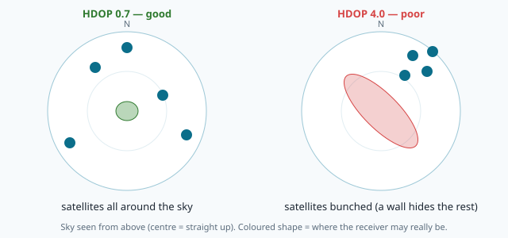

# How GPS talks: NMEA sentences

Inside the NAVERA box there is a small GPS receiver, about the size of a coin. It listens to the
satellites (lesson 1) and computes a position. But how does it **tell** that position to the
computer? There is no screen, no app — just two thin wires. Every second, the receiver sends a few
**lines of text** down those wires, like a radio operator reading a report:

```
$GNGGA,141621.00,3544.04006,N,01034.55091,E,1,12,0.72,95.3,M,32.1,M,,*70
$GNRMC,141621.00,A,3544.04006,N,01034.55091,E,0.012,,011026,,,A*62
```

These two lines are real: they were read from NAVERA's own receiver (a u-blox Neo-M8N) on the
Jetson's serial port, in M'saken near Sousse. By the end of this lesson you will read them as easily
as a bus timetable — and you will understand why NAVERA throws away every line that has even one
damaged character.

## A receiver that speaks text

The receiver and the Jetson are joined by a **serial port**: one wire sends bits one after the
other, like Morse code. On the Jetson it is the file `/dev/ttyTHS1`. Both sides must agree on the
speed — **9600 baud** (about 960 characters per second) is the classic speed for a GPS, and it is
NAVERA's default (`gps_pkg/gps_pkg/config/gps_params.yaml`).

What travels on the wire follows a standard called **NMEA 0183**, written in 1983 by the National
Marine Electronics Association so that a ship's GPS, compass and autopilot could talk to each other.
Forty years later almost every GPS receiver in the world still speaks it. The rules are simple:

| Rule | Example |
|---|---|
| One message = one line of text, called a **sentence** | `$GNGGA,141621.00,…*70` |
| It starts with `$` and ends with the two characters "carriage return, new line" (`\r\n`) | |
| The first word says **who** talks and **what** the message is | `GN` + `GGA` |
| Then come **fields**, separated by commas. An empty field is just `,,` | `…,M,,*70` |
| At the end, `*` and two characters: the **checksum** | `*70` |

The first two letters are the **talker**: `GP` means "GPS satellites only", `GL` the Russian
GLONASS, `GA` the European Galileo, and `GN` means "a mix of several systems" — NAVERA's receiver
uses several, so it says `GN`. The next three letters are the **sentence type**. A receiver sends
many types every second; two of them are all a navigation computer really needs:

| Type | Name | What it tells |
|---|---|---|
| **GGA** | Global positioning fix data | position, altitude, fix quality, number of satellites, HDOP |
| **RMC** | Recommended minimum data | position, speed, direction of travel, date |
| GSA, GSV | satellites | which satellites are used, where they are in the sky |
| VTG | track and speed | direction and speed again |

A program that wants GGA and RMC must simply **skip** the other types.

## The GGA sentence, field by field

Split a GGA sentence on the commas and number the pieces from 0 — exactly what Python's
`body.split(",")` does:


| # | Field | In the example | Meaning |
|---|---|---|---|
| 0 | talker + type | `GNGGA` | |
| 1 | time | `141621.00` | 14:16:21.00 **UTC** (world time, not Tunisian time) |
| 2, 3 | latitude | `3544.04006`, `N` | 35 degrees 44.04006 minutes North |
| 4, 5 | longitude | `01034.55091`, `E` | 10 degrees 34.55091 minutes East |
| 6 | fix quality | `1` | 1 = a normal GPS fix (see below) |
| 7 | satellites | `12` | how many satellites were used |
| 8 | HDOP | `0.72` | how good the satellites' geometry is (see below) |
| 9, 10 | altitude | `95.3`, `M` | 95.3 metres above **mean sea level** |
| 11, 12 | geoid separation | `32.1`, `M` | see "Two kinds of altitude" |
| 13, 14 | (differential data) | empty | only used with correction stations |

### Degrees and minutes — the classic trap

You learned in lesson 6 that a position is written in **decimal degrees**, like `35.734001`. NMEA
does not do that. It writes **degrees and minutes** glued together: `3544.04006` means
**35 degrees** and **44.04006 minutes**. A **minute** (of angle) is 1/60 of a degree, exactly like a
minute is 1/60 of an hour.

```
3544.04006  →  degrees = 35,  minutes = 44.04006
            →  35 + 44.04006 / 60  =  35.734001°
```

The degrees are everything **before the last two digits in front of the dot**. Longitudes have
three digits of degrees (`01034.55091` → 10°), latitudes two — but the rule "the last two digits
before the dot are the minutes" works for both. In Python: `degrees = int(value // 100)` and
`minutes = value - degrees * 100`.

Then the letter gives the sign: **N** and **E** are positive, **S** and **W** are negative.
A position in Brazil would be `2254.0,S,04312.0,W` → −22.9°, −43.2°.

> [!WARNING]
> The trap: reading `3544.04006` as `35.4404006°`. That is wrong by 0.29° of latitude — about
> **33 km**. A beginner's bug that would put a drone over the sea instead of over Sousse.

### Fix quality — can I believe this position?

Field 6 is a single digit that says **how** the receiver got its position:

| Quality | Meaning | NAVERA |
|---|---|---|
| 0 | no fix — not enough satellites yet | not a fix |
| 1 | GPS fix | ✅ used |
| 2 | DGPS: GPS improved by a correction station | ✅ used |
| 4 | RTK fixed (centimetre precision) | ✅ used |
| 5 | RTK float (decimetre precision) | ✅ used |
| 6 | **estimated** — the receiver's own **dead reckoning** | ❌ refused |
| 7 | manual input — someone typed a position | ❌ refused |
| 8 | simulator mode | ❌ refused |

Quality 6 deserves a second look. Some receivers, when they lose the satellites (in a tunnel, under
a bridge), keep inventing positions by continuing in the same direction at the same speed — that is
called **dead reckoning** ("counting steps blindfolded", lesson 1). The position looks perfect, with
a nice latitude and longitude, but **no satellite measured it**. NAVERA has its own, better
sources for that situation (vision, lessons 20–24), so it refuses quality 6, 7 and 8:
`gps_node.py` keeps only `_VALID_GPS_QUAL = {1, 2, 4, 5}`.

### HDOP in simple words

Imagine you stand in a field and three friends shout their distance to you. If your friends stand
all around you (north, south-east, south-west), their three circles cross at a sharp point: you know
exactly where you are. If they all stand in a little group to the north, their circles cross at a
very flat angle: you could be anywhere along a long thin zone.

Satellites are the same. **HDOP** (*Horizontal Dilution Of Precision*) is a number that says how
well the satellites are spread around the sky:



| HDOP | In words |
|---|---|
| below 1 | excellent — open sky |
| 1 to 2 | good |
| 2 to 5 | moderate — buildings, trees |
| above 5 | poor — take the position with care |
| 99.99 | receivers write this when they have no fix at all |

HDOP has **no unit**: it is a multiplier. The receiver's error is roughly *HDOP × the error on one
satellite distance*. NAVERA assumes 2 m for that single-distance error, so in `gps_node.py`:

```python
# sigma = HDOP x 2 m (assumed user range error); vertical ~2x horizontal.
cov = (hdop * 2.0) ** 2
```

With HDOP 0.72 NAVERA says "this fix is good to about 1.4 m (one sigma)". You will meet **sigma**
and **covariance** properly in lesson 26; for now, read it as "how far off it may be". Note that
this is an *assumption* written in the code, not a measured figure — the code says so too.

### Two kinds of altitude

Field 9 is the height above **mean sea level** — the level the sea would have if it went under the
land. But the Earth is a bit lumpy, so GPS maths use a smooth mathematical egg called the
**ellipsoid** (WGS84). Field 11, the **geoid separation**, is the distance between the two (32.1 m
around Sousse). NAVERA's position contract uses the ellipsoid, so `gps_node` adds them:

```
ellipsoid height = 95.3 + 32.1 = 127.4 m
```

## The RMC sentence

```
$GNRMC,141621.00,A,3544.04006,N,01034.55091,E,0.012,,011026,,,A*62
```

| # | Field | Example | Meaning |
|---|---|---|---|
| 1 | time | `141621.00` | UTC |
| 2 | status | `A` | **A** = active (valid), **V** = void (no fix) |
| 3–6 | position | | same format as GGA |
| 7 | speed | `0.012` | in **knots** (sea miles per hour): 1 knot = 0.514444 m/s |
| 8 | course | empty | direction of travel, degrees clockwise from true north |
| 9 | date | `011026` | 1 October 2026 (day, month, year) |

The course is empty here because the receiver was standing still — you cannot have a direction when
you don't move. NAVERA reads RMC only for the **velocity**: in `_publish_vel` it turns knots into m/s
and the course into "metres per second towards east" and "towards north" with sin and cos:

```python
v = spd * KNOTS_TO_MPS
vel.twist.linear.x = v * math.sin(math.radians(course))   # east
vel.twist.linear.y = v * math.cos(math.radians(course))   # north
```

## The checksum

A serial wire is not perfect. A motor starting nearby, a loose connector, a buffer that overflows —
and a character arrives wrong, or a line is cut in half. The **checksum** lets the computer notice.

The receiver takes every character **between `$` and `*`** and combines them with an operation called
**XOR** (written `^` in Python). XOR works on the **bits** — every character is stored as a number, and every number as 0s and
1s. For each bit position: **same bits → 0, different bits → 1**.

```
'G' = 71 = 0100 0111
'N' = 78 = 0100 1110
XOR      = 0000 1001  = 9
```

XOR-ing all the characters one after the other gives one number between 0 and 255. It is written in
**hexadecimal** (base 16: digits 0–9 then A–F), always with **two** digits: 9 → `09`, 112 → `70`,
13 → `0D`. In Python, `ord("G")` gives 71, and `f"{112:02X}"` gives `70`.

The computer does the same calculation on what it **received** and compares with the two characters
after `*`. If one character changed on the way, at least one bit is different, and the result is
different: the line is refused.

```
sent:     $GNGGA,…,3544.04006,N,…*70     → computed 70, written 70  ✔
received: $GNGGA,…,3574.04006,N,…*70     → computed 73, written 70  ✘ refused
```

> [!NOTE]
> A checksum of only 8 bits has 256 possible values. A **single** changed character is always
> caught, but a line mangled at random has about **1 chance in 256** to still match by luck. You
> will find exactly such a line in the lab's log — and see how NAVERA survives it anyway.

## Why NAVERA checks the checksum

Look again at the damaged line above: `3544` became `3574`. That is 30 minutes of latitude — the
vehicle would suddenly be **55 km** further north. An autopilot that believes it would turn around
and fly away. Worse, NAVERA's arbiter watches the GPS for **spoofing** (lesson 27): a position that
jumps 55 km looks exactly like an attack. One bad character could trigger a false alarm, or hide a
real one.

So the rule in NAVERA is strict: **a sentence without a correct checksum never becomes a position**.
A missing checksum is treated like a wrong one — a cut line has no checksum at all.

## In NAVERA

The GPS driver is [gps_node.py](file:navera/gps_pkg/gps_pkg/nodes/gps_node.py). It opens the serial
port with the `pyserial` library, reads one line at a time in a thread, and hands each line to the
**pynmea2** library:

```python
raw = self.ser.readline().decode("ascii", errors="replace").strip()
if not raw.startswith("$"):
    continue
try:
    # check=True: a truncated or corrupted line (no/bad *hh
    # checksum) must never become a fix.
    msg = pynmea2.parse(raw, check=True)
except pynmea2.ParseError:
    continue
if isinstance(msg, pynmea2.types.talker.GGA):
    self._publish_fix(msg)
elif isinstance(msg, pynmea2.types.talker.RMC):
    self._publish_vel(msg)
```

`_publish_fix` then checks the quality (`_VALID_GPS_QUAL = {1, 2, 4, 5}`), computes the ellipsoid
altitude and the HDOP covariance, and publishes on three topics (lesson 12):

| Topic | Type | What |
|---|---|---|
| `/navera/sensors/gps_fix` | `sensor_msgs/NavSatFix` | the standard ROS GPS message |
| `/navera/sensors/gps_vel` | `geometry_msgs/TwistStamped` | velocity from RMC (east, north) |
| `/navera/estimate/gps` | `navera_msgs/PositionEstimate` | NAVERA's source contract, for the arbiter |

Notice one important design choice: when there is **no** usable fix, `gps_node` does not stay silent.
It publishes a `PositionEstimate` with `valid = False`, a NaN position and a **reason**, such as
`"receiver reports a non-satellite position (qual=6) — not used"`. The arbiter then *knows* that
GPS is missing, instead of guessing from silence.

Two more places speak NMEA in NAVERA:

- `navera_tools/sim/nmea_gps.py` — the **simulated** receiver of the simulator. It writes real NMEA
  sentences on a fake serial port, so the real `gps_node` is tested exactly as in flight. Its
  checksum function is only 4 lines — compare it with yours after the lab.
- `navera_tools/tests/test_gps_serial.py` — the automatic test that feeds good, cut and corrupted
  lines to `gps_node` and checks that only the good ones become fixes.

## Words you met

| Word | Meaning |
|---|---|
| **serial port** | a wire that sends bits one after the other; `/dev/ttyTHS1` on the Jetson |
| **baud** | the speed of a serial port (9600 baud ≈ 960 characters per second) |
| **NMEA 0183** | the text standard GPS receivers use |
| **sentence** | one line of NMEA text, from `$` to `*hh` |
| **talker** | the two letters after `$`: GP, GN, GL, GA… |
| **GGA / RMC** | the sentence types with the position (GGA) and the speed and date (RMC) |
| **degrees-minutes** | NMEA's way to write angles: `3544.04006` = 35° 44.04006′ |
| **UTC** | world time, the same everywhere on Earth |
| **fix quality** | how the receiver got the position (0 none, 1 GPS, 6 its own guess…) |
| **dead reckoning** | continuing from the last known position with the speed and direction |
| **HDOP** | how well the satellites are spread; small is good |
| **geoid separation** | distance between sea level and the WGS84 ellipsoid |
| **knot** | a sea mile per hour = 0.514444 m/s |
| **XOR** | bit operation: same → 0, different → 1 |
| **checksum** | a small number computed from a message to detect damage |
| **hexadecimal** | base 16, digits 0–9 and A–F |

## Check what you learned

<details><summary>1. Convert <code>4807.038,N,01131.000,E</code> to decimal degrees.</summary>
48 + 7.038/60 = <b>48.1173°</b> and 11 + 31.000/60 = <b>11.516667°</b>. (This is the famous example of
the NMEA documentation: Munich.)
</details>

<details><summary>2. A GGA says quality 6 with a perfect-looking position. What does NAVERA publish?</summary>
A <code>PositionEstimate</code> with <code>valid = False</code> and the reason "receiver reports a
non-satellite position (qual=6) — not used". The position was invented by the receiver, not measured.
</details>

<details><summary>3. Two fixes have HDOP 0.8 and 3.2. What sigma does NAVERA give each?</summary>
HDOP × 2 m: <b>1.6 m</b> and <b>6.4 m</b>. The second one is four times less sure.
</details>

<details><summary>4. Why must the checksum always have two characters, even when it is 13?</summary>
Because the receiver always writes two hexadecimal digits: 13 is written <code>0D</code>. Comparing
"D" with "0D" would say the line is broken when it is fine.
</details>

<details><summary>5. Can the checksum catch every damaged line?</summary>
No. It always catches one changed character, but a badly mangled line still has about 1 chance in
256 to match by luck. That is why NAVERA also checks the fields themselves (the quality must be 1, 2,
4 or 5).
</details>

Now open the **🛠️ Lab** tab.
