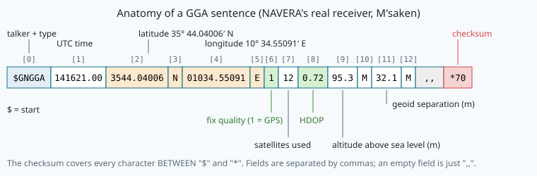
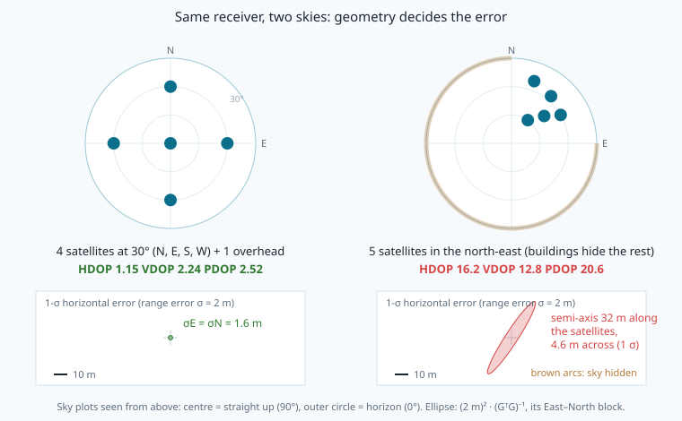
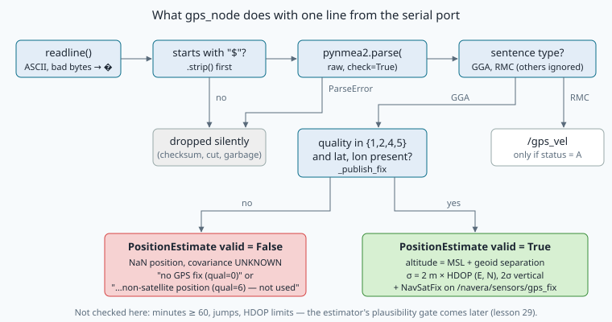

# GNSS receivers and NMEA 0183: from satellites to a trusted fix

> [!NOTE] In short
> - A GNSS receiver sends one line of text (**NMEA 0183**) per message: you will learn to read GGA, GSA and GSV.
> - A **checksum** finds most damaged lines, but not two swapped characters.
> - **DOP** measures the satellite geometry: you will compute it from a 4-column matrix G.
> - Error in metres ≈ DOP × **UERE** (the error of one range measurement).
> - In the lab you build a robust parser, recompute the DOPs, estimate the UERE of a synthetic drive
>   near Sousse, and test NAVERA's real GPS driver on a damaged log.

A survey drone flies along a coast, from a port towards an old town. Its GPS receiver
sends a short line of text to the flight computer every second. One second, a motor starts,
one bit flips on the cable, and the latitude in that line changes from `3547` to `3574`. Read
naively, the drone has jumped **50 km** north in one second. Another second, the drone passes
under a long bridge: the receiver loses the satellites and starts to *guess* positions. Later, in
the old town, the buildings hide most of the sky: the receiver still gives a "fix", but it can be
wrong by tens of metres.

A navigation computer must handle all three cases correctly. To do that, it must understand what
the receiver says (the **NMEA 0183** text protocol), how much each position can be trusted (the
**geometry** of the satellites, measured by **DOP**), and which lines must never become a position.
This lesson gives you the theory; in the lab you will build a robust parser, recompute the DOPs
from the satellite geometry, and test NAVERA's real GPS driver on a damaged log.

## 1. How a GNSS receiver finds its position

**GNSS** (*Global Navigation Satellite System*) is the general name. **GPS** (USA) is one GNSS;
the others are **GLONASS** (Russia), **Galileo** (Europe) and **BeiDou** (China). Each satellite
transmits its own position (the **ephemeris**) and the exact time of transmission.

The receiver measures the time the signal took to arrive and multiplies by the speed of light
*c*. But the receiver's clock is a cheap quartz clock, not an atomic clock: it has an unknown
offset *b* (in seconds). So the measured distance is not the true range. It is called a
**pseudorange**:

```
rho_i = || s_i - x ||  +  c*b  +  eps_i
```

- `s_i` — position of satellite *i* (known, from the ephemeris)
- `x`   — position of the receiver (unknown: 3 numbers)
- `c*b` — receiver clock error in metres (unknown: 1 number)
- `eps_i` — the measurement error of this pseudorange (ionosphere, troposphere, multipath, noise…)

There are **4 unknowns** (x, y, z and *b*), so the receiver needs **at least 4 satellites**.
With 3 it can only make a **2D fix** (it assumes an altitude). In the lab log you will see the
receiver report "no fix" when buildings leave it only 2 or 3 satellites.

The receiver gives its time in **UTC** (world time). GPS has its own time scale, **GPS time**, which
does not have leap seconds: since January 2017, GPS time is **18 s ahead** of UTC. The receiver
corrects this for you. Tunisia uses **UTC+1** all year, so `051200` in a sentence means 06:12 in Sousse; in Singapore
(UTC+8) it would be 13:12.

## 2. The serial link and the NMEA 0183 grammar

The receiver is connected to the Jetson by a **serial port** (UART), `/dev/ttyTHS1` on NAVERA. A
**baud** rate of 9600 means 9600 bits per second. Each character costs 10 bits (1 start bit,
8 data bits, 1 stop bit), so the link carries at most **960 characters per second**.

> [!NOTE]
> **Worked example — data budget.** The lab log has 439 301 bytes for 1069 seconds: 411 bytes/s,
> that is 43 % of a 9600-baud link. At 5 fixes per second the receiver would need 2055 bytes/s,
> twice what the link can carry: lines would be lost. This is why receivers are configured to send
> only the sentences you need, or to use a higher baud rate.

The text format is **NMEA 0183** (National Marine Electronics Association, first published 1983).
Almost every GNSS receiver speaks it. One message is one line, called a **sentence**:

```
sentence  = "$" address { "," field } "*" checksum "\r\n"
address   = talker(2 letters) type(3 letters)        e.g. GP + GGA
field     = any printable ASCII except "$", "*", "," (may be EMPTY)
checksum  = 2 hexadecimal digits (upper case)
length    = at most 82 characters, including "$" and "\r\n"
```

The **talker** says which system speaks: `GP` = GPS only, `GL` = GLONASS, `GA` = Galileo,
`GB` = BeiDou, `GN` = a combination of several systems. Sentences that start with `$P` are
**proprietary** (each manufacturer defines its own). An **empty field** (`,,`) means "no value",
which is different from a zero.

## 3. The checksum

The checksum is the **XOR** (`^` in Python) of the codes of all the characters **between `$` and
`*`**, written as 2 hexadecimal digits. XOR compares bits: same bits give 0, different bits give 1.

> [!NOTE]
> **Worked example.** Body `GPGSA,A,1`:
>
> | char | code | bits | running XOR |
> |---|---|---|---|
> | G | 71 | 0100 0111 | 0100 0111 = `47` |
> | P | 80 | 0101 0000 | 0001 0111 = `17` |
> | G | 71 | 0100 0111 | 0101 0000 = `50` |
> | S | 83 | 0101 0011 | 0000 0011 = `03` |
> | A | 65 | 0100 0001 | 0100 0010 = `42` |
> | , | 44 | 0010 1100 | 0110 1110 = `6E` |
> | A | 65 | 0100 0001 | 0010 1111 = `2F` |
> | , | 44 | 0010 1100 | 0000 0011 = `03` |
> | 1 | 49 | 0011 0001 | 0011 0010 = `32` |
>
> The sentence is `$GPGSA,A,1*32`. In Python: `ord("G")` is 71 and `f"{50:02X}"` is `"32"`.
> The format `02X` matters: 13 must be written `0D`, not `D`.

What can this 8-bit checksum detect? Think of it as the XOR of all the bytes:

- **Any single changed character** is always detected: at least one bit is different, and nothing
  else can cancel it.
- **Two changed characters** are missed if their two changes cancel (the same bit pattern changed
  in both). For random damage, this happens with probability about **1/256**.
- **Two swapped characters are never detected.** XOR is commutative: `a ^ b == b ^ a`. A latitude
  `3547.17` written `3574.17` has exactly the same checksum. The lab log contains two such lines.

So a correct checksum means "probably not damaged", not "correct". A robust receiver chain adds
**field checks** (for example, minutes must be below 60) and **plausibility checks** (the vehicle
cannot move 50 km in one second).

## 4. The sentences a navigation computer needs

### GGA — the fix



The line in the figure was read from NAVERA's own receiver (a u-blox NEO-M8N, `GN` talker) near
Sousse, Tunisia, where NAVERA is developed. **NAVERA's real recorded data and its test map cover
Sousse**; the lab log of this lesson is a synthetic drive in the same area, from the port of Sousse to
Monastir.

| # | Field | Example | Meaning |
|---|---|---|---|
| 1 | UTC time | `141621.00` | hhmmss.ss |
| 2, 3 | latitude | `3544.04006`, `N` | ddmm.mmmmm, hemisphere |
| 4, 5 | longitude | `01034.55091`, `E` | dddmm.mmmmm, hemisphere |
| 6 | fix quality | `1` | see the table below |
| 7 | satellites used | `12` | |
| 8 | HDOP | `0.72` | horizontal dilution of precision (section 5) |
| 9, 10 | altitude | `95.3`, `M` | above **mean sea level** (the geoid) |
| 11, 12 | geoid separation | `32.1`, `M` | ellipsoid height − MSL height |
| 13, 14 | DGPS age, station | empty | only with differential corrections |

**Degrees and minutes.** NMEA writes angles as degrees and **minutes** (1/60 of a degree) glued
together. The last two digits before the decimal point are the minutes:

```
3549.61531,N   ->  35 + 49.61531/60  =  35.826922 deg  (near the port of Sousse)
01038.52535,E  ->  10 + 38.52535/60  =  10.642089 deg
degrees = int(v // 100);  minutes = v - 100*degrees;  S and W are negative
```

Reading `3549.61531` as `35.4961531` is wrong by 0.331°, about 37 km. A robust parser also
rejects **minutes ≥ 60**: `3574.17098` is not a valid angle, even with a correct checksum.

**Fix quality** (field 6):

| Value | Meaning | NAVERA |
|---|---|---|
| 0 | no fix | invalid |
| 1 | GPS fix (standard positioning) | **used** |
| 2 | differential GPS (DGPS, SBAS) | **used** |
| 4 | RTK fixed (cm level) | **used** |
| 5 | RTK float (dm level) | **used** |
| 6 | estimated: the receiver's own **dead reckoning** | invalid |
| 7 | manual input | invalid |
| 8 | simulator mode | invalid |

Quality 6 is the dangerous one: in a tunnel, some receivers continue the last motion and print a
nice position with quality 6. No satellite measured it. NAVERA has better sources for that
situation (vision, lessons 20–24), so it refuses quality 6, 7 and 8.

**Two altitudes.** GNSS computes heights above the **WGS84 ellipsoid** (a smooth mathematical
shape). Maps and pilots use height above **mean sea level**, which follows the **geoid** (the
shape of the sea surface extended under the land). The receiver writes the MSL altitude in field 9
and the **geoid separation** *N* in field 11:

```
h_ellipsoid = H_msl + N
Sousse (real receiver):     95.3 + 32.1  = 127.4 m
lab log (synthetic, Sousse):  8.8 + 32.0  =  40.8 m
```

Around Sousse the geoid is about 32 m above the ellipsoid, so a car near sea level has an
ellipsoidal height of about +40 m. In other places the geoid is below the ellipsoid (its lowest
point, about −106 m, is in the Indian Ocean south of India): there a **negative** ellipsoidal
height is normal — the vehicle is not under the sea. The value 32.0 m is the one written by the
synthetic receiver of the lab.

### RMC — speed, course and date

`$GPRMC,051217.00,A,3549.61531,N,01038.52535,E,11.88,136.6,121026,,,A*5F`

Fields: time, **status** (`A` active, `V` void), position, **speed over ground in knots**
(1 kn = 0.514444 m/s), **course over ground** (degrees clockwise from **true** north; empty when
not moving), **date** (ddmmyy). Here 11.88 kn = 6.11 m/s towards 136.6° (south-east).

### GSA — which satellites, and the DOPs

`$GPGSA,A,3,02,05,07,09,13,20,23,24,30,,,,1.98,1.15,1.61*0C`

| # | Field | Meaning |
|---|---|---|
| 1 | `A` | mode selection: A = automatic, M = manual |
| 2 | `3` | fix type: 1 = none, 2 = 2D, 3 = 3D |
| 3–14 | `02,05,…,,,` | the **PRNs** (satellite numbers) **used** in the fix; 12 slots, empty slots `,,` |
| 15, 16, 17 | `1.98,1.15,1.61` | **PDOP, HDOP, VDOP** |

NMEA 4.10 and later add an 18th field, the system ID (1 = GPS, 2 = GLONASS, 3 = Galileo…); a `GN` receiver
then sends one GSA per system. A robust parser must accept both versions.

### GSV — satellites in view

`$GPGSV,3,1,12,02,61,008,45,05,31,051,38,07,20,097,34,09,45,130,41*7F`

Fields: number of GSV sentences in this group (3), this sentence's number (1), satellites in view
(12), then **blocks of 4** fields: PRN, **elevation** (°, 0–90), **azimuth** (°, clockwise from
north), **SNR** (signal-to-noise ratio, dB-Hz; empty when the satellite is in view but not tracked).
Four satellites per sentence, so 12 satellites need 3 sentences. **GSV + GSA together give the
geometry**: GSV says where each satellite is, GSA says which ones were used.

## 5. Dilution of precision: geometry in a matrix

Why does the same receiver give 1.5 m in an open field and 30 m in a street? The
pseudorange errors `eps_i` are similar. What changes is the **geometry**.

**Linearisation.** Start from an approximate solution `x0, b0` and write `x = x0 + dx`,
`c*b = c*b0 + db`. To first order:

```
d rho_i  =  -u_i . dx  +  db  +  eps_i
u_i = unit vector from the receiver to satellite i, in local East, North, Up (ENU):
u_i = ( cos(el_i) sin(az_i),  cos(el_i) cos(az_i),  sin(el_i) )
```

Stack the *n* satellites into one matrix equation:

```
d rho = G [dE, dN, dU, db]^T + eps        G (n x 4), row i = [ -uE_i, -uN_i, -uU_i, 1 ]
```

**Least squares** (the receiver's solution when n > 4):

```
[dE, dN, dU, db]^T = (G^T G)^-1 G^T d rho
```

If the errors `eps_i` are independent, with zero mean and the same standard deviation
`sigma_UERE`, the covariance of the solution is (covariance propagation, lesson 26):

```
Cov = sigma_UERE^2 * Q          Q = (G^T G)^-1   (4 x 4, depends ONLY on geometry)
```

The **DOPs** are the square roots of parts of the diagonal of Q:

```
GDOP = sqrt(Q_EE + Q_NN + Q_UU + Q_bb)     geometric (everything)
PDOP = sqrt(Q_EE + Q_NN + Q_UU)            position (3D)
HDOP = sqrt(Q_EE + Q_NN)                   horizontal
VDOP = sqrt(Q_UU)                          vertical
TDOP = sqrt(Q_bb)                          time (clock)
```

So a DOP is a **multiplier with no unit**: error in metres ≈ DOP × UERE.

> [!NOTE]
> **Worked example (by hand).** Four satellites at elevation 30° towards N, E, S, W, plus one
> straight overhead. With cos 30° = 0.866 and sin 30° = 0.5:
>
> ```
> G = [  0     -0.866  -0.5   1 ]      (az 0,   el 30)
>     [ -0.866  0      -0.5   1 ]      (az 90,  el 30)
>     [  0      0.866  -0.5   1 ]      (az 180, el 30)
>     [  0.866  0      -0.5   1 ]      (az 270, el 30)
>     [  0      0      -1     1 ]      (overhead)
>
> G^T G = [ 1.5  0    0    0 ]
>         [ 0    1.5  0    0 ]
>         [ 0    0    2   -3 ]
>         [ 0    0   -3    5 ]
> ```
>
> The matrix is block-diagonal. The East-North block inverts to 1/1.5 = 0.667 on each axis. The
> Up-clock block has determinant 2·5 − 9 = 1, so its inverse is `[[5, 3], [3, 2]]`. Then:
>
> ```
> HDOP = sqrt(0.667 + 0.667) = 1.155     VDOP = sqrt(5) = 2.236
> PDOP = sqrt(0.667 + 0.667 + 5) = 2.517 TDOP = sqrt(2) = 1.414    GDOP = 2.887
> ```
>
> With UERE = 2 m: σ_E = σ_N = 2 × 0.816 = 1.63 m, σ_U = 2 × 2.236 = 4.47 m.

Three lessons from this example:

1. **VDOP > HDOP** almost always. All satellites are **above** you, never below, so the "up" and
   "clock" columns of G are strongly correlated (look at the −3 in `G^T G`). Vertical GNSS is
   typically 1.5–2 times worse than horizontal.
2. **Remove the overhead satellite** and the four remaining satellites all have the same
   elevation. Then the Up column is exactly −0.5 × the clock column: `G^T G` is **singular**, it
   cannot be inverted, and height and clock cannot be separated: the DOPs are **infinite** (the
   lab's `dops()` returns `math.inf` for all five). Geometry, not the number of satellites, decides.
3. **Bunched satellites are bad.** In a street, only satellites along the street axis and near
   the zenith are visible. The error ellipse becomes long in the direction where no satellite
   constrains the position:



In the lab log you will recompute PDOP, HDOP and VDOP of every second from the GSV azimuths and
elevations and the GSA list of used satellites, and compare with what the receiver wrote.

## 6. From DOP to metres: UERE and accuracy measures

**UERE** (*User Equivalent Range Error*) is the standard deviation of one pseudorange error. It is
a sum of independent sources. Typical orders of magnitude for a single-frequency receiver in open
sky (they vary a lot with the receiver, the place and the time):

| Source | Typical size (1 σ) | Note |
|---|---|---|
| satellite clock and orbit (broadcast) | about 0.5–1 m | |
| ionosphere, after the broadcast model | about 1–5 m | larger by day and near solar maximum |
| troposphere, after the model | a few decimetres | |
| multipath (reflections) | 0.2 m to many metres | worst in streets, ports, near metal |
| receiver noise | about 0.1–0.5 m | |

The ionospheric delay is largest in two bands about 15° north and south of the magnetic equator,
the **equatorial ionisation anomaly** (for example over India, Taiwan, West Africa and Brazil),
especially in the evening. Single-frequency receivers there should not assume a small UERE.

If the horizontal errors are Gaussian, standard accuracy measures follow from UERE × HDOP:

| Measure | Formula | Probability (circular case) |
|---|---|---|
| **DRMS** (distance RMS) | sqrt(σ_E² + σ_N²) = UERE × HDOP | about 63 % |
| **CEP** (circular error probable) | ≈ 0.83 × DRMS | 50 % |
| **2DRMS** | 2 × UERE × HDOP | about 95–98 % |

> [!NOTE]
> **Worked example.** HDOP 1.15, UERE 2 m: DRMS = 2.3 m, CEP ≈ 1.9 m, 2DRMS = 4.6 m.
> In the old town of the lab log, HDOP 5.69: DRMS = 11.4 m, 2DRMS = 22.8 m — with the same receiver.

**Estimating UERE from data.** For each fix, `E[e_h^2] = UERE^2 × HDOP^2`, where `e_h` is the
horizontal error. When the truth is known, `UERE_est = sqrt(mean((e_h / HDOP)^2))`. You will do
this in the lab on a synthetic drive whose truth is known. On a real vehicle this needs a reference
(an RTK receiver or a surveyed point); NAVERA has not measured its own UERE yet.

**NAVERA's choice.** `gps_node` writes `sigma = 2 m × HDOP` on **each** horizontal axis. Theory
with UERE = 2 m gives `sqrt(σ_E² + σ_N²) = 2 × HDOP`, so about `1.41 × HDOP` per axis. NAVERA's
per-axis sigma is therefore **√2 larger** than this theory: a conservative choice, written in the
code as an assumption, not a measurement.

## 7. Robust parsing: never crash, never invent

A parser that reads a serial line in a flying vehicle must follow simple rules:

1. **Validate before parsing**: `$` at the start, `*` + exactly 2 hex digits, correct checksum,
   at most 82 characters, no second `$` inside (two sentences glued together).
2. **Every field can be empty or wrong.** Convert with functions that return `None` instead of
   raising (`to_float("")` → `None`). Check ranges (minutes < 60, quality 0–8, elevation 0–90).
3. **Never fill a missing value with a default that looks real** (no "0.0 latitude" — that is a
   real place in the Gulf of Guinea).
4. **Decode bytes defensively**: `bytes.decode("ascii", errors="replace")` turns a damaged byte into
   `'�'` instead of crashing; the checksum then fails.
5. **One line is not enough**: compare with the previous fix (a jump gate) and with other sources.

The lab log `sousse_drive.nmea` contains every kind of damage that a real serial line produces:
a flipped character, a cut line, a missing checksum, garbage, two glued sentences, a non-ASCII
byte, and two lines with swapped digits that pass the checksum.

## 🐦 How birds do it

Much of what we know today about bird **migration** comes from tracking tags. In 2007 a satellite
tag showed that a female **bar-tailed godwit** (known as "E7") flew non-stop from Alaska to New
Zealand, about 11 700 km in 8 days, without eating or drinking. Light-level loggers of a few grams
showed that **Arctic terns** breeding in Greenland and Iceland fly about 70 000 km a year, to the
Antarctic and back. GPS tags on young **white storks** from Europe showed exactly where they cross
into Africa — over the Strait of Gibraltar or around the eastern Mediterranean — because storks
glide on warm air and avoid long flights over the sea.

A modern tag is a tiny GNSS receiver plus a battery and a radio. It faces the same problems as
NAVERA: a bird under a rock ledge or in dense mangroves sees part of the sky only, and the fix has
a large HDOP. Biologists therefore **filter** the fixes before they draw a route: a common rule is
to drop fixes with a high HDOP or with too few satellites, and fixes that would need an impossible
flight speed. That is exactly the quality filter and the jump gate you will write in the lab.

The birds themselves do not need any of this: they combine the Sun, the stars, the Earth's magnetic
field and landmarks. Navi, our swallow, would say that a navigator who trusts one single sense
blindly is soon lost.

## In NAVERA

The GPS driver is [gps_node.py](file:navera/gps_pkg/gps_pkg/nodes/gps_node.py). A thread reads
the serial port line by line and hands each line to the **pynmea2** library:

```python
raw = self.ser.readline().decode("ascii", errors="replace").strip()
if not raw.startswith("$"):
    continue
try:
    # check=True: a truncated or corrupted line (no/bad *hh
    # checksum) must never become a fix.
    msg = pynmea2.parse(raw, check=True)
except pynmea2.ParseError:
    continue
if isinstance(msg, pynmea2.types.talker.GGA):
    self._publish_fix(msg)
elif isinstance(msg, pynmea2.types.talker.RMC):
    self._publish_vel(msg)
```

`_publish_fix` applies the quality filter (`_VALID_GPS_QUAL = {1, 2, 4, 5}`), converts the
altitude to the ellipsoid, and turns HDOP into a covariance:

```python
hdop = _field_float(msg.horizontal_dil)
if hdop is not None and hdop > 0:
    # sigma = HDOP x 2 m (assumed user range error); vertical ~2x horizontal.
    cov = (hdop * 2.0) ** 2
    fix.position_covariance = [cov, 0.0, 0.0, 0.0, cov, 0.0, 0.0, 0.0, cov * 4]
```



Important design choices:

- **An invalid fix is published, not swallowed.** Without a usable fix, `gps_node` publishes a
  `PositionEstimate` with `valid = False`, a NaN position and a **reason**, e.g.
  `"receiver reports a non-satellite position (qual=6) — not used"`. The estimator then *knows*
  that GPS is missing.
- **gps_node does not check plausibility.** A swapped-digit line with a correct checksum becomes a
  valid fix. The plausibility gate lives in the estimator
  ([estimator_node.py](file:navera/navera_estimator/navera_estimator/nodes/estimator_node.py),
  lesson 25): a fix farther from the last trusted fix than
  `max_speed_mps × elapsed + gps_jump_margin_m` (defaults 100 m/s and 50 m) is refused as
  "possible spoofing".
- **Timing is not finished.** The code says `# TODO(step 6): true measurement instant = GGA UTC +
  date(RMC)/RTC`: today `sensor_stamp` is the publication time. Lesson 19 explains why the true
  measurement instant matters.

The topics: `/navera/sensors/gps_fix` (`sensor_msgs/NavSatFix`), `/navera/sensors/gps_vel`
(`geometry_msgs/TwistStamped`, east/north velocity from RMC) and `/navera/estimate/gps`
(`navera_msgs/PositionEstimate`). Two more files speak NMEA: `navera_tools/sim/nmea_gps.py` (the
simulator's receiver, which writes real NMEA on a pseudo-terminal) and
`navera_tools/tests/test_gps_serial.py` (the integration test that feeds good, cut and corrupted
lines to the real node). `docs/VALIDATION_STATUS.md` lists these behaviours as **bench-tested**;
none of them has been validated in flight yet (Release 0.x — field validation pending).

## Glossary

| Term | Meaning |
|---|---|
| **GNSS** | Global Navigation Satellite System: GPS, GLONASS, Galileo, BeiDou |
| **pseudorange** | measured distance to a satellite, including the receiver clock error |
| **ephemeris** | the orbit data a satellite broadcasts, to compute its position |
| **UTC / GPS time** | world time / the GPS time scale (18 s ahead of UTC since 2017) |
| **baud** | bits per second on a serial line (9600 baud ≈ 960 characters/s) |
| **NMEA 0183** | text protocol of GNSS receivers: `$`, fields, `*hh` |
| **talker / sentence type** | `GP`, `GN`… / `GGA`, `RMC`, `GSA`, `GSV` |
| **checksum (XOR)** | 8-bit XOR of the body; detects single errors, not swaps |
| **fix quality** | GGA field 6: 0 none, 1 GPS, 2 DGPS, 4/5 RTK, 6 dead reckoning… |
| **dead reckoning** | continuing a position from the last speed and heading, without measurement |
| **PRN** | the number that identifies a GPS satellite |
| **elevation / azimuth** | angle above the horizon / clockwise from north |
| **SNR (C/N0)** | signal strength in dB-Hz |
| **geometry matrix G** | n × 4 matrix of the linearised pseudorange equations |
| **DOP** (G/P/H/V/T) | square roots of diagonal terms of (GᵀG)⁻¹; error multipliers |
| **UERE** | standard deviation of one pseudorange error (metres) |
| **DRMS, 2DRMS, CEP** | horizontal accuracy measures (≈ 63 %, ≈ 95–98 %, 50 %) |
| **geoid / ellipsoid** | mean-sea-level surface / WGS84 mathematical surface |
| **geoid separation N** | ellipsoid height − MSL height |
| **jump gate** | rejects a fix that would need an impossible speed |

## Check your understanding

<details><summary>1. Convert <code>3355.50000,S,01825.40000,E</code> (Cape Town) to decimal degrees.</summary>
−(33 + 55.5/60) = <b>−33.925000°</b> (south is negative) and 18 + 25.4/60 = <b>18.423333°</b> E.
</details>

<details><summary>2. Why can the checksum not detect <code>3547.17</code> written as <code>3574.17</code>? Name two other checks that catch it.</summary>
XOR is commutative, so swapping two characters does not change the XOR of the body. The field
check "minutes &lt; 60" catches it (74 minutes is impossible), and a jump gate catches it (a 50 km
jump in 1 s). NAVERA's gps_node does neither; its estimator has the jump gate.
</details>

<details><summary>3. Four satellites all at elevation 40°, at azimuths 0°, 90°, 180°, 270°. What happens to the DOPs?</summary>
The Up column of G is −sin 40° for every row, which is a constant multiple of the clock column (all
ones). The columns are linearly dependent, GᵀG is singular and the DOPs are infinite: height and
clock cannot be separated. A fifth satellite at another elevation fixes it.
</details>

<details><summary>4. HDOP = 3.0 and UERE = 2.5 m. Give DRMS and 2DRMS. What sigma does NAVERA write?</summary>
DRMS = 3.0 × 2.5 = <b>7.5 m</b>, 2DRMS = <b>15 m</b>. NAVERA writes σ = 2 m × 3.0 = <b>6 m</b> on each
horizontal axis (variance 36 m²) and 12 m vertically — it uses its assumed 2 m, not 2.5 m.
</details>

<details><summary>5. Why is VDOP usually larger than HDOP?</summary>
All satellites are above the horizon. The Up component of every line of sight has the same sign,
so it is correlated with the clock column of G; the estimate of height is mixed with the estimate
of the clock. Horizontally, satellites can surround the receiver on all sides.
</details>

<details><summary>6. A GGA has quality 6, 0 satellites and a perfect-looking position. What does gps_node publish?</summary>
A <code>PositionEstimate</code> with <code>valid = False</code>, NaN position, covariance UNKNOWN and
the reason "receiver reports a non-satellite position (qual=6) — not used". The position is the
receiver's own dead reckoning, not a measurement.
</details>

Now open the **🛠️ Lab** tab.
