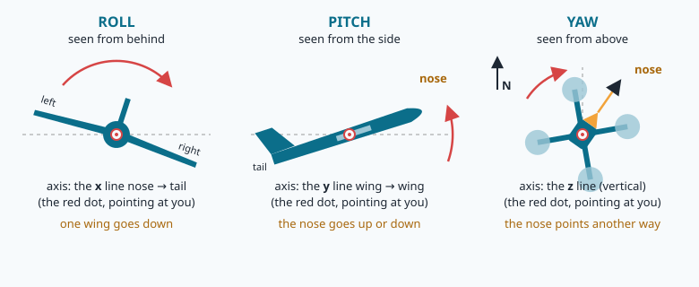
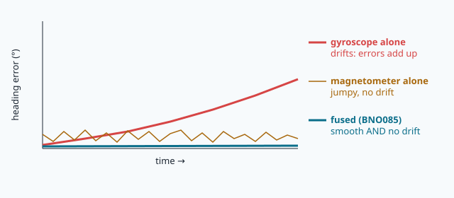
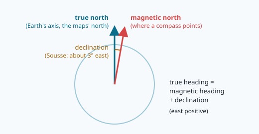
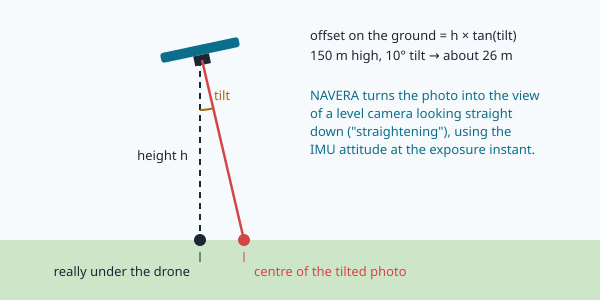

# Attitude: rotations, quaternions and the IMU

> [!NOTE] In short
> - An **IMU** has three sensors: a gyroscope (turn rates), an accelerometer (gravity + acceleration)
>   and a magnetometer (the Earth's magnetic field).
> - You will learn three ways to write an attitude: rotation matrices, Euler angles (and gimbal lock),
>   and **quaternions** (and SLERP to interpolate them).
> - The gyroscope drifts; the accelerometer is noisy and is fooled by acceleration. A
>   **complementary filter** keeps the good part of each.
> - A compass gives **magnetic** north. Add the **declination** (World Magnetic Model) to get true north.
> - In the lab you write the rotation toolbox, then estimate the attitude of a simulated flight near
>   Monastir and compare with NAVERA's code.

A NAVERA drone flies at 150 m above the olive groves south of Monastir, in NAVERA's test area in Tunisia.
The GPS signal is jammed. The downward camera takes a photo and NAVERA wants to find that photo on
its satellite map. Before any image processing can start, three questions need numbers:

1. **Which way does the top of the photo point?** The map is north-up. If the photo is turned by
   120°, nothing lines up.
2. **Was the camera looking straight down?** A multirotor leans its nose down to fly forward and
   banks in turns. A 10° tilt at 150 m moves the centre of the photo 26 m away from the point under
   the drone.
3. **At which exact instant?** The drone turns all the time; the attitude must be the one at the
   moment of the exposure.

The sensor that answers the first two questions is the **IMU**. This lesson gives you the
mathematics engineers use to describe an orientation — rotation matrices, Euler angles and
quaternions — and the classical algorithms that turn raw IMU samples into an orientation:
gyroscope integration, accelerometer tilt, the complementary filter and the magnetic compass with
the **declination** (the angle between magnetic and true north), which changes around the world.

## 1. The sensors and what they really measure

An **IMU** (Inertial Measurement Unit) measures motion from the inside, without looking outside.
The NAVERA box uses a **BNO085**: a 3-axis accelerometer, a 3-axis gyroscope and a 3-axis
magnetometer on one chip, with an on-chip fusion processor. It is read over the Jetson's **I²C** bus
1 (address `0x4A`) at **50 Hz**.

> [!NOTE]
> **On the box used for this course the BNO085 is not connected.** In the lab you work on a
> recorded log. The log is **simulated**, and this is useful: it contains the true attitude, so you
> can measure the error of every method.

Simple measurement models (subscript *b* = body frame, *w* = world frame):

```
gyroscope       ω_m = ω_b + b_g + n_g            (rad/s)  true body rate + bias + noise
accelerometer   f_m = Rᵀ (a_w − g_w) + n_a       (m/s²)   specific force, g_w = (0, 0, −9.81) in ENU
magnetometer    m_m = Rᵀ m_w + n_m               (µT)     Earth's field seen in the body frame
```

- The **gyroscope** gives an angular **rate**, not an angle. Its **bias** b_g is small and nearly
  constant, but it never disappears.
- The accelerometer measures the **specific force**: acceleration *minus* gravity. A drone at rest
  measures `Rᵀ (0, 0, +9.81)`: "up", with the size of g. This is how it finds **down**. But any
  real acceleration (speeding up, turning) is mixed into the same number.
- The **magnetometer** measures the local magnetic field vector (about 44 µT near Monastir, between about 25 µT and 65 µT around the world). Its
  horizontal part points to **magnetic** north. Motors, cables and steel disturb it.

**R** in these equations is the attitude: the rotation from the body frame to the world frame.
The rest of the lesson is about how to write R, and how to estimate it from these three sensors.

## 2. Frames and conventions

NAVERA follows ROS (REP-103):

| Frame | x | y | z |
|---|---|---|---|
| **body** (FLU) | forward | left | up |
| **world** (ENU) | east | north | up |

Positive angles follow the **right-hand rule**: thumb along the axis, fingers curl in the positive
direction. Consequences you must remember:

- positive **yaw** turns the nose counter-clockwise seen from above (to the left);
- positive **pitch** (about y = left) puts the nose **down**;
- positive **roll** (about x = forward) puts the **right** side down.



**Yaw is not heading.** The ROS yaw ψ is a maths angle from **east**, counter-clockwise. A compass
**heading** is measured from **north**, clockwise:

```
heading = (90° − ψ) mod 360°
```

Yaw 90° → heading 0° (north); yaw −90° → heading 180° (south). Python's `%` operator gives a
result in [0, 360) even for negative numbers. And remember: `math.sin`, `np.arctan2` etc. use
**radians**; ROS messages use radians and rad/s. "Yaw = 1.57" is 90°.

## 3. Rotation matrices

A **rotation matrix** R is a 3×3 matrix that maps a vector written in the body frame into the world
frame: `v_w = R · v_b`. Its columns are the body axes written in world coordinates. Every rotation
matrix satisfies

```
Rᵀ R = I        (columns are orthonormal: lengths and angles are kept)
det R = +1      (no mirror)
R⁻¹ = Rᵀ        (the inverse rotation is just the transpose)
```

The set of these matrices is called **SO(3)**. The three elementary rotations are

```
         ⎡1   0    0  ⎤           ⎡ cos  0  sin⎤           ⎡cos −sin  0⎤
Rx(φ) =  ⎢0  cos −sin ⎥   Ry(θ) = ⎢  0   1   0 ⎥   Rz(ψ) = ⎢sin  cos  0⎥
         ⎣0  sin  cos ⎦           ⎣−sin  0  cos⎦           ⎣ 0    0   1⎦
```

Rotations are **composed by matrix multiplication**, and the order matters: `Rz Ry ≠ Ry Rz`. Take
a book and try "yaw 90°, then roll 90°" and the opposite order — the book ends in two different
positions.

## 4. Euler angles (ZYX) and gimbal lock

Humans prefer three angles. ROS and NAVERA use the **ZYX** convention (also called yaw-pitch-roll):

```
R = Rz(ψ) · Ry(θ) · Rx(φ)          φ = roll, θ = pitch, ψ = yaw
```

Written out, the bottom row and first column give simple formulas to go back:

```
R[2,0] = −sin θ          →  θ = −asin(R[2,0])
R[2,1] = cos θ sin φ     \
R[2,2] = cos θ cos φ      →  φ = atan2(R[2,1], R[2,2])
R[1,0] = sin ψ cos θ     \
R[0,0] = cos ψ cos θ      →  ψ = atan2(R[1,0], R[0,0])
```

`atan2(a, b)` is the angle of the point (b, a): it knows the quadrant and never divides by zero.

**Worked example.** Roll 10°, pitch 5° (nose down), yaw 60°:

```
      ⎡ 0.4981  −0.8453   0.1933⎤
R  =  ⎢ 0.8627   0.5055  −0.0125⎥
      ⎣−0.0872   0.1730   0.9811⎦
```

The first column is the nose direction in ENU: (0.498, 0.863, −0.087). It points between north and
east, and slightly down (−0.087 = −sin 5°). The heading is 90° − 60° = 30°. Going back:
θ = −asin(−0.0872) = 5°, φ = atan2(0.1730, 0.9811) = 10°, ψ = atan2(0.8627, 0.4981) = 60°. ✔

**Gimbal lock.** When θ = ±90° (nose straight down or up), cos θ = 0: the formulas for φ and ψ
become atan2(0, 0). This is not only a numerical problem. With θ = 90° the matrix becomes

```
R = Rz(ψ) Ry(90°) Rx(φ)   depends only on (ψ − φ)
```

so (roll 30°, yaw 50°) and (roll 0°, yaw 20°) are the **same** attitude. One degree of freedom is
lost: you cannot recover roll and yaw separately. The usual convention is to set roll = 0 and put
the whole angle into yaw: ψ = atan2(−R[0,1], R[1,1]). A navigation filter must never store its state
as Euler angles for this reason. Also, rounding can make R[2,0] = −1.0000000002, and `asin` then
raises `ValueError: math domain error`: always **clamp** into [−1, 1] first.

## 5. Quaternions

A **quaternion** is a 4-vector q = (w, x, y, z) = w + x·i + y·j + z·k with the rules
i² = j² = k² = ijk = −1. We write it as a scalar w and a vector v = (x, y, z).

**Hamilton product** (not commutative):

```
(p_w, p_v) ⊗ (q_w, q_v) = ( p_w q_w − p_v · q_v ,  p_w q_v + q_w p_v + p_v × q_v )
```

For example i ⊗ j = k but j ⊗ i = −k. The **conjugate** is q* = (w, −v). For a **unit**
quaternion (|q| = 1), q* is the inverse rotation.

**Axis-angle.** A rotation by angle α about a unit axis u is

```
q = ( cos(α/2),  u · sin(α/2) )
```

90° about z: q = (0.7071, 0, 0, 0.7071). Note the **half angle**: q and −q give the **same**
rotation (a quaternion turns twice around while the rotation turns once).

**Rotating a vector.** Put the vector in a "pure" quaternion (0, v):

```
(0, v') = q ⊗ (0, v) ⊗ q*
```

With q = 90° about z and v = (1, 0, 0) (east) you get v' = (0, 1, 0) (north). ✔

**Quaternion → matrix** (q unit):

```
      ⎡1 − 2(y² + z²)   2(xy − wz)       2(xz + wy)    ⎤
R  =  ⎢2(xy + wz)       1 − 2(x² + z²)   2(yz − wx)    ⎥
      ⎣2(xz − wy)       2(yz + wx)       1 − 2(x² + y²)⎦
```

**Composition.** q_a ⊗ q_b corresponds to R_a · R_b. The ZYX Euler angles become
q = q_z(ψ) ⊗ q_y(θ) ⊗ q_x(φ). For the worked example (10°, 5°, 60°):
q = (0.8638, 0.0537, 0.0812, 0.4943), and its matrix is exactly the R above.

Why use quaternions? Four numbers instead of nine, one simple constraint (|q| = 1, easy to
re-normalise), no gimbal lock, cheap composition, and smooth interpolation (next section). The BNO085,
`sensor_msgs/Imu` and every NAVERA module store orientations as quaternions.

> [!WARNING]
> **The order trap.** ROS messages and NAVERA's code store a quaternion as **(x, y, z, w)** —
> scalar **last**. Many textbooks, and the lab files of this course, use **(w, x, y, z)** — scalar
> **first**. The identity is (0, 0, 0, 1) in the first order and (1, 0, 0, 0) in the second. Mixing
> them up gives no error message, only wrong angles. Convert explicitly (`xyzw_to_wxyz`) at every
> boundary.

## 6. Interpolation: SLERP

The IMU gives an attitude every 20 ms, but the camera exposure falls *between* two samples
(lesson 19). We need the attitude at a time t between q0 and q1. Averaging the components (linear
interpolation) gives a vector shorter than 1 and a rotation speed that is not constant. The correct
tool is **SLERP** (spherical linear interpolation): move along the great circle of the 4-D unit
sphere at a constant rate.


```
cos Θ = q0 · q1                       (4-D dot product)
if q0 · q1 < 0:  q1 ← −q1             (shortest path: −q1 is the same rotation)
slerp(q0, q1, t) = [ sin((1 − t)Θ) · q0 + sin(tΘ) · q1 ] / sin Θ ,   t ∈ [0, 1]
```

When Θ is very small, sin Θ ≈ 0: use normalised linear interpolation instead (NAVERA switches when
q0·q1 > 0.9995).

**Worked example.** Heading 10° (yaw 80°) at t = 0 and heading −10° (yaw 100°) 20 ms later:
q0 = (0.7660, 0, 0, 0.6428), q1 = (0.6428, 0, 0, 0.7660), cos Θ = 0.9848, Θ = 10° (half of the 20°
turn). At a quarter of the interval: slerp = (0.7373, 0, 0, 0.6756), i.e. yaw 85°, heading 5°: exactly
a quarter of the turn.

In the lab you write `slerp(q0, q1, t)` with quaternions as numpy arrays in **(w, x, y, z)** order.
**Lesson 19 reuses this function** to find the attitude at the exposure instant of each frame.

## 7. Integrating the gyroscope — and why it drifts

The orientation changes with the body rate ω according to the **quaternion kinematics**:

```
dq/dt = ½ · q ⊗ (0, ω)
```

Over one sample (dt = 20 ms) with ω roughly constant, the exact solution is

```
q_{k+1} = q_k ⊗ Δq ,     Δq = ( cos(|ω|dt/2),  ω/|ω| · sin(|ω|dt/2) )
```

Δq is the axis-angle quaternion of the small rotation |ω|dt about the axis ω/|ω|. It multiplies on
the **right** because ω is measured in the **body** frame. (A rotation of the *world* frame, such as
the declination correction below, multiplies on the **left**.) Re-normalise q after each step.

The problem is the bias. Integration adds b_g · dt at every step, so the attitude error grows
**without bound**:

```
error from bias:        e_b(t) = b_g · t
error from white noise: σ(t)  = σ_g · √(dt · t)      ("angle random walk")
```

With the log of the lab (b_g = 0.03 °/s on z, σ_g = 0.005 rad/s at 50 Hz): after 300 s the bias
gives 9.0° and the noise only about 0.7° (1σ). The bias dominates. After one hour the bias alone
gives 108°: the drone would believe it flies east while it flies north.



Gyroscopes are excellent for **fast, short** changes and useless alone for the **long term**. We
need sensors that do not drift — even if they are noisy.

## 8. Tilt from the accelerometer

When the drone is not accelerating, f_b = Rᵀ (0, 0, g). With R = Rz Ry Rx, the third row of R gives

```
f_b = g · ( −sin θ ,  cos θ sin φ ,  cos θ cos φ )
```

so

```
roll  φ = atan2(f_y, f_z)
pitch θ = atan2(−f_x, √(f_y² + f_z²))
```

Yaw does not appear: gravity is vertical, so it says nothing about heading. In cruise with the nose
4° down, f_x = −9.81 · sin 4° = −0.68 m/s².

These angles do **not drift**, but they are **noisy** (motor vibration: a 0.3 m/s² noise is
already 1.7° per sample) and they are **wrong whenever the drone accelerates**. The worst case is a
**coordinated turn**: a multirotor turning at speed v with turn rate ω banks by atan(v ω / g)
(10 m/s and 14 °/s → 14° of bank), and its thrust — the force the accelerometer feels — stays along
the body z axis. The accelerometer then believes the drone is **level**. This is not a sensor defect;
it is physics (Einstein's equivalence principle).

## 9. The complementary filter

Gyro: good at high frequency, bad at low frequency. Accelerometer: the opposite. The
**complementary filter** takes each where it is good:


```
α = τ / (τ + dt)
φ_k = α · (φ_{k−1} + φ̇ · dt) + (1 − α) · φ_acc,k
```

τ is the **time constant**: roughly, "trust the gyro for τ seconds, then let the accelerometer pull
the estimate back". In the frequency domain, the accelerometer goes through a low-pass filter and the
gyroscope through a high-pass filter with the same cut-off f_c = 1 / (2πτ); the two weights add up
to 1 at every frequency — hence the name.

The angle rates φ̇, θ̇ are **not** the body rates p, q, r (gyro x, y, z). For ZYX angles:

```
φ̇ = p + (q sin φ + r cos φ) tan θ
θ̇ = q cos φ − r sin φ
ψ̇ = (q sin φ + r cos φ) / cos θ          (cos θ = 0 → gimbal lock again)
```

During a turn, r (yaw rate) is large and leaks into φ̇ through tan θ: forgetting these terms costs
degrees.

**The bias is now bounded.** With a constant gyro bias b, the error e of the filter obeys
e_k = α (e_{k−1} + b · dt). In steady state e = α b dt / (1 − α) = **b · τ**. With b = 0.01 °/s
and τ = 30 s: 0.3°. The choice of τ is a **trade-off**: a small τ copies the accelerometer's noise and
its errors in turns; a large τ keeps more gyro bias (b·τ) and recovers slowly from a wrong start. In
the lab you sweep τ and find the best value for a real-looking flight.

Production systems (the BNO085's own fusion, ArduPilot's EKF) use **Kalman filters** that choose
this weighting automatically from the noise statistics (lesson 26). The complementary filter is the
same idea with a fixed gain.

## 10. The compass and the declination

**Tilt-compensated heading.** Remove roll and pitch from the measured field to get the field a
**level** body would see, then take its angle:

```
m_h = Ry(θ) · Rx(φ) · m_b
magnetic heading = atan2(m_h,y , m_h,x)        (deg, then mod 360)
```

Why compensate? The Earth's field is not horizontal: it dips by the **inclination** I (about 50° in
Monastir, 66° in London, −13° in Singapore: negative means the field points up). Without compensation, a few degrees of roll mixes the large vertical
component into the horizontal axes and the heading moves even though the drone does not turn.

**True vs magnetic north.** The horizontal field points to **magnetic** north. The angle from
**true** north (the north of maps) to magnetic north is the **magnetic declination** D, positive to
the east:

```
true heading = magnetic heading + D
```



D depends on place and time. It is computed from the **World Magnetic Model** (**WMM**), a
spherical-harmonic model of the Earth's main field published every five years (WMM2025 is valid
2025–2030). The Python package **pygeomag** implements it — NAVERA uses it, and so will you. Values
for mid-October 2026 (WMM2025, sea level):

| Place | Latitude, longitude | Declination D | Inclination I |
|---|---|---|---|
| London | 51.50 N, 0.12 W | +1.21° | 66.5° |
| Reykjavik | 64.15 N, 21.94 W | −11.05° | 75.4° |
| Cape Town | 33.92 S, 18.42 E | −26.81° | −64.6° |
| Sydney | 33.87 S, 151.21 E | +12.83° | −64.4° |
| Singapore | 1.29 N, 103.85 E | +0.24° | −12.9° |
| Sousse (Tunisia) | 35.83 N, 10.64 E | +3.33° | 50.6° |

The declination can be large (−26.8° in Cape Town: a compass there points more than a quarter of
a right angle west of true north) or small, and it changes with time (London: +0.91° in 2025,
+1.76° in 2030). Small does not mean negligible: if you ignore 1.21° in London, after 10 km of
flight you are 10 000 × tan(1.21°) ≈ **212 m** to the side. Sousse is in the table because NAVERA's
real test data (map, frames, simulator area) covers Sousse, Tunisia, where NAVERA is developed.

## 11. Straightening the photo

NAVERA does not integrate the IMU to get a **position** (inertial navigation is "not implemented" in
`docs/VALIDATION_STATUS.md`). It uses the **attitude**: for every frame it takes the attitude at the
exposure instant, computes the camera's rotation R_world_cam, and **straightens** the photo into the
view of a level camera looking straight down, with a **homography** H = K · R_virt_cam · K⁻¹
(lessons 17 and 22). Without it, the centre of the photo is h · tan(tilt) away from the point under
the drone: 150 m × tan 10° = 26.4 m.



The attitude error also limits other methods. `VALIDATION_STATUS.md` says the celestial fix is
"coarse: bounded by the IMU attitude (~111 km per degree)": 5.5–6.5 km with a perfect attitude,
24–119 km with a BNO085-class IMU (simulated star fields).

## 🐦 How birds do it

Navi the swallow has no BNO085, but she carries the same three sensors. In the inner ear of every
bird, as in yours, the **vestibular system** has three **semicircular canals** at roughly right
angles, filled with fluid: when the head turns, the fluid lags behind and bends sensory hair cells —
a 3-axis rate sensor, like a gyroscope. Next to them, the **otolith organs** carry small calcium
carbonate crystals on hair cells: they feel gravity and linear acceleration — an accelerometer, with
exactly the same ambiguity between tilt and acceleration that you met in section 8. The brain
resolves it as a complementary filter does: it combines the canals (fast) with the otoliths and with
vision (slow and absolute).

Birds also **stabilise the head**. A falcon hovering over a cliff, or a kestrel hanging
in the wind, keeps its head almost fixed in space while the body moves: reflexes driven by the
vestibular system and the eyes keep the image on the retina still. NAVERA cannot move its camera, so
it does the same job in software, by straightening the photo with the attitude.

And the compass? In 1972 Wolfgang and Roswitha Wiltschko showed that European robins in an
orientation cage changed their chosen direction when coils changed the magnetic field around them.
The bird compass is an **inclination compass**: it uses the angle between the field lines and
gravity ("towards the pole" vs "towards the equator"), not the polarity. In Europe the
field dips steeply (66° in London) and is easy to read; at the magnetic equator, where the field is
horizontal, such a compass cannot tell the two directions apart. Yet millions of migrants cross the
magnetic equator every year — barn swallows from Europe to southern Africa, Arctic terns from the
Arctic to the Antarctic, bar-tailed godwits from Alaska to New Zealand — and like NAVERA they
cannot trust one sensor alone: they cross-check the magnetic field with the sun and the stars
(lesson 24).

## In NAVERA

**The driver** — [imu_pkg/imu_pkg/nodes/imu_node.py](file:navera/imu_pkg/imu_pkg/nodes/imu_node.py)
reads the BNO085 and publishes `sensor_msgs/Imu` on `/navera/sensors/imu` at 50 Hz. Its settings,
[imu_params.yaml](file:navera/imu_pkg/imu_pkg/config/imu_params.yaml), state honestly that the noise
values (`orientation_stddev: 0.02` rad, `angular_velocity_stddev: 0.005` rad/s) are "datasheet-derived
estimates, NOT measured on NAVERA hardware". The fusion itself runs on the chip.

**Quaternion algebra and true north** — [imu_pkg/imu_pkg/orientation.py](file:navera/imu_pkg/imu_pkg/orientation.py),
order **(x, y, z, w)**:

```python
def quat_mul(a: Sequence[float], b: Sequence[float]) -> Quat:
    """Hamilton product a * b of (x, y, z, w) quaternions."""
    ax, ay, az, aw = a
    bx, by, bz, bw = b
    return (aw * bx + ax * bw + ay * bz - az * by,
            aw * by - ax * bz + ay * bw + az * bx,
            aw * bz + ax * by - ay * bx + az * bw,
            aw * bw - ax * bx - ay * by - az * bz)
```

`OrientationCorrector.apply()` turns the magnetic orientation into a true one by rotating the
**world** frame about "up", so the correction multiplies on the **left**:
`q = quat_mul((0, 0, sin(d/2), cos(d/2)), q)` with d = −D. The class `Declination` calls
`GeoMag().calculate(glat=lat, glon=lon, alt=alt_km, time=year).d` and recomputes only when the vehicle
has moved more than 20 km. Until a position is known, `imu_node` uses the `declination_deg`
parameter, or logs that the heading is still MAGNETIC.

**Matrices** — [navera_common/navera_common/camera_model.py](file:navera/navera_common/navera_common/camera_model.py)
has `quat_to_matrix(q)` (the matrix of section 5, order x, y, z, w), `rpy_to_matrix(roll, pitch, yaw)`
(`R = Rz(yaw) Ry(pitch) Rx(roll)`), `camera_rotation()`, `tilt_deg()` and `body_rpy_enu(q)`. Read the
docstring of `body_rpy_enu`: it reports pitch **positive nose up**, the opposite sign of ROS, because
it is for humans. Always read how an angle is counted.

**SLERP** — [navera_common/navera_common/sensor_history.py](file:navera/navera_common/navera_common/sensor_history.py):

```python
def slerp(q0: Sequence[float], q1: Sequence[float], f: float) -> Tuple[float, ...]:
    """Spherical interpolation of (x, y, z, w) quaternions, shortest path."""
    d = sum(a * b for a, b in zip(q0, q1))
    if d < 0:
        q1, d = [-c for c in q1], -d
    if d > 0.9995:
        q = [a + f * (b - a) for a, b in zip(q0, q1)]
    else:
        th = math.acos(min(1.0, d))
        s0, s1 = math.sin((1 - f) * th) / math.sin(th), math.sin(f * th) / math.sin(th)
        q = [s0 * a + s1 * b for a, b in zip(q0, q1)]
```

The live camera keeps a `History(maxlen=4000, max_gap_s=0.2, interp=slerp)` of attitudes and asks it
for the attitude at each exposure.

**Using the attitude** — [navera_common/navera_common/frame_builder.py](file:navera/navera_common/navera_common/frame_builder.py)
marks a frame **unusable** if there is no attitude at its exposure ("the camera's tilt is unknown"),
if the vehicle turns faster than `max_rate_dps` (30 °/s: the tilt at the shutter instant is
uncertain), or if the tilt is above `max_tilt_deg` (45°). Otherwise it straightens the frame:

```python
            if tilt > 0.05:
                H = nadir_homography(self.cam.K_out, R)
                h, w = out.shape[:2]
                out = cv2.warpPerspective(out, H, (w, h), flags=cv2.INTER_LINEAR,
                                          borderMode=cv2.BORDER_CONSTANT)
            meta["straightened"] = True
```

## Glossary

| Term | Meaning |
|---|---|
| **IMU** | Inertial Measurement Unit: accelerometer + gyroscope (+ magnetometer) |
| **attitude** | the orientation of a vehicle (roll, pitch, yaw / R / q) |
| **specific force** | what an accelerometer measures: acceleration minus gravity |
| **bias** | a constant (slowly varying) sensor offset |
| **drift** | the growing error caused by integrating a bias |
| **angle random walk** | the angle error from integrating white rate noise, grows as √t |
| **rotation matrix, SO(3)** | 3×3 orthonormal matrix with det = +1 |
| **Euler angles (ZYX)** | R = Rz(yaw) Ry(pitch) Rx(roll) |
| **gimbal lock** | at pitch ±90° roll and yaw become one angle |
| **quaternion** | (w, x, y, z), unit length; stores a rotation without gimbal lock |
| **Hamilton product** | quaternion multiplication, ⊗; composes rotations, not commutative |
| **SLERP** | interpolation along the great circle between two unit quaternions |
| **complementary filter** | blends a high-passed gyro angle with a low-passed absolute angle |
| **time constant τ** | how long the filter trusts the gyro; α = τ/(τ+dt) |
| **inclination** | angle of the magnetic field below the horizontal |
| **declination** | angle from true north to magnetic north, east positive |
| **WMM** | World Magnetic Model (WMM2025 valid 2025–2030), used through pygeomag |

## Self-check

<details><summary>1. Show that R⁻¹ = Rᵀ for a rotation matrix, and say why this is useful on the Jetson.</summary>
The columns of R are orthonormal, so (RᵀR)ij = column i · column j = 1 if i = j, else 0: RᵀR = I,
hence Rᵀ = R⁻¹. Inverting a rotation is then a free transpose instead of a general 3×3 inversion,
and it is exact (no numerical error).
</details>

<details><summary>2. A quaternion from a ROS message is (0, 0, 0.3827, 0.9239). What is the heading? What happens if you read it as (w, x, y, z)?</summary>
ROS order is (x, y, z, w): a rotation about z with cos(α/2) = 0.9239 → α = 45° yaw → heading
90 − 45 = 45° (north-east). Read as (w, x, y, z), w = 0 means a 180° rotation about the axis
(0, 0.38, 0.92): a completely different attitude (the body's up axis ends 45° from vertical) — with no error message.
</details>

<details><summary>3. Why does SLERP replace q1 by −q1 when q0·q1 &lt; 0?</summary>
q1 and −q1 are the same rotation. If the dot product is negative, the arc from q0 to q1 on the
4-D sphere is longer than 180°, and the interpolation would turn the "long way round" (more than
180° of rotation). Using −q1 takes the short arc.
</details>

<details><summary>4. The roll gyro has a bias of 0.05 °/s. What is the roll error after 10 minutes of pure integration? With the gyro + accelerometer complementary filter of τ = 20 s?</summary>
Integration: 0.05 × 600 = 30°. Complementary filter (steady state): b · τ = 0.05 × 20 = 1°, and it
does not grow. (This works for roll and pitch only: gravity says nothing about the heading, so the
accelerometer cannot correct a heading drift — that is the magnetometer's job, section 10.)
</details>

<details><summary>5. A drone turns at 20 °/s at 12 m/s. What roll does its accelerometer report, and what is the true bank?</summary>
True bank = atan(v ω / g) = atan(12 × 0.349 / 9.81) = 23°. In a coordinated turn the specific force
stays along the body z axis, so the accelerometer reports a roll of about 0° — an error of 23°.
</details>

<details><summary>6. A compass reads 359° in Sydney (D = +12.83°). What is the true heading? What side error after 5 km if D is ignored?</summary>
359 + 12.83 = 371.83 → 11.83° (mod 360): north-north-east. Side error 5000 × tan(12.83°) ≈ 1139 m.
</details>

Now open the **🛠️ Lab** tab.
