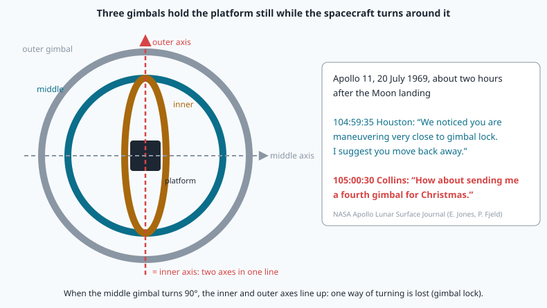
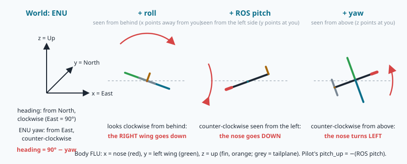
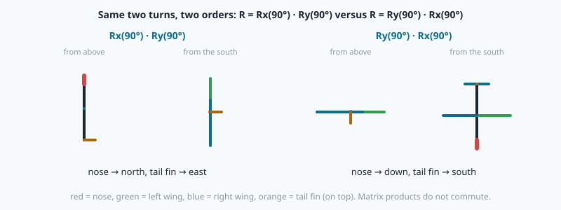
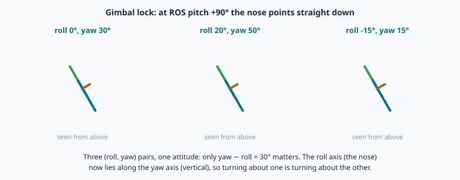
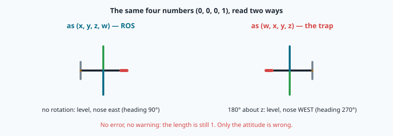
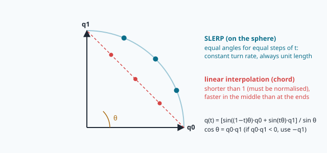

# Rotations and quaternions: describing an attitude



> [!NOTE] Mission brief
> **20 July 1969, lunar orbit, about two hours after the Moon landing.** Mission Control calls the command
> module: *"We noticed you are maneuvering very close to gimbal lock. I suggest you move back away."* Michael
> Collins steers around it, then jokes: *"How about sending me a fourth gimbal for Christmas."* (NASA, Apollo
> Lunar Surface Journal, mission time 104:59:35 and 105:00:30.) Apollo's guidance platform hung in **three**
> gimbals. If the middle one turned to 90°, two of the three axes lined up and one way of turning was lost.
> Engineers had chosen three gimbals on purpose (simpler hardware); the crews learned to fly around the lock.
>
> NAVERA's IMU is a small chip fixed to the vehicle, not a platform in gimbals, so its attitude lives in
> software, as numbers (its camera may be fixed to the body or carried by a camera gimbal). Every camera
> photo must be matched to a north-up map, so NAVERA needs the drone's **attitude** (its orientation) at the
> instant of the photo. A
> 10° tilt error at 150 m moves the centre of the photo 26 m. Today you build NAVERA Lite's rotation toolbox,
> watch gimbal lock happen in your own code, and then play **detective** on a colleague's bug that gives no
> error message at all. Session 1 (matrices and Euler angles) earns **Attitude reader**; session 2
> (quaternions and the investigation) earns **Quaternion detective**.
>
> **Start now:** open the 🛠️ **Lab** tab, do **Step 0** (two minutes, no code), then come back here for §1.

**Objectives.** After this mission you can:

1. **compose and invert** rotations in the right order, and say what the columns of a rotation matrix mean;
2. **convert** ZYX Euler angles ↔ rotation matrix, show **gimbal lock** and handle it;
3. **use quaternions** in ROS order (x, y, z, w): product, conjugate, rotating a vector, **slerp**, and the
   angle between two attitudes;
4. **read and check frame conventions** — ENU/FLU, heading vs yaw, ROS pitch vs a pilot's pitch,
   (x, y, z, w) vs (w, x, y, z) — and **diagnose** a convention bug from its symptoms.

**You need:** mission 06 §7 (a rotation matrix, R·Rᵀ = I), mission 03 (headings, numpy arrays), and the
complex numbers of school (a 🧰 box refreshes them). ⏱ Reading: about 70 minutes with the ✏️ checks (up to
2 h if matrices or trigonometry are rusty): §1–§3 before session 1, §4–§5 before session 2. Lab: 3 to 5 h.

**Before you start.** Answer without looking; if you miss two, reread mission 06 §3 and §7.

<details><summary>1. (Mission 06) A matrix R has unit rows at right angles. What is R⁻¹, and what does det R = −1 mean?</summary>
R⁻¹ = Rᵀ (R·Rᵀ = I). det R = −1 is a mirror, not a rotation: two rows swapped or one sign flipped.
</details>
<details><summary>2. (Mission 06) A bearing is atan2(east, north). Why not atan2(north, east)?</summary>
A bearing is counted from north, clockwise; atan2(y, x) measures from the x axis. With x = north and y = east
you get the angle from north towards east. atan2(north, east) is the maths angle from east, counter-clockwise.
</details>
<details><summary>3. (Mission 03) A drone flies heading 090°. Its unit velocity vector (east, north)?</summary>
(1, 0): heading 90° is due east; (sin h, cos h) = (1, 0).
</details>

<details><summary>Words of this lesson (open if you need them)</summary>

| Word | Meaning | Français |
|---|---|---|
| **attitude** | the orientation of a vehicle: which way its nose, wings and top point | attitude |
| **frame** | three axes at right angles that we measure coordinates in | repère |
| **right-hand rule** | thumb along the axis: the fingers curl in the positive direction of turning | règle de la main droite |
| **rotation matrix** | 3 × 3 matrix that turns body coordinates into world coordinates | matrice de rotation |
| **Euler angles (ZYX)** | yaw, pitch, roll: three turns about z, then y, then x | angles d'Euler |
| **gimbal lock** | at pitch ±90° roll and yaw become one angle | blocage de cardan |
| **quaternion** | four numbers (x, y, z, w) that store a rotation | quaternion |
| **Hamilton product** | the multiplication of quaternions (⊗); it composes rotations | produit de Hamilton |
| **conjugate** | q with its vector part negated: the inverse rotation | conjugué |
| **slerp** | interpolation between two attitudes at a constant turn rate | interpolation sphérique |
</details>

## 1. Frames and signs: the rules everything else depends on

An attitude is a relation between two **frames**. NAVERA, ROS and NAVERA Lite use the same two
(the course's conventions sheet):

| Frame | x | y | z |
|---|---|---|---|
| **world: ENU** | East | North | Up |
| **body: FLU** | Forward (the nose) | Left wing | Up (through the top) |

Positive angles follow the **right-hand rule**: point your right thumb along the axis; your fingers curl in
the positive direction. Seen with the axis pointing **at** you, a positive turn is counter-clockwise.
Three consequences you must know by heart:



- positive **roll** (about x, the nose) puts the **right wing down**;
- positive **pitch** (about y, the **left** wing) puts the **nose down**. Thumb along the left wing, fingers
  curl from the top (+z) towards the nose (+x): the nose dips;
- positive **yaw** (about z, up) turns the nose to the **left**, counter-clockwise seen from above.

Pilots do not count that way. A pilot says "pitch 5° up" for a climb, and a compass counts the **heading**
from north, clockwise. So NAVERA's human-readable attitude and NAVERA Lite's `rpy_human` report
**pitch_up = −(ROS pitch)**, and

```
heading = (90° − yaw) mod 360°          yaw = ROS yaw: from east, counter-clockwise
```

Worked example: yaw 60° → heading 30° (30° east of north); yaw −90° → heading 180° (south).
Python's `%` keeps the result in [0, 360) even for negative numbers: `(90 - 150) % 360` is 300.

> [!QUESTION] ✏️ Check
> 1. A ROS message says yaw = −135°. Heading?
> 2. A ROS message says pitch = +0.2 rad. Is the nose above or below the horizon, and what pitch_up (in
>    degrees) does a pilot read?

<details><summary>Answer</summary>
1. (90 − (−135)) mod 360 = 225°: south-west.<br>
2. Below: positive ROS pitch is nose down. pitch_up = −11.5° (0.2 rad × 180/π = 0.2 × 57.3 = 11.46°).
</details>

## 2. Rotation matrices: columns are axes, products are sequences

A **rotation matrix** R turns a vector written in the body frame into the same vector written in the
world frame: `v_world = R · v_body`. The course names it `R_world_body` when the frames matter
(`R_<to>_<from>`). Mission 06 gave the rules: R·Rᵀ = I, so the inverse is the transpose
(`R_body_world = Rᵀ`), and det R = +1.

The most useful fact: **the columns of R are the body axes, written in the world frame.** R·(1, 0, 0) is
the first column, i.e. where the nose points. Read a matrix by its columns and you can see the attitude.

<details><summary>🧰 The angles you will meet (sin/cos table, radians ↔ degrees)</summary>

| α | 0° | 30° | 45° | 60° | 90° | 180° |
|---|---|---|---|---|---|---|
| sin α | 0 | 0.5 | 0.7071 | 0.866 | 1 | 0 |
| cos α | 1 | 0.866 | 0.7071 | 0.5 | 0 | −1 |

Radians → degrees: × 180/π (≈ 57.3); back: × π/180 (`math.degrees`, `math.radians`). sin(−α) = −sin α,
cos(−α) = cos α.
</details>

The three elementary rotations, angle α:

```
         ⎡1    0      0  ⎤           ⎡ cos α  0  sin α⎤           ⎡cos α  −sin α  0⎤
Rx(α) =  ⎢0  cos α  −sin α⎥   Ry(α) = ⎢   0    1    0  ⎥   Rz(α) = ⎢sin α   cos α  0⎥
         ⎣0  sin α   cos α⎦           ⎣−sin α  0  cos α⎦           ⎣  0       0    1⎦
```

Look at Ry: its minus sign is in the **bottom-left** corner, not the top-right as in Rx and Rz. That is the
right-hand rule about y (z turns towards x), and it is exactly why a positive pitch puts the nose down:
Ry(α)·(1, 0, 0) = (cos α, 0, −sin α).

**Worked example.** Rz(30°)·(1, 0, 0) = (cos 30°, sin 30°, 0) = (0.866, 0.500, 0): the nose, east at
first, now points 30° north of east, heading 60°.

<details><summary>🧰 Matrix × matrix: A·B ≠ B·A (and `@`, not `*`)</summary>

(A·B) has, in row i and column j, row i of A times column j of B. Example:
[[0, −1], [1, 0]] · [[2, 0], [0, 1]] = [[0, −1], [2, 0]], but [[2, 0], [0, 1]] · [[0, −1], [1, 0]] =
[[0, −2], [1, 0]]: **A·B ≠ B·A**. To rotate a vector by B and then by A, compute A·(B·v) = (A·B)·v.
numpy: `A @ B` (never `A * B`, which multiplies element by element).
</details>

**The order matters.** Take a book flat on the table, spine towards you. Turn it 90° about one axis, then
90° about another; start again in the other order. It ends in two different positions. Rotations do not
commute:



How to read a product such as `Rz(ψ) · Ry(θ) · Rx(φ)`: either from **right to left about the fixed world
axes** (first roll about world x, then pitch about world y, then yaw about world z), or from **left to right
about the vehicle's own, moving axes** (first yaw, then pitch about the *new* left wing, then roll about the
*new* nose). Both readings give the same matrix. The second is how a pilot thinks.

> [!TIP] 🧰 One product, two stories — worked example
> M = Rz(90°)·Ry(90°), followed on the drone's **top** (0, 0, 1).
> **Right to left, fixed world axes:** pitch 90° about world y (north) carries the top to east (1, 0, 0); then
> yaw 90° about world up carries east to north → (0, 1, 0).
> **Left to right, the drone's own axes:** yaw 90° (the top stays up, the left wing now points west); then
> pitch 90° about the **new** left wing: the nose dips and the top swings to where the nose was, north →
> (0, 1, 0). Same answer: two descriptions of one matrix.
> Careful: in story 1 every turn is about a **fixed** world axis, so "then roll" there means about world x,
> not about the new nose. "About the new nose / new wing" belongs only to story 2.

> [!QUESTION] ✏️ Check
> Where does the nose (1, 0, 0) point after Rz(90°)·Ry(90°)? After Ry(90°)·Rz(90°)? Work from the right:
> first apply the right-hand matrix to the vector.

<details><summary>Answer</summary>
Rz(90°)·Ry(90°)·(1, 0, 0) = Rz(90°)·(0, 0, −1) = (0, 0, −1): straight down.<br>
Ry(90°)·Rz(90°)·(1, 0, 0) = Ry(90°)·(0, 1, 0) = (0, 1, 0): north. Two different attitudes.
</details>

## 3. Euler angles (ZYX) and gimbal lock

People prefer three angles. ROS and NAVERA use the **ZYX** convention (yaw, then pitch, then roll about
the moving axes):

```
R = Rz(yaw) · Ry(pitch) · Rx(roll)          roll φ, pitch θ (ROS sign), yaw ψ, all in radians
```

Multiplied out, the bottom row and the first column are simple, and they give the angles back:

```
R[2][0] = −sin θ                      →  θ = asin(−R[2][0])
R[2][1] = cos θ sin φ,  R[2][2] = cos θ cos φ   →  φ = atan2(R[2][1], R[2][2])
R[1][0] = sin ψ cos θ,  R[0][0] = cos ψ cos θ   →  ψ = atan2(R[1][0], R[0][0])
```

`atan2(a, b)` is the angle of the point (b, a): it knows the quadrant and never divides by zero.

**Worked example.** Roll 10°, pitch 5° (ROS: nose 5° down), yaw 60°:

```
      ⎡ 0.4981  −0.8453   0.1933⎤
R  =  ⎢ 0.8627   0.5055  −0.0125⎥
      ⎣−0.0872   0.1730   0.9811⎦
```

The first column, (0.498, 0.863, −0.087), is the nose: between east and north, and slightly down
(−0.087 = −sin 5°); heading 90° − 60° = 30°. Back: θ = asin(0.0872) = 5°, φ = atan2(0.1730, 0.9811) = 10°,
ψ = atan2(0.8627, 0.4981) = 60°. ✔ A pilot reads roll 10°, **pitch_up −5°**, heading 30°.

Rounding can make R[2][0] = −1.0000000002, and `math.asin` then raises `ValueError: math domain error`:
**clamp** to [−1, 1] first (`max(-1.0, min(1.0, s))`).

**Gimbal lock.** If θ = ±90° (nose straight down or up), cos θ = 0 and the formulas for φ and ψ become
atan2(0, 0). This is not just a numerical accident. At θ = +90° the matrix depends only on **ψ − φ**: the
roll axis (the nose) now lies along the yaw axis (vertical), and rolling is the same as yawing.

<details><summary>🧰 See it in the matrix (two products, 10 minutes)</summary>

With θ = 90°, Ry(90°) = [[0, 0, 1], [0, 1, 0], [−1, 0, 0]]. First the two right-hand matrices (row times
column): Ry(90°)·Rx(φ) = [[0, sin φ, cos φ], [0, cos φ, −sin φ], [−1, 0, 0]]. Then Rz(ψ)·(that), using
sin(a − b) = sin a cos b − cos a sin b, cos(a − b) = cos a cos b + sin a sin b:

```
R = [[ 0, −sin(ψ − φ), cos(ψ − φ)],
     [ 0,  cos(ψ − φ), sin(ψ − φ)],
     [−1,       0,          0     ]]
```

Only ψ − φ appears. And atan2(−R[0][1], R[1][1]) = atan2(sin(ψ − φ), cos(ψ − φ)) = ψ − φ: that is where the
convention's yaw (with roll = 0) comes from.
</details>



One degree of freedom is gone: the angles cannot be recovered separately. The usual convention, used by
NAVERA Lite and by SciPy, sets roll = 0 and puts everything in yaw: ψ = atan2(−R[0][1], R[1][1]). Close
to the lock it is worse than "undefined": a tiny change of attitude can swing roll and yaw by tens of
degrees (lab Step 3 measures it). This is Apollo's problem in mathematical form: Euler angles are three
gimbals on paper. A filter must never store its state as Euler angles.

> [!QUESTION] ✏️ Check
> The attitude is roll 10°, ROS pitch +90°, yaw 40°. What does the convention return, and is it the same
> attitude?

<details><summary>Answer</summary>
Roll 0°, pitch 90°, yaw 30° (ψ − φ = 30°). Yes, the same attitude: only ψ − φ matters at θ = +90°. (And at
−90°? Lab Step 3 finds out.)
</details>

## 4. Quaternions: rotations without gimbal lock

<details><summary>🧰 Complex numbers in five lines (a 2-D rotation = multiplying by e^{iα})</summary>

i² = −1. A complex number z = a + b·i is the point (a, b). e^{iα} = cos α + i sin α has length 1, and
multiplying by it **rotates** a point by α: (1 + 0i)·e^{i·90°} = i, the point (0, 1). Multiplying two of them
adds the angles: e^{iα}·e^{iβ} = e^{i(α+β)}. So in 2-D, "a rotation" is "a unit complex number" and
"compose" is "multiply". Quaternions do the same in 3-D.
</details>

A **quaternion** has one real part w and three imaginary parts: q = w + x·i + y·j + z·k, with

```
i² = j² = k² = i·j·k = −1          i·j = k,  j·k = i,  k·i = j,   but   j·i = −k   (order matters)
```

ROS messages, NAVERA and NAVERA Lite store it as **(x, y, z, w): the scalar last.** A rotation by angle α
about a unit axis u = (uₓ, u_y, u_z) is

```
q = ( uₓ sin(α/2),  u_y sin(α/2),  u_z sin(α/2),  cos(α/2) )
```

Note the **half angle**. A 90° yaw is q = (0, 0, sin 45°, cos 45°) = (0, 0, 0.7071, 0.7071). No rotation is
(0, 0, 0, 1). And **q and −q are the same rotation**: turning by α about u, or by α + 360° about u.

**Hamilton product** (⊗). With p = (p_v, p_w) and q = (q_v, q_w), where p_v = (pₓ, p_y, p_z):

```
p ⊗ q = ( p_w·q_v + q_w·p_v + p_v × q_v ,   p_w·q_w − p_v · q_v )
          ───────── vector part (x, y, z) ─────────   ── scalar part w ──
```

(× is the cross product, · the dot product: a × b = (a_y b_z − a_z b_y, a_z b_x − a_x b_z, a_x b_y − a_y b_x);
x × y = z.) The cross product is why p ⊗ q ≠ q ⊗ p. The product
**composes rotations exactly like matrices**: the matrix of p ⊗ q is R(p)·R(q).

The **conjugate** q* = (−x, −y, −z, w). For a unit quaternion it is the inverse rotation: q ⊗ q* =
(0, 0, 0, 1).

**Rotating a vector.** Write v as a "pure" quaternion (vₓ, v_y, v_z, 0) and compute

```
v' = q ⊗ (v, 0) ⊗ q*          then keep the vector part
```

**Worked example.** q = 90° yaw = (0, 0, 0.7071, 0.7071), v = east = (1, 0, 0, 0). First q ⊗ v: vector
part 0.7071·(1, 0, 0) + 0·(0, 0, 0.7071) + (0, 0, 0.7071) × (1, 0, 0) = (0.7071, 0.7071, 0), scalar
0 − 0 = 0. Then p = (0.7071, 0.7071, 0, 0) ⊗ q* = (0, 0, −0.7071, 0.7071): vector part
0·q*_v + 0.7071·(0.7071, 0.7071, 0) + (0.7071, 0.7071, 0) × (0, 0, −0.7071) = (0.5, 0.5, 0) + (−0.5, 0.5, 0)
= (0, 1, 0); scalar 0·0.7071 − 0 = 0. Result (0, 1, 0, 0): east became **north**. ✔

<details class="further"><summary>🔬 Why the half angle? (optional, 5 minutes)</summary>

Take a unit axis u, a vector v ⟂ u and q = (u sin(α/2), cos(α/2)). With the product above,
q ⊗ (v, 0) = (cos(α/2)·v + sin(α/2)·u × v, 0), because u · v = 0. Multiply on the right by
q* = (−u sin(α/2), cos(α/2)): the result is cos²(α/2)·v + 2 sin(α/2) cos(α/2)·u × v − sin²(α/2)·v =
**cos α · v + sin α · (u × v)**: v turned by α about u. q turns v by α/2 from the left and q* by α/2 from
the right: that is the half angle. ✏️ Do the middle step yourself.
</details>

**Quaternion → matrix** (normalise q first):

```
      ⎡1 − 2(y² + z²)    2(xy − wz)       2(xz + wy)   ⎤
R  =  ⎢2(xy + wz)       1 − 2(x² + z²)    2(yz − wx)   ⎥
      ⎣2(xz − wy)        2(yz + wx)      1 − 2(x² + y²)⎦
```

The ZYX Euler angles become q = q_z(ψ) ⊗ q_y(θ) ⊗ q_x(φ), in the same order as Rz·Ry·Rx. For §3's
example (10°, 5°, 60°): **q = (0.0537, 0.0812, 0.4943, 0.8638)**, and its matrix is exactly §3's R.

Why bother? Four numbers instead of nine, one simple constraint (length 1, easy to restore by dividing by
the length), no gimbal lock, cheap composition, and smooth interpolation (§5). The IMU chip, the ROS
`sensor_msgs/Imu` message and NAVERA all store attitudes as quaternions.

> [!WARNING] The order trap: (x, y, z, w) or (w, x, y, z)?
> Many textbooks, Eigen and some libraries write **(w, x, y, z)**, scalar first; ROS writes **(x, y, z, w)**.
> The same four numbers then mean two different attitudes, and nothing warns you: the length is still 1.
>
> 
>
> The course rule: every function says its order in its docstring, and data is converted explicitly where
> it enters.

> [!QUESTION] ✏️ Check
> 1. Write q for 180° about x. Where does it send (0, 1, 0)?
> 2. Why does a rotation by 360° give q = (0, 0, 0, −1) and not (0, 0, 0, 1)? Is it a problem?

<details><summary>Answer</summary>
1. (sin 90°, 0, 0, cos 90°) = (1, 0, 0, 0). It sends (0, 1, 0) to (0, −1, 0): the left wing to the right.
Shortcut: the matrix formula with (x, y, z, w) = (1, 0, 0, 0) gives R = diag(1, −1, −1).<br>
2. cos(360°/2) = cos 180° = −1. No problem for the attitude: −q is the same rotation as q. It matters
only when you compare or interpolate quaternions (§5).
</details>

## 5. Between two attitudes: slerp and the angle of a rotation

The IMU gives an attitude every 20 ms, but a photo is taken between two samples. NAVERA needs the
attitude at the photo's instant: an **interpolation** between q0 and q1. Averaging the four numbers
(linear interpolation) gives a vector shorter than 1; once normalised, it turns faster in the middle of the
interval than at the ends. **Slerp** (spherical linear interpolation) moves along the great circle of the
4-D unit sphere at a constant rate: the same idea as mission 06's great circles, one dimension up.



```
d = q0 · q1                                   4-D dot product
if d < 0:  q1 ← −q1,  d ← −d                  same rotation, shorter way round
if d > 0.9995:  normalise(q0 + t·(q1 − q0))   almost the same attitude: sin Θ ≈ 0
else:  Θ = acos(d),  slerp = [sin((1 − t)Θ)·q0 + sin(tΘ)·q1] / sin Θ
```

**The angle of the rotation from q0 to q1** follows from the same dot product: angle = 2·acos(|q0 · q1|).
The absolute value is the "q and −q" rule again. (d > 0.9995 means less than 3.6° apart.)

**Worked example.** Yaw 80° (heading 10°) at t = 0, yaw 100° (heading −10° = 350°) 20 ms later:
q0 = (0, 0, 0.6428, 0.7660), q1 = (0, 0, 0.7660, 0.6428). d = 0.9848, Θ = 10° (half of the 20° turn, the
half angle again). At t = 0.25: slerp = (0, 0, 0.6756, 0.7373), a yaw of 85°: exactly a quarter of the
turn. Over 20° linear interpolation is almost as good (4.9905° instead of 5°: a little behind, as the chord
predicts). Over a large turn it is not: lab Step 6 measures how much.

> [!QUESTION] ✏️ Check
> Why must slerp replace q1 by −q1 when q0 · q1 < 0? What would happen otherwise?

<details><summary>Answer</summary>
q1 and −q1 are the same attitude. With a negative dot product the arc from q0 to q1 on the 4-D sphere is
the long one: the interpolated attitude would turn the long way round (more than 180°) between two
attitudes that are close.
</details>

> [!WARNING] Common wrong ideas
> - "Positive pitch means nose up." Not in ROS: about the left wing, positive is nose **down**. Say which
>   pitch you print ("ROS pitch" or "pitch_up").
> - "Yaw is the heading." Yaw counts from east, counter-clockwise; heading from north, clockwise.
> - "R·v and Rᵀ·v are almost the same." They are opposite rotations. Check by a column: R·(1, 0, 0) is the nose.
> - "A quaternion stores the angle." It stores **half** the angle; and q and −q are the same attitude.
> - "If the length is 1, the quaternion is right." A swapped order still has length 1.

## In NAVERA

From NAVERA's architecture and validation documents (Release 0.2, 2026-10-03), in words:

- NAVERA reads the attitude as a ROS quaternion in the ENU world frame whose north axis is **true** north
  (not magnetic; the magnetic correction is mission 17's subject).
- For **every camera frame**, the attitude is **interpolated at the exposure instant** from the recent
  IMU history. No attitude within 0.2 s of the exposure → the frame is marked unusable. A camera fixed to
  the body that turned faster than **30°/s** around the exposure (measured from the rotation between two
  attitudes 0.2 s apart) is refused, and so is a frame tilted more than **45°** from vertical.
- Usable frames are **straightened** into a level, straight-down view with the attitude and the camera
  mount (missions 18 and 23). With a camera gimbal, which holds the camera pointing straight down, only the heading is used.
- The celestial fix loses about **111 km per degree** of attitude error (simulated star fields).
- NAVERA's human-readable attitude (roll, pitch, heading in degrees) counts pitch **positive nose up**
  and roll positive right wing down, like `rpy_human`, while its ROS messages carry the ROS signs. Its
  backlog (item IMU-3) still lists the IMU chip's frame as **to be confirmed on the real chip** with a
  known heading: conventions are tested, not assumed.

## In NAVERA Lite

[navera_lite/rotations.py](file:./navera_lite/rotations.py) is NAVERA Lite's rotation part: you write
`rot_y` to `q_angle_deg`; `rot_x`, `q_normalize`, `q_from_euler_zyx`, `heading_deg_from_q` and `rpy_human`
are given. Mission 17 integrates a gyroscope with your `q_mul` and `q_from_axis_angle`, mission 18 builds a
camera's rotation with `q_to_matrix`, and mission 20 interpolates the attitude at each photo with `slerp`.

## 🐦 How birds do it

A bird's inner ear has three **semicircular canals**, roughly at right angles, filled with fluid: when the
head turns, the fluid lags and bends sensory hair cells. Three axes, three rotation sensors, like a
gyroscope's three axes. A hovering kestrel uses them, with its eyes, to keep its **head** almost still in
space while its body moves in the wind. A camera gimbal does the same for NAVERA's camera; with a camera
fixed to the body, NAVERA does the job in software: it straightens each photo with the attitude.

## Summary

1. ENU world, FLU body, right-hand rule: positive roll = right wing down, positive **ROS pitch = nose
   down**, positive yaw = nose left. heading = (90° − yaw) mod 360°; pitch_up = −ROS pitch.
2. The columns of R are the body axes in the world; R⁻¹ = Rᵀ; products do not commute.
3. ZYX: R = Rz(ψ)·Ry(θ)·Rx(φ); back with asin (clamped) and atan2. Euler angles are for people: at
   θ = ±90° only one combination of ψ and φ exists (ψ − φ at +90°: gimbal lock), roll = 0 by convention.
   Matrices (9 numbers) rotate many vectors; watch R vs Rᵀ.
4. Quaternions (x, y, z, w) store, compose and interpolate: half angle, ⊗ composes, q* inverts,
   v' = q ⊗ v ⊗ q*, q ≡ −q; never read them as (w, x, y, z).
5. Slerp for attitudes between samples; the angle between two attitudes is 2·acos|q0 · q1|.

**Next mission:** the IMU — integrating a gyroscope into a quaternion, finding "down" from gravity, and why
the heading drifts.

## Check yourself

Answer without scrolling up.

<details><summary>1. What are the three columns of an attitude matrix R?</summary>
The body's x (nose), y (left wing) and z (top) axes, written in world (ENU) coordinates.
</details>
<details><summary>2. A drone flies 4° nose-down. Its ROS pitch? Its pitch_up?</summary>
ROS pitch +4° (about the left wing, positive = nose down); pitch_up −4°.
</details>
<details><summary>3. Why is "roll" undefined at ROS pitch 90°, and what does a program report then?</summary>
The nose is vertical, so the roll axis coincides with the yaw axis: only ψ − φ is defined. By convention
roll = 0 and yaw = atan2(−R[0][1], R[1][1]).
</details>
<details><summary>4. A ROS orientation is (0, 0, 0.5, 0.8660). Heading? What if you read it as (w, x, y, z)?</summary>
Yaw 2·acos(0.8660) = 60° about z (counter-clockwise from east) → heading 90° − 60° = 30°. Read as
(w, x, y, z): w = 0, a 180° turn about the axis (0, 0.5, 0.87) — a completely different attitude, and no
error message.
</details>
<details><summary>5. (Mission 06) The rows of the ENU matrix are E, N, U. To go back from ENU to ECEF you used R or Rᵀ?</summary>
Rᵀ: the inverse of a rotation is its transpose.
</details>

Now open the **🛠️ Lab** tab.
