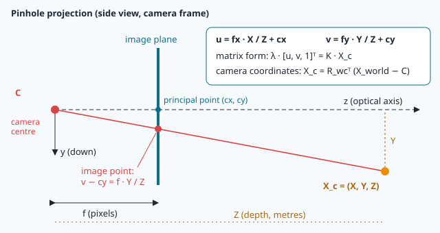

# The camera as a measuring tool

A drone flies over the old town of Sousse with its GPS jammed. Its camera looks straight down and
sees a maze of white roofs. NAVERA wants to find that picture on its satellite map — but first it
must answer a simple question: **how big is the ground in this picture?** Is this 300 meters of
roofs, or 30? A roof that is 40 pixels wide could be a small house seen from low, or a big hotel
seen from high.

If NAVERA gets the size wrong, the photo and the map are at different **scales** — like comparing a
city map with a country map — and nothing matches. In this lesson you will learn how a camera turns
meters on the ground into pixels in the picture, and back. With three numbers — the **height**,
the **field of view** and the **width in pixels** — you will be able to measure the world with a
photo.

## The pinhole camera

The simplest camera is a dark box with a tiny hole in one side: the **pinhole camera**. Light from
every point of the scene goes through the hole in a straight line and lands on the back wall, where
it makes an (upside-down) picture. Real cameras have a lens instead of a hole, but once the lens
distortion is removed (that is lesson 18), they behave exactly like a pinhole.



Look at the two triangles in the picture. The small one is inside the camera, the big one outside.
They have the same angles, so they are **similar triangles** (you met them in maths class): their
sides are in the same ratio.

> size in the image / distance hole→image = size of the object / distance hole→object

Engineers measure the inside distance directly **in pixels** and call it the **focal length in
pixels**, written **f**. It is not something you can measure with a ruler: it is "how many pixels
far from the hole the image is". With it, the rule becomes:

```
size_px / f  =  size_m / D
```

where `D` is the distance to the object. For a camera looking straight down, `D` is the **height
above the ground**, `h`. That is the whole **pinhole model** — one line of maths.

## Field of view

The **field of view** (FOV) is the angle the camera sees, from the left edge of the picture to the
right edge. We call the horizontal one **HFOV**. A phone camera sees about 70°, a fisheye lens like
the Insta360's can see more than 180°.

Field of view and focal length are two ways of saying the same thing. Take the right half of the
picture: it is `width_px / 2` pixels wide, and it is seen under the angle `HFOV / 2`. In the
right-angled triangle formed by the hole, the image centre and the image edge:

```
tan(HFOV / 2) = (width_px / 2) / f        so        f = (width_px / 2) / tan(HFOV / 2)
```

**tan** (tangent) is the button on your calculator that, for an angle in a right triangle, gives
"opposite side divided by adjacent side". In Python: `math.tan(math.radians(angle_deg))` — Python
wants angles in **radians**, `math.radians()` converts degrees for you.

| Camera | width | HFOV | f (pixels) |
|---|---|---|---|
| simple camera of this lab's photos | 960 px | 90° | 960/2 / tan 45° = **480** |
| Insta360 top lens, straightened by NAVERA | 1920 px | 111° | 960 / tan 55.5° ≈ **660** |
| a narrow "zoom" camera | 1920 px | 30° | 960 / tan 15° ≈ 3583 |

> [!NOTE]
> The second line is real. NAVERA's Insta360 ONE R top lens was calibrated on the bench and its
> focal length came out at **fx ≈ 660 pixels**. NAVERA straightens its picture into a view
> **111° wide**, and you can check that 2 · atan(960 / 660) ≈ 111°: it is the widest straight view
> that keeps the lens' own sharpness in the middle. You will see where these numbers come from in
> lesson 18.

A **narrow** field of view means a **long** focal length: the camera "zooms in". A **wide** field of
view means a short focal length: it sees a lot, but each pixel covers more ground.

## The footprint: how much ground is in the picture

Now hang the camera under a drone, looking straight down, at height `h`. The part of the ground it
sees is called the **footprint**.


Cut the cone of view in two halves. Each half is a right triangle with the height `h` as one side
and half of the footprint as the other, under the angle `HFOV / 2`:

```
footprint width  W = 2 · h · tan(HFOV / 2)
```

Some numbers for the Insta360 straightened view (HFOV 111°, so tan 55.5° ≈ 1.455):

| height h | footprint W |
|---|---|
| 50 m | 145 m |
| 100 m | 291 m |
| 150 m | 437 m |
| 300 m | 873 m |

Notice: **the footprint is proportional to the height**. Fly twice as high, see twice as wide (and
four times the area).

## Meters per pixel

The footprint is spread over the width of the picture. So **one pixel** covers:

```
meters per pixel  =  W / width_px  =  2 · h · tan(HFOV / 2) / width_px
```

This is the **ground resolution** of the photo, also called **GSD** (ground sample distance).
At 150 m with the Insta360 view: 437 m / 1920 px ≈ **0.23 m per pixel** — a car is about 20 pixels
long. At 600 m, a car is 5 pixels: the photo has less detail.

There is a neat shortcut: since `f = (width_px/2) / tan(HFOV/2)`, meters per pixel is simply
**h / f**. A camera with f = 660 px at 132 m sees 132 / 660 = 0.2 m per pixel.

## Matching the photo to the map: the scale

In lesson 7 you learned that the satellite map is cut into **tiles** of 256 × 256 pixels, and that
each **zoom level** z has its own meters per pixel:

```
map meters per pixel = 156 543.03 · cos(latitude) / 2^z
```

(156 543.03 is the Earth's circumference, 40 075 016.7 m, divided by 256.) Each zoom level up halves
the meters per pixel. Around Sousse (latitude 35.8°):

| zoom | 13 | 14 | 15 | 16 | 17 | 18 | 19 |
|---|---|---|---|---|---|---|---|
| m / px | 15.5 | 7.75 | 3.87 | 1.94 | **0.97** | 0.48 | 0.24 |

To compare a camera photo with the map, both must have the **same meters per pixel**. NAVERA does
not change the map: it **resizes the photo**. The resize factor is

```
scale = photo meters per pixel / map meters per pixel
```

At 300 m with the Insta360 view, the photo has 0.45 m/px. The zoom-17 map has 0.97 m/px, so NAVERA
shrinks the photo to about 0.47 of its size before comparing. If you were choosing the map yourself,
zoom 18 (0.48 m/px) would match the photo almost one to one: that is the **best zoom** for that
height, and you will compute it in the lab.

## Why the height matters so much

Look again at the formula: meters per pixel is **proportional to h**. If NAVERA believes the drone
is at 150 m but it is really at 200 m, every size in the photo is wrong by 33 %. The roofs look too
big compared with the map, and the matcher searches for the wrong pattern.

NAVERA even uses this as a **safety check**: when it finds a match, it measures the scale that fits
best and compares it with the scale the height predicts. A wrong place almost never matches at the
right scale, so a match whose scale is off by more than about 15 % is **refused**. The opposite is
also useful: if the match is right, the fitted scale tells the **true height**. A photo matched with
scale 1.2 means the camera saw 1.2 times more ground than expected: it was 1.2 times higher. That is
how NAVERA can **measure its height from the image** — a trick you will reproduce in the lab with a
landing pad of known size.

Where does the height come from in the first place? NAVERA tries several sources, best first
(`navera_common/altitude.py`): a **rangefinder** (a laser that measures the distance to the ground),
then the height **measured from the image** by earlier matches, carried forward by the barometer,
and finally the GPS altitude minus the altitude of the ground at take-off.

## Tilt: when the camera does not look straight down

A drone leans forward to fly, and leans sideways to turn. Its camera leans with it. A camera tilted
by an angle `tilt` does not see the ground under the drone anymore: the centre of its picture is
**in front of** the drone, at a distance

```
shift = h · tan(tilt)
```


At 150 m, a tilt of only 10° moves the centre of the picture by 150 · tan 10° ≈ **26 m**. If NAVERA
matched that photo and said "the drone is at the centre of the picture", it would be 26 m wrong.

Tilt also **stretches** the picture: the far edge is at `h · tan(tilt + FOV/2)` and the near edge at
`h · tan(tilt − FOV/2)`. The far side covers much more ground than the near side, so the photo is a
trapezoid on the ground, not a rectangle. And if `tilt + FOV/2` reaches 90°, the far edge looks at
the **horizon**: that part of the picture never touches the ground at all.

That is why NAVERA reads the drone's attitude (lesson 16) at the instant of each photo and
**straightens** the picture into the view of a level camera looking straight down before matching.
Frames tilted more than 45° are not used.

## 🐦 How birds do it

High above the coast, Navi sees a huge piece of the world: the beach, the port, the patchwork of
olive groves. Down low, skimming a field to catch flies, she sees only a small patch of grass — but
every insect in it. That is this lesson's rule, applied to an eye: **higher means a wider footprint,
but fewer details per metre of ground**. No eye can escape geometry.

Birds of prey push detail to the extreme. Their retina has a **fovea** (the sharpest spot) packed
with light sensors, and the best eagles see fine detail about twice as well as a human. It is a
little like having a long-focal-length camera in the centre of the eye: they can hunt from high up
and still see small things.

Now watch a **kestrel** hunting beside a road. It **hovers**, facing the wind. Its wings and tail
work hard all the time, and its body moves with every gust — but its **head stays almost perfectly
still**, as if pinned in the air. A still head means a steady picture: the kestrel can compare one
view with the next and spot the tiny movement of a vole in the grass.

NAVERA has the same two needs as the kestrel. It must know **how much ground each pixel covers**
(so it must know its height), and it wants pictures taken from a **known, steady** viewpoint — which
is why height and tilt matter so much.

## In NAVERA

The formulas of this lesson are in the real code, almost word for word.

In [navera_common/camera_model.py](file:navera/navera_common/navera_common/camera_model.py):

```python
def ground_m_per_px(altitude_agl_m: float, hfov_deg: float, width_px: int) -> float:
    return 2.0 * altitude_agl_m * math.tan(math.radians(hfov_deg) / 2.0) / width_px


def altitude_from_scale(predicted_altitude_m: float, fitted_scale: float) -> float:
    """... a fitted scale s (frame ground size / predicted) means the
    camera saw s times more ground: it was s times higher."""
    return predicted_altitude_m * fitted_scale
```

and `CameraModel.ideal(hfov_deg, size)`, an ideal lens, computes its focal length with
`f = (w / 2.0) / math.tan(math.radians(hfov_deg) / 2.0)` — your formula.

In [day_pkg/local_matcher.py](file:navera/day_pkg/day_pkg/local_matcher.py), the day-vision
matcher:

```python
EQUATOR_M = 40075016.7

def map_m_per_px(lat: float, z: int) -> float:
    return EQUATOR_M * math.cos(math.radians(lat)) / 2 ** z / 256.0
...
        mpp_map = map_m_per_px(prior[0], self.z)
        s = frame_m_per_px / mpp_map                     # frame pixels → map pixels
```

And in [day_pkg/nodes/day_subscriber.py](file:navera/day_pkg/day_pkg/nodes/day_subscriber.py),
`_frame_m_per_px()` refuses to guess: if the field of view is not between 1° and 179°, or the height
is unknown or below 5 m, the frame's scale is "unknown" and the frame is not compared with the map.

The tilt problem is written in the header of `camera_model.py`: *"150 m altitude, 10 deg pitch: 26 m
apart"* — the number you computed above.

## Glossary

| Word | Meaning |
|---|---|
| **pinhole model** | a camera seen as a tiny hole: `size_px / f = size_m / distance` |
| **similar triangles** | triangles with the same angles; their sides are in the same ratio |
| **focal length in pixels (f)** | the distance from the hole to the image, measured in pixels |
| **field of view (HFOV)** | the angle the camera sees from the left edge to the right edge |
| **tan, radians** | tangent = opposite / adjacent side; radians = the angle unit Python uses |
| **footprint** | the piece of ground the picture covers: `2 · h · tan(HFOV/2)` wide |
| **meters per pixel (GSD)** | how much ground one pixel covers |
| **scale** | the resize factor that gives the photo the map's meters per pixel |
| **tilt** | the angle between the camera's axis and straight down |
| **rangefinder** | a sensor (often a laser) that measures the distance to the ground |

## Check what you learned

<details><summary>1. A camera with HFOV 90° flies at 100 m. How wide is its footprint?</summary>
W = 2 · 100 · tan 45° = 2 · 100 · 1 = <b>200 m</b>.
</details>

<details><summary>2. The drone climbs from 100 m to 300 m. What happens to the meters per pixel?</summary>
They are proportional to the height: they are <b>multiplied by 3</b>. Each pixel covers three times
more ground, the photo has less detail.
</details>

<details><summary>3. Why does NAVERA refuse a match whose scale is far from the one the height predicts?</summary>
Because a wrong place almost never matches at the right scale. A big scale difference means either
the match is wrong, or the height is wrong — in both cases the position cannot be trusted.
</details>

<details><summary>4. A camera at 200 m is tilted 15°. How far from the point under the drone is the centre of its picture?</summary>
200 · tan 15° ≈ 200 · 0.268 ≈ <b>54 m</b>. That is why NAVERA straightens the picture first.
</details>

<details><summary>5. Which map zoom has about 0.5 m per pixel around Sousse?</summary>
Zoom 18 (0.48 m/px). Each zoom level up halves the meters per pixel.
</details>

Now open the **🛠️ Lab** tab.
