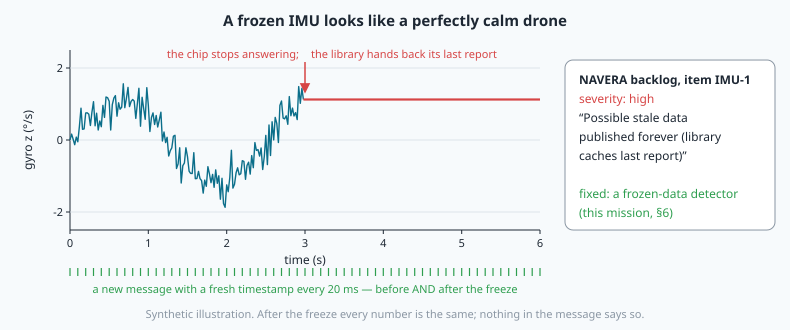
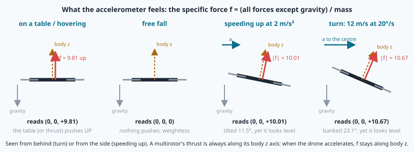
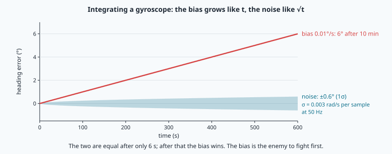
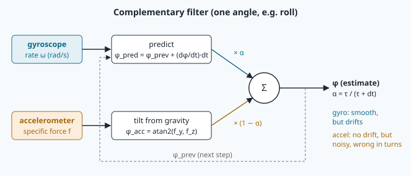
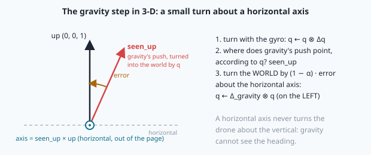
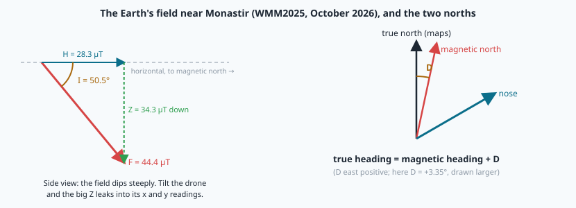

# The IMU: attitude from a gyroscope, gravity and a compass



> [!NOTE] Mission brief
> **28 September 2026, NAVERA's full code review.** Item **IMU-1**, severity *high*: "Possible stale data
> published forever (library caches last report)". If the IMU chip stopped answering, the driver library
> kept handing back its last report, and NAVERA's IMU node would have published it again and again, each
> time with a fresh timestamp. Every node downstream would have seen a perfectly steady drone. Item
> **IMU-3**: the heading was **magnetic**, not true. Both were fixed in code (IMU-3 still waits for a test
> on the real chip with a known heading).
>
> Why does it matter? NAVERA matches camera photos to a north-up map, so it needs the drone's attitude at
> every photo: a 10° tilt error at 150 m moves the centre of the photo 26 m. For the star fix, NAVERA's
> validation document (2026-10-03) says each degree of attitude error costs about **111 km**.
>
> Today you write NAVERA Lite's IMU part: you integrate a gyroscope and measure its drift, find "down"
> from gravity and catch it being fooled in a turn, fuse the two and choose the filter's time constant as
> an engineer would, correct a compass to true north, and build the detector that IMU-1 needed.
> Session 1 (gyroscope and gravity) earns **Drift hunter**; session 2 (fusion, compass, trust) earns
> **Attitude engineer**.
>
> **Start now:** open the 🛠️ **Lab** tab, do **Step 0** (two minutes, no code), then come back here for §1.

**Objectives.** After this mission you can:

1. **integrate** a gyroscope into an attitude quaternion, and **predict** its drift from its bias (and
   measure that bias);
2. **compute** the tilt from gravity, and **say when it fails** (any acceleration, a coordinated turn);
3. **fuse** both with a complementary filter and **choose τ** from measured errors;
4. **convert** a magnetic heading into a true heading (tilt compensation, declination, the world-frame
   correction of a whole attitude);
5. **detect** a frozen sensor, and choose the detector's threshold.

**You need:** mission 16 (quaternions in ROS order, `q_mul`, `q_from_axis_angle`, `q_rotate`, heading =
90° − yaw, ROS pitch = nose down), mission 04 (numpy columns, a mask, a mean), mission 06 (sin, a
distance to the side). ⏱ Reading: about 85 minutes with the ✏️ checks: §1–§3 before session 1, §4–§6
before session 2. Lab: 3 h 30 to 4 h 30.

**Before you start.** Answer without looking; if you miss two, reread mission 16 §1–§2 and §4.

<details><summary>1. (Mission 16) A ROS attitude has yaw −30°. What is its heading?</summary>
(90° − (−30°)) mod 360° = 120°: east-south-east.
</details>
<details><summary>2. (Mission 16) R is the drone's attitude (body → world). The drone then turns by ΔR about its OWN axes. Is the new attitude R·ΔR or ΔR·R?</summary>
R·ΔR. Read a product left to right about the moving (body) axes: first the old attitude, then the turn
about the new body axes. ΔR·R would turn about the fixed WORLD axes. With quaternions: q ⊗ Δq.
</details>
<details><summary>3. (Mission 04) g is an N × 3 numpy array and t an array of N times. How do you get the mean of each column for t &lt; 10?</summary>
`g[t < 10].mean(axis=0)`: the mask `t < 10` keeps the rows, `axis=0` averages down each column.
</details>

<details><summary>Words of this lesson (open if you need them)</summary>

| Word | Meaning | Français |
|---|---|---|
| **IMU** | inertial measurement unit: gyroscope + accelerometer (+ magnetometer) | centrale inertielle |
| **gyroscope** | measures turn rates about the body axes (rad/s) | gyromètre |
| **bias** | a constant (or slowly changing) offset in a sensor reading | biais |
| **drift** | the error that grows when you integrate a bias | dérive |
| **specific force** | what an accelerometer measures: all forces except gravity, per kg | force spécifique |
| **complementary filter** | trusts the gyro over short times and gravity over long times | filtre complémentaire |
| **time constant τ** | roughly how long the filter trusts the gyro alone | constante de temps |
| **inclination** | how steeply the Earth's field dips below the horizontal | inclinaison |
| **declination** | the angle from true north to magnetic north, east positive | déclinaison |
| **stale / frozen data** | readings that stop changing although messages keep coming | données figées |
</details>

## 1. What the three sensors measure

An **IMU** measures motion from the inside, without looking out. A small chip holds three sensors, each
with three axes in the body frame (FLU: x nose, y left wing, z up):

```
gyroscope       ω_m = ω + b + n                rad/s   true body rate + bias + noise
accelerometer   f_m = Rᵀ · (a + g·up) + n      m/s²    the specific force, in the body frame
magnetometer    m_m = Rᵀ · m_world + n          µT      the Earth's field, seen in the body frame
```

R is the attitude (body → world, mission 16), a the vehicle's acceleration in the world, g = 9.81 m/s²,
up = (0, 0, 1).

**Why does a still accelerometer read +9.81 upward?** An accelerometer is a small mass on a spring. It
cannot feel gravity itself: gravity pulls the mass and the case in the same way. It feels the **other**
forces, the ones that push the case: the table under a drone, or the rotors' thrust in a hover. Those push
**up** with 9.81 N per kg, so the spring is stretched exactly as if the case accelerated upward at 1 g. That
is the **specific force**: all forces except gravity, per kilogram. In free fall nothing pushes, and an
accelerometer reads 0.



**Worked example.** A level drone on its pad reads f = (0, 0, +9.81). Tilted 10° nose down (ROS pitch
+10°), still on a sloping ramp: f = 9.81·(−sin 10°, 0, cos 10°) = (−1.70, 0, 9.66). The "up" push now has
a negative x part, because the nose points a little down.

The **magnetometer** sees the Earth's field: 25 to 65 µT around the world, 44.4 µT near Monastir. Its
horizontal part points to **magnetic** north. Motors, cables and steel near the sensor disturb it.

> [!QUESTION] ✏️ Check
> 1. A drone hovers, perfectly still, 50 m above the ground. What does its accelerometer read?
> 2. The same drone climbs, accelerating upward at 2 m/s². And if its motors stop?

<details><summary>Answer</summary>
1. (0, 0, +9.81): in a hover the thrust replaces the table. Hovering and standing on a table feel the same.<br>
2. (0, 0, +11.81): the thrust must also accelerate the drone. Motors off: free fall, (0, 0, 0) (air drag
aside).
</details>

## 2. Integrating the gyroscope, and why it drifts

The gyroscope gives **rates**, not angles. Over one sample (dt = 0.02 s at 50 Hz) the body turns by the
small angle |ω|·dt about the axis ω/|ω|. You know this rotation from mission 16:
Δq = `q_from_axis_angle(ω, |ω|·dt)`. The gyro measures in the **body** frame, so the small turn is about
the drone's **own** axes and multiplies on the **right** (retrieval question 2):

```
q_k = q_(k−1) ⊗ Δq,      Δq from the rate measured at sample k−1, during dt = t_k − t_(k−1)
```

Normalise after each step (rounding slowly changes the length). A rate of exactly (0, 0, 0) has no axis:
then the attitude simply does not change.

**Worked example.** The drone is level, nose north: yaw 90°, q = (0, 0, 0.7071, 0.7071). The gyro reads
(0, 0, −0.35) rad/s: a turn to the **right** (negative about up) at 20°/s. One step: angle 0.35 × 0.02 =
0.007 rad, Δq = (0, 0, −0.0035, 1.0000), and q ⊗ Δq = (0, 0, 0.7046, 0.7096): yaw 89.60°, heading 0.40°.
After 50 such steps (1 s) the heading is 20.05°, as expected.

**Drift.** The gyro's **bias** b is small and almost constant, but integration adds b·dt at every step, so
the angle error grows **without limit**: e_bias(t) = b·t. A bias of 0.01°/s (a good gyro) gives 6° after
10 minutes. The white noise also adds up, but more slowly, like a random walk: its standard deviation
after t seconds is σ·√(dt·t). With σ = 0.003 rad/s per sample at 50 Hz, after 10 minutes that is 0.6°
(1σ). The two are equal after only 6 s; after that the bias wins.



**Measuring the bias.** When the vehicle is perfectly still (on its pad, before take-off), the true rate is
0, so the mean of the readings **is** the bias. Averaging N samples divides the noise by √N: 500 samples
(10 s at 50 Hz) with σ = 0.003 rad/s = 0.17°/s per sample give the bias to about 0.17 / √500 = 0.008°/s.
Subtract that estimate from every later reading, and the drift shrinks to the error of the estimate times
t, plus the random walk. Not zero: smaller.

> [!QUESTION] ✏️ Check
> A cheap phone gyroscope has a bias of 0.5°/s. Integrated alone, after how long is the heading 10° wrong?
> And if you could average 2 000 still samples with σ = 0.2°/s each, how good would your bias estimate be?

<details><summary>Answer</summary>
10 / 0.5 = 20 s. The estimate: 0.2 / √2000 = 0.0045°/s, a hundred times better than the raw bias.
</details>

## 3. Tilt from gravity, and when it fails

When the vehicle does not accelerate (a = 0), the accelerometer reads f = Rᵀ·(0, 0, g): g times the
**bottom row** of R, written as a column. With R = Rz(ψ)·Ry(θ)·Rx(φ) (mission 16 §3), that row is
(−sin θ, cos θ sin φ, cos θ cos φ), so

```
roll  φ = atan2(f_y, f_z)
pitch θ = atan2(−f_x, √(f_y² + f_z²))         (ROS pitch: positive = nose down)
```

The yaw ψ does not appear: gravity is vertical, so it says nothing about the heading. The size of f does
not matter either, only its direction.

**Worked example.** f = (−1.70, 0.52, 9.65): roll = atan2(0.52, 9.65) = 3.08° (right wing slightly down),
pitch = atan2(1.70, √(0.52² + 9.65²)) = atan2(1.70, 9.664) = 9.98°: ROS pitch +10°, nose down
(pitch_up −10°).

<details><summary>🧰 numpy: one formula for a whole column</summary>

`np.arctan2`, `np.hypot`, `np.sqrt` work element by element on whole arrays, and on single numbers too.
`math.atan2` takes single numbers only: on an array it raises `TypeError: only length-1 arrays can be
converted`.

```python
x = np.array([1.0, 0.0, -1.0]); y = np.array([0.0, 2.0, 0.0])
np.degrees(np.arctan2(y, x))          # array([  0.,  90., 180.])
np.hypot(3.0, 4.0)                    # 5.0
```
</details>

These angles **never drift**. But they have two weaknesses.

- **Noise.** Motor vibration of 0.3 m/s² is already 0.3/9.81 rad = 1.75° on one sample.
- **Acceleration.** The formula assumes a = 0. Any acceleration is mixed into f, and the accelerometer
  cannot tell it from a tilt. The worst case is a **coordinated turn**. A multirotor turning at speed v
  with turn rate ω needs a sideways acceleration v·ω towards the centre; it gets it by banking until its
  thrust, still along body z, gives both the support and the turn: bank = atan(v·ω/g). The specific force
  is the thrust, **along body z**: the accelerometer reads (0, 0, |f|) and believes the drone is level.
  Example: 12 m/s at 20°/s = 0.349 rad/s → v·ω = 4.19 m/s², bank = atan(4.19/9.81) = **23.1°**, and
  the accelerometer reads (0, 0, 10.67): roll 0°.

In **steady** flight (constant speed and direction) a = 0 and the formula is right again, even when a
multirotor holds its nose a few degrees down against the air drag: that tilt is real, and the accelerometer
sees it. Only **changes** of speed or direction fool it: the accelerometer does not see the part of the tilt
that makes the speed change. Braking is the mirror of speeding up: the drone pitches nose **up**, and the
accelerometer reads much less nose-up than the truth (it can even read slightly nose-down).

This is physics, not a bad sensor (Einstein's equivalence principle: you cannot tell gravity from
acceleration from the inside). Pilots know it as the *somatogravic illusion*: in the dark, a strong forward
acceleration feels like a nose-up tilt. Investigators named it as a likely factor in the crash of Gulf Air
flight 072 (Bahrain, 2000), during a night go-around over the sea.

> [!QUESTION] ✏️ Check
> A car accelerates at 2 m/s² on a flat road. What pitch does `tilt_from_accel` give for it (ROS sign)?
> What does a passenger with closed eyes feel?

<details><summary>Answer</summary>
f = (+2, 0, 9.81) in the car's body frame (the seat pushes forward and up). θ = atan2(−2, 9.81) =
−11.5° (ROS): "nose 11.5° up". The passenger feels pressed into the seat, as if leaning back: the same
illusion.
</details>

## 4. The complementary filter: trust each sensor where it is good

The gyro is excellent over **seconds** and useless over **minutes** (drift). Gravity is the opposite:
noisy and fooled at every moment, right **on average** over minutes. The **complementary filter** uses
each where it is good. In one dimension (the roll φ, small angles):

```
α = τ / (τ + dt)
φ_k = α · (φ_(k−1) + p·dt)  +  (1 − α) · φ_acc,k          p = the gyro's roll rate
```

At every step the gyro turns the estimate, and gravity pulls it a small fraction 1 − α of the way towards
its own opinion. τ is the **time constant**: roughly "trust the gyro alone for τ seconds".

**Worked example.** τ = 1 s, dt = 0.02 s → α = 1/1.02 = 0.9804. The drone is still, the estimate says
roll 0°, gravity says 10°. One step moves the estimate by 0.196°; after 1 s (50 steps) it is at
10·(1 − 0.9804⁵⁰) = 6.28°: about 63 % of the way (1 − e⁻¹), which is what "time constant" means.

**Two errors, one knob.**

- **Gyro bias.** With a constant bias b, the error settles where the gyro's push and gravity's pull
  cancel: e = α·b·dt/(1 − α) = **b·τ**. With b = 0.01°/s and τ = 1 s: 0.01° (instead of 6° after 10
  minutes of pure integration). Bounded.
- **Fooled gravity.** If gravity is wrong by E for T seconds (a turn), the estimate moves towards the
  wrong value by about E·(1 − e^(−T/τ)). A 12 s turn with E = 23°: τ = 1 s copies all 23°; τ = 30 s moves
  only 7.6°.

A small τ copies gravity's noise and its errors in turns; a large τ keeps more of the gyro bias and needs
about τ seconds to forget a wrong start. The best τ depends on the gyro, the vibration and how the vehicle
flies. Engineers measure it. That is your job in the lab.

**b·τ is a worst case.** It is the error once the filter has settled (after a few τ), for a vehicle that
keeps its heading. A bias on the body x or y axis turns **with** the drone: after a 180° turn the same body
bias tilts the estimate the other way, so on a flight with many turns its effect partly cancels. And with τ
of a few minutes, a 5-minute flight never settles. A large τ then costs less than b·τ: keep this in mind when
you read the lab's table.



**In three dimensions** NAVERA Lite keeps a quaternion, never Euler angles (mission 16 §3: no gimbal
lock), and does the same two things at every step:

1. **gyro step:** q ← q ⊗ Δq, exactly as in §2;
2. **gravity step:** where does gravity's push point in the world, according to q? `seen_up` =
   `q_rotate(q, f/|f|)`. If q were right (and a = 0), seen_up would be (0, 0, 1). The **error** is the angle
   between them, and the axis that turns seen_up towards up is `seen_up × (0, 0, 1)`, a **horizontal**
   world axis. Turn the **world** by (1 − α)·error about it: q ← Δ_gravity ⊗ q, on the **left**
   (a world-frame turn).

**Worked example (one gravity step).** The estimate is level, q = (0, 0, 0, 1), but the drone is really
banked 30° right wing down, still: f = (0, 4.905, 8.496). seen_up = q_rotate(q, f/|f|) = (0, 0.5, 0.866):
the estimate thinks gravity's push leans towards the left wing. Axis = seen_up × (0, 0, 1) = (0.5, 0, 0):
along world x, horizontal (turning seen_up towards up is a positive turn about it, by the right-hand rule).
Error = atan2(|axis|, seen_up_z) = atan2(0.5, 0.866) = 30°. With τ = 1.5 s and dt = 0.5 s, α = 0.75: the
world turns by (1 − 0.75) × 30° = 7.5° about x, and the roll goes 0° → 7.5°, exactly the 1-D formula
0.75 × 0° + 0.25 × 30°. (Use atan2 for the angle: |axis| alone is sin(error), 0.5 here, not 30°.)



For small angles this is exactly the 1-D formula on each tilt axis. Because the axis is horizontal, the
correction never turns the drone about the vertical: gravity cannot see the heading, so the heading drifts
with the gyro. The compass (§5) fixes that.

> [!QUESTION] ✏️ Check
> τ = 5 s at 50 Hz: what is α? With a gyro bias of 0.2°/s, how large is the steady tilt error? And without
> any filter, after one minute?

<details><summary>Answer</summary>
α = 5/5.02 = 0.9960. Steady error b·τ = 0.2 × 5 = 1.0°. Gyro alone: 0.2 × 60 = 12° after a minute,
and growing.
</details>

> [!WARNING] Common wrong ideas
> - "The accelerometer measures gravity." It measures everything **except** gravity: in free fall it reads 0.
> - "Bigger τ is always better, it filters more." It also keeps b·τ of bias, and needs ~τ to recover from a
>   wrong start.
> - "The gyro step multiplies on the left, like the declination." The gyro measures in the **body** frame:
>   right. Corrections of the **world** frame (gravity, north) multiply on the left.
> - "Gravity can correct the heading." It is vertical: it sees roll and pitch, never the heading.
> - "A magnetic heading is a true heading." Not until you add the declination (§5).

## 5. The compass: tilt compensation and true north

**Heading from a level magnetometer.** On a level drone with heading h, magnetic north is at angle h to the
**left** of the nose (counter-clockwise seen from above: the nose is h clockwise from north), so in FLU
(y = **left**) the horizontal field reads (H·cos h, H·sin h): nose east (h = 90°) puts north on the left,
+y. So

```
magnetic heading = atan2(m_y, m_x)        in FLU, degrees, mod 360
```

(Many tutorials use a body frame whose y points **right**, and write atan2(−m_y, m_x): a mirror image in
our frame.)

**Tilt compensation.** The Earth's field is not horizontal: it dips by the **inclination** I. Near Monastir
I = 50.5° (F = 44.4 µT: H = 28.3 µT horizontal, Z = 34.3 µT down); London 66.5°; Singapore −12.9°
(negative: the field points slightly up, because Singapore lies south of the magnetic equator). When the drone tilts, the large
vertical part leaks into its x and y readings. Undo the tilt before taking the angle: since
R = Rz·Ry·Rx, the field a **level** drone with the same heading would see is

```
m_level = Ry(θ) · Rx(φ) · m_body          (rot_y(pitch) @ rot_x(roll) @ m: the roll is undone first)
magnetic heading = atan2(m_level,y, m_level,x)
```

**Worked example (near Monastir).** Nose to magnetic north, banked 10° right wing down. The body reads
m = (28.25, −5.96, −33.78) µT. Without compensation, atan2(−5.96, 28.25) = −11.9° → **348.1°**, while the
drone points at 0°. With Rx(10°) undone first: 0.0°.



**True north.** Maps use true north; the horizontal field points to magnetic north. The angle from true to
magnetic north is the **declination** D, positive when magnetic north is **east** of true north:

```
true heading = (magnetic heading + D) mod 360
```

D depends on the place and the date. It comes from the **World Magnetic Model** (WMM2025, valid
2025–2030), here through the Python package `pygeomag`. Mid-October 2026, sea level:

| Place | D | I |
|---|---|---|
| London (51.50 N, 0.12 W) | +1.21° | 66.5° |
| Reykjavik (64.15 N, 21.94 W) | −11.05° | 75.4° |
| Sydney (33.87 S, 151.21 E) | +12.83° | −64.4° |
| Singapore (1.29 N, 103.85 E) | +0.24° | −12.9° |
| Sousse, NAVERA's test area (35.83 N, 10.64 E) | +3.34° | 50.6° |

Small is not negligible. A drone that ignores 1.21° in London and flies 10 km straight ends
10 000 · sin(1.21°) = **212 m** to the side.

**Correcting a whole attitude.** An IMU chip with its own compass gives a quaternion in an ENU frame whose
"north" is **magnetic** north. To express the same attitude in the true-north frame, turn the **world**
by −D about Up (true heading = magnetic + D, so the yaw decreases by D):

```
q_true = q_from_axis_angle((0, 0, 1), −D) ⊗ q_mag          on the LEFT: a world-frame turn
```

On the right it would be a turn about the drone's **own** up axis: the same when the drone is level,
wrong as soon as it banks.

> [!QUESTION] ✏️ Check
> 1. A compass in Sydney reads 359°. True heading?
> 2. A chip reports heading 75° (magnetic) near Sousse. After the correction, what heading do you expect?

<details><summary>Answer</summary>
1. 359 + 12.83 = 371.83 → 11.83°.<br>
2. 75 + 3.34 = 78.34° (the table's D for Sousse; the lab's log, near Monastir, has 3.35°).
</details>

## 6. Can you trust the numbers? A frozen sensor

A sensor can fail without going silent. That was IMU-1: the chip stopped answering, the library returned
its cached last report, and the node published it with new timestamps. **A fresh timestamp only says when
the message was sent, not when the sample was measured.**

The giveaway is that a living sensor is never perfectly still: its noise changes at least one digit at
every sample. A real chip reports in fixed steps, its resolution: about 0.002 rad/s (gyro), 0.004 m/s²
(accelerometer) and 0.06 µT (magnetometer) on a BNO085. With that resolution and this mission's noise, one
gyro axis repeats its previous value about one sample in five at rest, but all nine readings at once only
about once in 4·10¹³ samples. (The lab's log is written with more digits, so it repeats even less.) So: **N exact repeats
of the whole sample in a row = frozen**.

Choosing N is again a trade-off. Too small, and a short hiccup (a few failed reads that return the cached
value, then fresh data again) raises a false alarm. Too large, and the frozen data flows for longer before
anyone notices: N = 50 at 50 Hz is one second.

<details><summary>🧰 Python: an object that remembers (mission 03's classes)</summary>

A method can update the object's attributes between calls, so the object remembers the past:

```python
class Counter:
    def __init__(self):
        self.n = 0
    def tick(self, word):
        self.n = self.n + 1 if word == "yes" else 0
        return self.n

c = Counter(); [c.tick(w) for w in ["yes", "yes", "no", "yes"]]     # [1, 2, 0, 1]
(1.0, 2.0) == (1.0, 2.0), tuple([1, 2]) == (1, 2)                   # True True — tuples compare all items
```
</details>

## In NAVERA

From NAVERA's validation and architecture documents (Release 0.2, 2026-10-03) and its engineering backlog,
in words:

- The box carries a **BNO085** IMU (accelerometer, gyroscope, magnetometer and an on-chip fusion
  processor) on the Jetson's I²C bus, read at **50 Hz**. Its driver was verified live on 2026-07-13 (rates,
  accelerations, the gyro responding to motion). **Not yet checked**: its heading reference against a known
  heading (IMU-3) and its noise; the noise values in its settings are datasheet values.
- The fusion runs **on the chip**. NAVERA does **not** integrate the IMU into a position ("inertial
  navigation: not implemented"): the IMU gives the camera's **attitude** and heading changes.
- **IMU-1** (high) was fixed: the node now declares the data frozen after **50 identical samples in a row**
  (1 s at 50 Hz), stops publishing it and re-initialises the chip. **IMU-2**: the reconnection is no longer
  attempted at every 50 Hz tick on the shared I²C bus.
- **IMU-3**: the heading is turned to **true** north with the WMM2025 declination at the vehicle's
  position, recomputed about every 20 km. Until a position is known it uses a declination set by the
  operator, if any; otherwise the heading stays magnetic, and the node says so. A mounting rotation (how the
  chip sits in the box) is applied too.
- What the attitude buys: offline, 33 places with random tilts up to 12° and a BNO085-class IMU error
  (0.3°/1.5°), straightened camera views were all within 2.6 m (median 1.1 m); without straightening the
  median error was 28 m. For the star fix, a BNO085-class attitude gives **24–119 km** (simulated star
  fields), against 5.5–6.5 km with a perfect attitude.

## In NAVERA Lite

[navera_lite/imu.py](file:./navera_lite/imu.py) is NAVERA Lite's IMU part. You write `integrate_gyro`,
`tilt_from_accel`, `complementary`, `mag_heading`, `true_heading`, `q_true_north` and
`StaleDetector.update`; `declination_deg` (WMM through pygeomag) and `StaleDetector.__init__` are given. It
builds on your mission-16 toolbox (`rotations.py`, shipped finished). Mission 20 reads the attitude at each
photo's exposure, and mission 26 needs it for the stars.

## 🐦 How birds do it

Next to the semicircular canals of mission 16, a bird's inner ear has **otolith organs**: small crystals of
calcium carbonate resting on hair cells. They feel the specific force, exactly like an accelerometer, with
the same blind spot: a tilt and an acceleration feel the same. The brain fuses them with the canals and
with vision, a complementary filter of its own. And the compass: in 1972 Wolfgang and Roswitha Wiltschko
showed that European robins use the **inclination** of the field (towards the pole or towards the equator),
not its polarity; migrants cross-check it with the sun and the stars (mission 26).

## Summary

1. Gyro: rates in the body frame; q ← q ⊗ Δq (right). Bias → error b·t, noise → σ√(dt·t). Measure the bias
   on the pad (the mean of still samples) and subtract it.
2. Accelerometer: the specific force (+9.81 up at rest). Tilt = atan2(f_y, f_z), atan2(−f_x, √(f_y²+f_z²));
   no heading; fooled by every acceleration, completely in a coordinated turn.
3. Complementary filter: α = τ/(τ + dt); bias error b·τ; gravity errors remembered for ~τ; choose τ from
   measurements. In 3-D: gyro on the right, the gravity nudge on the left about a horizontal axis.
4. Compass: undo roll then pitch, heading = atan2(m_y, m_x) in FLU; true = magnetic + D (WMM); a whole
   attitude: turn the world by −D, on the left.
5. Trust: a fresh timestamp is not fresh data; N exact repeats of the whole sample = frozen; N trades false
   alarms against delay.

**Next mission:** the camera model — where a pixel lands on the ground, using the attitude you just learned
to compute.

## Check yourself

Answer without scrolling up.

<details><summary>1. Why does a drone resting on a table read +9.81 m/s² on z, and 0 in free fall?</summary>
An accelerometer feels the forces other than gravity (the specific force). The table pushes up with 9.81 N
per kg; in free fall nothing pushes.
</details>
<details><summary>2. A gyro has a bias of 0.05°/s. Error after 5 min alone? Steady tilt error in a complementary filter with τ = 20 s?</summary>
0.05 × 300 = 15°, growing. With the filter: b·τ = 0.05 × 20 = 1°, bounded (for roll and pitch only: gravity
cannot correct the heading).
</details>
<details><summary>3. Why does the accelerometer report "level" in a coordinated turn?</summary>
The drone banks so that its thrust, along body z, supports it and pulls it into the turn. The specific
force is that thrust: along body z, as on a level drone at rest.
</details>
<details><summary>4. Why does the declination multiply on the left, and the gyro step on the right?</summary>
The declination turns the world frame (magnetic → true north); the gyro measures turns about the body's own
axes. World-frame turns go on the left, body-frame turns on the right (mission 16 §2).
</details>
<details><summary>5. (Mission 16) A ROS orientation is (0, 0, 0.5, 0.8660). What heading does it give if you read it as (x, y, z, w)?</summary>
Yaw 2·acos(0.8660) = 60°, heading 90° − 60° = 30°.
</details>

Now open the **🛠️ Lab** tab.
