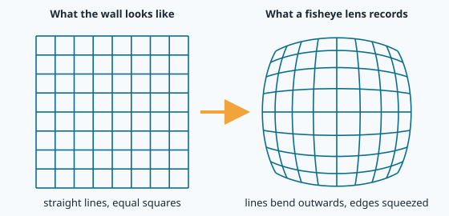
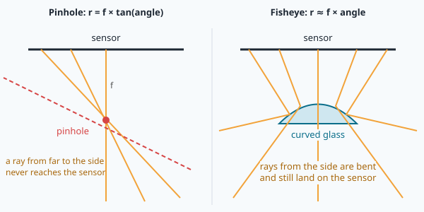

# Fisheye lenses and calibration

NAVERA's camera on the bench is an **Insta360 ONE R** with its 360° module. Its top lens
sees a huge piece of the world in one picture: about **166 degrees** from left to right. That is
wonderful for not missing anything… and terrible for measuring. Look at a photo it takes of a
flat computer screen: the screen's straight edges come out **curved**, like a reflection in a
spoon.

Now imagine the camera on a drone, looking down at a straight road. In the picture the road is
curved. NAVERA must compare this picture with a satellite map, where the road is straight
(lessons 20–22). A curved road will never match a straight one. Before the picture can be used
as a **measuring tool** (lesson 17), the bending must be removed. This lesson explains where the
bending comes from, how engineers **measure** it once with a chessboard, and how NAVERA uses that
measurement to straighten every frame — with the real calibration of the real camera.

## Why straight lines bend

In lesson 17 you met the **pinhole camera**: light goes through one tiny hole and hits the
sensor. A ray that arrives at an **angle** θ (the Greek letter "theta") from the camera's axis
lands at a distance

> **r = f × tan(θ)**

from the centre of the picture, where **f** is the focal length in pixels. A pinhole camera has
a lovely property: **straight lines in the world stay straight in the picture**. That is why the
maths of lessons 17 and 22 works.

But look at `tan(θ)` when θ grows: tan(45°) = 1, tan(70°) ≈ 2.7, tan(85°) ≈ 11.4, and tan(90°)
is infinite. A ray coming from the side would land infinitely far away — off any sensor. A
pinhole camera can **never** see 180°, and even 120° needs a gigantic sensor.

A **fisheye lens** cheats with curved glass. It bends the rays from the side so they still land
on the sensor. A simple fisheye follows roughly

> **r ≈ f × θ**   (θ in radians)

so a ray at 83° (1.45 rad) lands 1.45 × f from the centre instead of 8 × f. The price: the
pinhole's lovely property is gone. Things near the edge are **squeezed**, and a straight line
that does not pass through the centre comes out curved — bulging outwards like a barrel. This is
called **barrel distortion**.





> [!NOTE]
> The **distortion** is not a defect of a cheap lens: it is the price of a wide view. Every
> wide-angle lens has some — your phone also straightens its photos before showing them to you.

## How wide is the Insta360's top lens?

The Insta360 picture is 1920 × 1080 pixels, made of **two halves**: the top half (1920 × 540) is
the top lens, the bottom half the bottom lens (lesson 19). NAVERA uses only the top half. For
that half, the calibration you will study says:

| Number | Value | Meaning |
|---|---|---|
| fx | 660 px | focal length, horizontally |
| fy | 721 px | focal length, vertically |
| cx | 937 px | column of the optical centre (the middle would be 960) |
| cy | 318 px | row of the optical centre (the middle would be 270) |

With the simple fisheye rule "angle = distance / f", the left edge (937 px from the centre) is
937 / 660 = 1.42 rad = 81° to the left, the right edge (1919 − 937 = 982 px) is 1.49 rad = 85° to
the right: **about 166° wide**. Vertically: about **43°**. You will compute these in the lab.

> [!TIP]
> Why are fx and fy different? The Insta360 squeezes its lens picture a little to fit the
> 1920 × 540 half, so one pixel covers a slightly bigger angle across than up-down. You don't need
> to know this in advance: the calibration discovers it by itself. That is the point of calibrating.

## Calibration: measuring the lens once

Every lens is a little different, even two of the same model: the glass, the exact distance to
the sensor, the sensor glued a tiny bit off-centre. So engineers do not trust the datasheet: they
**measure** their own camera. This is called **calibration**, and it is done once per camera
(and per picture size).

The trick is to photograph something whose shape we know perfectly: a **chessboard**.

1. We know the board is flat, and every square is the same size (for the Insta360: squares of
   **32.94 mm**, shown on a computer screen).
2. On each photo, OpenCV finds the **inner corners** — where four squares meet — very precisely
   (to a fraction of a pixel). The board used has 9 × 6 inner corners.
3. A computer then searches for the lens numbers (fx, fy, cx, cy and the bending numbers) that
   explain **all the photos at once**: "if the lens had these numbers, and the board were at that
   place, the corners would land exactly here". It adjusts the numbers until predicted and seen
   corners agree as well as possible.


To measure the bending well, the board must be seen **in many places**: in the centre, near the
edges and corners (where the lens bends the most), tilted, near and far. The Insta360 top lens was
calibrated with **38 views**.

How good is the result? For every corner, the computer compares where the lens model says it
should be with where it really was seen. The average distance (a special average, the **RMS**,
"root mean square") is the **reprojection error**. The Insta360 calibration has **0.525 px**: on
average the model puts each corner about half a pixel from where the camera saw it.
`calibrate_camera.py` calls below 0.5 px "good" and below 1 px "usable".

## The numbers in the file

A calibration is just a few numbers. They are stored in two groups.

**The camera matrix K** (3 × 3) holds the focal lengths and the centre:

```
     | fx   0   cx |       | 660.5    0     937.1 |
K =  |  0  fy   cy |   =   |   0    721.4   317.7 |
     |  0   0    1 |       |   0      0       1   |
```

You don't need matrix maths here: think of K as a neat box holding four numbers. OpenCV wants
them in this shape.

**The distortion coefficients D** describe *how* the lens bends. OpenCV's **fisheye model** uses
four numbers k1, k2, k3, k4:

> r = f × θd   with   θd = θ × (1 + k1·θ² + k2·θ⁴ + k3·θ⁶ + k4·θ⁸)

With all k's at zero, this is exactly the simple fisheye "r = f × θ". The k's add small
corrections so the curve fits *this* lens. For the Insta360 top lens:
k1 = 0.232, k2 = −0.417, k3 = 0.534, k4 = −0.239.

> [!WARNING]
> A calibration is valid **only where the board was seen**. In the 38 views of the Insta360, the
> farthest corner was about 52° from the axis. Up to there the curve made with k1…k4 is measured;
> beyond, where no corner was ever seen, the polynomial does what polynomials do: after about 67° it
> turns back down (you will draw it in the lab). The very
> edges of the Insta360 picture are outside what the calibration can describe. Another reason why
> NAVERA does not use them (see below).

OpenCV also has a "normal" model (`pinhole` in NAVERA: k1, k2, p1, p2, k3) for ordinary lenses.
For lenses wider than about 120°, the fisheye model works much better — NAVERA's default.

## Straightening a picture

Once we know the lens, we can build a **new picture** as a perfect pinhole camera would have
taken it. This is called **undistorting** (or rectifying). We choose the new, perfect camera
ourselves: its own matrix, often written **K_new**, with its focal length chosen from the field
of view we want:

> f_new = (width / 2) / tan(hfov / 2)

Then, for **every pixel of the new picture**, the computer asks: "which direction does this pixel
look at? Where did the fisheye put that direction?" and copies the colour from there. The list
of "where to fetch each pixel" is called a **map**. OpenCV builds it once
(`cv2.fisheye.initUndistortRectifyMap`) and then applies it to each frame very quickly
(`cv2.remap`). Building the map takes time; applying it is fast — so NAVERA builds it once at
start and reuses it for every frame.

Pixels of the new picture whose direction the lens never saw stay **black**: you will see black
borders in the corners of your straightened picture.

## How wide should the straight picture be?

We could ask for a straight picture 160° wide. But remember tan(): to show 80° to each side, a
pinhole picture of width w needs f = (w/2)/tan(80°) = w/11.3. With w = 1920 that is f = 170 px,
while the real lens has fx = 660 px at its centre. The centre of the picture — the part that
matters most for matching with the map — would be shrunk almost 4 times, its details thrown away,
just to show stretched, blurry edges.

NAVERA's rule is: **never make the straight picture's focal length shorter than the lens' own**.
The widest view keeping the lens' full detail at the centre is

> max hfov = 2 × atan( (w/2) / fx ) = 2 × atan( 960 / 660.5 ) = **110.9°**

That is why NAVERA's straightened Insta360 view is **111° wide**: it is written in the
calibration file as `out_hfov_deg: 111.0`. We lose the far edges (81° → 55° on each side), but the
centre keeps every pixel of detail, and we stay where the calibration is trustworthy.

<details><summary>Why exactly "f_new = fx" keeps the centre's detail?</summary>
Near the centre, both a pinhole and a fisheye put a small angle θ at r ≈ f × θ. If the new picture
uses the same f as the lens, one degree near the centre covers the same number of pixels in both:
no detail lost, none invented.
</details>

## 🐦 How birds do it

Look at a pigeon's head. Its eyes are on the **sides**, not in front. Together they see a huge part
of the world at once — more than 300 degrees around in a pigeon, and a woodcock sees almost all the
way round. That is a bird with two built-in fisheye lenses! It is perfect for spotting a hawk coming
from almost any direction. The price: a small **blind spot behind the head**, and only a narrow zone
in front where both eyes see the same thing.

An **owl** made the opposite choice. Its eyes face **forward**, so both eyes see a much larger part
of the scene together. With two views of the same thing, the brain can judge **distance** — very
useful to land on a mouse in the dark. But the owl's field of view is much narrower, and its big
tube-shaped eyes can hardly move in their sockets. So the owl turns its whole head instead, up to
about three-quarters of a full turn.

Navi, a swallow catching insects in flight, sits somewhere in between: wide side vision to stay
safe, plus sharp zones to aim at a fly.

Nature has no single "best" lens: **wide** to see everything, or **narrow** to measure well. NAVERA
makes the same trade-off. Its Insta360 lens sees 166° like a pigeon, but for measuring, NAVERA
straightens and keeps the central 111°, where every pixel can be trusted.

## In NAVERA

**Calibrating.** The tool is
[navera_tools/calibrate_camera.py](file:navera/navera_tools/calibrate_camera.py). It can take
photos live from the camera or from a folder (`--images`), finds the corners with
`cv2.findChessboardCornersSB`, and calls `cv2.fisheye.calibrate`. On the bench, the Insta360 recorded frames of a chessboard
shown on a screen, and their top halves were calibrated like this:

```text
python3 navera_tools/calibrate_camera.py --images frames/ --crop top --board 9x6 --square-mm 32.94 --out insta360_top.yaml
```

It writes the YAML file you will open in the lab: `model`, `image_width`, `image_height`,
`camera_matrix` (the 9 numbers of K), `distortion` (k1…k4), `rms_px`, `views`, `out_hfov_deg`,
`crop` (which part of the picture was calibrated) and, measured later, `latency_s` (lesson 19).

**Using it.** [navera_common/camera_model.py](file:navera/navera_common/navera_common/camera_model.py)
turns the file into a `CameraModel`. Here is the heart of its `undistort()`:

```python
if self._maps is None:                      # built once, then reused for every frame
    if self.model == "fisheye":
        self._maps = cv2.fisheye.initUndistortRectifyMap(
            self.K, self.D[:4], np.eye(3), self.K_out, self.size, cv2.CV_16SC2)
    ...
return cv2.remap(img, *self._maps, cv2.INTER_LINEAR, borderMode=cv2.BORDER_CONSTANT)
```

`K_out` is the perfect camera, built from `out_hfov_deg` exactly like your `f_new`, and capped by
`max_out_hfov_deg()` = 2 atan(w/2 / fx) — the 111° rule above.

**Safety checks.** [camera_pkg/nodes/live_camera.py](file:navera/camera_pkg/camera_pkg/nodes/live_camera.py)
refuses a calibration that does not fit (`_camera_model`):

- made for **another picture size** ("calibration … is for 1920x540, the camera gives …"):
  K is in pixels of one size only;
- made with **another crop** (the whole picture instead of the top half…);
- made with **another camera** (when calibrated live, the file stores the USB camera's identity,
  `camera_id`, and live_camera compares it with the camera plugged in).

A wrong calibration does not crash anything — it silently puts every match a few tens of meters
off. So NAVERA prefers to stop with a clear message.

## New words

| Word | Meaning |
|---|---|
| **fisheye lens** | a very wide lens (often 150–200°) that bends side rays onto the sensor |
| **distortion** | the difference between the real picture and a perfect pinhole picture |
| **barrel distortion** | straight lines bulge outwards, edges squeezed |
| **calibration** | measuring the numbers of one camera's lens, once, with a known pattern |
| **inner corner** | a point where four chessboard squares meet; found to a fraction of a pixel |
| **K, camera matrix** | 3 × 3 box holding fx, fy (focal lengths, px) and cx, cy (centre, px) |
| **D, distortion coefficients** | the numbers describing the bending (fisheye: k1…k4) |
| **reprojection error (RMS)** | average distance between predicted and seen corners, in pixels |
| **undistort / straighten** | rebuild the picture a perfect pinhole camera would have taken |
| **map / remap** | the list "where to fetch each new pixel", and applying it |

## Check what you learned

<details><summary>1. Why can't a pinhole camera see 180°?</summary>
A ray at angle θ lands at r = f × tan(θ). At 90°, tan is infinite: the ray never reaches the sensor.
</details>

<details><summary>2. Why is a chessboard used for calibration?</summary>
Its shape is known exactly (flat, equal squares) and its corners can be found very precisely. Then the
only unknowns are the lens numbers (and where the board was), which the computer can solve for.
</details>

<details><summary>3. Where should you hold the board when calibrating a fisheye lens?</summary>
Everywhere — and especially near the edges and corners of the picture, where the lens bends the most.
The calibration is only valid where the board was seen.
</details>

<details><summary>4. NAVERA straightens the Insta360 picture to 111°. What would a 150° straight view cost?</summary>
Its focal length would be (960)/tan(75°) ≈ 257 px instead of 660: the centre, the most useful part,
would be shrunk 2.6 times and lose most of its detail, to show stretched edges the calibration does not
even describe well.
</details>

Now open the **🛠️ Lab** tab.
