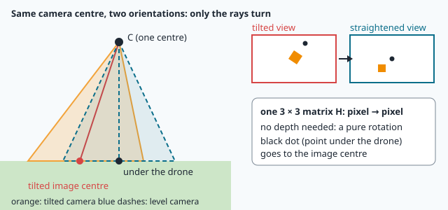
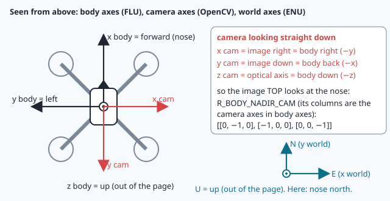
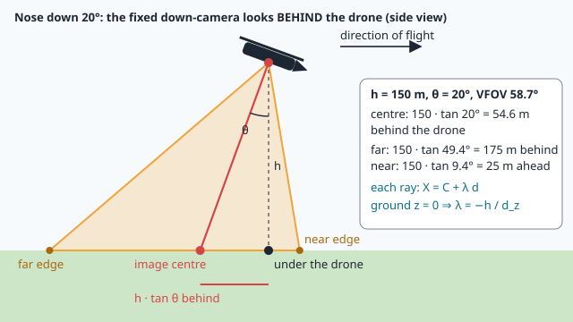
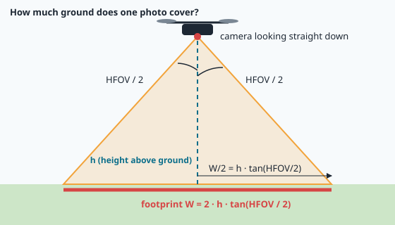

# The camera as a measuring instrument



> [!NOTE] Mission brief
> **2 October 2026, NAVERA's bench.** 33 **simulated** camera views of the Sousse area, from 120 to 250 m, the
> camera tilted by up to 12° as a drone tilts when it brakes, turns or fights the wind, with a slightly biased
> IMU. NAVERA's day vision placed all 33 within 2.6 m of the truth (median 1.1 m). The same views with one
> change, the old assumption that the camera looks **straight down**: median error **28 m**, and one view matched
> at a wrong place. (Offline test, simulated camera over the map's own imagery: NAVERA's report calls such
> results optimistic. The effect of the tilt is what matters here.)
>
> A few degrees of tilt cost 28 m. Today you find out why, and how to fix it. **Session 1 — Measurer:** you
> build the camera model of NAVERA Lite and measure heights and positions in drone photos. **Session 2 —
> Straightener:** you quantify what wrong heights and wrong attitudes cost, then straighten a tilted photo
> with one 3 × 3 matrix and check your work against OpenCV. Each session ends with a badge.
>
> **Start now:** open the 🛠️ **Lab** tab, do **Step 0** (two minutes, no code), then come back here for §1.

**Objectives.** After this mission you can:

1. **project** a 3-D point into a pixel with the intrinsic matrix K and the camera's pose, and
   **back-project** a pixel onto flat ground;
2. compute the **footprint** and the **ground sampling distance** (GSD) of a camera, and measure a height
   from an object of known size;
3. **quantify** how a height error becomes a scale error, and how an attitude error becomes a position error;
4. **straighten** a tilted view with the homography K·R·K⁻¹, and say what it needs and what it cannot fix.

**You need:** rotation matrices and the pitch sign rule (mission 16), images as numpy arrays (mission 08),
the metres per pixel of a map tile (mission 07). ⏱ Reading: about 75 minutes with the ✏️ checks, pencil and
calculator. Lab: 3 h to 4 h 30.

**Before you start** — answer without looking (if you miss two, reread mission 16 on rotation matrices and
mission 08 on image arrays):

<details><summary>1. R is a rotation matrix. How do you get R⁻¹ without computing an inverse?</summary>
R⁻¹ = Rᵀ, the transpose: the columns of a rotation are unit vectors at right angles.
</details>

<details><summary>2. A drone flies 5° nose down. What is its ROS pitch, and its "human" pitch (positive nose up)?</summary>
ROS pitch +5° (a rotation about +y = left turns the nose down); human pitch −5°.
</details>

<details><summary>3. In numpy, img[200, 50] is which pixel: column 200 or row 200?</summary>
Row 200, column 50: the first index is the row. A pixel written (u, v) is (column, row), so this is (u, v) = (50, 200).
</details>

<details><summary>Workspace and words (open if you need them)</summary>

Your files are in `~/lessons/18-camera-model/`; the part of NAVERA Lite you write is
[navera_lite/camera.py](file:./navera_lite/camera.py).

| Word | Meaning | Français |
|---|---|---|
| **pinhole camera** | ideal camera: every ray passes through one point, the camera centre | sténopé |
| **focal length in pixels (f)** | distance from the centre to the image plane, measured in pixels | focale en pixels |
| **principal point (cx, cy)** | the pixel where the optical axis meets the image | point principal |
| **intrinsic matrix K** | 3 × 3 matrix of f, cx, cy: the camera's own geometry | matrice intrinsèque |
| **pose** (extrinsics) | where the camera is (C) and how it is turned (R) | pose (paramètres extrinsèques) |
| **homogeneous coordinates** | a pixel written [u, v, 1], equal up to a scale factor | coordonnées homogènes |
| **back-projection** | from a pixel to the ray of points that project there | rétroprojection |
| **footprint** | the ground area covered by one image | emprise au sol |
| **GSD** | ground sampling distance: metres of ground per pixel | résolution au sol |
| **nadir / AGL** | straight down / height above the ground below (not above the sea) | nadir / hauteur sol |
| **homography** | a 3 × 3 matrix that maps one image plane onto another | homographie |
</details>

## 1. Three frames and the camera's pose

Three **frames** (an origin and three axes at right angles) are needed, the ones of the course's
conventions sheet:

| Frame | Axes | Used for |
|---|---|---|
| **world (ENU)** | x = east, y = north, z = up, metres. The ground is the plane z = 0 | positions on the ground |
| **body (FLU)** | x = forward (nose), y = left, z = up | the drone's attitude (mission 16) |
| **camera (OpenCV)** | x = image right, y = image **down**, z = the **optical axis** (where the lens looks) | pixels |



The **camera centre** C is where the pinhole is, in world coordinates: a drone h metres above the ground has
C = (e, n, h). The camera's orientation is the rotation **R_wc** ("world from camera"):

```
v_world = R_wc · v_cam          v_cam = R_wcᵀ · v_world        (R⁻¹ = Rᵀ, mission 16)
```

Read R_wc by its **columns**: they are the camera axes written in world coordinates. A level drone, nose north,
camera looking straight down: image right = east, image down = **south**, optical axis = **down**:

```
         x_cam  y_cam  z_cam
R_wc = [  1      0      0  ]     east
       [  0     -1      0  ]     north
       [  0      0     -1  ]     up
```

The camera is screwed to the body, so R_wc = R_world_body · R_body_cam: the body's attitude, then the
**mount** (`R_BODY_NADIR_CAM` for a camera looking down, image top towards the nose). NAVERA Lite gives two
finished helpers: `camera_rotation(q_body)` from an IMU quaternion (x, y, z, w), and
`camera_rotation_hpr(heading, pitch, roll)` from the "human" angles: heading clockwise from north, **pitch
positive nose up** (nose down is negative, e.g. −14°), roll positive right wing down.

> [!QUESTION] ✏️ Check
> A level drone points its nose **east**. Write the three columns of R_wc (image right, image down, optical
> axis) in world coordinates.

<details><summary>Answer</summary>
Image top = nose = east, so image down = <b>west</b> (−1, 0, 0). Image right = the drone's right = <b>south</b>
(0, −1, 0). Optical axis = down (0, 0, −1). R_wc = [[0, −1, 0], [−1, 0, 0], [0, 0, −1]].
</details>

## 2. The pinhole model and K


In camera coordinates a point is X_c = (X, Y, Z), where Z is its **depth** along the optical axis. Every ray
passes through the centre, and the image plane sits f pixels in front of it. Similar triangles give

```
u = f · X / Z + cx          v = f · Y / Z + cy
```

**f** is the **focal length in pixels**; (cx, cy), the **principal point**, is the image centre for an ideal
camera. The division by Z is why far things look small. In matrix form:

```
λ · [u, v, 1]ᵀ = K · X_c          K = [ f  0  cx ]
                                      [ 0  f  cy ]
                                      [ 0  0   1 ]
```

> [!TIP] 🧰 Homogeneous coordinates
> [u, v, 1] and [2u, 2v, 2] are the same pixel: to read a pixel from [a, b, c], divide by the last number,
> (a/c, b/c). That is how K · X_c (three numbers) becomes a pixel: K · (30, −45, 150) with f = 800 and
> (cx, cy) = (640, 360) is (120 000, 18 000, 150), and dividing by 150 gives (800, 120). The factor λ is the
> depth Z.

Add the pose and you have the whole camera:

```
X_c = R_wcᵀ · (X_world − C)           world → camera (the pose)
λ · [u, v, 1]ᵀ = K · X_c               camera → pixel (K)
```

If Z ≤ 0 the point is behind the camera and has no image. (Books write λx = K[R | t]X, R = R_wcᵀ, t = −R_wcᵀC.)

**Field of view.** The right half of the image, w/2 pixels, is seen under HFOV/2, so

```
tan(HFOV / 2) = (w / 2) / f        ⇔        f = (w / 2) / tan(HFOV / 2)        VFOV = 2 · atan((H_img / 2) / f)
```

(w and H_img are the image's width and height in pixels; from §3 on, h is the camera's height in metres.)

| Camera | Size (px) | HFOV | f (px) | VFOV |
|---|---|---|---|---|
| this lesson's examples | 1280 × 720 | 77.3° | 800 | 48.5° |
| NAVERA's Insta360 view, straightened | 1920 × 540 | 111° | 659.8 | lab Step 1 |
| a narrow zoom camera | 1920 × 1080 | 30° | 3 582.8 | 17.1° |

The second line is NAVERA's real camera, the top lens of an Insta360 ONE R: a fisheye, calibrated on the bench
on 6 October 2026, whose picture NAVERA turns into an ideal pinhole view 111° wide. Its f = 659.8 px follows from
1920 px and 111°; the fisheye's own calibration numbers belong to another lens model (mission 19 explains them,
and why 111°).

> [!WARNING]
> `math.tan` and `np.tan` take **radians**: `math.tan(math.radians(45))` is 1.0, `math.tan(45)` is 1.62.
> This is the most frequent bug of this mission.

**Worked example 1.** The lesson camera (f = 800, centre (640, 360)) looks straight down from 150 m, nose
north. Where does the ground point 30 m east, 45 m north appear?

```
X − C = (30, 45, −150)
X_c   = R_wcᵀ (X − C) = (30, −45, 150)       x = east, y = south (so −45), z = down: depth 150 m
                                             (here R_wcᵀ = R_wc = diag(1, −1, −1): keep x, flip y and z)
u     = 800 · 30 / 150 + 640 = 800
v     = 800 · (−45) / 150 + 360 = 120
```

Right of the centre (east) and above it (north): the image top is north, as the camera's columns said.

> [!QUESTION] ✏️ Check
> 1. A camera sees 70° across 1 600 px. What is f? What is its VFOV if the image is 900 px high?
> 2. With f = 800 and (cx, cy) = (640, 360), which pixel shows X_c = (−20, 10, 200)?

<details><summary>Answer</summary>
1. f = 800 / tan 35° = <b>1 142.5 px</b>; VFOV = 2 · atan(450 / 1 142.5) = <b>43.0°</b>.<br>
2. u = 800 · (−20)/200 + 640 = <b>560</b>, v = 800 · 10/200 + 360 = <b>400</b>.
</details>

## 3. Back-projection: from a pixel to the ground

To place a photo on a map, NAVERA needs the opposite: *which ground point does pixel (u, v) show?* A pixel
gives no depth, only a **ray** from C:

```
d = R_wc · K⁻¹ · [u, v, 1]ᵀ          the ray's direction in the world
X(λ) = C + λ · d,   λ > 0
```

> [!TIP] 🧰 K⁻¹ without inverting
> K⁻¹ · [u, v, 1] = ((u − cx)/f, (v − cy)/f, 1): undo the shift, then the scale. With f = 800 and centre
> (640, 360), pixel (800, 120) gives (0.2, −0.3, 1), a direction in camera axes. In numpy,
> `np.linalg.solve(K, b)` or `np.linalg.inv(K) @ b` does it for any K.

The ray meets the **ground plane** z = 0 where C_z + λ·d_z = 0:

```
λ = −C_z / d_z          only if d_z < 0 (the ray goes down)
X_ground = C + λ · d
```

If d_z ≥ 0 the ray goes to the horizon or the sky. This **ray–plane intersection** assumes **flat ground**.



**Worked example 2 — a tilted camera.** The lesson camera flies north at 120 m and pitches **nose down 20°**
to accelerate. The camera turns with the body: the nose goes down, so the belly, and the lens, turn
**backwards**. For the image centre, K⁻¹[640, 360, 1] = (0, 0, 1), and

```
d = R_wc · (0, 0, 1) = (0, −sin 20°, −cos 20°) = (0, −0.342, −0.940)
λ = −120 / −0.940 = 127.7 m                       the slant range
X_ground = (0, 0, 120) + 127.7 · d = (0, −43.7, 0)
```

The image centre shows the ground **43.7 m behind** the drone (h · tan 20°). A matcher that puts the drone
at the photo's centre is 44 m wrong.

> [!TIP] 🧰 Where does d = (0, −sin 20°, −cos 20°) come from?
> R_wc · (0, 0, 1) is simply the **third column** of R_wc: the optical axis written in world axes. Level, nose
> north, it is (0, 0, −1), straight down. Pitch the nose down 20° about the east axis: the belly, and that column,
> turn 20° towards the south (backwards), so down becomes (0, −sin 20°, −cos 20°). In the lab you never build
> R_wc by hand: `camera_rotation_hpr(0, -20)` returns it, and its third column `R[:, 2]` is this vector.

<details><summary>Read this after lab Step 2: flat ground is an assumption</summary>
A mast, a roof or a hill top is closer to the camera than the ground, so the same east/north offset is divided by
a smaller depth and appears farther from the image centre (for a level camera; in general, farther from the point
under the drone). Tall things <b>lean away from the centre</b> (relief displacement). Back-projected as if they
were on the ground, their tops land at the wrong place.
</details>

> [!QUESTION] ✏️ Check
> 1. A ray leaves C = (0, 0, 120) with direction d = (0.2, 0.1, −0.8). Where does it hit the ground?
> 2. A drone flies **east** at 300 m and pitches nose down 10°. Where is the ground point of the image centre?

<details><summary>Answer</summary>
1. λ = −120 / −0.8 = 150, X = (150 · 0.2, 150 · 0.1) = <b>(30 m east, 15 m north)</b>.<br>
2. Behind the drone, so <b>west</b>: 300 · tan 10° = <b>52.9 m</b> west of the point under it.
</details>

## 4. Footprint, GSD and measuring with a photo

The **footprint** is the ground the image covers: back-project the four corners and join them.



**Looking straight down**, the footprint is a rectangle w·h/f wide and H_img·h/f tall (similar triangles
again: w/2 pixels for h·tan(HFOV/2) metres). The lesson camera at 120 m covers 192 m × 108 m. Dividing by
the pixels gives the **ground sampling distance**:

```
GSD = 2 · h · tan(HFOV/2) / w = h / f          metres per pixel, at nadir
```

The lesson camera at 120 m: 0.15 m/px. NAVERA's Insta360 view at 150 m: 150 / 659.8 = **0.227 m/px**, so a
4.5 m car is about 20 px long. The GSD is **proportional to the height**: twice as high, half the detail.

**Tilted**, the footprint becomes a **trapezoid**: with the nose down, the image bottom looks far behind and
covers a wide strip. Lesson camera at 120 m, nose north:

| Pitch (nose up +) | 0° | −15° | −30° |
|---|---|---|---|
| image centre behind the drone | 0 m | 32.2 m | 69.3 m |
| far edge (image bottom): behind, width | 54 m, 192 m | 98 m, 226 m | 167 m, 300 m |
| area (shoelace formula, computed by the lab's runner) | 20 736 m² | 23 693 m² | 36 714 m² |

When the tilt plus half the VFOV reaches 90°, the far edge looks at the horizon: the footprint is infinite.

**Measuring with a known object.** Turn the pinhole model around: an object of S metres seen as n pixels by a
nadir camera gives GSD = S/n, so

```
h = f · S / n
```

A 4.5 m car that is 30 px long in the lesson camera: h = 800 · 4.5 / 30 = 120 m; at 31 px, 116.1 m. The
**pixel count limits the precision**.

**From the photo to the map.** Map tiles have their own metres per pixel (mission 07: Sousse, zoom 18,
0.484 m/px), so NAVERA first resizes the photo by s = GSD_photo / map_mpp: the Insta360 view at 150 m
(0.227 m/px) shrinks to 0.47 of its size. That needs h.

> [!QUESTION] ✏️ Check
> A 12 m long bus is 40 px long in a nadir photo taken by a camera with f = 1 000 px. How high is the
> camera? And if the measurement is off by one pixel either way?

<details><summary>Answer</summary>
h = 1 000 · 12 / 40 = <b>300 m</b>; 39 px → 307.7 m, 41 px → 292.7 m: about ±2.5 %, because one pixel is 1/40 of
the object.
</details>

<details class="further"><summary>Optional: the GSD of a tilted camera</summary>
At the centre of a camera tilted by θ, the slant range is h / cos θ. One pixel covers h / (f cos θ) across the
tilt direction, and h / (f cos² θ) along it, because the ground is seen at a grazing angle. Lesson camera,
120 m, θ = 20°: 0.160 m across and 0.170 m along, instead of 0.150 m. The scale changes across a tilted image,
one more reason to straighten it first (§7). Lab "Going further" checks it numerically.
</details>

## 5. Height error → scale error

Everything above needs h, the height **above the ground below** (AGL), never known exactly. The GSD is
proportional to h, so

```
fitted scale s = GSD_true / GSD_predicted = h_true / h_predicted          ⇒   δs / s = δh / h
```

A 10 % height error is a 10 % scale error. NAVERA's day vision fits each match with a rotation, a scale and a
shift, and accepts it only if the fitted scale is the one the height predicts, within **±15 %**: a wrong place
almost never matches at the right scale. Run backwards, the gate **measures** the height:
h_true = h_predicted · s. Predicted 150 m, fitted scale 1.2: the drone was at 180 m.

Without a rangefinder, the height is often "GPS altitude − ground altitude at take-off", which fails over
hills: take off in a valley at 500 m above sea level, fly at 2 300 m over a plateau at 2 000 m. The estimate
says 1 800 m, the truth is 300 m: a scale of 0.17, far outside any gate. On NAVERA's bench (2 October 2026,
real aerial photos), heights **40 % too high** gave 0 matches out of 33; with an altitude-uncertainty window
(a wider gate when the height is uncertain), 27 of 33, the height measured within 0.4 %.

> [!QUESTION] ✏️ Check
> The predicted height is 250 m, the match fits a scale of 0.92, the gate is ±15 %. Accepted? What height does
> it measure?

<details><summary>Answer</summary>
|0.92 − 1| = 0.08 ≤ 0.15: <b>accepted</b>. Measured height 250 · 0.92 = <b>230 m</b>.
</details>

## 6. Attitude error → position error

The ground point of the optical axis lies h·tan θ from the point under the drone (θ = the tilt from straight
down). If the attitude is wrong by δθ, that point moves by

```
Δ = h · tan(θ + δθ) − h · tan θ   ≈   h · δθ / cos² θ        (δθ in radians, small)
```

**Worked example.** 150 m, θ = 10°, δθ = 1°: Δ = 150 · (tan 11° − tan 10°) = **2.71 m**; the small-angle
formula gives 2.70 m. Straight down (θ = 0) it is h · tan 1° = 2.62 m. The slope 1/cos² θ grows with the tilt:
a tilted camera needs a better attitude.

Back to the hook: ignoring a tilt is an attitude error as large as the tilt. An illustration (the report does
not give the views' tilts one by one): at 185 m, the middle of the bench's heights, a tilt of 8.6° alone moves the
centre point by 185 · tan 8.6° = 28 m, the bench's median. Tilts of a few degrees, up to 12°, are enough to
explain it. The attitude at the instant of the photo (missions 17 and 20) is part of the camera chain.

> [!QUESTION] ✏️ Check
> A level camera at 300 m, an IMU whose attitude is 2° wrong. How far off is the centre point? Is that inside
> the 30 m σ that NAVERA's day vision states?

<details><summary>Answer</summary>
300 · tan 2° = <b>10.5 m</b>: inside 30 m. Independent errors add in quadrature, so √(30² − 10.5²) = 28.1 m are
left for everything else (matching, map, height).
</details>

## 7. Straightening a tilted view with a homography

Turn a camera about its centre and every pixel's ray simply turns with it: no point moves in the world,
only the axes we read it in. So the image a **level** camera at the same place would have taken can be
computed from the tilted one, pixel by pixel, without knowing any depth. Follow one pixel: it becomes a ray in
the real camera's axes (undo K, §3), the ray is written in world axes (the real camera's rotation R_wc), then in
the axes of the virtual level camera (orientation R_wv: world → camera, as in §2), and the virtual camera's K
turns it back into a pixel. Four 3 × 3 matrices, one product: a 3 × 3 matrix H that maps pixels to pixels (up to
the last-number division of §2). Such a matrix is a **homography**; you write it in lab Step 9 from this trace.
OpenCV's `cv2.warpPerspective(img, H, (w, H_img))` applies it to a whole image. You choose the virtual camera: level and straight down, with the image top towards the heading
(NAVERA keeps the heading) or towards north (then the photo looks like the map, as mission 08's `like_map`
prepared by rotating).

**Worked example 3.** The lesson camera, nose north, pitched 10° nose down, straightened to a level camera
with the image top north. The tilted image centre (640, 360) looks 10° behind vertical: in the level view it
appears 800 · tan 10° = 141.1 px below the centre, at (640, 501.1). And the pixel that showed the point under
the drone in the tilted view, (640, 218.9), comes to (640, 360). The straightened view behaves like the nadir
camera of §4: metres = pixels from the centre × GSD.

Straightening needs K and the attitude, nothing else. It cannot fix a wrong attitude (§6), a wrong height (for
the metres, §5) or the relief displacement of hills and buildings (§3): the straightened view is exactly what a
level camera would see, hills included, so reading metres in it still assumes flat ground. NAVERA refuses frames tilted more than **45°**: there the ground is seen at a grazing
angle and the far edge runs towards the horizon.

> [!QUESTION] ✏️ Check
> The lesson camera, nose north, level in pitch but rolled 8° right wing down, straightened to a level camera,
> image top north. Where does the tilted image centre appear in the level view? Which side of the drone is
> that ground point?

<details><summary>Answer</summary>
Right wing down turns the belly, and the lens, to the <b>left</b> (west): 800 · tan 8° = 112.4 px left of the
centre, at <b>(527.6, 360)</b>; the ground point is 112.4 × GSD west of the drone.
</details>

> [!WARNING] Common wrong ideas
> - "Nose down, so the camera looks ahead." The camera is fixed to the belly: nose down turns it **backwards**.
> - "R_wc turns world into camera." It turns camera vectors into world vectors; world → camera is **R_wcᵀ**. With
>   a level camera, nose north, R_wc is symmetric (R_wc = R_wcᵀ), so the mistake is invisible: test with a tilted
>   camera. Memory aid: project goes world → camera (R_wcᵀ, the "T" for "to the camera"); back-projection goes
>   camera → world (R_wc).
> - "cv2.projectPoints wants my R_wc." OpenCV's rvec / tvec (also what solvePnP returns) are world → camera:
>   rvec = Rodrigues(R_wcᵀ), tvec = −R_wcᵀ·C. Lab Step 10 does exactly this.
> - "The pixel (u, v) is img[u, v]." It is `img[v, u]`: row first in numpy, column first in a pixel.
> - "The GSD is the same all over the photo." Only for a nadir camera over flat ground.
> - "A homography needs the depth of every pixel." Not for a pure rotation about the camera centre; it is
>   **measuring** metres in the result that needs the height and flat ground.

## In NAVERA

NAVERA's live camera node prepares every frame before day vision sees it (in words, from its architecture
document): it stamps the exposure instant, takes the IMU attitude at that instant, removes the lens distortion
(mission 19), **straightens** the frame to a level, straight-down view (with a gimbal, only the heading is
used), refuses frames tilted more than 45°, and attaches the **height above the ground**: a downward
rangefinder if there is one, else the height measured by earlier matches, carried forward by the barometer or
by the GPS altitude above the take-off ground. Day vision then scales the frame to the map from that height and
the field of view, fits a rotation + scale + shift (mission 22), and accepts a match only with at least
6 inliers **and** a scale within ±15 % of the prediction. On an earlier benchmark (1 October 2026: 33 real aerial
frames from another source, not NAVERA's camera, a different set from the brief's simulated views), the scale check took the wrong accepted matches from 1 to 0. All these numbers come
from the bench or simulation: NAVERA is Release 0.2, field validation pending.

## In NAVERA Lite

The same ideas live in [navera_lite/camera.py](file:./navera_lite/camera.py), the part you write today:

| You write | It does | Lesson |
|---|---|---|
| `focal_px`, `K_from_hfov` | f and K of an ideal camera | §2 |
| `project`, `backproject_ground` | world point → pixel, pixel → ground point | §2, §3 |
| `gsd`, `footprint` | metres per pixel at nadir, the four ground corners | §4 |
| `tilt_position_error` | what an attitude error costs on the ground | §6 |
| `nadir_homography` | the straightening homography | §7 |

Given: `R_BODY_NADIR_CAM`, `camera_rotation`, `camera_rotation_hpr`, `off_nadir_deg`, `warp_point`, and mission
16's `rotations.py`. The stack grows: mission 19 adds the fisheye lens (`fisheye.py`), mission 20 the timing (`timing.py`), and the vision
missions use your GSD and straightening.

## 🐦 How birds do it

A hovering **common kestrel**, from Europe to Africa and Asia, beats its wings and twists its body against the
wind, yet its **head stays almost perfectly still** in space: a stable pose means a stable projection, and
anything that moves in the image is prey. NAVERA cannot hold its camera still, so it measures the attitude and
straightens the image instead. High above, **golden eagles** spot small prey with a deep central fovea, a long
"focal length" in the middle of a wide field of view: footprint and detail, traded as in §4.

## Summary

1. A pinhole camera is K (f, cx, cy) plus a pose (R_wc, C): X_c = R_wcᵀ(X − C), then divide K·X_c by the depth.
2. A pixel is a ray d = R_wc·K⁻¹·[u, v, 1]; over flat ground it hits z = 0 at λ = −h / d_z, only if d_z < 0.
3. At nadir the footprint is h·w/f wide and GSD = h/f; tilted, the footprint is a trapezoid, far side wide.
4. A height error is a scale error (s = h_true / h_predicted, NAVERA gates it at ±15 %); an attitude error
   moves the ground point by about h·δθ / cos²θ.
5. A rotation about the camera centre is a homography, H = K·R_wvᵀ·R_wc·K⁻¹: it straightens a tilted view
   without depth; measuring metres in it needs the height and flat ground.

**Next mission:** real lenses are not pinholes. You calibrate NAVERA's fisheye camera and find out why its
straightened view stops at 111°.

## Check yourself

Answer without scrolling up.

<details><summary>1. Write the two steps from a world point to a pixel, and say what Z ≤ 0 means.</summary>
X_c = R_wcᵀ(X − C), then (u, v) = (f·X/Z + cx, f·Y/Z + cy). Z ≤ 0: the point is behind the camera, no image.
</details>

<details><summary>2. A drone pitches nose down 25° at 100 m. Where is the ground point of the image centre?</summary>
Behind the drone, 100 · tan 25° = 46.6 m.
</details>

<details><summary>3. Your height estimate is 20 % too low. What scale does a correct match fit, and does a ±15 % gate accept it?</summary>
s = h_true / h_predicted = 1/0.8 = 1.25: refused by a ±15 % gate.
</details>

<details><summary>4. Why can a homography straighten a photo of a hilly city, yet the metres you read in the straightened view are wrong on the hills?</summary>
Straightening is a pure rotation of rays (no depth needed). Reading metres uses GSD = h/f with one ground height:
a hill top is closer to the camera, so its scale and position are off.
</details>

<details><summary>5. (Mission 07) Why does the same zoom level have fewer metres per pixel in Reykjavik than in Singapore?</summary>
Web Mercator stretches the map by 1/cos(latitude): a pixel covers 40 075 km · cos φ / (256 · 2^z), smaller at high latitude.
</details>

Now open the **🛠️ Lab** tab.
