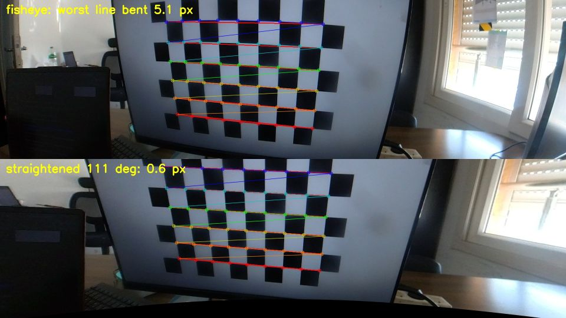
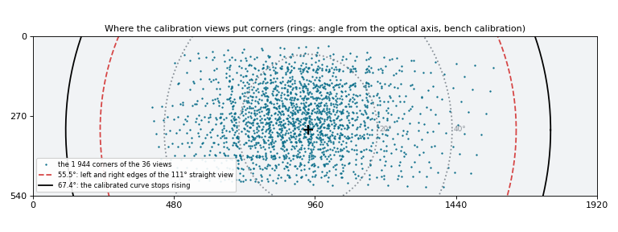
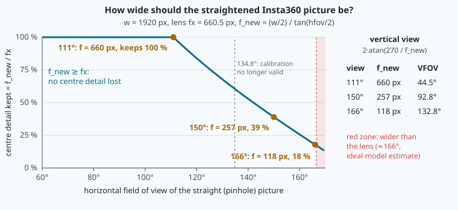
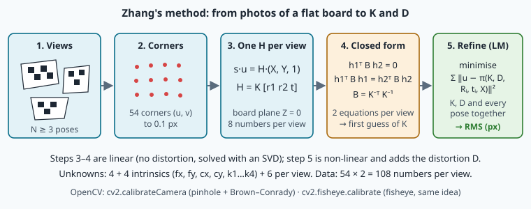

# Lens calibration: fisheye models and Zhang's method



> [!NOTE] Mission brief
> **6 October 2026, NAVERA's bench.** NAVERA's camera, the top lens of an Insta360 ONE R, was calibrated from
> 39 photos of a chessboard on a computer screen (OpenCV kept 38): **8 numbers** that turn every pixel into a
> direction in space. Now load that file on the wrong picture: the camera is switched to 1280 × 720 (its picture holds
> both lenses, one above the other), so the top lens arrives scaled by 2/3 (1280 × 360). Nothing crashes, but the middle pixel, (640, 180), is believed to look
> **27.7°** away from where it really looks: from 150 m, about **78 m** on the ground, on every frame. This is why
> NAVERA's live camera **refuses** a calibration made at another resolution or with another camera. Second
> puzzle: the lens sees roughly **166°** across, yet NAVERA straightens only the central **111°**. Why?
>
> **Session 1 — Lens modeller:** you write the fisheye lens model, find where it stops being valid, and choose
> the width of the straight view with numbers. **Session 2 — Calibrator:** you calibrate the real lens from
> 36 real views, test the result on views it never saw, and compare your numbers with the bench's. Each session
> ends with a badge.
>
> **Start now:** open the 🛠️ **Lab** tab, do **Step 0** (two minutes, no code), then come back here for §1.

**Objectives.** After this mission you can:

1. **implement** the equidistant fisheye model with its polynomial (Kannala–Brandt, as OpenCV uses it), and
   find the angle of a pixel;
2. **measure** a reprojection error and **say where** a calibration is valid (and where it only extrapolates);
3. **calibrate** a camera from chessboard views (Zhang's idea, done by OpenCV) and **test** it on views it
   never saw;
4. **justify** the width of a straightened view (NAVERA's 111°) with numbers.

**You need:** the pinhole model, K and f = (w/2) / tan(HFOV/2) (mission 18), rotation matrices (mission 16),
numpy arrays (mission 04). ⏱ Reading: about 90 minutes with the ✏️ checks, pencil and calculator (up to 2 h if
English or the maths are slow for you), in two halves: §1–§5 before session 1, §6–§8 before session 2.
Lab: 4 h to 5 h 30 (up to 6 h 30 if numpy is new for you).

**Before you start** — answer without looking (if you miss two, reread mission 18, §2 and §7):

<details><summary>1. A camera sees 90° across 1 000 px. What is its focal length f in pixels?</summary>
f = (w/2) / tan(HFOV/2) = 500 / tan 45° = <b>500 px</b>.
</details>

<details><summary>2. With K (f = 800, centre (640, 360)), which pixel shows the camera-frame point X_c = (20, −10, 100)?</summary>
u = 800 · 20/100 + 640 = <b>800</b>, v = 800 · (−10)/100 + 360 = <b>280</b>.
</details>

<details><summary>3. In mission 18 you straightened a tilted view with H = K·R_wvᵀ·R_wc·K⁻¹. Which matrix turns a pixel into a ray?</summary>
K⁻¹: [u, v, 1] → ((u − cx)/f, (v − cy)/f, 1). It undoes the shift, then the scale.
</details>

<details><summary>Workspace and words (open if you need them)</summary>

Your files are in `~/lessons/19-calibration/`; the part of NAVERA Lite you write is
[navera_lite/fisheye.py](file:./navera_lite/fisheye.py).

| Word | Meaning | Français |
|---|---|---|
| **distortion** | the difference between where a real lens puts a ray and where an ideal pinhole would | distorsion |
| **fisheye lens** | a very wide lens whose image distance grows with the ray's angle, not its tangent | objectif fisheye (hypergone) |
| **equidistant projection** | the ideal fisheye: r = f·θ | projection équidistante |
| **calibration** | measuring a camera's own numbers (K and the distortion) from photos | étalonnage (calibration) |
| **intrinsic / extrinsic parameters** | the camera's own numbers / the pose of the board in one photo | paramètres intrinsèques / extrinsèques |
| **reprojection error, RMS** | distance between a detected corner and the model's prediction; root mean square of those | erreur de reprojection, moyenne quadratique |
| **hold-out test** | measuring the error on data the fit never saw | test sur données réservées |
| **ill-conditioned** | a problem where tiny changes of the data change the answer a lot | mal conditionné |
| **straightening (undistortion)** | rebuilding the picture an ideal pinhole camera would take | redressement |
| **extrapolation** | using a fitted model outside the range of its data | extrapolation |
</details>

## 1. A pinhole cannot see 166°

A pinhole puts a ray at angle **θ** (theta) from the **optical axis** at **r = f · tan θ** from the principal point
(mission 18). That keeps straight lines straight, but tan θ explodes:

| θ | 30° | 45° | 55.5° | 70° | 80° | 83° | 90° |
|---|---|---|---|---|---|---|---|
| tan θ | 0.58 | 1.00 | 1.46 | 2.75 | 5.67 | 8.14 | ∞ |

**Worked example.** The Insta360 top lens sees about 83° to each side (estimated with the ideal fisheye of §2,
r = fx·θ: the left edge is 937 px from the centre, 937/660.5 = 1.42 rad = 81°, the right edge 85°; the calibration
itself cannot describe the edges, §3). A pinhole view with its edge at 55.5° has the edge at 1.46 f; at 83° it would
need 8.14 f, **5.6 times** farther out. At 90°, an infinite sensor.


> [!QUESTION] ✏️ Check
> A pinhole camera with f = 600 px. How far from the principal point do rays at 30°, 60° and 80° land?

<details><summary>Answer</summary>
<b>346 px</b>, <b>1 039 px</b>, <b>3 403 px</b>: ±80° needs 6 800 px across, ten times more than ±30°.
</details>

## 2. The fisheye model

A **fisheye lens** makes the distance on the sensor grow with the **angle** itself. The simplest ideal is the
**equidistant projection**, **r = f · θ** (θ in radians): at 83° (1.449 rad), r = 1.449 f instead of 8.14 f.
Straight lines become curves: the price of a wide view.


No real lens is exactly equidistant. OpenCV's fisheye model (the **Kannala–Brandt** model, used by NAVERA and
NAVERA Lite) corrects the angle with a short polynomial:

```
θ_d = θ · (1 + k1·θ² + k2·θ⁴ + k3·θ⁶ + k4·θ⁸)          D = [k1, k2, k3, k4]
```

θ_d is a corrected angle: the real lens puts the point at distance f·θ_d from the centre (an ideal fisheye would
put it at f·θ). With all four k = 0, θ_d = θ.

> [!TIP] 🧰 A polynomial in θ
> θ·(1 + k1θ² + …) = θ + k1θ³ + k2θ⁵ + …: for small θ the high powers are tiny, so θ_d ≈ θ near the centre; the k's
> matter far from the axis. With k1 = 0.2: θ = 0.1 rad gives 0.1002, θ = 1.0 rad gives 1.2.

**The projection, step by step.** A point X_c = (X, Y, Z) in the camera frame (mission 18: x right, y down, z
along the axis):

```
1. normalise          a = X / Z,    b = Y / Z,    r = √(a² + b²)        (r = tan θ: the pinhole's radius)
2. angle              θ = atan(r)                                       (from the axis, radians)
3. lens polynomial    θ_d = θ · (1 + k1θ² + k2θ⁴ + k3θ⁶ + k4θ⁸)
4. rescale            a' = (θ_d / r) · a,    b' = (θ_d / r) · b
5. apply K            u = fx · a' + cx,      v = fy · b' + cy
```

Step 4 keeps the **direction** of the point in the picture (a and b are multiplied by the same number) and changes
only its **distance** from the centre, from r to θ_d. There are two focal lengths: here fy/fx = 1.09, because the
camera stores the lens picture with a different scale across and up-down; the calibration measures it, whatever
its cause.

**Worked example**, with the real bench calibration (fx = 660.48, fy = 721.40, cx = 937.06, cy = 317.66;
k1 = 0.2319, k2 = −0.4170, k3 = 0.5338, k4 = −0.2386). The point X_c = (1.0, 0.5, 2.0) m:

```
a = 0.5,  b = 0.25,  r = 0.5590
θ   = atan(0.5590) = 0.5097 rad (29.2°)
θ_d = 0.5097 · (1 + 0.2319·0.2598 − 0.4170·0.0675 + 0.5338·0.0175 − 0.2386·0.0046) = 0.5303
θ_d / r = 0.9487   →   a' = 0.4743,  b' = 0.2372
u = 660.48 · 0.4743 + 937.06 = 1250.35 px        v = 721.40 · 0.2372 + 317.66 = 488.75 px
```

An ideal pinhole with the same K puts the point at (1267.30, 498.01): already **19.3 px** away, only 29° off the
axis. Farther out the gap grows fast (lab Step 2).

> [!WARNING]
> On the optical axis (a = b = 0), r = 0 and θ_d / r is 0/0: numpy gives `nan`. Near the axis θ_d ≈ θ ≈ r, so
> θ_d / r → 1 and the point lands on (cx, cy). Also: θ is the angle **from the axis**, atan(r), not the direction
> in the picture, atan2(b, a).

> [!QUESTION] ✏️ Check
> With the bench calibration, a ray at θ = 0.8 rad. Compute θ_d, then its distance from the principal point
> along a row (px). Compare with an ideal fisheye and with a pinhole of the same fx.

<details><summary>Answer</summary>
θ² = 0.64: θ_d = 0.8·(1 + 0.2319·0.64 − 0.4170·0.4096 + 0.5338·0.2621 − 0.2386·0.1678) = <b>0.862</b>, so
r = 660.48 · 0.862 = <b>569 px</b>. Ideal fisheye: 528 px. Pinhole: 660.48·tan 0.8 = 680 px.
</details>

## 3. Where is the model valid?

Map matching needs the opposite direction: **which ray does a pixel see?** Undo step 5, then step 4:

```
a' = (u − cx) / fx,    b' = (v − cy) / fy,    θ_d = √(a'² + b'²)      then solve θ_d(θ) = θ_d for θ
```

θ_d(θ) is a 9th-degree polynomial: there is no formula for θ, but a computer can solve it by **bisection**
(halve an interval that contains the answer, again and again: lab Step 3), *if* the curve rises.

Draw the bench calibration's curve r = fx·θ_d(θ) (lab Step 3): it rises, reaches **825 px at θ = 67.4°**, then
**turns back down**. A real lens never does that: a ray farther from the axis never lands closer to the centre.
The polynomial does it because no corner was photographed there, so nothing in the data forbids it. Look where
the corners are:



The corners of the 36 views stop at about **52°** from the axis, and only one view gets past 45° (look at this
again after lab Step 7). Beyond the corners, the polynomial **extrapolates**: four numbers fitted on the data say
nothing reliable about 70°. Two consequences:

- the picture's edges are 937 px (left) and 983 px (right) from the principal point, above the curve's top
  (825 px): **no angle** gives them. The outer 110 px on the left and 160 px on the right cannot be described;
- between the last corners and 67.4°, the model gives an answer, but an untested one.

> [!QUESTION] ✏️ Check
> Pixel (100, 270) of the bench picture. Compute θ_d. Can the model give its angle?

<details><summary>Answer</summary>
a' = (100 − 937.06)/660.48 = −1.267, b' = (270 − 317.66)/721.40 = −0.066, θ_d = <b>1.269</b>. The curve's top is
825/660.48 = 1.249 < 1.269: <b>no angle</b> gives it. The honest answer is "not describable" (`nan`).
</details>

## 4. Straightening a fisheye picture

Day vision compares the camera with a map. A straight-down **pinhole** picture of flat ground is a scaled, turned
copy of the map (mission 18); a fisheye picture is not. So NAVERA first builds the picture an **ideal pinhole
camera K_new** at the same place would take. For each pixel (u, v) of the **new** picture:

```
1. its ray in the new camera:        [a, b, 1] = K_new⁻¹ · [u, v, 1]                 (mission 18, §3)
2. where the fisheye puts that ray:  (u_f, v_f) = fisheye projection of (a, b, 1)     (§2)
3. copy the colour found at (u_f, v_f), interpolated between the 4 nearest pixels (bilinear)
```

This is **inverse mapping**: each output pixel fetches its colour, so there are no holes where the picture is
stretched. Steps 1–2 depend only on K, D and K_new: OpenCV computes them once (`cv2.fisheye.initUndistortRectifyMap`,
a "map"), then `cv2.remap` applies the map to each frame in milliseconds. A source outside the fisheye picture
gives **black**.

The 111° straight view of the Insta360 (K_new = `K_from_hfov(111, 1920, 540)` from mission 18, f = 659.79 px)
takes its colours from fisheye columns ≈ 230 to ≈ 1645 only: the outer ≈ 230 px on the left and ≈ 275 px on the
right are not used. Its bottom rows are black: the straight view is centred on its middle row (270), but the lens'
axis is at row 317.7, lower; so the bottom rows of the straight view ask for rays below the fisheye picture.

## 5. How wide should the straight view be?

A straight view w pixels wide with a field of view H has (mission 18) **f_new = (w/2) / tan(H/2)**. Choose H and
you choose f_new. Two numbers judge the choice:

- **At the centre**, the straight view has f_new pixels per radian, the lens fx. The ratio **f_new / fx** is the
  share of the lens' centre detail the straight view keeps: below 1, real detail is thrown away.
- **Away from the centre**, the pinhole picture spends f_new / cos²θ pixels per radian, the lens only
  fx · θ_d′(θ). Their ratio is the **stretch**:

```
θ_d′(θ) = 1 + 3k1θ² + 5k2θ⁴ + 7k3θ⁶ + 9k4θ⁸          stretch(θ) = (f_new / cos²θ) / (fx · θ_d′(θ))
```

> [!TIP] 🧰 Pixels per radian = a derivative
> If r(θ) is the distance on the picture, a small change dθ of the angle moves the point by r′(θ)·dθ pixels: r′ is
> the number of pixels per radian at θ. For the pinhole r = f·tan θ, and (tan θ)′ = 1/cos²θ, so r′ = f/cos²θ: f at
> 0°, 4f at 60°. For the lens r = fx·θ_d(θ), so r′ = fx·θ_d′(θ), with the rule (c·θⁿ)′ = n·c·θⁿ⁻¹.

Above 1, pixels are **invented** by interpolation: they cost time and add no detail. Where θ_d′ ≤ 0 (past the
curve's top) the stretch has no meaning.

| Straight view H | f_new (w = 1920) | centre detail kept f_new / fx | stretch at 30° | the view's edge (H/2) |
|---|---|---|---|---|
| 111° | 659.8 px | 99.9 % | 1.21 | 55.5°: lab Step 4 |
| 150° | 257.2 px | 38.9 % | 0.47 | 75°: not valid (> 67.4°) |
| 166° | 117.9 px | 17.8 % | 0.22 | 83°: not valid |

(111° view at 30°: θ_d′ = 1.099, stretch = (659.79 / 0.75) / (660.48 · 1.099) = 1.21.) A 150° view throws away 61 % of
the centre's detail, the part that matters most for matching, to show edges the calibration does not describe.
NAVERA's rule is **never make f_new shorter than fx**:

```
H_max = 2 · atan((w/2) / fx) = 2 · atan(960 / 660.48) = 110.94°
```

That is the **111°** of the bench file (`out_hfov_deg: 111.0`, which the code caps to 110.94°; NAVERA's calibration
tool now writes the capped value, as NAVERA Lite's does). The rule looks at fx only: this lens has fy = 721.4, so
vertically the straight view keeps 659.8 / 721.4 = 91.5 % of the centre detail. A square-pixel view cannot match
both.



> [!QUESTION] ✏️ Check
> Another camera: fx = 800 px, pictures 1 280 px wide. Following NAVERA's rule, what is the widest straight view?

<details><summary>Answer</summary>
H_max = 2·atan(640 / 800) = <b>77.3°</b>: more pixels per degree give a narrower view for the same width.
</details>

> [!WARNING] Common wrong ideas (session 1)
> - "Straightening adds detail." It only resamples: above a stretch of 1 the new pixels are interpolated.
> - "f_new = fx keeps all the detail." Only across: here fy > fx.
> - "If the model gives an angle, it is right." Past the last corners it extrapolates; past 67.4° it even answers
>   from the falling part of the curve.
> - "The black parts of the straightened picture are a bug." They are directions the lens picture does not contain.

## 6. Calibration: finding K and D from photos

**Calibration** measures fx, fy, cx, cy and k1…k4: photograph a chessboard (9 × 6 inner corners, squares of
32.94 mm) many times from different positions, and find the numbers that best predict where its corners appear.

**What is unknown.** The 8 **intrinsic** parameters (the skew is fixed to 0), plus each photo's board **pose**: a
rotation `rvec` (a **Rodrigues vector**: direction = axis, length = angle in radians; `cv2.Rodrigues` gives the matrix
R) and a translation `tvec` (metres). N views of 54 corners give 8 + 6·N unknowns and 108·N equations (54 corners × 2
coordinates), yet one view is never enough: a board seen face-on cannot separate "long focal length, board far" from
"short focal length, board close". Boards tilted **in different directions** (not all parallel to each other), near the picture's
edges, at several distances make the unknowns **observable**.

**Zhang's idea (2000).** Put the board's own frame on the board, so every corner has Z = 0. For a pinhole camera the
board-to-picture mapping is a 3 × 3 **homography** per view, and each gives **two equations on K alone**: 3 views fix a
first K (the closed form: lab "Going further"). Then K, D and every pose are **refined** together until the predicted
corners match the detected ones as well as possible:

```
minimise   Σ over views i, corners j   ‖ u_ij − project(K, D, rvec_i, tvec_i, X_j) ‖²
```

> [!TIP] 🧰 Least squares in one example
> "Least squares" = choose the unknown numbers so that the **sum of the squared errors** is as small as possible.
> Three measurements of one length: 10.0, 10.4 and 10.2 cm. Which single value x fits best? The sum
> (10.0 − x)² + (10.4 − x)² + (10.2 − x)² is 0.20 at x = 10.0, 0.08 at x = 10.2, 0.20 at x = 10.4: smallest at 10.2,
> the mean. Calibration does the same with 8 + 6·N unknowns. Because the model is not a straight line in its
> unknowns (atan, the polynomial, the rotation), there is no formula: the computer starts from a first guess and
> improves it step by step ("iterative"). **Levenberg–Marquardt** is the usual way to choose each step.

`cv2.calibrateCamera` (pinhole) follows this recipe, with a simpler first K (the principal point at the picture's
centre, only fx and fy from the homographies). `cv2.fisheye.calibrate` keeps its idea (a flat board, a
homography per view for a first pose, one joint refinement of K, D and every pose), but it starts K from the
picture's size instead of Zhang's closed form.



> [!QUESTION] ✏️ Check
> 20 views of a 9 × 6 board, fisheye model with no skew. How many unknowns and equations? Why does a camera on a
> tripod, photographing one board in one spot 20 times, still calibrate badly?

<details><summary>Answer</summary>
<b>128</b> unknowns, <b>2 160</b> equations. Twenty identical views are one view twenty times: nothing separates f from
the distance, and nothing at the picture's edges constrains k1…k4.
</details>

## 7. The reprojection error, and what it does not tell you

After the fit, every corner is projected again with the calibration and its view's pose, and compared with where it
was detected. One corner's **reprojection error** is the distance between the two (pixels). The summary is the
**RMS** (root mean square) over all M corners of all views: **RMS = √( (1/M) · Σ ‖u_detected − u_projected‖² )**.

> [!TIP] 🧰 RMS
> Square, average, square root, in that order. Errors (0.3, 0.4), (0, 1) and (0.6, 0.8) px have lengths 0.5, 1 and
> 1: squares 0.25, 1, 1, mean 0.75, RMS = √0.75 = **0.87 px** (the plain mean is 0.83). Over several views, square
> **every corner**, then average them all: the mean of the per-view RMS values is not the RMS.

The bench calibration says **RMS 0.525 px**: the model explains the corners it was fitted on to about half a pixel.
Three things it does **not** say:

1. **It is a training error.** The parameters were tuned on those corners. The honest test is a **hold-out**:
   calibrate on some views, measure on views the calibration never saw. For an unseen view the board's pose is
   unknown: find it first with K and D held fixed (`cv2.fisheye.undistortPoints` turns the corners into ideal
   pinhole rays, then `cv2.solvePnP` with K = identity finds the pose), then measure as above. (It tests the model's shape, not
   its absolute scale: point 3.)
2. **It says nothing where no corner was seen** (§3).
3. **It does not measure stability.** fx and the board's distance trade against each other: a 1.5 % larger fx with
   every board 1.5 % farther away predicts almost the same corners. Calibrations with the same RMS can disagree on fx
   by several pixels: the lab measures that spread.

> [!QUESTION] ✏️ Check
> Calibration A: RMS 0.30 px from 8 views near the picture's centre. Calibration B: RMS 0.50 px from 35 views spread
> over the picture. Which do you trust for a 111° straight view, and why?

<details><summary>Answer</summary>
<b>B</b>. A's small RMS is a training error on little data: unstable parameters, nothing at the edges (where the 111°
view reaches 55.5°). B's corners cover more angles, and more views pin its numbers down.
</details>

## 8. Calibrating with OpenCV

**Corners.** `cv2.findChessboardCornersSB` finds the 54 inner corners with sub-pixel accuracy, **row by row, the
column index changing fastest**. The board points you give OpenCV must be in the same order, (0, 0, 0), (s, 0, 0), …,
(8s, 0, 0), (0, s, 0)…, with s = 0.03294 m, as an array of shape (54, 1, 3), float64.

**The fisheye calibration.**

```python
rms, K, D, rvecs, tvecs = cv2.fisheye.calibrate(object_points, image_points, (width, height), K0, D0,
                                                flags=flags, criteria=criteria)
```

`object_points` and `image_points` are **lists**, one array per view. K0 and D0 are where a guess would go: OpenCV
reads K0 only with the flag `CALIB_USE_INTRINSIC_GUESS`; otherwise it starts from f = max(w, h)/π and the picture's
centre, so passing the identity and four zeros is a placeholder. The size is **(width, height)**, while `img.shape`
is (height, width, 3). The flags you need are listed in lab Step 7.

With the flag `CALIB_CHECK_COND`, OpenCV **refuses** a view whose pose cannot be estimated reliably: the call stops
with *"CALIB_CHECK_COND - Ill-conditioned matrix for input array 17"*. NAVERA's tool, and NAVERA Lite's given
`calibrate_robust()`, then remove that view and calibrate again. Write down **which** views get refused.

**The other model: Brown–Conrady.** OpenCV's ordinary `cv2.calibrateCamera` keeps the pinhole r = tan θ and corrects
it with a polynomial in r (k1, k2, k3) plus two "tangential" terms (p1, p2); it wants float32 points. Starting from
tan θ, it cannot describe a ray at 90° or beyond. Its fx is not comparable with the fisheye's: the two models split the
same bending differently between f and their k's.

> [!WARNING] Common wrong ideas (session 2)
> - "A low RMS means an accurate camera." It means the model fits the corners it was given, where they were.
> - "One calibration is the truth." Calibrate from other views and fx moves; know by how much.
> - "A calibration belongs to the lens." It belongs to one lens, at one resolution, with one crop: K is in pixels
>   of one specific picture.

## In NAVERA

NAVERA's calibration tool does what NAVERA Lite's does: fisheye calibration, refused views dropped one at a
time, a small file with the model, size, K, D, RMS, views, straight width, the **crop** (the Insta360 picture is two
lenses one above the other; NAVERA uses the top half) and, for a USB camera calibrated live, the camera's identity.
The bench file of 6 October 2026: 38 views kept of 39, RMS 0.525 px, fx 660.5 px, fy 721.4 px.

The live camera (NAVERA's architecture notes) straightens every frame with that file before day vision sees it, and
**refuses** a file made at another resolution, with another crop or, for a USB camera, with another camera, rather
than run with wrong rays. NAVERA is Release 0.2, field validation pending: its day vision is "not yet measured with
NAVERA's camera" (NAVERA's validation status, 2026-10-03). And the edges of the 111° view (55.5°) lie beyond the
corners of the bench session (about 52°, and that from a single view): one more open problem.

## In NAVERA Lite

[navera_lite/fisheye.py](file:./navera_lite/fisheye.py), the part you write today: `fisheye_project` (§2),
`theta_from_theta_d` (§3), `stretch_at` (§5), `undistort` (§4), `board_points` and `calibrate_fisheye` (§6, §8),
`reprojection_rms` and `holdout_rms` (§7). Given: `load_calibration`, `save_calibration`, `theta_d_of`,
`find_corners`, `calibrate_robust`, and the tool `python3 -m navera_lite.tools.calibrate` (built on your
`board_points` and `calibrate_fisheye`). Reused: `camera.K_from_hfov` (mission 18).

## 🐦 How birds do it

A **woodcock** has eyes so far back on its head that it sees almost all around, even above: two natural fisheye
lenses. **Falcons** make NAVERA's choice: a wide field at modest resolution, plus a deep central **fovea** packed
with receptors where detail is needed. And brains calibrate too: young barn owls fitted with prism spectacles
slowly re-aligned where they *heard* things with where they now *saw* them.

## Summary

1. Pinhole: r = f·tan θ, never 90°. Fisheye: r = f·θ_d, θ_d = θ(1 + k1θ² + k2θ⁴ + k3θ⁶ + k4θ⁸); on the axis θ_d/r → 1.
2. A calibration is measured only where its corners were; past the curve's top (67.4°, 825 px) a pixel has no angle.
3. Straightening fetches, for each pixel of an ideal pinhole view, the fisheye pixel that saw the same ray.
4. NAVERA's rule f_new ≥ fx gives 2·atan(960 / 660.48) = 110.94° ≈ 111°.
5. Zhang + least squares fit K, D and every pose; the RMS is a training error: test on unseen views, measure the spread.

**Next mission:** the straightened picture meets time (on a recorded clip). Frames arrive late and the drone turns while they travel: you
measure the camera's delay and take the attitude at the right instant.

## Check yourself

Answer without scrolling up.

<details><summary>1. Write the five steps from a camera-frame point to a fisheye pixel. Which step needs care on the axis?</summary>
a = X/Z, b = Y/Z, r = √(a² + b²); θ = atan r; θ_d = θ(1 + k1θ² + …); a' = (θ_d/r)·a, b' = (θ_d/r)·b; u = fx·a' + cx,
v = fy·b' + cy. Step 4: at r = 0 use θ_d/r = 1.
</details>

<details><summary>2. Why can the bench calibration not give the angle of the picture's left-edge pixels?</summary>
Their θ_d (937/660.5 = 1.42) is above the top of the polynomial's rising part (1.249, at 67.4°): no angle gives it.
The polynomial was fitted on corners much closer to the axis and bends back where it has no data.
</details>

<details><summary>3. Your calibration has train RMS 0.47 px and hold-out RMS 0.57 px. Is it broken?</summary>
No. The training error is optimistic (the parameters were tuned on those corners); the hold-out number is the honest
accuracy, within the angles tested.
</details>

<details><summary>4. A partner sets the Insta360 to 1280 × 720 and keeps the bench file. What goes wrong, and what does NAVERA do?</summary>
K is in pixels of the 1920 × 540 top half: every ray is wrong (27.7° at the picture's middle in the brief, about 78 m
on the ground from 150 m). NAVERA refuses the file; the camera must be calibrated again at the new size.
</details>

<details><summary>5. (Mission 18) A level camera at 150 m with an attitude 1° wrong. How far is the centre point off on the ground?</summary>
150 · tan 1° = 2.6 m.
</details>

Now open the **🛠️ Lab** tab.
