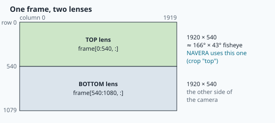

# The real camera

Until now, every picture you worked with was a **file**: a satellite tile, a saved drone photo,
a chessboard image. A file waits patiently on the disk. You can open it twice, take your time,
and it never changes.

A real camera on a flying drone is the opposite. It throws about **thirty new pictures every
second** at the computer, whether the computer is ready or not. Each picture is already a little
old when it arrives. And while the picture was travelling, the drone kept moving and turning.

On the NAVERA bench box, the camera is an **Insta360 ONE R** (its 360° module), plugged into the
Jetson by USB. In this lesson you will learn how a program reads such a camera, why NAVERA
cares about *when* each picture was taken, and how NAVERA's own node, `live_camera.py`, turns
the raw pictures into the clean, straight-down views that day vision compares with the map.


## Frames and frames per second

A video camera is a camera that never stops taking photos. Each photo is called a **frame**.
The number of frames per second is the **frame rate**, written **fps**.

The Insta360 gives **28.8 fps** at its largest size, 1920 × 1080 pixels. So a new frame arrives
every

```
1 / 28.8 = 0.0347 s   ≈ 35 milliseconds
```

How do you measure a frame rate? Note the time at which each frame arrives — its **grab time**.
If 5 frames arrive at 0.0, 0.1, 0.2, 0.3 and 0.4 s, there are **4 gaps** in 0.4 s, so the rate
is 4 / 0.4 = 10 fps. Careful: 5 frames, but only 4 gaps — like 5 fence posts hold 4 fence
panels. You will program exactly this in the lab.

> [!NOTE]
> NAVERA does not *use* 28.8 frames per second. Comparing one picture with the map takes a
> while, so the live camera **offers** the localizer about one frame per second (the setting
> `NAVERA_CAMERA_FPS`, default 1). But it must still read all 28.8, as you will see.

## How Linux sees a camera: V4L2 and /dev/video0

On Linux, every piece of hardware appears as a special file in the folder `/dev` ("devices").
A camera is handled by a **driver** — a small program inside the operating system that knows how
to talk to it. For cameras, that family of drivers is called **V4L2** (*Video for Linux, version 2*).

When the Insta360 is plugged in, V4L2 creates two device files:

| File | What it is |
|---|---|
| `/dev/video0` | the pictures |
| `/dev/video1` | a second door of the same camera (extra information, not the pictures we read) |

There is a catch: the numbers depend on the order in which devices were plugged in. Plug a second
camera first, and the Insta360 may become `/dev/video2`. That is why Linux also makes **stable
names**, built from the maker and the model, in `/dev/v4l/by-id/`:

```
/dev/v4l/by-id/usb-Amba_Insta360_One_R-video-index0  ->  ../../video0
```

("Amba" is Ambarella, the maker of the chip inside the camera.) NAVERA's settings use this kind of
name (`NAVERA_CAMERA_DEVICE=/dev/v4l/by-id/…`), so the right camera is opened even after a
reboot or a re-plug.

> [!WARNING]
> **One program at a time.** While a program is streaming from `/dev/video0`, nobody else can.
> The camera on the box is shared by the whole class and by the engineers' bench tests — that
> is why you **book** it in the dashboard, and why every program in this lesson also works with
> **recorded frames** when the camera is not yours.

## MJPG: why the frames are compressed

How big is one frame? 1920 × 1080 pixels, 3 bytes (blue, green, red) per pixel:

```
1920 × 1080 × 3 = 6 220 800 bytes ≈ 6.2 MB per frame
6.2 MB × 28.8 fps ≈ 179 MB every second
```

A USB 2 link, the kind most webcams use, carries 480 megabits per second — at best about 40 MB
of pictures per second. 179 MB/s
does not fit! So the camera **compresses** every frame as a small JPEG photo before sending it.
A stream of JPEG photos is called **MJPG** (*Motion JPEG*). Each frame becomes ten or more times
smaller.

The price: the computer must **decode** each JPEG back into pixels before it can use them, and
that costs processor time. The NAVERA engineers measured it on the box: **about 51 ms to decode
one 1080p frame** on the Orin Nano under load. Decoding all 28.8 frames every second would keep
about one and a half processor cores busy — for one frame used per second. Remember this number:
it explains a clever trick below.

With OpenCV, you ask for MJPG and the size when you open the camera:

```python
cap = cv2.VideoCapture("/dev/v4l/by-id/usb-Amba_Insta360_One_R-video-index0", cv2.CAP_V4L2)
cap.set(cv2.CAP_PROP_FOURCC, cv2.VideoWriter_fourcc(*"MJPG"))
cap.set(cv2.CAP_PROP_FRAME_WIDTH, 1920)
cap.set(cv2.CAP_PROP_FRAME_HEIGHT, 1080)
```

**FOURCC** ("four character code") is the four-letter name of a picture format: `MJPG`, `YUYV`…

## GStreamer: pipes for video

Not every camera is a USB webcam. The Jetson's own small cameras plug into a ribbon connector
called **CSI**, and they are only reachable through **GStreamer**. GStreamer builds a video
**pipeline**: a chain of blocks joined by `!`, like water pipes. Here is the one NAVERA builds for
a CSI camera (`camera_pkg/gst_capture.py`, function `csi_pipeline`):

```
nvarguscamerasrc sensor-id=0 ! video/x-raw(memory:NVMM),width=1920,height=1080,framerate=30/1
  ! nvvidconv ! video/x-raw,format=BGRx ! videoconvert ! video/x-raw,format=BGR
  ! appsink name=sink drop=true max-buffers=1 sync=false
```

Read it left to right: *take pictures from the CSI camera → convert them → into BGR (OpenCV's
colour order) → give them to our program (`appsink`), keeping only the newest (`max-buffers=1`,
`drop=true`)*. The OpenCV installed on the box was built without GStreamer, so NAVERA talks to
GStreamer directly and wraps it in a small class, `GstCapture`, that has the same methods as
`cv2.VideoCapture` (`grab`, `retrieve`, `read`, `release`). The rest of the code does not care
which kind of camera it reads. The same trick reads network cameras (`NAVERA_CAMERA_INPUT=gst`).

## One picture, two lenses

The Insta360 ONE R 360 module has **two fisheye lenses, back to back**, each seeing a half of
the world. In webcam mode it sends both in **one** 1920 × 1080 frame, stacked: the top lens
in the upper half, the bottom lens in the lower half.



Each half is 1920 × 540 pixels. Cutting them apart is just array slicing (lesson 8):

```python
top = frame[:540]       # rows 0 to 539
bottom = frame[540:]    # rows 540 to 1079
```

On the bench box, NAVERA uses the **top lens**. Its lens was calibrated (lesson 18) as a fisheye
that sees about **166° × 43°**; its calibration file was made with the crop `[0, 0, 1920, 540]`.
The live camera's setting `crop` says which part to keep: `"top"`, `"bottom"`, `"left"`,
`"right"` or `"x,y,w,h"` (function `parse_crop` in `navera_common/camera_model.py`). The node
even refuses to start if the crop is not the one the calibration was made with — a calibration of
the top lens is worthless on the bottom one.

> [!NOTE]
> The Insta360 has **no manual exposure** in webcam mode: it chooses by itself how long each
> picture is exposed and how bright it is. Point it at a bright window and the rest of the room
> goes dark. NAVERA has to live with this; a camera for a production installation would let NAVERA
> fix a short exposure time to avoid motion blur.

## The delay: every picture is already old

Between the moment the light hits the sensor (the **exposure**) and the moment your program gets
the frame (the **grab**), many things happen: the camera reads its sensor, compresses the JPEG,
sends it over USB, the driver stores it… That takes time: the **latency** (or delay).

How do you measure it? NAVERA has a bench tool for that, `navera_tools/bench/camera_latency.py`.
The camera looks at a screen. The program turns the screen **white** and notes the time; then it
watches the frames until one of them becomes bright. The difference is the delay. It repeats 20
flashes and keeps the median. On the bench with the Insta360 it measured **0.138 s** — and that
includes the screen's own delay (10–30 ms for a desktop monitor), so the camera's real delay is at
most that. The value is stored in the calibration file:

```yaml
latency_s: 0.138
```

Why does 0.138 s matter? Because NAVERA uses the vehicle's **attitude** (its roll, pitch and
heading, from the IMU — lesson 16) to straighten each picture. It must use the attitude **of the
instant the picture was taken**, not of the instant it arrived.


A drone turning at 30° per second turns 30 × 0.138 ≈ **4°** during the delay. Straightening the
picture with an attitude 4° wrong, at 150 m above the ground, places the match about
150 × tan(4°) ≈ **11 m** off. So NAVERA stamps every frame with:

```
exposure time = grab time − latency
```

and reads the IMU at *that* time. The IMU sends 50 samples per second, so NAVERA keeps a short
history and **interpolates** between the two samples around the exposure.

## Grab, retrieve, and always the newest frame

OpenCV can read a frame in two steps:

| Call | What it does | Cost |
|---|---|---|
| `cap.grab()` | waits for the next frame to arrive, keeps it **compressed** | tiny |
| `cap.retrieve()` | **decodes** the last grabbed frame into a numpy image | ≈ 51 ms |

(`cap.read()` is simply both.) NAVERA's trick: it calls `grab()` for **every** frame — so it always
knows the newest one and its exact grab time — but `retrieve()` **only** for the frame it is about
to send. Here is the heart of `_grab_loop` in `camera_pkg/nodes/live_camera.py`:

```python
cap.set(cv2.CAP_PROP_BUFFERSIZE, 1)                 # newest frame, not a queue
...
while not self._stop.is_set():
    ok = cap.grab()                                     # paced by the camera itself
    t = self.get_clock().now().nanoseconds * 1e-9 - self.latency_s
    frame = None
    if ok and self._want.is_set():
        ok, frame = cap.retrieve()                      # decode only the frame to send
    elif ok:
        fails = 0
        continue
    ...
    if self.crop:
        x, y, w, h = self.crop
        frame = frame[y:y + h, x:x + w]
    with self._lock:
        self._latest = (frame, t)
```

Find in it: the stamp `t = now − latency`, the decode only when a frame is wanted (`_want`), the
crop of the top half. And `BUFFERSIZE 1`: the driver must not keep a **queue** of old frames. A
frame that waited two seconds in a queue shows where the vehicle *was* two seconds ago — at
20 m/s, 40 m away. For navigation, the newest frame always wins.

## In NAVERA: what live_camera.py does with each frame

The node is described in `docs/ARCHITECTURE.md`, section 5 "The live camera". For every frame it
offers to day vision:

1. **Exposure stamp**: grab time − `NAVERA_CAMERA_LATENCY_S` (or the `latency_s` of the
   calibration file). With a ROS image input, the image's own stamp − latency.
2. **Attitude at the exposure**, interpolated from the IMU history. No IMU sample within 0.2 s
   → the frame is marked **unusable**. An IMU sending exactly the same value 50 times in a row is
   considered **frozen** (a real sensor always has a little noise) and is not used.
3. **Undistortion** with the lens calibration (lesson 18): the fisheye picture becomes a
   straight "pinhole" picture, **111°** wide for the Insta360 top lens.
4. **Straightening** into the view of a level camera looking straight down, with the same
   heading (`navera_common/frame_builder.py`). A frame tilted more than 45° is marked unusable;
   so is a frame taken while the vehicle turns faster than 30° per second.
5. **Height above ground** (`navera_common/altitude.py`) for the scale (lesson 17).
6. **Publishes** `/day/image_raw` (the picture), `/day/frame_meta` (a JSON description: stamp,
   attitude, tilt, heading of the image top, field of view, usable or not and why) and
   `/day/camera_info`.

The same node reads four kinds of input (`input` parameter): `usb` (V4L2, like the Insta360),
`csi` and `gst` (GStreamer), and `ros` — *any* ROS image topic, for example a vehicle that already
has its own camera. In the lab you will use that last one to run NAVERA's real node on recorded
Insta360 frames, without touching the camera.

## Words you met

| Word | Meaning |
|---|---|
| **frame** | one picture of a video stream |
| **fps** (frame rate) | frames per second; the Insta360 gives 28.8 at 1920 × 1080 |
| **grab time** | when the program received the frame |
| **exposure** | the moment the light hit the sensor: when the picture was really taken |
| **latency** (delay) | exposure → grab; 0.138 s measured on the bench for the Insta360 |
| **driver** | the part of the operating system that talks to a device |
| **V4L2** | *Video for Linux 2*, the Linux camera drivers; cameras appear as `/dev/videoN` |
| **MJPG** | Motion JPEG: every frame compressed as a JPEG photo |
| **decode** | turn a compressed JPEG back into pixels (≈ 51 ms for 1080p on the box) |
| **FOURCC** | the four-letter name of a picture format (`MJPG`, `YUYV`) |
| **GStreamer** | a toolkit that builds video pipelines from blocks (`a ! b ! c`) |
| **CSI** | the ribbon connector of the Jetson's own cameras |
| **crop** | keep only part of a picture (here, the top lens' half) |

## Check what you learned

<details><summary>1. The camera gives 28.8 fps. How many milliseconds between two frames?</summary>
1 / 28.8 = 0.0347 s ≈ 35 ms.
</details>

<details><summary>2. Why does the Insta360 send MJPG instead of raw pixels?</summary>
Raw 1080p at 28.8 fps is about 179 MB per second — far more than USB 2 can carry (≈ 40 MB/s).
JPEG compression makes each frame ten or more times smaller.
</details>

<details><summary>3. A frame is grabbed at t = 1000.500 s. What is its exposure stamp?</summary>
1000.500 − 0.138 = 1000.362 s. NAVERA reads the IMU attitude of that instant to straighten it.
</details>

<details><summary>4. Why is <code>/dev/v4l/by-id/usb-Amba_Insta360_One_R-video-index0</code> better than <code>/dev/video0</code> in a configuration file?</summary>
The number of <code>/dev/videoN</code> depends on the order the devices were plugged in; the by-id name is
built from the camera's maker and model, so it always points to the right camera.
</details>

<details><summary>5. What happens to a frame taken while the IMU is silent?</summary>
No attitude within 0.2 s of its exposure: the frame's tilt is unknown, so live_camera marks it
unusable ("no attitude at the frame's exposure") instead of guessing — a guess could put the match
tens of metres off.
</details>

Now open the **🛠️ Lab** tab.
