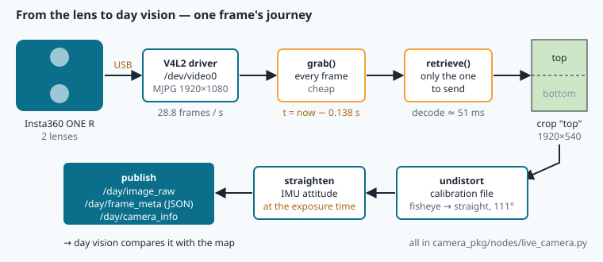
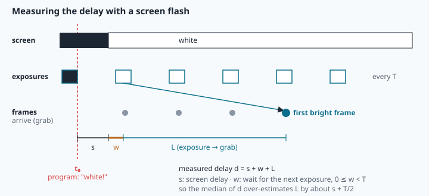

# Live camera: frames, delay and the attitude at the exposure

> [!NOTE] In short
> - Each camera picture is a **measurement taken at one instant**: about 0.14 s before your program receives it.
> - You will learn how Linux delivers frames (V4L2, MJPG, GStreamer) and how to describe their timing with statistics.
> - You will learn how to measure a camera's delay with a screen flash, and why a small time error becomes metres on the ground.
> - You will compute the vehicle's attitude at the exposure instant with **slerp**, using NAVERA's own rules.
> - In the lab you build the timing tools, check them against NAVERA's code, and run NAVERA's live camera node. The camera is **not** needed.

A survey drone flies 150 m above the Al Batinah coast near Sohar. Its GPS has just been jammed,
so NAVERA must find each camera picture on its satellite map. The drone is rolling into a turn
at 25° per second. The picture that reaches the computer **now** was taken about **0.14 s
ago**. In that time the drone rolled about 3.5°. If NAVERA straightens the picture with the
attitude it has *now*, the centre of the picture lands about **9 m** away from where it should
be. That is as large as the error of the map matching itself.

So a live camera is not only "a stream of images". Each image is a **measurement taken at a
precise instant**, and every other quantity (attitude, height, position) must be read **at that
instant**. This lesson covers the whole chain from the sensor to NAVERA's `live_camera.py`:
how Linux delivers frames (V4L2, MJPG, GStreamer), how to describe their timing with
statistics, how to measure a camera's delay, and how to compute the attitude at the exposure
with **slerp**.



## 1. The camera on the NAVERA bench

The bench box uses an **Insta360 ONE R** (360° module) as a USB webcam. These are measured
facts about it:

| Property | Value |
|---|---|
| Format | MJPG, 1920 × 1080 at most |
| Frame rate | 28.8 frames per second (fps) |
| Picture | two fisheye images stacked: top lens rows 0–539, bottom lens rows 540–1079 |
| Lens used by NAVERA | the top lens: fisheye about 166° × 43°, straightened view capped at 111° (lesson 18) |
| Exposure control | none from Linux (no V4L2 controls): the camera chooses exposure itself |
| Delay | 0.138 s, measured with the screen-flash method (section 6) |

A **frame** is one picture of the stream. The **frame period** is T = 1/28.8 = 34.72 ms.

## 2. How Linux delivers frames: V4L2

On Linux, a camera is handled by a **driver** inside the kernel. USB webcams use the
`uvcvideo` driver (USB Video Class), and every video driver offers the same programming
interface: **V4L2** (*Video for Linux, version 2*). The camera appears as a device file:

```
/dev/video0                                            first video device (number = plug-in order)
/dev/v4l/by-id/usb-Amba_Insta360_One_R-video-index0 -> ../../video0     stable name (maker + model)
```

NAVERA's settings use the stable **by-id** name, so a re-plug or a second camera does not
change which device is opened.

A program streams frames from V4L2 with a small **ring of buffers** in memory:

1. It asks for a format: size and **FOURCC** (four-character code of the pixel format:
   `MJPG`, `YUYV`…).
2. It asks for N buffers (`VIDIOC_REQBUFS`), gives them all to the driver (`VIDIOC_QBUF`) and
   starts the stream (`VIDIOC_STREAMON`).
3. The driver fills one buffer per frame. The program takes a full buffer (`VIDIOC_DQBUF`),
   uses it, and gives it back.

Each filled buffer also carries a **sequence number** and a **timestamp** set by the driver.
OpenCV hides all of this behind `cv2.VideoCapture`, and NAVERA stamps a frame with its own
clock at the moment `grab()` returns.

**Why the number of buffers matters.** If the program is slower than the camera, full
buffers wait in a **queue**. The frame you take is then not the newest one. It can be several
periods old. For navigation this is harmful: a frame that waited 2 s at 20 m/s shows the ground
40 m behind the drone. NAVERA therefore asks for one buffer (`CAP_PROP_BUFFERSIZE = 1`), so the
driver keeps only the newest frame.

> [!WARNING]
> **One program at a time.** While a program streams from `/dev/video0`, no other program can.
> On a shared box, check first with `fuser /dev/video0`: if it prints a process number, the camera
> is in use. Never open it then. The lab's programs check this and use recorded frames instead.

## 3. Bandwidth: why MJPG

Uncompressed frames would need this data rate:

```
YUYV (2 bytes per pixel):  1920 × 1080 × 2 B × 28.8 /s ≈ 119 MB/s
BGR  (3 bytes per pixel):  1920 × 1080 × 3 B × 28.8 /s ≈ 179 MB/s
USB 2.0 High Speed:        480 Mbit/s = 60 MB/s on the wire (the usable part is less)
```

So the camera **compresses** every frame as a JPEG, and the stream of JPEGs is called **MJPG**
(Motion JPEG). Each frame is compressed **alone** (no motion prediction), so any frame can be
decoded without the previous ones. The recorded Insta360 frames of this lesson are about
160 kB each, roughly 40 times smaller than BGR.

The price is **decoding**. NAVERA's engineers measured about **51 ms** to decode one 1080p
MJPG frame on the Orin Nano under load. Decoding all 28.8 frames every second would use
28.8 × 0.051 ≈ 1.5 CPU cores, while day vision uses about one frame per second. OpenCV splits
reading in two steps, and NAVERA uses this split:

| Call | What it does | Cost |
|---|---|---|
| `cap.grab()` | waits for the next frame and keeps it **compressed** | small |
| `cap.retrieve()` | **decodes** the last grabbed frame into a numpy BGR image | ≈ 51 ms at 1080p |
| `cap.read()` | `grab()` + `retrieve()` | both |

NAVERA calls `grab()` for **every** frame. This keeps the newest frame and its time. It calls
`retrieve()` **only** for the frame it will send.

## 4. GStreamer pipelines

The Jetson's own cameras (CSI ribbon connector), network cameras and many video sources can
only be reached through **GStreamer**, a library that builds a **pipeline** of **elements**
joined by `!`. Between two elements, **caps** (capabilities) fix the format, for example
`video/x-raw,width=1920,height=1080,framerate=30/1`. Here is NAVERA's CSI pipeline
(`camera_pkg/gst_capture.py`, `csi_pipeline`):

```
nvarguscamerasrc sensor-id=0 ! video/x-raw(memory:NVMM),width=1920,height=1080,framerate=30/1
  ! nvvidconv ! video/x-raw,format=BGRx ! videoconvert ! video/x-raw,format=BGR
  ! appsink name=sink drop=true max-buffers=1 sync=false
```

- `nvarguscamerasrc`: the CSI camera, through NVIDIA's Argus daemon. `nvvidconv` converts in
  GPU memory (`NVMM`). `videoconvert` produces **BGR**, the colour order of OpenCV.
- `appsink`: hands frames to our program. `max-buffers=1 drop=true` keeps only the newest frame,
  like `BUFFERSIZE 1` in V4L2. `sync=false` delivers frames immediately, without waiting for a
  playback clock.
- Frame rates are fractions: 28.8 fps is written `framerate=144/5`.

The OpenCV on the box was built without GStreamer, so NAVERA wraps GStreamer's Python bindings in
a class `GstCapture` with the same methods as `cv2.VideoCapture` (`isOpened`, `grab`,
`retrieve`, `read`, `release`). In the lab you will run this real class on a live test source
(`videotestsrc is-live=true`) and measure its timing.

## 5. Describing frame timing with statistics

Let the grab times be t₀, t₁, …, t₍ₙ₋₁₎. The **intervals** are dᵢ = tᵢ − tᵢ₋₁ (n − 1 of them).

```
mean frame rate      fps = (n − 1) / (t₍ₙ₋₁₎ − t₀)        (n frames, but n − 1 intervals)
nominal period       m   = median(dᵢ)                        (robust to outliers)
jitter               σ   = std(dᵢ)                           (np.std, ddof = 0)
largest gap          max(dᵢ)
dropped frames       Σ over dᵢ > 1.5 m  of  round(dᵢ / m) − 1
```

**Jitter** is the variation of the intervals. Its causes are USB transfer scheduling, the
operating system's scheduler, and other programs that use the CPU. **Dropped frames** appear as
intervals of about 2m, 3m…: an interval of 3m means 2 missing frames.

**Worked example.** Grab times 0, 0.1, 0.2, 0.4, 0.5 s give intervals 0.1, 0.1, 0.2, 0.1 s.
Then fps = 4 / 0.5 = 8.0, m = 0.1 s, mean period = 0.125 s, σ = 0.0433 s, largest gap 0.2 s,
and one dropped frame (round(0.2/0.1) − 1 = 1).

> [!NOTE]
> The standard deviation is very sensitive to rare large values. One 0.35 s **stall** (a pause of the stream) among 1700
> normal 35 ms intervals multiplies σ by several times. Report it, but also look at the histogram
> or at percentiles: σ describes the **risk**, the median describes the **normal** behaviour.

## 6. The delay, and how to measure it

Between the **exposure** (light reaches the sensor) and the **grab** (the program receives
the frame), several things happen: sensor read-out, JPEG compression in the camera, USB
transfer, the driver, and the buffer queue. Their total time is the **latency** L. For every frame:

```
exposure time   tₑ = t_g − L
```

**The screen-flash method** (`navera_tools/bench/camera_latency.py`). The camera faces a
screen. The program turns the screen white at time t₀ and watches the brightness of the
centre of each frame. The first frame brighter than the midpoint between "black" and "white"
arrives at time t, and the program records d = t − t₀. It repeats this 20 times and keeps the
median.



What does d contain? The screen needs s seconds to show white (10–30 ms for a desktop monitor).
The next exposure starts w seconds later, where w is between 0 and one frame period T. Then the
camera needs L. So

```
d = s + w + L,     w uniform in [0, T)  →  mean(w) = T/2 ≈ 17 ms,  std(w) = T/√12 ≈ 10 ms
```

Three consequences, which you will verify in the lab on a simulated bench:

1. The delays spread over about **one frame period** (≈ 35 ms), even with a perfect clock.
2. The median **over-estimates** L by about s + T/2. The **smallest** value is close to s + L.
3. With 20 flashes, the standard error of the mean is about 10 ms / √20 ≈ 2 ms.

The value NAVERA uses for the Insta360, **0.138 s**, is the median from this tool. Its
documentation states that it includes the screen's own delay, so **the camera's delay is at
most 0.138 s**. It is stored in the calibration file as `latency_s: 0.138`.

**Exposure time is not an instant.** The sensor collects light for the exposure time (a few
ms in daylight). Many CMOS sensors also read their rows one after another (**rolling
shutter**), so the top and bottom rows are exposed at slightly different times. NAVERA uses one
stamp per frame. The error of that simplification is small compared to 138 ms, but it grows with
the rotation rate.

## 7. Error budget: why a few hundredths of a second matter

If the attitude has an angle error δθ, a camera looking down from height H places the image
centre about

```
Δx ≈ H · tan(δθ)            and with a rotation rate ω and a time error δt:   δθ ≈ ω · δt
```

**Worked example (Sohar coast).** H = 150 m, roll rate ω = 25 °/s, and NAVERA uses the attitude
of the grab instead of the exposure, so δt = 0.138 s:

```
δθ = 25 × 0.138 = 3.45°      Δx = 150 × tan(3.45°) = 150 × 0.0603 ≈ 9.0 m
```

For comparison: on aerial test frames, NAVERA's local feature matching placed 32 of 33 frames
within 9 m, with a median of 4 m (NAVERA's validation document, measured on replayed frames,
not in flight). A 9 m error from timing alone would cancel that precision. With the correct
exposure time, the IMU sampling (50 Hz) leaves a residual of half a sample period at most
if we only take the **nearest** sample: δt ≤ 10 ms → 0.25° → 0.65 m. Interpolation removes
most of that residual.

## 8. Attitude at the exposure: slerp

The IMU (lesson 16) gives attitude quaternions q at 50 Hz. The exposure time tₑ almost never
falls exactly on a sample. Take the samples around it, (t₀, q₀) and (t₁, q₁), with
t₀ ≤ tₑ ≤ t₁, and the fraction

```
f = (tₑ − t₀) / (t₁ − t₀)          0 ≤ f ≤ 1
```

Unit quaternions lie on a 4-D sphere. **Slerp** (spherical linear interpolation) moves along
the great circle between them at constant angular speed:

```
cos Ω = q₀ · q₁                               (dot product of the 4 components)
slerp(q₀, q₁, f) = sin((1 − f) Ω) / sin Ω · q₀  +  sin(f Ω) / sin Ω · q₁
```

Three practical rules:

1. **Shortest path.** q and −q are the same rotation. If q₀ · q₁ < 0, use −q₁ (and −dot);
   otherwise slerp takes the long way round, through a 360° − θ rotation.
2. **Almost equal quaternions.** When the dot product is above 0.9995, sin Ω is close to 0 and
   the formula divides by almost zero. Use linear interpolation q₀ + f (q₁ − q₀) instead. At
   50 Hz this is the normal case.
3. **Normalise** the result, q / |q|.

If the vehicle turns at a constant angular velocity between two samples, slerp is **exact**.
A constant rotation rate is a great circle on the quaternion sphere. Linear interpolation of
Euler angles is not exact, and it fails when an angle wraps from 179° to −179°.

The angle between two attitudes, which you will use to measure errors, is

```
angle(q₀, q₁) = 2 · acos(|q₀ · q₁|)
```

The absolute value is there because q and −q are the same attitude. Clip the dot product to
1.0 before `acos`, because rounding can give 1.0000000002.

**Worked example.** Samples yaw 0° at t₀ = 0 and yaw 20° at t₁ = 0.2 s, exposure at 0.05 s:
f = 0.25 → yaw 5°. As quaternions (w, x, y, z): q₀ = (1, 0, 0, 0), q₁ = (cos 10°, 0, 0, sin 10°);
q₀ · q₁ = 0.9848 → Ω = 10°; the result is (cos 2.5°, 0, 0, sin 2.5°), a yaw of 5°.

> [!WARNING]
> **Order of the components.** In lesson 16 and in this lab, a quaternion is a numpy array
> **(w, x, y, z)**. ROS messages (`sensor_msgs/Imu`) and NAVERA's `sensor_history.py` store
> **(x, y, z, w)**. Reordering them is a classic bug: a level attitude (0, 0, 0, 1) read in the
> wrong order becomes a 180° rotation. The lab's comparison script reorders explicitly.

**When there is no sample.** If the IMU is silent around tₑ, an interpolated value would be a
guess. NAVERA's rule (`History.at`, `max_gap_s = 0.2`): no value when tₑ is more than 0.2 s
before the first sample or after the last sample, or inside a hole longer than 0.4 s and more
than 0.2 s from both of its sides. The frame is then marked **unusable**.


## 🐦 How birds do it

No eye is instant. Light changes the photoreceptors, the retina processes the signal, and nerves
carry it to the brain. Every animal sees the world a little late, and fast fliers have fast
eyes. Scientists measure this with the **flicker fusion frequency**, the rate at which a
flickering light starts to look steady. For humans it is typically around 50–60 Hz. In the pied
flycatcher, a small insect-hunting songbird, it was measured at up to about **146 Hz**. Navi the
swallow catches insects in flight, and her eyes "sample" the world at a high rate too.

Sampling fast is not enough. A hunter must also **compensate for the delay**. High-speed films of
peregrine falcons attacking showed that they steer with **proportional navigation**, the
guidance law of many missiles: they turn in proportion to how fast the line of sight to the
prey rotates. In effect they aim at where the prey **will be**, not at the old image of where
it was. In Oman, the **sooty falcon** shows how much timing matters. It breeds on islands off
the coast, such as the Daymaniyat Islands near Muscat. It raises its chicks late in the summer,
when small songbirds migrate across the sea in autumn, and it catches them in flight over the
water.

NAVERA's problem is the same, only slower. Each picture is about 0.14 s old when it arrives. NAVERA
remembers when the picture was **really** taken and reads the attitude of **that** instant,
just as the falcon does not trust the old image.

## In NAVERA

The node is `camera_pkg/camera_pkg/nodes/live_camera.py` (see also `docs/ARCHITECTURE.md`,
"The live camera"). Its grab loop for a USB camera:

```python
cap = cv2.VideoCapture(device, cv2.CAP_V4L2)
cap.set(cv2.CAP_PROP_FOURCC, cv2.VideoWriter_fourcc(*"MJPG"))
cap.set(cv2.CAP_PROP_BUFFERSIZE, 1)                 # newest frame, not a queue
...
while not self._stop.is_set():
    ok = cap.grab()                                     # paced by the camera itself
    t = self.get_clock().now().nanoseconds * 1e-9 - self.latency_s
    frame = None
    if ok and self._want.is_set():
        ok, frame = cap.retrieve()                      # decode only the frame to send
    elif ok:
        fails = 0
        continue
```

`t` is the **exposure stamp**. The delay comes from the parameter `capture_latency_s`
(`NAVERA_CAMERA_LATENCY_S`), or from `latency_s` in the calibration file. With the `ros` input
(any `sensor_msgs/Image` topic), the image's own stamp minus the delay is used. The attitude
history and its use:

```python
self.att = History(maxlen=4000, max_gap_s=0.2, interp=slerp)    # in __init__
...
def _on_imu(self, m: Imu):
    q = (m.orientation.x, m.orientation.y, m.orientation.z, m.orientation.w)
    ...                                    # 50 identical samples in a row = frozen IMU: ignored
    self.att.add(stamp_s(m.header.stamp), q)
...
out, meta = self.builder.build(raw, self.count, int(t * 1e9), self.att.at(t), ...)
```

`History.at(t)` and `slerp` live in `navera_common/navera_common/sensor_history.py`, and your
`attitude_at()` must give the same results. `FrameBuilder.build` (`navera_common/frame_builder.py`)
then undistorts the frame, straightens it to a level, straight-down view, and marks it
**unusable** in three cases: no attitude at the exposure, a tilt above `max_tilt_deg` (45°), or
a rotation rate above `max_rate_dps` (30 °/s) for a fixed camera. In that last case the tilt at the
exposure is too uncertain. The node then publishes `/day/image_raw`, `/day/frame_meta` (JSON:
`image_stamp_ns`, tilt, heading, field of view, usable, reason) and `/day/camera_info`. It
offers day vision only the **newest** frame, about once per second (`fps`), and waits for its
acknowledgement (`frame_done`) before sending the next.

## Glossary

| Term | Meaning |
|---|---|
| **frame / frame period T** | one picture of the stream / time between two frames (1/28.8 s = 34.7 ms) |
| **V4L2** | Video for Linux 2: the kernel interface for cameras (`/dev/videoN`) |
| **uvcvideo** | the Linux driver for USB Video Class cameras (webcams) |
| **FOURCC** | four-character code of a pixel format: `MJPG`, `YUYV` |
| **MJPG** | Motion JPEG: every frame compressed alone as a JPEG |
| **grab / retrieve** | take the next frame (compressed) / decode it into pixels |
| **GStreamer, element, caps** | pipeline library; one processing block; the format agreed between two blocks |
| **appsink** | GStreamer element that gives frames to the application |
| **jitter** | variation of the intervals between frames (here: their standard deviation) |
| **dropped frame** | a frame that the camera produced but the program never received |
| **latency L** | time from exposure to grab (≤ 0.138 s for the Insta360) |
| **exposure stamp** | tₑ = t_g − L, the instant the picture was taken |
| **rolling shutter** | sensor rows exposed one after another, not all at once |
| **slerp** | spherical linear interpolation between unit quaternions |
| **flicker fusion frequency** | the flicker rate at which a flashing light starts to look steady |
| **proportional navigation** | steering in proportion to the rotation rate of the line of sight |

## Self-check

<details><summary>1. 30 frames arrive between t = 10.000 s and t = 11.050 s. What is the mean frame rate? Why is it not 30/1.05?</summary>
29 intervals in 1.05 s: 29 / 1.05 = 27.6 fps. 30 frames have only 29 intervals between them
(like fence posts and fence panels).
</details>

<details><summary>2. In a grab log the median interval is 34.7 ms and one interval is 140 ms. How many frames were dropped there?</summary>
140 / 34.7 = 4.03 → round = 4 periods → 4 − 1 = 3 dropped frames.
</details>

<details><summary>3. A latency bench gives delays from 125 ms to 158 ms, median 141 ms. The camera runs at 28.8 fps. What is the best estimate of screen delay + camera latency, and why?</summary>
About 125 ms, the minimum. Every measurement is s + L + w, where the wait w for the next exposure is
between 0 and T = 34.7 ms. The spread (33 ms) is about one period, and the median contains about T/2 = 17 ms
of waiting: 141 − 17 ≈ 124 ms, which agrees.
</details>

<details><summary>4. A frame is grabbed at t = 500.300 s; IMU samples are at 500.140 s (yaw 30°) and 500.180 s (yaw 32°). With L = 0.138 s, what yaw does slerp give?</summary>
tₑ = 500.300 − 0.138 = 500.162 s; f = (500.162 − 500.140) / 0.040 = 0.55 → yaw 30 + 0.55 × 2 = 31.1°
(for a pure yaw rotation, slerp is linear in the angle).
</details>

<details><summary>5. Why must slerp use −q₁ when q₀ · q₁ < 0?</summary>
q₁ and −q₁ are the same rotation, but on the quaternion sphere they are opposite points. With a negative
dot product the great circle from q₀ to q₁ is the long way (a rotation of 360° − θ). Using −q₁ gives the
short way, the physical motion between two samples 20 ms apart.
</details>

<details><summary>6. The IMU is silent from 17.0 s to 17.8 s. Is a frame exposed at 17.1 s usable? And at 17.4 s? (max_gap_s = 0.2)</summary>
At 17.1 s: the last sample is 0.1 s before, so the hole test does not apply (min distance 0.1 ≤ 0.2): the value is
interpolated, so the frame is usable. At 17.4 s: the hole is 0.8 s > 0.4 s and the exposure is 0.4 s from both sides,
so there is no attitude and the frame is unusable.
</details>

Now open the **🛠️ Lab** tab.
