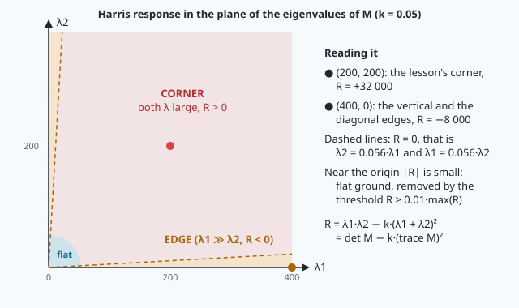
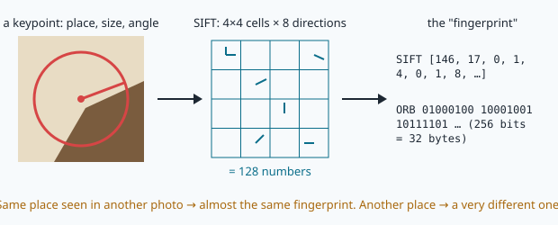
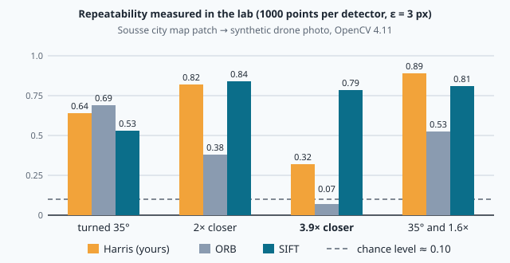
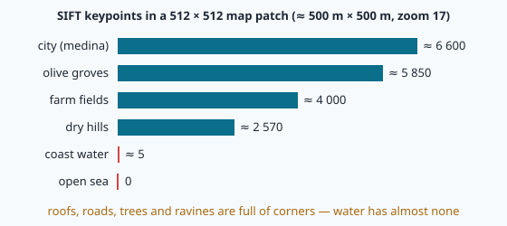

# Local features: corners, scale and descriptors

> [!NOTE] In short
> - To find a photo on a map, vision looks for a few **distinctive points** (keypoints), not for every pixel.
> - You will learn the maths of the **Harris corner** (image gradients and the structure tensor).
> - You will learn how SIFT finds the **scale** of a point, and how SIFT and ORB **describe** it with a vector.
> - You will measure **repeatability** (does the detector find the same points again after a turn or a zoom?).
> - In the lab you build Harris from scratch, use OpenCV's ORB and SIFT, and score which terrains can be matched.

A survey drone flies along a busy coast at 300 m, from one harbour town to the next.
Halfway, its GPS receiver is jammed. The camera still works: it sees roofs, roads, palm groves,
the beach. On board, NAVERA has a satellite map of the area. The question of this module ("Eyes on
the ground") is easy to say and hard to answer: **where on the map is this photo?**

Sliding the photo over the map pixel by pixel and comparing brightness does not work. The photo was
taken on another day, under another sun, with another camera. It is turned (the drone's heading) and
at another size (its height). The pixel values never agree.

So computer vision does what a pilot does: it ignores most of the picture and looks for a few
**distinctive points** — the corner of a building, a crossroads, a single tree — then checks that they
sit in the same arrangement on the map. These points are called **local features** or **keypoints**.
This lesson is about finding them (**detection**) and summarising each one with a vector of numbers
(**description**). Lesson 21 matches them; lesson 22 turns the match into a position.

> [!NOTE]
> NAVERA's test map and recorded frames cover **Sousse, Tunisia**, where NAVERA is developed. All the
> pictures in the lab come from that map. The examples in the text use places from around the world; the
> method is the same everywhere.

## 1. Image gradients

A grey image is a function `I(x, y)`: brightness (0–255) at column `x` and row `y`. In OpenCV and in
this course, `x` goes right and `y` goes **down**. The **gradient** is the vector of partial
derivatives:

```
∇I = (Ix, Iy) = (∂I/∂x, ∂I/∂y)
```

On a discrete image we estimate the derivatives with a small **convolution kernel**. The **Sobel**
kernel for `Ix` combines a central difference (along x) with a smoothing (along y):

```
        [-1  0  +1]
Sx  =   [-2  0  +2]        Sy = Sxᵀ
        [-1  0  +1]
```

**Worked example.** On a ramp `I(x, y) = 3x` every row is `… 0 3 6 9 …`. One Sobel row gives
`-1·0 + 1·6 = 6`, and the weights 1, 2, 1 of the three rows add up to 4: `Sx * I = 6 × 4 = 24`, that
is **8 times** the true slope of 3. This is why the lab divides the Sobel output by `SOBEL_NORM = 8`:
then a ramp `I = a·x` gives exactly `Ix = a`.

> [!WARNING]
> Gradients are negative where brightness falls. If you ask OpenCV for a `uint8` result
> (`cv2.Sobel(img, -1, …)` on a `uint8` image), every negative value is cut to 0. Always ask for
> `cv2.CV_32F`.

## 2. The structure tensor and the Harris corner

Take a small window `W` around a pixel and shift it by `(u, v)`. How much does the content change?
The **sum of squared differences**, weighted by a window function `w` (a Gaussian), is

```
E(u, v) = Σ w(x, y) · [ I(x+u, y+v) − I(x, y) ]²
```

For a small shift, a first-order Taylor expansion gives `I(x+u, y+v) ≈ I(x, y) + Ix·u + Iy·v`, so

```
E(u, v) ≈ Σ w · (Ix·u + Iy·v)²  =  [u v] · M · [u v]ᵀ

            [ Σ w·Ix²     Σ w·Ix·Iy ]     [ Sxx  Sxy ]
with   M =  [                       ]  =  [          ]
            [ Σ w·Ix·Iy   Σ w·Iy²   ]     [ Sxy  Syy ]
```

`M` is the **structure tensor** (also called the second-moment matrix). It is symmetric and positive
semi-definite, so it has two real eigenvalues `λ1 ≥ λ2 ≥ 0`. `E(u, v)` is a quadratic form: the
eigenvalues say how fast the content changes in the two principal directions.


| Region | Eigenvalues | Moving the window… |
|---|---|---|
| **Flat** (calm sea, a sabkha) | `λ1 ≈ λ2 ≈ 0` | changes nothing in any direction |
| **Edge** (a road side, the shoreline) | `λ1 ≫ λ2 ≈ 0` | changes only across the edge |
| **Corner** (a roof corner, a crossroads) | `λ1, λ2` both large | changes in every direction |

Computing eigenvalues at every pixel is slow. Harris and Stephens (1988) used two invariants of the
2 × 2 matrix instead — `det M = λ1·λ2` and `trace M = λ1 + λ2` — in the **Harris response**

```
R = det M − k · (trace M)²  =  Sxx·Syy − Sxy² − k·(Sxx + Syy)²      (k ≈ 0.04 – 0.06)
```

`R > 0` and large at corners, `R < 0` on edges, `|R|` small in flat regions.



**Worked example** (k = 0.05). Three windows, the weights summing to 1:

| Window | Gradients inside | Sxx | Syy | Sxy | det | trace | R |
|---|---|---|---|---|---|---|---|
| corner | half the pixels `(20, 0)`, half `(0, 20)` | 200 | 200 | 0 | 40 000 | 400 | 40 000 − 0.05·160 000 = **+32 000** |
| vertical edge | all `(20, 0)` | 400 | 0 | 0 | 0 | 400 | **−8 000** |
| diagonal edge | all `(14.1, 14.1)` | 200 | 200 | 200 | 0 | 400 | **−8 000** |

The diagonal edge has the same `Sxx` and `Syy` as the corner; only `Sxy` tells them apart. Its
eigenvalues are 400 and 0 — the same as the vertical edge, because eigenvalues do not depend on the
orientation. The Harris response is therefore **rotation invariant**.

**From R to points.** Two more steps turn the response map into a list of corners:

1. **Threshold**: keep pixels with `R > 0.01 · max(R)`.
2. **Non-maximum suppression (NMS)**: a corner makes a small "hill" of high `R`; keep only the top of
   each hill — the pixels whose `R` equals the maximum of their `(2r+1) × (2r+1)` neighbourhood.
   With OpenCV: `R == cv2.dilate(R, kernel)` (dilation replaces each pixel by the maximum around it).

A close relative, **Shi–Tomasi** ("good features to track", `cv2.goodFeaturesToTrack`), uses
`min(λ1, λ2)` instead of `R`. **FAST**, used by ORB, is a much faster corner test: it compares 16 pixels
on a circle with the centre and needs 9 contiguous ones all brighter or all darker.

## 3. Scale: the same roof from 150 m and from 600 m

Harris uses a fixed window (σ = 1.5 px in the lab). A roof corner is a corner at any height, but a
round water tank that fills the window at 600 m becomes a big flat disk at 150 m — the window then
sees only its flat inside. A detector that should work at any height needs to choose, for each point,
**its own size**. This is the idea of **scale space** (Lindeberg, 1994).

The scale space of an image is the family of blurred images

```
L(x, y, σ) = G(σ) * I        G(σ) = Gaussian of standard deviation σ
```

A blob detector looks at the **Laplacian** `∇²L = Lxx + Lyy`. Blurring makes all derivatives smaller,
so the responses at different σ are compared after multiplying by σ² — the **scale-normalised
Laplacian** `σ²·∇²L`. For a bright disk of radius `r`, `|σ²·∇²L|` at its centre is largest at

```
σ* = r / √2
```

This is the **characteristic scale** of the disk. Make the disk twice as big, and σ* doubles: the
detector measures the size of the structure, which is exactly what you need to compare a photo taken at
150 m with one taken at 600 m. In the lab you will check `σ* = r/√2` numerically.


### SIFT in four steps (Lowe, 2004)

1. **Difference of Gaussians (DoG).** Computing a Laplacian at every scale is expensive. Lowe used the
   difference of two neighbouring blurred images, `D = L(kσ) − L(σ) ≈ (k − 1)·σ²·∇²L` — the
   scale-normalised Laplacian almost for free. The scales are grouped in **octaves** (σ doubles; the
   image is then halved), with 3 intervals per octave: `k = 2^(1/3) ≈ 1.26`.
2. **Extrema.** A keypoint is a pixel larger (or smaller) than its 26 neighbours: 8 in its own DoG image
   and 9 in each of the two neighbouring scales. Its position and scale are refined to sub-pixel accuracy
   by fitting a quadratic.
3. **Rejection.** Low-contrast extrema are dropped (`contrastThreshold`: OpenCV's default is 0.04;
   NAVERA uses 0.02 because satellite pictures are often pale). Extrema on edges are dropped with a test
   on the 2 × 2 Hessian of D: `trace² / det < (r + 1)² / r` with `r = 10` — the same eigenvalue idea as
   Harris.
4. **Orientation.** A 36-bin histogram of the gradient directions around the point (weighted by
   magnitude) gives the dominant direction θ. The descriptor is computed in a frame turned by θ and
   scaled by σ: that is what makes it **rotation and scale invariant**.

## 4. Descriptors: a vector per keypoint

Detection says *where*. To recognise the same point in two pictures we need a **descriptor**: a vector
computed from the neighbourhood, close for the same ground point, far for different ones.



**SIFT descriptor — 128 floats.** A 16 × 16 neighbourhood (in the keypoint's own scale and rotation) is
cut into 4 × 4 cells; each cell gets an 8-bin histogram of gradient orientations: `4 × 4 × 8 = 128`.
The vector is normalised to unit length, values above 0.2 are clipped and it is normalised again: this
makes it robust to contrast changes (another sun, another camera). OpenCV returns `float32` values from
0 to 255. Two descriptors are compared with the **Euclidean (L2) distance**.

**ORB descriptor — 256 bits** (Rublee et al., 2011). ORB = oriented FAST + rotated BRIEF:

- FAST corners on an 8-level image pyramid (scale factor 1.2 per level), ranked by the Harris response;
- an orientation from the **intensity centroid**: with the moments `m_pq = Σ x^p·y^q·I(x, y)` of the patch,
  `θ = atan2(m01, m10)`;
- 256 binary tests "is pixel `p_i` brighter than pixel `q_i`?" on a smoothed 31 × 31 patch turned by θ.
  The 256 answers are packed in **32 bytes** (`uint8`).

Two binary descriptors are compared with the **Hamming distance**: the number of bits that differ,

```
d_H(a, b) = popcount(a XOR b)        0 ≤ d_H ≤ 256
```

**Worked example.** `a = 10110000`, `b = 10010001`: `a XOR b = 00100001`, two ones, `d_H = 2`.

For two *unrelated* descriptors, each bit differs with probability about ½, so `d_H` is close to
256/2 = **128**. In the lab you will measure the median for the same ground point (in the map and in a
turned photo): it is far below that. A computer compares 32 bytes with a few XOR and "count bits"
instructions; a SIFT comparison needs 128 subtractions, multiplications and additions on floats. This is
why ORB is popular on small processors, and why SIFT (or a learned descriptor on the GPU, lesson 22) is
preferred when accuracy matters.

| | SIFT | ORB |
|---|---|---|
| Detector | DoG extrema in scale space | FAST corners on a pyramid, Harris ranking |
| Scale | continuous (characteristic scale) | 8 pyramid levels × 1.2 |
| Orientation | gradient histogram | intensity centroid |
| Descriptor | 128 × float32 (512 bytes) | 256 bits (32 bytes) |
| Distance | Euclidean | Hamming |
| In OpenCV | `cv2.SIFT_create()` | `cv2.ORB_create()` |

## 5. Repeatability: measuring a detector

A detector is useful only if it finds **the same ground points** in two pictures of the same place.
Given two pictures A and B and the exact transform `H` (a 3 × 3 matrix) that maps a pixel of A to the
corresponding pixel of B, the **repeatability** is

```
rep = (number of A points whose projection H·p has a B point within ε pixels)
      / (number of A points whose projection falls inside B)
```

The projection uses **homogeneous coordinates**: `[x', y', w']ᵀ = H·[x, y, 1]ᵀ`, then the pixel is
`(x'/w', y'/w')`. For a rotation + scale + shift the last row of `H` is `[0, 0, 1]` and `w' = 1`; lesson
21 shows how to *estimate* `H` from matches. Here it is known, because the lab's "drone photos" were
made from the map with a chosen rotation and scale.

**Chance level.** Even random points are sometimes "repeated". With `N` points spread over `w × h`
pixels, the probability that at least one falls within ε of a given position is about

```
p_chance ≈ 1 − exp(−N·π·ε² / (w·h))
```

**Worked example.** `N = 1000`, ε = 3 px, a 640 × 480 photo: `1000 · π · 9 / 307 200 = 0.092`, so
`p_chance ≈ 1 − e^(−0.092) ≈ 0.088`. A detector scoring 0.10 is no better than chance. The lab compares
every detector with this level, and always with the **same number of points** — more points per pixel
raise the score without making the detector better.

**What the lab measures** (OpenCV 4.11, 1000 points per detector, ε = 3 px, synthetic photos made from
the Sousse map):



| Pair (map patch → photo) | Harris | ORB | SIFT | chance |
|---|---|---|---|---|
| city, turned 35°, same scale | 0.64 | 0.69 | 0.53 | 0.10 |
| city, 2× closer | 0.82 | 0.38 | 0.84 | 0.10 |
| city, **3.9× closer** | **0.32** | 0.07 | **0.79** | 0.10 |
| city, 35° and 1.6× | 0.89 | 0.53 | 0.81 | 0.10 |

Read it carefully — it is more interesting than the textbook story:

- **Harris is rotation invariant** (0.64 at 35°) and survives moderate zoom on sharp building corners: a
  sharp corner is a corner at every scale.
- At **×3.9** the close-up photo shows small details (windows, low roof walls, cars) that do not exist at the
  map's resolution; Harris with its fixed window prefers them, and its repeatability falls to 0.32.
  SIFT chooses a scale per point and stays at 0.79.
- **ORB** scores low here partly because of the metric: its points on coarse pyramid levels are only
  located to ±1.2ᴸ pixels, and a fixed 3 px tolerance punishes them. Repeatability depends on how you
  measure it — always say which ε and how many points.
- Even where Harris repeats well, it gives **no scale and no orientation**, so no invariant descriptor:
  you could not *match* its corners between a map at 0.97 m/px and a photo at 0.25 m/px. Repeatable
  positions are necessary, not sufficient.

## 6. Texture and matchability: cities, dunes, the open sea

A picture with many distinct, well-spread features has rich **texture**. The lab counts SIFT keypoints in
six 512 × 512 patches of the Sousse map at zoom 17 (0.97 m per pixel, about 500 m × 500 m of ground):



The two extremes: the city patch gives about **6600** SIFT keypoints, the open-sea patch (`terrain_sea`)
gives **0**, and the coast with water (`terrain_coast_water`) only about **5**. These counts use OpenCV's
default `contrastThreshold` of 0.04. With NAVERA's lower value, 0.02, the same coast patch gives about
68 — still very few, and mostly on the shoreline.

Now think about the whole world:

- **Towns and farms** (Paris, Singapore, the farmland of the Nile delta): roofs, walls, roads and
  field borders — thousands of corners and blobs, like the Sousse medina. The best case.
- **Palm, olive and orange plantations**: many blobs, but all alike and in rows. Many keypoints is not
  the same as many *distinct* keypoints: this is **repetitive texture**. A tree in the photo can be
  matched to the wrong tree on the map (lesson 21's ratio test exists for this).
- **The Sahara's sand seas** and the **Namib** dunes: long dune ridges, low contrast,
  repetitive, and the dunes move with the wind — the satellite map may be several years old. Few
  keypoints, and the ones found may not be on the map any more.
- **Mountains** (the Alps, the Andes, the Himalaya): valleys, ridges and terraces give strong texture; the
  difficulty there is relief — the camera's height above the ground changes fast, so the scale changes
  (lesson 22).
- **The sea** (the Mediterranean off Sousse, the open Atlantic or Pacific): nearly uniform, with waves that change every
  second. Zero useful keypoints. The **coastline** gives an edge, not corners: positions along it are
  badly constrained.
- **Tidal flats and salt flats** (the Wadden Sea in Europe, the Salar de Uyuni in Bolivia): wide, flat,
  and changed by tides or flooding — few features. Snow and ice (Greenland, Antarctica) are even worse.

Three more enemies of texture come from the camera: **blur** (vibration, speed), **darkness** (dusk,
shadows) and **haze** (dust or smog in the air, very common over deserts and big cities). All three remove the small
brightness changes detectors need.

**CLAHE** (*Contrast Limited Adaptive Histogram Equalisation*) stretches the contrast in small tiles,
with a limit on the stretch so that noise is not amplified too much:

```python
clahe = cv2.createCLAHE(clipLimit=2.0, tileGridSize=(8, 8))
boosted = clahe.apply(grey)
```

It brings back features in a dull picture — and also "finds" texture in ripples and noise on water,
features that will never be on the map. More keypoints help only when they belong to things that stay
put.

**Matchability.** Before trying to match a photo, the lab scores it from 0 to 1:

```
matchability = min(1, N / 300) × spread        spread = share of 4 × 4 grid cells with ≥ 3 keypoints
```

The spread matters as much as the count: points all on one road or one shoreline give a fit that is
poorly constrained in rotation and scale (lesson 21).

## 🐦 How birds do it

Homing pigeons use landmarks. GPS loggers on pigeons near Rome and Oxford showed that, on familiar
routes, they follow roads, rivers and field borders — long, stable, high-contrast structures — sometimes
turning at the same motorway junctions each time (Lipp et al., 2004; Biro et al., 2004). Like a good
keypoint, a good landmark is distinctive and stays put.

Large soaring birds avoid long sea crossings. Every autumn, hundreds of thousands of **white storks** and
raptors flying from Europe to Africa gather at the **Strait of Gibraltar**, where the sea is only about
14 km wide, or at the **Bosphorus** in Istanbul, instead of crossing the Mediterranean directly. Be careful with
the reason. The main one is energy: soaring birds climb in **thermals** (rising warm air), which form over
sun-heated land, not over the sea, so a long crossing means tiring flapping. A small extra reason is the
one from this lesson: the open sea has no landmarks.

Navi is a **barn swallow**. Swallows flap all the way and cross the sea and the desert on a broad front,
catching insects as they fly. She does not need the coast — but she would not try to recognise a wave.

NAVERA cannot choose its route, but it can do the next best thing: **measure** how much texture a picture
has, and say honestly when day vision has nothing to hold on to.

## In NAVERA

Open [local_matcher.py](file:navera/day_pkg/day_pkg/local_matcher.py) in your NAVERA copy. It is NAVERA's
day-vision matcher. Its class `TileFeatures` computes the SIFT features of each map tile once, with a
border taken from the neighbouring tiles, and keeps them in a cache:

```python
class TileFeatures:
    """SIFT features of the map tiles of an area, computed lazily and cached."""
    PAD = 48                          # border taken from the neighbours

    def __init__(self, images_dir, zoom=17, per_tile=300, cache_tiles=3000):
        ...
        self.sift = cv2.SIFT_create(nfeatures=per_tile, contrastThreshold=0.02)
        self.clahe = cv2.createCLAHE(clipLimit=2.0, tileGridSize=(8, 8))
```

and in `_compute()`: `kp, d = self.sift.detectAndCompute(self.clahe.apply(big), None)`.

Everything from this lesson is there: **SIFT** (scale and rotation invariant, 128-float descriptors), at
most **300 keypoints per 256 × 256 tile** at zoom 17, a **lower contrast threshold** (0.02) for pale
satellite pictures, **CLAHE** before detection, and a 48-pixel border so that a roof cut by a tile edge is
still seen whole. The camera frame gets the same treatment in `LocalMatcher.locate()` (up to 1500
keypoints, after the frame is resized to the map's resolution). A frame with too little texture is
refused at once:

```python
kq, dq = self.sift.detectAndCompute(q, None)
if dq is None or len(kq) < 10:
    res.update(reason="too few features in the frame (uniform ground, blur, darkness)")
    return res
```

The function `inlier_spread()` in the same file measures how much of the frame the matched points cover,
on a 4 × 2 grid with at least 3 points per cell — the idea of your `spread()`. In
[vision_nav.py](file:navera/day_pkg/day_pkg/vision_nav.py) a fix whose inliers cover too little of the
frame is rejected — but only when it is also weak: fewer than 30 inliers **and** a spread below
`min_spread=0.25`.

What happens over uniform terrain is written in `docs/VALIDATION_STATUS.md`. In a simulated flight over
uniform terrain near Gabès (southern Tunisia), the former whole-tile method gave a median error of 351 m:
**"Day vision is unreliable over uniform terrain (desert, sea)"**. Local SIFT matching did much better on
the same simulated flight (147 matches, none rejected) — but the document warns that this simulated
camera is cut from the map's own imagery, which is optimistic. Over the sea there is nothing to match:
NAVERA carries its last position along the measured track (lesson 23). In the simulator it was carried
90 s over a bay stating ±300 m, with a true error of at most 146 m. All these figures are from the
simulator or the bench; NAVERA is at **Release 0.x — field validation pending**.

## Glossary

| Term | Meaning |
|---|---|
| **local feature / keypoint** | a small, distinctive image location that can be found again: a corner or a blob |
| **gradient** `(Ix, Iy)` | partial derivatives of brightness; estimated with the Sobel kernel |
| **structure tensor** `M` | 2 × 2 matrix of window-averaged gradient products; its eigenvalues describe the local structure |
| **Harris response** `R` | `det M − k·(trace M)²`: positive at corners, negative on edges |
| **non-maximum suppression (NMS)** | keeping only the local maxima of a response map |
| **scale space** | the family of images blurred with growing σ |
| **characteristic scale** | the σ where the scale-normalised Laplacian is extreme; proportional to the structure's size |
| **DoG** | difference of Gaussians, SIFT's fast approximation of the scale-normalised Laplacian |
| **descriptor** | a vector describing a keypoint's neighbourhood (SIFT: 128 floats; ORB: 256 bits) |
| **Hamming distance** | number of differing bits between two binary descriptors |
| **invariant** | unchanged by a transformation (rotation, scale, brightness) |
| **repeatability** | share of points found again in a second picture, within ε pixels |
| **homogeneous coordinates** | `(x, y)` written `(x, y, 1)` so a 3 × 3 matrix can map points |
| **repetitive texture** | many features that look alike (rows of trees, dunes): easy to confuse |
| **CLAHE** | local contrast stretching with a limit, used before detection |

## Check what you learned

<details><summary>1. At a pixel, Sxx = 300, Syy = 280, Sxy = 0. With k = 0.05, what is R, and what kind of region is it? What if Sxy = 289?</summary>
det = 300·280 − 0 = 84 000, trace = 580, R = 84 000 − 0.05·336 400 = 84 000 − 16 820 = <b>67 180 &gt; 0: a corner</b>.
With Sxy = 289: det = 84 000 − 83 521 = 479, R = 479 − 16 820 ≈ −16 300 &lt; 0: an <b>edge</b> (a diagonal one —
the gradients are all nearly parallel, one eigenvalue is close to 0).
</details>

<details><summary>2. Why does R not change when the picture is turned by 35°?</summary>
R uses only det M = λ1·λ2 and trace M = λ1 + λ2. Turning the picture turns the gradients, which changes M to
Q·M·Qᵀ with a rotation Q — the eigenvalues, hence det and trace, are unchanged.
</details>

<details><summary>3. A round water tank of radius 6 px gives its strongest scale-normalised Laplacian at σ ≈ 4.2. The drone climbs and the tank now has a radius of 3 px. What σ do you expect, and why does this matter?</summary>
σ* = r/√2 ≈ 2.1: half. The detector measures the size of the structure, so the descriptor can be computed on a
window of the same <i>ground</i> size at both heights. That is scale invariance.
</details>

<details><summary>4. Two ORB descriptors differ in 121 of their 256 bits. Is it probably the same ground point?</summary>
Probably not: unrelated descriptors differ in about half the bits (≈ 128). In the lab the same ground point gives a
median of about 73 bits. 121 is in the "random" range.
</details>

<details><summary>5. A detector finds the same points again in 12 % of cases, with 1000 points on a 640 × 480 photo and ε = 3 px. Is it a good detector?</summary>
No. Random points would score about 1 − exp(−1000·π·9/307 200) ≈ 9 %. 12 % is barely above chance.
</details>

<details><summary>6. Over the Sahara's sand dunes the camera finds 2000 SIFT keypoints. Give two reasons why matching may still fail.</summary>
Repetitive texture (dune ridges look alike, so descriptors have near-twins), and change (dunes move with the wind and
the map may be years old, so the keypoints are not where the map shows them). Low contrast and haze make it worse.
</details>

Now open the **🛠️ Lab** tab.
