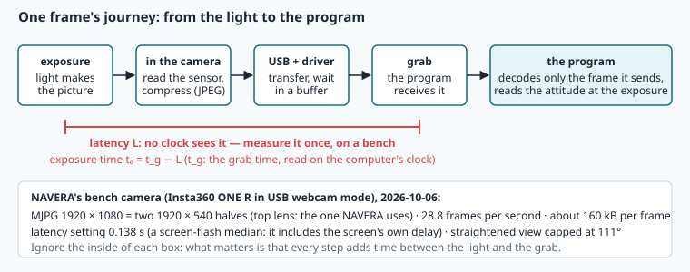
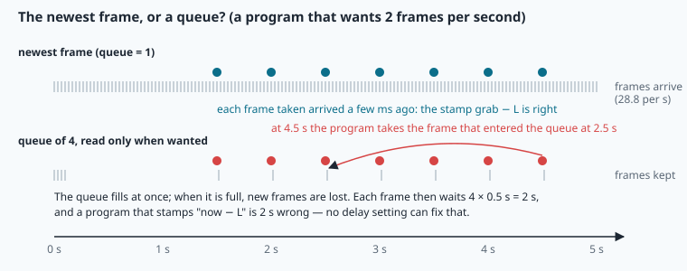
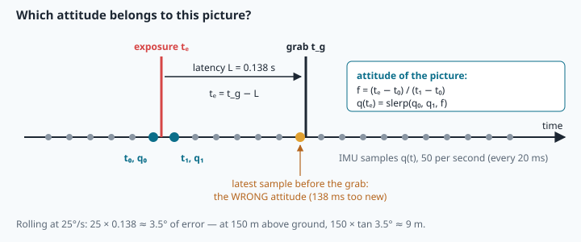

# Live camera: frames, delay and the attitude at the exposure


> [!NOTE] Mission brief
> **3 October 2026, NAVERA's mission simulator.** A plane flies at 40 m/s, its camera on a gimbal. Day vision
> matches each camera picture against the map with an error of **0 to 1 m**. Yet the position NAVERA hands to the
> autopilot is off by **83 m** (median), and **none** of its positions is within the ±30 m it states. The
> matches were right; their **time** was wrong. Each vision position described the instant the photo was taken,
> 1 to 2.5 s earlier, and was sent as if it were the present. (NAVERA's validation report, 2026-10-03; now
> fixed in the simulator.) NAVERA's engineering backlog lists a twin bug in the star pipeline, also fixed (on the bench): the attitude was read when the
> photo was *processed*, not when it was *taken* — "degrees off in flight".
>
> A camera picture is a measurement of **one instant**, and that instant is not "now". Today you learn to find
> it, to measure how late a camera is, and to read every other sensor at the right instant.
> **Session 1 — Timekeeper:** you describe a frame stream with statistics, measure a camera's delay on a
> screen-flash bench and choose the delay setting. **Session 2 — The attitude at the exposure:** you give each
> frame of a turning plane its true attitude, refuse the frames you cannot trust, and run NAVERA Lite's live
> camera over ROS. Each session ends with a badge: **Timekeeper**, then **Shutter**.
>
> **Start now:** open the 🛠️ **Lab** tab, do **Step 0** (two minutes, no code), then come back here for §1.

**Objectives.** After this mission you can:

1. **describe** the timing of a frame stream (rate, median period, jitter, dropped frames) and say which number
   describes normal behaviour and which one the risk;
2. **measure** a camera's delay with screen flashes and **choose** the delay setting from the data, knowing what
   the median and the minimum over-estimate;
3. **turn** a time error into metres on the ground (δθ = ω·δt, then h·tan δθ);
4. **compute** the attitude at a frame's exposure from an IMU history (bracket, fraction, slerp), and **refuse**
   frames with no attitude, a fast rotation or a large tilt.

**You need:** slerp and the angle between two attitudes (mission 16), how an attitude error moves a ground point
(mission 18), median and standard deviation (mission 04), a ROS node and a topic (missions 09–11). 🧰 boxes
refresh `ddof` and `bisect`. ⏱ Reading: about 70–100 minutes with the ✏️ checks. Lab: 3 h to 5 h (weaker programmers: plan the full 5 h).

**Before you start** — answer without looking (if you miss two, reread mission 16 §5 on slerp and mission 18 §6):

<details><summary>1. slerp(q₀, q₁, 0.5) with q₀ = no rotation and q₁ = a yaw of 90°: what attitude?</summary>
A yaw of 45°: slerp turns at a constant rate along the shortest way, so half the time gives half the angle.
</details>

<details><summary>2. A camera 150 m above flat ground looks straight down. Its attitude is wrong by 2°. How far does the ground point at the image centre move?</summary>
150 × tan 2° ≈ 5.2 m (mission 18 §6, with a tilt of 0°).
</details>

<details><summary>3. Ten numbers: nine are about 35, one is 380. Which moves more if you remove the 380: the mean or the median?</summary>
The mean (by about 34). The median hardly moves: it is robust to one outlier (mission 04).
</details>

<details><summary>Workspace and words (open if you need them)</summary>

Your files are in `~/lessons/20-live-camera/`; the part of NAVERA Lite you write is
[navera_lite/timing.py](file:./navera_lite/timing.py).

| Word | Meaning | Français |
|---|---|---|
| **frame** | one picture of a video stream | image (trame) |
| **exposure** | the instant the light makes the picture (the sensor collects light for a few ms) | exposition |
| **grab** | the instant the program receives the frame | acquisition (réception) |
| **latency (delay) L** | the time from the exposure to the grab | latence |
| **frame period T** | the time between two frames; 1/28.8 s = 34.7 ms | période d'image |
| **jitter** | how much the intervals between frames vary (here: their standard deviation) | gigue |
| **dropped frame** | a frame the camera made but the program never received | image perdue |
| **stall** | a pause of the whole stream | blocage |
| **MJPG** | a video stream where every frame is a separate JPEG picture | Motion JPEG |
| **queue / buffer** | memory where frames wait before the program takes them | file d'attente / tampon |
| **slerp** | interpolation between two attitudes at a constant rotation rate (mission 16) | interpolation sphérique |
</details>

## 1. A frame is a measurement of one instant

**The problem.** Your program receives a picture. When was it taken? Not now. Between the light and your
program, the picture travels through a chain, and every link takes time:



The program can read its clock when the frame arrives: the **grab time** t_g. It cannot read the instant of the
**exposure** tₑ: no clock is inside the light. The **latency** L, the time from exposure to grab, is a property of
the camera chain, measured once on a bench (§3). Then for every frame

```
exposure time   tₑ = t_g − L
```

and **every other sensor value used with this frame** (attitude, height, position) must be read **at tₑ**.

**NAVERA's bench camera.** NAVERA's engineers use an Insta360 ONE R in USB webcam mode. A frame is MJPG, 1920 × 1080:
two 1920 × 540 halves, one per lens, stacked. NAVERA keeps the top half (its "crop") and straightens it to a view
capped at 111° wide. The stream runs at 28.8 frames per second (T = 34.7 ms), and NAVERA's calibration file for
that lens stores a delay setting of **0.138 s** (2026-10-06) — an upper bound, as §3 explains. Lab Step 1 opens a
real recorded frame.

**Grab every frame, decode one.** Each frame arrives as a JPEG of about 160 kB; decoded, it is 1920 × 1080 × 3 B =
6.2 MB. Decoding costs CPU time, and vision uses about one frame per second. So a live camera program **grabs every
frame** (cheap: it keeps the newest one and its time) and **decodes only the frame it sends** to vision. You will
measure the decode time on your computer in Step 1.

**The newest frame, not a queue.** If the program is slower than the camera, frames wait in a **queue**. Worked
example: a driver keeps a queue of 4 frames, and the program takes one only twice a second.



The queue fills at once; when it is full, new frames are lost; each frame taken has waited 4 × 0.5 s = **2 s**.
A program that stamps it "now − L" is 2 s wrong, and no delay setting can fix it, because the waiting time is not
part of L. NAVERA therefore always works with the **newest** frame. You will see this live in Step 10.

> [!QUESTION] ✏️ Check
> A program grabs at 30 frames per second but needs 0.25 s to process each frame it takes, and lets frames queue
> (queue of 8). Roughly how old is a frame when the program takes it, once the queue is full?

<details><summary>Answer</summary>
The program takes one frame every 0.25 s; the queue holds 8, so each frame waits about 8 × 0.25 = 2 s, plus the
latency L. Faster processing would not remove the problem; taking the newest frame would.
</details>

> [!TIP] 🛠️ Lab now
> Do lab **Step 1**, then read §2.

## 2. Describing a frame stream

**The problem.** Is the camera really giving 28.8 frames per second? Does it pause? Does it lose frames? Grab times
answer that. Let the grab times be t₀, t₁, …, tₙ₋₁; the **intervals** are dᵢ = tᵢ − tᵢ₋₁ (there are n − 1 of them).

```
mean frame rate     fps        = (n − 1) / (tₙ₋₁ − t₀)        n frames, but n − 1 intervals
nominal period      median(dᵢ)                                 robust: a few long gaps do not move it
jitter              std(dᵢ)                                    how much the intervals vary
largest gap         max(dᵢ)
dropped frames      an interval of about k periods hides k − 1 frames:
                    for every dᵢ > 1.5 × median, add round(dᵢ / median) − 1
```

> [!TIP] 🧰 Standard deviation: `ddof`
> `np.std(x)` divides by n (**ddof = 0**, the spread of exactly these numbers); `np.std(x, ddof=1)` and pandas'
> `.std()` divide by n − 1 (an estimate for the whole population). `np.std([1.0, 3.0])` is 1.0; with `ddof=1` it
> is 1.414. Course rule here: numpy's default, ddof = 0.

**Worked example.** Grab times 0, 0.1, 0.2, 0.4, 0.5 s. Intervals 0.1, 0.1, 0.2, 0.1 s.
fps = 4 / 0.5 = **8.0** (not 5 / 0.5). Median interval 0.1 s = **100 ms**. Jitter = std(0.1, 0.1, 0.2, 0.1) =
**43.3 ms**. Largest gap 200 ms. The 0.2 s interval is 2 periods: round(0.2 / 0.1) − 1 = **1** dropped frame.

**Normal behaviour vs risk.** The intervals of a USB camera vary by a few ms: USB transfers are scheduled, and the
operating system runs other programs. Sometimes the whole stream **stalls** for a fraction of a second. Which of
the numbers above does a stall move, and which one hardly moves? Step 2 shows you on 60 s of real-looking grab
times. Keep the question in mind: which number describes the normal rhythm, and which one the risk (the longest
time without a picture)?

> [!QUESTION] ✏️ Check
> Grab times 10.000, 10.035, 10.070, 10.175, 10.210 s. Compute fps, the median interval and the dropped frames.

<details><summary>Answer</summary>
Intervals 35, 35, 105, 35 ms. fps = 4 / 0.210 = 19.05. Median 35 ms. 105 / 35 = 3 periods → 2 dropped frames
(and fps is low because of them: the camera itself still runs at about 28.6 frames per second).
</details>

> [!TIP] 🛠️ Lab now
> Do lab **Step 2**, then **only the prediction** at the start of Step 3 (`PREDICT_DELAY`), **before** you read §3.

## 3. Measuring the delay: the screen flash

**The problem.** No clock sees the exposure. So we make an event whose time we know, and watch when the camera sees
it. **The screen-flash bench:** the camera faces a screen. The program turns the screen white at t₀ (its own clock)
and watches the brightness of the centre of each frame it grabs. The **delay** of the flash is the grab time of the
first frame **brighter than the midpoint** between the dark level (the last frame before t₀) and the bright level
(the brightest frame soon after), minus t₀. Repeat about 20 times.


**What does one delay contain?** Three parts:

```
d = s + w + L        s: the screen's own delay to turn white (desktop monitors: about 10–30 ms)
                     w: the wait for the next exposure: anywhere between 0 and T, at random
                     L: the camera chain's latency, the number we want
```

Why "brighter than the midpoint" and not "a bit brighter"? An exposure lasts a few ms: the frame exposed while the
screen changes is half lit. The midpoint rule says the frame counts when **more than half** of its exposure saw the
white screen.

Three consequences, which you will meet in the lab:

1. Even with perfect clocks, the delays **spread over about one frame period** (34.7 ms), because w is random.
   w has a mean of T/2 = 17.4 ms and a standard deviation of T/√12 = 10.0 ms.
2. The **median** of d is about **s + T/2 + L**: it over-estimates the camera's delay by s + T/2. The **minimum** is
   about s + L (the flash that happened just before an exposure), but one number is fragile: a single early frame
   by noise, and it is wrong.
3. Robust and nearly unbiased: take the median and subtract what you know, **L ≈ median − T/2 − s**, with s
   measured separately (for example with a photodiode). The median also ignores a stall or a missed flash.

NAVERA's tool for this bench prints the **median of its flashes** (20 by default; how many were used for the
Insta360's value is not recorded), and says itself that the screen's delay is included, "so the camera's delay is
**at most** the result". Its 0.138 s for the Insta360 is such a median: an upper bound, not the camera's latency. With
s = 10–30 ms and T/2 = 17 ms, the camera's own delay is probably about 0.09–0.11 s. Is that bad? A setting that is
too large by 30 ms stamps every frame 30 ms too early: §4 tells you what that costs. NAVERA's field-test procedure
adds a second method for a camera on a vehicle: film a phone's stopwatch and compare the time shown in the picture
with the frame's exposure stamp.

> [!QUESTION] ✏️ Check
> A bench gives 20 delays from 125 ms to 158 ms, median 141 ms, at 28.8 frames per second. The screen's delay is
> 15 ms. Estimate L in two ways. Which do you trust more?

<details><summary>Answer</summary>
Median − T/2 − s = 141 − 17 − 15 = 109 ms. Minimum − s = 125 − 15 = 110 ms. They agree; the median-based one
uses all 20 flashes, so one odd flash cannot move it. The spread, 33 ms, is about one period, as expected.
</details>

> [!TIP] 🛠️ Lab now
> Finish lab **Steps 3 and 4** (your delay setting), then read §4.

## 4. What a time error costs

**The idea.** If the program uses the attitude of the wrong instant, δt seconds off, while the vehicle rotates at
ω degrees per second, the attitude is wrong by about

```
δθ = ω · δt          and a camera h metres above flat ground, looking down, misplaces the image centre by
Δx = h · tan δθ      (mission 18 §6)
```

**Worked example.** A plane 150 m above a coastline rolls into a turn at 25 °/s. A program straightens a frame with
the attitude it holds at the **grab**; take NAVERA's setting, L = 0.14 s, as the time since the exposure:
δθ = 25 × 0.14 = **3.5°**, so Δx = 150 × tan 3.5° = **9.2 m**. That is more than the error of a good map match
(NAVERA's day vision placed 32 of 33 aerial test photos within 9 m, median 4 m — photos from another camera, not yet
measured with NAVERA's own).

**A steady bank is still a rotation.** Once the plane holds its bank angle φ, the roll stops changing, but the plane
is **turning**: its heading changes. To fly a level turn at speed v, the tilted lift must supply the sideways
(centripetal) force, and that gives a turn rate

```
ω = g · tan φ / v            g = 9.81 m/s², ω in rad/s (× 57.3 for °/s)
```

For φ = 20° at 40 m/s: ω = 9.81 × 0.364 / 40 = 0.089 rad/s = **5.1 °/s**. A fixed camera turns with the plane, so a
time error still leaves the attitude wrong by ω·δt during the whole turn, not only while the bank changes. But this
rotation is about the **vertical**: like the yaw of the ✏️ below, it turns the picture about the point straight below
the plane. The image centre lies h·tan φ from that point (87 m at 150 m and 30°), so it swings by about
h·tan φ · ω·δt (ω·δt in radians), and points farther out move more. h·tan(ω·δt) is the rule for a roll or a pitch error.

**And the position?** The same delay moves the vehicle: a plane at 40 m/s travels 40 × 0.14 = 5.6 m between the
exposure and the grab. So every position made from a frame must carry the **exposure** time. The mission brief is
this error, much larger: photos 1–2.5 s old at 40 m/s are 40–100 m behind the plane, which is how an 83 m median
error appeared with a 1 m match.

> [!QUESTION] ✏️ Check
> A drone hovers 100 m up and spins about the vertical at 90 °/s (a pure yaw). A frame is stamped 0.1 s wrong.
> How far does the ground point at the image centre move? And a ground point 60 m from it?

<details><summary>Answer</summary>
The camera looks straight down along the yaw axis: the centre does not move at all. The image turns by
90 × 0.1 = 9°, so a point 60 m away moves 2 × 60 × sin 4.5° ≈ 9.4 m. h·tan δθ is the rule for roll and pitch;
a yaw error rotates the picture around its centre.
</details>

> [!TIP] 🛠️ Lab now
> Do lab **Step 5**, then **only the prediction** at the start of Step 6 (`PREDICT_METHODS`), **before** you read §5.

## 5. The attitude at the exposure

**The problem.** The IMU (mission 17) gives the attitude 50 times per second, as quaternions with their times. The
exposure tₑ almost never falls on a sample. Three steps: **bracket** tₑ between two samples, compute the
**fraction** of the way, and **slerp**.

> [!TIP] 🧰 Python: `bisect` finds where a number fits in a sorted list
> ```python
> import bisect
> times = [0.00, 0.02, 0.04, 0.06]
> i = bisect.bisect_right(times, 0.03)   # 2: times[1] <= 0.03 < times[2]
> bisect.bisect_right(times, 0.04)       # 3: a value equal to a sample goes AFTER it
> bisect.bisect_right(times, -1.0)       # 0: before the first one
> bisect.bisect_right(times, 9.0)        # 4 = len(times): after the last one
> times[0 - 1]                           # 0.06 — careful: index −1 is the LAST element, and Python does not complain
> ```
> It halves the list at each step (like a dictionary search), so 3 000 samples need about 12 comparisons.

```
bracket   t₀ ≤ tₑ < t₁   (the samples i − 1 and i)
fraction  f = (tₑ − t₀) / (t₁ − t₀)        0 ≤ f < 1
attitude  q(tₑ) = slerp(q₀, q₁, f)          mission 16: exact if the rotation rate is constant in between
```

**Worked example.** A frame is grabbed at t_g = 500.300 s; with L = 0.138 s, tₑ = **500.162 s**. The plane yaws at
25 °/s; the IMU gave yaw 31.0° at 500.160 s and 31.5° at 500.180 s. f = 0.002 / 0.020 = **0.1**, so the attitude
at the exposure is a yaw of **31.05°**. The sample held at the grab, 500.300 s, says about 34.5°: 3.45° wrong.

Why not interpolate the Euler angles, roll, pitch and yaw, one by one? Between two samples 20 ms apart it gives
almost the same result, except when a heading crosses 180° → −180° (it would turn the long way round), and in
general it does not turn at a constant rate. Slerp has neither problem: use the `slerp` you wrote in mission 16
(NAVERA Lite gives it to you finished in `rotations.py`).

**When there is no sample.** An IMU can be silent: a busy bus, a restart. An interpolated value far from any
sample is a guess, so the rule is: **no sample within 0.2 s of tₑ → no attitude** (and the frame will be refused).
Before the first sample or after the last one, but within 0.2 s, take that end sample; never extrapolate.



> [!WARNING] Common mistakes
> - **The order of the four numbers.** NAVERA Lite, ROS and NAVERA store a quaternion as (x, y, z, w), the scalar
>   **last**. A level attitude is (0, 0, 0, 1); read as (w, x, y, z) it becomes a 180° turn about z.
> - **f upside down.** (t₁ − tₑ) / (t₁ − t₀) is the fraction from the *other* end: `attitude_at`'s docstring
>   example (a quarter of the way from yaw 0° to 20°) then gives 15° instead of 5°.
> - **i = 0.** Before the first sample, bisect gives i = 0, and `imu_t[i - 1]` is `imu_t[-1]`, the LAST sample.
> - **Extrapolating** past the last sample: a noisy rate times 0.1 s can be degrees wrong.
> - **The sample held at the grab**: the newest attitude is the wrong one, by ω × L.

> [!QUESTION] ✏️ Check
> The IMU is silent from 17.0 s to 17.8 s (samples at 17.0 and 17.8). Is there an attitude for an exposure at
> 17.1 s? At 17.4 s? At 17.65 s?

<details><summary>Answer</summary>
17.1 s: the nearest sample is 0.1 s away → yes, interpolated (f = 0.125). 17.4 s: both samples are 0.4 s away → no
attitude. 17.65 s: 0.15 s from 17.8 → yes (f = 0.8125).
</details>

> [!TIP] 🛠️ Lab now
> Do lab **Steps 6 and 7**, then read §6.

## 6. Refusing the frames you cannot trust

**The problem.** Even with the right instant, some frames are not worth using. Three refusal rules, in this order
(the first one that refuses gives the reason):

1. **No attitude at the exposure** (§5) → refuse: a frame cannot be straightened without one.
2. **Turning too fast** (fixed camera). The **rotation rate** is the angle between the attitude 0.2 s before the
   exposure and the attitude at it, divided by 0.2 s. Above **30 °/s**, refuse. If one of the two attitudes is
   missing, the rate is unknown: refuse too.
3. **Tilted too far** (fixed camera): the camera axis more than **45°** from straight down → refuse.

Otherwise the frame is usable. With a **gimbal** that holds the camera straight down, only rule 1 applies. (The
`usable` docstring numbers "rate unknown" as a rule of its own, so it lists five lines: the same rules.)

Why refuse a fast rotation if the attitude is interpolated at the right instant? Because what is left is not
zero: the delay setting is known to a few ms; an exposure lasts several ms, during which the picture turns (blur);
and many sensors expose their rows one after the other (**rolling shutter**), so the top and bottom of one frame
are not taken at the same instant. Each leftover δt costs h·tan(ω·δt): at 60 °/s, 10 ms is 0.6°, or 1.6 m at
150 m — and it grows with ω. Why refuse a large tilt? Mission 18: the footprint of a tilted camera stretches
towards the horizon, and straightening spreads few pixels over much ground.

**Worked example.** Exposure at 12.0 s. The attitudes at 11.8 s and 12.0 s differ by 5.2°: rate = 5.2 / 0.2 = 26 °/s,
below 30; tilt 28° (a 28° bank, level nose), below 45° → **usable**. A moment later the bank grows to 48°: the tilt
rule refuses it, even if the rate is small.

> [!QUESTION] ✏️ Check
> A multirotor with a gimbal yaws at 60 °/s. A plane with a fixed camera rolls at 60 °/s with a 20° bank. Which
> frame is used?

<details><summary>Answer</summary>
The multirotor's: with a gimbal, only the "no attitude" rule applies (the gimbal keeps the camera level and steady,
and a yaw does not move the centre). The plane's frame is refused: 60 °/s > 30 °/s.
</details>

> [!TIP] 🛠️ Lab now
> Do lab **Steps 8 to 11**. The rest of the lesson (NAVERA, NAVERA Lite, birds, summary) can wait until the end.

## In NAVERA

NAVERA's **live camera** (described in its architecture document) reads frames from a USB camera (V4L2, addressed by
its stable name under `/dev/v4l/by-id/`), from the Jetson's own camera connector, from any GStreamer pipeline, or
from a ROS image topic. For every frame it offers to day or night vision:

- **Exposure stamp:** the grab time minus the camera's delay setting (for a ROS image: the image's stamp minus the
  delay). Every other sensor value is taken at that instant.
- **Attitude** interpolated at the exposure from the IMU history. **No attitude within 0.2 s** of the exposure → the
  frame is marked unusable. A frozen IMU (50 identical samples in a row) is not used.
- **Rotation rate:** the rotation between the attitude 0.2 s before the exposure and at it. With a fixed camera, a
  frame taken while rotating faster than **30 °/s** is unusable (never with a gimbal). In NAVERA's simulator, a
  fixed-camera plane rocked by a ±26° roll oscillation turned at 144–185 °/s: those frames are refused.
- Then undistortion with the lens calibration (mission 19), straightening with the attitude (mission 18); a frame
  tilted more than **45°** is unusable.
- Always the **newest** frame, never a queue; frames are grabbed at the camera's rate and only the one sent is
  decoded.
- The two bugs of the mission brief are fixed: vision positions are now carried from their photo's instant to the
  present along the measured velocity, with an uncertainty grown by the lag (2026-10-03, simulator and unit tests); the star pipeline takes the
  IMU attitude at the frame's exposure (fixed earlier: bench-verified on synthetic data, 2026-09-28).

Honest limits: the 0.138 s delay of the Insta360 is a bench median that includes the screen; it has not been
checked in flight. The delay may also change with the computer's load, so it should be measured under the vehicle's
real load. The stopwatch method needs the phone's clock to agree with the computer's to a few ms, and the phone's
screen adds its own delay, just like the bench screen. NAVERA is **Release 0.2 — field validation pending**.

## In NAVERA Lite

[navera_lite/timing.py](file:./navera_lite/timing.py) is this mission's part. You write `frame_stats` (§2),
`delay_from_flashes` (§3), `time_error_m` (§4), `attitude_at` (§5), `rotation_rate_dps` and `usable` (§6). Given:
`exposure_time`, `tilt_deg`, and `load_camera_settings`, which reads your [camera.yaml](file:./camera.yaml) (the
delay setting and the refusal rules). `navera_lite/ros/camera_node.py` (given) is the live camera: it replays a
recorded flight over ROS, stamps each frame at its exposure, and calls **your** functions for every frame.

## 🐦 How birds do it

Fast fliers have fast eyes: the pied flycatcher, a small insect-hunting songbird, sees a flickering light as
flickering up to about 146 times per second, more than twice what humans can (Boström et al., 2016). And birds
avoid blurred "frames": a walking pigeon holds its head **still in space** while its body moves forward, then
thrusts the head forward quickly, so its eyes get a still image most of the time. The bobbing is for the eyes: on a
treadmill, where the scene does not move past it, a walking pigeon stops bobbing (Frost, 1978). NAVERA's rate rule
has the same aim: use the views taken while the camera turns slowly.

## Summary

1. A frame is a measurement of **one instant**: tₑ = t_g − L. Every other sensor value is read at tₑ.
2. Describe a stream with the **median** period (normal rhythm), the **jitter** and the largest gap (risk), and the
   dropped frames. Take the **newest** frame: a queue makes frames old and their stamps wrong.
3. A flash bench measures d = s + w + L; the median over-estimates L by about s + T/2: L ≈ median − T/2 − s.
4. A time error costs h·tan(ω·δt) on the ground, and v·δt in position.
5. The attitude at the exposure: bracket, fraction, slerp; none if no sample within 0.2 s. Refuse fast rotations
   (> 30 °/s) and large tilts (> 45°) with a fixed camera.

**Next mission:** features — the corners and blobs that let vision recognise the same place in two pictures.

## Check yourself

Answer without scrolling up.

<details><summary>1. Why can the program not simply read the exposure time on its clock?</summary>
The exposure happens inside the camera; the program's clock sees only the grab. The latency between them must be
measured once (a flash bench, a filmed stopwatch) and subtracted.
</details>

<details><summary>2. 600 grab times span 21.0 s; the median interval is 34.7 ms. What is the mean rate, and roughly how many frames were dropped?</summary>
599 / 21.0 = 28.5 frames per second. At 34.7 ms the span holds about 605 periods, so about 6 frames are missing.
</details>

<details><summary>3. Why does the median delay of a flash bench over-estimate the camera's latency, and by how much?</summary>
It includes the screen's delay s and the random wait for the next exposure, on average T/2: by about s + T/2.
</details>

<details><summary>4. Frame grabbed at 80.250 s, L = 0.120 s; IMU samples at 80.120 s (roll 10°) and 80.140 s (roll 11°), a pure roll. Roll at the exposure?</summary>
tₑ = 80.130 s; f = 0.5 → roll 10.5°.
</details>

<details><summary>5. (mission 18) A camera 300 m up is tilted 20°; a wrong attitude moves the centre point more than for a level camera. Why?</summary>
The ground point is at h·tan(tilt); its change for a small δ grows like 1/cos²(tilt): a tilted camera turns small
angle errors into larger ground errors.
</details>

<details><summary>6. (mission 16) Why does slerp use −q₁ when q₀ · q₁ < 0?</summary>
q₁ and −q₁ are the same attitude; with a negative dot product the path to q₁ is the long way round (more than
180°). −q₁ gives the short way, the real motion between two samples.
</details>

Now open the **🛠️ Lab** tab.
