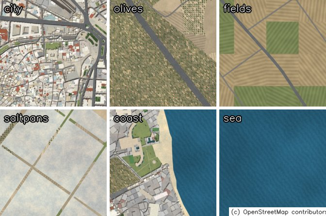
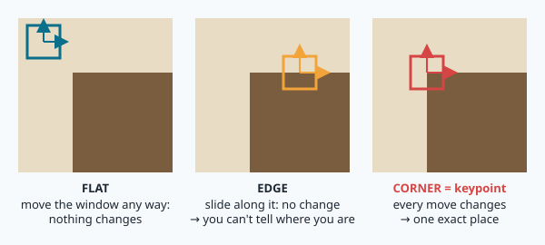
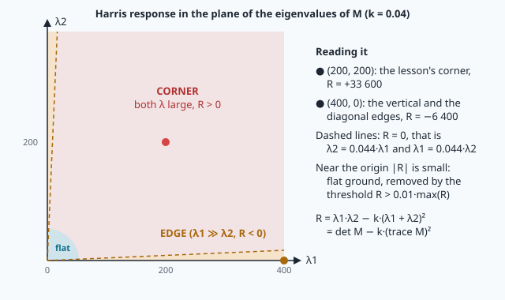
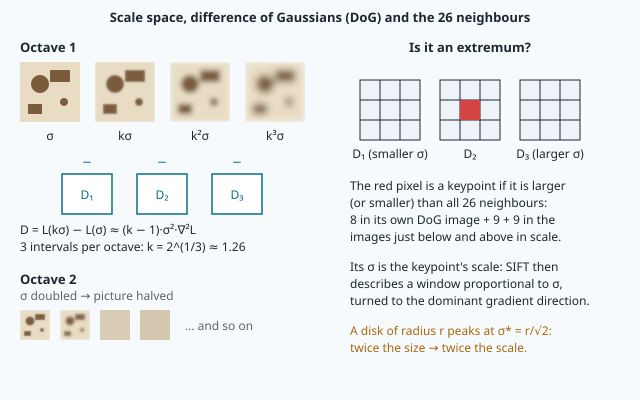
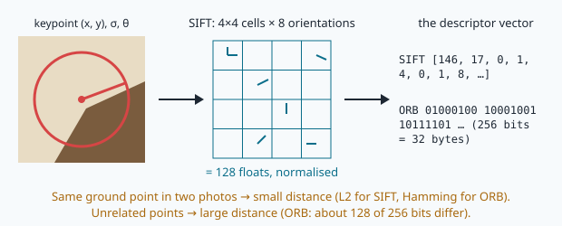
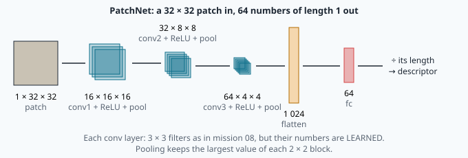
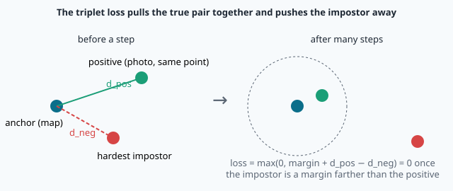
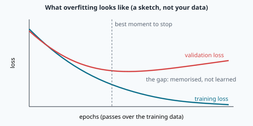

# Local features: corners, scale and descriptors



> [!NOTE] Mission brief
> **18 January 2024, Jezero crater, Mars.** NASA's Ingenuity helicopter takes off for its 72nd flight. Its
> navigation tracks visual features on the ground with a downward camera, a system designed for well-textured,
> flat terrain. That day it flies over steep, almost featureless sand ripples. About 20 seconds after take-off,
> the flight data show that the navigation can no longer find enough features to track. Ingenuity touches down
> with a high horizontal speed, pitches and rolls, and breaks its rotor blades. (NASA/JPL accident investigation,
> December 2024: "the most likely scenario", since there was no black box.)
>
> NAVERA meets the same enemy on Earth: its validation report (3 October 2026) states that **day vision is
> unreliable over uniform terrain** (desert, sea). Today you learn what a "feature" is, how to measure one, and
> how to *learn* one. **Session 1 — Scout & detector:** you rank terrains by eye, build the Harris corner detector
> from its maths and measure detectors against the truth. **Session 2 — Learner:** you compare binary descriptors,
> then build, train and test your own neural network that describes ground patches, and you measure it against
> OpenCV. Each session ends with a badge: **Corner hunter**, then **Learner**.
>
> **Start now:** open the 🛠️ **Lab** tab, do **Step 0** (five minutes, no code), then come back here for §1.

**Objectives.** After this mission you can:

1. compute image **gradients** and the **structure tensor**, and classify a window as flat, edge or corner from
   its **eigenvalues** and the **Harris response**;
2. **measure** a detector: its **repeatability** against a known homography, compared with chance, and explain
   why scale matters;
3. compare **descriptors** (ORB's 256 bits with the Hamming distance, SIFT's 128 numbers), and predict and test
   how **matchable** a terrain is;
4. explain the parts of training a **neural network**: tensors, layers, a loss, gradient descent, a
   training/validation split, and **overfitting**;
5. **train** a small convolutional network as a patch descriptor and compare it, **measured**, with ORB and SIFT.

**You need:** convolution and the Sobel kernel divided by 8 (mission 08), homogeneous coordinates and homographies
(mission 18), numpy arrays. Matrices 2 × 2 and derivatives are refreshed in 🧰 boxes; PyTorch is new and taught
here. ⏱ Reading: 90 to 120 minutes with the ✏️ checks (Part A, §1–§6, before session 1, 55–70 minutes; Part B,
§7–§9, before session 2, 35–50 minutes). Lab: 3 h 30 to 6 h in two sessions. The whole mission: 5 h (a strong
programmer) to 8 h (new to PyTorch), about 30 minutes more if your trainings run on the CPU.

**Before you start** — answer without looking (if you miss two, reread mission 08 §4 and mission 18 §7):

<details><summary>1. A grey ramp climbs 5 grey levels per pixel to the right. What does the course's Sobel (divided by 8) give for gx and gy?</summary>
gx = 5, gy = 0. The raw 3 × 3 Sobel sums give 8 × 5 = 40; the course divides by 8 so that the result is in grey levels per pixel.
</details>

<details><summary>2. H = [[2, 0, 10], [0, 2, 0], [0, 0, 1]]. Where does it send the pixel (3, 4)?</summary>
H · [3, 4, 1] = [16, 8, 1], so (16, 8): a zoom by 2 and a shift of 10 px to the right.
</details>

<details><summary>3. Why is cv2.Sobel(img, -1, 1, 0) on a uint8 image a trap?</summary>
The output keeps the input's dtype, uint8: every negative gradient (brightness falling) becomes 0.
</details>

<details><summary>Workspace and words (open if you need them)</summary>

Your files are in `~/lessons/21-features/`. The parts of NAVERA Lite you write are
[navera_lite/features.py](file:./navera_lite/features.py) and [navera_lite/learned_desc.py](file:./navera_lite/learned_desc.py).

| Word | Meaning | Français |
|---|---|---|
| **keypoint** (local feature) | a small place in an image that can be found again: a corner, a blob | point d'intérêt |
| **structure tensor** | 2 × 2 matrix of averaged gradient products in a window | tenseur de structure |
| **eigenvalue** | a number λ with M·v = λ·v; here, how fast the window's content changes in one direction | valeur propre |
| **repeatability** | share of keypoints found again in another picture of the same place | répétabilité |
| **descriptor** | a vector that summarises the neighbourhood of a keypoint | descripteur |
| **Hamming distance** | number of bits that differ between two binary strings | distance de Hamming |
| **tensor** (PyTorch) | an n-dimensional array that can remember how it was computed | tenseur |
| **loss** | one number that says how wrong the network is; training makes it smaller | fonction de perte |
| **gradient descent** | changing every weight a little against its derivative | descente de gradient |
| **overfitting** | learning the training examples by heart instead of the rule | surapprentissage |
</details>

# Part A — Classic features (read before session 1)

## 1. Gradients: where brightness changes

To find a photo on a map, a matcher does not compare every pixel: the light, the camera and the date differ. It
looks for a few **distinctive places** (a roof corner, a crossroads, a lone tree) and checks that they sit in the
same arrangement. Finding them is **detection**; summarising each one by a vector is **description**. Mission 22
matches them; mission 23 turns the match into a position.

A grey image is a function I(x, y), x to the right and y **down**. Its **gradient** (gx, gy) = (∂I/∂x, ∂I/∂y) is
estimated with the Sobel kernel of mission 08, divided by 8 (the course rule): a ramp that climbs a grey levels per
pixel gives exactly a. OpenCV computes it in one call, about 50 times faster than mission 08's loops, but only if
you ask for a float result (`cv2.CV_32F`): a uint8 result cuts every negative gradient to 0.

A uniform region has gradient (0, 0). An edge has a large gradient across it. A corner has large gradients in **two**
directions. That is all a detector needs; the trick is to look at a whole small window, not one pixel.

## 2. The structure tensor and the Harris corner



Shift a small window by (u, v) and measure how much its content changes: the sum of squared differences, weighted
by a Gaussian window w. For a small shift, I(x+u, y+v) ≈ I + gx·u + gy·v (a first-order Taylor expansion), so

```
E(u, v) ≈ Σ w·(gx·u + gy·v)²  =  [u v] · M · [u v]ᵀ           M = [ Sxx  Sxy ]     Sxx = Σ w·gx²
                                                                 [ Sxy  Syy ]     Syy = Σ w·gy²,  Sxy = Σ w·gx·gy
```

M is the **structure tensor**. In code, Sxx is simply the image gx·gx blurred by a Gaussian of standard deviation σ
(the window), and the same for Syy and Sxy: three products, three blurs.

> [!TIP] 🧰 Eigenvalues of a symmetric 2 × 2 matrix
> For M = [[a, b], [b, c]] the two eigenvalues are λ = (a + c)/2 ± √(((a − c)/2)² + b²). They are real, and
> λ1·λ2 = det M = ac − b², λ1 + λ2 = trace M = a + c. Example: [[5, 3], [3, 5]] gives 5 ± √(0 + 9) = **8 and 2**.
> Each λ says how fast E grows when the window moves in one particular direction (its eigenvector).

| Window | Eigenvalues | Moving the window… |
|---|---|---|
| **flat** (calm sea, an empty field) | λ1 ≈ λ2 ≈ 0 | changes nothing in any direction |
| **edge** (a road side, the shoreline) | λ1 ≫ λ2 ≈ 0 | changes only across the edge |
| **corner** (a roof corner, a crossroads) | λ1 and λ2 both large | changes in every direction: one exact place |

Harris and Stephens (1988) avoided computing eigenvalues at every pixel by using det and trace:

```
R = det M − k·(trace M)²  =  Sxx·Syy − Sxy² − k·(Sxx + Syy)²          k ≈ 0.04 (the course's value)
```

**Worked example** (k = 0.04). A window where half the pixels have gradient (20, 0) and half (0, 20), weights
summing to 1: Sxx = 200, Syy = 200, Sxy = 0. Eigenvalues 200 and 200: both large, a corner.
R = 40 000 − 0.04 · 400² = **33 600**. Now Sxx = 200, Syy = 2, Sxy = 0: eigenvalues 200 and 2, an edge;
R = 400 − 0.04 · 202² = **−1 232**. A diagonal edge (all gradients (14.1, 14.1)): Sxx = Syy = Sxy = 200, eigenvalues
400 and 0, R = 0 − 0.04 · 400² = −6 400. Same Sxx and Syy as the corner: only Sxy tells them apart.



R > 0 and large: corner; R < 0: edge; |R| small: flat. R depends only on the eigenvalues, which do not change when
the picture turns: the Harris response is **rotation invariant**.

> [!QUESTION] ✏️ Check
> At a pixel, Sxx = 300, Syy = 280, Sxy = 0 (k = 0.04). R? What kind of window? And if Sxy = 289?

<details><summary>Answer</summary>
det = 84 000, trace = 580, R = 84 000 − 0.04 · 336 400 = <b>70 544 &gt; 0: a corner</b>. With Sxy = 289: det =
84 000 − 83 521 = 479, R = 479 − 13 456 ≈ <b>−12 977 &lt; 0: an edge</b> (eigenvalues ≈ 579.2 and 0.8: the gradients
are all nearly parallel).
</details>

**From R to points.** Keep a pixel when its R is the largest of its neighbourhood (**non-maximum suppression**: a
corner makes a little hill of R, keep only the top) and larger than 1 % of the picture's largest R; sort by R. NAVERA
Lite's `harris_corners` does this for you with OpenCV's `dilate` (each pixel replaced by the maximum around it).

## 3. Scale: one window does not fit all

The window σ is fixed (1.5 px here). A roof corner is a corner at any height, but fly 4 times lower and the photo
shows details the map never had: windows, parapets, cars, each a "corner" of its own for a small window. A detector
that must work at any height should choose, for every point, **its own size**. This is **scale space**: blur the
picture with growing σ and look, at each point, for the σ where a blob detector (the Laplacian, scaled by σ²) answers
most strongly. That σ grows in proportion to the structure's size: a bright disc of radius r answers most strongly at
σ = r/√2, the same disc twice as large at twice that σ. **SIFT** (Lowe, 2004) is built on this idea; **ORB** (Rublee et al., 2011) uses a
simpler pyramid of 8 shrunken copies of the picture.

<details class="further"><summary>Optional — SIFT in four steps, and the pyramid</summary>



1. **Difference of Gaussians.** D = L(kσ) − L(σ) ≈ (k − 1)·σ²·∇²L: the scale-normalised Laplacian almost for free.
   Scales come in **octaves** (σ doubles, the picture is halved), 3 intervals per octave, k = 2^(1/3) ≈ 1.26.
2. **Extrema.** A keypoint is larger (or smaller) than its 26 neighbours: 8 in its DoG image, 9 above and 9 below in
   scale. Position and scale are refined to sub-pixel accuracy.
3. **Rejection.** Low-contrast extrema are dropped (OpenCV's contrastThreshold 0.04); points on edges are dropped
   with the same eigenvalue idea as Harris, on the 2 × 2 Hessian.
4. **Orientation.** A histogram of gradient directions around the point gives its main direction; the descriptor
   is computed in that turned, scaled frame: rotation and scale invariance.

ORB: FAST corners (16 pixels on a circle compared with the centre) on 8 pyramid levels, 1.2 apart, ranked by the
Harris response; orientation from the intensity centroid; 256 binary comparisons of smoothed pixel pairs (BRIEF,
turned by the orientation).
</details>

Which detector suffers most when the photo is 4 times closer is your prediction in lab Step 4: think about it with
the paragraph above, then measure.

## 4. Repeatability: measuring a detector

A detector is useful only if it finds **the same ground points** in two pictures of the same place. Our lab photos
were made from the map with a chosen turn and zoom, so the exact homography H from the map patch to the photo is
known (mission 18). The **repeatability** is

```
repeatability = (points of picture 1 whose image H·p has a point of picture 2 within ε pixels)
                / (points of picture 1 whose image H·p falls inside picture 2)
```


A point that falls outside picture 2 could never be found: it does not count, neither above nor below the line.

**Chance level.** Even random points are sometimes "repeated". With N points spread over w × h pixels, the chance
that at least one falls within ε of a given position is about

```
p_chance ≈ 1 − exp(−N·π·ε² / (w·h))
```

**Worked example.** N = 500, ε = 2 px, a 512 × 512 picture: 500 · π · 4 / 262 144 = 0.024, so p_chance ≈ 0.024. A
detector must be compared with this level, and always with the **same number of points**: more points per pixel
raise the score without making the detector better.

> [!QUESTION] ✏️ Check
> A detector scores 0.15 with 2 000 points on a 640 × 480 photo, ε = 3 px. Is it good?

<details><summary>Answer</summary>
Chance: 2 000 · π · 9 / 307 200 = 0.184, p ≈ 1 − e^(−0.184) ≈ <b>0.17</b>. 0.15 is <b>no better than random points</b>.
</details>

## 5. Descriptors: a vector per keypoint

Detection says *where*. To recognise the same point in two pictures you need a **descriptor**: close for the same
ground point, far for different ones.



- **SIFT**: a 16 × 16 neighbourhood (in the keypoint's own scale and direction) cut into 4 × 4 cells, an 8-bin
  histogram of gradient directions in each: **128 numbers**, normalised. Compared with the Euclidean (L2) distance.
- **ORB**: **256 bits** (32 bytes, uint8), each the answer to "is pixel p brighter than pixel q?" for a fixed list
  of pixel pairs. Compared with the **Hamming distance**, the number of bits that differ:

```
d_H(a, b) = number of 1 bits in (a XOR b)          0 ≤ d_H ≤ 256
```

**Worked example.** a = 10110000, b = 10010001: a XOR b = 00100001, two 1 bits, **d_H = 2**. A computer compares
32 bytes with a few XOR and "count bits" instructions; that is why ORB is popular on small processors.

> [!TIP] 🧰 Bits in numpy
> `np.unpackbits(np.array([5, 255], np.uint8))` → the 16 bits `0 0 0 0 0 1 0 1 1 1 1 1 1 1 1 1`;
> `np.bitwise_xor(np.uint8(12), np.uint8(10))` → 6 (1100 XOR 1010 = 0110); `.sum()` counts the ones.

> [!QUESTION] ✏️ Check
> Two ORB descriptors of unrelated places: about how many of their 256 bits do you expect to differ, and why?

<details><summary>Answer</summary>
About <b>128</b>: for unrelated patches each comparison is a coin toss, so each bit differs with probability about ½.
The same ground point must give far fewer; lab Step 6 measures how many.
</details>

## 6. Texture, matchability and contrast

A picture with many distinct, well-spread features has rich **texture**. Three traps:

- **Uniform ground** (calm sea, sand, salt flats, a ploughed field) gives no keypoints, or a few on noise.
- **Repetitive texture** (rows of trees, dunes) gives many keypoints that **look alike**: a tree in the photo may be
  matched to the wrong tree on the map. Many keypoints is not the same as many *distinct* keypoints.
- **Bunched points**: all on one road or one shoreline. A fit is then poorly constrained in rotation and scale.

NAVERA Lite's `matchability(gray)` turns this into a score from 0 to 1 with a reason:

```
fewer than 10 ORB keypoints               → (0.0, "too few features")
score = min(1, N / 300) × spread           spread = share of the 4 × 4 grid cells holding ≥ 3 keypoints
spread < 0.25                              → (score, "features bunched"), otherwise (score, "ok")
```

(N is the number of ORB keypoints, at most 500.) The camera brings three more enemies: **blur**, **darkness** and
**haze**. **CLAHE** (Contrast Limited Adaptive Histogram Equalisation) stretches the contrast in small tiles, with a
limit so that noise is not amplified too much. It brings back features in a dull picture, and also "finds" texture
in ripples and noise on water, features that will never be on the map.

> [!QUESTION] ✏️ Check
> A photo has 400 ORB keypoints, all on a straight coastal road: 3 of the 16 grid cells hold 3 or more. Score and
> reason?

<details><summary>Answer</summary>
spread = 3/16 = 0.1875, score = min(1, 400/300) × 0.1875 = <b>0.19, "features bunched"</b>: many points, one line.
</details>

> [!WARNING] Common wrong ideas (Part A)
> - "A strong gradient is a corner." An edge has a strong gradient too, in **one** direction only: look at both eigenvalues.
> - "More keypoints, better matching." Rows of olive trees give thousands of look-alike keypoints.
> - "Repeatability 0.10 is low but useful." Compare it with chance first.
> - "`cv2.Sobel(img, -1, …)` is fine." On uint8 it cuts negative gradients to 0: ask for `cv2.CV_32F`.
> - "numpy gives (x, y)." `np.nonzero` gives (rows, columns) = (y, x).

# Part B — Learning a descriptor (read before session 2)

## 7. From hand-made to learned: tensors and layers

SIFT and ORB were **designed by hand**: someone chose 4 × 4 cells, 8 directions, 256 pixel pairs. A **neural
network** instead *learns* its own description from examples: thousands of pairs of patches that show the same
ground point, one from the map and one from a "drone photo" (turned a little, scaled, tilted, blurred, darker,
noisier). The lab's pairs come from views of NAVERA's test map rendered with exact ground truth, so every pair is
known to be right. NAVERA relies on learned features too: its day matching first tries a learned detector, descriptor
and matcher, with SIFT as the fallback, and its former day method and its night vision are networks (In NAVERA,
below). Which one wins is measured, not believed.

> [!TIP] 🧰 PyTorch in ten lines
> ```python
> import torch
> x = torch.tensor([[1.0, 2.0], [3.0, 4.0]])   # a tensor: like a numpy array, shape torch.Size([2, 2])
> x.shape, x.mean(), x @ x.T                   # the same operations as numpy (@ is the matrix product)
> w = torch.tensor(3.0, requires_grad=True)    # a number PyTorch must be able to differentiate
> loss = (w * 2.0 - 10.0) ** 2                 # 16.0 — PyTorch remembers how it was computed
> loss.backward()                              # computes d(loss)/dw for every tensor that requires it
> w.grad                                       # tensor(-16.) = 2·(2w − 10)·2 at w = 3
> torch.nn.Conv2d(1, 16, 3, padding=1)         # a layer: 16 learnable 3 × 3 filters (weights + 16 biases)
> x.to("cuda")                                 # move a tensor (or a model) to the GPU, if there is one
> ```
> A model is a class derived from `torch.nn.Module`: its `__init__` creates the layers (after `super().__init__()`),
> its `forward(x)` says in which order they are applied. `model(x)` calls `forward`.

**A layer** is a function with **parameters** (numbers that training changes):

- a **convolution** `Conv2d(c_in, c_out, 3)` is mission 08's 3 × 3 kernel, but c_out of them, each looking at all
  c_in input maps, and their 9·c_in weights are learned instead of chosen; `padding=1` keeps the size;
- **ReLU** replaces negative values by 0 (without it, many layers would collapse into one linear function);
- **max-pooling 2 × 2** keeps the largest value of each 2 × 2 block: half the width, half the height;
- a **linear** layer `Linear(n_in, n_out)` is a matrix n_out × n_in plus a bias: every output sees every input.



At the end, each 64-number output is divided by its length, so every descriptor is a unit vector: distances
between descriptors then lie between 0 and 2, whatever the patch's contrast.

**Worked example — counting parameters.** `Conv2d(3, 8, 5)` (3 input maps, as in a colour picture, 8 filters of
5 × 5): each filter has 3 × 5 × 5 = 75 weights and 1 bias, so 8 × 76 = **608** parameters. A linear layer from 200
inputs to 10 outputs: 10 × 200 + 10 = **2 010**. Modern vision models have millions; the course's limit for your
networks is one million, small enough to train in seconds on the Jetson's GPU. You will count PatchNet's yourself.

> [!QUESTION] ✏️ Check
> A small network takes a 1 × 24 × 24 patch. Block 1: `Conv2d(1, 8, 3, padding=1)`, ReLU, 2 × 2 pooling. Block 2: the
> same with 16 maps. What is the shape after each block, and how many numbers does `flatten` give?

<details><summary>Answer</summary>
8 × 12 × 12 (8 maps, padding keeps 24, pooling halves it), then 16 × 6 × 6, so 576 numbers: a linear layer after it
must take 576 inputs. (Without padding=1 a 3 × 3 conv shrinks 24 → 22: the sizes no longer halve cleanly.)
</details>

## 8. A loss and gradient descent

Training needs one number that says how wrong the network is: the **loss**. Ours is the **triplet loss**. For a batch
of B pairs, da[i] and dp[i] are the descriptors of the same ground point (the **anchor** from the map, the
**positive** from the photo). Every other dp[j] is an **impostor**. Let d_pos = ‖da[i] − dp[i]‖ and d_neg the distance
to the **closest** impostor in the batch (the hardest one). Then

```
loss_i = max(0, margin + d_pos − d_neg)          loss = mean over the batch          margin = 0.5
```



**Worked example.** d_pos = 0.3, d_neg = 0.9: 0.5 + 0.3 − 0.9 = −0.1 → loss 0: this point is already well
described, nothing to learn. d_pos = 0.3, d_neg = 0.6: loss **0.2**: the impostor is too close.

**Gradient descent.** Every weight w gets a small step against the derivative of the loss: w ← w − lr · ∂loss/∂w (lr,
the **learning rate**, sets the step size). One weight, worked: loss(w) = (2w − 6)², lr = 0.05, start w = 0.
∂loss/∂w = 2(2w − 6)·2 = −24, so w becomes 0 + 0.05 · 24 = 1.2 and the loss falls from 36 to (2.4 − 6)² = 12.96; next
step: derivative −14.4, w = 1.92, loss 4.67. It slides towards w = 3, where the loss is 0.

A network has tens of thousands of parameters, not one. PyTorch's `loss.backward()` computes all their derivatives at once
(**backpropagation**: the chain rule, applied backwards through the layers), and an **optimiser** applies the
steps. The lab uses **Adam**, a gradient descent that adapts the step of each weight. One training step is always the
same four lines: compute the loss on a batch, `opt.zero_grad()` (forget the previous derivatives),
`loss.backward()`, `opt.step()`. One pass over all the training pairs is an **epoch**.

> [!QUESTION] ✏️ Check
> Continue the one-weight example for one more step from w = 1.92. And what goes wrong with lr = 0.3?

<details><summary>Answer</summary>
Derivative 2(3.84 − 6)·2 = −8.64, w = 1.92 + 0.432 = <b>2.352</b>, loss (4.704 − 6)² ≈ 1.68. With lr = 0.3 from w = 0:
w = 7.2, loss (14.4 − 6)² = 70.6: the step jumps over the minimum and the loss grows. A learning rate too large
diverges; too small, training crawls.
</details>

## 9. Training, validation, and overfitting

A network can learn the training pairs **by heart**: a patch's exact pixels instead of what makes a ground point
recognisable. To see it, keep pairs it never trains on, the **validation** set, and measure the loss there after
each epoch, without learning from it. In the lab, validation pairs come from **other places** on the map: the
question is "does it work on ground it has never seen?", which is what a drone needs.



While both losses fall, the network is learning something general. (In the first epoch the validation loss can even be
*below* the training loss: the training loss is the mean over the epoch, while the network was still poor at its
start; the validation loss is measured at the end, with the improved weights.) When the training loss keeps falling and the
validation loss stops or rises, it is **overfitting**: memorising. More (and more varied) data, fewer epochs, or a
smaller network fight it. The validation loss is computed in batches of the same size as training: the triplet loss
looks for the closest impostor **in the batch**, so with 2 048 pairs at once each anchor would face 2 047 impostors
instead of 255, and the two losses would not be comparable. A third set, the **test** set, is kept for the very end: the check of this mission
measures your trained network on pairs you never see.

**The matching score.** Losses compare runs of one network; to compare a network with SIFT or ORB, measure the job:
in groups of 256 pairs, take each map patch, find the nearest of the 256 photo descriptors, and count how often it
is the right one. Random descriptors score about 1/256 ≈ 0.004 on average (pure luck); a perfect descriptor 1.0.

> [!QUESTION] ✏️ Check
> Your network scores 0.99 on its training pairs and 0.70 on validation pairs from other places. What do you
> conclude, and what would you try?

<details><summary>Answer</summary>
Overfitting: it learned the training places, not the rule. More training pairs from more places, fewer epochs (stop
where the validation loss is lowest), or a smaller network. Never judge a network on the pairs it trained on.
</details>

> [!WARNING] Common wrong ideas (Part B)
> - "The training loss went down, so the network works." Only the validation (and later the test) score says that.
> - "A neural network is magic." It is tens of thousands of numbers changed by gradient descent to make one loss smaller: it learns
>   exactly what the data and the loss ask for, including the data's flaws (here: a drawn map, not a real camera).
> - "`loss.item()` inside the loss is fine." A plain Python number has no gradient: keep tensors until `backward()`.
> - "Validate on random pairs of the training places." Neighbouring patches share ground: that measures memory.
> - "Learned beats hand-made, always." It wins on the kind of data it was trained on. Measure on other data.

## In NAVERA

NAVERA's day vision, IRIS's product, matches the camera frame against map tiles with local features (described in
words). When its models load on the GPU, it first uses a **learned** pair: DISK keypoints and descriptors, matched by
LightGlue, two published neural networks; like your network, DISK is not rotation invariant, so the frame is first
turned north-up from the heading. Its fallback is a **SIFT** matcher: at most 300 keypoints per map tile, a contrast threshold of 0.02 instead of OpenCV's 0.04 because map
pictures are often pale, **CLAHE** (clip 2.0, 8 × 8 tiles) before detection, and up to 1 500 keypoints in the frame.
A frame with fewer than 10 keypoints is refused at once ("too few features: uniform ground, blur, darkness"), and a
weak match whose inliers cover less than a quarter of the frame (a 4 × 2 grid, 3 inliers per cell) is rejected: the
idea of `spread`. On the bench (1 October 2026), the SIFT local matching placed 32 of 33 aerial test frames within
9 m (median 4 m), with frames from another source, not NAVERA's camera; the validation report (3 October 2026) gives
no figure yet for the learned pair, and neither is measured with NAVERA's camera.

NAVERA uses other learned models too. Its former day method compared whole tiles with **DINOv2**, a pretrained network
(median error 442 m on labelled replay frames: not accurate enough, kept as a fallback), and night vision uses
**STHN**, a network that predicts a homography between a thermal frame and the map (8–13 m median on synthetic
frames, not validated on real thermal). Over uniform terrain near Gabès, in simulation, the former method gave a
median error of 351 m and the autopilot failed safe after 45 s: "day vision is unreliable over uniform terrain"
(validation report, 3 October 2026). NAVERA is Release 0.2, field validation pending.

## In NAVERA Lite

| You write | It does | Lesson |
|---|---|---|
| `gradients`, `structure_tensor`, `eigen2`, `harris` (features.py) | the Harris detector from its maths | §1–§2 |
| `repeatability` | how a detector is measured | §4 |
| `hamming` | the distance of binary descriptors | §5 |
| `PatchNet`, `triplet_loss`, `train` (learned_desc.py) | a learned patch descriptor | §7–§9 |

Given: `harris_corners`, `detect` (OpenCV's ORB and SIFT), `clahe`, `warp_points`, `spread`, `matchability`,
`to_tensor`, `describe`, `nn_accuracy`, `load_weights`, and mission 08's `image.py`. Your trained weights file,
`my_desc.pt` (with its training log, `logs/my_desc.pt.json`), is a part of your stack too: mission 22 matches with
it, and Sim Lite (31) can fly it.

## 🐦 How birds do it

Homing pigeons with GPS loggers, near Oxford and Rome, follow roads, rivers and field borders on familiar routes,
sometimes turning at the same motorway junctions every time (Biro et al., 2004; Lipp et al., 2004): long, stable,
high-contrast landmarks, like good keypoints. And they **learn** them: the routes become faithful only after several
flights over the same ground, as your network becomes faithful only after it has seen enough pairs. Navi the swallow
crosses the Mediterranean on a broad front: over open water she has no landmarks either, and relies on her compass.

## Summary

1. The structure tensor M (averaged gx², gy², gx·gy) says how a window changes: two small eigenvalues = flat, one
   large = edge, two large = corner; Harris uses R = det M − k·(trace M)² instead of the eigenvalues.
2. A detector is measured: repeatability against a known H, with the same number of points, against chance. A fixed
   window suffers under zoom; scale space (SIFT) chooses a size per point.
3. A descriptor makes a point recognisable: ORB's 256 bits with the Hamming distance, SIFT's 128 numbers.
   Many keypoints is not the same as distinct, well-spread keypoints.
4. A network learns a descriptor: layers with parameters, a loss (triplet), gradient descent (backward, step), and a
   validation set from other places to catch overfitting.
5. Learned vs hand-made is a measurement on the data you care about, not a belief.

**Next mission:** matching. You pair the keypoints of a photo with the map's, with your descriptor and SIFT, throw
out the wrong pairs with RANSAC, and see why NAVERA's scale check matters.

## Check yourself

Answer without scrolling up.

<details><summary>1. Sxx = 50, Syy = 50, Sxy = 50. Eigenvalues, R (k = 0.04), and the kind of window?</summary>
λ = 50 ± √(0 + 2 500) = 100 and 0; R = 0 − 0.04 · 100² = −400: an edge (a diagonal one).
</details>

<details><summary>2. Why must a point of picture 1 whose image falls outside picture 2 be left out of the repeatability?</summary>
It cannot be found again, whatever the detector: counting it would punish the detector for the photo's frame.
</details>

<details><summary>3. Two ORB descriptors differ in 121 of 256 bits. Same ground point?</summary>
Probably not: unrelated descriptors differ in about 128 bits; 121 is in the "random" range.
</details>

<details><summary>4. Write the four lines of one training step in PyTorch, in order.</summary>
loss = triplet_loss(model(a), model(p)); opt.zero_grad(); loss.backward(); opt.step().
</details>

<details><summary>5. Training loss 0.01, validation loss rising since epoch 10. What is happening, and which weights do you keep?</summary>
Overfitting; keep the weights of the epoch with the lowest validation loss, or train again with more data.
</details>

<details><summary>6. (Mission 18) Why can one 3 × 3 homography map a nadir map patch onto a turned, zoomed nadir photo of flat ground?</summary>
A turn, a zoom and a shift of a plane are a similarity, a special homography (last row [0, 0, 1]); the ground is flat,
so every ground point follows the same 3 × 3 matrix.
</details>

<details><summary>7. (Mission 08) What does a 3 × 3 kernel do at the border of an image in OpenCV, by default?</summary>
It mirrors the image without repeating the edge pixel ("reflect 101"): … c b | a b c …
</details>

Now open the **🛠️ Lab** tab.
