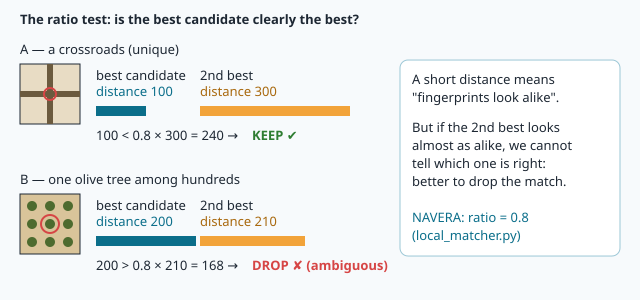
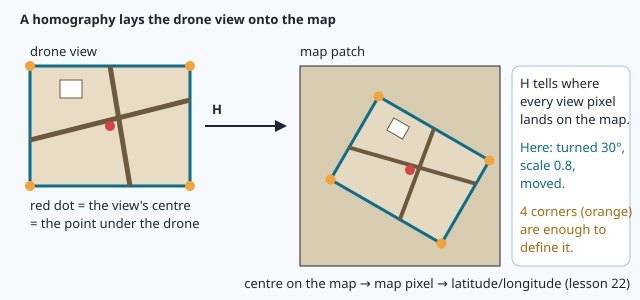

# Matching two pictures

A drone flies over Sousse. GPS has been jammed for a minute. The camera under the drone takes a
photo: rooftops, a crooked street, a white mosque courtyard. Somewhere on the satellite map stored
in NAVERA, the same rooftops exist. In lesson 20 you found **keypoints** in both pictures and gave
each one a **descriptor** — a fingerprint. Now comes the detective work: **which fingerprint in the
photo belongs to which fingerprint on the map?** And once we have pairs, **how exactly is the photo
placed on the map** — turned by how much, zoomed by how much, shifted where?

That is what this lesson is about. By the end you will lay a drone view onto the map so precisely
that its roads continue the roads of the map — and you will know how much to trust the result.

## 1. Pairing fingerprints: nearest neighbours

A SIFT descriptor is a list of 128 numbers. Two descriptors of the **same** piece of ground (the
same street corner, seen in the photo and on the map) have similar numbers; two descriptors of
different places have different numbers.

To measure "how different", we use the **distance** between the two lists — exactly Pythagoras,
but with 128 differences instead of 2:

```
distance = √( (a1 − b1)² + (a2 − b2)² + … + (a128 − b128)² )
```

A small distance means "these fingerprints look alike". For each keypoint of the photo, the
computer looks through **all** the keypoints of the map and keeps the one with the smallest
distance: its **nearest neighbour**. OpenCV does this with a **brute-force matcher**
(`cv2.BFMatcher`) — "brute force" because it simply tries every pair.

```python
matcher = cv2.BFMatcher(cv2.NORM_L2)            # L2 = the Pythagoras distance
pairs = matcher.knnMatch(desc_photo, desc_map, k=2)
```

`knnMatch(..., k=2)` gives, for each photo keypoint, its **2** nearest neighbours on the map: the
best one and the second best. Each is a `cv2.DMatch` object with three useful fields:

| Field | Meaning |
|---|---|
| `queryIdx` | the number of the keypoint in the photo (the "query") |
| `trainIdx` | the number of the keypoint on the map |
| `distance` | how different their fingerprints are (smaller = more alike) |

Why ask for the second best? Because of the next problem.

## 2. Liars among the pairs: the ratio test

The nearest neighbour is **always** found — even when the photo's keypoint is not on the map at
all (a car that has moved, a new building), the computer still finds *some* closest fingerprint.
And in an olive grove, one olive tree looks exactly like the hundred others: the nearest
neighbour is a coin toss.

David Lowe, the researcher who invented SIFT, proposed a simple rule in 2004:
**compare the best candidate with the second best.**

- If the best is **clearly** better than the second (distance 100 against 300), the match is
  probably right: there is only one place on the map that looks like this.
- If the two are **almost equal** (200 against 210), the place is **ambiguous**: we cannot know
  which one is right, so we drop the match.



In numbers: keep the match when

```
best.distance < ratio × second.distance          (ratio = 0.8 in NAVERA)
```

This is the **ratio test**. A smaller ratio (0.6) is stricter: fewer matches, but more of them
are right. A bigger ratio (0.9) keeps more matches, and more mistakes.

> [!NOTE]
> The ratio test does not look at **where** the keypoints are. It only says "this fingerprint is
> distinctive". Some matches that pass it are still wrong. We need a second filter that looks at
> the **geometry**.

## 3. Outliers: why one bad pair ruins everything

After the ratio test, say we have 250 pairs. Most of them are right — they are **inliers**. But
some are wrong — the **outliers**. A wrong pair says "this roof in the photo is that roof on the
map", 300 m away from the truth.

Why is that so bad? Because the usual way to compute "the best transformation for all the pairs"
is an average, the **least-squares** method (it makes the sum of the squared errors as small as
possible). An average is pulled by every value: one billionaire walking into a café raises the
*average* income of the customers to millions. In the same way, a few outliers far away drag the
answer away from the truth.

We need a method that **ignores** the outliers instead of averaging them. Before we do it with
pictures, let's do it with something simpler: a line.

## 4. RANSAC, first with a line

Look at the points below. 70 of them lie on a straight line (with a little noise); 30 are
scattered at random — outliers. If you ask "what is the best line through **all** the points?"
(least squares, the dashed orange line), the outliers pull it away from the true line.


**RANSAC** (*RANdom SAmple Consensus*, 1981) works like a vote:

1. Pick **2 points at random**. Two points are exactly enough to define a line.
2. Draw the line through them.
3. Count the points that are **close** to this line (closer than a **threshold**, say 3 units):
   they agree with it. They are this line's inliers.
4. Repeat many times (200 tries).
5. Keep the line with the **most inliers**. Finally, compute a least-squares line using
   **only those inliers** — now the average is fair, because the liars are gone.

Why does it work? If 70 % of the points are good, the chance that **both** random points are good
is 0.7 × 0.7 = 0.49: about every second try. A line through two good points gets ~70 votes; a line
through an outlier gets only a handful. After 200 tries, it is practically impossible to miss the
true line. Even with 50 % outliers, one try in four is good.

> [!TIP]
> RANSAC's idea fits in one sentence: **liars do not agree with each other.** The good points all
> tell the same story; the bad ones each tell a different one.

You will write this line-fitting RANSAC yourself in the lab, in about ten lines of Python.

## 5. The homography: laying one picture onto another

Back to pictures. Instead of a line ("y = slope × x + intercept"), we now look for a
**transformation**: a rule that tells, for **every** pixel of the photo, which pixel of the map it
lands on. Think of the photo printed on transparent plastic: you slide it, turn it and zoom it on
top of the printed map until all the roads line up. The transformation is the description of that
movement.

The most general version for flat pictures is called a **homography**. It is stored as a table of
3 × 3 numbers, the matrix **H**:

```
      | h00  h01  h02 |
H  =  | h10  h11  h12 |
      | h20  h21  h22 |
```

You don't need to compute with it by hand — OpenCV does — but it helps to know what the numbers
mean:

| Part of H | What it does |
|---|---|
| `h02`, `h12` (right column) | the **shift**: how far the picture slides, in map pixels |
| `h00 h01 / h10 h11` (top-left 2 × 2 block) | the **rotation** and the **scale** (and possible stretching) |
| `h20 h21` (bottom row) | the **perspective**: a picture taken at a slant. 0 for a straight-down view |



How many pairs does it take to find H? A homography has 8 free numbers, and each pair of points
gives 2 equations (one for x, one for y). So **4 pairs** are enough — the 4 corners of a sheet of
plastic pinned on the map fix it completely. That is why `cv2.findHomography` needs at least 4
matches.

And with outliers? Exactly like the line: **RANSAC**. Pick 4 random pairs, compute H, count how
many of the other pairs agree with it (a pair agrees when H carries the photo point to within a
few pixels of its map point — the threshold, 5 px in this lab). Repeat, keep the H with the most
inliers, refine it on its inliers. One line of OpenCV:

```python
H, mask = cv2.findHomography(src_points, dst_points, cv2.RANSAC, 5.0)
```

`mask` holds one value per pair: 1 for an inlier, 0 for an outlier.

### Reading rotation and scale out of H

For a straight-down photo, the top-left 2 × 2 block of H is a rotation combined with a zoom:

```
| h00  h01 |     | s·cos θ   −s·sin θ |
| h10  h11 |  =  | s·sin θ    s·cos θ |
```

Look at the first column `(h00, h10)`: it is where the photo's "one pixel to the right" arrow
ends up on the map. Its **length** is the scale `s` (Pythagoras), its **angle** is the rotation θ:

```python
rotation_deg = math.degrees(math.atan2(H[1, 0], H[0, 0]))
scale        = math.hypot(H[0, 0], H[1, 0])
```

`atan2(y, x)` is the angle of the arrow (x, y), with the right sign in every direction (a plain
`atan(y / x)` would confuse "up-right" with "down-left"). In picture coordinates the y axis points **down**, so a positive angle turns
clockwise on the screen.

### Where is the drone?

The most important point of the photo is its **centre**: for a camera looking straight down, it is
the ground right under the drone. Carry it through H and you get its pixel on the map:

```python
centre = np.float32([[[w / 2, h / 2]]])               # shape (1, 1, 2), OpenCV's habit
x, y = cv2.perspectiveTransform(centre, H)[0, 0]
```

A map pixel can be turned into latitude and longitude (lesson 7) — that is the whole of
lesson 22.

## 6. Similarity or homography?

A full homography can also stretch and slant the picture (perspective). NAVERA's camera frames are
first **straightened** to a straight-down view with the IMU attitude (lessons 16–18), and scaled
to the map's resolution with the height. After that, the only movement left between the photo and
the map is **rotation + scale + shift** — a **similarity** (4 free numbers instead of 8). So
NAVERA fits that simpler model with `cv2.estimateAffinePartial2D`, which needs only **2** pairs per
RANSAC try and cannot invent a crazy slant from a few bad matches. Fewer free numbers = fewer ways
to be fooled.

In the lab you use `cv2.findHomography` (the general tool, good to know), and you will see that on
straight-down views it finds a block that is almost exactly a rotation + scale anyway.

## 7. Inliers as confidence — and the scale check

How do we know whether a match is right? Not by "the pictures look similar": NAVERA's former
method gave similarity scores of 0.95–0.98 to right and wrong places alike. Two geometric facts
are much stronger:

1. **The number of inliers.** At the right place, dozens or hundreds of pairs agree on **one**
   transformation. At a wrong place, only a few agree by chance. Many inliers = confidence.
2. **The scale is known in advance.** From the height and the camera (lesson 17) we know how many
   map pixels one photo pixel should cover. If RANSAC finds a scale 40 % too big, the match is at a
   wrong place, however many inliers it has. **A wrong place almost never matches at the right
   scale.** The same goes for the rotation when the heading is known from the IMU.

In the lab, your `trust()` function applies the first two rules, like NAVERA.

## 🐦 How birds do it

How does a homing pigeon recognise the way home? In 2004, Dora Biro, Jessica Meade and Tim Guilford,
at the University of Oxford, put tiny GPS loggers on homing pigeons and released them again and again
from the same places. Each pigeon slowly built **its own route** home. The routes were often not the
shortest — but every bird stayed loyal to its own, flight after flight, passing over the same fields,
hedges and villages.

The best explanation is **visual pilotage**: the bird has learned what the ground along its route
looks like and, during each flight, **pairs what it sees now with what it remembers**. That is this
lesson in one sentence: pair fingerprints from the photo with fingerprints from the map, then check
that the pairs agree.

Pigeons are also good at the "picture memory" part. In laboratory experiments, pigeons have learned
to recognise **hundreds** of different photographs.

A sensible pigeon also does not trust one lonely landmark: one white house can look like another
white house. It is the **pattern** of many features, all in the right places, that says "I know where
I am". NAVERA thinks the same way: one pair of keypoints proves nothing, many pairs that agree on one
homography — the **inliers** — do.

## In NAVERA

All of this lives in [day_pkg/local_matcher.py](file:navera/day_pkg/day_pkg/local_matcher.py),
in `LocalMatcher.locate()`. Here is its heart, slightly shortened:

```python
idx, val = self._knn2(dq, dm)                     # 2 nearest map descriptors per frame descriptor
ok = val[:, 0] < self.ratio * val[:, 1]           # the ratio test (ratio = 0.8)
qi = np.nonzero(ok)[0]
src = np.float32([kq[i].pt for i in qi])          # frame points
dst = pm[idx[qi, 0]].astype(np.float32)           # map points
A, inl = cv2.estimateAffinePartial2D(src, dst, method=cv2.RANSAC, ransacReprojThreshold=self.ransac_px,
                                     maxIters=5000, confidence=0.999)
n_in = int(inl.sum())                             # the inliers
scale = math.hypot(A[0, 0], A[1, 0])              # 1.0 when the altitude prediction is right
# then, in short:
#   n_in < self.min_inliers               → refused: too few inliers
#   rotation ≠ IMU heading (± 20°)         → refused: wrong place
#   abs(scale - 1.0) > tol (± 15 %)       → refused: "fitted scale ≠ 1 expected from the altitude: wrong place"
#   otherwise                             → accepted
```

You will recognise every step: nearest neighbours (`_knn2`, which runs on the GPU when there is
one), the ratio test with 0.8, RANSAC (`ransac_px` = 6 px), the inlier count (`min_inliers` = 8 by
default), the scale check (± 15 % by default) and the heading check. The frame was already scaled
so that the expected scale is exactly 1.

How much did those geometric checks matter? `docs/VALIDATION_STATUS.md` records a benchmark measured
on the Jetson on 2026-10-01 with 33 aerial frames from another source and date than the map
(searching within 600 m of the true position):

| Variant | Accepted | Error of accepted | Wrong (> 50 m) accepted |
|---|---|---|---|
| prototype, no scale check, ≥ 12 inliers | 10/33 | median 4 m, worst 1097 m | 1 |
| + scale check (frame scale known) | 21/33 | median 4 m, worst 5 m | 0 |
| + frame pre-scaled, map features per tile, margin 300 m | 32/33 | median 4 m, worst 9 m | 0 |
| product module (`LocalMatcher`, ≥ 6 inliers, GPU matching) | 30/33 | median 4 m, worst 5 m | 0 |

Look at the first two lines: **without** the scale check, one wrong position, 1097 m off, was
accepted. **With** it, zero. That is the power of "inliers + known scale". The document is honest
about the limits: these are aerial frames, not frames from NAVERA's own camera (lens, blur, haze),
and positions are stated with a 30 m uncertainty until measured with the real camera.

> [!NOTE]
> NAVERA also has a **learned** matcher (DISK + LightGlue, `learned_matcher.py`) that finds
> keypoints and pairs them with neural networks. It still finishes with the same RANSAC fit and
> the same checks — you will meet it in lesson 22.

## Glossary

| Word | Meaning |
|---|---|
| **distance** (between descriptors) | how different two fingerprints are; Pythagoras on 128 numbers |
| **nearest neighbour** | the map keypoint whose descriptor is closest to a photo keypoint's |
| **brute-force matcher** | `cv2.BFMatcher`: compares every descriptor with every other |
| **ratio test** | keep a match only if the best candidate is clearly better than the second (Lowe) |
| **inlier / outlier** | a pair (or point) that agrees / does not agree with the fitted model |
| **least squares** | the "average" best fit; pulled away by outliers |
| **RANSAC** | fit many models on random minimal samples, keep the one most points agree with |
| **threshold** | how close a point must be to the model to count as an inlier |
| **homography** | the 3 × 3 transformation that lays one flat picture onto another |
| **similarity** | rotation + scale + shift only (what NAVERA fits on straightened frames) |
| **scale check** | refuse a match whose scale differs from the one the height predicts |

## Check what you learned

<details><summary>1. Why does the ratio test drop a match whose best distance is 200 and second best 210?</summary>
Because the two candidates look almost equally alike (200 is not smaller than 0.8 × 210 = 168). The
place is ambiguous — like one olive tree among a hundred — so we cannot tell which candidate is
right. Dropping it is safer.
</details>

<details><summary>2. In RANSAC for a line, why pick exactly 2 points per try? And for a homography?</summary>
2 points are the minimum that define a line; a homography needs 4 pairs (8 unknown numbers, 2
equations per pair). The smaller the sample, the more likely it is to contain only good points.
</details>

<details><summary>3. A match has 250 inliers but its scale is 1.45 when 1.0 was expected. Do you accept it?</summary>
No. The height tells us the scale; a scale 45 % off means the photo was matched at a wrong place
(or the height is badly wrong). NAVERA refuses it: "fitted scale ≠ 1 expected from the altitude:
wrong place".
</details>

<details><summary>4. Why does NAVERA fit a similarity (estimateAffinePartial2D) rather than a full homography?</summary>
Its frames are already straightened to a straight-down view and scaled with the height, so only
rotation + scale + shift remain. A model with fewer free numbers needs fewer pairs per try and is
harder to fool with a few wrong matches.
</details>

<details><summary>5. Over open sea, how many inliers do you expect, and what should the matcher say?</summary>
Almost none — water has no stable keypoints (lesson 20). The matcher must say "no match", not
invent a position. NAVERA then carries its last position along the measured track (lesson 23).
</details>

Now open the **🛠️ Lab** tab.
