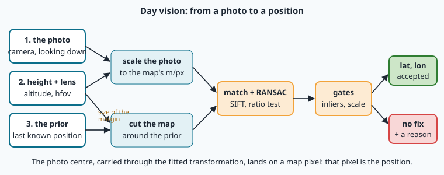
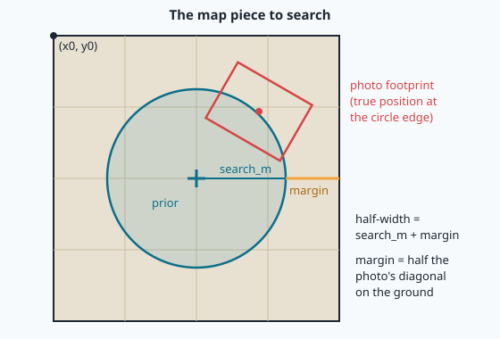

# Where is this photo? Finding the drone on the map

A delivery drone flies over Sousse at 200 m. Suddenly its GPS receiver shows nonsense: someone nearby
is jamming. The drone still has two things: a camera looking straight down, and a satellite map of
the whole region stored on its NAVERA box. The question of this lesson is the one NAVERA's **day
vision** answers several times per minute:

> "Here is a photo I just took. **Where on the map** was it taken?"

In lesson 20 you found interesting points in a picture. In lesson 21 you matched two pictures and
fitted the transformation that lays one onto the other. Now you put everything together, add the
geography of lessons 6, 7 and 17, and get what a pilot really wants: a **latitude**, a **longitude**,
and an honest answer to "how wrong could this be?".

## The whole chain at a glance



Three things go in:

1. **The photo**, from a camera pointing down. NAVERA's live camera first **straightens** a tilted
   frame into a straight-down view, using the attitude from the IMU (lesson 16).
2. **The height above the ground and the lens** (altitude and horizontal field of view, `hfov`):
   together they say how many meters one photo pixel covers (lesson 17).
3. **The prior**: where the drone *probably* is — the last good GPS fix, or the last vision fix
   carried forward. Without it NAVERA does not even try (you will see why).

Then five steps:

1. **Scale** the photo so that one of its pixels covers as much ground as one map pixel.
2. **Cut** the piece of map where the photo can be: around the prior.
3. **Match** the two pictures (SIFT + ratio test, lesson 21) and fit the transformation with **RANSAC**.
4. **Gates**: refuse the fit if it is not convincing.
5. **Convert** the photo centre into a map pixel, and that pixel into latitude and longitude.

Let's walk through them one by one.

## Step 1 — Put the photo at the map's scale

A satellite map tile at zoom 17 covers about **0.97 m per pixel** in Sousse (lesson 7:
`40 075 017 m × cos(latitude) / 2^17 / 256`). Your drone photo has its own scale, which depends on
the height and the lens. Lesson 17 gave the **footprint**, the width of ground the photo sees:

```
footprint width = 2 × altitude × tan(hfov / 2)
meters per photo pixel = footprint width / photo width in pixels
```

Example: a 640-pixel-wide photo, from 200 m, with a 75° lens:

```
footprint = 2 × 200 × tan(37.5°) = 2 × 200 × 0.767 = 307 m
m/px      = 307 / 640 = 0.48 m per pixel
```

So the photo is about twice as sharp as the map (0.48 m against 0.97 m). We shrink it by
`0.48 / 0.97 ≈ 0.49`: then a house that is 10 pixels wide on the map is also about 10 pixels wide in
the shrunk photo.

> [!NOTE]
> Why not keep the photo big? Features (lesson 20) are found at many sizes, but they match best when
> both pictures show the ground at the **same scale**. Knowing the scale in advance also gives us a
> powerful test later: after matching, the fitted scale should be **1**. If it is 0.6 or 1.8, the
> match is wrong.

**Which zoom?** NAVERA matches against **zoom 17**. Zoom 18 is twice as sharp (0.48 m/px) but four
times more pixels to search; and in our map, many zoom-19 tiles are grey squares saying "Map data not
yet available" — matching against them would be hopeless. Zoom 17 is a good balance between detail
and speed.

## Step 2 — Search around the prior, not the whole map

The Sousse map covers about 55 km × 60 km. Why not search the photo everywhere?

Because **many places look alike**. Olive groves look like other olive groves; one street of the old
town looks like the next one. The bigger the area you search, the more chances you have to find a
place that matches *by accident*. NAVERA measured this the hard way. Its first day-vision method
compared the photo with every tile of the map (with a neural network called DINOv2). On 33 labelled
aerial frames (bench measurement, recorded in `docs/VALIDATION_STATUS.md`):

| Where it searched | Median error |
|---|---|
| the whole map, no prior | **1 696 m** |
| within 600 m of the previous true position | 442 m |

So the whole-map search is **disabled by default** (`allow_global_search: false`), and day vision
reports nothing at all until it has a prior.

The prior is never perfect, so we search a **circle** around it. Its radius, `search_m`, says "the
drone is surely within this distance of the prior". The piece of map we cut must hold the whole
photo even when the drone is at the very edge of the circle, so we add a **margin**: half the photo's
diagonal on the ground.



In the lab, `search_m` is 300 m and the photo's diagonal is about 384 m, so the margin is about
192 m and the map piece is about 2 × 492 m ≈ 1 km wide: roughly 1 000 × 1 000 pixels at zoom 17.

> [!TIP]
> Remember the corner `(x0, y0)` of the map piece, in **global pixels** (lesson 7). Matching gives
> positions *inside* the piece; adding `(x0, y0)` turns them into global pixels, and global pixels
> turn into latitude and longitude.

## Step 3 — Match and fit

This is lesson 21 again:

- SIFT finds keypoints and their descriptors in the shrunk photo and in the map piece;
- for each photo keypoint, the two most similar map descriptors are found (`knnMatch`, `k=2`);
- the **ratio test** keeps a match only when the best is clearly better than the second best;
- **RANSAC** finds the transformation that agrees with the largest group of matches, the
  **inliers**, and ignores the rest, the **outliers**.

In lesson 21 you fitted a **homography**: 8 numbers, able to describe any perspective. Here the photo
has already been straightened to look straight down, so a simpler transformation is
enough: a **similarity** — a rotation, one scale and a shift (4 numbers). OpenCV calls it
`cv2.estimateAffinePartial2D`. Fewer numbers means RANSAC needs only **2** matches per guess instead of
4, and a wrong place has fewer ways to fit by luck.

The result is a 2 × 3 matrix `A`:

```
A = [ s·cos θ   −s·sin θ   tx ]
    [ s·sin θ    s·cos θ   ty ]
```

From it you read:

| What | How | What it should be |
|---|---|---|
| scale `s` | `math.hypot(A[0,0], A[1,0])` | about **1**, because we pre-scaled the photo |
| rotation `θ` | `math.degrees(math.atan2(A[1,0], A[0,0]))` | the direction the photo's top was pointing (the heading), clockwise from north |
| shift | `A[0,2], A[1,2]` | where the photo sits in the map piece |

> [!NOTE]
> Why is the rotation "clockwise"? In an image, the y axis points **down**. A positive angle in that
> world turns things clockwise on the screen — exactly like a compass heading. A photo taken with the
> drone's nose (and the photo's top) pointing 30° east of north comes out with θ ≈ 30°.

## Step 4 — Gates: when to say "I don't know"

RANSAC **always** returns its best guess, even over the sea, even when the drone is not in the map
piece at all. A position that is wrong but looks confident is the most dangerous thing a navigation
system can produce: the autopilot would fly the drone towards the wrong place, sure of itself.
So every fit must pass **gates** before it is believed:

1. **Enough inliers.** NAVERA's default minimum is **8** (`local_min_inliers`). Over the sea or a
   uniform field there are almost no keypoints, so almost no inliers.
2. **The right scale.** We know the scale from the altitude, so the fitted scale must be 1 within
   **±15 %** (`local_scale_tol`). A wrong place almost never matches at the right scale.

NAVERA learned the value of gate 2 on real data. On the 33 aerial test frames
(`docs/VALIDATION_STATUS.md`, bench, search within 600 m of the true position):

| Variant | Accepted | Worst error of the accepted | Wrong (> 50 m) accepted |
|---|---|---|---|
| prototype, no scale check, ≥ 12 inliers | 10/33 | 1 097 m | 1 |
| + scale check | 21/33 | 5 m | 0 |

One extra line of code turned "sometimes 1 km off" into "never wrong". When a gate refuses a photo,
the answer is **"no fix"** plus a reason, like `"3 inliers (min 8)"`. That is not a failure of the
code: it is the code being honest.

## Step 5 — From the photo centre to latitude and longitude

The position of the drone is the point of the ground **under the camera**: the centre of the photo
(for a camera looking straight down). Follow it through the chain:

1. Centre of the shrunk photo: `(cx, cy) = (width / 2, height / 2)`.
2. Carried by `A` into the map piece: `(u, v) = A @ [cx, cy, 1]` (matrix times vector: numpy does it).
3. Into global pixels: `(x0 + u, y0 + v)`.
4. Into latitude and longitude with the inverse tile formula of lesson 7 (`navmap.pixel_to_latlon`).

Then compare with the truth with the haversine distance of lesson 6: the **error in meters**. On a
set of photos, report the **median** error — the middle value once sorted. The median is not pulled
around by one very bad photo the way an average is, and it is what NAVERA's validation document
quotes.

> [!WARNING]
> Measure on **accepted** photos only, but always report **how many** were accepted. "Median 1 m"
> on 2 photos out of 13 is not the same result as "median 1 m" on 12 out of 13.

## In NAVERA

The real code is [local_matcher.py](file:navera/day_pkg/day_pkg/local_matcher.py), class
`LocalMatcher`, method `locate()`. Its last part is almost what you will write in the lab:

```python
idx, val = self._knn2(dq, dm)                      # 2 nearest map descriptors (GPU when there is one)
ok = val[:, 0] < self.ratio * val[:, 1]            # the ratio test, ratio = 0.8
...
A, inl = cv2.estimateAffinePartial2D(src, dst, method=cv2.RANSAC, ransacReprojThreshold=self.ransac_px,
                                     maxIters=5000, confidence=0.999)
n_in = int(inl.sum())
scale = math.hypot(A[0, 0], A[1, 0])              # 1.0 when the altitude/FOV prediction is right
px, py = A @ np.array([q.shape[1] / 2.0, q.shape[0] / 2.0, 1.0])
lat, lon = tile_px_to_latlon(float(px), float(py), self.z)
```

Two differences with the lab: NAVERA computes the features of each map **tile** once (300 per tile,
with a border borrowed from its neighbours) and keeps them in a cache, so a new photo only needs its
own features; and its map points are already in global pixels, so there is no `(x0, y0)` to add.

Around `locate()`, the day node
[day_subscriber.py](file:navera/day_pkg/day_pkg/nodes/day_subscriber.py) and
[vision_nav.py](file:navera/day_pkg/day_pkg/vision_nav.py) add what a real flight needs:

- **Where to search** (`_spatial_window()`). The prior is the last position carried forward along the
  measured velocity. Its uncertainty grows with time, and the search circle follows it: radius = 3 × that uncertainty
  (`search_k_sigma`), never less than 80 m (`local_min_radius_m`) and never more than 1 500 m. A drone
  that has been lost for a while is searched for in a wider circle.
- **More gates.** Besides 8 inliers and scale ±15 %: the fitted rotation must agree with the heading
  measured by the IMU within ±20° (`local_heading_tol_deg`); a fix far from the predicted position
  (more than 3 σ) is refused unless it has at least 100 inliers (`strong_inliers`); a fix whose
  inliers all sit in one strip of the frame (a road, a shoreline) is refused when it has fewer than
  50; and a fix farther from the last one than the vehicle could have flown (`max_speed_mps` × the
  time since + 250 m) is refused (the **motion gate**).
- **A stated accuracy.** `fix_sigma_m()` turns the inlier count into an uncertainty: 100 inliers or
  more → 4 map pixels (about 4 m), 50–99 → 8, 20–49 → 15, fewer → 25 pixels. (Day vision positions are
  still published with a cautious 30 m until they are measured with NAVERA's own camera.)
- **When the height is wrong**, every match fails on the scale gate; after 3 failures in a row the
  node also tries the photo 20 % lower and 25 % higher.

**How good is it?** From `docs/VALIDATION_STATUS.md`, measured on the bench with 33 aerial frames from
**another source and date** than the map (not frames from NAVERA's own camera): **32 of 33 within
9 m, median 4 m**, no wrong position accepted, 0.42 s per frame on the Jetson's CPU. In the
simulator, over the desert, the error was about 1 m — but the simulated camera cuts its pictures
from the map's own imagery, so that number is optimistic. You will meet exactly this effect in the
lab.

**Learned features.** Since then NAVERA also has
[learned_matcher.py](file:navera/day_pkg/day_pkg/learned_matcher.py): instead of SIFT it uses
**DISK** keypoints and the **LightGlue** matcher, two neural networks running on the Jetson's GPU.
They were trained on many real photo pairs, so they cope better when the photo and the map differ in
colour, shadows and date. On the bench described in that file (33 real aerial frames, 600 m search)
they located **30/33** frames against **22/33** for SIFT, both with 0 wrong, in 333 ms instead of
720 ms. They are not rotation-invariant, so the frame is first turned north-up with the heading; and
when they fail, SIFT is tried as a fallback. The day node uses them when the GPU models load
(`matcher: auto`), SIFT otherwise.

## Words to remember

| Word | Meaning |
|---|---|
| **prior** | where the vehicle probably is before looking: last GPS fix or last vision fix carried forward |
| **search radius** | how far from the prior the true position may be; the map is searched only there |
| **margin** | extra map around the search circle so the whole photo fits even at the edge |
| **footprint** | the piece of ground one photo covers (lesson 17) |
| **similarity** | rotation + one scale + shift (4 numbers); a simpler cousin of the homography |
| **inlier / outlier** | a match that agrees / disagrees with the fitted transformation |
| **gate** | a test a result must pass to be believed (inliers, scale, heading, motion) |
| **no fix** | the honest answer when the gates refuse: no position, plus a reason |
| **median error** | the middle error once all errors are sorted; not pulled by one bad case |

## Check what you learned

<details><summary>1. A photo is 1 000 px wide, taken from 100 m with a 90° lens. How many meters per pixel?</summary>
Footprint = 2 × 100 × tan(45°) = 200 m. 200 m / 1 000 px = <b>0.2 m per pixel</b>.
</details>

<details><summary>2. Why does NAVERA not search the photo on the whole map?</summary>
Because many places look alike: the bigger the search area, the more likely a wrong place matches
by accident. Measured: 1 696 m median error for the whole map, so whole-map search is disabled and
day vision waits for a prior.
</details>

<details><summary>3. RANSAC found 6 inliers and a scale of 1.7. What should the code answer?</summary>
"No fix": 6 inliers is under the minimum of 8, and a scale of 1.7 is far from the 1 the altitude
predicts. Both gates say it is a wrong place.
</details>

<details><summary>4. The match is right. Which point of the photo gives the drone's position, and how does it become a latitude?</summary>
The photo centre (straight under a downward camera). Carried by the matrix A it lands in the map
piece; adding the piece's corner (x0, y0) gives a global pixel, and the inverse tile formula of
lesson 7 gives latitude and longitude.
</details>

<details><summary>5. Your test photos are cut from the map itself and you measure 0.3 m median. Is day vision that accurate?</summary>
No. The photo and the map are the same picture, so matching is far too easy. Real photos differ in
date, light, shadows, season and lens; NAVERA's bench result on real aerial frames is a median of
4 m, and some frames are not located at all.
</details>

Now open the **🛠️ Lab** tab.
